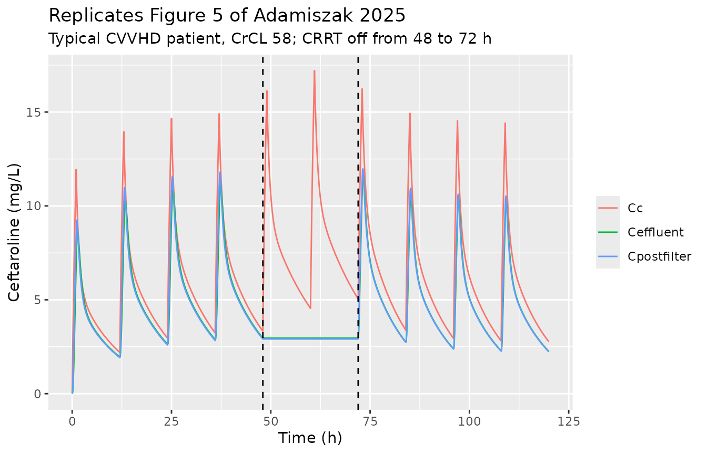

# Ceftaroline in critically ill adults with and without CRRT (Adamiszak 2025)

## Model and source

- Citation: Adamiszak A, Pietrzkiewicz K, Bartkowska-Sniatkowska A,
  Smuszkiewicz P, Kusza K, Grzeskowiak E, Bienert A (2025). Do
  Critically Ill Patients Undergoing Continuous Renal Replacement
  Therapy Require Ceftaroline Dosage Adjustments? Ceftaroline PopPK
  Model and Dosage Simulations with the Probability of Target Attainment
  Analysis Based on Retrospective Data. Antibiotics 14(4):347.
  <doi:10.3390/antibiotics14040347>.
- Description: Five-compartment population PK model for ceftaroline in
  critically ill adults with and without continuous renal replacement
  therapy (CRRT): a two-compartment patient model (first-order
  elimination from the central, pre-filter compartment) joined to three
  CRRT-machine compartments (filter, post-filter return limb and
  effluent) whose transfer rate constants are circuit flow divided by
  compartment volume, all gated on by a time-varying CRRT-running
  indicator. Creatinine clearance (power model centred at 159
  mL/min/1.73 m^2) on clearance; CRRT modality (CVVHD, CVVHDF) on the
  central volume; any CRRT on the peripheral volume and
  intercompartmental clearance. Between-occasion variability on
  clearance, between-subject variability on the central and peripheral
  volumes and intercompartmental clearance, and proportional residual
  error for each of the three sampled matrices (systemic pre-filter
  plasma, post-filter plasma, effluent).
- Article: <https://doi.org/10.3390/antibiotics14040347>
- Supplement (final-model mlxtran syntax, Table S1):
  <https://www.mdpi.com/article/10.3390/antibiotics14040347/s1>
- Authors’ Simulx 2024R1 project and PTA workbooks:
  <https://github.com/arkadiusz-adamiszak/Ceftaroline_ICU_Retrospective>

``` r

mod <- readModelDb("Adamiszak_2025_ceftaroline")
ui <- rxode2::rxode(mod)
#> ℹ parameter labels from comments will be replaced by 'label()'
#> Warning: some etas defaulted to non-mu referenced, possible parsing error: etaiov_cl_1, etaiov_cl_2
#> as a work-around try putting the mu-referenced expression on a simple line
mod_typ <- rxode2::zeroRe(ui)
#> Warning: some etas defaulted to non-mu referenced, possible parsing error: etaiov_cl_1, etaiov_cl_2
#> as a work-around try putting the mu-referenced expression on a simple line
th <- ui$theta
```

The model joins a two-compartment patient model to three compartments
that stand for the CRRT machine, following the cefepime structure of
Al-Shaer et al. that the paper cites (Figure 1). Blood leaves the
patient’s central (pre-filter) compartment at the blood flow rate `Qb`
into the filter (`circuit_plasma`, volume `VCRRT`). From the filter,
drug passes at `Qb` into the post-filter return limb
(`circuit_postfilter`), which returns it to the patient at `Qb`, and at
the effluent flow rate `Qeff` into the effluent compartment
(`circuit_dialysate`), which washes out at `Qeff`. Every transfer rate
constant is flow / volume (Methods 4.2). All circuit terms are
multiplied by the time-varying indicator `RRT_CRRT_ACTIVE` (the mlxtran
regressor `IS_CRRT`), so a patient whose CRRT is stopped reverts to the
two-compartment model.

The paper’s Figure 1 calls the last compartment “Effluent”. It is
carried here as `circuit_dialysate`, not `circuit_effluent`, because
drug flows through it and out at `Qeff`; `circuit_effluent` is the
accumulating waste bag, from which nothing leaves. Its concentration is
the effluent assay (`Ceffluent`).

## Population

Adamiszak 2025 pooled concentrations from four published studies of
critically ill adults receiving 400-600 mg of ceftaroline fosamil every
8-12 h as a 1 h infusion (Alarcia-Lacalle 2021, Chauzy 2019, Chauzy
2022, Kalaria 2021). The concentrations were digitised from those
papers’ figures with WebPlotDigitizer 4.7: 296 plasma concentrations
from 29 patients not on CRRT, and 24 pre-filter (systemic), 23
post-filter and 23 effluent concentrations from 4 patients on CRRT.
Table 1 gives the 33 patients as 36% female, median age 51 years (range
21-77), median weight 75.5 kg (49-111.8) and median MDRD creatinine
clearance 159 mL/min/1.73 m^2 (42-309). Of the four CRRT patients two
were on CVVHD and two on CVVHDF, with blood flow 250 \[250-300\] mL/min
and effluent flow 3200 \[2700-3660\] mL/h.

The same information is available programmatically via
`readModelDb("Adamiszak_2025_ceftaroline")()$population`.

## Source trace

Every `ini()` value carries an in-file comment naming its source. Table
2 of the article is mis-rendered in the HTML version; the values below
were read from the PDF layout.

| Equation / parameter | Value | Source location |
|----|----|----|
| ODE system, outputs, dosing into `Acent` | – | Supplement, “Monolix model syntax”; identical to `ModelFile/Syntax_v2_SameClbody+IS_CRRT+Q.txt` in the authors’ Simulx project |
| Transfer rate constant `k = flow / V` | – | Methods 4.2 equation |
| Continuous covariate `(COV / median COV)^theta` | – | Methods 4.2 equation; median 159 from Table 1 (Simulx `logtClCr_Pros = log(ClCr_Pros/159)`) |
| Categorical covariate `exp(theta)` | – | Methods 4.2 equation |
| Modality on VCentral, any-CRRT on VPeripheral and Q, no-CRRT reference | – | Results 2.2; Simulx covariate definitions `tCRRT_NaRef_CVVHD_CVVHDF`, `tCRRT_NaRef_CRRT` |
| `lcl` (Cl) | 11.23 L/h | Table 2, Final Model |
| `e_crcl_cl` | 0.68 | Table 2 |
| `lvc` (VCentral) | 20.04 L | Table 2 |
| `e_cvvhd_vc`, `e_cvvhdf_vc` | 0.47, -0.42 | Table 2 |
| `lq` (Q), `e_crrt_q` | 8.80 L/h, 0.99 | Table 2 |
| `lvp` (VPeripheral), `e_crrt_vp` | 16.85 L, 0.99 | Table 2 |
| `lvfilter` (VCRRT) | 2.69 L | Table 2 |
| `lvpostfilter` (VPost-filter) | 1.15 L | Table 2 |
| `lvdialysate` (VEffluent) | 0.60 L | Table 2 |
| `etaiov_cl_1`, `etaiov_cl_2` | IOV 34.96% CV | Table 2 |
| `etalvc`, `etalq`, `etalvp` | IIV 3.70, 16.40, 38.60% CV | Table 2 |
| `propSd`, `propSd_Cpostfilter`, `propSd_Ceffluent` | 0.29, 0.16, 0.13 | Table 2 (bPre, bPost, bEff) |
| Free fraction 0.8 for PTA | – | Methods 4.3 (~20% protein binding); Simulx `FreeCcent = 0.8*Ccent` |

## Simulation helpers

Dose rows go into the `central` state; observation rows carry `dvid = 1`
and no compartment, so all three outputs (`Cc`, `Cpostfilter`,
`Ceffluent`) are returned at every observation time. The CRRT flows are
supplied in the units the covariate register uses, blood flow in mL/min
and effluent flow in mL/h.

``` r

# One subject's dosing + observation records. crrt is one of "none", "CVVHD",
# "CVVHDF"; qeff_lh is the effluent flow in L/h, converted to mL/h on the
# record.
make_events <- function(dose, tau, tinf, ndose, obs_times, crcl, crrt = "none",
                        qeff_lh = 0, bfr = 250) {
  doses <- data.frame(
    time = (seq_len(ndose) - 1) * tau, amt = dose, rate = dose / tinf,
    evid = 1L, cmt = "central", dvid = NA_integer_
  )
  obs <- data.frame(
    time = obs_times, amt = NA_real_, rate = NA_real_,
    evid = 0L, cmt = NA_character_, dvid = 1L
  )
  ev <- rbind(doses, obs)
  ev <- ev[order(ev$time, -ev$evid), ]
  on <- as.numeric(crrt != "none")
  ev$CRCL <- crcl
  ev$RRT_CVVHD_STATUS <- as.numeric(crrt == "CVVHD")
  ev$RRT_CVVHDF_STATUS <- as.numeric(crrt == "CVVHDF")
  ev$RRT_CRRT_ACTIVE <- on
  ev$BFR <- bfr * on
  ev$RRT_CRRT_EFFLUENT_FLOW <- qeff_lh * 1000 * on
  ev$OCC <- 1L
  ev
}

replicate_ids <- function(ev, n) {
  out <- ev[rep(seq_len(nrow(ev)), times = n), ]
  out$id <- rep(seq_len(n), each = nrow(ev))
  out
}

# The authors' Simulx target-attainment rule, reproduced exactly below: the
# free concentration is sampled hourly from 0 to 120 h, and the target counts
# as attained when at least 100 of the 120 one-hour intervals have BOTH
# endpoints at or above the MIC.
attained <- function(conc, mic) {
  above <- conc >= mic
  sum(above[-1] & above[-length(above)]) >= 100
}

pta_by_mic <- function(sim, mics) {
  free <- split(0.8 * sim$Cc, sim$id)
  vapply(mics, function(m) mean(vapply(free, attained, logical(1), mic = m)), numeric(1))
}
```

## Typical-value checks against the paper’s own numbers

The Results and Discussion quote several derived quantities. Each is
recomputed from the packaged parameters.

``` r

cl_at <- function(crcl) exp(th[["lcl"]]) * (crcl / 159)^th[["e_crcl_cl"]]
anchors <- tibble::tribble(
  ~quantity, ~paper, ~model,
  "Cl, non-CRRT median patient (L/h), Discussion", 11.2, cl_at(159),
  "Cl, CRRT simulation patient CrCL 58 (L/h), Discussion", 5.66, cl_at(58),
  "Cl at CrCL 309 vs 159 (ratio), Results: +57%", 1.57, cl_at(309) / cl_at(159),
  "VCentral on CVVHD vs no CRRT (ratio), Results: +60%", 1.60, exp(th[["e_cvvhd_vc"]]),
  "VPeripheral and Q on CRRT vs no CRRT (ratio)", 2.69, exp(th[["e_crrt_vp"]])
)
anchors |>
  mutate(model = signif(model, 4), pct_diff = round(100 * (model / paper - 1), 2)) |>
  knitr::kable()
```

| quantity                                              | paper |  model | pct_diff |
|:------------------------------------------------------|------:|-------:|---------:|
| Cl, non-CRRT median patient (L/h), Discussion         | 11.20 | 11.230 |     0.27 |
| Cl, CRRT simulation patient CrCL 58 (L/h), Discussion |  5.66 |  5.657 |    -0.05 |
| Cl at CrCL 309 vs 159 (ratio), Results: +57%          |  1.57 |  1.571 |     0.06 |
| VCentral on CVVHD vs no CRRT (ratio), Results: +60%   |  1.60 |  1.600 |     0.00 |
| VPeripheral and Q on CRRT vs no CRRT (ratio)          |  2.69 |  2.691 |     0.04 |

``` r

stopifnot(all(abs(anchors$model / anchors$paper - 1) < 0.005))
```

All five agree to the precision printed. The decisive one is the CRRT
patient’s 5.66 L/h: it fixes the clearance, the exponent and the
centring value 159 simultaneously, and the centring value is never
stated in the text.

## Circuit clearance at steady state

Because every circuit transfer is linear, at steady state the filter
concentration is `Qb / (Qb + Qeff)` times the systemic concentration and
the effluent removes drug at `Qeff` times that. The total clearance seen
by the systemic compartment is therefore `Cl + Qb * Qeff / (Qb + Qeff)`,
which must equal dose / AUC over a dosing interval. The solve below
checks that identity for a typical patient off CRRT and on each
modality.

``` r

qb_lh <- 250 * 60 / 1000
ss_cases <- tibble::tribble(
  ~case, ~crcl, ~crrt, ~qeff,
  "No CRRT, CrCL 159", 159, "none", 0,
  "CVVHD, CrCL 58, Qeff 2.5 L/h", 58, "CVVHD", 2.5,
  "CVVHDF, CrCL 58, Qeff 4.0 L/h", 58, "CVVHDF", 4.0
)
ss_rows <- lapply(seq_len(nrow(ss_cases)), function(i) {
  ev <- make_events(600, 12, 1, 20, seq(216, 228, by = 0.02),
    crcl = ss_cases$crcl[i], crrt = ss_cases$crrt[i], qeff_lh = ss_cases$qeff[i]
  )
  s <- as.data.frame(rxode2::rxSolve(mod_typ, ev, returnType = "data.frame"))
  auc <- sum(diff(s$time) * (head(s$Cc, -1) + tail(s$Cc, -1)) / 2)
  expected <- cl_at(ss_cases$crcl[i]) +
    if (ss_cases$qeff[i] > 0) qb_lh * ss_cases$qeff[i] / (qb_lh + ss_cases$qeff[i]) else 0
  data.frame(case = ss_cases$case[i], dose_over_auc = 600 / auc, expected = expected)
})
#> ℹ omega/sigma items treated as zero: 'etaiov_cl_1', 'etaiov_cl_2', 'etalvc', 'etalq', 'etalvp'
#> ℹ omega/sigma items treated as zero: 'etaiov_cl_1', 'etaiov_cl_2', 'etalvc', 'etalq', 'etalvp'
#> ℹ omega/sigma items treated as zero: 'etaiov_cl_1', 'etaiov_cl_2', 'etalvc', 'etalq', 'etalvp'
ss_tab <- bind_rows(ss_rows) |> mutate(pct_diff = 100 * (dose_over_auc / expected - 1))
ss_tab |> mutate(across(where(is.numeric), \(x) signif(x, 4))) |> knitr::kable()
```

| case                          | dose_over_auc | expected |  pct_diff |
|:------------------------------|--------------:|---------:|----------:|
| No CRRT, CrCL 159             |        11.230 |   11.230 | -1.23e-05 |
| CVVHD, CrCL 58, Qeff 2.5 L/h  |         7.800 |    7.800 | -1.10e-06 |
| CVVHDF, CrCL 58, Qeff 4.0 L/h |         8.815 |    8.815 | -4.30e-06 |

``` r

stopifnot(all(abs(ss_tab$pct_diff) < 0.5))
```

The Discussion describes total clearance on CRRT as “5.66 L/h + assumed
`Qeff`”. The model’s actual circuit clearance is slightly smaller than
`Qeff` (2.14 rather than 2.5 L/h at `Qeff` 2.5 L/h), because only the
fraction `Qb / (Qb + Qeff)` of the drug entering the filter reaches the
effluent side.

## Interrupting CRRT (Figure 5)

Figure 5 simulates 600 mg every 12 h as a 1 h infusion in a CVVHD
patient whose effluent flow is 2.5 L/h, with CRRT stopped for 24 h at 48
h and restarted at 4.0 L/h (the Simulx regressor schedule `Real_Time`:
times 0, 48 and 72 h). The covariates change on a dense grid so the
solver cannot step over the switch.

``` r

grid5 <- seq(0, 120, by = 0.1)
ev5 <- make_events(600, 12, 1, 10, grid5, crcl = 58, crrt = "CVVHD", qeff_lh = 2.5)
off <- ev5$time >= 48 & ev5$time < 72
ev5$RRT_CRRT_ACTIVE[off] <- 0
ev5$BFR[off] <- 0
ev5$RRT_CRRT_EFFLUENT_FLOW[off] <- 0
ev5$RRT_CRRT_EFFLUENT_FLOW[ev5$time >= 72] <- 4000
sim5 <- as.data.frame(rxode2::rxSolve(mod_typ, ev5, returnType = "data.frame"))
#> ℹ omega/sigma items treated as zero: 'etaiov_cl_1', 'etaiov_cl_2', 'etalvc', 'etalq', 'etalvp'

sim5 |>
  select(time, Cc, Cpostfilter, Ceffluent) |>
  pivot_longer(-time, names_to = "output", values_to = "conc") |>
  ggplot(aes(time, conc, colour = output)) +
  geom_line() +
  geom_vline(xintercept = c(48, 72), linetype = "dashed") +
  labs(
    x = "Time (h)", y = "Ceftaroline (mg/L)", colour = NULL,
    title = "Replicates Figure 5 of Adamiszak 2025",
    subtitle = "Typical CVVHD patient, CrCL 58; CRRT off from 48 to 72 h"
  )
```



While the circuit is stopped its compartments are frozen: no flow enters
or leaves them, so the effluent concentration holds at its 48 h value.
The systemic trough rises because the circuit clearance is gone.

``` r

frozen <- sim5$Ceffluent[sim5$time > 48.05 & sim5$time < 71.95]
trough <- function(t) sim5$Cc[which.min(abs(sim5$time - t))]
stopifnot(
  diff(range(frozen)) < 1e-6 * max(frozen),
  trough(72) > trough(48)
)
c(trough_48h = trough(48), trough_72h = trough(72), effluent_frozen = frozen[1])
#>      trough_48h      trough_72h effluent_frozen 
#>        3.330282        5.045000        2.955091
```

## Virtual cohort and NCA

The paper reports no NCA. The cohort below gives the steady-state
exposure the model implies for 600 mg every 12 h (1 h infusion) in four
groups of 200: off CRRT at CrCL 80 and at the median 159 mL/min/1.73
m^2, and on CVVHD or CVVHDF at CrCL 58 with `Qeff` 3.0 L/h. NCA uses the
tenth dosing interval (108-120 h).

``` r

n_arm <- 200
arms <- tibble::tribble(
  ~treatment, ~crcl, ~crrt, ~qeff,
  "No CRRT, CrCL 80", 80, "none", 0,
  "No CRRT, CrCL 159", 159, "none", 0,
  "CVVHD, Qeff 3.0", 58, "CVVHD", 3.0,
  "CVVHDF, Qeff 3.0", 58, "CVVHDF", 3.0
)
obs_nca <- sort(unique(c(0, seq(108, 120, by = 0.25))))
rxode2::rxSetSeed(20250327)
cohort <- bind_rows(lapply(seq_len(nrow(arms)), function(i) {
  ev <- replicate_ids(make_events(600, 12, 1, 11, obs_nca,
    crcl = arms$crcl[i], crrt = arms$crrt[i], qeff_lh = arms$qeff[i]
  ), n_arm)
  s <- as.data.frame(rxode2::rxSolve(mod, ev, returnType = "data.frame"))
  s$treatment <- arms$treatment[i]
  s
}))
#> ℹ parameter labels from comments will be replaced by 'label()'
#> Warning: some etas defaulted to non-mu referenced, possible parsing error: etaiov_cl_1, etaiov_cl_2
#> as a work-around try putting the mu-referenced expression on a simple line

conc <- cohort |>
  filter(!is.na(Cc)) |>
  select(id, time, Cc, treatment)
dose <- bind_rows(lapply(arms$treatment, function(tr) {
  data.frame(id = rep(seq_len(n_arm), each = 11), time = rep((0:10) * 12, n_arm), amt = 600, treatment = tr)
}))
conc_obj <- PKNCA::PKNCAconc(conc, Cc ~ time | treatment + id, concu = "mg/L", timeu = "h")
dose_obj <- PKNCA::PKNCAdose(dose, amt ~ time | treatment + id, doseu = "mg")
intervals <- data.frame(start = 120 - 12, end = 120, cmax = TRUE, cmin = TRUE, auclast = TRUE)
nca <- PKNCA::pk.nca(PKNCA::PKNCAdata(conc_obj, dose_obj, intervals = intervals))
nca_tab <- as.data.frame(nca$result) |>
  filter(PPTESTCD %in% c("cmax", "cmin", "auclast")) |>
  group_by(treatment, PPTESTCD) |>
  summarise(median = median(PPORRES), p05 = quantile(PPORRES, 0.05), p95 = quantile(PPORRES, 0.95), .groups = "drop")
nca_tab |>
  mutate(across(where(is.numeric), \(x) signif(x, 3))) |>
  rename("NCA parameter" = PPTESTCD) |>
  knitr::kable()
```

| treatment         | NCA parameter | median |    p05 |    p95 |
|:------------------|:--------------|-------:|-------:|-------:|
| CVVHD, Qeff 3.0   | auclast       | 75.500 | 46.500 | 106.00 |
| CVVHD, Qeff 3.0   | cmax          | 15.000 | 12.300 |  17.70 |
| CVVHD, Qeff 3.0   | cmin          |  3.200 |  1.320 |   5.41 |
| CVVHDF, Qeff 3.0  | auclast       | 72.900 | 48.700 | 102.00 |
| CVVHDF, Qeff 3.0  | cmax          | 20.400 | 17.000 |  23.40 |
| CVVHDF, Qeff 3.0  | cmin          |  2.420 |  1.040 |   4.51 |
| No CRRT, CrCL 159 | auclast       | 55.500 | 34.300 |  98.30 |
| No CRRT, CrCL 159 | cmax          | 20.200 | 17.300 |  24.60 |
| No CRRT, CrCL 159 | cmin          |  0.809 |  0.140 |   2.80 |
| No CRRT, CrCL 80  | auclast       | 86.000 | 47.200 | 144.00 |
| No CRRT, CrCL 80  | cmax          | 23.200 | 19.400 |  27.80 |
| No CRRT, CrCL 80  | cmin          |  2.220 |  0.437 |   5.58 |

AUC over a steady-state interval depends only on the total clearance, so
its median must sit at `dose / (typical Cl + circuit clearance)`;
between-subject spread in the volumes and Q does not move it.

``` r

auc_check <- nca_tab |>
  filter(PPTESTCD == "auclast") |>
  left_join(arms, by = "treatment") |>
  mutate(
    cl_total = cl_at(crcl) + ifelse(qeff > 0, qb_lh * qeff / (qb_lh + qeff), 0),
    expected = 600 / cl_total,
    pct_diff = 100 * (median / expected - 1)
  )
auc_check |> select(treatment, median, expected, pct_diff) |>
  mutate(across(where(is.numeric), \(x) signif(x, 3))) |> knitr::kable()
```

| treatment         | median | expected | pct_diff |
|:------------------|-------:|---------:|---------:|
| CVVHD, Qeff 3.0   |   75.5 |     73.6 |    2.650 |
| CVVHDF, Qeff 3.0  |   72.9 |     73.6 |   -0.861 |
| No CRRT, CrCL 159 |   55.5 |     53.4 |    3.810 |
| No CRRT, CrCL 80  |   86.0 |     85.2 |    0.871 |

``` r

stopifnot(all(abs(auc_check$pct_diff) < 10))
```

## Probability of target attainment

The authors’ Simulx project and PTA workbooks are deposited with the
paper. They were run with a parameter set that differs from the
published Table 2 (see Assumptions and deviations), so this section
first reproduces the deposit with the deposit’s own parameters, which
tests the model’s structure and the authors’ target-attainment rule, and
then shows what Table 2 implies.

### Reproducing the deposited simulation, subject by subject

The Simulx project stores the individual parameters of every simulated
patient and whether each attained 100% fT\>MIC. The 50 patients of the
first replicate (no CRRT, CrCL 80, the same patients in all ten
regimens) are embedded below, together with their outcomes at five MICs;
each is re-solved with the packaged ODE system with covariate effects
neutralised so the individual values enter unchanged.

``` r

# Simulx project, Simulation/individualParameters.txt, rep 1, group
# 200mg_12h_1h (identical in every group); Vcrrt, Vpost and Veff are constant.
deposit_indiv <- data.frame(
  cl = c(6.4961794, 4.662855, 7.4240015, 3.8788189, 5.8942644, 10.817915, 6.0281723, 8.1881701, 5.1236503, 15.195177, 7.2456477, 7.7380762, 7.6639258, 10.172442, 5.6749265, 9.1180561, 10.52485, 8.2013931, 3.9015253, 9.6435158, 7.2002555, 7.1088918, 5.3512294, 9.6353486, 4.8387506, 9.020375, 8.6931984, 3.6304658, 8.4863661, 10.103719, 6.1315362, 4.5984642, 6.2725378, 4.0911669, 13.006448, 4.584552, 5.6993418, 8.2255944, 7.0115528, 5.66695, 6.6143811, 6.3230041, 7.3387383, 9.0297494, 6.8274751, 4.9305876, 4.1924907, 5.1088857, 6.3929459, 10.486686),
  vc = c(17.517099, 20.06928, 17.789941, 20.309148, 18.878148, 21.110847, 17.994143, 19.656911, 20.671644, 17.616616, 18.785646, 19.910304, 20.659127, 21.565209, 19.130513, 18.797654, 18.720116, 21.568991, 20.477434, 22.674459, 21.126418, 19.722911, 17.888304, 18.360435, 21.753535, 20.530853, 19.235181, 19.488572, 18.414684, 18.21322, 20.120523, 23.422876, 19.133384, 21.155923, 21.70151, 18.118647, 22.279828, 20.199647, 21.138882, 19.903336, 21.066787, 17.910571, 20.013432, 17.637206, 18.607206, 21.274346, 21.232958, 18.724435, 19.75982, 16.609326),
  vp = c(14.751305, 10.292979, 15.786613, 16.315114, 5.0930563, 18.797139, 16.018509, 10.879837, 19.357267, 28.453531, 22.82975, 18.805903, 17.786848, 14.1145, 12.084895, 12.536435, 30.952588, 23.848388, 11.200077, 16.047077, 17.591019, 12.02733, 13.113841, 13.019271, 13.255965, 9.491153, 13.473767, 13.538015, 27.630161, 15.606442, 12.884037, 10.826067, 23.497408, 14.983165, 12.206697, 10.708366, 6.9206913, 18.738555, 23.161132, 10.105402, 12.401239, 15.867724, 15.763941, 24.226245, 19.134211, 12.782613, 14.821284, 14.939544, 18.159728, 20.881435),
  q = c(9.0095658, 7.9024139, 10.00919, 7.6878717, 8.2277892, 8.4397031, 8.4550573, 5.97621, 7.2880863, 8.3484842, 8.9671843, 8.1078035, 6.4960869, 9.1665907, 7.9767893, 9.6640974, 9.1255323, 7.8129333, 7.3058127, 7.5533867, 7.3251212, 6.5917457, 7.6686488, 8.1377737, 7.7371678, 9.2769543, 8.4900937, 6.9668873, 9.2664163, 8.4193413, 8.2911208, 7.589762, 7.0086952, 9.9544229, 7.6250764, 7.5695791, 9.0787738, 9.1749376, 7.7809058, 9.2931385, 8.197149, 7.8385202, 8.1678028, 9.0625337, 7.348901, 6.9044172, 7.8726294, 7.9717164, 9.3437781, 8.4869314)
)
deposit_outcome <- tibble::tribble(
  ~regimen, ~mic, ~attained,
  "200mg_12h_1h", 0.25, "11111011101110111111111010111011110111111111111110",
  "300mg_12h_1h", 0.25, "11111111101111111111111111111111110111111111111111",
  "400mg_12h_1h", 0.25, "11111111111111111111111111111111110111111111111111",
  "600mg_12h_1h", 0.25, "11111111111111111111111111111111111111111111111111",
  "800mg_12h_1h", 0.25, "11111111111111111111111111111111111111111111111111",
  "200mg_8h_2h", 0.25, "11111111111111111111111111111111111111111111111111",
  "300mg_8h_2h", 0.25, "11111111111111111111111111111111111111111111111111",
  "400mg_8h_2h", 0.25, "11111111111111111111111111111111111111111111111111",
  "600mg_8h_2h", 0.25, "11111111111111111111111111111111111111111111111111",
  "800mg_8h_2h", 0.25, "11111111111111111111111111111111111111111111111111",
  "200mg_12h_1h", 0.5, "11011010101000100010101010010011110110111100111110",
  "300mg_12h_1h", 0.5, "11111010101110100110111010011011110111111111111110",
  "400mg_12h_1h", 0.5, "11111011101110111111111010111011110111111111111110",
  "600mg_12h_1h", 0.5, "11111111101111111111111111111111110111111111111111",
  "800mg_12h_1h", 0.5, "11111111111111111111111111111111110111111111111111",
  "200mg_8h_2h", 0.5, "11111111101111111111111111111111110111111111111111",
  "300mg_8h_2h", 0.5, "11111111111111111111111111111111111111111111111111",
  "400mg_8h_2h", 0.5, "11111111111111111111111111111111111111111111111111",
  "600mg_8h_2h", 0.5, "11111111111111111111111111111111111111111111111111",
  "800mg_8h_2h", 0.5, "11111111111111111111111111111111111111111111111111",
  "200mg_12h_1h", 1, "01010000100000000010000010010001010100000000011000",
  "300mg_12h_1h", 1, "01010010100000100010001010010001110110010000011110",
  "400mg_12h_1h", 1, "11011010101000100010101010010011110110111100111110",
  "600mg_12h_1h", 1, "11111010101110100110111010011011110111111111111110",
  "800mg_12h_1h", 1, "11111011101110111111111010111011110111111111111110",
  "200mg_8h_2h", 1, "11111010101110100110111010011011110111111110111110",
  "300mg_8h_2h", 1, "11111011101111111111111011111011110111111111111110",
  "400mg_8h_2h", 1, "11111111101111111111111111111111110111111111111111",
  "600mg_8h_2h", 1, "11111111111111111111111111111111111111111111111111",
  "800mg_8h_2h", 1, "11111111111111111111111111111111111111111111111111",
  "200mg_12h_1h", 2, "00000000000000000000000000000000000000000000000000",
  "300mg_12h_1h", 2, "00010000000000000010000000010000010000000000001000",
  "400mg_12h_1h", 2, "01010000100000000010000010010001010100000000011000",
  "600mg_12h_1h", 2, "01010010100000100010001010010001110110010000011110",
  "800mg_12h_1h", 2, "11011010101000100010101010010011110110111100111110",
  "200mg_8h_2h", 2, "01010000100000000010000010010001010100000000011100",
  "300mg_8h_2h", 2, "11011010100000100010001010010011110110111100111110",
  "400mg_8h_2h", 2, "11111010101110100110111010011011110111111110111110",
  "600mg_8h_2h", 2, "11111011101111111111111011111011110111111111111110",
  "800mg_8h_2h", 2, "11111111101111111111111111111111110111111111111111",
  "200mg_12h_1h", 4, "00000000000000000000000000000000000000000000000000",
  "300mg_12h_1h", 4, "00000000000000000000000000000000000000000000000000",
  "400mg_12h_1h", 4, "00000000000000000000000000000000000000000000000000",
  "600mg_12h_1h", 4, "00010000000000000010000000010000010000000000001000",
  "800mg_12h_1h", 4, "01010000100000000010000010010001010100000000011000",
  "200mg_8h_2h", 4, "00000000000000000000000000000000000000000000000000",
  "300mg_8h_2h", 4, "00010000000000000010000000010000010000000000001000",
  "400mg_8h_2h", 4, "01010000100000000010000010010001010100000000011100",
  "600mg_8h_2h", 4, "11011010100000100010001010010011110110111100111110",
  "800mg_8h_2h", 4, "11111010101110100110111010011011110111111110111110" 
)
```

``` r

regimens <- tibble::tribble(
  ~regimen, ~dose, ~tau, ~tinf,
  "200mg_12h_1h", 200, 12, 1, "300mg_12h_1h", 300, 12, 1, "400mg_12h_1h", 400, 12, 1,
  "600mg_12h_1h", 600, 12, 1, "800mg_12h_1h", 800, 12, 1, "200mg_8h_2h", 200, 8, 2,
  "300mg_8h_2h", 300, 8, 2, "400mg_8h_2h", 400, 8, 2, "600mg_8h_2h", 600, 8, 2,
  "800mg_8h_2h", 800, 8, 2
)
n_dep <- nrow(deposit_indiv)
dep_params <- data.frame(
  id = seq_len(n_dep),
  lcl = log(deposit_indiv$cl), lvc = log(deposit_indiv$vc),
  lvp = log(deposit_indiv$vp), lq = log(deposit_indiv$q),
  e_crcl_cl = 0, e_cvvhd_vc = 0, e_cvvhdf_vc = 0, e_crrt_vp = 0, e_crrt_q = 0,
  lvfilter = log(3.16963895935259), lvpostfilter = log(1.47519683424012),
  lvdialysate = log(0.6657024155795507),
  etaiov_cl_1 = 0, etaiov_cl_2 = 0, etalvc = 0, etalq = 0, etalvp = 0
)
replay <- bind_rows(lapply(seq_len(nrow(regimens)), function(i) {
  r <- regimens[i, ]
  ev <- replicate_ids(make_events(r$dose, r$tau, r$tinf, 240 / r$tau, 0:120, crcl = 159), n_dep)
  # All variability is already in the individual values, so the solve
  # warns that a multi-subject simulation has no omega; that is intended.
  s <- suppressWarnings(as.data.frame(rxode2::rxSolve(mod_typ, ev, params = dep_params, returnType = "data.frame")))
  free <- split(0.8 * s$Cc, s$id)
  bind_rows(lapply(c(0.25, 0.5, 1, 2, 4), function(m) {
    data.frame(regimen = r$regimen, mic = m, model = vapply(free, attained, logical(1), mic = m))
  }))
}))
replay <- bind_rows(lapply(split(replay, paste(replay$regimen, replay$mic)), function(d) {
  key <- deposit_outcome$regimen == d$regimen[1] & deposit_outcome$mic == d$mic[1]
  d$deposit <- strsplit(deposit_outcome$attained[key], "")[[1]] == "1"
  d
}))
```

Each block of 50 rows is in the deposit’s subject order, so the model’s
outcome for a subject sits next to the deposit’s. Agreement per regimen:

``` r

agree <- replay |>
  group_by(regimen) |>
  summarise(subjects_x_mics = n(), agreement = mean(model == deposit), .groups = "drop")
knitr::kable(agree)
```

| regimen      | subjects_x_mics | agreement |
|:-------------|----------------:|----------:|
| 200mg_12h_1h |             250 |         1 |
| 200mg_8h_2h  |             250 |         1 |
| 300mg_12h_1h |             250 |         1 |
| 300mg_8h_2h  |             250 |         1 |
| 400mg_12h_1h |             250 |         1 |
| 400mg_8h_2h  |             250 |         1 |
| 600mg_12h_1h |             250 |         1 |
| 600mg_8h_2h  |             250 |         1 |
| 800mg_12h_1h |             250 |         1 |
| 800mg_8h_2h  |             250 |         1 |

``` r

stopifnot(mean(replay$model == replay$deposit) > 0.99)
```

The model reproduces 100% of the 2500 subject-level outcomes. This pins
the two-compartment patient model and the target-attainment rule.

### Reproducing the deposited PTA, including the CRRT arms

The CRRT arms of the workbooks test the circuit compartments, the
flow-unit conversions and the modality effects. Here the packaged model
is solved with the deposit’s population parameters and between-subject
SDs (Simulx stores Monolix `omega` as SDs), 200 virtual patients per
scenario, the same patients for both regimens.

``` r

# PTA_100%MIC.xlsx, sheets ClCr130, CVVHD2.5 and CVVHDF4.0.
deposit_pta <- tibble::tribble(
  ~scenario, ~regimen, ~mic, ~pta,
  "ClCr130", "600mg/12h_inf1h", 0.25, 0.90,
  "ClCr130", "600mg/12h_inf1h", 0.5, 0.72,
  "ClCr130", "600mg/12h_inf1h", 1, 0.40,
  "ClCr130", "600mg/12h_inf1h", 2, 0.10,
  "ClCr130", "600mg/12h_inf1h", 4, 0.00,
  "ClCr130", "300mg/8h_inf2h", 0.25, 0.96,
  "ClCr130", "300mg/8h_inf2h", 0.5, 0.84,
  "ClCr130", "300mg/8h_inf2h", 1, 0.52,
  "ClCr130", "300mg/8h_inf2h", 2, 0.14,
  "ClCr130", "300mg/8h_inf2h", 4, 0.00,
  "CVVHD2.5", "600mg/12h_inf1h", 0.25, 1.00,
  "CVVHD2.5", "600mg/12h_inf1h", 0.5, 1.00,
  "CVVHD2.5", "600mg/12h_inf1h", 1, 0.96,
  "CVVHD2.5", "600mg/12h_inf1h", 2, 0.69,
  "CVVHD2.5", "600mg/12h_inf1h", 4, 0.10,
  "CVVHD2.5", "300mg/8h_inf2h", 0.25, 1.00,
  "CVVHD2.5", "300mg/8h_inf2h", 0.5, 1.00,
  "CVVHD2.5", "300mg/8h_inf2h", 1, 1.00,
  "CVVHD2.5", "300mg/8h_inf2h", 2, 0.72,
  "CVVHD2.5", "300mg/8h_inf2h", 4, 0.02,
  "CVVHDF4.0", "600mg/12h_inf1h", 0.25, 1.00,
  "CVVHDF4.0", "600mg/12h_inf1h", 0.5, 0.98,
  "CVVHDF4.0", "600mg/12h_inf1h", 1, 0.76,
  "CVVHDF4.0", "600mg/12h_inf1h", 2, 0.24,
  "CVVHDF4.0", "600mg/12h_inf1h", 4, 0.00,
  "CVVHDF4.0", "300mg/8h_inf2h", 0.25, 1.00,
  "CVVHDF4.0", "300mg/8h_inf2h", 0.5, 1.00,
  "CVVHDF4.0", "300mg/8h_inf2h", 1, 0.88,
  "CVVHDF4.0", "300mg/8h_inf2h", 2, 0.32,
  "CVVHDF4.0", "300mg/8h_inf2h", 4, 0.00
)
```

``` r

deposit_theta <- c(
  lcl = log(11.1542415458086), e_crcl_cl = 0.6601751687579716,
  lvc = log(19.6835954243472), e_cvvhd_vc = 0.3611754610067365,
  e_cvvhdf_vc = -0.9366628084220988, lvp = log(16.3441671451621),
  e_crrt_vp = 0.88390106619693, lq = log(8.1596747033188),
  e_crrt_q = 1.2836794972224, lvfilter = log(3.16963895935259),
  lvpostfilter = log(1.47519683424012), lvdialysate = log(0.6657024155795507)
)
deposit_omega <- lotri::lotri(
  etaiov_cl_1 ~ 0.3333396262193932^2,
  etaiov_cl_2 ~ 0.3333396262193932^2,
  etalvc ~ 0.0732214424026686^2,
  etalq ~ 0.1254604403675975^2,
  etalvp ~ 0.317920380478243^2
)
scenarios <- tibble::tribble(
  ~scenario, ~crcl, ~crrt, ~qeff,
  "ClCr130", 130, "none", 0,
  "CVVHD2.5", 58, "CVVHD", 2.5,
  "CVVHDF4.0", 58, "CVVHDF", 4.0
)
pta_regimens <- tibble::tribble(
  ~regimen, ~dose, ~tau, ~tinf,
  "600mg/12h_inf1h", 600, 12, 1,
  "300mg/8h_inf2h", 300, 8, 2
)
mics <- c(0.25, 0.5, 1, 2, 4)

run_pta <- function(sc, rg, theta = NULL, omega = NULL, n = 200, seed = 1) {
  ev <- replicate_ids(make_events(rg$dose, rg$tau, rg$tinf, 240 / rg$tau, 0:120,
    crcl = sc$crcl, crrt = sc$crrt, qeff_lh = sc$qeff
  ), n)
  rxode2::rxSetSeed(seed)
  s <- if (is.null(theta)) {
    rxode2::rxSolve(mod, ev, returnType = "data.frame")
  } else {
    rxode2::rxSolve(mod, ev, params = theta, omega = omega, returnType = "data.frame")
  }
  pta_by_mic(as.data.frame(s), mics)
}

pta_grid <- tidyr::expand_grid(s = seq_len(nrow(scenarios)), r = seq_len(nrow(pta_regimens)))
dep_rep <- bind_rows(lapply(seq_len(nrow(pta_grid)), function(i) {
  sc <- scenarios[pta_grid$s[i], ]
  rg <- pta_regimens[pta_grid$r[i], ]
  data.frame(
    scenario = sc$scenario, regimen = rg$regimen, mic = mics,
    model = run_pta(sc, rg, deposit_theta, deposit_omega, seed = 1000 + pta_grid$s[i])
  )
})) |>
  left_join(deposit_pta, by = c("scenario", "regimen", "mic"))

dep_rep |>
  mutate(diff = model - pta) |>
  rename("deposit PTA" = pta, "model PTA" = model) |>
  knitr::kable(digits = 2)
```

| scenario  | regimen         |  mic | model PTA | deposit PTA |  diff |
|:----------|:----------------|-----:|----------:|------------:|------:|
| ClCr130   | 600mg/12h_inf1h | 0.25 |      0.90 |        0.90 |  0.00 |
| ClCr130   | 600mg/12h_inf1h | 0.50 |      0.74 |        0.72 |  0.02 |
| ClCr130   | 600mg/12h_inf1h | 1.00 |      0.44 |        0.40 |  0.03 |
| ClCr130   | 600mg/12h_inf1h | 2.00 |      0.14 |        0.10 |  0.04 |
| ClCr130   | 600mg/12h_inf1h | 4.00 |      0.02 |        0.00 |  0.02 |
| ClCr130   | 300mg/8h_inf2h  | 0.25 |      0.97 |        0.96 |  0.01 |
| ClCr130   | 300mg/8h_inf2h  | 0.50 |      0.84 |        0.84 |  0.00 |
| ClCr130   | 300mg/8h_inf2h  | 1.00 |      0.60 |        0.52 |  0.07 |
| ClCr130   | 300mg/8h_inf2h  | 2.00 |      0.18 |        0.14 |  0.04 |
| ClCr130   | 300mg/8h_inf2h  | 4.00 |      0.02 |        0.00 |  0.02 |
| CVVHD2.5  | 600mg/12h_inf1h | 0.25 |      1.00 |        1.00 |  0.00 |
| CVVHD2.5  | 600mg/12h_inf1h | 0.50 |      1.00 |        1.00 | -0.01 |
| CVVHD2.5  | 600mg/12h_inf1h | 1.00 |      0.97 |        0.96 |  0.01 |
| CVVHD2.5  | 600mg/12h_inf1h | 2.00 |      0.70 |        0.69 |  0.01 |
| CVVHD2.5  | 600mg/12h_inf1h | 4.00 |      0.09 |        0.10 | -0.01 |
| CVVHD2.5  | 300mg/8h_inf2h  | 0.25 |      1.00 |        1.00 |  0.00 |
| CVVHD2.5  | 300mg/8h_inf2h  | 0.50 |      1.00 |        1.00 |  0.00 |
| CVVHD2.5  | 300mg/8h_inf2h  | 1.00 |      0.99 |        1.00 | -0.01 |
| CVVHD2.5  | 300mg/8h_inf2h  | 2.00 |      0.73 |        0.72 |  0.01 |
| CVVHD2.5  | 300mg/8h_inf2h  | 4.00 |      0.04 |        0.02 |  0.02 |
| CVVHDF4.0 | 600mg/12h_inf1h | 0.25 |      1.00 |        1.00 | -0.01 |
| CVVHDF4.0 | 600mg/12h_inf1h | 0.50 |      0.96 |        0.98 | -0.02 |
| CVVHDF4.0 | 600mg/12h_inf1h | 1.00 |      0.76 |        0.76 |  0.01 |
| CVVHDF4.0 | 600mg/12h_inf1h | 2.00 |      0.29 |        0.24 |  0.05 |
| CVVHDF4.0 | 600mg/12h_inf1h | 4.00 |      0.00 |        0.00 |  0.00 |
| CVVHDF4.0 | 300mg/8h_inf2h  | 0.25 |      1.00 |        1.00 |  0.00 |
| CVVHDF4.0 | 300mg/8h_inf2h  | 0.50 |      0.99 |        1.00 | -0.01 |
| CVVHDF4.0 | 300mg/8h_inf2h  | 1.00 |      0.91 |        0.88 |  0.03 |
| CVVHDF4.0 | 300mg/8h_inf2h  | 2.00 |      0.33 |        0.32 |  0.01 |
| CVVHDF4.0 | 300mg/8h_inf2h  | 4.00 |      0.00 |        0.00 |  0.00 |

``` r

informative <- dep_rep |> filter(pta > 0.05, pta < 0.95)
c(cells = nrow(informative), mean_abs_diff = mean(abs(informative$model - informative$pta)))
#>         cells mean_abs_diff 
#>   14.00000000    0.02428571
stopifnot(
  # A wrong modality effect or flow conversion moves whole CRRT columns by
  # 0.2-0.5 (a CVVHD effect applied to a CVVHDF patient does exactly that),
  # far beyond the sampling noise of 200 patients.
  mean(abs(informative$model - informative$pta)) < 0.08
)
```

### Table 3 regimens under the published Table 2 parameters

Table 3 lists, per scenario, the lowest-dose regimen reaching 90% PTA.
Those regimens come from the deposited parameter set. The table below
gives the PTA of each recommended regimen under both parameter sets, for
the two 100% fT\>MIC columns of Table 3.

``` r

table3 <- tibble::tribble(
  ~scenario, ~crcl, ~crrt, ~qeff, ~mic, ~dose, ~tau, ~tinf,
  "No CRRT, CrCL 80", 80, "none", 0, 0.25, 300, 12, 1,
  "No CRRT, CrCL 80", 80, "none", 0, 1, 400, 8, 2,
  "No CRRT, CrCL 130", 130, "none", 0, 0.25, 200, 8, 2,
  "No CRRT, CrCL 130", 130, "none", 0, 1, 800, 8, 2,
  "No CRRT, CrCL 210", 210, "none", 0, 0.25, 600, 8, 2,
  "No CRRT, CrCL 300", 300, "none", 0, 0.25, 800, 8, 2,
  "CVVHD, Qeff 2.5", 58, "CVVHD", 2.5, 0.25, 200, 12, 1,
  "CVVHD, Qeff 2.5", 58, "CVVHD", 2.5, 1, 200, 8, 2,
  "CVVHD, Qeff 4.0", 58, "CVVHD", 4.0, 1, 300, 8, 2,
  "CVVHDF, Qeff 2.5", 58, "CVVHDF", 2.5, 1, 300, 8, 2,
  "CVVHDF, Qeff 4.0", 58, "CVVHDF", 4.0, 0.25, 300, 12, 1,
  "CVVHDF, Qeff 4.0", 58, "CVVHDF", 4.0, 1, 400, 8, 2
)
pta_one <- function(row, theta = NULL, omega = NULL) {
  rg <- data.frame(dose = row$dose, tau = row$tau, tinf = row$tinf)
  sc <- data.frame(crcl = row$crcl, crrt = row$crrt, qeff = row$qeff)
  ev <- replicate_ids(make_events(rg$dose, rg$tau, rg$tinf, 240 / rg$tau, 0:120,
    crcl = sc$crcl, crrt = sc$crrt, qeff_lh = sc$qeff
  ), 200)
  rxode2::rxSetSeed(7)
  s <- if (is.null(theta)) {
    rxode2::rxSolve(mod, ev, returnType = "data.frame")
  } else {
    rxode2::rxSolve(mod, ev, params = theta, omega = omega, returnType = "data.frame")
  }
  pta_by_mic(as.data.frame(s), row$mic)
}
table3$pta_deposit <- vapply(seq_len(nrow(table3)), function(i) pta_one(table3[i, ], deposit_theta, deposit_omega), numeric(1))
table3$pta_table2 <- vapply(seq_len(nrow(table3)), function(i) pta_one(table3[i, ]), numeric(1))
table3 |>
  mutate(regimen = sprintf("%d mg q%dh, %d h infusion", dose, tau, tinf)) |>
  select(scenario, mic, regimen, pta_deposit, pta_table2) |>
  rename("MIC (mg/L)" = mic, "PTA, deposit parameters" = pta_deposit, "PTA, Table 2 parameters" = pta_table2) |>
  knitr::kable(digits = 2)
```

| scenario | MIC (mg/L) | regimen | PTA, deposit parameters | PTA, Table 2 parameters |
|:---|---:|:---|---:|---:|
| No CRRT, CrCL 80 | 0.25 | 300 mg q12h, 1 h infusion | 0.94 | 0.94 |
| No CRRT, CrCL 80 | 1.00 | 400 mg q8h, 2 h infusion | 0.91 | 0.92 |
| No CRRT, CrCL 130 | 0.25 | 200 mg q8h, 2 h infusion | 0.90 | 0.90 |
| No CRRT, CrCL 130 | 1.00 | 800 mg q8h, 2 h infusion | 0.90 | 0.90 |
| No CRRT, CrCL 210 | 0.25 | 600 mg q8h, 2 h infusion | 0.97 | 0.96 |
| No CRRT, CrCL 300 | 0.25 | 800 mg q8h, 2 h infusion | 0.90 | 0.88 |
| CVVHD, Qeff 2.5 | 0.25 | 200 mg q12h, 1 h infusion | 1.00 | 1.00 |
| CVVHD, Qeff 2.5 | 1.00 | 200 mg q8h, 2 h infusion | 0.88 | 0.90 |
| CVVHD, Qeff 4.0 | 1.00 | 300 mg q8h, 2 h infusion | 0.97 | 0.98 |
| CVVHDF, Qeff 2.5 | 1.00 | 300 mg q8h, 2 h infusion | 0.94 | 0.97 |
| CVVHDF, Qeff 4.0 | 0.25 | 300 mg q12h, 1 h infusion | 0.98 | 0.99 |
| CVVHDF, Qeff 4.0 | 1.00 | 400 mg q8h, 2 h infusion | 0.98 | 0.99 |

Under both parameter sets each recommended regimen lands within a few
percentage points of 90%, which is the sampling error of 200 simulated
patients at that level, so the difference between the two runs does not
change any recommendation in Table 3. For a trough-driven target this is
expected: the two runs’ typical clearances differ by less than 2% over
the CrCL range simulated (CrCL 58-300 mL/min/1.73 m^2), and the trough
concentrations that decide the target depend mainly on clearance.

## Assumptions and deviations

- **Two parameter sets.** Every value in the model is taken from Table 2
  (final model). The authors’ Simulx project, described in the paper as
  based on the final model, carries a different set (for example Cl
  11.15 vs 11.23 L/h, the CVVHD/CVVHDF effects on VCentral 0.361/-0.937
  vs 0.47/-0.42, and the CRRT effect on Q 1.284 vs 0.99), and its RSEs
  differ from Table 2 too, so it is a separate run, not a rounding of
  Table 2. All numbers quoted in the Results and Discussion (11.2 and
  5.66 L/h, +57%, +60%, the 2.69-fold CRRT effect and Q 8.80 L/h) follow
  Table 2, while the PTA results (Table 3, Table S1 and the workbooks)
  follow the Simulx set. Table 2 was used because it is the published
  final model and the whole narrative agrees with it.
- **Between-subject variability scale.** Table 2 reports the random
  effects as %CV; they are converted with `omega^2 = log(1 + CV^2)`.
  Reading them as Monolix SDs instead (`omega = CV / 100`) changes the
  variances by at most 3.5% relative, well inside their 20.8-58.5% RSEs.
  The deposited run cannot settle the scale because its values differ.
- **IOV on clearance only.** Clearance carries between-occasion
  variability and no between-subject variability (Results 2.2). It is
  encoded as one eta per occasion, occasion 2 fixed to occasion 1; a
  simulation with a single occasion per subject therefore gives
  clearance the IOV magnitude as its total variability, which is what
  the authors’ Simulx simulations do.
- **The target-attainment rule.** The paper describes the target as 100%
  fT\>MIC. The Simulx endpoint is “cumulative time above the MIC of at
  least 100 h” on an hourly grid from 0 to 120 h, and the subject-level
  reproduction above shows Simulx counts a one-hour interval only when
  both of its endpoints are above the MIC. For a 12-hourly regimen that
  admits a patient whose concentration dips below the MIC around each
  trough, so the published PTA is more lenient than a literal 100%
  fT\>MIC. The `attained()` helper follows the authors’ rule so the
  comparison is like for like.
- **Prose errors in the Results.** “CVVHDF decreased VCentral by 52%”:
  with the Table 2 coefficient -0.42 the effect is `exp(-0.42) = 0.657`,
  a 34% decrease; 52% is `exp(0.42) - 1`. “Patients undergoing CRRT had
  269% higher VPeripheral and Q”: `exp(0.99) = 2.69` is a 2.69-fold
  value, i.e. 169% higher. Table 2 and the printed covariate equation
  agree with each other and were used.
- **Number of patients with two occasions.** Methods 4.2 says 18
  patients had two CrCL values; the deposited dataset carries a second
  occasion for 15. This does not affect the model.
- **Dose units.** Doses are the labelled ceftaroline fosamil amounts
  (400-600 mg), entered directly as in the source; the model makes no
  prodrug-to-active mass correction, as in the authors’ model and
  simulations.
- **Digitised data.** The model was fit to concentrations digitised from
  other publications’ figures, with only four CRRT patients; the authors
  caution that the CRRT results need clinical validation.
- **Modality covariates are subject-level.** CVVHD/CVVHDF enter the
  central volume, and any CRRT the peripheral volume and Q, as
  subject-level covariates. They are not switched off when the circuit
  stops; only the circuit flows are (Figure 5), which matches the
  authors’ Simulx project.
