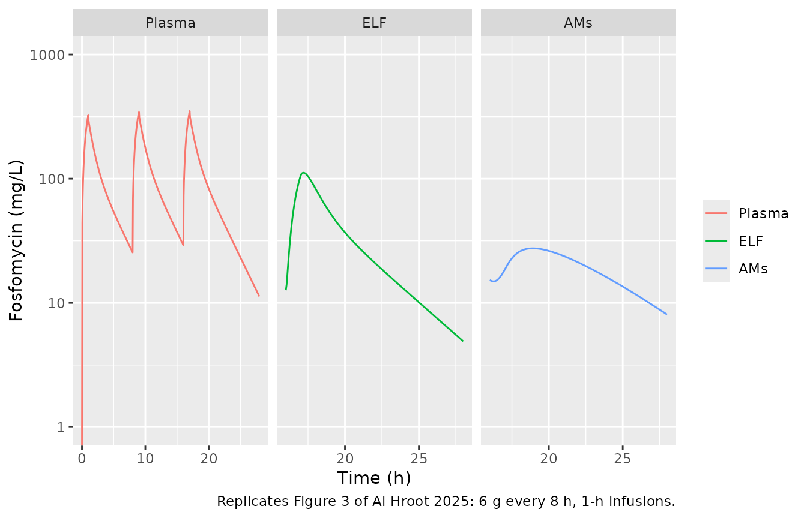
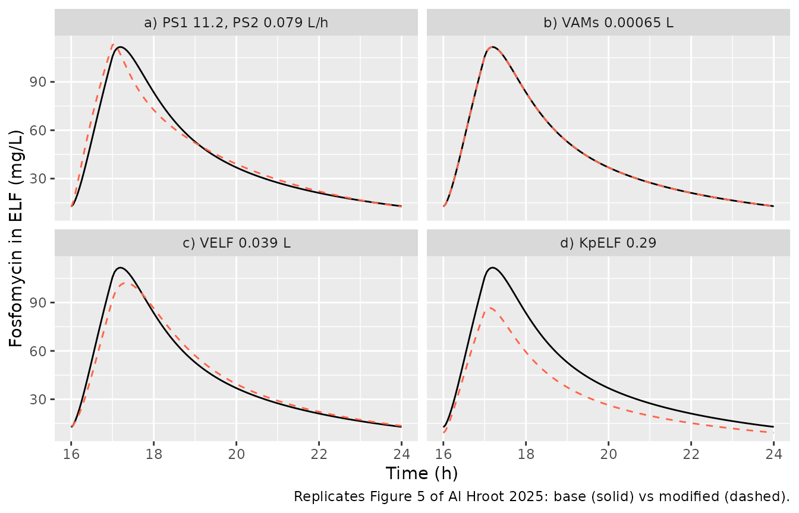
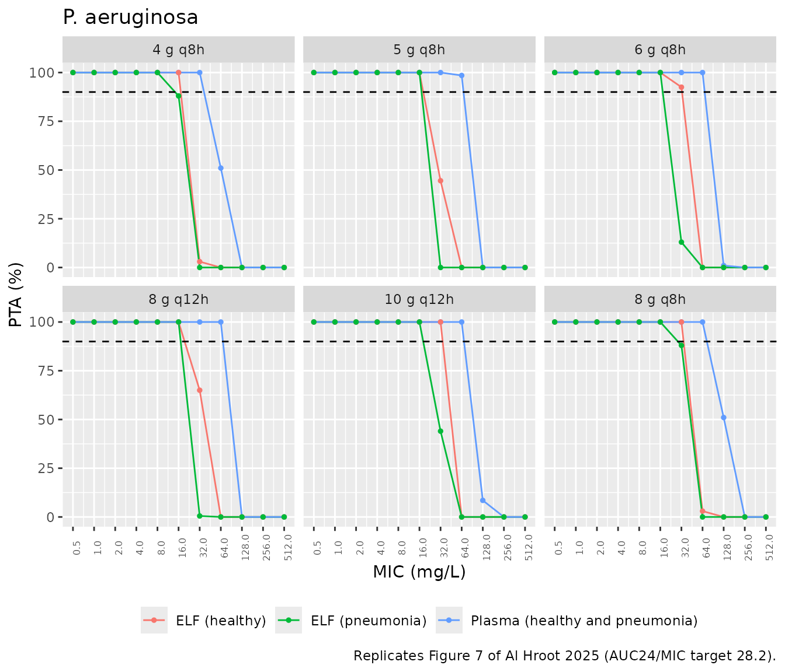
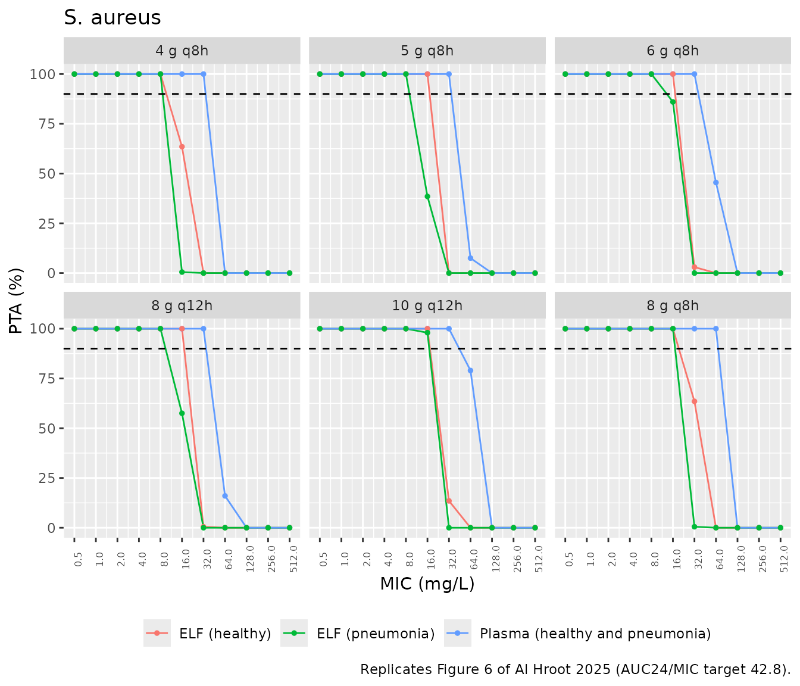

# Fosfomycin intrapulmonary PK (Al Hroot 2025)

## Model and source

Al Hroot et al. (2025) fitted a minimal physiologically based PK
(m-PBPK) model to plasma, epithelial lining fluid (ELF) and alveolar
macrophage (AM) concentrations of intravenous fosfomycin (ZTI-01) in
healthy adults. They then used it to simulate pneumonia patients and to
compute the probability of target attainment (PTA).

- Model: `AlHroot_2025_fosfomycin_pbpk`
- Description: mPBPK (minimal physiologically based). Intravenous
  fosfomycin (ZTI-01) in healthy adults: plasma, a lumped
  residual-tissue compartment, and a lung resolved into interstitial
  fluid, lung tissue, epithelial lining fluid (ELF) and alveolar
  macrophages (AMs). The lung interstitial fluid receives the whole
  cardiac output, the residual tissues a fitted fraction of it; lung
  tissue and ELF exchange with the interstitial fluid by
  permeability-surface products and partition coefficients, and drug
  moves between ELF and AMs by first-order uptake and efflux. Linear
  elimination from plasma. Physiological volumes and cardiac output are
  fixed 70 kg values; plasma, ELF and AM concentrations were fitted
  simultaneously with a single proportional residual error.
- Citation: Al Hroot J, Reeder J, Yuan X, Gu K, Walter E, Boole L, Que
  L, An G. Determining an appropriate fosfomycin (ZTI-01) dosing regimen
  in pneumonia patients by utilizing minimal PBPK modeling and target
  attainment analysis. Antimicrob Agents Chemother.
  2025;69(6):e01869-24. <doi:10.1128/aac.01869-24>.
- Article: <https://doi.org/10.1128/aac.01869-24>

## Population

Thirty-seven healthy adults aged 18-45 years with normal renal function
were enrolled in the NIAID Phase 1 intrapulmonary PK study NCT03910673
at the Duke University Early Phase Clinical Research Unit (Methods,
“Data source”; Fig. 1). Each received three 6 g doses of intravenous
fosfomycin, each infused over 1 h every 8 h. Plasma was sampled before
every dose and at 0.5, 1, 1.25, 2 and 5 h after the first and third
doses, with extra samples 8 and 12 h after the third dose. Thirty
participants had one bronchoalveolar lavage at a randomised time (0.5,
1.25, 2, 5 or 8 h) after the third dose, six per time point, from which
the ELF and AM concentrations were measured by LC-MS/MS. The paper gives
no weight, sex or race summary. Pneumonia patients were not studied; the
paper simulates them by changing two lung parameters (Table 3).

The same information is available programmatically via
`readModelDb("AlHroot_2025_fosfomycin_pbpk")()$population`.

## Source trace

The per-parameter origin is recorded as an in-file comment next to each
`ini()` entry in
`inst/modeldb/specificDrugs/AlHroot_2025_fosfomycin_pbpk.R`. The table
below collects them in one place for review.

| Equation / parameter | Value | Source location |
|----|----|----|
| `d/dt(plasma)`, `d/dt(is_lung)`, `d/dt(lung)`, `d/dt(elf)`, `d/dt(alveolar_macrophage)`, `d/dt(other)` | n/a | Equations 1-6 (Methods, “Final model”); structure in Fig. 2 |
| `Cc = plasma / v_plasma`, `Celf = elf / v_elf`, `Calveolar_macrophage = alveolar_macrophage / v_alveolar_macrophage` | n/a | Not printed; confirmed against the Fig. 3 predicted lines (below) |
| `qc` | 336 L/h (fixed) | Table 1 |
| `v_plasma`, `v_other`, `v_is_lung`, `v_lung`, `v_elf`, `v_alveolar_macrophage` | 3, 66, 0.3, 0.7, 0.026, 0.0026 L (fixed) | Table 1 |
| `lcl` | log(6.59) L/h | Results, “Estimated parameters” (Table 2 prints 7.0; see Assumptions) |
| `lfq_other` (Fd) | log(0.396) | Table 2 |
| `lkp_lung`, `lkp_other`, `lkp_elf`, `lkp_alveolar_macrophage` | log(11.6), log(0.142), log(0.393), log(0.000023) | Table 2 |
| `lps_lung` (PS1), `lps_elf` (PS2) | log(4.55), log(0.0316) L/h | Table 2 |
| `lk_elf_alveolar_macrophage` (K1), `lk_alveolar_macrophage_elf` (K2) | log(0.00515), log(0.000006) 1/h | Table 2 |
| `etalcl`, `etalk_alveolar_macrophage_elf` | 12.1 %CV, 40.0 %CV | Table 2, as log(1 + CV^2) |
| `propSd`, `propSd_Celf`, `propSd_Calveolar_macrophage` | sqrt(0.0303) | Table 2 sigma^2 (proportional), one value shared by all three matrices |
| Pneumonia scenario: `lkp_elf`, `v_elf` | log(0.29), 0.039 L | Table 3; Methods, “Probability of target attainment” |

## Study regimen: three 6 g doses every 8 h

The model has three endpoints (plasma, ELF, AM), so observation rows
name the dosed state and carry `dvid = 1`; rxode2 returns every
concentration column on each row.

``` r

make_events <- function(dose_cmt, doses = c(0, 8, 16), amt = 6000, tgrid) {
  dose <- data.frame(
    id = 1L, time = doses, amt = amt, rate = amt, evid = 1L,
    cmt = dose_cmt, dvid = NA_integer_
  )
  obs <- data.frame(
    id = 1L, time = tgrid, amt = 0, rate = 0, evid = 0L,
    cmt = dose_cmt, dvid = 1L
  )
  dplyr::arrange(dplyr::bind_rows(dose, obs), time, dplyr::desc(evid))
}
tgrid <- sort(unique(c(seq(0, 28, by = 0.05), 17.25)))

mod_pbpk <- readModelDb("AlHroot_2025_fosfomycin_pbpk")
typ_pbpk <- rxode2::rxSolve(rxode2::zeroRe(mod_pbpk), make_events("plasma", tgrid = tgrid)) |>
  as.data.frame()
#> ℹ parameter labels from comments will be replaced by 'label()'
#> ℹ omega/sigma items treated as zero: 'etalcl', 'etalk_alveolar_macrophage_elf'
```

### Figure 3: concentration-time profiles

``` r

typ_pbpk |>
  dplyr::select(time, Plasma = Cc, ELF = Celf, AMs = Calveolar_macrophage) |>
  tidyr::pivot_longer(c(Plasma, ELF, AMs), names_to = "matrix", values_to = "conc") |>
  dplyr::filter(matrix == "Plasma" | time >= 16) |>
  dplyr::mutate(matrix = factor(matrix, c("Plasma", "ELF", "AMs"))) |>
  ggplot(aes(time, conc, colour = matrix)) +
  geom_line() +
  facet_wrap(~matrix, scales = "free_x") +
  scale_y_log10(limits = c(1, 1000)) +
  labs(
    x = "Time (h)", y = "Fosfomycin (mg/L)", colour = NULL,
    caption = "Replicates Figure 3 of Al Hroot 2025: 6 g every 8 h, 1-h infusions."
  )
#> Warning in scale_y_log10(limits = c(1, 1000)): log-10 transformation introduced
#> infinite values.
```



The predicted lines in Fig. 3 are straight segments joining the model
predictions at the sampling times. The maintainers digitised each
segment and read its value at the sampling time it ends on; where a
marker covers that end the segment was extrapolated to it. The dashed AM
line is too faint to resolve point by point, but it stays at about 24
mg/L between its 18 h and 21 h nodes. The table compares the
typical-value predictions with these values. The column `CL 7.0` repeats
the prediction with the Table 2 clearance in place of the Results-text
value; see Assumptions.

``` r

fig3 <- tibble::tribble(
  ~matrix, ~time, ~fig3,
  "Plasma", 5, 54.5,
  "Plasma", 8, 25.9,
  "Plasma", 16, 29.6,
  "Plasma", 21, 62.2,
  "Plasma", 24, 29.5,
  "Plasma", 28, 11.5,
  "ELF", 18, 80.4,
  "ELF", 21, 26.7,
  "AMs", 18, 24,
  "AMs", 21, 24
)
col_of <- c(Plasma = "Cc", ELF = "Celf", AMs = "Calveolar_macrophage")
pred_at <- function(sim, matrix, time) {
  v <- vapply(seq_along(matrix), function(i) {
    row <- sim[abs(sim$time - time[i]) < 1e-8, col_of[[matrix[i]]]]
    if (length(row) != 1L) stop("no unique prediction at t = ", time[i])
    row
  }, numeric(1))
  v
}
typ_cl7 <- rxode2::rxSolve(
  rxode2::zeroRe(mod_pbpk) |> rxode2::ini(lcl = log(7.0)),
  make_events("plasma", tgrid = tgrid)
) |>
  as.data.frame()
#> ℹ parameter labels from comments will be replaced by 'label()'
#> ℹ change initial estimate of `lcl` to `1.94591014905531`
#> ℹ omega/sigma items treated as zero: 'etalcl', 'etalk_alveolar_macrophage_elf'

fig3_cmp <- fig3 |>
  dplyr::mutate(
    pbpk = pred_at(typ_pbpk, matrix, time),
    pbpk_cl7 = pred_at(typ_cl7, matrix, time),
    pct_pbpk = 100 * (pbpk / fig3 - 1),
    pct_pbpk_cl7 = 100 * (pbpk_cl7 / fig3 - 1)
  )
fig3_cmp |>
  dplyr::select(
    Matrix = matrix, "Time (h)" = time, "Fig. 3 line (mg/L)" = fig3,
    "Model (mg/L)" = pbpk, "% diff" = pct_pbpk,
    "CL 7.0 (mg/L)" = pbpk_cl7, "CL 7.0 % diff" = pct_pbpk_cl7
  ) |>
  knitr::kable(digits = 1, caption = "Typical-value predictions against the digitised Fig. 3 lines.")
```

| Matrix | Time (h) | Fig. 3 line (mg/L) | Model (mg/L) | % diff | CL 7.0 (mg/L) | CL 7.0 % diff |
|:---|---:|---:|---:|---:|---:|---:|
| Plasma | 5 | 54.5 | 54.2 | -0.5 | 49.5 | -9.2 |
| Plasma | 8 | 25.9 | 25.5 | -1.6 | 22.5 | -13.1 |
| Plasma | 16 | 29.6 | 29.2 | -1.5 | 25.5 | -13.8 |
| Plasma | 21 | 62.2 | 62.9 | 1.1 | 56.7 | -8.8 |
| Plasma | 24 | 29.5 | 29.7 | 0.6 | 25.9 | -12.2 |
| Plasma | 28 | 11.5 | 11.3 | -2.0 | 9.4 | -17.9 |
| ELF | 18 | 80.4 | 83.5 | 3.9 | 79.9 | -0.6 |
| ELF | 21 | 26.7 | 27.5 | 3.0 | 24.9 | -6.7 |
| AMs | 18 | 24.0 | 25.8 | 7.6 | 24.6 | 2.7 |
| AMs | 21 | 24.0 | 23.9 | -0.6 | 22.5 | -6.4 |

Typical-value predictions against the digitised Fig. 3 lines. {.table}

``` r


# Deterministic typical-value solves against digitised lines. 15 % allows
# for digitising error and still fails on a wrong partition coefficient,
# volume or clearance.
stopifnot(
  nrow(fig3_cmp) == 10L,
  all(abs(fig3_cmp$pct_pbpk) < 15)
)
```

## Sensitivity analysis: pneumonia-related changes (Figure 5, Table 3)

Table 3 changes one lung parameter at a time from its healthy value. The
profiles below are typical-value ELF concentrations after the third 6 g
dose.

``` r

scen <- list(
  "Base model" = mod_pbpk,
  "a) PS1 11.2, PS2 0.079 L/h" = mod_pbpk |> rxode2::ini(lps_lung = log(11.2), lps_elf = log(0.079)),
  "b) VAMs 0.00065 L" = mod_pbpk |> rxode2::ini(v_alveolar_macrophage = 0.00065),
  "c) VELF 0.039 L" = mod_pbpk |> rxode2::ini(v_elf = 0.039),
  "d) KpELF 0.29" = mod_pbpk |> rxode2::ini(lkp_elf = log(0.29))
)
#> ℹ parameter labels from comments will be replaced by 'label()'
#> ℹ change initial estimate of `lps_lung` to `2.41591377830105`
#> ℹ change initial estimate of `lps_elf` to `-2.53830742651512`
#> ℹ parameter labels from comments will be replaced by 'label()'
#> ℹ change initial estimate of `v_alveolar_macrophage` to `0.00065`
#> ℹ parameter labels from comments will be replaced by 'label()'
#> ℹ change initial estimate of `v_elf` to `0.039`
#> ℹ parameter labels from comments will be replaced by 'label()'
#> ℹ change initial estimate of `lkp_elf` to `-1.23787435600162`
sens <- dplyr::bind_rows(lapply(names(scen), function(nm) {
  rxode2::rxSolve(rxode2::zeroRe(scen[[nm]]), make_events("plasma", tgrid = tgrid)) |>
    as.data.frame() |>
    dplyr::mutate(scenario = nm)
}))
#> ℹ parameter labels from comments will be replaced by 'label()'
#> ℹ omega/sigma items treated as zero: 'etalcl', 'etalk_alveolar_macrophage_elf'
#> ℹ omega/sigma items treated as zero: 'etalcl', 'etalk_alveolar_macrophage_elf'
#> ℹ omega/sigma items treated as zero: 'etalcl', 'etalk_alveolar_macrophage_elf'
#> ℹ omega/sigma items treated as zero: 'etalcl', 'etalk_alveolar_macrophage_elf'
#> ℹ omega/sigma items treated as zero: 'etalcl', 'etalk_alveolar_macrophage_elf'
base_line <- sens |>
  dplyr::filter(scenario == "Base model") |>
  dplyr::select(time, Celf_base = Celf)
sens |>
  dplyr::filter(scenario != "Base model", time >= 16, time <= 24) |>
  dplyr::left_join(base_line, by = "time") |>
  ggplot(aes(time)) +
  geom_line(aes(y = Celf_base), colour = "black") +
  geom_line(aes(y = Celf), colour = "tomato", linetype = "dashed") +
  facet_wrap(~scenario) +
  labs(
    x = "Time (h)", y = "Fosfomycin in ELF (mg/L)",
    caption = "Replicates Figure 5 of Al Hroot 2025: base (solid) vs modified (dashed)."
  )
```



``` r


sens_tab <- sens |>
  dplyr::filter(time >= 16, time <= 24) |>
  dplyr::group_by(scenario) |>
  dplyr::summarise(
    elf_cmax = max(Celf),
    elf_auc = sum(diff(time) * (head(Celf, -1) + tail(Celf, -1)) / 2),
    plasma_auc = sum(diff(time) * (head(Cc, -1) + tail(Cc, -1)) / 2),
    .groups = "drop"
  ) |>
  dplyr::mutate(
    pct_elf_cmax = 100 * (elf_cmax / elf_cmax[scenario == "Base model"] - 1),
    pct_elf_auc = 100 * (elf_auc / elf_auc[scenario == "Base model"] - 1),
    pct_plasma_auc = 100 * (plasma_auc / plasma_auc[scenario == "Base model"] - 1)
  )
sens_tab |>
  dplyr::select(
    Scenario = scenario, "ELF Cmax (mg/L)" = elf_cmax,
    "ELF Cmax % change" = pct_elf_cmax, "ELF AUC16-24 % change" = pct_elf_auc,
    "Plasma AUC16-24 % change" = pct_plasma_auc
  ) |>
  knitr::kable(digits = 1, caption = "Effect of each Table 3 change on the third-dose ELF and plasma exposure.")
```

| Scenario | ELF Cmax (mg/L) | ELF Cmax % change | ELF AUC16-24 % change | Plasma AUC16-24 % change |
|:---|---:|---:|---:|---:|
| Base model | 111.7 | 0.0 | 0.0 | 0.0 |
| a\) PS1 11.2, PS2 0.079 L/h | 113.5 | 1.6 | 0.2 | 0.1 |
| b\) VAMs 0.00065 L | 111.7 | 0.0 | 0.0 | 0.0 |
| c\) VELF 0.039 L | 102.2 | -8.5 | 0.0 | 0.0 |
| d\) KpELF 0.29 | 86.7 | -22.4 | -26.2 | 0.0 |

Effect of each Table 3 change on the third-dose ELF and plasma exposure.
{.table}

``` r


pct <- function(nm, col) {
  v <- sens_tab[[col]][sens_tab$scenario == nm]
  if (length(v) != 1L) stop("no unique row for '", nm, "'")
  v
}
# Table 3 / Results: no change alters plasma; VAMs has no effect on the ELF;
# VELF lowers it slightly; KpELF has the greatest effect.
stopifnot(
  all(abs(sens_tab$pct_plasma_auc) < 1),
  abs(pct("b) VAMs 0.00065 L", "pct_elf_auc")) < 1,
  pct("c) VELF 0.039 L", "pct_elf_cmax") < 0,
  pct("d) KpELF 0.29", "pct_elf_auc") < -15,
  abs(pct("d) KpELF 0.29", "pct_elf_auc")) > abs(pct("c) VELF 0.039 L", "pct_elf_auc"))
)
```

## Probability of target attainment (Figures 6 and 7, Table 4)

The paper simulated 1,000 subjects per scenario at steady state for 4,
5, 6 and 8 g every 8 h and 8 and 10 g every 12 h, all as 1-h infusions,
and scored AUC24/MIC against 28.2 (*P. aeruginosa*) and 42.8 (*S.
aureus*). The model is linear and every regimen uses the same 1-h
infusion, so the steady-state AUC24 of any regimen is the daily dose
times the single-dose AUC0-inf per gram. Below, 200 virtual subjects per
population each receive one 1 g dose, PKNCA computes their plasma and
ELF AUC, and the regimens are formed by that scaling. The pneumonia
population uses KpELF = 0.29 and VELF = 0.039 L, as in the paper; its
plasma exposure is identical to that of healthy subjects.

``` r

rxode2::rxSetSeed(20250603)
n_per_pop <- 200L
pta_grid <- sort(unique(c(seq(0, 4, by = 0.1), seq(4, 24, by = 0.5), seq(24, 72, by = 1))))
pop_models <- list(
  Healthy = mod_pbpk,
  Pneumonia = mod_pbpk |> rxode2::ini(lkp_elf = log(0.29), v_elf = 0.039)
)
#> ℹ parameter labels from comments will be replaced by 'label()'
#> ℹ change initial estimate of `lkp_elf` to `-1.23787435600162`
#> ℹ change initial estimate of `v_elf` to `0.039`
pta_sim <- dplyr::bind_rows(lapply(seq_along(pop_models), function(i) {
  ev <- make_events("plasma", doses = 0, amt = 1000, tgrid = pta_grid)
  ev <- dplyr::bind_rows(lapply(seq_len(n_per_pop), function(j) dplyr::mutate(ev, id = (i - 1L) * n_per_pop + j)))
  rxode2::rxSolve(pop_models[[i]], ev) |>
    as.data.frame() |>
    dplyr::mutate(population = names(pop_models)[i])
}))
#> ℹ parameter labels from comments will be replaced by 'label()'
stopifnot(dplyr::n_distinct(pta_sim$id) == 2L * n_per_pop)
```

### PKNCA

``` r

nca_one <- function(sim, conc_col, matrix_label) {
  conc <- sim |>
    dplyr::transmute(id, population, time, conc = .data[[conc_col]]) |>
    dplyr::filter(!is.na(conc))
  stopifnot(all(conc$conc >= -1e-6 * max(conc$conc)))
  conc <- dplyr::mutate(conc, conc = pmax(conc, 0))
  dose <- sim |>
    dplyr::distinct(id, population) |>
    dplyr::mutate(time = 0, amt = 1000)
  res <- PKNCA::pk.nca(PKNCA::PKNCAdata(
    PKNCA::PKNCAconc(conc, conc ~ time | population + id),
    PKNCA::PKNCAdose(dose, amt ~ time | population + id),
    intervals = data.frame(start = 0, end = Inf, cmax = TRUE, tmax = TRUE, auclast = TRUE, aucinf.obs = TRUE)
  ))
  as.data.frame(res) |>
    dplyr::mutate(matrix = matrix_label)
}
nca <- dplyr::bind_rows(
  nca_one(pta_sim, "Cc", "Plasma"),
  nca_one(pta_sim, "Celf", "ELF")
)
nca |>
  dplyr::group_by(matrix, population, PPTESTCD) |>
  dplyr::summarise(median = median(PPORRES), .groups = "drop") |>
  tidyr::pivot_wider(names_from = PPTESTCD, values_from = median) |>
  dplyr::select(
    Matrix = matrix, Population = population, "Cmax (mg/L)" = cmax,
    "Tmax (h)" = tmax, "AUClast (mg*h/L)" = auclast, "AUCinf (mg*h/L)" = aucinf.obs
  ) |>
  knitr::kable(digits = 2, caption = "Median single-dose (1 g, 1-h infusion) NCA by matrix and population.")
```

| Matrix | Population | Cmax (mg/L) | Tmax (h) | AUClast (mg\*h/L) | AUCinf (mg\*h/L) |
|:-------|:-----------|------------:|---------:|------------------:|-----------------:|
| ELF    | Healthy    |       17.00 |      1.2 |             59.18 |            59.18 |
| ELF    | Pneumonia  |       12.29 |      1.2 |             44.30 |            44.30 |
| Plasma | Healthy    |       54.52 |      1.0 |            150.56 |           150.56 |
| Plasma | Pneumonia  |       54.71 |      1.0 |            152.74 |           152.74 |

Median single-dose (1 g, 1-h infusion) NCA by matrix and population.
{.table style="width:100%;"}

``` r


# Plasma AUCinf must equal dose / CL for each subject: the same drawn
# parameters feed both sides, so only integration and trapezoid error remain.
cl_i <- pta_sim |>
  dplyr::distinct(id, cl)
auc_chk <- nca |>
  dplyr::filter(matrix == "Plasma", PPTESTCD == "aucinf.obs") |>
  dplyr::left_join(cl_i, by = "id") |>
  dplyr::mutate(ratio = PPORRES / (1000 / cl))
stopifnot(nrow(auc_chk) == 2L * n_per_pop, max(abs(auc_chk$ratio - 1)) < 0.01)
```

The paper reports no NCA values for these regimens, so there is no
published NCA table to compare against; the PTA breakpoints of Table 4
are the published comparison.

``` r

regimens <- tibble::tribble(
  ~regimen, ~daily_g,
  "4 g q8h", 12,
  "5 g q8h", 15,
  "6 g q8h", 18,
  "8 g q12h", 16,
  "10 g q12h", 20,
  "8 g q8h", 24
)
targets <- c("P. aeruginosa" = 28.2, "S. aureus" = 42.8)
mics <- 2^(-1:9)
auc1 <- nca |>
  dplyr::filter(PPTESTCD == "aucinf.obs") |>
  dplyr::select(id, population, matrix, auc1g = PPORRES)
pta <- tidyr::expand_grid(
  auc1 |> dplyr::distinct(population, matrix),
  regimens,
  pathogen = names(targets),
  mic = mics
) |>
  dplyr::rowwise() |>
  dplyr::mutate(pta = {
    a <- auc1$auc1g[auc1$population == population & auc1$matrix == matrix]
    100 * mean(a * daily_g / mic >= targets[[pathogen]])
  }) |>
  dplyr::ungroup() |>
  dplyr::mutate(
    curve = ifelse(matrix == "Plasma", "Plasma (healthy and pneumonia)", paste0("ELF (", tolower(population), ")"))
  ) |>
  dplyr::filter(!(matrix == "Plasma" & population == "Pneumonia"))
```

``` r

for (pg in names(targets)) {
  p <- pta |>
    dplyr::filter(pathogen == pg) |>
    dplyr::mutate(regimen = factor(regimen, regimens$regimen)) |>
    ggplot(aes(mic, pta, colour = curve)) +
    geom_line() +
    geom_point(size = 1) +
    geom_hline(yintercept = 90, linetype = "dashed") +
    scale_x_continuous(trans = "log2", breaks = mics) +
    facet_wrap(~regimen) +
    labs(
      x = "MIC (mg/L)", y = "PTA (%)", colour = NULL,
      title = pg,
      caption = sprintf(
        "Replicates Figure %d of Al Hroot 2025 (AUC24/MIC target %s).",
        if (pg == "S. aureus") 6L else 7L, targets[[pg]]
      )
    ) +
    theme(legend.position = "bottom", axis.text.x = element_text(angle = 90, size = 6))
  print(p)
}
```



``` r

breakpoint <- function(x_mic, x_pta) {
  ok <- x_mic[x_pta >= 90]
  if (length(ok) == 0L) NA_real_ else max(ok)
}
bp_sim <- pta |>
  dplyr::group_by(curve, regimen, pathogen) |>
  dplyr::summarise(bp = breakpoint(mic, pta), .groups = "drop")
table4 <- tibble::tribble(
  ~regimen, ~pathogen, ~plasma, ~elf_healthy, ~elf_pneumonia,
  "4 g q8h", "P. aeruginosa", 32, 16, 16,
  "4 g q8h", "S. aureus", 32, 8, 8,
  "5 g q8h", "P. aeruginosa", 64, 16, 16,
  "5 g q8h", "S. aureus", 32, 16, 8,
  "8 g q12h", "P. aeruginosa", 64, 16, 16,
  "8 g q12h", "S. aureus", 32, 16, 8,
  "6 g q8h", "P. aeruginosa", 64, 32, 16,
  "6 g q8h", "S. aureus", 32, 16, 8,
  "10 g q12h", "P. aeruginosa", 64, 32, 16,
  "10 g q12h", "S. aureus", 32, 16, 16,
  "8 g q8h", "P. aeruginosa", 64, 32, 32,
  "8 g q8h", "S. aureus", 64, 16, 16
) |>
  tidyr::pivot_longer(c(plasma, elf_healthy, elf_pneumonia), names_to = "curve", values_to = "bp_paper") |>
  dplyr::mutate(curve = dplyr::recode(curve,
    plasma = "Plasma (healthy and pneumonia)",
    elf_healthy = "ELF (healthy)",
    elf_pneumonia = "ELF (pneumonia)"
  ))
bp_cmp <- dplyr::left_join(table4, bp_sim, by = c("regimen", "pathogen", "curve"))
stopifnot(nrow(bp_cmp) == 36L, !anyNA(bp_cmp$bp))
bp_cmp |>
  dplyr::mutate(cell = sprintf("%g (%g)", bp, bp_paper)) |>
  dplyr::select(regimen, pathogen, curve, cell) |>
  tidyr::pivot_wider(names_from = curve, values_from = cell) |>
  dplyr::rename(Regimen = regimen, Pathogen = pathogen) |>
  knitr::kable(caption = "PTA >= 90% breakpoints (mg/L): simulated, with the Table 4 value of Al Hroot 2025 in parentheses.")
```

| Regimen | Pathogen | Plasma (healthy and pneumonia) | ELF (healthy) | ELF (pneumonia) |
|:---|:---|:---|:---|:---|
| 4 g q8h | P. aeruginosa | 32 (32) | 16 (16) | 8 (16) |
| 4 g q8h | S. aureus | 32 (32) | 8 (8) | 8 (8) |
| 5 g q8h | P. aeruginosa | 64 (64) | 16 (16) | 16 (16) |
| 5 g q8h | S. aureus | 32 (32) | 16 (16) | 8 (8) |
| 8 g q12h | P. aeruginosa | 64 (64) | 16 (16) | 16 (16) |
| 8 g q12h | S. aureus | 32 (32) | 16 (16) | 8 (8) |
| 6 g q8h | P. aeruginosa | 64 (64) | 32 (32) | 16 (16) |
| 6 g q8h | S. aureus | 32 (32) | 16 (16) | 8 (8) |
| 10 g q12h | P. aeruginosa | 64 (64) | 32 (32) | 16 (16) |
| 10 g q12h | S. aureus | 32 (32) | 16 (16) | 16 (16) |
| 8 g q8h | P. aeruginosa | 64 (64) | 32 (32) | 16 (32) |
| 8 g q8h | S. aureus | 64 (64) | 16 (16) | 16 (16) |

PTA \>= 90% breakpoints (mg/L): simulated, with the Table 4 value of Al
Hroot 2025 in parentheses. {.table style="width:100%;"}

``` r


n_match <- bp_cmp |>
  dplyr::group_by(is_plasma = grepl("^Plasma", curve)) |>
  dplyr::summarise(match = sum(bp == bp_paper), n = dplyr::n(), .groups = "drop")
n_match
#> # A tibble: 2 × 3
#>   is_plasma match     n
#>   <lgl>     <int> <int>
#> 1 FALSE        22    24
#> 2 TRUE         12    12
# Plasma breakpoints rest on the 10th percentile of dose/CL, at least 5
# binomial standard errors from every MIC boundary with 200 subjects: all 12
# matched at every seed tried. ELF cells for 6 g q8h and 4 g q8h sit on a
# boundary; 10-12 of 12 per population matched across seeds, so the gate is 20
# of 24. A wrong KpELF, PS2 or clearance shifts whole columns.
stopifnot(
  n_match$match[n_match$is_plasma] == 12L,
  n_match$match[!n_match$is_plasma] >= 20L
)
```

## Assumptions and deviations

- **Clearance: 6.59 L/h, not the 7.0 L/h of Table 2.** The Results text
  says “the systematic clearance was estimated to be 6.59 L/h”, while
  Table 2 prints CL = 7.0 (RSE 1.9%). There is no confidence interval to
  say which is the point estimate, so the maintainers checked both
  against the paper’s own outputs. In the Fig. 3 comparison above, the
  plasma troughs at 8, 16, 24 and 28 h are within 2% of the digitised
  line with 6.59 L/h and 12-18% below it with 7.0 L/h. They are still
  9-13% below with 7.0 L/h when the line is taken as the mean of 2,000
  individual predictions rather than the typical value. With 1,000
  subjects per scenario, 35 of the 36 Table 4 breakpoints come out right
  with 6.59 L/h and 33 of 36 with 7.0 L/h. To use the tabulated value,
  run `mod |> rxode2::ini(lcl = log(7.0))`.
- **Observed concentrations are amount over volume.** The paper does not
  print observation equations. The ELF and AM concentrations are taken
  as the compartment amount divided by `v_elf` and
  `v_alveolar_macrophage`, without the partition coefficient; this
  reproduces the ELF and AM lines of Fig. 3 (table above).
- **One residual variance for three matrices.** The paper estimates a
  single proportional sigma^2 for plasma, ELF and AM data. nlmixr2 needs
  a separate parameter for each endpoint, so the same value is stored
  three times (`propSd`, `propSd_Celf`, `propSd_Calveolar_macrophage`).
  Constrain them to be equal when re-fitting.
- **IIV CV% converted with omega^2 = log(1 + CV^2).** The tables report
  IIV as %CV.
- **PTA by superposition, IIV only.** The steady-state AUC24 is computed
  from a single-dose AUC0-inf scaled by the daily dose (exact for this
  linear model with a fixed 1-h infusion). Residual error is not added
  to the simulated concentrations; the paper does not say whether its
  NONMEM simulation added it. The vignette uses 200 subjects per
  population rather than 1,000.
- **The supplement’s compartmental model is not included.** Before the
  m-PBPK model, the authors built a four-compartment model (central,
  peripheral, ELF, AMs; supplement Fig. S1, Table S1 model 5, final
  estimates in Table S2). They replaced it with the m-PBPK model and
  used only the m-PBPK model for the sensitivity and PTA analyses, so
  only the final model is packaged. Also, the printed Table S2 values do
  not reproduce that model’s own diagnostics. Using the Fig. S1
  structure (central-ELF k13/k31 and ELF-AM k34/k43 acting on amounts,
  ELF and AM volumes fixed at 0.026 and 0.0026 L), the plasma and ELF
  profiles match Fig. 3. The AM concentrations, however, come out at
  5-10 mg/L after the third dose. That is about one-third of the 15-35
  mg/L population predictions in the AM points of Fig. S2 and of the
  observed AM data.
- **Compartment names.** The plasma, lung interstitial fluid, lung
  tissue, ELF and residual tissues use the library’s registered names
  `plasma`, `is_lung`, `lung`, `elf` and `other`. The alveolar
  macrophage state, `alveolar_macrophage`, is model-specific because the
  library has no registered name for it.
- **No erratum** was found for this article (checked 2026-11-04).
