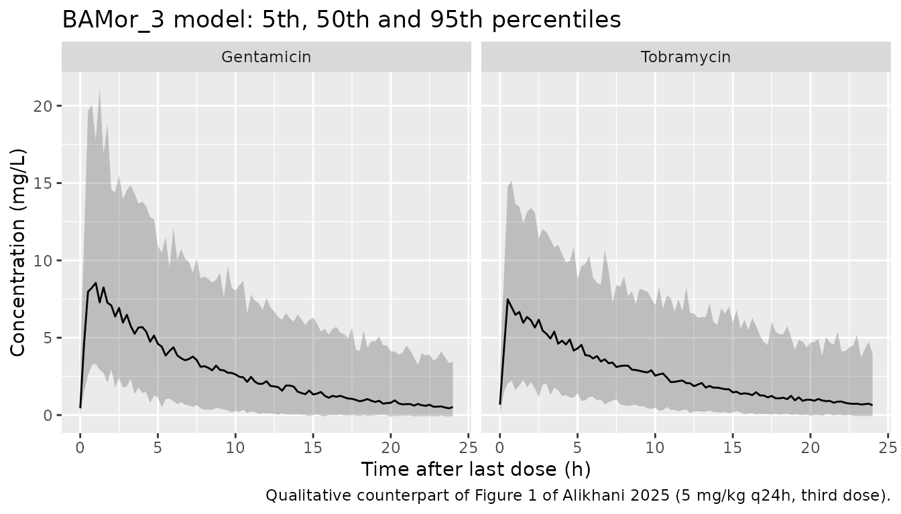
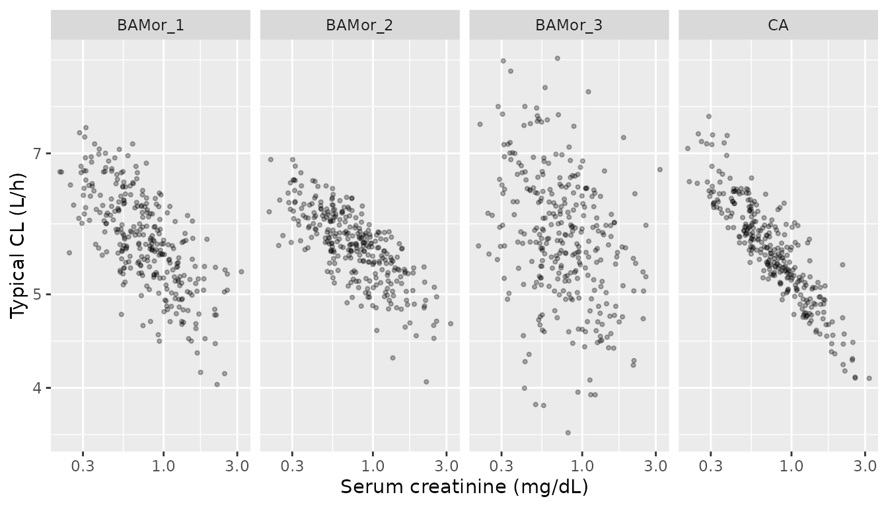

# Gentamicin and tobramycin with radiomic biological age (Alikhani 2025)

## Model and source

- Citation: Alikhani R, Horbal SR, Pai MP. A comparison between radiomic
  biological age and chronological age in estimating kidney function.
  Sci Rep. 2025;15:13384. <doi:10.1038/s41598-025-98297-1>.
- Article: <https://doi.org/10.1038/s41598-025-98297-1> (open access,
  with Supplementary Material 1 holding Supplementary Tables 1-5)

Alikhani, Horbal and Pai used aminoglycoside clearance as a surrogate
for kidney function and asked whether “radiomic biological age” indices
built from abdominal CT body-composition measurements (analytic
morphomics) explain clearance better than chronological age. The
structural model is a one-compartment model with zero-order (infusion)
input and linear elimination, fitted in Monolix to pooled gentamicin and
tobramycin concentrations. Each age index is divided by serum creatinine
and enters CL as a power term; drug (tobramycin vs gentamicin) enters V.

The paper reports four complete final models side by side (Supplementary
Table 4), one per age index. All four are packaged:

| Model file | Paper model | Age index on CL | AIC |
|----|----|----|----|
| `Alikhani_2025_gentamicin_tobramycin_bamor1` | 19.1 | BAMor_1 = psoas muscle area x BMD / fascia area | 2601.57 |
| `Alikhani_2025_gentamicin_tobramycin_bamor2` | 25.1 | BAMor_2 = psoas muscle area x psoas muscle density x vertebral slab height | 2601.71 |
| `Alikhani_2025_gentamicin_tobramycin_bamor3` | 29.2 | BAMor_3 = dorsal muscle group area x BMD / visceral fat area, plus subcutaneous fat density | 2598.33 (best) |
| `Alikhani_2025_gentamicin_tobramycin_ca` | 6.1 | 1 / chronological age | 2602.12 |

AIC values are from Table 3 and Supplementary Table 3.

## Population

156 hospitalised adults at the University of Michigan Health System who
received at least three doses of gentamicin (n = 67) or tobramycin (n =
89, 57.05%) with measured plasma concentrations and had an abdominal CT
scan (Alikhani 2025 Table 1). 51.92% were female; median age 58 years
(IQR 22, range 21-93); mean weight 81.0 kg (SD 21.06, range 43.8-139.3);
median serum creatinine 0.75 mg/dL (IQR 0.57, range 0.17-5.5). Psoas
measures were taken at L4, the dorsal muscle group at L2 and the
remaining morphomics at L3; missing morphomic values were imputed
(random-forest `mice`). Dosing regimens were not reported.

The same information is available programmatically via
`readModelDb("Alikhani_2025_gentamicin_tobramycin_bamor3")()$population`.

## Source trace

Every `ini()` value carries an in-file comment pointing at its source.
All structural, covariate, IIV and residual-error values come from
Supplementary Table 4 (one column per model). Monolix reports the random
effects as SDs (`Omega_V`, `Omega_Cl`); the model files hold their
squares.

| Parameter | BAMor_1 (19.1) | BAMor_2 (25.1) | BAMor_3 (29.2) | CA (6.1) | Source |
|----|----|----|----|----|----|
| `lcl` (Cl_pop, L/h) | log(5.8) | log(5.72) | log(2.62) | log(5.82) | Supp Table 4 |
| `lvc` (V_pop gentamicin, L) | log(49.09) | log(45.87) | log(45.89) | log(49.2) | Supp Table 4 |
| index exponent on CL | 0.15 | 0.12 | 0.11 | 0.19 | Supp Table 4 ‘Beta_Cl\_(BAMor/creat)’, ‘Beta_Cl\_(CA-1/creat)’ |
| `e_ct_subcutaneous_fat_density_cl` | – | – | -0.93 | – | Supp Table 4 ‘Beta_Cl\_(subcutfathu)’ |
| `e_trt_tobramycin_vc` | 0.24 | 0.29 | 0.28 | 0.25 | Supp Table 4 ‘Beta_V_drug_tobramycin’ |
| `etalcl` (variance) | 0.49^2 | 0.51^2 | 0.49^2 | 0.49^2 | Supp Table 4 ‘Omega_Cl’ |
| `etalvc` (variance) | 0.37^2 | 0.37^2 | 0.36^2 | 0.38^2 | Supp Table 4 ‘Omega_V’ |
| `addSd` (a, mg/L) | 0.049 | 0.12 | 0.13 | 0.069 | Supp Table 4 ‘a’ |
| `propSd` (b) | 0.4 | 0.38 | 0.39 | 0.4 | Supp Table 4 ‘b’ |

| Equation | Source |
|----|----|
| One compartment, infusion input, linear CL, log-normal IIV on V and CL | Results; Methods |
| Combined error `y = f + sqrt(a^2 + (b f)^2) e` (“combined2”) | Supp Table 3 row 4 (base model) |
| `V = V_pop exp(beta TRT_TOBRAMYCIN + eta_V)` | Supp Table 4 ‘V_drug_Gentamicin’ / ‘V_drug_Tobramycin’ |
| BAMor_1, BAMor_2, BAMor_3 definitions | Table 2 |
| `CL = Cl_pop (BAMor_1 / Scr / 10)^beta` | Supp Table 3 rows 19 / 19.1 |
| `CL = Cl_pop (BAMor_2 / Scr / 4200000)^beta` | Supp Table 3 rows 25 / 25.1 |
| `CL = Cl_pop (BAMor_3 / (Scr x 300))^beta exp(beta_subQ SubQHU / 90)` | Equation 1 (centring constant 300; see Assumptions) |
| `CL = Cl_pop ((1 / (Age x Scr)) / 0.03)^beta` | Supp Table 3 rows 6 / 6.1 |

## Deterministic checks

### Tobramycin volume

Supplementary Table 4 also prints the volume for each drug category.
Applying the drug effect to `V_pop` must reproduce the tobramycin row;
the residual difference comes from the 2-decimal rounding of the
published coefficient (an exponent rounded by 0.005 moves V by up to
0.5%).

``` r

model_names <- c(
  BAMor_1 = "Alikhani_2025_gentamicin_tobramycin_bamor1",
  BAMor_2 = "Alikhani_2025_gentamicin_tobramycin_bamor2",
  BAMor_3 = "Alikhani_2025_gentamicin_tobramycin_bamor3",
  CA = "Alikhani_2025_gentamicin_tobramycin_ca"
)
mods <- lapply(model_names, function(nm) rxode2::rxode(readModelDb(nm)))
#> ℹ parameter labels from comments will be replaced by 'label()'
#> ℹ parameter labels from comments will be replaced by 'label()'
#> ℹ parameter labels from comments will be replaced by 'label()'
#> ℹ parameter labels from comments will be replaced by 'label()'

theta_of <- function(m) {
  df <- m$iniDf
  stats::setNames(df$est[is.na(df$neta1)], df$name[is.na(df$neta1)])
}
thetas <- lapply(mods, theta_of)

# Typical-value (zeroRe) solves are intended throughout; muffle only the
# notices rxode2 gives for them, so any other warning still surfaces.
solve_typical <- function(mod, events, ...) {
  withCallingHandlers(
    rxode2::rxSolve(rxode2::zeroRe(mod), events = events, ...),
    warning = function(w) {
      if (grepl("without 'omega'", conditionMessage(w), fixed = TRUE)) {
        invokeRestart("muffleWarning")
      }
    },
    message = function(m) {
      if (grepl("treated as zero", conditionMessage(m), fixed = TRUE)) {
        invokeRestart("muffleMessage")
      }
    }
  )
}

v_check <- tibble(
  model = names(model_names),
  v_gent = vapply(thetas, function(t) exp(t[["lvc"]]), numeric(1)),
  v_tobra = vapply(thetas, function(t) exp(t[["lvc"]] + t[["e_trt_tobramycin_vc"]]), numeric(1)),
  v_tobra_published = c(62.38, 61.61, 60.75, 63.42) # Supp Table 4 'V_drug_Tobramycin'
) |>
  mutate(pct_diff = 100 * (v_tobra / v_tobra_published - 1))
stopifnot(nrow(v_check) == 4L, all(abs(v_check$pct_diff) < 1))

v_check |>
  dplyr::rename(
    "Model" = model,
    "V gentamicin (L)" = v_gent,
    "V tobramycin, model (L)" = v_tobra,
    "V tobramycin, Supp Table 4 (L)" = v_tobra_published,
    "Difference (%)" = pct_diff
  ) |>
  knitr::kable(digits = 2, caption = "Volume of distribution by drug.")
```

| Model | V gentamicin (L) | V tobramycin, model (L) | V tobramycin, Supp Table 4 (L) | Difference (%) |
|:---|---:|---:|---:|---:|
| BAMor_1 | 49.09 | 62.41 | 62.38 | 0.04 |
| BAMor_2 | 45.87 | 61.30 | 61.61 | -0.50 |
| BAMor_3 | 45.89 | 60.72 | 60.75 | -0.05 |
| CA | 49.20 | 63.17 | 63.42 | -0.39 |

Volume of distribution by drug. {.table}

### Typical clearance at the cohort centre

The paper notes that the BAMor_3 model’s `Cl_pop` (2.62 L/h) is far
below the other three (5.72-5.82 L/h). That is a property of where each
index is centred, not a disagreement between models: `Cl_pop` is the
clearance when the index term equals one, and for BAMor_3 that point is
far from a typical patient (and its subcutaneous-fat term is uncentred).
Evaluating all four models at the cohort’s Table 1 centre (mean
morphomics, median age and serum creatinine) puts them within a few
percent of each other.

``` r

centre <- data.frame(
  id = 1L,
  AGE = 58, # Table 1 median
  CREAT = 0.75, # Table 1 median, mg/dL
  CT_PSOAS_MUSCLE_AREA = 1953.7 / 100, # Table 1 mean, mm^2 -> cm^2
  CT_PSOAS_MUSCLE_DENSITY = 46.28, # HU
  CT_DORSAL_MUSCLE_AREA = 4030 / 100, # mm^2 -> cm^2
  CT_FASCIA_AREA = 50625 / 100, # mm^2 -> cm^2
  VISCERAL_ABDOMINAL_FAT = 12790 / 100, # mm^2 -> cm^2
  CT_SUBCUTANEOUS_FAT_DENSITY = -89.03, # HU
  CT_VERTEBRAL_BMD = 182.23, # HU
  CT_VERTEBRAL_SLAB_HEIGHT = 32.78, # mm
  TRT_TOBRAMYCIN = 0L
)
ev_centre <- rxode2::et(amt = 100, cmt = "central") |>
  rxode2::et(time = 1, cmt = "central") |>
  as.data.frame() |>
  mutate(id = 1L) |>
  left_join(centre, by = "id")

cl_centre <- vapply(mods, function(m) {
  solve_typical(m, events = ev_centre)$cl[1]
}, numeric(1))

# Hand-computed from the published equations at the same covariates.
cl_hand <- c(
  BAMor_1 = 5.8 * ((1953.7 * 182.23 / 50625) / 0.75 / 10)^0.15,
  BAMor_2 = 5.72 * (1953.7 * 46.28 * 32.78 / 0.75 / 4200000)^0.12,
  BAMor_3 = 2.62 * ((4030 * 182.23 / 12790) / (0.75 * 300))^0.11 * exp(-0.93 * -89.03 / 90),
  CA = 5.82 * ((1 / (58 * 0.75)) / 0.03)^0.19
)
stopifnot(max(abs(cl_centre / cl_hand[names(cl_centre)] - 1)) < 1e-8)
# Four independently fitted models of the same data should agree on the
# typical patient; a mis-transcribed exponent or centring constant moves one of
# them by tens of percent.
stopifnot(max(cl_centre) / min(cl_centre) < 1.10)

# Serum creatinine divides every index, so doubling it must scale CL by
# exactly 2^-beta in each model; this pins where CREAT enters the equation.
ev_centre_2scr <- ev_centre |> mutate(CREAT = 2 * CREAT)
cl_2scr <- vapply(mods, function(m) {
  solve_typical(m, events = ev_centre_2scr)$cl[1]
}, numeric(1))
beta_scr <- c(
  BAMor_1 = 0.15, BAMor_2 = 0.12, BAMor_3 = 0.11, CA = 0.19 # Supp Table 4
)
stopifnot(max(abs(cl_2scr / cl_centre - 2^-beta_scr[names(cl_centre)])) < 1e-8)

tibble(
  model = names(cl_centre),
  cl_pop = vapply(thetas, function(t) exp(t[["lcl"]]), numeric(1)),
  cl_centre = cl_centre
) |>
  dplyr::rename(
    "Model" = model,
    "Cl_pop, Supp Table 4 (L/h)" = cl_pop,
    "Typical CL at cohort centre (L/h)" = cl_centre
  ) |>
  knitr::kable(digits = 2, caption = "Population CL versus typical CL at the Table 1 centre.")
```

| Model   | Cl_pop, Supp Table 4 (L/h) | Typical CL at cohort centre (L/h) |
|:--------|---------------------------:|----------------------------------:|
| BAMor_1 |                       5.80 |                              5.74 |
| BAMor_2 |                       5.72 |                              5.68 |
| BAMor_3 |                       2.62 |                              5.66 |
| CA      |                       5.82 |                              5.53 |

Population CL versus typical CL at the Table 1 centre. {.table}

### Closed-form one-compartment infusion

A typical-value solve of the BAMor_3 model for a 30-minute infusion is
compared against the analytic one-compartment infusion solution.

``` r

dose <- 400
tinf <- 0.5
ev_cf <- data.frame(
  id = 1L,
  time = c(0, seq(0.1, 24, by = 0.1)),
  evid = c(1L, rep(0L, 240)),
  amt = c(dose, rep(0, 240)),
  rate = c(dose / tinf, rep(0, 240)),
  cmt = "central"
) |>
  left_join(centre, by = "id")
sim_cf <- solve_typical(mods$BAMor_3,
  events = ev_cf,
  rtol = 1e-10, atol = 1e-12
) |>
  as.data.frame()
k <- sim_cf$cl[1] / sim_cf$vc[1]
analytic <- with(sim_cf, ifelse(
  time <= tinf,
  dose / tinf / cl * (1 - exp(-k * time)),
  dose / tinf / cl * (1 - exp(-k * tinf)) * exp(-k * (time - tinf))
))
rel_err <- max(abs(sim_cf$Cc / analytic - 1))
stopifnot(rel_err < 1e-6)
rel_err
#> [1] 1.001782e-10
```

## Virtual cohort

Individual data are not public. The cohort below draws each covariate
independently from the Table 1 summaries (normal for symmetric measures,
log-normal for serum creatinine and visceral fat area, which Table 1
shows as right-skewed), truncated to the published ranges. Correlations
between the morphomic measures are not reported and are not reproduced.

The dosing regimen was not reported. The simulation uses an illustrative
5 mg/kg (actual body weight) dose infused over 30 minutes every 24 hours
for three doses (the inclusion criterion was at least three doses).

``` r

rxode2::rxSetSeed(20250418)
set.seed(20250418)

rtnorm <- function(n, mean, sd, lo, hi) {
  x <- stats::rnorm(n, mean, sd)
  bad <- x < lo | x > hi
  while (any(bad)) {
    x[bad] <- stats::rnorm(sum(bad), mean, sd)
    bad <- x < lo | x > hi
  }
  x
}
rtlnorm <- function(n, meanlog, sdlog, lo, hi) {
  exp(rtnorm(n, meanlog, sdlog, log(lo), log(hi)))
}

n_per_drug <- 150L
vat_sdlog <- sqrt(log(1 + (10708.68 / 12790)^2)) # mean/SD-matched log-normal
make_cohort <- function(n, tobra, id_offset) {
  tibble(
    id = id_offset + seq_len(n),
    drug = if (tobra == 1L) "Tobramycin" else "Gentamicin",
    TRT_TOBRAMYCIN = tobra,
    WT = rtnorm(n, 81.0, 21.06, 43.8, 139.3),
    AGE = rtnorm(n, 58, 22 / 1.349, 21, 93),
    # Median 0.75, IQR 0.57: log-normal sdlog solves 0.75*2*sinh(0.674 s) = 0.57
    CREAT = rtlnorm(n, log(0.75), asinh(0.57 / 1.5) / 0.674, 0.17, 5.5),
    CT_PSOAS_MUSCLE_AREA = rtnorm(n, 1953.7, 748.63, 455.5, 4353.5) / 100,
    CT_PSOAS_MUSCLE_DENSITY = rtnorm(n, 46.28, 11.73, 0.24, 72.64),
    CT_DORSAL_MUSCLE_AREA = rtnorm(n, 4030, 1123.49, 1024, 7950) / 100,
    CT_FASCIA_AREA = rtnorm(n, 50625, 14102.61, 26787, 112550) / 100,
    VISCERAL_ABDOMINAL_FAT = rtlnorm(
      n, log(12790) - vat_sdlog^2 / 2, vat_sdlog, 40, 49471
    ) / 100,
    CT_SUBCUTANEOUS_FAT_DENSITY = rtnorm(n, -89.03, 12.76, -112.08, -59.83),
    CT_VERTEBRAL_BMD = rtnorm(n, 182.23, 63.03, 46.35, 588.30),
    CT_VERTEBRAL_SLAB_HEIGHT = rtnorm(n, 32.78, 3.83, 20.46, 42.13)
  )
}
cohort <- bind_rows(
  make_cohort(n_per_drug, 0L, 0L),
  make_cohort(n_per_drug, 1L, n_per_drug)
)
stopifnot(!anyDuplicated(cohort$id))

tau <- 24
dose_times <- c(0, 24, 48)
obs_times <- sort(unique(c(seq(0, 48, by = 2), seq(48, 72, by = 0.25))))
events <- bind_rows(
  cohort |>
    tidyr::crossing(time = dose_times) |>
    mutate(evid = 1L, amt = 5 * WT, rate = amt / 0.5),
  cohort |>
    tidyr::crossing(time = obs_times) |>
    mutate(evid = 0L, amt = 0, rate = 0)
) |>
  mutate(cmt = "central") |>
  arrange(id, time, desc(evid))
```

## Simulation

``` r

sims <- bind_rows(lapply(names(mods), function(nm) {
  rxode2::rxSolve(mods[[nm]],
    events = events,
    keep = c("drug", "WT")
  ) |>
    as.data.frame() |>
    mutate(model = nm)
}))
```

## Replicate published figures

### Figure 1: concentration versus time after last dose

Figure 1 of the paper is a VPC of the BAMor_3 model, stratified by drug,
with time after last dose on the x-axis. The observed regimens are
unknown, so the panel below is a qualitative counterpart under the
illustrative regimen above (the third dose, 48-72 h), not an overlay.
The features that do not depend on dose carry over: a
near-mono-exponential decline over the dosing interval and lower
concentrations for tobramycin at the same mg/kg dose, from its roughly
1.3-fold larger V.

``` r

sims |>
  filter(model == "BAMor_3", time >= 48) |>
  mutate(tad = time - 48) |>
  group_by(drug, tad) |>
  summarise(
    Q05 = quantile(sim, 0.05, na.rm = TRUE),
    Q50 = quantile(sim, 0.50, na.rm = TRUE),
    Q95 = quantile(sim, 0.95, na.rm = TRUE),
    .groups = "drop"
  ) |>
  ggplot(aes(tad, Q50)) +
  geom_ribbon(aes(ymin = Q05, ymax = Q95), alpha = 0.25) +
  geom_line() +
  facet_wrap(~drug) +
  labs(
    x = "Time after last dose (h)", y = "Concentration (mg/L)",
    title = "BAMor_3 model: 5th, 50th and 95th percentiles",
    caption = "Qualitative counterpart of Figure 1 of Alikhani 2025 (5 mg/kg q24h, third dose)."
  )
```



### Clearance across the four age indices

Individual typical clearances (no random effects) of the same virtual
subjects under each model. The exponents on the indices are small
(0.11-0.19), so serum creatinine moves typical CL only modestly, and in
the BAMor_3 model the subcutaneous fat density term (log-CL SD about
0.93 x 12.76 / 90 = 0.13 across the cohort) outweighs the creatinine
term (about 0.11 x 0.55 = 0.06). Because the virtual covariates are
drawn independently, the agreement between models below is lower than it
would be in the real cohort, where the morphomic measures, age and
creatinine are correlated; the table is descriptive.

``` r

cl_typ <- bind_rows(lapply(names(mods), function(nm) {
  solve_typical(mods[[nm]],
    events = events |> filter(evid == 1L | time == 72),
    keep = "drug"
  ) |>
    as.data.frame() |>
    distinct(id, .keep_all = TRUE) |>
    transmute(id, drug, cl, model = nm)
}))
cl_wide <- cl_typ |>
  tidyr::pivot_wider(names_from = model, values_from = cl)
cl_cor <- stats::cor(log(cl_wide[, names(mods)]))
stopifnot(nrow(cl_wide) == 2L * n_per_drug, !anyNA(cl_cor))
knitr::kable(cl_cor, digits = 2, caption = "Correlation of log typical CL between models (virtual cohort).")
```

|         | BAMor_1 | BAMor_2 | BAMor_3 |   CA |
|:--------|--------:|--------:|--------:|-----:|
| BAMor_1 |    1.00 |    0.76 |    0.39 | 0.61 |
| BAMor_2 |    0.76 |    1.00 |    0.27 | 0.67 |
| BAMor_3 |    0.39 |    0.27 |    1.00 | 0.31 |
| CA      |    0.61 |    0.67 |    0.31 | 1.00 |

Correlation of log typical CL between models (virtual cohort). {.table}

``` r


cl_typ |>
  left_join(cohort |> select(id, CREAT), by = "id") |>
  ggplot(aes(CREAT, cl)) +
  geom_point(alpha = 0.3, size = 0.8) +
  facet_wrap(~model, nrow = 1) +
  scale_x_log10() +
  scale_y_log10() +
  labs(x = "Serum creatinine (mg/dL)", y = "Typical CL (L/h)")
```



## PKNCA validation

AUC over the third dosing interval (48-72 h) from PKNCA is compared with
the closed form for the same subject, `Dose / CL x (1 - exp(-3 k tau))`
(exact for a linear one-compartment model after three equal doses). Both
sides use the same drawn parameters, so the difference is numerical
(integrator plus trapezoid on the 0.25 h grid) and a tight bound is
appropriate.

``` r

sim_nca <- sims |>
  filter(!is.na(Cc), time >= 48) |>
  select(id, time, Cc, drug, model)

conc_obj <- PKNCA::PKNCAconc(sim_nca, Cc ~ time | model + drug + id)
dose_df <- events |>
  filter(evid == 1L, time == 48) |>
  select(id, time, amt, drug) |>
  tidyr::crossing(model = names(mods))
dose_obj <- PKNCA::PKNCAdose(dose_df, amt ~ time | model + drug + id)
intervals <- data.frame(start = 48, end = 72, cmax = TRUE, auclast = TRUE)
nca_res <- PKNCA::pk.nca(PKNCA::PKNCAdata(conc_obj, dose_obj, intervals = intervals))

auc_nca <- as.data.frame(nca_res) |>
  filter(PPTESTCD == "auclast") |>
  select(id, model, drug, auclast = PPORRES)
auc_cf <- sims |>
  filter(time == 72) |>
  transmute(id, model, auc_cf = 5 * WT / cl * (1 - exp(-3 * cl / vc * tau)))
chk <- inner_join(auc_nca, auc_cf, by = c("id", "model")) |>
  mutate(pct_diff = 100 * (auclast / auc_cf - 1))
stopifnot(nrow(chk) == 4L * 2L * n_per_drug)
stopifnot(abs(median(chk$pct_diff)) < 0.5, max(abs(chk$pct_diff)) < 2)

chk |>
  group_by(model, drug) |>
  summarise(
    n = n(),
    auc_median = median(auclast),
    auc_cf_median = median(auc_cf),
    max_abs_pct = max(abs(pct_diff)),
    .groups = "drop"
  ) |>
  dplyr::rename(
    "Model" = model,
    "Drug" = drug,
    "N" = n,
    "Median PKNCA AUC48-72 (mg*h/L)" = auc_median,
    "Median closed-form AUC (mg*h/L)" = auc_cf_median,
    "Max abs difference (%)" = max_abs_pct
  ) |>
  knitr::kable(digits = 2, caption = "PKNCA AUC over the third dosing interval versus the closed form.")
```

| Model | Drug | N | Median PKNCA AUC48-72 (mg\*h/L) | Median closed-form AUC (mg\*h/L) | Max abs difference (%) |
|:---|:---|---:|---:|---:|---:|
| BAMor_1 | Gentamicin | 150 | 68.03 | 68.05 | 0.21 |
| BAMor_1 | Tobramycin | 150 | 71.60 | 71.61 | 0.18 |
| BAMor_2 | Gentamicin | 150 | 65.93 | 65.94 | 0.55 |
| BAMor_2 | Tobramycin | 150 | 73.21 | 73.21 | 0.24 |
| BAMor_3 | Gentamicin | 150 | 70.01 | 70.02 | 0.16 |
| BAMor_3 | Tobramycin | 150 | 68.73 | 68.74 | 0.12 |
| CA | Gentamicin | 150 | 66.76 | 66.77 | 0.17 |
| CA | Tobramycin | 150 | 74.78 | 74.81 | 0.20 |

PKNCA AUC over the third dosing interval versus the closed form.
{.table}

The paper reports no NCA results, so there is no published NCA table to
compare against.

## Assumptions and deviations

- **BAMor_3 centring constant.** The printed final-model Equation 1
  divides BAMor_3 by `Scr x 300`; the modelling log (Supplementary Table
  3, rows 29, 29.1 and 29.2) writes the same index with `/580`. Equation
  1 is otherwise inconsistent with model 29.2: its coefficients 0.12 and
  -0.92 are those of the age-only model 32.1 (Supplementary Table 5),
  not 29.2’s 0.11 and -0.93; its intercept 0.42 equals log10(2.62)
  rather than ln(2.62); and it adds `exp(eta_Cl)` on the log scale where
  `eta_Cl` is meant. The maintainers kept 300 from the printed equation
  and the coefficients from Supplementary Table 4. With 580 the typical
  CL at the cohort centre would be (300/580)^0.11 = 0.93 times the value
  above (about 5.3 instead of 5.7 L/h).
- **Concentration units.** The paper gives CL in L/h and V in L but does
  not state the concentration units; mg/L (dose in mg) is assumed, the
  clinical convention for aminoglycosides, which makes the additive
  error `a` mg/L.
- **CT area units.** The new CT area covariates are supplied in cm^2
  (the convention of the existing visceral-fat covariate); the source
  reports mm^2. BAMor_1 and BAMor_3 use ratios of two areas, so the
  conversion cancels; BAMor_2 multiplies the psoas area by 100 inside
  the model to reach the mm^2 scale on which its centring
  constant (4200000) was set.
- **Subcutaneous fat density units.** Table 1 labels it mm2; it is a CT
  attenuation in HU (Supplementary Table 2), which its values (-112 to
  -60) confirm.
- **Age-only models not packaged.** Supplementary Table 5 refits each
  index without serum creatinine and drug; the paper treats these as a
  reduced sensitivity analysis (two of them were “incomplete in
  Monolix”), so only the four complete final models of Supplementary
  Table 4 are packaged.
- **Missing standard error.** Supplementary Table 4 gives no SE for the
  BAMor_3 index exponent (0.11, RSE 29.4%); the value is used as
  printed.
- **Virtual cohort.** Covariates are drawn independently from Table 1
  marginal summaries; the real morphomic measures are correlated with
  one another and with age and sex, so the spread of the indices is only
  approximate. The dosing regimen (5 mg/kg q24h, 30-minute infusion) is
  illustrative.
- **Errata.** No correction notice is linked to the article
  (PMID 40251375) in Europe PMC’s comment-and-correction records as of
  2026-11-10.
