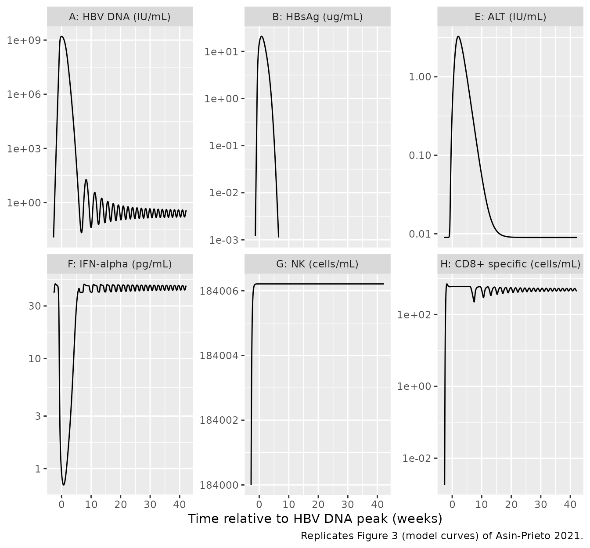
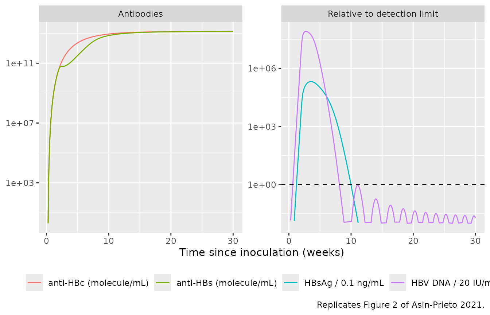
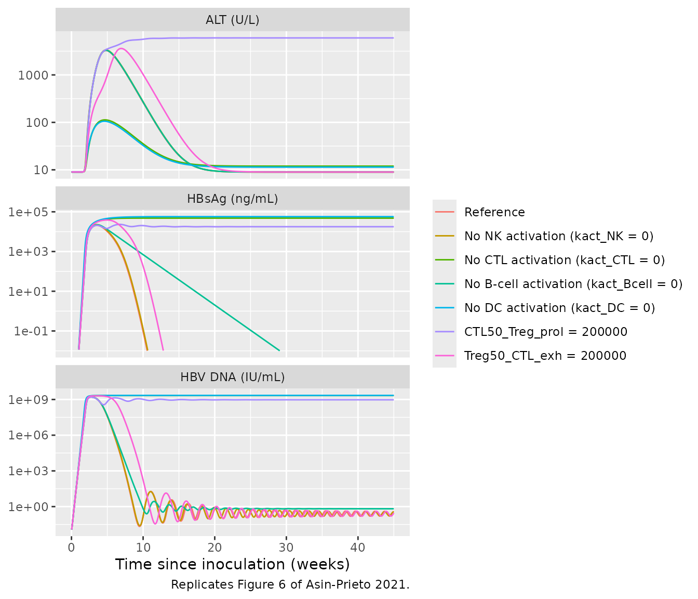
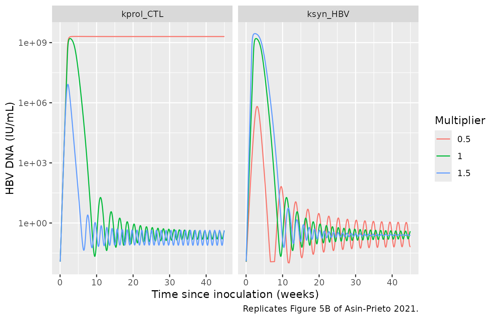

# Acute hepatitis B virus infection QSP model (Asin-Prieto 2021)

## Model and source

- Citation: Asin-Prieto E, Parra-Guillen ZP, Gomez Mantilla JD,
  Vandenbossche J, Stuyckens K, Woot de Trixhe X, Perez-Ruixo JJ,
  Troconiz IF. A quantitative systems pharmacology model for acute viral
  hepatitis B. Comput Struct Biotechnol J. 2021;19:4997-5007.
  <doi:10.1016/j.csbj.2021.08.052>. Equations from Supplementary
  Appendix 1 (equations 1-47); parameter values from Table S1 and
  initial conditions from Table S2 of the supplementary tables.
- Article: <https://doi.org/10.1016/j.csbj.2021.08.052>

Asin-Prieto, Parra-Guillen and colleagues (Computational and Structural
Biotechnology Journal, 2021) built a quantitative systems pharmacology
(QSP) model of **acute hepatitis B virus (HBV) infection** in adults. It
links viral dynamics in the liver to the innate response (dendritic
cells, IFN-alpha, natural killer cells, IFN-gamma), the cellular
adaptive response (cytotoxic T lymphocytes primed in the lymph node),
the humoral response (B cells, plasmablasts, plasma cells, anti-HBs and
anti-HBc) and the immunotolerant response (regulatory T cells driving
CTL exhaustion), across liver, plasma and lymph-node compartments. The
authors implemented it in MATLAB SimBiology.

This is a **typical-individual, deterministic mechanism model**: every
parameter is a literature value, a homeostasis derivation or a
calibrated constant (Table S1), so there is no IIV and no residual-error
model. The paper’s 500-subject chronicity analysis (30% log-normal
variability on 11 parameters) is an exploratory simulation and is not
encoded here.

Infection starts from an HBV inoculum in the liver, `HBV0` = 0.67
virion/mL (Table S2; about 1000 copies in 1500 mL, the minimum
needle-stick inoculum cited in the Discussion). Setting `HBV0 = 0` gives
the uninfected baseline.

``` r

mod <- rxode2::rxode2(readModelDb("AsinPrieto_2021_hepatitisB_qsp"))
length(mod$state)
#> [1] 36
```

``` r

# Tight tolerances: rates span 4e-3 to 33/day and states span 0 to 1.3e8
# cell/mL, and several assertions below read times off threshold crossings.
solve_hbv <- function(params = NULL, times = seq(0, 315, by = 0.25)) {
  as.data.frame(rxode2::rxSolve(
    mod,
    rxode2::et(times),
    params = params,
    atol = 1e-10,
    rtol = 1e-8,
    maxsteps = 1e6
  ))
}
```

## Population

The model was not fitted to individual patient data. Typical-value
predictions were compared with digitised biomarker time courses from
four published cohorts of adults with acute, self-resolving HBV
infection (Table 1 of the paper): Webster 2000 (5 patients identified
during the incubation period), Dunn 2009 (21 patients sampled during the
pre-symptomatic phase), Fisicaro 2009 (2 blood donors who seroconverted)
and Chulanov 2003 (21 hospitalised patients). Only the ALT data were
used to calibrate model parameters (the ALT release and degradation rate
constants); the other biomarkers served as validation data.

## Source trace

| Model element | Source location |
|----|----|
| Hepatocytes, infection, debris, ALT in liver (`iHep_LV`, `dHep_LV`, `ALT_LV`; `Hep_LV` algebraic) | Supplementary Appendix 1, eq 1-3, 18 |
| HBV and HBsAg in liver and plasma | eq 4, 5, 20, 22; HBV DNA output eq 21 |
| Dendritic cells (`DC_LV`, `DCa_LV`, `DC_PL`, `DCa_LN`) | eq 6, 7, 23, 35 |
| IFN-alpha, NK cells, TRAIL+ NK, IFN-gamma | eq 8-12, 24-26 |
| CTL in liver, plasma and lymph node; exhaustion | eq 13-15, 27, 36, 37 |
| Th0 and Treg | eq 16, 17 |
| B cells, plasmablast chain, plasma cells | eq 40-47 (plasma cells summed, see below) |
| Anti-HBs, anti-HBc and antigen complexes | eq 29-34 |
| Replication cut-off below 1 infected hepatocyte | Main text section 2.2 |
| All parameter values | Table S1 (one row per `ini()` entry; see the model file comments) |
| Initial conditions | Table S2; `CTL_LN(0)` from its footnote 35 |
| HBV DNA conversion (0.2 IU/copy) | Table S2 footnote 33 |
| HBsAg conversion (3.011e11 molecule/ug) | Table S1 footnote 2 |

``` r

ini_df <- as.data.frame(mod$iniDf) |>
  dplyr::filter(is.na(neta1)) |>
  dplyr::select(name, est, label)
knitr::kable(ini_df, digits = 6, row.names = FALSE)
```

| name | est | label |
|:---|---:|:---|
| V_LV | 1.5000e+03 | Liver volume (mL) |
| V_PL | 3.0000e+03 | Plasma volume (mL) |
| V_LN | 7.3000e+02 | Lymph nodes volume (mL) |
| HBV0 | 6.7000e-01 | Initial liver HBV inoculum (virion/mL); 0 = uninfected baseline |
| kinf | 0.0000e+00 | Hepatocyte infection rate constant (mL/virion/day) |
| ksyn_HBV | 3.1500e+02 | HBV synthesis rate constant by infected hepatocytes (virion/cell/day) |
| ksyn_HBsAg | 4.5165e+04 | HBsAg synthesis rate constant by infected hepatocytes (molecule/cell/day) |
| kact_DC | 2.0000e-01 | Naive DC activation rate constant (1/day) |
| ksyn_IFNa | 4.5920e+02 | IFN-alpha independent production (pg/mL/day) |
| ksyn_IFNa_DC | 1.0000e-01 | IFN-alpha produced by the pDC fraction of activated DC (pg/cell/day) |
| kact_NK | 1.8000e-05 | Naive NK activation rate constant (1/day) |
| ksyn_IFNg_NK | 3.3400e-03 | IFN-gamma production by activated NK (pg/cell/day) |
| ksyn_IFNg_CTL | 3.4000e-03 | IFN-gamma production by liver IFN-gamma+ CTL (pg/cell/day) |
| kprol_CTL | 5.7000e-01 | Proliferation of activated CTL in liver and lymph node (1/day) |
| kact_Treg | 2.5600e-02 | Activation of Treg in the liver (mL/cell/day) |
| kprol_Treg | 7.0000e-01 | Proliferation of Treg in the liver (1/day) |
| ksyn_ALT | 0.0000e+00 | ALT synthesis by debris hepatocytes (IU/cell/day) |
| ksyn_DC | 1.0760e+04 | Naive DC daily production (cell/mL/day) |
| ksyn_NK | 1.1850e+05 | Naive NK daily production (cell/mL/day) |
| kprod_antiHBs | 1.2000e+09 | Anti-HBs production per plasma cell (molecule/cell/day) |
| kprod_antiHBc | 1.2000e+09 | Anti-HBc production per plasma cell (molecule/cell/day) |
| ksyn_CTL | 1.0000e+03 | CTL production in the lymph node (cell/mL/day) |
| krec_CTL | 1.0000e-01 | CTL recruitment by activated DC in the lymph node (cell/cell/day) |
| kact_CTL | 1.0000e-04 | CTL activation by activated DC in the lymph node (mL/cell/day) |
| ksyn_Bcell | 2.0000e+02 | Naive B-cell daily production (cell/mL/day) |
| kact_Bcell | 1.0000e+00 | Activation of B cells (1/day) |
| kdeath_Hep | 3.9000e-03 | Natural death of healthy and infected hepatocytes (1/day) |
| kdeath_dHep | 1.3000e+01 | Disappearance of debris hepatocytes (1/day) |
| kdeg_HBV | 7.0000e-01 | Natural degradation of HBV (1/day) |
| kdeath_DC | 2.3100e-01 | Natural death of activated and naive DC (1/day) |
| kdeg_IFNa | 5.7400e+00 | Degradation of IFN-alpha (1/day) |
| kdeath_NK | 6.9000e-02 | Natural death of activated and naive NK (1/day) |
| kdeg_IFNg | 3.3400e+01 | Degradation of IFN-gamma (1/day) |
| kexh_CTLa | 4.0300e-01 | Exhaustion rate constant of activated CTL (1/day) |
| kdeath_CTLa | 3.3000e-01 | Natural death of activated CTL (1/day) |
| kdeath_CTLexh | 3.3000e-02 | Natural death of exhausted CTL (1/day) |
| kdeath_Treg | 1.0000e-01 | Natural death of Treg (1/day) |
| kdeg_ALT | 9.0000e-02 | Degradation of ALT (1/day) |
| kdeg_HBsAg | 8.3500e-02 | Natural degradation of HBsAg (1/day) |
| kdeg_antiHBs | 3.3000e-02 | Natural degradation of anti-HBs (1/day) |
| kdeg_cpxHBV | 2.7000e+00 | Natural degradation of the HBV:anti-HBs complex (1/day) |
| kdeg_cpxHBsAg | 2.7000e+00 | Natural degradation of the HBsAg:anti-HBs complex (1/day) |
| kdeg_antiHBc | 3.3000e-02 | Natural degradation of anti-HBc (1/day) |
| kdeath_CTL | 1.0200e-01 | Natural death of CTL precursors in the lymph node (1/day) |
| kdeath_Bcell | 2.0000e-01 | Natural death of naive B cells (1/day) |
| MTT_PB | 5.0000e+01 | Mean transit time of plasmablasts (day) |
| N_PB | 5.0000e+00 | Number of plasmablast transit compartments (unitless) |
| kdeath_PB | 1.0000e-01 | Natural death of plasmablasts (1/day) |
| kdeath_PC | 1.0000e-01 | Natural death of plasma cells in plasma and lymph node (1/day) |
| Hep_tot | 1.3300e+08 | Total liver hepatocytes (cell/mL) |
| pDC_ratio | 3.6000e-01 | Fraction of pDC among activated DC (unitless) |
| CTLa_ratio | 6.5000e-01 | Fraction of activated CTL that are IFN-gamma+ (unitless) |
| NK_ratio | 5.0000e-01 | Fraction of activated NK that are TRAIL+ (unitless) |
| CTLa_max_LV | 2.0000e+06 | Maximal concentration of activated CTL in the liver (cell/mL) |
| Treg_max_LV | 2.0000e+06 | Maximal concentration of Treg in the liver (cell/mL) |
| CTLa_max_LN | 1.0000e+05 | Maximal concentration of activated CTL in the lymph node (cell/mL) |
| kLV_PL_HBV | 1.0000e+00 | HBV distribution from liver to plasma (1/day) |
| kPL_LV_HBV | 1.0000e+00 | HBV distribution from plasma to liver (1/day) |
| kLV_PL_HBsAg | 1.0000e+00 | HBsAg distribution from liver to plasma (1/day) |
| kPL_LV_HBsAg | 1.0000e+00 | HBsAg distribution from plasma to liver (1/day) |
| kPL_LV_DC | 5.9900e-02 | DC distribution from plasma to liver (1/day) |
| kLV_LN_DCa | 9.0000e-01 | Activated DC distribution from liver to lymph node (1/day) |
| kPL_LV_NK | 5.7500e-01 | NK distribution from plasma to liver (1/day) |
| kPL_LV_CTLa | 9.0000e-01 | Activated CTL distribution from plasma to liver (1/day) |
| kLV_PL_ALT | 9.0000e-02 | ALT distribution from liver to plasma (1/day) |
| kLN_PL_CTLa | 9.0000e-01 | Activated CTL distribution from lymph node to plasma (1/day) |
| kon_antiHBs | 0.0000e+00 | Association rate of HBV and HBsAg with anti-HBs (mL/molecule/day) |
| koff_antiHBs | 1.0000e+01 | Dissociation rate of anti-HBs complexes (1/day) |
| kLN_PL_PC | 9.0000e-01 | Plasma-cell distribution from lymph node to plasma (1/day) |
| klytic_CTL | 3.7000e-05 | Cytopathic effect of CTL on infected hepatocytes (mL/cell/day) |
| klytic_NK | 1.0000e-06 | Cytopathic effect of NK on infected hepatocytes (mL/cell/day) |
| IFNa50_HBV | 1.0000e+02 | IFN-alpha inhibiting 50% of HBV synthesis (pg/mL) |
| IFNg50_HBV | 5.3170e+02 | IFN-gamma inhibiting 50% of HBV synthesis (pg/mL) |
| HBV50_DC | 1.0000e+01 | HBV triggering 50% of maximal DC activation (virion/mL) |
| HBsAg50_IFNa | 2.2000e+11 | Liver HBsAg inhibiting 50% of DC-induced IFN-alpha synthesis (molecule/mL) |
| SLP_IFNa_NK | 5.2500e+00 | Fractional change in NK activation per unit IFN-alpha (mL/pg) |
| HBV50_CTL_prol | 1.0000e+01 | HBV triggering 50% of maximal CTL proliferation (virion/mL) |
| gamma_CTL | 4.0000e+00 | Shape parameter of HBV effect on CTL proliferation (unitless) |
| Treg50_CTL_exh | 1.0000e+06 | Treg triggering 50% of maximal CTL exhaustion (cell/mL) |
| CTL50_Treg_prol | 1.0000e+06 | Activated CTL triggering 50% of maximal Treg proliferation (cell/mL) |
| DC50_CTL_prol | 1.0000e+00 | Activated DC triggering 50% of maximal CTL proliferation in lymph node (cell/mL) |
| DC50_Bcell_prol | 1.0000e+00 | Activated DC triggering 50% of maximal B-cell activation in lymph node (cell/mL) |

## Validation 1: uninfected steady state

With no inoculum the system should hold at its baseline: the paper
derived several synthesis rates and initial conditions “to keep
homeostasis” (Table S1 footnotes 3-5, 8-12 and Table S2 footnotes 32 and
35).

``` r

base <- solve_hbv(params = c(HBV0 = 0))
drift <- tibble::tibble(state = mod$state) |>
  dplyr::rowwise() |>
  dplyr::mutate(
    start = base[[state]][1],
    end = base[[state]][nrow(base)],
    rel_change = ifelse(start == 0, end, (end - start) / start)
  ) |>
  dplyr::ungroup()
drift |>
  dplyr::filter(abs(rel_change) > 1e-6) |>
  knitr::kable(digits = 4)
```

| state   |    start |          end | rel_change |
|:--------|---------:|-------------:|-----------:|
| dHep_LV | 4.00e+04 |   39900.0000 |    -0.0025 |
| DC_LV   | 1.92e+04 |   19182.8614 |    -0.0009 |
| NK_LV   | 2.70e+06 | 2760253.9825 |     0.0223 |
| NKa_LV  | 3.00e+05 |  306516.2038 |     0.0217 |
| IFNg_LV | 3.00e+01 |      30.6516 |     0.0217 |
| ALT_LV  | 1.80e-02 |       0.0180 |    -0.0025 |
| ALT_PL  | 9.00e-03 |       0.0090 |    -0.0025 |
| DC_PL   | 3.70e+04 |   36988.6559 |    -0.0003 |
| NK_PL   | 1.84e+05 |  184006.2112 |     0.0000 |

``` r


stopifnot(
  # The infection-dependent states stay exactly at zero.
  all(base$iHep_LV == 0),
  all(base$HBV_PL == 0),
  # Every state is within 3% of its baseline after 45 weeks.
  max(abs(drift$rel_change)) < 0.03
)
```

Two small drifts remain, both from rounding in the published tables
rather than from the model structure:

- `NK_LV`, `NKa_LV` and `IFNg_LV` rise by about 2%. Table S1 footnote 19
  derives `kPL_LV_NK` from a plasma NK level of 1.8e5 cell/mL, but Table
  S2 sets `NK_PL(0)` to 1.84e5; the extra 2% of NK influx carries
  through to activated NK and the IFN-gamma they produce.
- `dHep_LV` and both ALT pools settle 0.25% low. Table S1 footnote 12
  derives `kdeath_dHep` = 13/day from 1.3e8 hepatocytes, while `Hep_tot`
  is 1.33e8 and `dHep_LV(0)` is the rounded 40000 cell/mL.

## Validation 2: the reference acute infection (Figures 2 and 3)

``` r

ref <- solve_hbv()

t_peak <- ref$time[which.max(ref$HBVDNA)]
after_peak <- ref[ref$time > t_peak, ]
t_lt200 <- after_peak$time[which(after_peak$HBVDNA < 200)[1]]
t_lt20 <- after_peak$time[which(after_peak$HBVDNA < 20)[1]]
t_alt_peak <- ref$time[which.max(ref$ALT_UL)]
hbsag_pos <- ref$time[ref$HBsAg_ngmL > 0.1]
hbv_gt240 <- ref$time[ref$HBVDNA > 240]

gates <- tibble::tribble(
  ~quantity, ~paper, ~paper_days, ~model_days,
  "Time from inoculation to HBV DNA peak", "3 weeks", 21, t_peak,
  "Time from inoculation to HBV DNA < 200 IU/mL", "52 days", 52, t_lt200,
  "Time from inoculation to HBV DNA < 20 IU/mL", "approx. 8 weeks", 56, t_lt20,
  "ALT peak after HBV DNA peak", "2 weeks", 14, t_alt_peak - t_peak,
  "ALT peak after first detectable HBsAg (> 0.1 ng/mL)", "3 weeks", 21, t_alt_peak - min(hbsag_pos),
  "HBsAg above 0.1 ng/mL until", "up to 10 weeks", 70, max(hbsag_pos),
  "Duration of HBsAg antigenemia", "60 days", 60, max(hbsag_pos) - min(hbsag_pos),
  "Duration of HBV DNA above 240 IU/mL", "7 weeks", 49, max(hbv_gt240) - min(hbv_gt240)
) |>
  dplyr::mutate(pct_diff = 100 * (model_days - paper_days) / paper_days)

gates |>
  dplyr::rename(
    "Quantity" = quantity,
    "Paper (text)" = paper,
    "Paper (days)" = paper_days,
    "Model (days)" = model_days,
    "Difference (%)" = pct_diff
  ) |>
  knitr::kable(digits = 1)
```

| Quantity | Paper (text) | Paper (days) | Model (days) | Difference (%) |
|:---|:---|---:|---:|---:|
| Time from inoculation to HBV DNA peak | 3 weeks | 21 | 19.2 | -8.3 |
| Time from inoculation to HBV DNA \< 200 IU/mL | 52 days | 52 | 54.2 | 4.3 |
| Time from inoculation to HBV DNA \< 20 IU/mL | approx. 8 weeks | 56 | 57.0 | 1.8 |
| ALT peak after HBV DNA peak | 2 weeks | 14 | 14.5 | 3.6 |
| ALT peak after first detectable HBsAg (\> 0.1 ng/mL) | 3 weeks | 21 | 25.0 | 19.0 |
| HBsAg above 0.1 ng/mL until | up to 10 weeks | 70 | 69.8 | -0.4 |
| Duration of HBsAg antigenemia | 60 days | 60 | 61.0 | 1.7 |
| Duration of HBV DNA above 240 IU/mL | 7 weeks | 49 | 47.8 | -2.6 |

The paper states the HBV DNA times as “52 days after viral peak” and “a
predicted time from peak to negativity (20 IU/mL) of 55 days”. Counted
from the peak, the model gives 35 and 37.8 days; counted from
inoculation it gives 54.2 and 57 days, matching the paper’s “complete
viral eradication (\< 20 IU/mL) in approximately 8 weeks”. The table
therefore compares the inoculation-based times.

``` r

# The model is deterministic, so these checks do not depend on a random
# cohort. The bounds allow for the paper's rounded reporting (weeks, "52
# days") and for the plasma-cell simplification described under
# Assumptions and deviations.
stopifnot(
  abs(gates$pct_diff[gates$quantity == "Time from inoculation to HBV DNA peak"]) < 15,
  all(abs(gates$pct_diff[-c(1, 5)]) < 10),
  # Figure 3B: HBsAg peaks in the tens of ug/mL.
  max(ref$HBsAg_ngmL) / 1000 > 10, max(ref$HBsAg_ngmL) / 1000 < 100,
  # Figure 3F: IFN-alpha in plasma dips from 40 pg/mL to about 1 pg/mL.
  min(ref$IFNa_PL) < 2,
  # Figure 3H: HBV-specific CD8+ cells in plasma plateau near 1e3 cell/mL
  # and persist to week 30. After clearance they oscillate (about 250-600
  # cell/mL) with the low-level residual infection, so check the median.
  median(ref$CTLa_PL[ref$time >= 56 & ref$time <= 210]) > 300,
  median(ref$CTLa_PL[ref$time >= 56 & ref$time <= 210]) < 1000,
  # HBV DNA stays below 20 IU/mL from clearance to week 45.
  all(ref$HBVDNA[ref$time >= 60] < 20)
)
```

The ALT peak lags the first detectable HBsAg by about 3.6 weeks instead
of 3; that gate is reported but not asserted. After clearance, liver HBV
settles around 10 virion/mL (the DC and CTL half-activation level), and
the immune cells and virus oscillate gently around that point; HBV DNA
in plasma stays below 1 IU/mL.

``` r

# Replicates Figure 3 of Asin-Prieto 2021 (model curves only; the digitised
# clinical points are not reproduced). Time is relative to the HBV DNA peak,
# as in the paper.
fig3 <- ref |>
  dplyr::mutate(week = (time - t_peak) / 7) |>
  dplyr::transmute(
    week,
    "A: HBV DNA (IU/mL)" = HBVDNA,
    "B: HBsAg (ug/mL)" = HBsAg_ngmL / 1000,
    "E: ALT (IU/mL)" = ALT_PL,
    "F: IFN-alpha (pg/mL)" = IFNa_PL,
    "G: NK (cells/mL)" = NK_PL,
    "H: CD8+ specific (cells/mL)" = CTLa_PL
  ) |>
  tidyr::pivot_longer(-week, names_to = "panel", values_to = "value") |>
  dplyr::filter(value > 1e-3)

ggplot(fig3, aes(week, value)) +
  geom_line() +
  scale_y_log10() +
  facet_wrap(~panel, scales = "free_y") +
  labs(
    x = "Time relative to HBV DNA peak (weeks)",
    y = NULL,
    caption = "Replicates Figure 3 (model curves) of Asin-Prieto 2021."
  )
```



``` r

# Replicates Figure 2 of Asin-Prieto 2021 for HBV DNA and HBsAg, normalised to
# their detection limits (20 IU/mL and 0.1 ng/mL). The paper does not print
# the anti-HBs or anti-HBc unit conversions, so the antibodies are shown in
# molecule/mL on a separate panel.
fig2 <- ref |>
  dplyr::mutate(week = time / 7) |>
  dplyr::filter(week <= 30) |>
  dplyr::transmute(
    week,
    "HBV DNA / 20 IU/mL" = HBVDNA / 20,
    "HBsAg / 0.1 ng/mL" = HBsAg_ngmL / 0.1,
    "anti-HBs (molecule/mL)" = antiHBs_PL,
    "anti-HBc (molecule/mL)" = antiHBc_PL
  ) |>
  tidyr::pivot_longer(-week, names_to = "series", values_to = "value") |>
  dplyr::mutate(
    panel = ifelse(grepl("^anti", series), "Antibodies", "Relative to detection limit")
  ) |>
  dplyr::filter(value > 1e-2)

ggplot(fig2, aes(week, value, colour = series)) +
  geom_line() +
  geom_hline(
    data = data.frame(panel = "Relative to detection limit", y = 1),
    aes(yintercept = y),
    linetype = "dashed"
  ) +
  scale_y_log10() +
  facet_wrap(~panel, scales = "free_y") +
  labs(
    x = "Time since inoculation (weeks)",
    y = NULL,
    colour = NULL,
    caption = "Replicates Figure 2 of Asin-Prieto 2021."
  ) +
  theme(legend.position = "bottom")
```



The antibodies rise to a plateau and are still rising slowly at week 30,
whereas Figure 2 and Figures 3C/3D show them peaking near week 18 and
then declining. See Assumptions and deviations.

## Validation 3: knock-out analysis (Figure 6)

The paper switched off one immune pathway at a time. It reports that
blocking NK activation had no impact, that blocking B-cell activation or
raising Treg-mediated CTL exhaustion five-fold slowed clearance without
changing the outcome, and that blocking CTL or DC activation, or raising
the sensitivity of Treg proliferation to CTL five-fold, led to chronic
infection (the last with sustained hepatic damage).

``` r

scenarios <- list(
  "Reference" = NULL,
  "No NK activation (kact_NK = 0)" = c(kact_NK = 0),
  "No CTL activation (kact_CTL = 0)" = c(kact_CTL = 0),
  "No B-cell activation (kact_Bcell = 0)" = c(kact_Bcell = 0),
  "No DC activation (kact_DC = 0)" = c(kact_DC = 0),
  "CTL50_Treg_prol = 200000" = c(CTL50_Treg_prol = 2e5),
  "Treg50_CTL_exh = 200000" = c(Treg50_CTL_exh = 2e5)
)
paper_outcome <- c(
  "resolves", "resolves", "chronic", "resolves", "chronic", "chronic", "resolves"
)
ko <- dplyr::bind_rows(lapply(names(scenarios), function(nm) {
  solve_hbv(params = scenarios[[nm]]) |> dplyr::mutate(scenario = nm)
}))
ko_summary <- ko |>
  dplyr::group_by(scenario) |>
  dplyr::summarise(
    peak_HBVDNA = max(HBVDNA),
    HBVDNA_wk45 = HBVDNA[time == 315],
    ALT_wk45 = ALT_UL[time == 315],
    .groups = "drop"
  ) |>
  dplyr::mutate(
    model_outcome = ifelse(HBVDNA_wk45 < 20, "resolves", "chronic"),
    paper_outcome = paper_outcome[match(scenario, names(scenarios))]
  ) |>
  dplyr::arrange(match(scenario, names(scenarios)))

ko_summary |>
  dplyr::rename(
    "Scenario" = scenario,
    "Peak HBV DNA (IU/mL)" = peak_HBVDNA,
    "HBV DNA at week 45 (IU/mL)" = HBVDNA_wk45,
    "ALT at week 45 (U/L)" = ALT_wk45,
    "Model outcome" = model_outcome,
    "Paper outcome" = paper_outcome
  ) |>
  dplyr::mutate(dplyr::across(dplyr::where(is.numeric), ~ signif(.x, 3))) |>
  knitr::kable()
```

| Scenario | Peak HBV DNA (IU/mL) | HBV DNA at week 45 (IU/mL) | ALT at week 45 (U/L) | Model outcome | Paper outcome |
|:---|---:|---:|---:|:---|:---|
| Reference | 1.60e+09 | 3.86e-01 | 8.98 | resolves | resolves |
| No NK activation (kact_NK = 0) | 1.71e+09 | 3.65e-01 | 8.98 | resolves | resolves |
| No CTL activation (kact_CTL = 0) | 2.14e+09 | 2.14e+09 | 12.00 | chronic | chronic |
| No B-cell activation (kact_Bcell = 0) | 1.62e+09 | 6.59e-01 | 8.98 | resolves | resolves |
| No DC activation (kact_DC = 0) | 2.20e+09 | 2.20e+09 | 11.40 | chronic | chronic |
| CTL50_Treg_prol = 200000 | 1.60e+09 | 9.42e+08 | 6020.00 | chronic | chronic |
| Treg50_CTL_exh = 200000 | 2.02e+09 | 2.91e-01 | 8.98 | resolves | resolves |

``` r


# Resolution is HBV DNA < 20 IU/mL at week 45, the paper's definition.
stopifnot(
  identical(ko_summary$model_outcome, ko_summary$paper_outcome),
  # "sustained hepatic damage" in the CTL50_Treg_prol scenario
  ko_summary$ALT_wk45[ko_summary$scenario == "CTL50_Treg_prol = 200000"] > 1000
)
```

``` r

# Replicates Figure 6 of Asin-Prieto 2021.
ko |>
  dplyr::mutate(week = time / 7, scenario = factor(scenario, names(scenarios))) |>
  dplyr::select(week, scenario, "HBV DNA (IU/mL)" = HBVDNA, "HBsAg (ng/mL)" = HBsAg_ngmL, "ALT (U/L)" = ALT_UL) |>
  tidyr::pivot_longer(-c(week, scenario), names_to = "marker", values_to = "value") |>
  dplyr::filter(value > 1e-2) |>
  ggplot(aes(week, value, colour = scenario)) +
  geom_line() +
  scale_y_log10() +
  facet_wrap(~marker, ncol = 1, scales = "free_y") +
  labs(
    x = "Time since inoculation (weeks)",
    y = NULL,
    colour = NULL,
    caption = "Replicates Figure 6 of Asin-Prieto 2021."
  ) +
  theme(legend.position = "right")
```



## Validation 4: parameter scan (Figure 5B)

The paper reports that of the influential parameters, only a +/-50%
change in CTL proliferation (`kprol_CTL`) switched the outcome from
responder to non-responder; the same change in HBV synthesis
(`ksyn_HBV`) moved peak levels and time to cure but not the outcome.

``` r

scan <- tidyr::expand_grid(
  parameter = c("kprol_CTL", "ksyn_HBV"),
  factor = c(0.5, 1, 1.5)
)
scan_sim <- dplyr::bind_rows(lapply(seq_len(nrow(scan)), function(i) {
  base_value <- ini_df$est[ini_df$name == scan$parameter[i]]
  p <- stats::setNames(base_value * scan$factor[i], scan$parameter[i])
  solve_hbv(params = p) |>
    dplyr::mutate(parameter = scan$parameter[i], factor = scan$factor[i])
}))
scan_summary <- scan_sim |>
  dplyr::group_by(parameter, factor) |>
  dplyr::summarise(HBVDNA_wk45 = HBVDNA[time == 315], .groups = "drop") |>
  dplyr::mutate(outcome = ifelse(HBVDNA_wk45 < 20, "resolves", "chronic"))
knitr::kable(scan_summary, digits = 3)
```

| parameter | factor |  HBVDNA_wk45 | outcome  |
|:----------|-------:|-------------:|:---------|
| kprol_CTL |    0.5 | 2.012977e+09 | chronic  |
| kprol_CTL |    1.0 | 3.860000e-01 | resolves |
| kprol_CTL |    1.5 | 4.340000e-01 | resolves |
| ksyn_HBV  |    0.5 | 6.800000e-02 | resolves |
| ksyn_HBV  |    1.0 | 3.860000e-01 | resolves |
| ksyn_HBV  |    1.5 | 2.460000e-01 | resolves |

``` r


stopifnot(
  scan_summary$outcome[scan_summary$parameter == "kprol_CTL" & scan_summary$factor == 0.5] == "chronic",
  all(scan_summary$outcome[scan_summary$parameter == "ksyn_HBV"] == "resolves"),
  all(scan_summary$outcome[scan_summary$factor >= 1] == "resolves")
)

scan_sim |>
  dplyr::filter(HBVDNA > 1e-2) |>
  ggplot(aes(time / 7, HBVDNA, colour = factor(factor))) +
  geom_line() +
  scale_y_log10() +
  facet_wrap(~parameter) +
  labs(
    x = "Time since inoculation (weeks)",
    y = "HBV DNA (IU/mL)",
    colour = "Multiplier",
    caption = "Replicates Figure 5B of Asin-Prieto 2021."
  )
```



## Assumptions and deviations

### Parameters used by the printed equations but not reported

Table S1 is described as listing all model parameters, but five symbols
in Supplementary Appendix 1 have no value anywhere in the paper or its
supplements. No value was invented for any of them:

- **The memory-CTL branch is omitted.** `CTLm_ref_LN`, `CTLm_LN` and
  `CTLm_PL` (eq 28, 38, 39) need `k_tr_CTLm`, `k_death_CTLm_ref` and
  `k_LN_PL_CTLm`, none of which is reported. Memory CTL appear in no
  other equation, so the branch is an output-only sink and dropping it
  changes no other state. Table S1’s `k_death_CTLm` (0.22/day) and
  `CTLm_RATIO` (0.05) are therefore not carried.
- **Short- and long-lived plasma cells are merged.** Eq 46/47 split the
  plasmablast output by `PC_RATIO` and give long-lived cells their own
  death rate `k_death_LPC`; neither is reported. Table S1 has a single
  plasma-cell death rate, `k_death_PC` = 0.1/day, described as applying
  to plasma cells in plasma and lymph node. With
  `k_death_LPC = k_death_PC` the two pools have identical kinetics and
  the antibodies depend only on their sum, so the model carries one pool
  `PC = SPC + LPC` (in lymph node and plasma) and `PC_RATIO` drops out.
  A slower long-lived death rate would sustain the antibodies longer;
  across plausible values (1e-4 to 0.1/day) it moves the HBV DNA
  clearance time by about 4 days. This simplification is the most likely
  source of the remaining 2-4% gap to the paper’s clearance times.

### The replication cut-off

Section 2.2 states that viral replication was considered negligible when
fewer than 1 hepatocyte was infected, without giving the form of the
threshold. It is encoded literally: HBV synthesis is switched off while
the whole-liver infected-cell count `iHep_LV * V_LV` is below 1 cell
(not latched). This matters only during the first day after inoculation.
After clearance a residual 0.05-1 infected cell/mL (tens to hundreds of
cells in the liver) persists, so the cut-off never fires again:
dendritic-cell and B-cell activation continue at a low level and the
antibodies plateau instead of declining after week 18 as in Figures 2,
3C and 3D. The alternative reading (switch off replication and remove
infected hepatocytes once fewer than 1 infected cell per mL remains
after the peak) reproduces the antibody peak near week 17 but collapses
the CD8+ plateau of Figure 3H by week 12, so no single reading
reproduces every published figure. The literal reading was kept.

### Errata in the printed equations

Each of these was resolved by the homeostasis derivations in the table
footnotes, by mass balance, or by the published figures:

1.  **Eq 25.** The printed NK death term in plasma acts on `NK_LV`; the
    Table S1 footnote 10 derivation of `ksyn_NK`
    (`(kdeath_NK + kPL_LV_NK) * NK_PL`) requires it to act on `NK_PL`.
2.  **Eq 37.** The printed lymph-node efflux of activated CTL acts on
    the liver pool `CTL*_LV`; eq 27 receives it from `CTL*_LN`, so mass
    balance requires `CTLa_LN`.
3.  **Eq 14.** The printed death term for liver activated CTL uses
    `k_death_CTL` (0.102/day, the lymph-node precursor death rate that
    footnote 16 describes as including recirculation). The model uses
    `k_death_CTL*` (0.33/day, Table S1 “Natural death of CTL\*“), as eq
    27 and 37 do for the other activated-CTL pools. With 0.102/day the
    liver CTL expand faster, the HBV DNA peak falls to about 1.6e8 IU/mL
    (Figure 3A shows about 1e9) and the ALT peak to about 400 U/L
    (Figure 3E shows 1-3 IU/mL, i.e. 1000-3000 U/L).
4.  **Eq 8.** As printed, the HBsAg inhibition multiplies only the pDC
    term, which leaves IFN-alpha flat near its 40 pg/mL baseline. Figure
    3F shows IFN-alpha dipping to about 1 pg/mL; that requires the
    inhibition to multiply the whole synthesis (basal plus pDC), which
    is how it is encoded.
5.  **Eq 12.** The printed equation has a separate basal term
    `k_syn_IFNgamma`, but Table S1 has no such row: footnote 5 derives
    `k_syn_IFNgamma_NK = kdeg_IFNg * IFNg_LV / NK*_LV` = 0.00334, so all
    basal IFN-gamma production is carried by activated NK cells.
6.  **Table S1 footnote 4** computes `kact_NK` with a slope of 0.0035
    mL/pg, whereas the table gives `SLP_IFNa_NK` = 5.25 mL/pg. The
    tabulated pair (`kact_NK` = 1.82e-5/day with slope 5.25) is
    self-consistent at baseline and is used.
7.  **Naming variants of a single parameter:** `k_on_HBsAg` /
    `k_off_HBsAg` in eq 31 are `k_on_antiHBs` / `k_off_antiHBs`;
    `k_LN_PL_LPC` and `k_LN_LPL_PC` in eq 30/47 are `k_LN_PL_PC`;
    `k_rec_DC` in eq 36 is `k_rec_CTL`; `k_exh_CTL*` is Table S1
    `k_ex_CTL*`; `k_deg_complexHBsAg` in eq 34 is Table S1
    `k_deg_complexantiHBs`. Eq 40/41 print `DC50_CTL_prol` for B-cell
    activation; the model uses Table S1’s `DC50_Bcell_prol`, which has
    the same value (1 cell/mL).

### Other conventions

- `CTL_LN(0)` is set to `ksyn_CTL / kdeath_CTL` = 9804 cell/mL, the
  definition in Table S2 footnote 35; the table prints it rounded to
  1e4.
- Table S2 lists ALT in “molec/mL”; Table S1 footnotes 8 and 32 and
  Figure 3E use IU/mL, which is the unit used here (`ALT_UL` = 1000 x
  `ALT_PL`).
- The IFN-alpha and IFN-gamma terms in eq 4 and 5 use the liver
  concentrations; plasma IFN levels are algebraic volume-scaled copies
  of the liver levels (eq 24, 26).
- The text gives the hepatocyte count as 2.4e11 cells in 1470 mL; Table
  S1 gives `Hep_tot` = 1.33e8 cell/mL (citing a different source), which
  is used.
- All parameters are exposed as typical values without `fixed()`, so
  they can be recalibrated; none was estimated in the usual statistical
  sense.

## Session information

``` r

sessionInfo()
#> R version 4.6.1 (2026-06-24)
#> Platform: x86_64-pc-linux-gnu
#> Running under: Ubuntu 24.04.5 LTS
#> 
#> Matrix products: default
#> BLAS:   /usr/lib/x86_64-linux-gnu/openblas-pthread/libblas.so.3 
#> LAPACK: /usr/lib/x86_64-linux-gnu/openblas-pthread/libopenblasp-r0.3.26.so;  LAPACK version 3.12.0
#> 
#> locale:
#>  [1] LC_CTYPE=C.UTF-8       LC_NUMERIC=C           LC_TIME=C.UTF-8       
#>  [4] LC_COLLATE=C.UTF-8     LC_MONETARY=C.UTF-8    LC_MESSAGES=C.UTF-8   
#>  [7] LC_PAPER=C.UTF-8       LC_NAME=C              LC_ADDRESS=C          
#> [10] LC_TELEPHONE=C         LC_MEASUREMENT=C.UTF-8 LC_IDENTIFICATION=C   
#> 
#> time zone: UTC
#> tzcode source: system (glibc)
#> 
#> attached base packages:
#> [1] stats     graphics  grDevices utils     datasets  methods   base     
#> 
#> other attached packages:
#> [1] ggplot2_4.0.3         tidyr_1.3.2           dplyr_1.2.1          
#> [4] rxode2_5.1.8          nlmixr2lib_0.3.2.9000
#> 
#> loaded via a namespace (and not attached):
#>  [1] generics_0.1.4      sass_0.4.10         xml2_1.6.0         
#>  [4] digest_0.6.39       magrittr_2.0.5      RColorBrewer_1.1-3 
#>  [7] evaluate_1.0.5      grid_4.6.1          fastmap_1.2.0      
#> [10] lotri_1.0.5         jsonlite_2.0.0      whisker_0.4.1      
#> [13] rxode2ll_2.0.18     backports_1.5.1     purrr_1.2.2        
#> [16] scales_1.4.0        textshaping_1.0.5   jquerylib_0.1.4    
#> [19] cli_3.6.6           crayon_1.5.3        symengine_0.2.14   
#> [22] rlang_1.3.0         withr_3.0.3         cachem_1.1.0       
#> [25] yaml_2.3.12         otel_0.2.0          tools_4.6.1        
#> [28] parallel_4.6.1      memoise_2.0.1       checkmate_2.3.4    
#> [31] rxode2lincmt_0.1.0  vctrs_0.7.3         R6_2.6.1           
#> [34] lifecycle_1.0.5     fs_2.1.0            ragg_1.5.2         
#> [37] PreciseSums_0.7     fontawesome_0.5.3   pkgconfig_2.0.3    
#> [40] desc_1.4.3          rex_1.2.2           pkgdown_2.2.1      
#> [43] pillar_1.11.1       bslib_0.12.0        gtable_0.3.6       
#> [46] glue_1.8.1          data.table_1.18.6.1 Rcpp_1.1.2         
#> [49] systemfonts_1.3.2   tidyselect_1.2.1    xfun_0.62          
#> [52] tibble_3.3.1        sys_3.4.3           knitr_1.52         
#> [55] farver_2.1.2        dparser_1.3.1-14    htmltools_0.5.9    
#> [58] labeling_0.4.3      rmarkdown_2.32      compiler_4.6.1     
#> [61] S7_0.2.2            downlit_0.4.5       askpass_1.2.1      
#> [64] openssl_2.4.2
```
