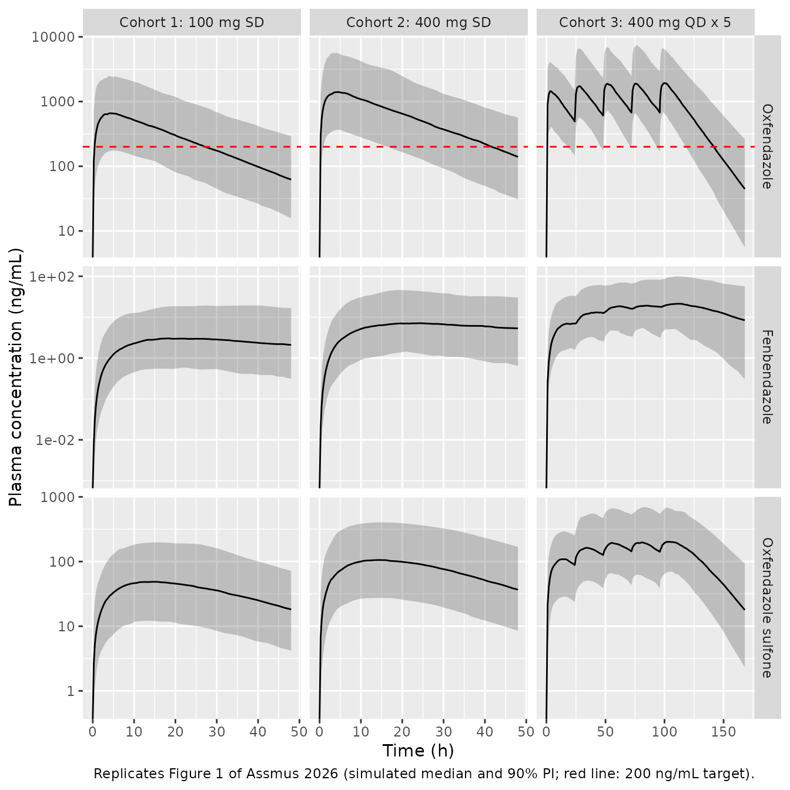
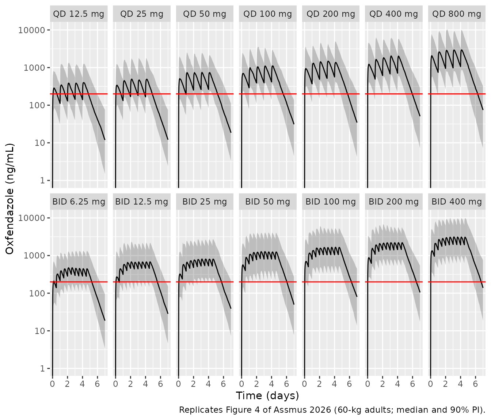

# Oxfendazole (Assmus 2026)

## Model and source

- Citation: Assmus F, Adehin A, Hoglund RM, Nyaulingo G, Mbarak H, Jongo
  S, Ackermann E, Reus E, Keiser J, Barreira Da Silva Rocha F, Specht S,
  Scandale I, Tarning J. Repurposing Oxfendazole for Onchocerciasis:
  Population Pharmacokinetics of a Tablet Formulation in Healthy African
  Adults. CPT Pharmacometrics Syst Pharmacol. 2026.
  <doi:10.1002/psp4.70189>. Structure and parameter values taken from
  the final NONMEM control stream (Supplementary Code S1), whose \$THETA
  equals Table 1 of the main paper; the IIV on KA follows Table 1 (see
  vignette Errata).
- Description: Joint parent + two-metabolite population PK model for
  oral oxfendazole (immediate-release tablet, fasted) and its
  metabolites fenbendazole and oxfendazole sulfone in healthy African
  adults (Assmus 2026). First-order absorption with first-pass
  metabolism: a logit-scale fraction of the absorbed dose is converted
  to oxfendazole sulfone before reaching the systemic circulation, the
  remainder enters the oxfendazole central compartment. One-compartment
  disposition for each analyte with linear elimination; oxfendazole
  clearance is split equally (fraction fixed at 0.5 for identifiability)
  between formation of fenbendazole and formation of oxfendazole
  sulfone. Dose-limited relative bioavailability F = (dose / 34.7
  mg)^-0.541, coefficients fixed from an earlier single-ascending-dose
  study. Allometric body-weight scaling (0.75 on clearances, 1 on
  volumes, reference 70 kg) on all six disposition parameters.
  Inter-occasion variability on F and KA across up to five dosing
  occasions. The model is on the authors’ molar scale (dose in nmol,
  concentrations in nmol/L); metabolite clearances and volumes are
  apparent values relative to the unknown true fraction metabolised.
- Article: <https://doi.org/10.1002/psp4.70189> (open access,
  PMC12896373)

The final NONMEM control stream is printed in the article’s
Supplementary Information (Code S1). Its `$THETA` block matches Table 1
of the main paper to every printed digit, so the packaged model is built
from the control stream and cross-checked against Table 1.

## Population

The model was fitted to the 24 healthy adults who received oxfendazole
in the HELP-OFZ Phase 1 study (NCT04920292), run in 2022 at the Bagamoyo
Clinical Trial Facility, Tanzania. Thirty participants were enrolled;
the six placebo recipients were excluded from the analysis. Eight
participants were in each of three cohorts: a 100 mg single dose, a 400
mg single dose, and 400 mg once daily for 5 days, all given as an
immediate-release tablet in the fasted state. All participants were of
Black African ethnicity; 10 (41.7%) were female. Median age was 28 years
(19-41), median body weight 58 kg (42-75), median height 161.5 cm and
median BMI 21.4 kg/m^2 (Supplementary Table S2 and Results 3.1). The 984
post-dose samples (328 per analyte) were converted to molar units before
fitting; 8.4% were below the limit of quantification and were omitted.

The same information is available programmatically via
`readModelDb("Assmus_2026_oxfendazole")()$population`.

## Source trace

The per-parameter origin is recorded as an in-file comment next to each
`ini()` entry in `inst/modeldb/specificDrugs/Assmus_2026_oxfendazole.R`.

| Equation / parameter | Value | Source location |
|----|----|----|
| `lcl` (CL_OXF/F, 70 kg) | log(3.54) L/h | Table 1; Code S1 `$THETA 1` |
| `lvc` (V_OXF/F, 70 kg) | log(67.2) L | Table 1; `$THETA 2` |
| `lka` (KA) | log(0.695) 1/h | Table 1; `$THETA 3` |
| `lfdepot` (F) | log(1), fixed | Table 1; `$THETA 4 (1) FIX` |
| `lcl_fenbendazole` (CL_FEN/F) | log(94.4) L/h | Table 1; `$THETA 5` |
| `lvc_fenbendazole` (V_FEN/F) | log(3370) L | Table 1; `$THETA 6` |
| `fm_fenbendazole` (f_M) | 0.5, fixed | Table 1; `$THETA 7 (0.5) FIX`; Methods 2.4 |
| `lcl_oxfsfn` (CL_OXF-SO2/F) | log(15.8) L/h | Table 1; `$THETA 8` |
| `lvc_oxfsfn` (V_OXF-SO2/F) | log(206) L | Table 1; `$THETA 9` |
| `logitfm_oxfsfn` (f_FP) | logit(0.0549) | `$THETA 10`; Table 1 prints 0.055 |
| `e_wt_cl`, `e_wt_vc` | 0.75, 1, fixed; reference 70 kg | Methods 2.4; `$PK` |
| `e_dose_fdepot`, `dose_ref_fdepot` | -0.541, 34.7 mg, fixed | Eq. 1a; Table 1 last row; `$PK COV` |
| IIV variances (CL, V, F, CL_FEN, V_FEN, CL_OXF-SO2, f_FP) | 0.0161, 0.0387, 0.424, 0.618, 0.569, 0.0552, 0.192 | `$OMEGA` 1, 2, 4, 5, 6, 8, 10; Table 1 %CV |
| IIV variance on KA | 0.0924 | Table 1 (31.1% CV); see Errata |
| IOV variances on F and KA (5 occasions, SAME) | 0.141, 0.257 | `$OMEGA BLOCK(1)` 11-20; Table 1 |
| `expSd`, `expSd_fenbendazole`, `expSd_oxfsfn` | sqrt(0.0231), sqrt(0.177), sqrt(0.0189) | `$SIGMA`; Table 1 ‘sigma’ rows |
| Depot outflow split `ka * (1 - f_FP)` / `ka * f_FP` | n/a | Figure 2; `$PK K12`, `K14` |
| Parent clearance split `f_M * CL/V` / `(1 - f_M) * CL/V` | n/a | Figure 2; `$PK K23`, `K24` |
| `F_i = F * (Dose / 34.7)^-0.541 * exp(eta + IOV)` | n/a | Eq. 1a-1b; `$PK TVF1`, `F1` |
| Log-additive residual error per analyte | n/a | Methods 2.4; `$ERROR` |

## Units

The model is on the authors’ molar scale: doses in nmol and
concentrations in nmol/L. The bioavailability function needs the dose in
mg, which is supplied in the `DOSE_OXFENDAZOLE_MG` covariate column. To
compare with the paper’s ng/mL tables the vignette converts with the
molecular weights of the three analytes, computed by the maintainers
from their molecular formulae (the paper does not print them):
oxfendazole C15H13N3O3S, 315.35 g/mol; fenbendazole C15H13N3O2S, 299.35
g/mol; oxfendazole sulfone C15H13N3O4S, 331.35 g/mol.

``` r

mw <- c(oxf = 315.35, fen = 299.35, sfn = 331.35) # g/mol
mg_to_nmol <- function(mg) mg * 1e6 / mw[["oxf"]]
# nmol/L * (ng/nmol) = ng/L; / 1000 = ng/mL
to_ngml <- function(x, analyte) x * mw[[analyte]] / 1000
```

## Event-table helper

The model has three declared endpoints, so observation rows carry
`dvid = 1` and no `cmt`; the solve then returns all three concentrations
as columns of one wide data frame. Each dose is its own occasion
(`OCC`), as in the source data.

``` r

mod <- readModelDb("Assmus_2026_oxfendazole")

make_subjects <- function(ids, dose_mg, ndose, tau, wt, grid, occ_of_dose = seq_len(ndose)) {
  dose_rows <- tidyr::expand_grid(id = ids, dose_i = seq_len(ndose)) |>
    mutate(
      time = (dose_i - 1) * tau, evid = 1L, amt = mg_to_nmol(dose_mg),
      cmt = "depot", dvid = NA_integer_, OCC = occ_of_dose[dose_i]
    ) |>
    select(-dose_i)
  obs_rows <- tidyr::expand_grid(id = ids, time = grid) |>
    mutate(evid = 0L, amt = 0, cmt = NA_character_, dvid = 1L, OCC = NA_integer_)
  bind_rows(dose_rows, obs_rows) |>
    arrange(id, time, desc(evid)) |>
    group_by(id) |>
    tidyr::fill(OCC, .direction = "down") |>
    ungroup() |>
    left_join(tibble(id = ids, WT = wt), by = "id") |>
    mutate(DOSE_OXFENDAZOLE_MG = dose_mg) |>
    # Event columns first: a covariate column placed before `amt` can be
    # misread by rxode2's event translation.
    relocate(id, time, evid, amt, cmt, dvid)
}

# Dense grids for the typical-value identity check; sparser grids, still
# 0.25-h through each absorption peak, for the 200-per-cohort simulations.
dense_sd <- sort(unique(c(seq(0, 24, 0.25), seq(24.5, 400, 0.5))))
dense_md <- sort(unique(c(seq(0, 96, 0.5), 96 + dense_sd)))
grid_sd <- sort(unique(c(seq(0, 12, 0.25), seq(12.5, 48, 0.5), seq(54, 402, 6))))
grid_md <- sort(unique(c(seq(0, 96, 1), 96 + grid_sd)))
```

## Structural check: closed-form AUC identities

For a typical 58-kg adult (the population median), the model’s mass
balance fixes the area under each analyte’s molar concentration curve in
closed form, independent of KA and the volumes:

- oxfendazole: `AUC = F * Dose * (1 - f_FP) / CL`
- fenbendazole: `AUC = f_M * F * Dose * (1 - f_FP) / CL_FEN`
- oxfendazole sulfone:
  `AUC = F * Dose * (f_FP + (1 - f_M) * (1 - f_FP)) / CL_OXF-SO2`

Both sides use the same parameters, so the only difference is numerical
(integration and trapezoidal error on a 400-h grid), and a tight bound
is correct.

``` r

mod_typ <- rxode2::zeroRe(mod)
#> ℹ parameter labels from comments will be replaced by 'label()'
#> Warning: some etas defaulted to non-mu referenced, possible parsing error: etaiov_fdepot_1, etaiov_fdepot_2, etaiov_fdepot_3, etaiov_fdepot_4, etaiov_fdepot_5, etaiov_ka_1, etaiov_ka_2, etaiov_ka_3, etaiov_ka_4, etaiov_ka_5
#> as a work-around try putting the mu-referenced expression on a simple line
#> Warning: some etas defaulted to non-mu referenced, possible parsing error: etaiov_fdepot_1, etaiov_fdepot_2, etaiov_fdepot_3, etaiov_fdepot_4, etaiov_fdepot_5, etaiov_ka_1, etaiov_ka_2, etaiov_ka_3, etaiov_ka_4, etaiov_ka_5
#> as a work-around try putting the mu-referenced expression on a simple line

typ_cases <- tibble::tribble(
  ~cohort, ~dose_mg, ~ndose,
  "Cohort 1: 100 mg SD", 100, 1,
  "Cohort 2: 400 mg SD", 400, 1,
  "Cohort 3: 400 mg QD x 5", 400, 5
)

wt_typ <- 58
ffp <- 0.0549
typ_res <- lapply(seq_len(nrow(typ_cases)), function(i) {
  cs <- typ_cases[i, ]
  grid <- if (cs$ndose == 1) dense_sd else dense_md
  ev <- make_subjects(1L, cs$dose_mg, cs$ndose, 24, wt_typ, grid)
  s <- as.data.frame(rxode2::rxSolve(mod_typ, ev, returnType = "data.frame"))
  s$cohort <- cs$cohort
  s
})
#> ℹ omega/sigma items treated as zero: 'etalcl', 'etalvc', 'etalka', 'etalfdepot', 'etalcl_fenbendazole', 'etalvc_fenbendazole', 'etalcl_oxfsfn', 'etalogitfm_oxfsfn', 'etaiov_fdepot_1', 'etaiov_fdepot_2', 'etaiov_fdepot_3', 'etaiov_fdepot_4', 'etaiov_fdepot_5', 'etaiov_ka_1', 'etaiov_ka_2', 'etaiov_ka_3', 'etaiov_ka_4', 'etaiov_ka_5'
#> ℹ omega/sigma items treated as zero: 'etalcl', 'etalvc', 'etalka', 'etalfdepot', 'etalcl_fenbendazole', 'etalvc_fenbendazole', 'etalcl_oxfsfn', 'etalogitfm_oxfsfn', 'etaiov_fdepot_1', 'etaiov_fdepot_2', 'etaiov_fdepot_3', 'etaiov_fdepot_4', 'etaiov_fdepot_5', 'etaiov_ka_1', 'etaiov_ka_2', 'etaiov_ka_3', 'etaiov_ka_4', 'etaiov_ka_5'
#> ℹ omega/sigma items treated as zero: 'etalcl', 'etalvc', 'etalka', 'etalfdepot', 'etalcl_fenbendazole', 'etalvc_fenbendazole', 'etalcl_oxfsfn', 'etalogitfm_oxfsfn', 'etaiov_fdepot_1', 'etaiov_fdepot_2', 'etaiov_fdepot_3', 'etaiov_fdepot_4', 'etaiov_fdepot_5', 'etaiov_ka_1', 'etaiov_ka_2', 'etaiov_ka_3', 'etaiov_ka_4', 'etaiov_ka_5'
typ_sim <- bind_rows(typ_res)

stopifnot(
  # Dose lands in the depot, and all three endpoints come back as columns.
  all(c("depot", "central", "central_fenbendazole", "central_oxfsfn") %in% names(typ_sim)),
  all(c("Cc", "Cc_fenbendazole", "Cc_oxfsfn") %in% names(typ_sim))
)

trap <- function(t, y) sum(diff(t) * (head(y, -1) + tail(y, -1)) / 2)
identity_tbl <- typ_sim |>
  group_by(cohort) |>
  summarise(
    auc_oxf = trap(time, Cc), auc_fen = trap(time, Cc_fenbendazole),
    auc_sfn = trap(time, Cc_oxfsfn), .groups = "drop"
  ) |>
  left_join(typ_cases, by = "cohort") |>
  mutate(
    fbio = (dose_mg / 34.7)^-0.541,
    dose_tot = mg_to_nmol(dose_mg) * ndose,
    exp_oxf = fbio * dose_tot * (1 - ffp) / (3.54 * (wt_typ / 70)^0.75),
    exp_fen = 0.5 * fbio * dose_tot * (1 - ffp) / (94.4 * (wt_typ / 70)^0.75),
    exp_sfn = fbio * dose_tot * (ffp + 0.5 * (1 - ffp)) / (15.8 * (wt_typ / 70)^0.75),
    ratio_oxf = auc_oxf / exp_oxf, ratio_fen = auc_fen / exp_fen, ratio_sfn = auc_sfn / exp_sfn
  )

identity_tbl |>
  select(cohort, ratio_oxf, ratio_fen, ratio_sfn) |>
  rename(
    "Cohort" = cohort, "Oxfendazole AUC / closed form" = ratio_oxf,
    "Fenbendazole AUC / closed form" = ratio_fen,
    "Oxfendazole sulfone AUC / closed form" = ratio_sfn
  ) |>
  knitr::kable(digits = 5, caption = "Simulated vs. closed-form molar AUC, typical 58-kg adult.")
```

| Cohort | Oxfendazole AUC / closed form | Fenbendazole AUC / closed form | Oxfendazole sulfone AUC / closed form |
|:---|---:|---:|---:|
| Cohort 1: 100 mg SD | 0.99981 | 0.99998 | 0.99998 |
| Cohort 2: 400 mg SD | 0.99981 | 0.99998 | 0.99998 |
| Cohort 3: 400 mg QD x 5 | 0.99932 | 0.99999 | 0.99990 |

Simulated vs. closed-form molar AUC, typical 58-kg adult. {.table}

``` r


# Realised ratios 0.9993-1.0000 (the shortfall is the tail beyond 400 h and
# trapezoidal error). A wrong split, a dropped first-pass route, or a dose
# function applied to the wrong compartment moves these by >= 5%.
stopifnot(
  all(abs(identity_tbl$ratio_oxf - 1) < 0.005),
  all(abs(identity_tbl$ratio_fen - 1) < 0.005),
  all(abs(identity_tbl$ratio_sfn - 1) < 0.005)
)
```

## Virtual cohort

Observed data are not public. Each study cohort is simulated with 200
virtual adults (25 times the 8 per cohort studied) so that cohort
medians are stable. Body weight is drawn from a normal distribution with
mean 58 kg and SD 8 kg and redrawn until it lies in the observed 42-75
kg range (Table S2).

``` r

rxode2::rxSetSeed(20260)
set.seed(20260)

draw_wt <- function(n, lo = 42, hi = 75) {
  out <- numeric(0)
  while (length(out) < n) {
    w <- rnorm(n, 58, 8)
    out <- c(out, w[w >= lo & w <= hi])
  }
  out[seq_len(n)]
}

n_per <- 200L
cohort_def <- tibble::tribble(
  ~cohort, ~dose_mg, ~ndose, ~id_offset,
  "Cohort 1: 100 mg SD", 100, 1, 0L,
  "Cohort 2: 400 mg SD", 400, 1, 200L,
  "Cohort 3: 400 mg QD x 5", 400, 5, 400L
)

events <- bind_rows(lapply(seq_len(nrow(cohort_def)), function(i) {
  cs <- cohort_def[i, ]
  ids <- cs$id_offset + seq_len(n_per)
  grid <- if (cs$ndose == 1) grid_sd else grid_md
  make_subjects(ids, cs$dose_mg, cs$ndose, 24, draw_wt(n_per), grid) |>
    mutate(cohort = cs$cohort)
}))
stopifnot(!anyDuplicated(unique(events[, c("id", "time", "evid")])))
```

## Simulation

``` r

cohort_sim <- rxode2::rxSolve(mod, events = events, keep = c("cohort", "WT"), returnType = "data.frame") |>
  as.data.frame() |>
  mutate(
    oxf = to_ngml(Cc, "oxf"),
    fen = to_ngml(Cc_fenbendazole, "fen"),
    sfn = to_ngml(Cc_oxfsfn, "sfn")
  )
#> ℹ parameter labels from comments will be replaced by 'label()'
#> Warning: some etas defaulted to non-mu referenced, possible parsing error: etaiov_fdepot_1, etaiov_fdepot_2, etaiov_fdepot_3, etaiov_fdepot_4, etaiov_fdepot_5, etaiov_ka_1, etaiov_ka_2, etaiov_ka_3, etaiov_ka_4, etaiov_ka_5
#> as a work-around try putting the mu-referenced expression on a simple line
```

## Replicate Figure 1: concentration-time profiles by cohort

Figure 1 of the paper shows the observed individual profiles of the
three analytes by cohort. The simulated median and 90% prediction
interval are shown here over the observed sampling window (48 h for the
single-dose cohorts; through 72 h after the last dose for cohort 3).

``` r

fig1 <- cohort_sim |>
  filter((cohort != "Cohort 3: 400 mg QD x 5" & time <= 48) |
    (cohort == "Cohort 3: 400 mg QD x 5" & time <= 168)) |>
  select(id, time, cohort, oxf, fen, sfn) |>
  pivot_longer(c(oxf, fen, sfn), names_to = "analyte", values_to = "conc") |>
  mutate(analyte = factor(analyte,
    levels = c("oxf", "fen", "sfn"),
    labels = c("Oxfendazole", "Fenbendazole", "Oxfendazole sulfone")
  )) |>
  group_by(cohort, analyte, time) |>
  summarise(
    Q05 = quantile(conc, 0.05), Q50 = median(conc), Q95 = quantile(conc, 0.95),
    .groups = "drop"
  )

ggplot(fig1, aes(time, Q50)) +
  geom_ribbon(aes(ymin = Q05, ymax = Q95), alpha = 0.25) +
  geom_line() +
  geom_hline(
    data = data.frame(analyte = factor("Oxfendazole", levels = levels(fig1$analyte))),
    aes(yintercept = 200), colour = "red", linetype = "dashed"
  ) +
  facet_grid(analyte ~ cohort, scales = "free") +
  scale_y_log10() +
  labs(
    x = "Time (h)", y = "Plasma concentration (ng/mL)",
    caption = "Replicates Figure 1 of Assmus 2026 (simulated median and 90% PI; red line: 200 ng/mL target)."
  )
#> Warning in scale_y_log10(): log-10 transformation introduced infinite values.
#> log-10 transformation introduced infinite values.
#> log-10 transformation introduced infinite values.
#> log-10 transformation introduced infinite values.
```



## PKNCA validation

Table 2 of the paper is a noncompartmental analysis of the observed
profiles (Methods 2.4). NCA here runs on the simulated profiles over the
full simulation grid, for the first 40 virtual subjects of each cohort
(five times the 8 behind each published median; PKNCA’s per-subject cost
makes all 600 too slow for the article build). Concentrations below the
assay LLOQ (Methods 2.3: 2 ng/mL oxfendazole, 1 ng/mL each metabolite)
are dropped, as in the study; this also keeps the far tail, where the
solved concentration is at numerical noise, out of the lambda-z fit.

NCA is run separately for each analyte. For the single-dose cohorts one
interval from 0 to infinity yields Cmax, Tmax, AUCinf and the terminal
half-life. Table 2 reports a cumulative AUC from time zero to infinity
and the overall Cmax for cohort 3, so those come from a 0-to-infinity
interval as well; its Tmax and half-life come from an interval starting
at the last dose (96 h), so that Tmax is dose-relative.

``` r

n_nca <- 40L
nca_ids <- unlist(lapply(cohort_def$id_offset, function(o) o + seq_len(n_nca)))
lloq <- c(oxf = 2, fen = 1, sfn = 1)

intervals <- bind_rows(
  data.frame(
    cohort = c("Cohort 1: 100 mg SD", "Cohort 2: 400 mg SD"), start = 0, end = Inf,
    cmax = TRUE, tmax = TRUE, aucinf.obs = TRUE, half.life = TRUE
  ),
  data.frame(
    cohort = "Cohort 3: 400 mg QD x 5", start = 0, end = Inf,
    cmax = TRUE, tmax = FALSE, aucinf.obs = TRUE, half.life = FALSE
  ),
  data.frame(
    cohort = "Cohort 3: 400 mg QD x 5", start = 96, end = Inf,
    cmax = FALSE, tmax = TRUE, aucinf.obs = FALSE, half.life = TRUE
  )
)

# `sim` holds one row per subject and grid time with columns id, cohort,
# time, oxf, fen, sfn (ng/mL); `doses` holds id, cohort, time, amt.
run_nca <- function(sim, doses, analyte) {
  d <- sim |>
    mutate(Cc = ifelse(.data[[analyte]] < lloq[[analyte]], NA_real_, .data[[analyte]])) |>
    filter(!is.na(Cc)) |>
    select(id, time, Cc, cohort)
  d <- bind_rows(d, d |> distinct(id, cohort) |> mutate(time = 0, Cc = 0)) |>
    distinct(id, cohort, time, .keep_all = TRUE) |>
    arrange(id, cohort, time)
  res <- PKNCA::pk.nca(PKNCA::PKNCAdata(
    PKNCA::PKNCAconc(d, Cc ~ time | cohort + id),
    PKNCA::PKNCAdose(doses, amt ~ time | cohort + id),
    intervals = intervals
  ))
  # aucinf.obs needs lambda.z, so PKNCA also computes tmax / half.life as
  # dependencies on the cohort-3 0-Inf interval. Keep only the dose-relative
  # values from the last-dose interval.
  as.data.frame(res) |>
    filter(!(cohort == "Cohort 3: 400 mg QD x 5" & start == 0 &
      PPTESTCD %in% c("tmax", "half.life"))) |>
    filter(PPTESTCD %in% c("cmax", "tmax", "aucinf.obs", "half.life"))
}

nca_sim <- cohort_sim |> filter(id %in% nca_ids)
dose_df <- events |>
  filter(evid == 1, id %in% nca_ids) |>
  select(id, time, amt, cohort)

nca_oxf <- run_nca(nca_sim, dose_df, "oxf")
nca_fen <- run_nca(nca_sim, dose_df, "fen")
#> Warning: cohort=Cohort 1: 100 mg SD; id=12: No concentration data
#> Warning: cohort=Cohort 1: 100 mg SD; id=15: No concentration data
#> Warning: cohort=Cohort 1: 100 mg SD; id=33: No concentration data
#> Warning: cohort=Cohort 1: 100 mg SD; id=34: No concentration data
#> Warning: cohort=Cohort 2: 400 mg SD; id=212: No concentration data
nca_sfn <- run_nca(nca_sim, dose_df, "sfn")

stopifnot(
  !anyNA(nca_oxf$PPORRES[nca_oxf$PPTESTCD %in% c("cmax", "aucinf.obs")]),
  # PKNCA reports tmax from the interval start; the cohort-3 value must be
  # dose-relative, not the absolute time on day 5.
  all(nca_oxf$PPORRES[nca_oxf$cohort == "Cohort 3: 400 mg QD x 5" & nca_oxf$PPTESTCD == "tmax"] < 24)
)
```

### Comparison against published NCA (Table 2)

``` r

published <- tibble::tribble(
  ~analyte, ~cohort, ~aucinf.obs, ~cmax, ~tmax, ~half.life,
  "oxf", "Cohort 1: 100 mg SD", 17100, 796, 3.68, 12.3,
  "oxf", "Cohort 2: 400 mg SD", 48000, 2060, 3.57, 13.5,
  "oxf", "Cohort 3: 400 mg QD x 5", 182000, 2790, 3.55, 11.7,
  "fen", "Cohort 1: 100 mg SD", 386, 5.98, 30.0, 31.1,
  "fen", "Cohort 2: 400 mg SD", 806, 9.94, 26.7, 26.5,
  "fen", "Cohort 3: 400 mg QD x 5", 1790, 16.1, 13.5, 16.0,
  "sfn", "Cohort 1: 100 mg SD", 1970, 50.6, 13.0, 8.05,
  "sfn", "Cohort 2: 400 mg SD", 5970, 142, 16.3, 9.15,
  "sfn", "Cohort 3: 400 mg QD x 5", 21940, 267, 8.15, 8.35
)

nca_units <- c(aucinf.obs = "ng*h/mL", cmax = "ng/mL", tmax = "h", half.life = "h")
compare_one <- function(nca_res, key, label) {
  nlmixr2lib::ncaComparisonTable(
    simulated = nca_res,
    reference = published |> filter(analyte == key) |> select(-analyte),
    by = "cohort",
    units = nca_units,
    tolerance_pct = 20
  ) |>
    mutate(Analyte = label, .before = 1)
}

cmp <- bind_rows(
  compare_one(nca_oxf, "oxf", "Oxfendazole"),
  compare_one(nca_fen, "fen", "Fenbendazole"),
  compare_one(nca_sfn, "sfn", "Oxfendazole sulfone")
)

knitr::kable(
  cmp,
  caption = paste(
    "Simulated (40 per cohort, median) vs. published (Table 2, median of 8).",
    "* differs from the published value by >20%."
  )
)
```

| Analyte | NCA parameter | cohort | Reference | Simulated | % diff |
|:---|:---|:---|:---|:---|:---|
| Oxfendazole | Cmax (ng/mL) | Cohort 1: 100 mg SD | 796 | 673 | -15.5% |
| Oxfendazole | Cmax (ng/mL) | Cohort 2: 400 mg SD | 2060 | 1900 | -7.7% |
| Oxfendazole | Cmax (ng/mL) | Cohort 3: 400 mg QD x 5 | 2790 | 2530 | -9.2% |
| Oxfendazole | Tmax (h) | Cohort 1: 100 mg SD | 3.68 | 4.38 | +18.9% |
| Oxfendazole | Tmax (h) | Cohort 2: 400 mg SD | 3.57 | 3.5 | -2.0% |
| Oxfendazole | Tmax (h) | Cohort 3: 400 mg QD x 5 | 3.55 | 2.88 | -19.0% |
| Oxfendazole | AUC0-∞ (obs) (ng\*h/mL) | Cohort 1: 100 mg SD | 17100 | 15900 | -7.2% |
| Oxfendazole | AUC0-∞ (obs) (ng\*h/mL) | Cohort 2: 400 mg SD | 48000 | 42000 | -12.5% |
| Oxfendazole | AUC0-∞ (obs) (ng\*h/mL) | Cohort 3: 400 mg QD x 5 | 182000 | 165000 | -9.2% |
| Oxfendazole | t½ (h) | Cohort 1: 100 mg SD | 12.3 | 12.2 | -1.1% |
| Oxfendazole | t½ (h) | Cohort 2: 400 mg SD | 13.5 | 11.8 | -12.6% |
| Oxfendazole | t½ (h) | Cohort 3: 400 mg QD x 5 | 11.7 | 12.3 | +5.5% |
| Fenbendazole | Cmax (ng/mL) | Cohort 1: 100 mg SD | 5.98 | 3.06 | -48.9%\* |
| Fenbendazole | Cmax (ng/mL) | Cohort 2: 400 mg SD | 9.94 | 9.06 | -8.8% |
| Fenbendazole | Cmax (ng/mL) | Cohort 3: 400 mg QD x 5 | 16.1 | 21.6 | +34.5%\* |
| Fenbendazole | Tmax (h) | Cohort 1: 100 mg SD | 30 | 23.2 | -22.5%\* |
| Fenbendazole | Tmax (h) | Cohort 2: 400 mg SD | 26.7 | 27 | +1.1% |
| Fenbendazole | Tmax (h) | Cohort 3: 400 mg QD x 5 | 13.5 | 12.2 | -9.3% |
| Fenbendazole | AUC0-∞ (obs) (ng\*h/mL) | Cohort 1: 100 mg SD | 386 | 232 | -39.9%\* |
| Fenbendazole | AUC0-∞ (obs) (ng\*h/mL) | Cohort 2: 400 mg SD | 806 | 788 | -2.2% |
| Fenbendazole | AUC0-∞ (obs) (ng\*h/mL) | Cohort 3: 400 mg QD x 5 | 1790 | 2850 | +59.1%\* |
| Fenbendazole | t½ (h) | Cohort 1: 100 mg SD | 31.1 | 25.3 | -18.5% |
| Fenbendazole | t½ (h) | Cohort 2: 400 mg SD | 26.5 | 30.2 | +13.9% |
| Fenbendazole | t½ (h) | Cohort 3: 400 mg QD x 5 | 16 | 25 | +56.0%\* |
| Oxfendazole sulfone | Cmax (ng/mL) | Cohort 1: 100 mg SD | 50.6 | 51.5 | +1.8% |
| Oxfendazole sulfone | Cmax (ng/mL) | Cohort 2: 400 mg SD | 142 | 139 | -2.1% |
| Oxfendazole sulfone | Cmax (ng/mL) | Cohort 3: 400 mg QD x 5 | 267 | 229 | -14.2% |
| Oxfendazole sulfone | Tmax (h) | Cohort 1: 100 mg SD | 13 | 14.8 | +13.5% |
| Oxfendazole sulfone | Tmax (h) | Cohort 2: 400 mg SD | 16.3 | 14.8 | -9.5% |
| Oxfendazole sulfone | Tmax (h) | Cohort 3: 400 mg QD x 5 | 8.15 | 8 | -1.8% |
| Oxfendazole sulfone | AUC0-∞ (obs) (ng\*h/mL) | Cohort 1: 100 mg SD | 1970 | 2150 | +9.0% |
| Oxfendazole sulfone | AUC0-∞ (obs) (ng\*h/mL) | Cohort 2: 400 mg SD | 5970 | 5750 | -3.6% |
| Oxfendazole sulfone | AUC0-∞ (obs) (ng\*h/mL) | Cohort 3: 400 mg QD x 5 | 21900 | 20900 | -4.8% |
| Oxfendazole sulfone | t½ (h) | Cohort 1: 100 mg SD | 8.05 | 13.4 | +66.2%\* |
| Oxfendazole sulfone | t½ (h) | Cohort 2: 400 mg SD | 9.15 | 13.3 | +45.1%\* |
| Oxfendazole sulfone | t½ (h) | Cohort 3: 400 mg QD x 5 | 8.35 | 13.2 | +58.3%\* |

Simulated (40 per cohort, median) vs. published (Table 2, median of 8).
\* differs from the published value by \>20%. {.table}

The same NCA on the typical-value solve of a 58-kg adult (the population
median weight, no random effects) gives a deterministic check of the
parent that does not depend on which subjects a cohort draw happens to
contain.

``` r

# Each cohort was solved as a single subject, so the solve carries no id
# column; number the cohorts as ids and rebuild their dosing records.
typ_wide <- typ_sim |>
  mutate(
    id = match(cohort, typ_cases$cohort),
    oxf = to_ngml(Cc, "oxf"), fen = to_ngml(Cc_fenbendazole, "fen"),
    sfn = to_ngml(Cc_oxfsfn, "sfn")
  ) |>
  select(id, cohort, time, oxf, fen, sfn)
typ_doses <- typ_cases |>
  mutate(id = seq_len(n())) |>
  tidyr::uncount(ndose, .id = "dose_i") |>
  transmute(id, cohort, time = (dose_i - 1) * 24, amt = mg_to_nmol(dose_mg))
nca_typ <- run_nca(typ_wide, typ_doses, "oxf")

pct <- function(sim, ref) 100 * (sim / ref - 1)
typ_of <- function(coh, code) nca_typ$PPORRES[nca_typ$cohort == coh & nca_typ$PPTESTCD == code]
med_of <- function(nca_res, coh, code) {
  median(nca_res$PPORRES[nca_res$cohort == coh & nca_res$PPTESTCD == code], na.rm = TRUE)
}

gated <- c("Cohort 1: 100 mg SD", "Cohort 3: 400 mg QD x 5")
oxf_gate <- tidyr::expand_grid(cohort = gated, PPTESTCD = c("aucinf.obs", "cmax", "half.life")) |>
  left_join(
    published |> filter(analyte == "oxf") |>
      tidyr::pivot_longer(c(aucinf.obs, cmax, tmax, half.life), names_to = "PPTESTCD", values_to = "published"),
    by = c("cohort", "PPTESTCD")
  ) |>
  mutate(
    typical = mapply(typ_of, cohort, PPTESTCD),
    cohort_median = mapply(med_of, list(nca_oxf), cohort, PPTESTCD),
    typical_pct = pct(typical, published),
    median_pct = pct(cohort_median, published)
  ) |>
  select(-analyte)

oxf_gate |>
  rename(
    "Cohort" = cohort, "Parameter" = PPTESTCD, "Published" = published,
    "Typical 58-kg adult" = typical, "Cohort median" = cohort_median,
    "Typical % diff" = typical_pct, "Median % diff" = median_pct
  ) |>
  knitr::kable(digits = 1, caption = "Oxfendazole, cohorts 1 and 3: published Table 2 vs. the typical-value and cohort-median NCA.")
```

| Cohort | Parameter | Published | Typical 58-kg adult | Cohort median | Typical % diff | Median % diff |
|:---|:---|---:|---:|---:|---:|---:|
| Cohort 1: 100 mg SD | aucinf.obs | 17100.0 | 17336.2 | 15872.5 | 1.4 | -7.2 |
| Cohort 1: 100 mg SD | cmax | 796.0 | 769.4 | 672.5 | -3.3 | -15.5 |
| Cohort 1: 100 mg SD | half.life | 12.3 | 12.6 | 12.2 | 2.2 | -1.1 |
| Cohort 3: 400 mg QD x 5 | aucinf.obs | 182000.0 | 163700.3 | 165277.0 | -10.1 | -9.2 |
| Cohort 3: 400 mg QD x 5 | cmax | 2790.0 | 2030.6 | 2532.0 | -27.2 | -9.2 |
| Cohort 3: 400 mg QD x 5 | half.life | 11.7 | 12.6 | 12.3 | 7.4 | 5.5 |

Oxfendazole, cohorts 1 and 3: published Table 2 vs. the typical-value
and cohort-median NCA. {.table}

``` r


# The typical-value solve is deterministic, so its bound is set by how far
# a median of 8 subjects (73% CV on F) can sit from the typical value, not by
# simulation noise. A mis-transcribed CL, F function or dose unit moves these
# by far more than 25%. Cohort-3 Cmax is shown but not gated: over five doses
# it is a maximum across IOV draws, which the typical value has none of, and
# the 40-subject cohort medians carry a sampling SE of about 15%. Cohort 2 is
# excluded (see Assumptions and deviations).
typ_gate <- oxf_gate |>
  filter(!(cohort == "Cohort 3: 400 mg QD x 5" & PPTESTCD == "cmax"))
stopifnot(
  nrow(typ_gate) == 5,
  all(abs(typ_gate$typical_pct) < 25)
)
```

## Replicate Figure 4 and the target-attainment results

The paper simulated 1000 adults of 60 kg per regimen, once daily (QD) or
twice daily (BID) for 5 days, and defined target attainment as at least
5 days in total with oxfendazole above 200 ng/mL. Here 200 virtual
adults per regimen are simulated through day 10 so that the post-dosing
tail is counted. Time above target is computed per subject with
[`PKNCA::pk.calc.time_above()`](https://humanpred.github.io/pknca/reference/pk.calc.time_above.html).

``` r

rxode2::rxSetSeed(20261)
n_reg <- 200L
regimens <- bind_rows(
  tibble(regimen = "QD", dose_mg = c(12.5, 25, 50, 100, 200, 400, 800), ndose = 5L, tau = 24),
  tibble(regimen = "BID", dose_mg = c(6.25, 12.5, 25, 50, 100, 200, 400), ndose = 10L, tau = 12)
) |>
  mutate(
    label = paste0(regimen, " ", dose_mg, " mg"),
    id_offset = (row_number() - 1L) * n_reg
  )

grid_f4 <- seq(0, 240, 0.5)
events_f4 <- bind_rows(lapply(seq_len(nrow(regimens)), function(i) {
  rg <- regimens[i, ]
  # Each dose is its own occasion, numbered 1..ndose. The model carries IOV
  # for occasions 1-5 only, as Code S1 does, so twice-daily doses 6-10 take
  # no IOV draw. This numbering reproduces the published median Cmax for
  # both 400 mg QD and 50 mg BID (see Assumptions and deviations).
  occ <- seq_len(rg$ndose)
  make_subjects(rg$id_offset + seq_len(n_reg), rg$dose_mg, rg$ndose, rg$tau,
    rep(60, n_reg), grid_f4,
    occ_of_dose = occ
  ) |>
    mutate(label = rg$label, regimen = rg$regimen)
}))
stopifnot(!anyDuplicated(unique(events_f4[, c("id", "time", "evid")])))

f4_sim <- rxode2::rxSolve(mod, events = events_f4, keep = c("label", "regimen"), returnType = "data.frame") |>
  as.data.frame() |>
  mutate(oxf = to_ngml(Cc, "oxf"))
```

``` r

f4_sum <- f4_sim |>
  group_by(label, regimen, time) |>
  summarise(Q05 = quantile(oxf, 0.05), Q50 = median(oxf), Q95 = quantile(oxf, 0.95), .groups = "drop") |>
  mutate(label = factor(label, levels = regimens$label))

ggplot(f4_sum |> filter(time <= 168), aes(time / 24, Q50)) +
  geom_ribbon(aes(ymin = pmax(Q05, 1), ymax = Q95), alpha = 0.25) +
  geom_line() +
  geom_hline(yintercept = 200, colour = "red") +
  facet_wrap(~label, ncol = 7) +
  scale_y_log10() +
  labs(
    x = "Time (days)", y = "Oxfendazole (ng/mL)",
    caption = "Replicates Figure 4 of Assmus 2026 (60-kg adults; median and 90% PI)."
  )
#> Warning in scale_y_log10(): log-10 transformation introduced infinite values.
#> log-10 transformation introduced infinite values.
#> log-10 transformation introduced infinite values.
```



``` r

targets <- c(100, 200, 500, 1000, 2000)
tat <- f4_sim |>
  group_by(id, label, regimen) |>
  summarise(
    cmax = max(oxf),
    t_100 = PKNCA::pk.calc.time_above(oxf, time, conc_above = 100),
    t_200 = PKNCA::pk.calc.time_above(oxf, time, conc_above = 200),
    t_500 = PKNCA::pk.calc.time_above(oxf, time, conc_above = 500),
    t_1000 = PKNCA::pk.calc.time_above(oxf, time, conc_above = 1000),
    t_2000 = PKNCA::pk.calc.time_above(oxf, time, conc_above = 2000),
    .groups = "drop"
  )

pta <- tat |>
  group_by(label, regimen) |>
  summarise(
    median_cmax = median(cmax),
    across(starts_with("t_"), ~ 100 * mean(.x >= 120), .names = "pta{.col}"),
    .groups = "drop"
  ) |>
  mutate(label = factor(label, levels = regimens$label)) |>
  arrange(label)

pta |>
  rename(
    "Regimen" = label, "Median Cmax (ng/mL)" = median_cmax,
    "PTA 100 ng/mL (%)" = ptat_100, "PTA 200 ng/mL (%)" = ptat_200,
    "PTA 500 ng/mL (%)" = ptat_500, "PTA 1000 ng/mL (%)" = ptat_1000,
    "PTA 2000 ng/mL (%)" = ptat_2000
  ) |>
  select(-regimen) |>
  knitr::kable(digits = 1, caption = "Simulated median Cmax and probability of >= 5 days above each target (200 per regimen).")
```

| Regimen | Median Cmax (ng/mL) | PTA 100 ng/mL (%) | PTA 200 ng/mL (%) | PTA 500 ng/mL (%) | PTA 1000 ng/mL (%) | PTA 2000 ng/mL (%) |
|:---|---:|---:|---:|---:|---:|---:|
| QD 12.5 mg | 500.1 | 55.5 | 21.0 | 1.5 | 0.0 | 0.0 |
| QD 25 mg | 651.2 | 64.0 | 27.5 | 4.5 | 0.5 | 0.0 |
| QD 50 mg | 1032.3 | 84.0 | 50.0 | 10.5 | 1.5 | 0.0 |
| QD 100 mg | 1449.0 | 94.5 | 73.0 | 21.0 | 3.0 | 0.5 |
| QD 200 mg | 2005.1 | 97.0 | 82.5 | 34.0 | 9.5 | 1.0 |
| QD 400 mg | 2642.7 | 98.5 | 90.0 | 51.5 | 20.0 | 2.5 |
| QD 800 mg | 4042.2 | 99.0 | 95.0 | 73.5 | 37.0 | 9.0 |
| BID 6.25 mg | 557.4 | 85.0 | 45.5 | 7.5 | 0.0 | 0.0 |
| BID 12.5 mg | 786.2 | 93.0 | 67.0 | 23.0 | 3.5 | 0.0 |
| BID 25 mg | 933.3 | 95.5 | 77.0 | 25.5 | 7.5 | 0.5 |
| BID 50 mg | 1414.3 | 96.5 | 89.0 | 54.5 | 19.5 | 2.0 |
| BID 100 mg | 1913.8 | 100.0 | 96.0 | 65.0 | 30.0 | 9.5 |
| BID 200 mg | 2526.7 | 100.0 | 98.5 | 83.0 | 45.5 | 12.0 |
| BID 400 mg | 3609.8 | 100.0 | 99.5 | 89.0 | 61.0 | 29.0 |

Simulated median Cmax and probability of \>= 5 days above each target
(200 per regimen). {.table style="width:100%;"}

The paper reports, for 60-kg adults (Results 3.4 and 3.6): median Cmax
of 2528 ng/mL for 400 mg QD and 1376 ng/mL for 50 mg BID; \>90% PTA at
200 ng/mL for both of those regimens; and 68.6%, 19.3%, 3.2% and 0.1%
PTA for 100 mg QD at 200, 500, 1000 and 2000 ng/mL.

``` r

pta_of <- function(lab, col) pta[[col]][pta$label == lab]
f4_check <- tibble::tribble(
  ~quantity, ~published, ~simulated,
  "Median Cmax, 400 mg QD (ng/mL)", 2528, pta_of("QD 400 mg", "median_cmax"),
  "Median Cmax, 50 mg BID (ng/mL)", 1376, pta_of("BID 50 mg", "median_cmax"),
  "PTA 200 ng/mL, 100 mg QD (%)", 68.6, pta_of("QD 100 mg", "ptat_200"),
  "PTA 500 ng/mL, 100 mg QD (%)", 19.3, pta_of("QD 100 mg", "ptat_500"),
  "PTA 200 ng/mL, 400 mg QD (%)", 90, pta_of("QD 400 mg", "ptat_200"),
  "PTA 200 ng/mL, 50 mg BID (%)", 90, pta_of("BID 50 mg", "ptat_200")
)
f4_check |>
  rename("Quantity" = quantity, "Published" = published, "Simulated" = simulated) |>
  knitr::kable(digits = 1, caption = "Figure 4 / Results 3.4 and 3.6: published vs. simulated (the two 90% rows are published as '>90%').")
```

| Quantity                       | Published | Simulated |
|:-------------------------------|----------:|----------:|
| Median Cmax, 400 mg QD (ng/mL) |    2528.0 |    2642.7 |
| Median Cmax, 50 mg BID (ng/mL) |    1376.0 |    1414.3 |
| PTA 200 ng/mL, 100 mg QD (%)   |      68.6 |      73.0 |
| PTA 500 ng/mL, 100 mg QD (%)   |      19.3 |      21.0 |
| PTA 200 ng/mL, 400 mg QD (%)   |      90.0 |      90.0 |
| PTA 200 ng/mL, 50 mg BID (%)   |      90.0 |      89.0 |

Figure 4 / Results 3.4 and 3.6: published vs. simulated (the two 90%
rows are published as ‘\>90%’). {.table}

``` r


# Medians are the structural check. Cmax combines a 73% CV on F with IOV,
# so the median of 200 subjects carries a sampling SE of about 7%; 25% is
# over three SEs. The PTA bounds allow for the binomial error of 200 subjects
# (about +/-3 points at 68%) plus the different cohort draw; a wrong dose
# function or a mis-scaled clearance moves the 100-mg PTA by tens of points.
stopifnot(
  abs(pct(pta_of("QD 400 mg", "median_cmax"), 2528)) < 25,
  abs(pct(pta_of("BID 50 mg", "median_cmax"), 1376)) < 25,
  abs(pta_of("QD 100 mg", "ptat_200") - 68.6) < 15,
  pta_of("QD 400 mg", "ptat_200") > 80,
  pta_of("BID 50 mg", "ptat_200") > 80
)
```

## Assumptions and deviations

- **Errata – IIV on KA.** Code S1 prints `$OMEGA 0.924 ; IIV_KA`. The
  model uses 0.0924. Table 1 reports 31.1% CV for this term, which is
  `100 * sqrt(exp(0.0924) - 1)`, whereas 0.924 gives 123% CV; Table 1’s
  bootstrap 95% CI for the term (13.6-51.7%) cannot contain 123%; and
  the Discussion describes “moderate IIV in K_A” and a corrected
  estimate of “31% vs. 45% CV”. Every other `$OMEGA` in Code S1
  reproduces its Table 1 %CV to three digits, so a dropped leading zero
  is the only consistent reading.
- **f_FP.** Table 1 prints 0.055; the model uses the control stream’s
  0.0549. Its IIV is on the logit scale (variance 0.192); the 44.2% CV
  in Table 1 was computed by simulation (Code S2), not from the variance
  formula used for the other terms.
- **f_M = 0.5 is an identifiability assumption, not a measurement.** No
  mass-balance study exists, so the authors split oxfendazole clearance
  equally between the two metabolites. Metabolite clearances and volumes
  are therefore apparent values relative to the unknown true fraction
  metabolised; metabolite concentrations are reproduced, but the
  individual metabolite parameters should not be read as physiological
  values.
- **Zero-variance IIV terms omitted.** IIV on f_M and on V_OXF-SO2 is
  `0 FIX` in Code S1 (Table 1 shows ‘-’). These are left out of the
  model rather than written as fixed zero variances, which would make
  the variance matrix singular for simulation.
- **Occasions.** Code S1 defines five dosing occasions. Occasions
  outside 1-5 carry no IOV in this encoding, exactly as in the control
  stream. The paper does not state how occasions were assigned in its
  dosing simulations. The maintainers number each dose as its own
  occasion (1-5 for once daily, 1-10 for twice daily, so twice-daily
  doses 6-10 take no IOV draw). Compared at 1000 subjects per regimen,
  this numbering gave median Cmax of 2423 ng/mL (400 mg QD; 5th-95th
  percentile 879-8304) and 1363 ng/mL (50 mg BID), against the published
  2528 ng/mL (865-8314) and 1376 ng/mL. One occasion per study day for
  twice-daily dosing gave 1553 ng/mL, and no IOV at all gave 2047 and
  1184 ng/mL.
- **Cohort 2 is not gated against Table 2.** The published cohort-2
  medians (AUCinf 48,000 ng*h/mL, Cmax 2060 ng/mL, 8 subjects) are
  2.8-fold and 2.6-fold the cohort-1 medians for a 4-fold dose increase.
  The final model’s fixed dose function implies
  `4^(1 - 0.541) = 1.89`-fold, which also matches the paper’s own
  categorical estimate (a 52% reduction in F from 100 to 400 mg; Results
  3.3). The typical-value cohort-2 AUCinf of a 58-kg adult (about 33,000
  ng*h/mL) is therefore roughly 30% below the observed median of 8
  subjects; this is a property of the published model, not of its
  transcription.
- **Metabolite NCA.** Metabolite medians are shown for comparison but
  not gated. Fenbendazole exposure is low, 25% of its samples were below
  the LLOQ (mainly in the formation phase; Results 3.2), and its CL/F
  and V/F carry ~90% CV IIV, so medians of 8 subjects are imprecise;
  some virtual subjects have no fenbendazole concentration above the
  LLOQ at all, as one study participant did. The oxfendazole sulfone
  half-life (about 13 h simulated, 8-9 h in Table 2) differs
  structurally: the sulfone’s own elimination half-life in the model is
  `ln(2) * 206 / 15.8 = 9.0` h, shorter than the parent’s 13.2 h, so its
  terminal phase is formation-rate limited and follows the parent. The
  model cannot produce a sulfone terminal half-life below the parent’s,
  whatever the sampling; the paper attributes such metabolite
  differences to model-based versus noncompartmental methods (Discussion
  4.1). Sulfone AUC and Cmax agree with Table 2.
- **Virtual-cohort body weight.** Drawn from Normal(58, 8) kg, redrawn
  until within the observed 42-75 kg range; the paper reports only the
  median and range. Figure 4 uses a fixed 60 kg, as in the paper.
- **Molecular weights** used for the ng/mL conversion were computed by
  the maintainers from the molecular formulae; the paper does not print
  them.
- **Cohort sizes.** 200 per study cohort (of which the first 40 enter
  the NCA) and 200 per Figure 4 regimen, against the paper’s 1000 per
  regimen, to keep the article fast to build.
