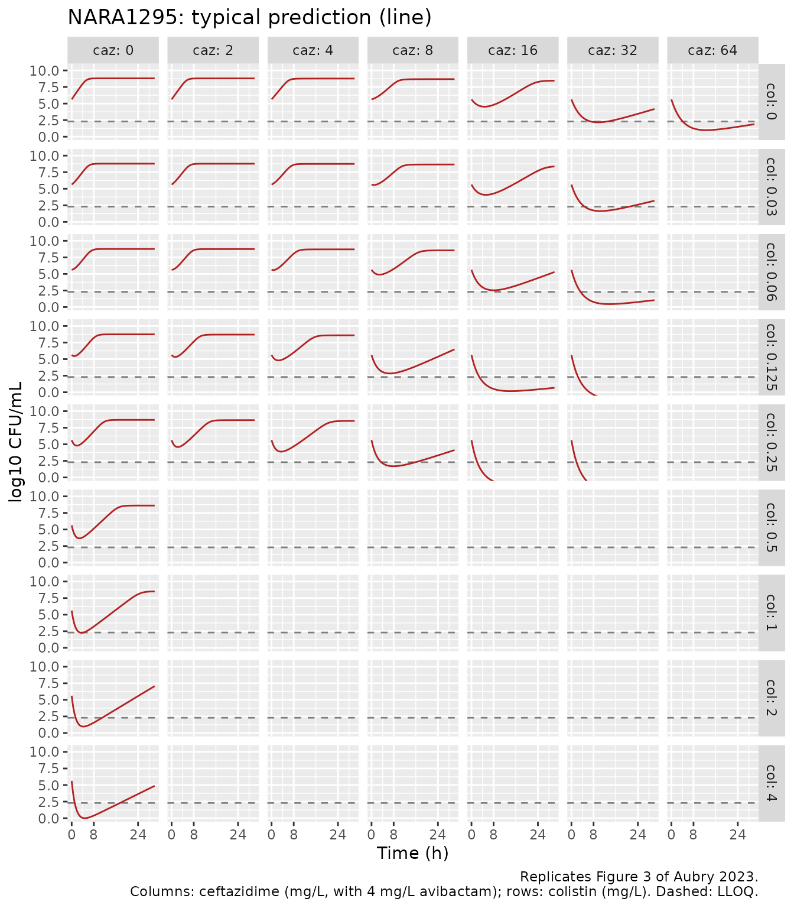
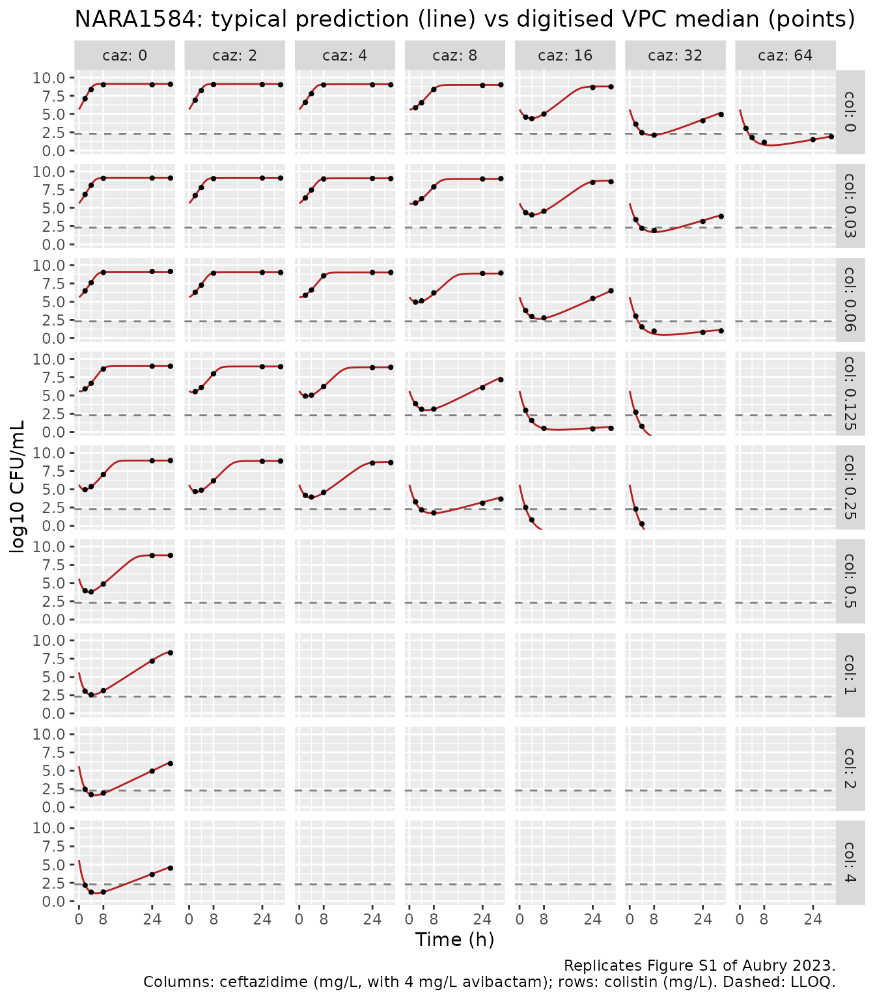
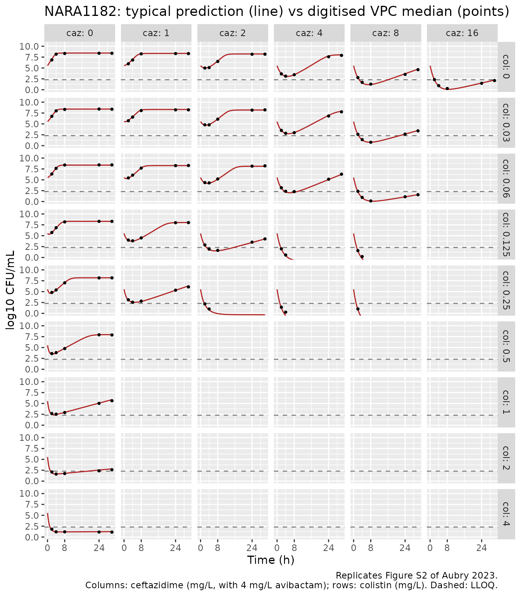
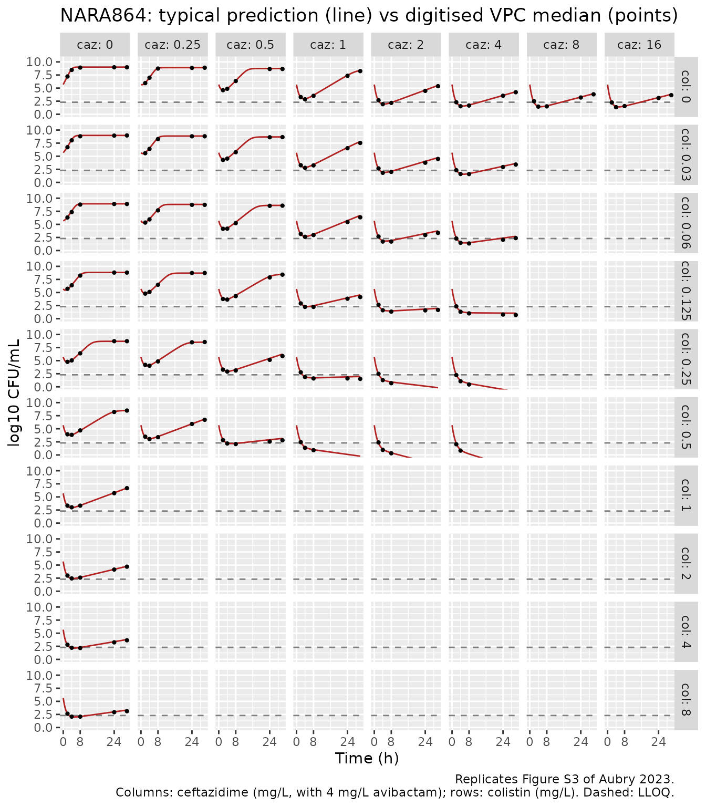

# Ceftazidime/avibactam + colistin against KPC-3 Klebsiella pneumoniae (Aubry 2023)

## Model and source

- Article: <https://doi.org/10.1128/aac.00301-23>
- Supplementary material (`aac.00301-23-s0001.docx`): visual predictive
  checks for the three other isolates (Figs. S1-S3),
  observed-versus-predicted plots, and the NONMEM control streams of the
  expected-additivity (Code S1) and observed-interaction (Code S2)
  models for isolate NARA1295.

``` r

isolates <- c("NARA1295", "NARA1584", "NARA1182", "NARA864")
model_names <- paste0("Aubry_2023_ceftazidime_avibactam_colistin_", isolates)
mods <- setNames(lapply(model_names, function(nm) rxode2::rxode2(readModelDb(nm))), isolates)
cat(mods$NARA1295$reference, sep = "\n")
#> Aubry R, Buyck J, Prouvensier L, Decousser JW, Nordmann P, Wicha SG, Marchand S, Gregoire N. An improved PKPD modeling approach to characterize the pharmacodynamic interaction over time between ceftazidime/avibactam and colistin from in vitro time-kill experiments against multidrug-resistant Klebsiella pneumoniae isolates. Antimicrob Agents Chemother. 2023;67(10):e00301-23. doi:10.1128/aac.00301-23. Structural equations: main-text Eqs 1-6 and the NONMEM control stream of this isolate's observed interaction model (Supplementary Code S2). Parameter estimates: main-text Table 2.
```

Aubry 2023 fits one semi-mechanistic time-kill model **per isolate** to
static time-kill curves of four KPC-3-producing *Klebsiella pneumoniae*
clinical isolates exposed to ceftazidime/avibactam (CZA; avibactam
always at 4 mg/L) and colistin (CST), alone and in combination. The
structure is shared, but every isolate has its own parameter column in
Table 2 and its own visual predictive check, so the library ships four
models:

| Model | Isolate | GPDI interaction (colistin as perpetrator) |
|----|----|----|
| `Aubry_2023_ceftazidime_avibactam_colistin_NARA1295` | NARA1295 (ST512) | lowers the CZA EC50 by up to 51.4% |
| `Aubry_2023_ceftazidime_avibactam_colistin_NARA1584` | NARA1584 (ST101) | lowers the CZA EC50 by up to 48.3% |
| `Aubry_2023_ceftazidime_avibactam_colistin_NARA1182` | NARA1182 (ST512) | lowers the CZA EC50 by up to 48.6% |
| `Aubry_2023_ceftazidime_avibactam_colistin_NARA864` | NARA864 (ST348) | lowers the CZA Emax by up to 65.8% |

Each model has:

- one homogeneous bacterial population `cfu` (CFU/mL) with logistic
  growth toward `bmax`;
- a sigmoidal Emax kill by each drug, whose Emax falls in proportion to
  the fraction of bacteria in an “adapted” state (`aron_caz`,
  `aron_col`) – an empirical two-state adaptive-resistance model per
  drug, switched on only while that drug is present, with no reversal
  (`koff = 0`);
- Bliss independence as the additivity criterion, with each kill rate
  normalised by the larger of the two mono-drug Emax values (Code S2);
- a general pharmacodynamic interaction (GPDI) term through which
  colistin modifies one ceftazidime parameter;
- the observation `log_cfu` = log10 CFU/mL with an additive residual
  error.

Drug concentrations are supplied as the covariates `CONC_CAZ_MGL` and
`CONC_CST_MGL`. There is no PK and there are no dosing events: the
solver integrates the bacterial and adaptation states from the inoculum.
This is a pharmacodynamic model of an in vitro experiment, so PKNCA is
not the right validation target; the checks below compare the model
against the paper’s own model predictions instead.

## Population (biological context)

``` r

pop <- lapply(mods, function(m) m$population)
data.frame(
  isolate = isolates,
  disease_state = vapply(pop, function(p) p$disease_state, character(1)),
  inoculum = vapply(pop, function(p) p$initial_inoculum, character(1))
) |>
  knitr::kable()
```

|  | isolate | disease_state | inoculum |
|:---|:---|:---|:---|
| NARA1295 | NARA1295 | Clinical K. pneumoniae isolate from the human strain collection (2019-2021) of the National Reference Center for Emerging Antibiotic Resistance (NARA, Fribourg, Switzerland). Sequence type ST512; resistance genes KPC-3, SHV-11 (35Q), TEM-1D, truncated OmpK35 (25%) and OmpK36 with a glycine-aspartate insertion (Table 1). MICs (broth microdilution, EUCAST): ceftazidime/avibactam 8 mg/L (avibactam fixed at 4 mg/L), colistin 0.125 mg/L; susceptible to both. | Estimated 10^5.63 CFU/mL (Table 2) |
| NARA1584 | NARA1584 | Clinical K. pneumoniae isolate from the human strain collection (2019-2021) of the National Reference Center for Emerging Antibiotic Resistance (NARA, Fribourg, Switzerland). Sequence type ST101; resistance genes KPC-3, SHV-1, truncated OmpK35 (17%) and OmpK36 with a threonine-aspartate insertion (Table 1). MICs (broth microdilution, EUCAST): ceftazidime/avibactam 8 mg/L (avibactam fixed at 4 mg/L), colistin 0.125 mg/L; susceptible to both. | Estimated 10^5.62 CFU/mL (Table 2) |
| NARA1182 | NARA1182 | Clinical K. pneumoniae isolate from the human strain collection (2019-2021) of the National Reference Center for Emerging Antibiotic Resistance (NARA, Fribourg, Switzerland). Sequence type ST512; resistance genes KPC-3, SHV-11 (35Q), truncated OmpK35 (25%) and OmpK36 with a glycine-aspartate insertion (Table 1). MICs (broth microdilution, EUCAST): ceftazidime/avibactam 4 mg/L (avibactam fixed at 4 mg/L), colistin 0.125 mg/L; susceptible to both. | Estimated 10^5.53 CFU/mL (Table 2) |
| NARA864 | NARA864 | Clinical K. pneumoniae isolate from the human strain collection (2019-2021) of the National Reference Center for Emerging Antibiotic Resistance (NARA, Fribourg, Switzerland). Sequence type ST348; resistance genes KPC-3, SHV-11 (35Q), TEM-1D and OXA-9, with no porin alteration reported (Table 1). MICs (broth microdilution, EUCAST): ceftazidime/avibactam 2 mg/L (avibactam fixed at 4 mg/L), colistin 0.25 mg/L; susceptible to both. | Estimated 10^5.68 CFU/mL (Table 2) |

All four isolates come from the 2019-2021 human strain collection of the
National Reference Center for Emerging Antibiotic Resistance (NARA,
Fribourg, Switzerland) and are susceptible to both drugs (Table 1: CZA
MICs 2-8 mg/L, CST MICs 0.125-0.25 mg/L). Static time-kill experiments
ran for 30 h at 35 degrees C in 10 mL cation-adjusted Mueller-Hinton
broth II from an inoculum of about 5 x 10^5 CFU/mL, with counts at 0, 2,
4, 8, 24 and 30 h and a lower limit of quantification of 200 CFU/mL (2.3
log10 CFU/mL).

## Source trace

| Element | Source location | Value(s) in the files |
|----|----|----|
| Sigmoidal Emax kill | Eq 1 | `emax_*`, `ec50_*`, `hill_*` |
| Two-state adaptive resistance | Eqs 2-3; Code S2 `DADT(4)`-`DADT(7)` | `aron_*` / `aroff_*`, `kon_*`, `koff` |
| Emax reduced by the adapted fraction | Eq 4; Code S2 `E_ADAPT_CZA = AR_CZA*A(4)` | `armax_*` |
| Adaptation only while the drug is present | Code S2 `IF(A(1).GT.0) ADAPT_CZA=KON_CZA` | `kon_*_i <- kon_* * (CONC > 0)` |
| Logistic growth on the linear CFU scale | Eq 5; Code S2 `DADT(3)`, `A_0(3)=10**INOC` | `kg`, `log10bmax`, `log10inoc` |
| Bliss independence, normalised by max Emax | Code S2 `E_COMB` | `emax_norm`, `kill_comb` |
| GPDI interaction | Eq 6; Code S2 `INTERACTION` | `int_col_caz`, `ec50int_col_caz`, `hillint_col_caz` |
| Victim parameter (EC50 vs Emax) | Table 2 rows `INT_EC50` / `INT_Emax`; Results | EC50 for NARA1295/1584/1182, Emax for NARA864 |
| Residual error | Table 2 `RES_ADD`; Code S2 `W = SQRT(SIGMA(1))` | `addSd = sqrt(RES_ADD)` (see below) |
| Observation floor | Code S2 `IF(BTOT_ERR<1e-6) BTOT_ERR=1e-6` | `log10(max(cfu, 1e-6))` |
| All parameter estimates | Table 2 (one column per isolate) | `ini()` of each file |

## Parameter tables (paper vs. file)

Table 2 is transcribed below in the paper’s units (percentages for
`ARmax` and `INT`, the residual entry as printed). The file values are
read from each model’s `ini()` and converted to the same units, so the
comparison checks the transcription and every back-transform in one
pass.

``` r

table2 <- read.csv(text = "
parameter,NARA1295,NARA1584,NARA1182,NARA864
INOC,5.63,5.62,5.53,5.68
KG,1.40,1.77,1.78,1.84
Bmax,8.80,9.13,8.43,9.01
Emax_CZA,4.59,6.27,7.51,9.17
EC50_CZA,13.39,13.47,2.51,0.46
gamma_CZA,2.13,1.84,1.53,1.79
KON_CZA,0.24,0.32,0.36,0.66
KOFF,0,0,0,0
ARmax_CZA,71.9,73.0,78.6,82.5
Emax_CST,13.12,8.78,14.31,8.81
EC50_CST,0.60,0.33,0.33,0.21
gamma_CST,0.96,1.13,1.21,1.16
KON_CST,0.65,0.52,1.18,0.75
ARmax_CST,91.8,83.1,87.0,80.3
INT,-51.4,-48.3,-48.6,-65.8
EC50_INT,0.06,0.06,0.07,0.39
gamma_INT,10,10,10,1
RES_ADD,1.74,1.01,1.44,2.25
")

file_values <- function(m) {
  th <- m$theta
  c(
    INOC = th[["log10inoc"]], KG = th[["kg"]], Bmax = th[["log10bmax"]],
    Emax_CZA = th[["emax_caz"]], EC50_CZA = th[["ec50_caz"]],
    gamma_CZA = th[["hill_caz"]], KON_CZA = th[["kon_caz"]], KOFF = th[["koff"]],
    ARmax_CZA = 100 * th[["armax_caz"]],
    Emax_CST = th[["emax_col"]], EC50_CST = th[["ec50_col"]],
    gamma_CST = th[["hill_col"]], KON_CST = th[["kon_col"]],
    ARmax_CST = 100 * th[["armax_col"]],
    INT = 100 * th[["int_col_caz"]], EC50_INT = th[["ec50int_col_caz"]],
    gamma_INT = th[["hillint_col_caz"]],
    # Table 2 prints the $SIGMA variance; the file carries its square root.
    RES_ADD = th[["addSd"]]^2
  )
}
cmp <- table2 |>
  pivot_longer(-parameter, names_to = "isolate", values_to = "paper") |>
  mutate(file = mapply(function(p, i) file_values(mods[[i]])[[p]], parameter, isolate))
stopifnot(all(abs(cmp$file - cmp$paper) < 1e-8))
cmp |>
  pivot_wider(names_from = isolate, values_from = c(paper, file)) |>
  select(parameter, ends_with("NARA1295"), ends_with("NARA1584"),
         ends_with("NARA1182"), ends_with("NARA864")) |>
  knitr::kable(digits = 3)
```

| parameter | paper_NARA1295 | file_NARA1295 | paper_NARA1584 | file_NARA1584 | paper_NARA1182 | file_NARA1182 | paper_NARA864 | file_NARA864 |
|:---|---:|---:|---:|---:|---:|---:|---:|---:|
| INOC | 5.63 | 5.63 | 5.62 | 5.62 | 5.53 | 5.53 | 5.68 | 5.68 |
| KG | 1.40 | 1.40 | 1.77 | 1.77 | 1.78 | 1.78 | 1.84 | 1.84 |
| Bmax | 8.80 | 8.80 | 9.13 | 9.13 | 8.43 | 8.43 | 9.01 | 9.01 |
| Emax_CZA | 4.59 | 4.59 | 6.27 | 6.27 | 7.51 | 7.51 | 9.17 | 9.17 |
| EC50_CZA | 13.39 | 13.39 | 13.47 | 13.47 | 2.51 | 2.51 | 0.46 | 0.46 |
| gamma_CZA | 2.13 | 2.13 | 1.84 | 1.84 | 1.53 | 1.53 | 1.79 | 1.79 |
| KON_CZA | 0.24 | 0.24 | 0.32 | 0.32 | 0.36 | 0.36 | 0.66 | 0.66 |
| KOFF | 0.00 | 0.00 | 0.00 | 0.00 | 0.00 | 0.00 | 0.00 | 0.00 |
| ARmax_CZA | 71.90 | 71.90 | 73.00 | 73.00 | 78.60 | 78.60 | 82.50 | 82.50 |
| Emax_CST | 13.12 | 13.12 | 8.78 | 8.78 | 14.31 | 14.31 | 8.81 | 8.81 |
| EC50_CST | 0.60 | 0.60 | 0.33 | 0.33 | 0.33 | 0.33 | 0.21 | 0.21 |
| gamma_CST | 0.96 | 0.96 | 1.13 | 1.13 | 1.21 | 1.21 | 1.16 | 1.16 |
| KON_CST | 0.65 | 0.65 | 0.52 | 0.52 | 1.18 | 1.18 | 0.75 | 0.75 |
| ARmax_CST | 91.80 | 91.80 | 83.10 | 83.10 | 87.00 | 87.00 | 80.30 | 80.30 |
| INT | -51.40 | -51.40 | -48.30 | -48.30 | -48.60 | -48.60 | -65.80 | -65.80 |
| EC50_INT | 0.06 | 0.06 | 0.06 | 0.06 | 0.07 | 0.07 | 0.39 | 0.39 |
| gamma_INT | 10.00 | 10.00 | 10.00 | 10.00 | 10.00 | 10.00 | 1.00 | 1.00 |
| RES_ADD | 1.74 | 1.74 | 1.01 | 1.01 | 1.44 | 1.44 | 2.25 | 2.25 |

For NARA864 the interaction row is `INT_Emax` / `EC50_INT_Emax` /
`gamma_INT_Emax`; for the other three it is `INT_EC50` / `EC50_INT_EC50`
/ `gamma_INT_EC50`. The NARA864 growth rate, all interaction Hill
coefficients, the NARA864 interaction EC50 and `KOFF` were not estimated
(Table 2 “fixed”) and are wrapped in `fixed()`.

## Simulation helpers

``` r

grid_events <- function(panels, times) {
  panels$id <- seq_len(nrow(panels))
  ev <- merge(panels, data.frame(time = times))
  ev$CONC_CAZ_MGL <- ev$caz
  ev$CONC_CST_MGL <- ev$col
  # Observations on the bacterial ODE state; log_cfu is returned alongside.
  ev$evid <- 0
  ev$cmt <- "cfu"
  dplyr::arrange(ev, id, time)
}
# The models have no between-tube variability, and each `id` is a
# drug-concentration scenario, not a subject. rxode2 warns about a
# multi-subject solve without omega; only that message is muffled.
muffle_no_omega <- function(w) {
  if (grepl("multi-subject simulation without", conditionMessage(w), fixed = TRUE)) {
    invokeRestart("muffleWarning")
  }
}
solve_typical <- function(mod, panels, times = seq(0, 30, by = 0.25)) {
  ev <- grid_events(panels, times)
  withCallingHandlers(
    rxode2::rxSolve(rxode2::zeroRe(mod, "sigma"), ev, omega = NA,
                    keep = c("caz", "col"), returnType = "data.frame"),
    warning = muffle_no_omega
  )
}
```

## Carrying capacity and inoculum

With no drug the model is a pure logistic growth curve: it starts at
`10^INOC` and settles at `10^Bmax`. A mis-transcribed `log10bmax` or a
missed `10^` back-transform shows up here immediately.

``` r

gc <- bind_rows(lapply(isolates, function(i) {
  solve_typical(mods[[i]], data.frame(caz = 0, col = 0), times = c(0, 30)) |>
    mutate(isolate = i)
}))
gc_chk <- gc |>
  select(isolate, time, log_cfu) |>
  pivot_wider(names_from = time, values_from = log_cfu, names_prefix = "t") |>
  mutate(
    inoc = vapply(isolate, function(i) mods[[i]]$theta[["log10inoc"]], numeric(1)),
    bmax = vapply(isolate, function(i) mods[[i]]$theta[["log10bmax"]], numeric(1))
  )
knitr::kable(gc_chk, digits = 3)
```

| isolate  |   t0 |  t30 | inoc | bmax |
|:---------|-----:|-----:|-----:|-----:|
| NARA1295 | 5.63 | 8.80 | 5.63 | 8.80 |
| NARA1584 | 5.62 | 9.13 | 5.62 | 9.13 |
| NARA1182 | 5.53 | 8.43 | 5.53 | 8.43 |
| NARA864  | 5.68 | 9.01 | 5.68 | 9.01 |

``` r

stopifnot(
  all(abs(gc_chk$t0 - gc_chk$inoc) < 1e-6),
  all(abs(gc_chk$t30 - gc_chk$bmax) < 0.01)
)
```

## Mass balance of the adaptation states

`aron + aroff` is a fraction of the population and must stay at 1 for
each drug. The adaptation switch must also stay off for a drug that is
absent.

``` r

ab <- solve_typical(mods$NARA1295, data.frame(caz = c(8, 0), col = c(0, 0.25)))
stopifnot(
  all(abs(ab$aron_caz + ab$aroff_caz - 1) < 1e-6),
  all(abs(ab$aron_col + ab$aroff_col - 1) < 1e-6),
  # colistin-free arm: no colistin adaptation; CZA-free arm: no CZA adaptation
  max(ab$aron_col[ab$col == 0]) < 1e-9,
  max(ab$aron_caz[ab$caz == 0]) < 1e-9
)
# kon_caz = 0.24 1/h, so 1 - exp(-0.24 * 30) of the bacteria are adapted by 30 h
ab |>
  filter(time == 30) |>
  select(caz, col, aron_caz, aron_col) |>
  mutate(aron_caz_closed_form = ifelse(caz > 0, 1 - exp(-0.24 * 30), 0)) |>
  knitr::kable(digits = 4)
```

| caz |  col | aron_caz | aron_col | aron_caz_closed_form |
|----:|-----:|---------:|---------:|---------------------:|
|   8 | 0.00 |   0.9993 |        0 |               0.9993 |
|   0 | 0.25 |   0.0000 |        1 |               0.0000 |

## Replicate the visual predictive checks (Figure 3, Figures S1-S3)

The models have no random effect except the residual error, and that
error is additive and symmetric on the log10 scale. The median of the
paper’s VPC simulations is therefore the typical prediction itself, so
the red median lines of the VPCs are a direct, quantitative target for
`zeroRe()` simulations.

The median lines of Figs. S1-S3 (high-resolution images in the
supplement) were digitised by the maintainers from the image pixels: the
y axis was calibrated on the printed 0.0 and 10.0 log10 CFU/mL ticks of
each panel row, the x axis on the 0-30 h tick marks of each panel
column, and the median was read at the six sampling times. Fig. 3
(NARA1295) is published only as a low-resolution image in which the
median line could not be traced reliably, so NARA1295 is shown without
digitised points; its grid of concentrations is the same as that of
NARA1584.

``` r

# Digitised VPC medians (log10 CFU/mL) at 2, 4, 8, 24 and 30 h; caz and col
# are the ceftazidime and colistin concentrations (mg/L) of each panel.
dig <- read.csv(text = "
isolate,caz,col,t2,t4,t8,t24,t30
NARA1584,0,0,7.11,8.36,9.01,9.01,9.08
NARA1584,2,0,6.9,8.22,9.04,9.04,9.01
NARA1584,4,0,6.6,7.79,8.99,9.01,9.01
NARA1584,8,0,5.87,6.55,8.36,8.92,9.01
NARA1584,16,0,4.58,4.37,5.0,8.64,8.73
NARA1584,32,0,3.62,2.44,2.11,4.08,4.93
NARA1584,64,0,3.03,1.78,1.13,1.5,1.9
NARA1584,0,0.03,6.83,8.09,9.05,9.08,9.08
NARA1584,2,0.03,6.69,7.78,9.01,9.08,9.08
NARA1584,4,0.03,6.36,7.45,8.96,9.03,9.01
NARA1584,8,0.03,5.67,6.26,7.87,8.96,9.01
NARA1584,16,0.03,4.35,4.04,4.54,8.49,8.58
NARA1584,32,0.03,3.4,2.2,1.91,3.14,3.83
NARA1584,0,0.06,6.48,7.6,9.0,9.14,9.14
NARA1584,2,0.06,6.29,7.26,8.9,9.0,9.0
NARA1584,4,0.06,5.88,6.6,8.55,9.0,9.0
NARA1584,8,0.06,4.95,5.12,6.21,8.88,8.93
NARA1584,16,0.06,3.79,2.98,2.79,5.45,6.5
NARA1584,32,0.06,3.02,1.55,0.98,0.79,1.0
NARA1584,0,0.125,5.91,6.67,8.63,9.01,9.01
NARA1584,2,0.125,5.53,6.1,7.97,8.94,8.94
NARA1584,4,0.125,4.92,5.04,6.22,8.82,8.87
NARA1584,8,0.125,3.88,3.12,3.14,6.08,7.16
NARA1584,16,0.125,2.96,1.58,0.5,0.43,0.5
NARA1584,32,0.125,2.7,0.78,NA,NA,NA
NARA1584,0,0.25,4.95,5.38,7.02,8.92,8.94
NARA1584,2,0.25,4.69,4.88,6.17,8.83,8.87
NARA1584,4,0.25,4.18,3.94,4.58,8.59,8.66
NARA1584,8,0.25,3.29,2.18,1.78,3.1,3.66
NARA1584,16,0.25,2.51,0.82,NA,NA,NA
NARA1584,32,0.25,2.3,0.28,NA,NA,NA
NARA1584,0,0.5,3.97,3.8,4.88,8.78,8.8
NARA1584,0,1,3.05,2.56,3.12,7.16,8.31
NARA1584,0,2,2.46,1.74,1.95,4.95,5.99
NARA1584,0,4,2.18,1.22,1.24,3.64,4.51
NARA1182,0,0,6.85,8.17,8.33,8.38,8.38
NARA1182,1,0,5.96,6.83,8.24,8.31,8.31
NARA1182,2,0,4.98,5.09,6.5,8.15,8.17
NARA1182,4,0,3.64,3.12,3.45,7.58,7.89
NARA1182,8,0,2.79,1.69,1.29,3.52,4.61
NARA1182,16,0,2.32,0.94,0.28,1.48,2.11
NARA1182,0,0.03,6.74,7.99,8.32,8.42,8.37
NARA1182,1,0.03,5.72,6.57,8.06,8.23,8.23
NARA1182,2,0.03,4.78,4.78,6.08,8.16,8.23
NARA1182,4,0.03,3.5,2.84,2.98,6.81,7.77
NARA1182,8,0.03,2.6,1.39,0.78,2.65,3.4
NARA1182,0,0.06,6.33,7.64,8.4,8.43,8.43
NARA1182,1,0.06,5.43,6.07,7.69,8.26,8.29
NARA1182,2,0.06,4.36,4.29,5.19,8.14,8.21
NARA1182,4,0.06,3.17,2.36,2.29,5.14,6.29
NARA1182,8,0.06,2.36,0.95,0.14,1.1,1.57
NARA1182,0,0.125,5.74,6.83,8.18,8.3,8.3
NARA1182,1,0.125,4.0,3.83,4.49,7.99,8.01
NARA1182,2,0.125,2.88,1.91,1.63,3.52,4.26
NARA1182,4,0.125,1.99,0.57,NA,NA,NA
NARA1182,8,0.125,1.58,0.21,NA,NA,NA
NARA1182,0,0.25,4.81,5.38,7.02,8.15,8.17
NARA1182,1,0.25,3.12,2.56,2.82,5.33,6.09
NARA1182,2,0.25,2.18,1.01,NA,NA,NA
NARA1182,4,0.25,1.41,0.28,NA,NA,NA
NARA1182,8,0.25,1.03,NA,NA,NA,NA
NARA1182,0,0.5,3.62,3.83,4.77,7.93,7.89
NARA1182,0,1,2.68,2.54,2.91,5.02,5.63
NARA1182,0,2,2.11,1.62,1.74,2.37,2.61
NARA1182,0,4,1.81,1.2,1.2,1.15,1.13
NARA864,0,0,7.22,8.47,8.92,8.97,8.97
NARA864,0.25,0,5.95,6.98,8.73,8.86,8.89
NARA864,0.5,0,4.6,4.87,6.35,8.65,8.65
NARA864,1,0,3.28,2.86,3.52,7.35,8.25
NARA864,2,0,2.67,1.93,2.17,4.47,5.36
NARA864,4,0,2.3,1.53,1.67,3.54,4.21
NARA864,8,0,2.49,1.46,1.51,3.2,3.81
NARA864,16,0,2.25,1.35,1.56,3.1,3.65
NARA864,0,0.03,6.72,8.04,8.81,8.94,8.97
NARA864,0.25,0.03,5.58,6.4,8.28,8.81,8.81
NARA864,0.5,0.03,4.29,4.55,5.77,8.62,8.65
NARA864,1,0.03,3.28,2.78,3.25,6.53,7.54
NARA864,2,0.03,2.67,1.83,2.01,3.76,4.48
NARA864,4,0.03,2.33,1.61,1.59,2.94,3.41
NARA864,0,0.06,6.32,7.35,8.78,8.89,8.89
NARA864,0.25,0.06,5.34,5.95,7.67,8.73,8.73
NARA864,0.5,0.06,4.15,4.18,5.24,8.54,8.57
NARA864,1,0.06,3.17,2.62,2.96,5.45,6.35
NARA864,2,0.06,2.67,1.72,1.72,2.96,3.37
NARA864,4,0.06,2.3,1.48,1.35,2.06,2.38
NARA864,0,0.125,5.71,6.38,8.23,8.81,8.81
NARA864,0.25,0.125,4.79,5.11,6.48,8.73,8.73
NARA864,0.5,0.125,3.76,3.65,4.31,7.88,8.41
NARA864,1,0.125,2.91,2.25,2.25,3.81,4.13
NARA864,2,0.125,2.65,1.61,1.35,1.59,1.67
NARA864,4,0.125,2.35,1.32,1.01,0.79,0.71
NARA864,0,0.25,4.77,5.04,6.4,8.72,8.72
NARA864,0.25,0.25,4.19,4.03,4.85,8.51,8.56
NARA864,0.5,0.25,3.28,2.91,3.12,5.15,5.88
NARA864,1,0.25,2.77,1.87,1.6,1.6,1.52
NARA864,2,0.25,2.48,1.28,0.69,NA,NA
NARA864,4,0.25,2.24,1.07,0.45,NA,NA
NARA864,0,0.5,3.95,3.84,4.69,8.21,8.48
NARA864,0.25,0.5,3.49,3.04,3.39,5.92,6.72
NARA864,0.5,0.5,2.83,2.19,2.08,2.56,2.8
NARA864,1,0.5,2.45,1.36,0.91,NA,NA
NARA864,2,0.5,2.4,0.96,0.32,NA,NA
NARA864,4,0.5,2.05,0.83,NA,NA,NA
NARA864,0,1,3.33,3.02,3.33,5.71,6.67
NARA864,0,2,2.99,2.45,2.6,4.14,4.69
NARA864,0,4,2.8,2.22,2.17,3.25,3.65
NARA864,0,8,2.64,2.08,2.08,2.93,3.12
")
dig_long <- dig |>
  pivot_longer(starts_with("t"), names_to = "time", values_to = "log_cfu_paper",
               names_prefix = "t", names_transform = as.numeric) |>
  filter(!is.na(log_cfu_paper))
nrow(dig_long)
#> [1] 499
```

``` r

grid_1584 <- dig |> filter(isolate == "NARA1584") |> select(caz, col)
panels <- list(
  NARA1295 = grid_1584,
  NARA1584 = grid_1584,
  NARA1182 = dig |> filter(isolate == "NARA1182") |> select(caz, col),
  NARA864  = dig |> filter(isolate == "NARA864")  |> select(caz, col)
)
typ <- bind_rows(lapply(isolates, function(i) {
  solve_typical(mods[[i]], panels[[i]]) |> mutate(isolate = i)
}))
plot_isolate <- function(i, fig) {
  d <- typ |> filter(isolate == i)
  p <- ggplot(d, aes(time, log_cfu)) +
    geom_hline(yintercept = log10(200), linetype = "dashed", colour = "grey50") +
    geom_line(colour = "firebrick") +
    facet_grid(col ~ caz, labeller = label_both) +
    coord_cartesian(ylim = c(0, 10.5)) +
    scale_x_continuous(breaks = c(0, 8, 24)) +
    labs(x = "Time (h)", y = "log10 CFU/mL",
         title = paste0(i, ": typical prediction (line)",
                        if (i != "NARA1295") " vs digitised VPC median (points)"),
         caption = paste0("Replicates ", fig, " of Aubry 2023.\nColumns: ceftazidime (mg/L, ",
                          "with 4 mg/L avibactam); rows: colistin (mg/L). Dashed: LLOQ."))
  if (i != "NARA1295") {
    p <- p + geom_point(data = dig_long |> filter(isolate == i),
                        aes(time, log_cfu_paper), size = 0.8)
  }
  p
}
plot_isolate("NARA1295", "Figure 3")
```



``` r

plot_isolate("NARA1584", "Figure S1")
```



``` r

plot_isolate("NARA1182", "Figure S2")
```



``` r

plot_isolate("NARA864", "Figure S3")
```



### Quantitative agreement

Below the limit of quantification the paper’s plotted medians are
clipped at the 0.0 axis line, so the comparison is restricted to points
where both the digitised median and the model are above 2.5 log10
CFU/mL.

``` r

vpc_cmp <- typ |>
  select(isolate, caz, col, time, log_cfu) |>
  inner_join(dig_long, by = c("isolate", "caz", "col", "time")) |>
  filter(log_cfu_paper > 2.5, log_cfu > 2.5) |>
  mutate(diff = log_cfu - log_cfu_paper)
vpc_sum <- vpc_cmp |>
  group_by(isolate) |>
  summarise(
    n = n(),
    median_diff = median(diff),
    median_abs_diff = median(abs(diff)),
    q90_abs_diff = unname(quantile(abs(diff), 0.9)),
    max_abs_diff = max(abs(diff)),
    .groups = "drop"
  )
knitr::kable(vpc_sum, digits = 3)
```

| isolate  |   n | median_diff | median_abs_diff | q90_abs_diff | max_abs_diff |
|:---------|----:|------------:|----------------:|-------------:|-------------:|
| NARA1182 |  97 |       0.014 |           0.051 |        0.137 |        0.238 |
| NARA1584 | 136 |       0.028 |           0.050 |        0.141 |        0.316 |
| NARA864  | 140 |       0.068 |           0.080 |        0.203 |        0.421 |

``` r

# Digitising error is about 0.1-0.2 log10 (one image pixel is 0.14-0.16 log10
# CFU/mL). A mis-transcribed EC50, Emax or adaptation rate moves whole panels
# by one log10 or more.
stopifnot(
  all(abs(vpc_sum$median_diff) < 0.25),
  all(vpc_sum$q90_abs_diff < 0.5)
)
```

## Residual error: variance, not standard deviation

Table 2 prints `RES_ADD` as an “additive residual error (log10CFU/mL)”.
The control streams (Codes S1-S2) estimate it as `$SIGMA` and use
`W = SQRT(SIGMA(1))` as the standard deviation, which means NONMEM
reports a variance. The VPC bands settle the reading. In the
growth-control panel the band is the 10th-90th percentile of an additive
normal error around a flat median, so its width is
`2 * qnorm(0.9) * SD`. Measured on the image pixels of the
growth-control panels (the outer edge lines of the band, at the
plateau): NARA1182 (Fig. S2) 3.14 log10 wide, NARA864 (Fig. S3) 3.81
log10 wide.

``` r

res_chk <- data.frame(
  isolate = c("NARA1182", "NARA864"),
  RES_ADD = c(1.44, 2.25),
  band_width_figure = c(3.14, 3.81)
) |>
  mutate(
    sd_from_band = band_width_figure / (2 * qnorm(0.9)),
    sd_if_variance = sqrt(RES_ADD),
    sd_if_sd = RES_ADD,
    addSd_in_file = vapply(isolate, function(i) mods[[i]]$theta[["addSd"]], numeric(1))
  )
knitr::kable(res_chk, digits = 3)
```

| isolate | RES_ADD | band_width_figure | sd_from_band | sd_if_variance | sd_if_sd | addSd_in_file |
|:---|---:|---:|---:|---:|---:|---:|
| NARA1182 | 1.44 | 3.14 | 1.225 | 1.2 | 1.44 | 1.2 |
| NARA864 | 2.25 | 3.81 | 1.486 | 1.5 | 2.25 | 1.5 |

``` r

stopifnot(
  all(abs(res_chk$sd_from_band - res_chk$sd_if_variance) <
        abs(res_chk$sd_from_band - res_chk$sd_if_sd)),
  all(abs(res_chk$addSd_in_file - res_chk$sd_if_variance) < 1e-8)
)
```

The variance reading reproduces the band width of both isolates within
the pixel resolution; the standard-deviation reading would make the
NARA864 band 5.8 log10 wide, half as wide again as printed.

## Results-text checks

The Results section reports that each drug alone at its MIC let the
bacteria regrow, and that the combination at 2x the MIC of each drug
prevented regrowth for every isolate. With the Table 1 MICs:

``` r

mic <- data.frame(
  isolate = isolates,
  mic_caz = c(8, 8, 4, 2),
  mic_cst = c(0.125, 0.125, 0.125, 0.25)
)
claims <- bind_rows(lapply(seq_len(nrow(mic)), function(k) {
  i <- mic$isolate[k]
  p <- data.frame(
    scenario = c("CZA 1x MIC alone", "CST 1x MIC alone", "CZA 2x + CST 2x MIC"),
    caz = c(1, 0, 2) * mic$mic_caz[k],
    col = c(0, 1, 2) * mic$mic_cst[k]
  )
  solve_typical(mods[[i]], p) |>
    left_join(p, by = c("caz", "col")) |>
    group_by(scenario) |>
    summarise(nadir = min(log_cfu), at_30h = log_cfu[time == 30], .groups = "drop") |>
    mutate(isolate = i, regrowth = at_30h - nadir)
}))
claims |>
  select(isolate, scenario, nadir, at_30h, regrowth) |>
  knitr::kable(digits = 2)
```

| isolate  | scenario            | nadir | at_30h | regrowth |
|:---------|:--------------------|------:|-------:|---------:|
| NARA1295 | CST 1x MIC alone    |  5.45 |   8.73 |     3.28 |
| NARA1295 | CZA 1x MIC alone    |  5.63 |   8.69 |     3.06 |
| NARA1295 | CZA 2x + CST 2x MIC | -1.54 |  -1.54 |     0.00 |
| NARA1584 | CST 1x MIC alone    |  5.57 |   9.03 |     3.45 |
| NARA1584 | CZA 1x MIC alone    |  5.62 |   9.00 |     3.38 |
| NARA1584 | CZA 2x + CST 2x MIC | -2.54 |  -2.54 |     0.00 |
| NARA1182 | CST 1x MIC alone    |  5.33 |   8.31 |     2.98 |
| NARA1182 | CZA 1x MIC alone    |  3.06 |   8.02 |     4.96 |
| NARA1182 | CZA 2x + CST 2x MIC | -6.00 |  -6.00 |     0.00 |
| NARA864  | CST 1x MIC alone    |  4.70 |   8.69 |     4.00 |
| NARA864  | CZA 1x MIC alone    |  1.95 |   5.51 |     3.56 |
| NARA864  | CZA 2x + CST 2x MIC | -2.54 |  -2.54 |     0.00 |

``` r

alone <- claims |> filter(grepl("alone", scenario))
combo <- claims |> filter(grepl("\\+", scenario))
stopifnot(
  all(alone$regrowth > 2),
  all(combo$at_30h < log10(200))
)
```

## Direction of the interaction (Figures 4 and 5)

The paper judged synergy and antagonism by comparing bootstrap 95% CIs
of the observed-interaction model with those of a separately fitted
Bliss expected-additivity model (Code S1), whose parameter estimates are
not tabulated. That comparison cannot be reproduced here, but its
direction can: setting `int_col_caz = 0` switches the GPDI term off
while keeping every other parameter. For NARA1295 colistin lowers the
CZA EC50, so the combination kills more than additivity predicts – the
paper finds significant synergy late in the experiment (Fig. 4); the
case below uses both drugs at their MIC (CZA 8 mg/L, CST 0.125 mg/L),
where the EC50 shift matters most, since well below the CZA EC50 there
is little CZA kill to enhance. For NARA864 colistin lowers the CZA Emax,
so the combination kills less (the paper finds antagonism at CZA
0.25-0.5 mg/L with CST 0.25-0.5 mg/L, Fig. 5).

``` r

dir_case <- function(i, caz, col) {
  p <- data.frame(caz = caz, col = col)
  obs <- solve_typical(mods[[i]], p, times = c(0, 8, 24, 30))
  add <- solve_typical(rxode2::ini(mods[[i]], int_col_caz = 0), p, times = c(0, 8, 24, 30))
  data.frame(isolate = i, caz = caz, col = col, time = obs$time,
             observed = obs$log_cfu, no_interaction = add$log_cfu)
}
dir_tab <- bind_rows(
  dir_case("NARA1295", 8, 0.125),
  dir_case("NARA864", 0.5, 0.5)
) |>
  mutate(difference = observed - no_interaction)
#> ℹ change initial estimate of `int_col_caz` to `0`
#> ℹ change initial estimate of `int_col_caz` to `0`
knitr::kable(dir_tab, digits = 2)
```

| isolate  | caz |  col | time | observed | no_interaction | difference |
|:---------|----:|-----:|-----:|---------:|---------------:|-----------:|
| NARA1295 | 8.0 | 0.12 |    0 |     5.63 |           5.63 |       0.00 |
| NARA1295 | 8.0 | 0.12 |    8 |     2.88 |           6.10 |      -3.22 |
| NARA1295 | 8.0 | 0.12 |   24 |     5.36 |           8.60 |      -3.24 |
| NARA1295 | 8.0 | 0.12 |   30 |     6.47 |           8.60 |      -2.13 |
| NARA864  | 0.5 | 0.50 |    0 |     5.68 |           5.68 |       0.00 |
| NARA864  | 0.5 | 0.50 |    8 |     2.22 |           0.78 |       1.44 |
| NARA864  | 0.5 | 0.50 |   24 |     2.90 |          -0.44 |       3.35 |
| NARA864  | 0.5 | 0.50 |   30 |     3.17 |          -0.90 |       4.06 |

``` r

d30 <- dir_tab |> filter(time == 30)
stopifnot(
  d30$difference[d30$isolate == "NARA1295"] < -1,
  d30$difference[d30$isolate == "NARA864"] > 1
)
```

## Clinical-profile simulations (Figure 6)

Figure 6 and Figs. S6-S7 drive the NARA1295 model with typical patient
concentration-time profiles from two external popPK models (ceftazidime
from Sy et al. 2019, colistin from Kristoffersson et al. 2020) that are
not in this library, so they are not reproduced here. The model accepts
time-varying `CONC_CAZ_MGL` / `CONC_CST_MGL` columns for that purpose:
rxode2 interpolates covariates between records, and the adaptation
switch follows the instantaneous concentration exactly as
`IF(A(1).GT.0)` does in Code S2. Note that avibactam is assumed
throughout to be present at a fully inhibiting, non-bactericidal
concentration, which the paper flags as an assumption for these
simulations (Discussion).

## Assumptions and deviations

- **Residual error is a variance.** Table 2 `RES_ADD` is the NONMEM
  `$SIGMA` variance (see the residual section); each file carries
  `addSd = sqrt(RES_ADD)`. The paper fitted below-quantification counts
  with Beal’s M3 method (LLOQ 200 CFU/mL); the model files carry the
  plain additive error, and a user re-estimating with censored data
  should set `CENS`/`LIMIT` accordingly.
- **Linear CFU state.** Eq 5 calls `B` a log10 count, but the control
  streams integrate `DADT(3) = (KG*PLATEAU - E_COMB)*A(3)` with
  `A_0(3) = 10**INOC` and `PLATEAU = 1 - A(3)/10**BMAX`, i.e. logistic
  growth of the linear CFU/mL count. The files follow the control
  streams.
- **Template control stream.** Only the NARA1295 control streams are
  published. The paper states that the same structure was used for all
  four isolates with isolate-specific estimates, so the other three
  files reuse the Code S2 structure with their Table 2 column.
- **NARA864 Emax interaction.** No control stream is printed for an
  interaction on Emax. The file multiplies the CZA Emax by the GPDI
  factor `(1 + INT * C_CST / (0.39 + C_CST))` and, as in Code S2, keeps
  the Bliss normaliser at the larger of the two mono-drug Emax values
  (9.17 1/h). The alternative of normalising by the interaction-reduced
  Emax was also checked against the digitised Fig. S3 medians and fits
  marginally worse (90th percentile absolute difference 0.30 versus 0.29
  log10).
- **Avibactam** has no covariate. Every experiment used 4 mg/L, which
  the authors assume fully inhibits the beta-lactamases with no
  bactericidal effect of its own; `CONC_CAZ_MGL` is the ceftazidime
  concentration in the presence of that avibactam.
- **Interaction gating.** Code S2 sets the interaction to zero unless
  both drugs are present. The files compute it whenever colistin is
  present; without ceftazidime the ceftazidime kill term is zero, so the
  two are identical.
- **Observation floor.** `log_cfu` uses the `1e-6` CFU/mL floor of the
  control-stream error block; deep-kill predictions below about -6 log10
  are reported as -6.
- **Adaptive-resistance state names.** `aron_col` / `aroff_col` use the
  registered colistin suffix; `aron_caz` / `aroff_caz` are declared as
  paper-specific compartments because `caz` is not a registered suffix
  token.
