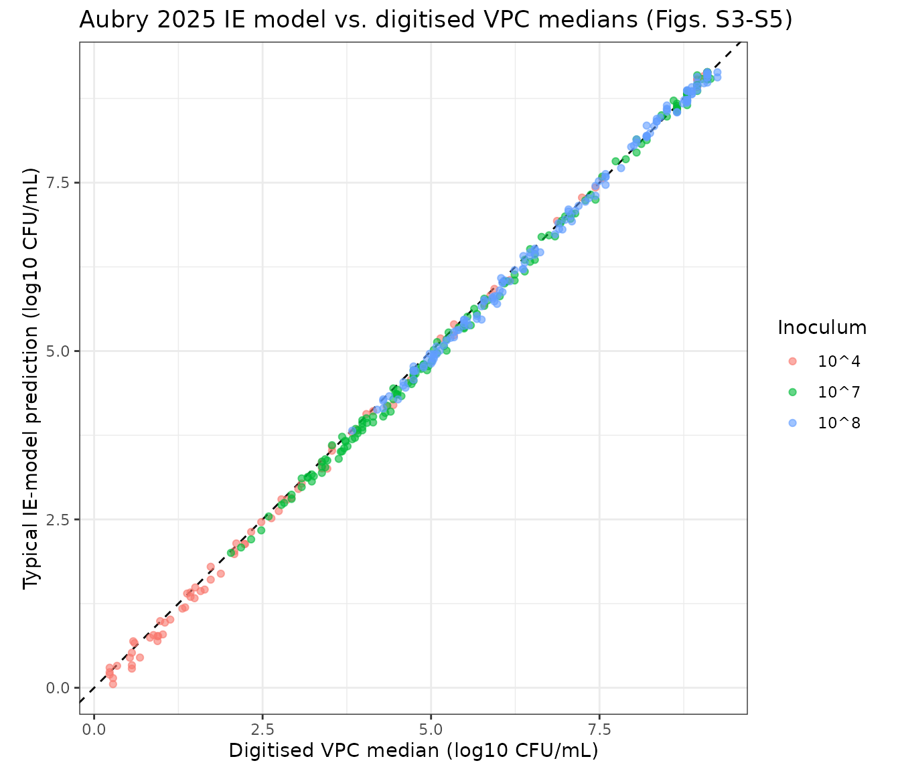
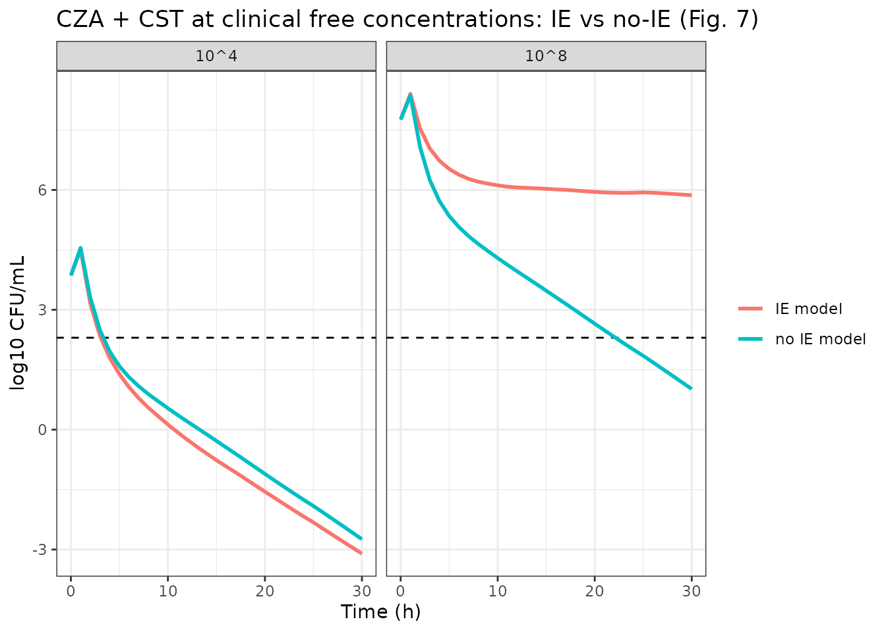

# Ceftazidime/avibactam + colistin inoculum effect against KPC-3 Klebsiella pneumoniae (Aubry 2025)

## Model and source

- Article: <https://doi.org/10.1128/aac.01797-24>
- Supplementary material (`aac.01797-24-s0001.docx`): parameter
  estimates of the no-inoculum-effect model (Table S1) and the
  inoculum-effect model (Table S2), visual predictive checks at each
  inoculum (Figs. S1, S3-S5), the predicted-effect comparisons (Figs.
  S6-S7), the clinical-concentration simulations (Fig. S8), the
  PD-interaction equation (Text S1), and the NONMEM control stream of
  the inoculum-effect model (Code S1).

``` r

mIE <- rxode2::rxode2(readModelDb("Aubry_2025_ceftazidime_avibactam_colistin_inoculumEffect"))
#> ℹ parameter labels from comments will be replaced by 'label()'
mNo <- rxode2::rxode2(readModelDb("Aubry_2025_ceftazidime_avibactam_colistin_noInoculumEffect"))
#> ℹ parameter labels from comments will be replaced by 'label()'
cat(mIE$reference, sep = "\n")
#> Aubry R, Buyck JM, Chauzy A, Prouvensier L, Decousser JW, Nordmann P, Wicha SG, Marchand S, Gregoire N. PKPD modeling of the inoculum effect of combined ceftazidime/avibactam and colistin against KPC-3 Klebsiella pneumoniae isolate. Antimicrob Agents Chemother. 2025;69(5):e01797-24. doi:10.1128/aac.01797-24. Structural equations: main-text Eq 1 and the NONMEM control stream of the observed interaction model with inoculum effect (Supplemental Code S1); PD interaction equation in Supplemental Text S1. Parameter estimates: Supplemental Table S2 (final estimates; the Code S1 $THETA block lists initial values).
```

Aubry 2025 studies the **inoculum effect** – the loss of antimicrobial
activity as the starting bacterial density rises – for the
ceftazidime/avibactam (CZA; avibactam fixed at 4 mg/L) plus colistin
(CST) combination against the KPC-3-producing *Klebsiella pneumoniae*
isolate NARA864. Static time-kill experiments were run at four inocula
(10^4, 5e5, 10^7 and 10^8 CFU/mL). The paper builds and compares **two
models**, both shipped here:

| Model | Fitted to | Role |
|----|----|----|
| `Aubry_2025_ceftazidime_avibactam_colistin_noInoculumEffect` | the standard 5e5 CFU/mL inoculum only | comparator (“no IE model”), reusing the Aubry 2023 structure |
| `Aubry_2025_ceftazidime_avibactam_colistin_inoculumEffect` | all four inocula | the inoculum-effect model (“IE model”) |

Both models share this structure:

- one homogeneous bacterial population `cfu` (CFU/mL) with logistic
  growth toward `bmax`, starting at the inoculum;
- a sigmoidal Emax kill by each drug, whose Emax falls in proportion to
  the fraction of bacteria in an “adapted” state (`aron_caz`,
  `aron_col`) – an empirical two-state adaptive-resistance model per
  drug, switched on only while that drug is present, with no reversal
  (`koff = 0`);
- Bliss independence as the additivity criterion, with each kill rate
  normalised by the larger of the two mono-drug Emax values (Code S1);
- a general pharmacodynamic interaction (GPDI) term through which
  colistin lowers the ceftazidime/avibactam Emax;
- the observation `log_cfu` = log10 CFU/mL with an additive residual
  error and an inter-experimental variability on the inoculum.

The **IE model** adds the inoculum effect as a power function of the
starting inoculum (Eq 1): increasing inoculum reduces the
ceftazidime/avibactam Emax (exponent `ie_emax_caz` \< 0) and increases
the colistin EC50 (exponent `ie_ec50_col` \> 0), each relative to the
standard inoculum log10(5e5) = 5.699 log10 CFU/mL. In the IE model the
starting inoculum is the covariate `INOC_LOG10CFU`; in the no-IE model
(a single inoculum) it is the fixed parameter `log10inoc`.

Drug concentrations are supplied as the covariates `CONC_CAZ_MGL` and
`CONC_CST_MGL`. There is no PK and there are no dosing events: the
solver integrates the bacterial and adaptation states from the inoculum.
This is a pharmacodynamic model of an in vitro experiment, so PKNCA is
not the right validation target; the checks below compare the models
against the paper’s own model predictions instead.

## Population (biological context)

``` r

pop <- mIE$population
data.frame(
  field = c("species", "disease_state", "inoculum_range"),
  value = c(pop$species, pop$disease_state, pop$inoculum_range)
) |>
  knitr::kable()
```

| field | value |
|:---|:---|
| species | in vitro (Klebsiella pneumoniae NARA864 clinical isolate) |
| disease_state | Clinical KPC-3-producing K. pneumoniae isolate NARA864, obtained from the National Reference Center for Emerging Antibiotic Resistance (Fribourg, Switzerland). Susceptible to ceftazidime/avibactam (MIC 2 mg/L with avibactam fixed at 4 mg/L) and to colistin (MIC 0.25 mg/L). The same isolate was used in the earlier interaction study (Aubry et al. 2023). |
| inoculum_range | Estimated 3.86, 5.54, 6.65 and 7.76 log10 CFU/mL (Table S2) for nominal 10^4, 5e5, 10^7 and 10^8 CFU/mL |

Isolate NARA864 (a KPC-3-producing *K. pneumoniae* clinical isolate from
the National Reference Center for Emerging Antibiotic Resistance,
Fribourg, Switzerland) is susceptible to both drugs: CZA MIC 2 mg/L
(with avibactam at 4 mg/L) and CST MIC 0.25 mg/L. Static time-kill
experiments ran for 30 h at 35 degrees C in 10 mL cation-adjusted
Mueller-Hinton broth II, with counts at 0, 2, 4, 8, 24 and 30 h and a
lower limit of quantification of 200 CFU/mL (2.3 log10 CFU/mL). The four
nominal inocula 10^4, 5e5, 10^7 and 10^8 CFU/mL were estimated from the
time-zero counts as 3.86, 5.54, 6.65 and 7.76 log10 CFU/mL (Table S2).

## Source trace

| Element | Source location | Value(s) in the files |
|----|----|----|
| Sigmoidal Emax kill | Code S1 `$DES` `KILL_CZA` / `KILL_CST` | `emax_*`, `ec50_*`, `hill_*` |
| Two-state adaptive resistance | Code S1 `DADT(4)`-`DADT(7)` | `aron_*` / `aroff_*`, `kon_*`, `koff` |
| Emax reduced by the adapted fraction | Code S1 `E_ADAPT_CZA = AR_CZA*A(4)` | `armax_*` |
| Adaptation only while the drug is present | Code S1 `IF(A(1).GT.0) ADAPT_CZA=KON_CZA` | `kon_*_i <- kon_* * (CONC > 0)` |
| Logistic growth on the linear CFU scale | Code S1 `DADT(3)`, `A_0(3)=10**INOC` | `kg`, `log10bmax`, `INOC_LOG10CFU` / `log10inoc` |
| Inoculum effect (power model, IE model) | Eq 1; Code S1 `EMAX_CZA_INOC` / `EC50_CST_INOC` | `ie_emax_caz`, `ie_ec50_col` |
| Bliss independence, normalised by max Emax | Code S1 `E_COMB` | `emax_norm`, `kill_comb` |
| GPDI interaction (CST lowers CZA Emax) | Text S1; Code S1 `INTERACTION` | `int_col_caz`, `ec50int_col_caz`, `hillint_col_caz` |
| Inter-experimental variability on inoculum | Code S1 `INOC = INOC_TV*EXP(ETA(1))`, `$OMEGA` | `etainoc` |
| Residual error | Tables S1/S2 `RES_ADD`; Code S1 `W = SQRT(SIGMA(1))` | `addSd = sqrt(RES_ADD)` (see below) |
| Observation floor | Code S1 `IF(BTOT_ERR<1e-6) BTOT_ERR=1e-6` | `log10(max(cfu, 1e-6))` |
| No-IE model parameters | Table S1 | `ini()` of `..._noInoculumEffect` |
| IE model parameters | Table S2 | `ini()` of `..._inoculumEffect` |

## Parameter tables (paper vs. files)

Tables S1 (no IE) and S2 (IE) are transcribed below in the paper’s units
(`ARmax` and `INT` as percentages, `RES_ADD` as the printed residual
entry). The file values are read from each model’s `ini()` and converted
to the same units, so the comparison checks the transcription and every
back-transform in one pass.

``` r

paper <- read.csv(text = "
parameter,noIE,IE
INOC,5.54,NA
KG,1.76,1.77
Bmax,9.03,9.14
Emax_CZA,7.53,5.59
EC50_CZA,0.46,0.40
gamma_CZA,1.66,1.26
KON_CZA,0.49,0.31
KOFF,0,0
ARmax_CZA,80.0,72.9
Emax_CST,8.94,13.79
EC50_CST,0.23,0.26
gamma_CST,1.11,1.21
KON_CST,0.77,1.28
ARmax_CST,81.0,89.1
gamma_IE_CZA,NA,-0.21
gamma_IE_CST,NA,1.53
INT_Emax,-60.0,-63.0
EC50_INT_Emax,0.38,0.30
gamma_INT_Emax,1,1
RES_ADD,2.06,1.73
")

file_values <- function(m, is_ie) {
  th <- m$theta
  out <- c(
    INOC = if (is_ie) NA_real_ else th[["log10inoc"]],
    KG = th[["kg"]], Bmax = th[["log10bmax"]],
    Emax_CZA = th[["emax_caz"]], EC50_CZA = th[["ec50_caz"]],
    gamma_CZA = th[["hill_caz"]], KON_CZA = th[["kon_caz"]], KOFF = th[["koff"]],
    ARmax_CZA = 100 * th[["armax_caz"]],
    Emax_CST = th[["emax_col"]], EC50_CST = th[["ec50_col"]],
    gamma_CST = th[["hill_col"]], KON_CST = th[["kon_col"]],
    ARmax_CST = 100 * th[["armax_col"]],
    gamma_IE_CZA = if (is_ie) th[["ie_emax_caz"]] else NA_real_,
    gamma_IE_CST = if (is_ie) th[["ie_ec50_col"]] else NA_real_,
    INT_Emax = 100 * th[["int_col_caz"]], EC50_INT_Emax = th[["ec50int_col_caz"]],
    gamma_INT_Emax = th[["hillint_col_caz"]],
    # Tables print the $SIGMA variance; the files carry its square root.
    RES_ADD = th[["addSd"]]^2
  )
  out[paper$parameter]
}
cmp <- paper |>
  mutate(file_noIE = file_values(mNo, FALSE),
         file_IE = file_values(mIE, TRUE))
# Every non-NA paper value must match its file value exactly.
stopifnot(
  all(abs(cmp$file_noIE - cmp$noIE)[!is.na(cmp$noIE)] < 1e-8),
  all(abs(cmp$file_IE - cmp$IE)[!is.na(cmp$IE)] < 1e-8)
)
cmp |>
  select(parameter, noIE, file_noIE, IE, file_IE) |>
  knitr::kable(digits = 3)
```

| parameter      |   noIE | file_noIE |     IE | file_IE |
|:---------------|-------:|----------:|-------:|--------:|
| INOC           |   5.54 |      5.54 |     NA |      NA |
| KG             |   1.76 |      1.76 |   1.77 |    1.77 |
| Bmax           |   9.03 |      9.03 |   9.14 |    9.14 |
| Emax_CZA       |   7.53 |      7.53 |   5.59 |    5.59 |
| EC50_CZA       |   0.46 |      0.46 |   0.40 |    0.40 |
| gamma_CZA      |   1.66 |      1.66 |   1.26 |    1.26 |
| KON_CZA        |   0.49 |      0.49 |   0.31 |    0.31 |
| KOFF           |   0.00 |      0.00 |   0.00 |    0.00 |
| ARmax_CZA      |  80.00 |     80.00 |  72.90 |   72.90 |
| Emax_CST       |   8.94 |      8.94 |  13.79 |   13.79 |
| EC50_CST       |   0.23 |      0.23 |   0.26 |    0.26 |
| gamma_CST      |   1.11 |      1.11 |   1.21 |    1.21 |
| KON_CST        |   0.77 |      0.77 |   1.28 |    1.28 |
| ARmax_CST      |  81.00 |     81.00 |  89.10 |   89.10 |
| gamma_IE_CZA   |     NA |        NA |  -0.21 |   -0.21 |
| gamma_IE_CST   |     NA |        NA |   1.53 |    1.53 |
| INT_Emax       | -60.00 |    -60.00 | -63.00 |  -63.00 |
| EC50_INT_Emax  |   0.38 |      0.38 |   0.30 |    0.30 |
| gamma_INT_Emax |   1.00 |      1.00 |   1.00 |    1.00 |
| RES_ADD        |   2.06 |      2.06 |   1.73 |    1.73 |

`KOFF`, `EC50_INT_Emax` and `gamma_INT_Emax` were not estimated in
either model (Tables “fixed”); the no-IE model additionally fixed `INOC`
and `Emax_CST`. All fixed values are wrapped in `fixed()`.

## Simulation helpers

``` r

solve_ie <- function(inoc, caz, cst, times = seq(0, 30, by = 0.25)) {
  ev <- data.frame(id = 1, time = times,
                   CONC_CAZ_MGL = caz, CONC_CST_MGL = cst,
                   INOC_LOG10CFU = inoc)
  rxode2::rxSolve(rxode2::zeroRe(mIE), ev, returnType = "data.frame")
}
```

## Growth control and inoculum (IE model)

With no drug the model is a pure logistic growth curve: it starts at
`10^INOC_LOG10CFU` and settles at `10^Bmax`. A mis-transcribed
`log10bmax`, a missed `10^` back-transform, or a broken initial
condition shows up here immediately. The starting value tracks the
covariate across the four inocula.

``` r

gc <- bind_rows(lapply(c(3.86, 5.54, 6.65, 7.76), function(i) {
  solve_ie(i, 0, 0, times = c(0, 30)) |>
    mutate(inoc = i) |>
    select(inoc, time, log_cfu)
})) |>
  pivot_wider(names_from = time, values_from = log_cfu, names_prefix = "t")
#> ℹ omega/sigma items treated as zero: 'etainoc'
#> ℹ omega/sigma items treated as zero: 'etainoc'
#> ℹ omega/sigma items treated as zero: 'etainoc'
#> ℹ omega/sigma items treated as zero: 'etainoc'
knitr::kable(gc, digits = 3)
```

| inoc |   t0 |  t30 |
|-----:|-----:|-----:|
| 3.86 | 3.86 | 9.14 |
| 5.54 | 5.54 | 9.14 |
| 6.65 | 6.65 | 9.14 |
| 7.76 | 7.76 | 9.14 |

``` r

stopifnot(
  all(abs(gc$t0 - gc$inoc) < 1e-6),      # initial state = 10^INOC
  all(abs(gc$t30 - mIE$theta[["log10bmax"]]) < 0.01)  # settles at Bmax
)
```

## Mass balance of the adaptation states (IE model)

`aron + aroff` is a fraction of the population and must stay at 1 for
each drug, and the adaptation switch must stay off for a drug that is
absent.

``` r

ab <- bind_rows(
  solve_ie(5.54, 8, 0) |> mutate(arm = "CZA alone"),
  solve_ie(5.54, 0, 0.5) |> mutate(arm = "CST alone")
)
#> ℹ omega/sigma items treated as zero: 'etainoc'
#> ℹ omega/sigma items treated as zero: 'etainoc'
stopifnot(
  all(abs(ab$aron_caz + ab$aroff_caz - 1) < 1e-6),
  all(abs(ab$aron_col + ab$aroff_col - 1) < 1e-6),
  max(ab$aron_col[ab$arm == "CZA alone"]) < 1e-9,  # no CST -> no CST adaptation
  max(ab$aron_caz[ab$arm == "CST alone"]) < 1e-9   # no CZA -> no CZA adaptation
)
# kon_caz = 0.31 1/h, so 1 - exp(-0.31 * 30) of the bacteria are adapted by 30 h
ab |>
  filter(time == 30) |>
  distinct(arm, aron_caz, aron_col) |>
  mutate(aron_caz_closed_form = c(1 - exp(-0.31 * 30), 0)) |>
  knitr::kable(digits = 4)
```

| arm       | aron_caz | aron_col | aron_caz_closed_form |
|:----------|---------:|---------:|---------------------:|
| CZA alone |   0.9999 |        0 |               0.9999 |
| CST alone |   0.0000 |        1 |               0.0000 |

## The inoculum effect enters as a power function (Eq 1)

The ceftazidime/avibactam Emax and the colistin EC50 scale with the
starting inoculum as `theta_STD * (INOC / log10(5e5))^gamma_IE`. The
closed form below is checked against the IE model’s own parameters at
the four inocula: the effective CZA Emax falls (negative exponent) and
the effective CST EC50 rises (positive exponent) as the inoculum
increases, equalling the standard-inoculum value at 5e5 CFU/mL.

``` r

th <- mIE$theta
std <- log10(5e5)  # 5.699 log10 CFU/mL, the standard inoculum (ratio = 1)
ie <- data.frame(inoc = sort(c(3.86, std, 5.54, 6.65, 7.76))) |>
  mutate(
    emax_caz_ie = th[["emax_caz"]] * (inoc / std)^th[["ie_emax_caz"]],
    ec50_col_ie = th[["ec50_col"]] * (inoc / std)^th[["ie_ec50_col"]]
  )
knitr::kable(ie, digits = 3)
```

|  inoc | emax_caz_ie | ec50_col_ie |
|------:|------------:|------------:|
| 3.860 |       6.067 |       0.143 |
| 5.540 |       5.623 |       0.249 |
| 5.699 |       5.590 |       0.260 |
| 6.650 |       5.412 |       0.329 |
| 7.760 |       5.239 |       0.417 |

``` r

stopifnot(
  # at exactly the standard inoculum the power functions equal 1 (no effect)
  abs(ie$emax_caz_ie[ie$inoc == std] - th[["emax_caz"]]) < 1e-8,
  abs(ie$ec50_col_ie[ie$inoc == std] - th[["ec50_col"]]) < 1e-8,
  # monotone across inocula: CZA Emax decreases, CST EC50 increases
  all(diff(ie$emax_caz_ie) < 0),
  all(diff(ie$ec50_col_ie) > 0)
)
```

The paper reports the CZA Emax falling from 6.01 to 5.21 /h (a 13%
reduction) and the CST EC50 rising from 0.15 to 0.44 mg/L (a 193%
increase) as the inoculum rises from 10^4 to 10^8 CFU/mL; the table
above reproduces that direction and magnitude.

## Replicate the visual predictive checks (Figures S3-S5)

The only random effects are the additive residual error (symmetric on
the log10 scale) and a small fixed inter-experimental variability on the
inoculum, so the median of the paper’s VPC simulations is essentially
the typical prediction. The red median lines of the VPCs are therefore a
direct, quantitative target for `zeroRe()` simulations.

The median lines of Figs. S3 (10^4), S4 (10^7) and S5 (10^8) were
digitised by the maintainers from the supplement image pixels: the y
axis was calibrated on the printed 0.0 and 10.0 log10 CFU/mL ticks of
each panel row, the x axis on the 0-30 h tick marks of each panel
column, and the median was read at the sampling times. Each panel is one
(ceftazidime, colistin) concentration pair at one inoculum.

``` r

# Digitised VPC medians (log10 CFU/mL). inoc = estimated starting inoculum
# (log10 CFU/mL) of each supplement figure; caz / cst are the ceftazidime and
# colistin concentrations (mg/L) of each panel.
dig <- read.csv(text = "
inoc,caz,cst,t0,t2,t4,t8,t24,t30
3.86,0,0,4.19,5.34,6.87,9.05,9.1,9.1
3.86,0,0.06,3.83,4.04,5.14,7.54,8.95,8.95
3.86,0,0.125,3.76,3.08,3.91,5.79,8.95,8.95
3.86,0,0.25,3.53,2.08,2.48,3.83,8.65,8.8
3.86,0,0.5,3.38,1.31,1.38,2.33,6.17,7.44
3.86,0,1,3.46,0.94,0.94,1.58,4.44,5.34
3.86,0,2,3.31,0.68,0.53,0.98,3.38,4.14
3.86,0,4,3.23,0.56,0.23,0.88,2.93,3.53
3.86,0,8,3.23,0.56,0.23,0.58,2.74,3.38
3.86,0.5,0,3.68,3.03,2.78,3.53,8.65,8.8
3.86,0.5,0.06,3.61,2.24,1.73,2.11,5.88,7.24
3.86,0.5,0.125,3.53,1.64,1.05,1.13,3.46,4.34
3.86,0.5,0.25,3.46,0.95,0.28,NA,1.02,1.35
3.86,1,0,3.61,2.23,1.43,1.43,4.7,5.94
3.86,1,0.06,3.53,1.5,0.6,0.34,2.08,2.86
3.86,2,0,3.68,1.73,0.56,NA,1.88,2.63
3.86,4,0,3.61,1.49,0.28,NA,0.23,0.83
6.65,0,0,6.89,8.05,9.02,9.1,9.1,9.1
6.65,0,0.06,6.77,7.54,8.6,8.95,9.1,9.1
6.65,0,0.125,6.69,7.07,8.12,9.1,9.1,9.15
6.65,0,0.25,6.54,6.13,6.92,8.65,8.95,8.95
6.65,0,0.5,6.47,5.09,5.54,6.94,8.8,8.8
6.65,0,1,6.32,4.4,4.47,5.49,8.65,8.8
6.65,0,2,6.17,3.71,3.73,4.49,7.44,8.2
6.65,0,4,6.02,3.43,3.38,3.88,6.39,7.14
6.65,0,8,6.02,3.26,3.08,3.53,5.79,6.54
6.65,0.5,0,6.54,6.09,6.09,6.99,8.95,8.8
6.65,0.5,0.06,6.49,5.84,5.79,6.64,8.8,8.8
6.65,0.5,0.125,6.49,5.59,5.41,6.24,8.8,NA
6.65,0.5,0.25,6.47,4.96,4.74,5.23,8.5,8.65
6.65,0.5,0.5,6.24,4.29,3.68,3.98,6.47,7.29
6.65,1,0,6.49,5.26,4.89,5.19,8.65,NA
6.65,1,0.06,6.39,5.09,4.74,5.04,8.42,8.65
6.65,1,0.125,6.49,5.01,4.51,4.74,8.05,8.65
6.65,1,0.25,6.43,4.5,3.98,4.05,6.54,7.37
6.65,1,0.5,6.24,3.87,3.17,3.08,4.35,4.94
6.65,2,0,6.49,4.89,4.04,3.91,6.84,7.89
6.65,2,0.06,6.39,4.85,4.14,3.98,6.75,7.74
6.65,2,0.125,6.54,4.71,3.98,3.83,6.24,7.09
6.65,2,0.25,6.49,4.32,3.46,NA,4.77,5.49
6.65,2,0.5,6.32,3.66,2.82,2.48,2.93,3.23
6.65,4,0,6.47,4.74,3.76,3.23,5.49,6.39
6.65,4,0.06,6.47,4.66,3.73,3.38,5.68,6.47
6.65,4,0.125,6.49,4.56,3.68,3.38,5.23,6.02
6.65,4,0.25,6.47,4.14,3.17,2.78,3.91,4.44
6.65,4,0.5,6.39,3.63,2.59,2.03,2.18,2.33
6.65,8,0,6.24,4.44,3.43,2.93,4.84,5.64
7.76,0,0,7.97,8.87,9.1,9.1,NA,9.25
7.76,0,0.06,7.89,8.5,8.95,9.1,9.1,9.1
7.76,0,0.125,7.89,8.25,8.95,9.25,9.1,9.1
7.76,0,0.25,7.74,7.59,8.31,9.05,9.1,8.95
7.76,0,0.5,7.52,6.54,7.04,8.4,8.8,8.8
7.76,0,1,7.52,5.75,5.94,7.09,8.8,8.8
7.76,0,2,7.29,5.0,5.04,5.79,8.35,8.65
7.76,0,4,7.23,4.62,4.59,5.19,7.49,8.2
7.76,0,8,7.14,4.51,4.29,4.74,6.89,7.59
7.76,0.5,0,7.74,7.19,7.29,8.05,8.95,8.8
7.76,0.5,0.06,7.59,7.07,7.04,8.01,8.87,8.87
7.76,0.5,0.125,7.67,6.84,6.95,7.82,8.87,8.87
7.76,0.5,0.25,7.54,6.36,6.24,6.99,8.76,8.8
7.76,0.5,0.5,7.37,5.68,5.38,5.79,8.35,8.5
7.76,1,0,7.67,6.47,6.09,6.47,8.8,8.8
7.76,1,0.06,7.59,6.37,6.04,6.54,8.8,NA
7.76,1,0.125,7.67,6.37,6.02,6.39,8.74,8.8
7.76,1,0.25,7.59,5.91,5.53,5.94,8.35,8.5
7.76,1,0.5,7.44,5.23,4.74,4.89,6.9,7.59
7.76,2,0,7.67,6.06,5.34,5.34,8.2,NA
7.76,2,0.06,7.52,6.06,5.49,5.49,NA,8.5
7.76,2,0.125,7.67,6.06,5.41,5.49,8.2,8.65
7.76,2,0.25,7.52,5.68,4.98,5.04,7.44,8.05
7.76,2,0.5,7.44,5.08,4.38,4.29,5.49,6.17
7.76,4,0,7.52,5.91,4.94,4.74,7.14,7.97
7.76,4,0.06,7.59,5.98,5.08,5.04,7.59,8.2
7.76,4,0.125,7.67,5.98,5.13,5.04,NA,8.2
7.76,4,0.25,7.52,5.56,4.77,4.59,6.62,7.34
7.76,4,0.5,7.44,5.02,4.2,3.83,4.89,5.29
7.76,8,0,7.29,5.75,4.74,4.29,6.54,7.44
")

obs <- dig |>
  pivot_longer(starts_with("t"), names_to = "tt", values_to = "obs") |>
  mutate(time = as.numeric(sub("t", "", tt))) |>
  filter(!is.na(obs), time > 0)  # t0 is the initial condition, checked above

# Typical prediction for each distinct panel, at the sample times.
panels <- distinct(obs, inoc, caz, cst)
sims <- bind_rows(lapply(seq_len(nrow(panels)), function(i) {
  solve_ie(panels$inoc[i], panels$caz[i], panels$cst[i],
           times = c(0, 2, 4, 8, 24, 30)) |>
    mutate(inoc = panels$inoc[i], caz = panels$caz[i], cst = panels$cst[i]) |>
    select(inoc, caz, cst, time, pred = log_cfu)
}))
#> ℹ omega/sigma items treated as zero: 'etainoc'
#> ℹ omega/sigma items treated as zero: 'etainoc'
#> ℹ omega/sigma items treated as zero: 'etainoc'
#> ℹ omega/sigma items treated as zero: 'etainoc'
#> ℹ omega/sigma items treated as zero: 'etainoc'
#> ℹ omega/sigma items treated as zero: 'etainoc'
#> ℹ omega/sigma items treated as zero: 'etainoc'
#> ℹ omega/sigma items treated as zero: 'etainoc'
#> ℹ omega/sigma items treated as zero: 'etainoc'
#> ℹ omega/sigma items treated as zero: 'etainoc'
#> ℹ omega/sigma items treated as zero: 'etainoc'
#> ℹ omega/sigma items treated as zero: 'etainoc'
#> ℹ omega/sigma items treated as zero: 'etainoc'
#> ℹ omega/sigma items treated as zero: 'etainoc'
#> ℹ omega/sigma items treated as zero: 'etainoc'
#> ℹ omega/sigma items treated as zero: 'etainoc'
#> ℹ omega/sigma items treated as zero: 'etainoc'
#> ℹ omega/sigma items treated as zero: 'etainoc'
#> ℹ omega/sigma items treated as zero: 'etainoc'
#> ℹ omega/sigma items treated as zero: 'etainoc'
#> ℹ omega/sigma items treated as zero: 'etainoc'
#> ℹ omega/sigma items treated as zero: 'etainoc'
#> ℹ omega/sigma items treated as zero: 'etainoc'
#> ℹ omega/sigma items treated as zero: 'etainoc'
#> ℹ omega/sigma items treated as zero: 'etainoc'
#> ℹ omega/sigma items treated as zero: 'etainoc'
#> ℹ omega/sigma items treated as zero: 'etainoc'
#> ℹ omega/sigma items treated as zero: 'etainoc'
#> ℹ omega/sigma items treated as zero: 'etainoc'
#> ℹ omega/sigma items treated as zero: 'etainoc'
#> ℹ omega/sigma items treated as zero: 'etainoc'
#> ℹ omega/sigma items treated as zero: 'etainoc'
#> ℹ omega/sigma items treated as zero: 'etainoc'
#> ℹ omega/sigma items treated as zero: 'etainoc'
#> ℹ omega/sigma items treated as zero: 'etainoc'
#> ℹ omega/sigma items treated as zero: 'etainoc'
#> ℹ omega/sigma items treated as zero: 'etainoc'
#> ℹ omega/sigma items treated as zero: 'etainoc'
#> ℹ omega/sigma items treated as zero: 'etainoc'
#> ℹ omega/sigma items treated as zero: 'etainoc'
#> ℹ omega/sigma items treated as zero: 'etainoc'
#> ℹ omega/sigma items treated as zero: 'etainoc'
#> ℹ omega/sigma items treated as zero: 'etainoc'
#> ℹ omega/sigma items treated as zero: 'etainoc'
#> ℹ omega/sigma items treated as zero: 'etainoc'
#> ℹ omega/sigma items treated as zero: 'etainoc'
#> ℹ omega/sigma items treated as zero: 'etainoc'
#> ℹ omega/sigma items treated as zero: 'etainoc'
#> ℹ omega/sigma items treated as zero: 'etainoc'
#> ℹ omega/sigma items treated as zero: 'etainoc'
#> ℹ omega/sigma items treated as zero: 'etainoc'
#> ℹ omega/sigma items treated as zero: 'etainoc'
#> ℹ omega/sigma items treated as zero: 'etainoc'
#> ℹ omega/sigma items treated as zero: 'etainoc'
#> ℹ omega/sigma items treated as zero: 'etainoc'
#> ℹ omega/sigma items treated as zero: 'etainoc'
#> ℹ omega/sigma items treated as zero: 'etainoc'
#> ℹ omega/sigma items treated as zero: 'etainoc'
#> ℹ omega/sigma items treated as zero: 'etainoc'
#> ℹ omega/sigma items treated as zero: 'etainoc'
#> ℹ omega/sigma items treated as zero: 'etainoc'
#> ℹ omega/sigma items treated as zero: 'etainoc'
#> ℹ omega/sigma items treated as zero: 'etainoc'
#> ℹ omega/sigma items treated as zero: 'etainoc'
#> ℹ omega/sigma items treated as zero: 'etainoc'
#> ℹ omega/sigma items treated as zero: 'etainoc'
#> ℹ omega/sigma items treated as zero: 'etainoc'
#> ℹ omega/sigma items treated as zero: 'etainoc'
#> ℹ omega/sigma items treated as zero: 'etainoc'
#> ℹ omega/sigma items treated as zero: 'etainoc'
#> ℹ omega/sigma items treated as zero: 'etainoc'
#> ℹ omega/sigma items treated as zero: 'etainoc'
#> ℹ omega/sigma items treated as zero: 'etainoc'
#> ℹ omega/sigma items treated as zero: 'etainoc'
#> ℹ omega/sigma items treated as zero: 'etainoc'
#> ℹ omega/sigma items treated as zero: 'etainoc'
#> ℹ omega/sigma items treated as zero: 'etainoc'

cmp_vpc <- obs |>
  left_join(sims, by = c("inoc", "caz", "cst", "time")) |>
  # Censor both sides at the LOQ (2.3 log10 CFU/mL), as the VPCs are.
  mutate(err = pmax(pred, 2.3) - pmax(obs, 2.3))

summ <- cmp_vpc |>
  group_by(inoc) |>
  summarise(n = n(), median_bias = median(err),
            p90_abs_err = quantile(abs(err), 0.9), .groups = "drop")
knitr::kable(summ, digits = 3)
```

| inoc |   n | median_bias | p90_abs_err |
|-----:|----:|------------:|------------:|
| 3.86 |  82 |       0.000 |       0.110 |
| 6.65 | 147 |      -0.085 |       0.187 |
| 7.76 | 145 |      -0.058 |       0.156 |

``` r


# Structural gate: a mis-transcribed parameter, wrong back-transform or wrong
# inoculum-effect sign would shift whole curves by more than a log10. Bounds are
# generous for digitisation pixel noise but far tighter than a structural error.
stopifnot(
  abs(median(cmp_vpc$err)) < 0.15,
  quantile(abs(cmp_vpc$err), 0.9) < 0.35
)
```

``` r

cmp_vpc |>
  mutate(inoc_lab = factor(inoc, labels = c("10^4", "10^7", "10^8"))) |>
  ggplot(aes(obs, pred, colour = inoc_lab)) +
  geom_abline(slope = 1, intercept = 0, linetype = 2) +
  geom_point(alpha = 0.6) +
  coord_equal() +
  labs(x = "Digitised VPC median (log10 CFU/mL)",
       y = "Typical IE-model prediction (log10 CFU/mL)",
       colour = "Inoculum",
       title = "Aubry 2025 IE model vs. digitised VPC medians (Figs. S3-S5)") +
  theme_bw()
```



## Clinical-concentration simulation (Figure 7): the inoculum effect in practice

The paper simulated the combination at concentrations mimicking a
typical patient on standard regimens (ceftazidime 2 g every 8 h as a 2 h
infusion; colistin 9 MIU CMS loading plus 4.5 MIU CMS every 12 h as 30
min infusions), using free ceftazidime and colistin concentrations (Fig.
7A). It compared the IE model against the no-IE model at a low (10^4)
and a high (10^8) inoculum (Fig. 7B-C): at the low inoculum both models
predict eradication, but at 10^8 the inoculum effect prevents
eradication (IE model) where the no-IE model would still predict it.

The free concentration-time profiles were digitised by the maintainers
from Fig. 7A and are supplied here as time-varying covariates driving
both shipped models. Because the no-IE model was fitted at a single
inoculum, it is applied at 10^4 and 10^8 by overriding its fixed
`log10inoc`.

``` r

# Digitised free concentrations (mg/L) from Fig. 7A, hourly over 30 h.
t_grid <- 0:30
caz_pk <- c(0.01, 40.8, 65.3, 35.9, 23.5, 16.0, 10.9, 7.7, 5.5, 46.4, 71.1,
            39.1, 25.6, 16.7, 11.9, 7.7, 6.0, 48.4, 71.1, 37.5, 24.5, 16.7,
            11.9, 8.1, 5.5, 46.4, 71.1, 37.5, 24.5, 16.7, 11.9)
cst_pk <- c(0.008, 0.198, 0.464, 0.653, 0.774, 0.843, 0.918, 0.918, 0.918,
            0.918, 0.918, 0.88, 0.843, 0.918, 1.0, 1.089, 1.089, 1.089, 1.089,
            1.089, 1.089, 1.0, 1.0, 0.918, 0.918, 1.0, 1.089, 1.089, 1.136,
            1.136, 1.136)

sim_clin <- function(inoc) {
  ev_ie <- data.frame(id = 1, time = t_grid,
                      CONC_CAZ_MGL = caz_pk, CONC_CST_MGL = cst_pk,
                      INOC_LOG10CFU = inoc)
  ev_no <- data.frame(id = 1, time = t_grid,
                      CONC_CAZ_MGL = caz_pk, CONC_CST_MGL = cst_pk)
  rIE <- rxode2::rxSolve(rxode2::zeroRe(mIE), ev_ie, returnType = "data.frame")
  rNo <- rxode2::rxSolve(rxode2::zeroRe(rxode2::ini(mNo, log10inoc = inoc)),
                         ev_no, returnType = "data.frame")
  bind_rows(
    data.frame(time = rIE$time, log_cfu = rIE$log_cfu, model = "IE model"),
    data.frame(time = rNo$time, log_cfu = rNo$log_cfu, model = "no IE model")
  ) |>
    mutate(inoc_lab = sprintf("10^%g", round(inoc)))
}
clin <- bind_rows(sim_clin(3.86), sim_clin(7.76))
#> ℹ omega/sigma items treated as zero: 'etainoc'
#> ℹ change initial estimate of `log10inoc` to `3.86`
#> ℹ omega/sigma items treated as zero: 'etainoc'
#> ℹ omega/sigma items treated as zero: 'etainoc'
#> ℹ change initial estimate of `log10inoc` to `7.76`
#> ℹ omega/sigma items treated as zero: 'etainoc'

ggplot(clin, aes(time, log_cfu, colour = model)) +
  geom_hline(yintercept = log10(200), linetype = 2) +
  geom_line(linewidth = 1) +
  facet_wrap(~inoc_lab) +
  labs(x = "Time (h)", y = "log10 CFU/mL", colour = NULL,
       title = "CZA + CST at clinical free concentrations: IE vs no-IE (Fig. 7)") +
  theme_bw()
```



``` r


# At 10^4 both models clear the bacteria below the LOQ. At 10^8 the inoculum
# effect leaves a persistent population (IE model) while the no-IE model still
# predicts eradication -- the paper's central finding.
end <- clin |> filter(time == 30)
stopifnot(
  end$log_cfu[end$inoc_lab == "10^4" & end$model == "IE model"] < log10(200),
  end$log_cfu[end$inoc_lab == "10^4" & end$model == "no IE model"] < log10(200),
  end$log_cfu[end$inoc_lab == "10^8" & end$model == "IE model"] > log10(200),
  end$log_cfu[end$inoc_lab == "10^8" & end$model == "no IE model"] < log10(200)
)
```

## Assumptions and deviations

- **Two models, as the paper built them.** Aubry 2025 reports and uses
  both a no-inoculum-effect model (Table S1, the comparator) and an
  inoculum-effect model (Table S2) throughout; both are shipped, with
  one vignette. The no-IE model reuses the structure of Aubry 2023,
  re-estimated on this study’s 5e5 CFU/mL data.
- **Residual error is the NONMEM `$SIGMA` variance.** Tables S1/S2 print
  `RES_ADD` (2.06 and 1.73) labelled “log10 CFU/mL”, but Code S1
  computes the error SD as `W = SQRT(SIGMA(1))`, so the tabulated values
  are variances. The 10th-90th percentile VPC bands (Figs. S1, S3-S5)
  are about 2.9 log10 wide, matching `SD = sqrt(1.73) = 1.32` (band
  `2 * 1.2816 * 1.32 = 3.4` log10) and not `SD = 1.73` (which would give
  a 4.4 log10 band). The files use `addSd = sqrt(RES_ADD)`.
- **Final estimates, not initial values.** The IE-model parameters are
  the supplement Table S2 final estimates; the `$THETA` block of Code S1
  lists the model’s initial values (e.g. `KG 1.64`, `Emax_CZA 5.88`),
  which differ and were not used.
- **Inter-experimental variability on the inoculum.** Code S1 carries a
  random effect on the inoculum (`INOC = INOC_TV*EXP(ETA(1))`): fixed at
  4.30% CV in the IE model (`$OMEGA 0.00188 FIX`), estimated at 9.40% CV
  in the no-IE model. It is encoded as `etainoc` multiplying the
  log10-scale inoculum. Because it acts on a covariate (IE model) or a
  fixed parameter (no-IE model) rather than on an estimated fixed
  effect,
  [`checkModelConventions()`](https://nlmixr2.github.io/nlmixr2lib/reference/checkModelConventions.md)
  emits a single “IIV has no matching fixed-effect parameter” warning
  per model; this is the faithful encoding of the control stream and is
  expected.
- **No interaction between the two inoculum effects.** The possibility
  that each drug modifies the other’s inoculum effect was tested and
  found non-significant (Table S2 `E_CZA_IE_CST = E_CST_IE_CZA = 0`), so
  those terms are not included.
- **Bliss normaliser uses the base Emax values.** As in Code S1, the
  Bliss combination normalises each kill rate by the larger of the two
  mono-drug Emax THETAs (`max(emax_caz, emax_col)`), before any inoculum
  or interaction term.
- **Figure 7 PK was digitised.** The free ceftazidime and colistin
  concentration-time profiles driving the clinical-concentration
  simulation were read from Fig. 7A; the paper generated them from
  external PK models (ceftazidime from Sy et al. 2019, colistin from
  Kristoffersson et al. 2020) that are not part of these models. The
  reproduction is therefore qualitative: eradication at 10^4 for both
  models, and at 10^8 persistence under the IE model but eradication
  under the no-IE model (the paper’s central message).
- **Species.** These are in vitro models; `population$species` records
  the *K. pneumoniae* isolate rather than a host organism.
