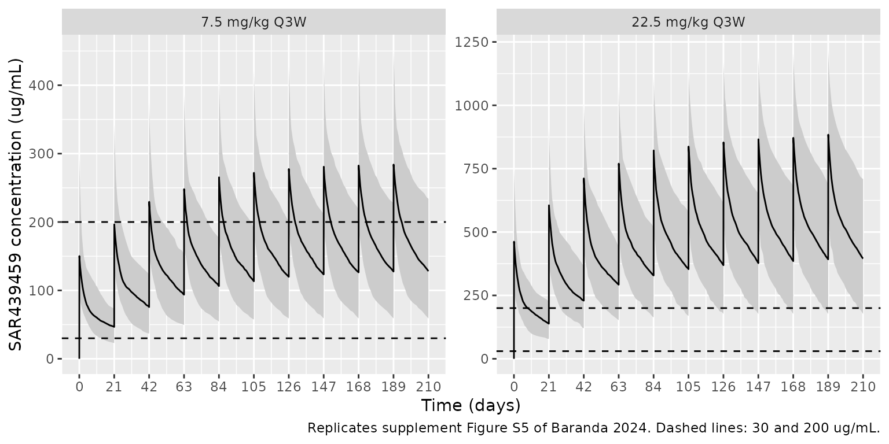
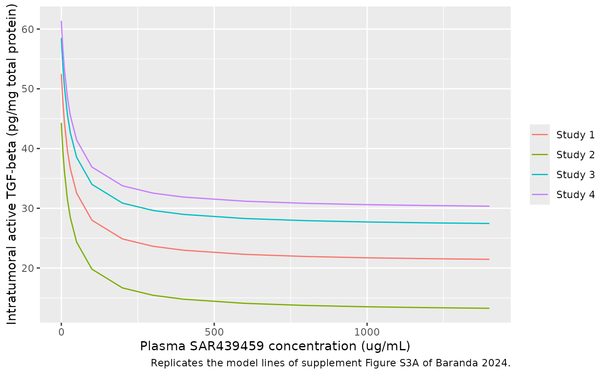
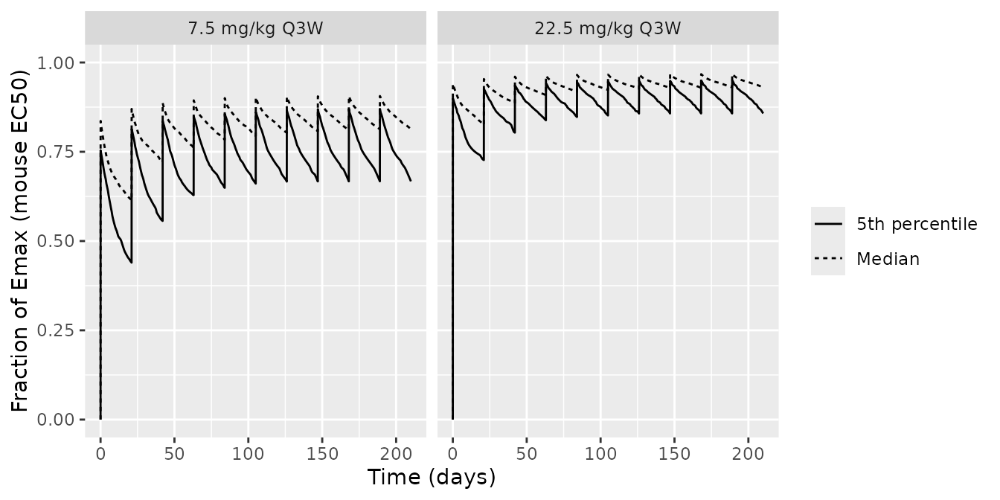

# SAR439459 (Baranda 2024)

## Model and source

- Citation: Baranda JC, Robbrecht D, Sullivan R, Doger B, Santoro A,
  Barve M, Grob J-J, Bechter O, Vieito M, de Miguel MJ, Schadendorf D,
  Johnson M, Pouzin C, Cantalloube C, Wang R, Lee J, Chen X, Demers B,
  Amrate A, Abbadessa G, Hodi FS. Safety, pharmacokinetics,
  pharmacodynamics, and antitumor activity of SAR439459, a TGFbeta
  inhibitor, as monotherapy and in combination with cemiplimab in
  patients with advanced solid tumors: Findings from a phase 1/1b study.
  Clin Transl Sci. 2024;17(6):e13854. <doi:10.1111/cts.13854>
- Human model: Two-compartment population PK model with linear
  elimination for SAR439459 (anti-TGF-beta monoclonal antibody) given
  intravenously as monotherapy or with cemiplimab in adults with
  advanced solid tumours, with body weight on clearance and sex on
  central volume (Baranda 2024)
- Mouse model: Preclinical (mouse, MC38 syngeneic colon tumour). Direct
  Emax inhibition model of intratumoral active TGF-beta driven by the
  SAR439459 (anti-TGF-beta monoclonal antibody) plasma concentration,
  with a study-specific baseline and a shared Emax and EC50 (Baranda
  2024)
- Article: <https://doi.org/10.1111/cts.13854> (open access,
  PMC11186846)

Baranda 2024 reports the phase 1/1b study of SAR439459 (SAR’459), a
human anti-TGF-beta IgG4 monoclonal antibody that neutralises all three
TGF-beta isoforms, given intravenously alone or with cemiplimab. Two
models from the paper’s supplement are packaged:

1.  `Baranda_2024_sar439459` – the human population PK model (supplement
    Table S2), fitted to the 52 dose-escalation patients.
2.  `Baranda_2024_sar439459_mouse` – the preclinical PK/PD model in MC38
    tumour-bearing mice (supplement Table S3 and Eq. 1), a direct Emax
    inhibition of intratumoral active TGF-beta by the SAR439459 plasma
    concentration. Its EC50 (about 30 ug/mL) and near-maximal
    concentration (about 200 ug/mL) were the exposure targets used to
    pick the 7.5 and 22.5 mg/kg Q3W expansion doses.

The two models are independent fits in different species; the source
does not link them, other than by comparing human simulated troughs with
the mouse-derived thresholds (supplement Figure S5). That comparison is
reproduced at the end of this article.

## Population

**Human.** The popPK data set holds 52 patients with advanced
unresectable or metastatic solid tumours from the dose-escalation parts
of NCT03192345: Part 1A (n = 28, SAR439459 0.05-15 mg/kg Q2W
monotherapy) and Part 1B (n = 24, SAR439459 0.25-15 mg/kg Q2W or 22.5
mg/kg Q3W with cemiplimab 3 mg/kg Q2W or 350 mg Q3W). Median age was
60.5 years (Part 1A, range 25-91) and 63.0 years (Part 1B, range 43-81);
25 of 52 patients (48.1%) were female (Table 1). Cycle 1 was richly
sampled (pre-dose to 336 h, plus 504 h for Q3W) and later cycles
sparsely. Body weight is not tabulated.

**Mouse.** Four MC38 syngeneic colon-carcinoma studies, each with an
untreated control group: study 1 (single dose, 1 and 25 mg/kg), study 2
(single dose, 10, 25 and 50 mg/kg), study 3 (three doses of 25 mg/kg)
and study 4 (single dose, 10, 25 and 50 mg/kg) (supplement Figure S3A
legend). Plasma SAR439459 and intratumoral active TGF-beta (pg/mg total
protein) were measured in the same animals at several times after
dosing. The number of animals is not reported.

The same information is available programmatically via each model’s
`population` metadata,
e.g. `readModelDb("Baranda_2024_sar439459")()$population`.

## Source trace

| Equation / parameter | Value | Source location |
|----|----|----|
| Human: two-compartment, linear elimination, IV | – | Results, Population pharmacokinetics; supplement p. 4 |
| `lcl` (CL, 70 kg) | 0.141 L/day | Supplement Table S2 |
| `e_wt_cl` (power on WT/70) | 0.994 | Supplement Table S2 ‘+ betaWT’ |
| `lvc` (Vc, male) | 4.06 L | Supplement Table S2 |
| `e_sexf_vc` (log-scale, female) | -0.321 | Supplement Table S2 ‘+ betaSEX_female’ |
| `lq` (Q) | 0.624 L/day | Supplement Table S2 |
| `lvp` (Vp) | 2.44 L | Supplement Table S2 |
| `etalcl`, `etalvc`, `etalvp` | 0.337^2, 0.224^2, 0.731^2 | Supplement Table S2 omega (%) = 33.7, 22.4, 73.1 |
| `propSd` (human) | 0.195 | Supplement Table S2 sigma prop = 19.5% |
| Mouse: `tgfb_tumor = E0 - Emax * C / (EC50 + C)` | – | Supplement Eq. 1 (see Assumptions) |
| `le0_tgfb_tumor` (study 1) | 52.5 pg/mg protein | Supplement Table S3 |
| `le0_tgfb_tumor_study2` / `_study3` / `_study4` | 44.3 / 58.5 / 61.4 pg/mg protein | Supplement Table S3 |
| `lemax` | 31.7 pg/mg protein | Supplement Table S3 |
| `lec50` | 29.4 ug/mL | Supplement Table S3 |
| `propSd` (mouse) | 0.311 | Supplement Table S3 ‘Proportional error’ = 31.1% |

## Human population PK

### Virtual cohort

Body weight is not reported for the PK population, so a log-normal
weight with median 70 kg and 20% CV (truncated to 40-130 kg) is assumed;
48.1% of virtual patients are female (Table 1, Parts 1A and 1B).
Supplement Figure S5 simulated 200 patients per regimen, which this
article matches.

``` r

mod_h <- readModelDb("Baranda_2024_sar439459")

n_per_arm <- 200
set.seed(20240611)
rxode2::rxSetSeed(20240611)

cohort <- tibble(
  id_base = seq_len(n_per_arm),
  WT = pmin(pmax(70 * exp(rnorm(n_per_arm, 0, 0.198)), 40), 130),
  SEXF = rbinom(n_per_arm, 1, 0.481)
)

regimens <- tibble(regimen = c("7.5 mg/kg Q3W", "22.5 mg/kg Q3W"), mgkg = c(7.5, 22.5))
dose_days <- seq(0, 189, by = 21)
obs_days <- sort(unique(c(
  seq(0, 210, by = 0.5),
  dose_days + 1 / 24,
  dose_days + 21 - 1e-3
)))

subjects <- tidyr::crossing(regimens, cohort) |>
  mutate(id = row_number(), amt = mgkg * WT)

dose_rows <- subjects |>
  tidyr::crossing(time = dose_days) |>
  mutate(evid = 1L, cmt = "central", dur = 1 / 24)
obs_rows <- subjects |>
  tidyr::crossing(time = obs_days) |>
  mutate(evid = 0L, cmt = "central", amt = 0, dur = 0)

events_h <- bind_rows(dose_rows, obs_rows) |>
  arrange(id, time, desc(evid)) |>
  select(id, time, evid, cmt, amt, dur, WT, SEXF, regimen, mgkg)

sim_h <- rxode2::rxSolve(mod_h, events_h, keep = c("regimen", "mgkg")) |>
  as.data.frame()
#> ℹ parameter labels from comments will be replaced by 'label()'
```

### Replicates Figure S5 (5th, median and 95th percentiles)

``` r

pct_h <- sim_h |>
  group_by(regimen, time) |>
  summarise(
    p05 = quantile(Cc, 0.05),
    p50 = median(Cc),
    p95 = quantile(Cc, 0.95),
    .groups = "drop"
  ) |>
  mutate(regimen = factor(regimen, levels = regimens$regimen))

ggplot(pct_h, aes(time)) +
  geom_ribbon(aes(ymin = p05, ymax = p95), fill = "grey80") +
  geom_line(aes(y = p50)) +
  geom_hline(yintercept = c(30, 200), linetype = "dashed") +
  facet_wrap(~regimen, scales = "free_y") +
  scale_x_continuous(breaks = seq(0, 210, by = 21)) +
  labs(
    x = "Time (days)", y = "SAR439459 concentration (ug/mL)",
    caption = "Replicates supplement Figure S5 of Baranda 2024. Dashed lines: 30 and 200 ug/mL."
  )
```



The figure’s medians were digitised by the maintainers from supplement
Figure S5 at the end of the first infusion (cycle-1 peak), at day 21
(cycle-1 trough), at the last peak (day 189) and at day 210 (trough
after the tenth dose).

``` r

at_time <- function(d, t) {
  d |>
    group_by(regimen) |>
    filter(abs(time - t) == min(abs(time - t))) |>
    summarise(p05 = quantile(Cc, 0.05), p50 = median(Cc), .groups = "drop")
}
digitised <- tribble(
  ~regimen, ~landmark, ~t, ~published_median,
  "7.5 mg/kg Q3W", "Cycle-1 peak", 1 / 24, 135,
  "7.5 mg/kg Q3W", "Day-21 trough", 21 - 1e-3, 48,
  "7.5 mg/kg Q3W", "Day-189 peak", 189 + 1 / 24, 300,
  "7.5 mg/kg Q3W", "Day-210 trough", 210, 150,
  "22.5 mg/kg Q3W", "Cycle-1 peak", 1 / 24, 440,
  "22.5 mg/kg Q3W", "Day-21 trough", 21 - 1e-3, 150,
  "22.5 mg/kg Q3W", "Day-189 peak", 189 + 1 / 24, 910,
  "22.5 mg/kg Q3W", "Day-210 trough", 210, 435
)
median_at <- function(reg, t) {
  d <- sim_h[sim_h$regimen == reg, ]
  median(d$Cc[abs(d$time - t) == min(abs(d$time - t))])
}
cmp_s5 <- digitised |>
  mutate(
    simulated_median = mapply(median_at, regimen, t),
    ratio = simulated_median / published_median
  )

cmp_s5 |>
  mutate(across(c(simulated_median, ratio), \(x) signif(x, 3))) |>
  select(-t) |>
  dplyr::rename(
    Regimen = regimen,
    Landmark = landmark,
    "Figure S5 median (ug/mL)" = published_median,
    "Simulated median (ug/mL)" = simulated_median,
    "Simulated / published" = ratio
  ) |>
  knitr::kable()
```

| Regimen | Landmark | Figure S5 median (ug/mL) | Simulated median (ug/mL) | Simulated / published |
|:---|:---|---:|---:|---:|
| 7.5 mg/kg Q3W | Cycle-1 peak | 135 | 150.0 | 1.110 |
| 7.5 mg/kg Q3W | Day-21 trough | 48 | 46.6 | 0.971 |
| 7.5 mg/kg Q3W | Day-189 peak | 300 | 284.0 | 0.947 |
| 7.5 mg/kg Q3W | Day-210 trough | 150 | 128.0 | 0.854 |
| 22.5 mg/kg Q3W | Cycle-1 peak | 440 | 462.0 | 1.050 |
| 22.5 mg/kg Q3W | Day-21 trough | 150 | 139.0 | 0.924 |
| 22.5 mg/kg Q3W | Day-189 peak | 910 | 884.0 | 0.972 |
| 22.5 mg/kg Q3W | Day-210 trough | 435 | 395.0 | 0.909 |

``` r


stopifnot(
  # A mis-transcribed CL, Vc, dose or unit shifts every landmark by tens of
  # percent; the digitising error and the assumed weight distribution do not.
  abs(median(log(cmp_s5$ratio))) < log(1.15),
  all(cmp_s5$ratio > 0.75 & cmp_s5$ratio < 1.33)
)
```

The paper states that 22.5 mg/kg Q3W gives troughs at or above 200 ug/mL
and 7.5 mg/kg Q3W gives troughs at or above 30 ug/mL (Results; Figure S5
shows these thresholds against the 5th percentile at steady state and in
cycle 1, respectively).

``` r

trough_p05 <- bind_rows(
  at_time(sim_h, 21 - 1e-3) |> mutate(when = "Day 21 (cycle 1)"),
  at_time(sim_h, 210) |> mutate(when = "Day 210 (after 10 doses)")
)
trough_p05 |>
  mutate(across(c(p05, p50), \(x) signif(x, 3))) |>
  select(when, regimen, p50, p05) |>
  dplyr::rename(
    Regimen = regimen, Trough = when,
    "5th percentile (ug/mL)" = p05, "Median (ug/mL)" = p50
  ) |>
  knitr::kable()
```

| Trough | Regimen | Median (ug/mL) | 5th percentile (ug/mL) |
|:---|:---|---:|---:|
| Day 21 (cycle 1) | 22.5 mg/kg Q3W | 139.0 | 78.2 |
| Day 21 (cycle 1) | 7.5 mg/kg Q3W | 46.6 | 23.1 |
| Day 210 (after 10 doses) | 22.5 mg/kg Q3W | 395.0 | 177.0 |
| Day 210 (after 10 doses) | 7.5 mg/kg Q3W | 128.0 | 58.9 |

The simulated 5th percentiles sit a little below these statements (and
below the 5th-percentile lines of Figure S5, which read about 28 ug/mL
at day 21 for 7.5 mg/kg and about 190 ug/mL at day 210 for 22.5 mg/kg).
The lower tail depends on the assumed weight distribution and on the
large Vp variability (omega 73.1%), neither of which can be matched
exactly from the reported information; the medians, which carry the
structural parameters, agree.

### PKNCA: cycle-1 exposure

The paper reports no NCA table; cycle-1 NCA is shown for reference and
to confirm dose proportionality, which a linear model must give.

``` r

conc_c1 <- sim_h |>
  filter(time <= 21, !is.na(Cc)) |>
  select(id, time, Cc, regimen)
dose_c1 <- events_h |>
  filter(evid == 1, time == 0) |>
  select(id, time, amt, regimen)

conc_obj <- PKNCA::PKNCAconc(conc_c1, Cc ~ time | regimen + id)
dose_obj <- PKNCA::PKNCAdose(dose_c1, amt ~ time | regimen + id)
intervals <- data.frame(start = 0, end = 21 - 1e-3, cmax = TRUE, auclast = TRUE, clast.obs = TRUE)
nca_res <- PKNCA::pk.nca(PKNCA::PKNCAdata(conc_obj, dose_obj, intervals = intervals))

nca_tab <- as.data.frame(nca_res$result) |>
  group_by(regimen, PPTESTCD) |>
  summarise(median = median(PPORRES), .groups = "drop") |>
  tidyr::pivot_wider(names_from = PPTESTCD, values_from = median)

nca_tab |>
  mutate(across(-regimen, \(x) signif(x, 3))) |>
  dplyr::rename(
    Regimen = regimen,
    "Cmax (ug/mL)" = cmax,
    "Concentration at day 21 (ug/mL)" = clast.obs,
    "AUC0-21 (day*ug/mL)" = auclast
  ) |>
  knitr::kable()
```

| Regimen | AUC0-21 (day\*ug/mL) | Concentration at day 21 (ug/mL) | Cmax (ug/mL) |
|:---|---:|---:|---:|
| 22.5 mg/kg Q3W | 4400 | 139.0 | 462 |
| 7.5 mg/kg Q3W | 1430 | 46.6 | 150 |

``` r


auc_ratio <- nca_tab$auclast[nca_tab$regimen == "22.5 mg/kg Q3W"] /
  nca_tab$auclast[nca_tab$regimen == "7.5 mg/kg Q3W"]
stopifnot(abs(auc_ratio / 3 - 1) < 0.15)
```

### Covariate effects

The paper notes that weight and sex change exposure by less than 30% at
the covariate extremes relative to the median. With the typical-value
model:

``` r

typ <- tidyr::crossing(WT = c(50, 70, 100), SEXF = c(0, 1)) |>
  mutate(
    cl = 0.141 * (WT / 70)^0.994,
    vc = 4.06 * exp(-0.321 * SEXF)
  )
typ |>
  mutate(across(c(cl, vc), \(x) signif(x, 3))) |>
  dplyr::rename("Weight (kg)" = WT, "Female" = SEXF, "CL (L/day)" = cl, "Vc (L)" = vc) |>
  knitr::kable()
```

| Weight (kg) | Female | CL (L/day) | Vc (L) |
|------------:|-------:|-----------:|-------:|
|          50 |      0 |      0.101 |   4.06 |
|          50 |      1 |      0.101 |   2.95 |
|          70 |      0 |      0.141 |   4.06 |
|          70 |      1 |      0.141 |   2.95 |
|         100 |      0 |      0.201 |   4.06 |
|         100 |      1 |      0.201 |   2.95 |

## Mouse MC38 PK/PD model

### Replicates Figure S3A (typical prediction per study)

``` r

mod_m <- readModelDb("Baranda_2024_sar439459_mouse")

conc_grid <- c(0, 1, 2, 5, 10, 20, 29.4, 50, 100, 200, 300, 400, 600, 800, 1000, 1200, 1400)
studies <- tibble(
  study = paste("Study", 1:4),
  STUDY_MC38_2 = c(0, 1, 0, 0),
  STUDY_MC38_3 = c(0, 0, 1, 0),
  STUDY_MC38_4 = c(0, 0, 0, 1)
)
events_m <- tidyr::crossing(studies, CP_SAR439459_MGL = conc_grid) |>
  mutate(id = as.integer(factor(study)), time = CP_SAR439459_MGL, evid = 0L, amt = 0) |>
  arrange(id, time)

# The mouse model has no random effects, so rxode2 warns that a
# multi-subject solve has no omega; each "subject" here is one study's
# typical curve, which is the intent.
sim_m <- suppressWarnings(rxode2::rxSolve(mod_m, events_m, keep = "study")) |>
  as.data.frame()

ggplot(sim_m, aes(CP_SAR439459_MGL, tgfb_tumor, colour = study)) +
  geom_line() +
  labs(
    x = "Plasma SAR439459 concentration (ug/mL)",
    y = "Intratumoral active TGF-beta (pg/mg total protein)",
    colour = NULL,
    caption = "Replicates the model lines of supplement Figure S3A of Baranda 2024."
  )
```



The typical lines in Figure S3A level off at about 21 (study 1), 13
(study 2), 27 (study 3) and 30 (study 4) pg/mg protein at 1400 ug/mL
(digitised by the maintainers). The simulated values at 1400 ug/mL and
at the EC50:

``` r

plateau <- sim_m |>
  filter(CP_SAR439459_MGL == 1400) |>
  select(study, tgfb_tumor) |>
  mutate(figure_s3a = c(21, 13, 27, 30))
plateau |>
  mutate(tgfb_tumor = signif(tgfb_tumor, 3)) |>
  dplyr::rename(
    Study = study,
    "Simulated at 1400 ug/mL" = tgfb_tumor,
    "Figure S3A (digitised)" = figure_s3a
  ) |>
  knitr::kable()
```

| Study   | Simulated at 1400 ug/mL | Figure S3A (digitised) |
|:--------|------------------------:|-----------------------:|
| Study 1 |                    21.5 |                     21 |
| Study 2 |                    13.3 |                     13 |
| Study 3 |                    27.5 |                     27 |
| Study 4 |                    30.4 |                     30 |

``` r

stopifnot(all(abs(plateau$tgfb_tumor - plateau$figure_s3a) < 3))

# At C = EC50 the decrease is Emax / 2 for every study; at 200 ug/mL the
# paper calls it 'close to 90% of Emax'. Same parameters on both sides, so
# these checks are exact up to floating point.
drop <- sim_m |>
  group_by(study) |>
  summarise(
    e0 = tgfb_tumor[CP_SAR439459_MGL == 0],
    at_ec50 = e0 - tgfb_tumor[CP_SAR439459_MGL == 29.4],
    at_200 = e0 - tgfb_tumor[CP_SAR439459_MGL == 200],
    .groups = "drop"
  )
stopifnot(
  all(abs(drop$at_ec50 - 31.7 / 2) < 1e-6),
  all(abs(drop$at_200 / 31.7 - 200 / (29.4 + 200)) < 1e-6),
  all(drop$at_200 / 31.7 > 0.85 & drop$at_200 / 31.7 < 0.90)
)
```

### Human exposure against the mouse thresholds

Supplement Figure S5 overlays the human simulations on the mouse-derived
thresholds. The fraction of the maximal intratumoral TGF-beta decrease
implied by the mouse EC50, `C / (EC50 + C)`, can be computed from the
human median profile. This is the source authors’ translational
assumption (a mouse plasma EC50 applied to human plasma), not a fitted
human relationship.

``` r

frac <- pct_h |>
  mutate(
    median_inhibition = p50 / (29.4 + p50),
    p05_inhibition = p05 / (29.4 + p05)
  )
ggplot(frac, aes(time)) +
  geom_line(aes(y = median_inhibition, linetype = "Median")) +
  geom_line(aes(y = p05_inhibition, linetype = "5th percentile")) +
  facet_wrap(~regimen) +
  scale_y_continuous(limits = c(0, 1)) +
  labs(
    x = "Time (days)", y = "Fraction of Emax (mouse EC50)", linetype = NULL
  )
```



## Assumptions and deviations

- **Reference weight.** Table S2 gives the weight exponent on CL but not
  the value weight is centred on; 70 kg is assumed. The paper says
  covariate effects are expressed relative to the median, which is not
  reported.
- **Weight distribution.** Not reported; the virtual cohort uses a
  log-normal weight with median 70 kg and 20% CV, truncated to 40-130
  kg.
- **Infusion duration.** Not reported; a 1-hour infusion is simulated.
  For a monoclonal antibody with a multi-day half-life this has no
  visible effect beyond the first hour.
- **IIV.** Table S2 reports Monolix omega (%) values; Monolix omega is
  the standard deviation of the log-normal random effect, so the
  variances are the squares (0.337^2, 0.224^2, 0.731^2). No correlations
  are reported.
- **Mouse Eq. 1.** The equation in the supplement PDF is garbled: it
  prints `TGFbeta = 0 - ...` with the Emax fraction repeated three
  times. The intended form `TGFbeta = E0 - Emax * C / (EC50 + C)`
  follows from the text (‘direct Emax inhibition model’), from Table S3
  reporting a separate E0 per study and a single Emax and EC50, and from
  the Figure S3A typical lines, which start at the per-study E0 and
  level off at E0 - Emax (checked above).
- **Mouse PK.** No mouse PK model is reported; the plasma concentration
  is a per-record covariate column, `CP_SAR439459_MGL`. The source
  fitted the measured plasma concentration paired with each tumour
  sample.
- **Mouse IIV.** Table S3 reports no random effects; the model is
  typical-value plus proportional residual error.
- **Figure S5 axis labels.** In the 7.5 mg/kg panel the x-axis tick
  labels read 0, 21, 22, 23, 24, 105, … where the 22.5 mg/kg panel reads
  0, 21, 42, 63, 84, 105, …; the two panels show the same Q3W schedule,
  so the 7.5 mg/kg labels are taken as a typographical error for 42, 63
  and 84.
- **Digitised values.** Figure S5 medians and Figure S3A plateaus were
  read from the published figures and carry a few percent of reading
  error; the checks above allow for it.
- **Cemiplimab.** Tested as a covariate and not retained (‘Cemiplimab
  had no effect on SAR’459 PK exposure’); recorded under
  `covariatesDataExcluded`.
