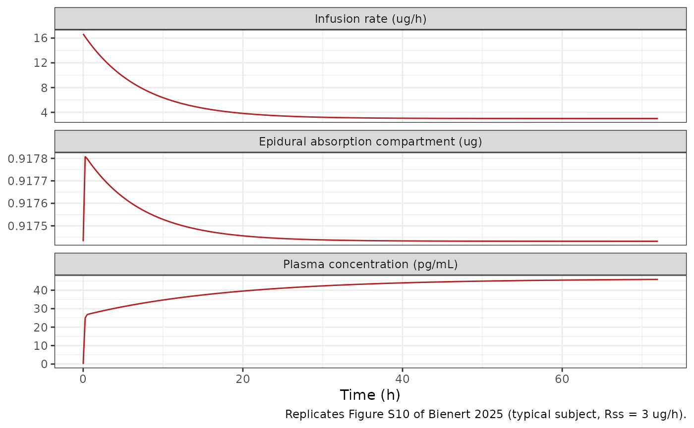
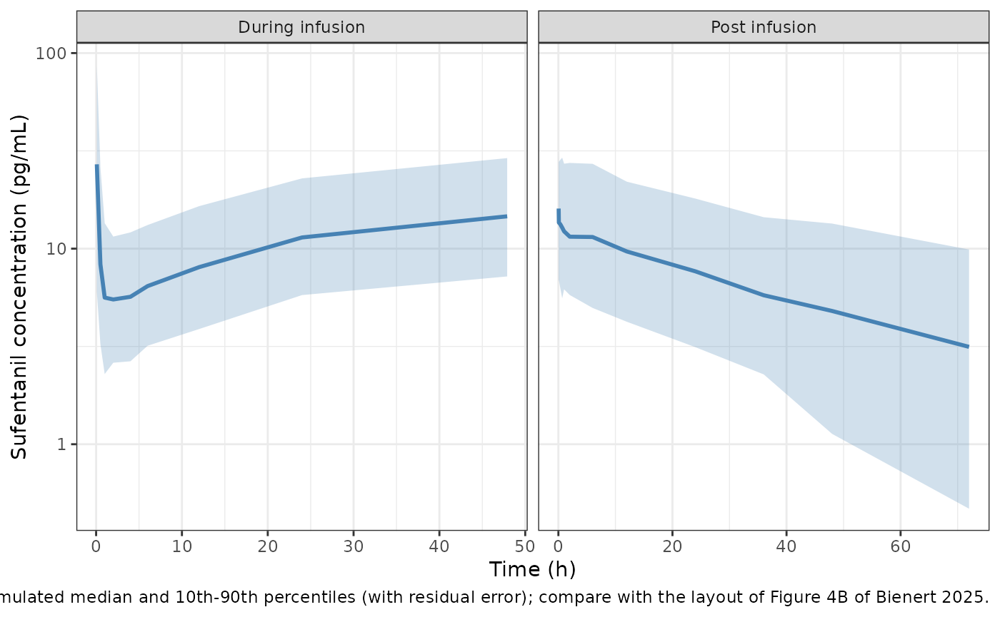

# Sufentanil, epidural (Bienert 2025)

## Model and source

- Citation: Bienert A, Borsuk-De Moor A, Okunska P, Ber J, Siluk D,
  Waszczuk M, Kusza K, Bartkowiak T, Szrama J, Kluzik A, Koszel T,
  Wiczling P. Pharmacokinetics of Sufentanil After Epidural
  Administration During the Course of Extensive Abdominal Surgery. Clin
  Pharmacokinet 2025;64(9):1331-1340. <doi:10.1007/s40262-025-01543-y>.
  Correlations of the random effects are from the authors’ public code
  and output deposit (<https://github.com/wiczling/sufentanil-epidural>,
  deliv/tables/torsten/3b/parameters-table.csv) for the same final
  model.
- Description: Two-compartment population PK model for epidural
  sufentanil in adults undergoing major abdominal surgery under general
  anaesthesia with epidural analgesia (epidural bolus plus continuous
  epidural infusion for up to about 3 days). Absorption from the
  epidural space is itself two-compartmental: the dose enters an
  epidural absorption compartment that drains first order into plasma
  (KA) and exchanges with a slowly returning epidural distribution
  compartment (epidural fat; KA14 out, KA41 back), which produces
  flip-flop kinetics. Linear elimination from the central compartment.
  Full Bayesian fit (Stan/Torsten); typical values are posterior means.
  Log-normal IIV on all seven parameters with a full correlation matrix;
  residual error additive on the log scale with a Student-t
  distribution.
- Article: [Clin Pharmacokinet
  2025;64(9):1331-1340](https://doi.org/10.1007/s40262-025-01543-y)

Sufentanil given into the epidural space reaches plasma slowly, and its
plasma concentrations decline more slowly than after intravenous dosing.
Bienert 2025 explains this with a two-compartment absorption site: the
dose enters an epidural absorption compartment (`depot`, the paper’s A1)
that drains quickly into plasma (KA) and also exchanges quickly with an
epidural distribution compartment (`depot_peripheral`, the paper’s A4,
attributed to epidural fat) from which sufentanil returns only slowly
(KA41). Disposition is a standard two-compartment model. Because the
slow return from the epidural fat is slower than sufentanil’s own
terminal disposition, the post-infusion decline is absorption-limited
(flip-flop kinetics).

``` r

mod <- rxode2::rxode(readModelDb("Bienert_2025_sufentanil"))
#> ℹ parameter labels from comments will be replaced by 'label()'
mod
#>  ── rxode2-based free-form 4-cmt ODE model ────────────────────────────────────── 
#>  ── Initalization: ──  
#> Fixed Effects ($theta): 
#>       lcl        lq       lvc       lvp       lka     lka14     lka41     expSd 
#>  4.172848  3.875359  2.322388  6.226537  1.184790  2.701361 -1.966113  0.310000 
#>        nu 
#>  3.810000 
#> 
#> Omega ($omega): 
#>               etalcl        etalq       etalvc       etalvp       etalka
#> etalcl    0.24010000  0.006945750  0.187194700 -0.003616200 -0.002205000
#> etalq     0.00694575  0.202500000 -0.028674900  0.000440955  0.002980800
#> etalvc    0.18719470 -0.028674900  2.280100000 -0.027921410  0.001723212
#> etalvp   -0.00361620  0.000440955 -0.027921410  0.168100000  0.003808080
#> etalka   -0.00220500  0.002980800  0.001723212  0.003808080  0.129600000
#> etalka14  0.00465500  0.003471300 -0.054797900 -0.003739200  0.010369440
#> etalka41  0.04581500  0.023850000  0.083805000 -0.007277500 -0.014598000
#>             etalka14   etalka41
#> etalcl    0.00465500  0.0458150
#> etalq     0.00347130  0.0238500
#> etalvc   -0.05479790  0.0838050
#> etalvp   -0.00373920 -0.0072775
#> etalka    0.01036944 -0.0145980
#> etalka14  0.14440000  0.0212800
#> etalka41  0.02128000  0.2500000
#> attr(,"lotriLabels")
#> [1] NA                                                                                                                                                        
#> [2] NA                                                                                                                                                        
#> [3] NA                                                                                                                                                        
#> [4] NA                                                                                                                                                        
#> [5] NA                                                                                                                                                        
#> [6] NA                                                                                                                                                        
#> [7] "Table 1: omegaCL 0.49, omegaQ 0.45, omegaV1 1.51, omegaV2 0.41, omegaKA 0.36, omegaKA14 0.38, omegaKA41 0.5; rho from the deposited parameters-table.csv"
#> attr(,"lotriFix")
#>          etalcl etalq etalvc etalvp etalka etalka14 etalka41
#> etalcl    FALSE FALSE  FALSE  FALSE  FALSE    FALSE    FALSE
#> etalq     FALSE FALSE  FALSE  FALSE  FALSE    FALSE    FALSE
#> etalvc    FALSE FALSE  FALSE  FALSE  FALSE    FALSE    FALSE
#> etalvp    FALSE FALSE  FALSE  FALSE  FALSE    FALSE    FALSE
#> etalka    FALSE FALSE  FALSE  FALSE  FALSE    FALSE    FALSE
#> etalka14  FALSE FALSE  FALSE  FALSE  FALSE    FALSE    FALSE
#> etalka41  FALSE FALSE  FALSE  FALSE  FALSE    FALSE    FALSE
#> 
#> States ($state or $stateDf): 
#>   Compartment Number Compartment Name
#> 1                  1            depot
#> 2                  2 depot_peripheral
#> 3                  3          central
#> 4                  4      peripheral1
#>  ── μ-referencing ($muRefTable): ──  
#>   theta      eta level
#> 1   lcl   etalcl    id
#> 2    lq    etalq    id
#> 3   lvc   etalvc    id
#> 4   lvp   etalvp    id
#> 5   lka   etalka    id
#> 6 lka14 etalka14    id
#> 7 lka41 etalka41    id
#> 
#>  ── Model (Normalized Syntax): ── 
#> function() {
#>     compartmentData <- list(depot = list(analyte = "sufentanil", 
#>         units = "ug", specimen = "administration site", verified = TRUE), 
#>         depot_peripheral = list(analyte = "sufentanil", units = "ug", 
#>             specimen = "administration site", verified = TRUE), 
#>         central = list(analyte = "sufentanil", units = "ug", 
#>             specimen = "plasma", verified = TRUE), peripheral1 = list(analyte = "sufentanil", 
#>             units = "ug", specimen = "plasma", verified = TRUE))
#>     covariateData <- list()
#>     covariatesDataExcluded <- list(AGE = list(description = "Age", 
#>         units = "years", type = "continuous", notes = "Explored graphically against the individual random effects (Figure S5); no covariate model was fitted."), 
#>         WT = list(description = "Body weight", units = "kg", 
#>             type = "continuous", notes = "Explored graphically against the individual random effects (Figure S6); no covariate model was fitted."), 
#>         HT = list(description = "Body height", units = "cm", 
#>             type = "continuous", notes = "Explored graphically against the individual random effects (Figure S7); no covariate model was fitted."), 
#>         SEXF = list(description = "Sex (1 = female, 0 = male)", 
#>             units = "(binary)", type = "binary", notes = "Explored graphically against the individual random effects (Figure S8); no covariate model was fitted."))
#>     description <- "Two-compartment population PK model for epidural sufentanil in adults undergoing major abdominal surgery under general anaesthesia with epidural analgesia (epidural bolus plus continuous epidural infusion for up to about 3 days). Absorption from the epidural space is itself two-compartmental: the dose enters an epidural absorption compartment that drains first order into plasma (KA) and exchanges with a slowly returning epidural distribution compartment (epidural fat; KA14 out, KA41 back), which produces flip-flop kinetics. Linear elimination from the central compartment. Full Bayesian fit (Stan/Torsten); typical values are posterior means. Log-normal IIV on all seven parameters with a full correlation matrix; residual error additive on the log scale with a Student-t distribution."
#>     dosing <- "depot"
#>     paper_specific_compartments <- "depot_peripheral"
#>     population <- list(species = "human", n_subjects = 23L, n_studies = 1L, 
#>         age_range = "30-83 years", age_median = "60 years (IQR 42.5-65)", 
#>         weight_median = "71 kg (IQR 59-80.5)", sex_female_pct = 52, 
#>         disease_state = "Adults (ASA physical status 2-3) undergoing major oncologic or non-oncologic abdominal surgery under general anaesthesia combined with epidural analgesia (epidural catheter at Th8/9 to Th12/L1).", 
#>         dose_range = "Epidural sufentanil: an initial dose with an amide local anaesthetic (ropivacaine or bupivacaine), followed by a continuous epidural infusion titrated to clinical response during surgery and for the following 3 days. Median (IQR) total intra-operative epidural sufentanil dose 15 (10.9-20.6) ug (Table S1).", 
#>         regions = "Poland (single centre, Poznan University of Medical Sciences)", 
#>         notes = "Study NCT06069219. Demographics from Tables S1 and S2: 12 female / 11 male; ASA 2 in 9 and ASA 3 in 14 patients; general anaesthesia with sevoflurane (20) or desflurane (3) after IV fentanyl and propofol induction. Plasma sampled at 5 min, 0.5, 1, 2, 4, 6 and 12 h, then every 24 h, before the end of infusion, and at 3, 5, 20 and 40 min and 1, 2, 6, 12, 36 and 72 h after the infusion ended; LC-MS/MS assay. Two very high concentrations just after the start of the infusion were flagged as outliers (Figure 2). Stan/Torsten full Bayesian estimation, 4 chains x 1000 post-warmup iterations, weakly informative priors on disposition taken from published IV sufentanil PK.")
#>     reference <- "Bienert A, Borsuk-De Moor A, Okunska P, Ber J, Siluk D, Waszczuk M, Kusza K, Bartkowiak T, Szrama J, Kluzik A, Koszel T, Wiczling P. Pharmacokinetics of Sufentanil After Epidural Administration During the Course of Extensive Abdominal Surgery. Clin Pharmacokinet 2025;64(9):1331-1340. doi:10.1007/s40262-025-01543-y. Correlations of the random effects are from the authors' public code and output deposit (https://github.com/wiczling/sufentanil-epidural, deliv/tables/torsten/3b/parameters-table.csv) for the same final model."
#>     units <- list(time = "h", dosing = "ug", concentration = "pg/mL")
#>     vignette <- "Bienert_2025_sufentanil"
#>     ini({
#>         lcl <- 4.17284762371004
#>         label("Clearance (L/h)")
#>         lq <- 3.87535902105655
#>         label("Inter-compartmental clearance (L/h)")
#>         lvc <- 2.32238772029023
#>         label("Central volume of distribution (L)")
#>         lvp <- 6.22653666928747
#>         label("Peripheral volume of distribution (L)")
#>         lka <- 1.18478998490916
#>         label("Absorption rate constant, epidural space to plasma (1/h)")
#>         lka14 <- 2.70136121295141
#>         label("Rate constant, epidural absorption to epidural distribution compartment (1/h)")
#>         lka41 <- -1.96611285637283
#>         label("Rate constant, epidural distribution compartment back to epidural absorption compartment (1/h)")
#>         expSd <- c(0, 0.31)
#>         label("Residual scale on the log concentration (Student-t)")
#>         nu <- c(0, 3.81)
#>         label("Degrees of freedom of the Student-t residual error")
#>         etalcl ~ c(etalcl = 0.2401)
#>         etalq ~ c(etalcl = 0.00694575, etalq = 0.2025)
#>         etalvc ~ c(etalcl = 0.1871947, etalq = -0.0286749, etalvc = 2.2801)
#>         etalvp ~ c(etalcl = -0.0036162, etalq = 0.000440955, 
#>             etalvc = -0.02792141, etalvp = 0.1681)
#>         etalka ~ c(etalcl = -0.002205, etalq = 0.0029808, etalvc = 0.001723212, 
#>             etalvp = 0.00380808, etalka = 0.1296)
#>         etalka14 ~ c(etalcl = 0.004655, etalq = 0.0034713, etalvc = -0.0547979, 
#>             etalvp = -0.0037392, etalka = 0.01036944, etalka14 = 0.1444)
#>         etalka41 ~ c(etalcl = 0.045815, etalq = 0.02385, etalvc = 0.083805, 
#>             etalvp = -0.0072775, etalka = -0.014598, etalka14 = 0.02128, 
#>             etalka41 = 0.25)
#>         label("Table 1: omegaCL 0.49, omegaQ 0.45, omegaV1 1.51, omegaV2 0.41, omegaKA 0.36, omegaKA14 0.38, omegaKA41 0.5; rho from the deposited parameters-table.csv")
#>     })
#>     model({
#>         cl <- exp(lcl + etalcl)
#>         q <- exp(lq + etalq)
#>         vc <- exp(lvc + etalvc)
#>         vp <- exp(lvp + etalvp)
#>         ka <- exp(lka + etalka)
#>         ka14 <- exp(lka14 + etalka14)
#>         ka41 <- exp(lka41 + etalka41)
#>         kel <- cl/vc
#>         k12 <- q/vc
#>         k21 <- q/vp
#>         d/dt(depot) <- -(ka + ka14) * depot + ka41 * depot_peripheral
#>         d/dt(depot_peripheral) <- ka14 * depot - ka41 * depot_peripheral
#>         d/dt(central) <- ka * depot - (kel + k12) * central + 
#>             k21 * peripheral1
#>         d/dt(peripheral1) <- k12 * central - k21 * peripheral1
#>         Cc <- 1000 * central/vc
#>         Cc ~ lnorm(expSd) + dt(nu)
#>     })
#> }
```

## Population

Bienert 2025 studied 23 adults (12 female, 11 male; ASA physical status
2 in 9 and 3 in 14 patients) undergoing major oncologic or non-oncologic
abdominal surgery under general anaesthesia combined with epidural
analgesia at a single centre in Poznan, Poland (NCT06069219). The
abstract gives an age range of 30-83 years; Table S1 reports a median
(IQR) age of 60 (42.5-65) years and body weight of 71 (59-80.5) kg. The
epidural catheter sat between Th8/9 and Th12/L1. After an initial
epidural dose of sufentanil with an amide local anaesthetic, sufentanil
was infused epidurally, titrated to response, during surgery and for the
following 3 days (median intra-operative epidural dose 15 ug, Table S1).
Plasma was sampled densely during the infusion and for 72 h after it
stopped.

Age, weight, height, sex and catheter placement were explored only
graphically against the individual random effects (Figures S5-S9); no
covariate model was fitted, so the model has no covariates.

``` r

pop <- mod$population
str(pop[c("species", "n_subjects", "age_range", "age_median", "weight_median", "sex_female_pct")])
#> List of 6
#>  $ species       : chr "human"
#>  $ n_subjects    : int 23
#>  $ age_range     : chr "30-83 years"
#>  $ age_median    : chr "60 years (IQR 42.5-65)"
#>  $ weight_median : chr "71 kg (IQR 59-80.5)"
#>  $ sex_female_pct: num 52
```

## Source trace

| Item | Value | Source |
|----|----|----|
| ODE system (A1, A4, C1, C2) | as in `model()` | Statistical Methods, final model equations; K matrix of the deposited Stan code (`model/torsten/3b/3b.stan`) |
| Concentration = amount / V1 x 1000 (pg/mL) |  | Deposited Stan code (`x[2] ./ theta[3] .* 1000`) |
| `lcl` | 64.9 L/h | Table 1, thetaCL mean |
| `lq` | 48.2 L/h | Table 1, thetaQ mean |
| `lvc` | 10.2 L | Table 1, thetaV1 mean |
| `lvp` | 506 L | Table 1, thetaV2 mean |
| `lka` | 3.27 1/h | Table 1, thetaKA mean |
| `lka14` | 14.9 1/h | Table 1, thetaKA14 mean |
| `lka41` | 0.14 1/h | Table 1, thetaKA41 mean |
| IIV SDs (log scale) | 0.49, 0.45, 1.51, 0.41, 0.36, 0.38, 0.5 | Table 1, omega CL, Q, V1, V2, KA, KA14, KA41 means |
| IIV correlations | 21 posterior-mean rho | Deposited `deliv/tables/torsten/3b/parameters-table.csv` |
| Omega = diag(omega) rho diag(omega) |  | Statistical Methods |
| `expSd` | 0.31 | Table 1, sigma mean |
| `nu` | 3.81 | Table 1, nu mean |
| Student-t residual on log(C) |  | Statistical Methods |

## Replicating Figure S10: dosing to an epidural steady state

The Discussion derives a regimen that puts the epidural absorption
compartment at its steady-state amount from the start: an induction dose
of `Rss / KA` followed by an infusion whose rate decays as
`Rss + KA14 / KA * Rss * exp(-KA41 * t)`. With that input, `depot` holds
exactly at `Rss / KA` (the KA14 outflow is replaced by the decaying
extra rate) while the epidural fat fills, and plasma approaches
`Rss / CL`. Figure S10 shows this for `Rss = 3` ug/h in the typical
subject. The decaying rate is given here as consecutive 0.05-h
infusions, each carrying the exact integral of the rate over its
interval.

``` r

typ <- rxode2::zeroRe(mod)
ka <- exp(mod$theta[["lka"]])
ka14 <- exp(mod$theta[["lka14"]])
ka41 <- exp(mod$theta[["lka41"]])
cl <- exp(mod$theta[["lcl"]])
rss <- 3
dt_seg <- 0.05
t_seg <- seq(0, 72 - dt_seg, by = dt_seg)
seg_amt <- rss * dt_seg +
  (ka14 / ka) * rss / ka41 * (exp(-ka41 * t_seg) - exp(-ka41 * (t_seg + dt_seg)))

ev_s10 <- dplyr::bind_rows(
  data.frame(id = 1L, time = 0, amt = rss / ka, rate = 0, evid = 1L, cmt = "depot"),
  data.frame(id = 1L, time = t_seg, amt = seg_amt, rate = seg_amt / dt_seg, evid = 1L, cmt = "depot"),
  data.frame(id = 1L, time = seq(0, 72, by = 0.25), amt = 0, rate = 0, evid = 0L, cmt = "central")
)
sim_s10 <- rxode2::rxSolve(typ, ev_s10, atol = 1e-10, rtol = 1e-10) |>
  as.data.frame()
#> ℹ omega/sigma items treated as zero: 'etalcl', 'etalq', 'etalvc', 'etalvp', 'etalka', 'etalka14', 'etalka41'

rate_df <- data.frame(time = seq(0, 72, by = 0.25)) |>
  dplyr::mutate(value = rss + (ka14 / ka) * rss * exp(-ka41 * time), panel = "Infusion rate (ug/h)")
plot_s10 <- dplyr::bind_rows(
  rate_df,
  sim_s10 |> dplyr::transmute(time, value = depot, panel = "Epidural absorption compartment (ug)"),
  sim_s10 |> dplyr::transmute(time, value = Cc, panel = "Plasma concentration (pg/mL)")
) |>
  dplyr::mutate(panel = factor(panel, levels = c(
    "Infusion rate (ug/h)", "Epidural absorption compartment (ug)", "Plasma concentration (pg/mL)"
  )))

ggplot(plot_s10, aes(time, value)) +
  geom_line(colour = "firebrick") +
  facet_wrap(~panel, ncol = 1, scales = "free_y") +
  labs(x = "Time (h)", y = NULL, caption = "Replicates Figure S10 of Bienert 2025 (typical subject, Rss = 3 ug/h).") +
  theme_bw()
```



``` r

s10_at <- sim_s10 |>
  dplyr::filter(time %in% c(20, 40, 72)) |>
  dplyr::select(time, depot, Cc)
# Figure S10 plasma curve, read off the published panel at 20, 40 and 72 h.
s10_at$Cc_fig <- c(39.5, 44.5, 46)
knitr::kable(s10_at, digits = 3, caption = "Typical-subject Figure S10 values.")
```

| time | depot |     Cc | Cc_fig |
|-----:|------:|-------:|-------:|
|   20 | 0.917 | 39.531 |   39.5 |
|   40 | 0.917 | 43.973 |   44.5 |
|   72 | 0.917 | 45.831 |   46.0 |

Typical-subject Figure S10 values. {.table}

``` r


c(
  initial_rate = rss * (1 + ka14 / ka),
  initial_rate_ratio = 1 + ka14 / ka,
  depot_target = rss / ka,
  plasma_ss = 1000 * rss / cl
)
#>       initial_rate initial_rate_ratio       depot_target          plasma_ss 
#>         16.6697248          5.5565749          0.9174312         46.2249615

stopifnot(
  # depot is held at Rss / KA by construction. The decaying rate is given as
  # 0.05-h constant-rate steps, which leaves a ripple of a few 1e-4.
  all(abs(sim_s10$depot[sim_s10$time > 0] / (rss / ka) - 1) < 2e-3),
  # Plasma curve matches the published panel.
  all(abs(s10_at$Cc / s10_at$Cc_fig - 1) < 0.10),
  # The paper's 'initial dose rate must be about 5.5 higher'.
  abs((1 + ka14 / ka) - 5.5) < 0.2,
  # Plasma approaches Rss / CL (46.2 pg/mL) by 72 h.
  abs(s10_at$Cc[s10_at$time == 72] / (1000 * rss / cl) - 1) < 0.02
)
```

The induction dose of `3 / 3.27 = 0.92` ug keeps the absorption
compartment flat, the starting rate is `3 x (1 + 14.9 / 3.27) = 16.7`
ug/h (Figure S10 starts just under 17 ug/h; the Discussion’s “about 5.5
higher”), and plasma rises from about 27 pg/mL at 1 h towards
`1000 x 3 / 64.9 = 46.2` pg/mL, as in Figure S10.

## Half-lives of the absorption and disposition processes

The Discussion reports the beta-phase half-life of absorption as 29.7
+/- 5.8 h and of disposition as 13.7 +/- 3.4 h (posterior mean +/- SD of
the half-lives computed from each draw of the typical values). The same
bi-exponential formula applied to the posterior-mean typical values
gives:

``` r

q <- exp(mod$theta[["lq"]])
vc <- exp(mod$theta[["lvc"]])
vp <- exp(mod$theta[["lvp"]])
beta_rate <- function(k_out, k_fwd, k_back) {
  s <- k_out + k_fwd + k_back
  0.5 * (s - sqrt(s^2 - 4 * k_back * k_out))
}
thalf_abs <- log(2) / beta_rate(ka, ka14, ka41)
thalf_dis <- log(2) / beta_rate(cl / vc, q / vc, q / vp)
data.frame(
  process = c("absorption (beta)", "disposition (beta)"),
  model_h = c(thalf_abs, thalf_dis),
  paper_mean_h = c(29.7, 13.7),
  paper_sd_h = c(5.8, 3.4)
) |>
  knitr::kable(digits = 1)
```

| process            | model_h | paper_mean_h | paper_sd_h |
|:-------------------|--------:|-------------:|-----------:|
| absorption (beta)  |    27.7 |         29.7 |        5.8 |
| disposition (beta) |    12.7 |         13.7 |        3.4 |

``` r


stopifnot(
  abs(thalf_abs - 29.7) < 5.8,
  abs(thalf_dis - 13.7) < 3.4,
  # Flip-flop: absorption is the slower process.
  thalf_abs > thalf_dis
)
```

The half-lives from the mean typical values sit slightly below the
paper’s means, as expected when the paper averages a non-linear function
over posterior draws; both are well inside one posterior SD.

## Virtual cohort and visual predictive check

The study regimens were individually titrated (the authors’ deposited
dataset shows maintenance infusion rates mostly between 0.75 and 3 ug/h,
short faster segments of 15-150 ug/h for the initial and supplementary
doses, and total infusion durations of 12-74 h), so an exact replication
of the Figure 4 VPC is not possible from the published material. As an
illustration, 200 virtual patients receive a representative regimen of
10 ug over 10 min followed by 1.5 ug/h for 48 h, sampled on the study’s
schedule during and for 72 h after the infusion. The model has no
covariates, so no covariate distribution is needed.

``` r

obs_during <- c(5 / 60, 0.5, 1, 2, 4, 6, 12, 24, 47.9)
obs_post <- 48 + c(3, 5, 20, 40) / 60
obs_post <- c(obs_post, 48 + c(1, 2, 6, 12, 24, 36, 48, 72))
ev_vpc <- rxode2::et(amt = 10, rate = 60, cmt = "depot") |>
  rxode2::et(time = 1 / 6, amt = 1.5 * (48 - 1 / 6), rate = 1.5, cmt = "depot") |>
  rxode2::et(sort(unique(c(obs_during, obs_post))), cmt = "central")

rxode2::rxSetSeed(20250629)
sim_vpc <- rxode2::rxSolve(mod, ev_vpc, nSub = 200) |>
  as.data.frame()

vpc_sum <- sim_vpc |>
  dplyr::mutate(phase = ifelse(time < 48, "During infusion", "Post infusion"),
                tplot = ifelse(time < 48, time, time - 48)) |>
  dplyr::group_by(phase, tplot) |>
  dplyr::summarise(
    p10 = quantile(sim, 0.1), p50 = quantile(sim, 0.5), p90 = quantile(sim, 0.9),
    .groups = "drop"
  )

ggplot(vpc_sum, aes(tplot)) +
  geom_ribbon(aes(ymin = p10, ymax = p90), fill = "steelblue", alpha = 0.25) +
  geom_line(aes(y = p50), colour = "steelblue", linewidth = 1) +
  facet_wrap(~phase, scales = "free_x") +
  scale_y_log10() +
  labs(
    x = "Time (h)", y = "Sufentanil concentration (pg/mL)",
    caption = paste(
      "Simulated median and 10th-90th percentiles (with residual error);",
      "compare with the layout of Figure 4B of Bienert 2025."
    )
  ) +
  theme_bw()
```



The simulated median rises from a few pg/mL in the first hours to about
10-20 pg/mL at 24-48 h and falls to a few pg/mL 72 h after the infusion
stops, the same range as the observed median in Figure 4B.

## PKNCA validation

Non-compartmental analysis of the same regimen without residual error
(IIV retained), split into the infusion interval (0-48 h) and the
post-infusion interval (48-120 h). The paper reports no NCA, so the only
published comparator is the terminal half-life: under flip-flop kinetics
the late post-infusion decline should approach the absorption beta-phase
half-life (29.7 h).

``` r

# Cc is the individual prediction (IIV, no residual error); the
# residual-error draw is in the separate `sim` column.
rxode2::rxSetSeed(20250630)
ev_nca <- rxode2::et(amt = 10, rate = 60, cmt = "depot") |>
  rxode2::et(time = 1 / 6, amt = 1.5 * (48 - 1 / 6), rate = 1.5, cmt = "depot") |>
  rxode2::et(sort(unique(c(seq(0, 48, by = 1), 48 + c(0.5, 1, 2, 4, 6, 12, 18, 24, 36, 48, 60, 72)))), cmt = "central")
sim_nca <- rxode2::rxSolve(mod, ev_nca, nSub = 200) |>
  as.data.frame() |>
  dplyr::rename(id = sim.id) |>
  dplyr::mutate(treatment = "10 ug + 1.5 ug/h x 48 h")

conc_df <- sim_nca |>
  dplyr::filter(!is.na(Cc)) |>
  dplyr::select(id, time, Cc, treatment)
dose_df <- data.frame(
  id = rep(unique(conc_df$id), each = 2),
  time = rep(c(0, 1 / 6), times = length(unique(conc_df$id))),
  amt = rep(c(10, 1.5 * (48 - 1 / 6)), times = length(unique(conc_df$id))),
  treatment = "10 ug + 1.5 ug/h x 48 h"
)

conc_obj <- PKNCA::PKNCAconc(conc_df, Cc ~ time | treatment + id, concu = "pg/mL", timeu = "h")
dose_obj <- PKNCA::PKNCAdose(dose_df, amt ~ time | treatment + id, doseu = "ug")
intervals <- data.frame(
  start = c(0, 48),
  end = c(48, 120),
  cmax = c(TRUE, TRUE),
  tmax = c(TRUE, FALSE),
  auclast = c(TRUE, TRUE),
  half.life = c(FALSE, TRUE)
)
nca_res <- PKNCA::pk.nca(PKNCA::PKNCAdata(conc_obj, dose_obj, intervals = intervals))
summary(nca_res)
#>  Interval Start Interval End               treatment   N AUClast (h*pg/mL)
#>               0           48 10 ug + 1.5 ug/h x 48 h 200        528 [51.8]
#>              48          120 10 ug + 1.5 ug/h x 48 h 200        512 [65.3]
#>  Cmax (pg/mL)          Tmax (h) Half-life (h)
#>   15.8 [52.2] 48.0 [1.00, 48.0]             .
#>   15.8 [52.2]                 .   39.6 [28.6]
#> 
#> Caption: AUClast, Cmax: geometric mean and geometric coefficient of variation; Tmax: median and range; Half-life: arithmetic mean and standard deviation; N: number of subjects
```

``` r

published <- data.frame(
  treatment = "10 ug + 1.5 ug/h x 48 h",
  half.life = 29.7
)
hl_sim <- as.data.frame(nca_res) |>
  dplyr::filter(PPTESTCD == "half.life", start == 48) |>
  dplyr::select(treatment, PPTESTCD, PPORRES)
cmp <- nlmixr2lib::ncaComparisonTable(
  simulated = hl_sim,
  reference = published,
  by = "treatment",
  params = "half.life",
  units = c(half.life = "h"),
  tolerance_pct = 20
)
knitr::kable(cmp, caption = "Post-infusion terminal half-life: simulated (median) vs the paper's absorption beta-phase half-life. * marks rows differing by >20%.")
```

| NCA parameter | treatment               | Reference | Simulated | % diff |
|:--------------|:------------------------|:----------|:----------|:-------|
| t½ (h)        | 10 ug + 1.5 ug/h x 48 h | 29.7      | 32.2      | +8.4%  |

Post-infusion terminal half-life: simulated (median) vs the paper’s
absorption beta-phase half-life. \* marks rows differing by \>20%.
{.table}

``` r


stopifnot(abs(median(hl_sim$PPORRES, na.rm = TRUE) / 29.7 - 1) < 0.2)
```

The post-infusion terminal half-life of the simulated cohort is close to
the paper’s absorption beta-phase half-life and well above the
disposition beta-phase half-life (13.7 h), which is the flip-flop
behaviour the model was built to describe.

## Assumptions and deviations

- **Posterior means as point estimates.** Table 1 reports the posterior
  mean and median of each parameter. The model uses the means, which are
  the values the paper itself uses for the typical subject (Discussion:
  CL 64.9 L/h, `Rss / KA` approximately `Rss / 3.3`, KA14 / KA
  approximately 4.5).
- **IIV correlations from the authors’ deposit.** The paper estimates a
  full 7 x 7 correlation matrix (LKJ(10) prior) but prints only the SDs.
  The correlations are the posterior means in the authors’ public output
  for the same final model
  (`deliv/tables/torsten/3b/parameters-table.csv` of
  github.com/wiczling/sufentanil-epidural). Only the CL-V1 correlation
  (0.25) has a 90% interval excluding zero; the rest are near zero. The
  assembled covariance matrix is positive definite. The SDs are the
  Table 1 values, which match the deposit to two significant figures.
- **KA41 rounding.** Table 1 prints the KA41 mean as 0.14 1/h; the
  deposit gives 0.135 1/h. The model uses the printed 0.14.
- **Residual error.** The paper fits `log(Cobs)` with a Student-t error
  of scale sigma and nu degrees of freedom. This is encoded as
  `lnorm(expSd) + dt(nu)`; rxode2 uses the same scale parameterisation
  as Stan. `nu` is the paper’s name for the degrees of freedom. No
  canonical name exists for a t-distribution degrees-of-freedom
  parameter, so
  [`checkModelConventions()`](https://nlmixr2.github.io/nlmixr2lib/reference/checkModelConventions.md)
  warns that `nu` is not one of `propSd` / `addSd` / `expSd`; the
  warning is expected.
- **Epidural distribution compartment.** The paper’s A4 exchanges only
  with the epidural absorption compartment, never with plasma, a role no
  registered compartment name covers (`abs_site` exchanges with
  `central`; `depot2` denotes a second dosing route). It is named
  `depot_peripheral` and declared in the model’s
  `paper_specific_compartments`. The paper’s own rate-constant names
  KA14 and KA41 are kept (`ka14`, `ka41`).
- **Bioavailability.** The model assumes complete absorption from the
  epidural space, as the paper does (Discussion); CL and the volumes are
  therefore apparent values relative to the epidural dose.
- **Illustrative regimen.** The VPC and NCA regimen (10 ug over 10 min,
  then 1.5 ug/h for 48 h) is representative of, not identical to, the
  individually titrated study regimens, so the VPC is a qualitative
  comparison with Figure 4B.
- **Number of subjects.** The paper describes 23 patients; the deposited
  analysis dataset contains concentration records for 18 of them. The
  paper does not state that any patient was excluded, and the population
  metadata reports the 23 described.
