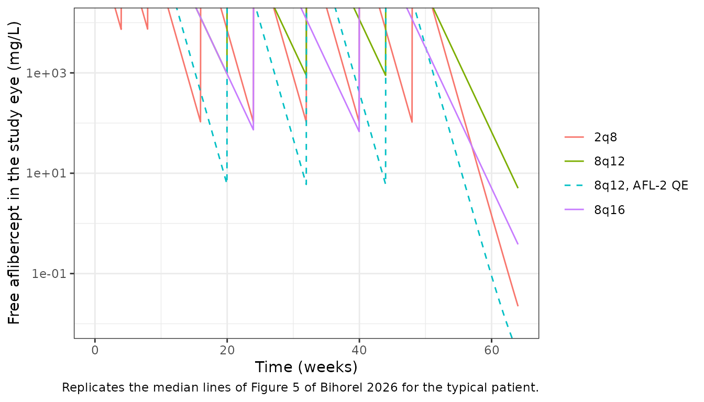
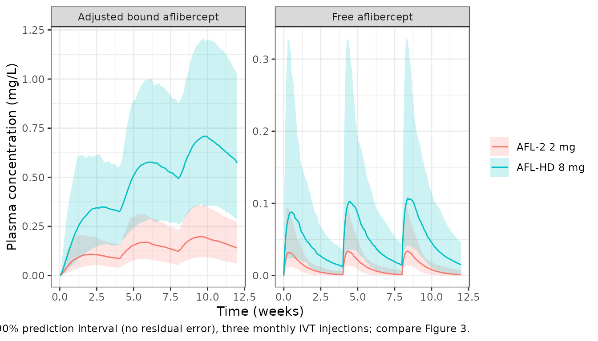

# Intravitreal aflibercept (Bihorel 2026)

## Model and source

- Citation: Bihorel S, Chiu J, Chittenden J, Eissing T, Turner KC,
  Hochel J, Zimmermann T, He ZW, Davis JD, DiCioccio AT, Harnisch LO.
  Integrated Population Pharmacokinetic Analysis of Intravitreal
  Aflibercept Drug Products. CPT Pharmacometrics Syst Pharmacol. 2026.
  <doi:10.1002/psp4.70287>. Adapts the IV-only free/bound aflibercept
  model of Thai et al. (2011); see modellib(‘Thai_2011_aflibercept’).
- Description: Integrated semi-mechanistic population PK model for free
  and VEGF-bound (adjusted bound) aflibercept in plasma after
  intravitreal (AFL-2 2 mg and AFL-HD 8 mg drug products), intravenous
  and subcutaneous administration (Bihorel 2026). Study and fellow eyes
  (fixed 4 mL vitreous volumes) exchange free aflibercept
  bidirectionally with the central compartment at the ocular clearance
  QE; free aflibercept distributes to two peripheral compartments, is
  eliminated first-order (K20), is taken up by a capacity-limited
  platelet pool, and binds VEGF in the central compartment by a
  Michaelis-Menten process that feeds the bound-aflibercept compartment
  (equal volume to central, first-order elimination K40). SC doses are
  absorbed first-order. Allometric body weight on all volumes and on
  K20/K40, albumin on K40, age and drug product (AFL-HD 39.4% slower) on
  QE, and healthy-volunteer / oncology indicators on Vmax. Pooled 2744
  participants from 16 trials (healthy volunteers, nAMD, DME, solid
  tumors / lymphoma).
- Article: <https://doi.org/10.1002/psp4.70287> (open access)

Bihorel et al. pooled free and VEGF-bound (“adjusted bound”) aflibercept
plasma concentrations from 16 trials in which aflibercept was given
intravitreally (IVT), intravenously or subcutaneously. They adapted the
IV-only model of Thai et al. (2011; `modellib("Thai_2011_aflibercept")`)
by adding both eyes, a second peripheral compartment, a platelet-uptake
pathway and SC absorption, and by moving VEGF binding from the
peripheral to the central compartment. The main finding is that the 8 mg
drug product (AFL-HD) has a 39.4% slower ocular clearance (QE) than the
2 mg drug product (AFL-2), which prolongs ocular exposure beyond what
the 4-fold dose increase alone would give.

## Population

The analysis included 2744 participants: healthy volunteers (n = 76),
neovascular age-related macular degeneration (nAMD, n = 1662), diabetic
macular edema (DME, n = 968), and solid tumors or lymphoma (n = 38). IVT
doses were 0.05-4 mg (AFL-2) or 8 mg (AFL-HD), IV doses 0.3-4 mg/kg and
SC doses 0.025-2 mg/kg. The baseline demographics are in Table S5 of the
supplement. The reference patient for the covariate model (Figure 4
caption) is a 71-year-old, 76 kg patient with nAMD and a serum albumin
of 4.3 g/dL. Of 31,326 plasma samples, 62.9% of the free and 19.6% of
the bound aflibercept concentrations were below the limit of
quantitation; these were handled with Beal’s M3 method in NONMEM 7.5.

## Source trace

The structural equations are the Figure 1 ODE system (states A1-A8) and
the typical-value equations of Section 3.1. Parameter values are from
Table 1.

| Model element | Value | Source |
|----|----|----|
| ODE system, 8 states (`vitreous` = A1, `central` = A2, `peripheral1` = A3, `complex` = A4, `vitreous_fellow` = A5, `depot` = A6, `plt_afl` = A7, `peripheral2` = A8) | – | Figure 1 caption |
| F_IVT on doses into either eye; F_SC on SC doses; IV into central | – | Figure 1 diagram |
| `lf_vitreous` (F_IVT) | 0.701 | Table 1 |
| `lq_vitreous` (QE, AFL-2) | 0.608 mL/day | Table 1; Section 3.1 equation |
| `e_form_afl_hd_q_vitreous` (0.606^HD) | 0.606 | Table 1; Section 3.1 equation |
| `e_age_q_vitreous` ((AGE/71)^x) | -1.36 | Table 1; Section 3.1 equation |
| `lv_vitreous` (V1 = V5, fixed) | 4 mL | Table 1 |
| `lkel` (K20), `e_wt_kel` | 0.0807 1/day, -0.192 | Table 1; Section 3.1 equation |
| `lvc` (V2 = V4), `e_wt_vc` | 4.99 L, 0.872 | Table 1; Section 3.1 equation |
| `lvp` (V3), `e_wt_vp` | 1.08 L, 1.08 | Table 1; Section 3.1 equation |
| `lvp2` (V8), `e_wt_vp2` | 1.18 L, 1.16 | Table 1; Section 3.1 equation |
| `lq` (QF1), `lq2` (QF2) | 0.849, 0.0763 L/day | Table 1 |
| `lvmax_plt` (Vmax,p), `lkm_plt` (Km,p), `lkel_plt` (K70) | 0.0310 1/day/L, 42.7 mg, 0.0265 1/day | Table 1 |
| `logitfdepot` (F_SC), `lka` (K62) | 0.536, 0.368 1/day | Table 1 |
| `lvmax` (Vmax, nAMD/DME) | 0.224 mg/day/L | Table 1 (the Section 3.1 equation prints 0.0224; see below) |
| `e_dis_healthy_vmax`, `e_dis_cancer_vmax` | 0.613, 1.24 | Table 1; Section 3.1 equation |
| `lkm` (Km) | 0.411 mg/L | Table 1 |
| `lkint` (K40), `e_wt_kint`, `e_alb_kint` | 0.0350 1/day, -0.153, -0.767 | Table 1; Section 3.1 equation |
| IIV variances: QE 0.597; K20 0.207, cov -0.0727, V2/V4 0.0618; Vmax 0.158; F_SC 0.629 (logit); K62 0.852; K40 0.0452 | – | Table 1 |
| Residual SDs after IVT: free add 0.00644 mg/L, prop 0.415; bound add 0.0180 mg/L, prop 0.227 | – | Table 1 |

The Table 1 note says the IIV entries are variances on the log scale
(logit for F_SC). Every reported CV% reproduces from
`sqrt(exp(omega^2) - 1)`, which confirms that reading.

``` r

mod <- rxode2::rxode2(readModelDb("Bihorel_2026_aflibercept"))
#> ℹ parameter labels from comments will be replaced by 'label()'
mod_typ <- rxode2::zeroRe(mod)

ref_cov <- data.frame(
  WT = 76, AGE = 71, ALB = 43, FORM_AFL_HD = 0,
  DIS_HEALTHY = 0, DIS_CANCER = 0
)

# Two error endpoints (Cc, Cc_complex): observation rows carry dvid; both
# observables come back as columns on every observation row.
ivt_events <- function(dose_times, dose, obs_times, id = 1L, cmt = "vitreous") {
  dplyr::bind_rows(
    data.frame(id = id, time = dose_times, amt = dose, evid = 1L, cmt = cmt, dvid = NA_integer_),
    data.frame(id = id, time = obs_times, amt = 0, evid = 0L, cmt = "central", dvid = 1L)
  ) |>
    dplyr::arrange(id, time, dplyr::desc(evid))
}

auc_trap <- function(t, y) sum(diff(t) * (head(y, -1) + tail(y, -1)) / 2)
```

## Vmax: Table 1 versus the Section 3.1 equation

Table 1 gives Vmax = 0.224 mg/day/L (95% CI 0.213-0.227, RSE 1.63%). The
typical-value equation in Section 3.1 prints
`Vmax = 0.0224 x 0.613^HV x 1.24^ONCO`. The confidence interval excludes
0.0224 by a factor of ten. The bound analyte is the time-integral of the
Vmax binding term, so it tells the two readings apart. The chunk below
solves the typical patient after a single IVT dose of each product under
both readings and compares the result with the post hoc medians in Table
2.

``` r

obs_28 <- sort(unique(c(seq(0, 7, by = 0.02), seq(7, 28, by = 0.1))))
typ_metrics <- function(dose, hd, vmax) {
  m <- rxode2::ini(mod_typ, lvmax = log(vmax))
  ev <- ivt_events(0, dose, obs_28)
  cov <- ref_cov
  cov$FORM_AFL_HD <- hd
  s <- as.data.frame(rxode2::rxSolve(m, events = cbind(ev, cov)))
  data.frame(
    free_auc = auc_trap(s$time, s$Cc), free_cmax = max(s$Cc),
    bound_auc = auc_trap(s$time, s$Cc_complex), bound_cmax = max(s$Cc_complex),
    bound_ctrough = s$Cc_complex[s$time == 28]
  )
}
vmax_tab <- dplyr::bind_rows(
  cbind(product = "AFL-2 2 mg", reading = "Table 1 (0.224)", typ_metrics(2, 0, 0.224)),
  cbind(product = "AFL-2 2 mg", reading = "Equation (0.0224)", typ_metrics(2, 0, 0.0224)),
  cbind(product = "AFL-HD 8 mg", reading = "Table 1 (0.224)", typ_metrics(8, 1, 0.224)),
  cbind(product = "AFL-HD 8 mg", reading = "Equation (0.0224)", typ_metrics(8, 1, 0.0224))
)
#> ℹ change initial estimate of `lvmax` to `-1.4961092271271`
#> ℹ omega/sigma items treated as zero: 'etalq_vitreous', 'etalkel', 'etalvc', 'etalvmax', 'etalogitfdepot', 'etalka', 'etalkint'
#> ℹ change initial estimate of `lvmax` to `-3.79869432012114`
#> ℹ omega/sigma items treated as zero: 'etalq_vitreous', 'etalkel', 'etalvc', 'etalvmax', 'etalogitfdepot', 'etalka', 'etalkint'
#> ℹ change initial estimate of `lvmax` to `-1.4961092271271`
#> ℹ omega/sigma items treated as zero: 'etalq_vitreous', 'etalkel', 'etalvc', 'etalvmax', 'etalogitfdepot', 'etalka', 'etalkint'
#> ℹ change initial estimate of `lvmax` to `-3.79869432012114`
#> ℹ omega/sigma items treated as zero: 'etalq_vitreous', 'etalkel', 'etalvc', 'etalvmax', 'etalogitfdepot', 'etalka', 'etalkint'
paper_bound <- data.frame(
  product = c("AFL-2 2 mg", "AFL-HD 8 mg"),
  paper_bound_auc = c(2.91, 9.58), paper_bound_cmax = c(0.138, 0.451),
  paper_bound_ctrough = c(0.0963, 0.344)
)
vmax_tab <- dplyr::left_join(vmax_tab, paper_bound, by = "product")
vmax_tab |>
  dplyr::transmute(
    product, reading,
    `Bound AUC0-4wk (sim)` = signif(bound_auc, 3), `Bound AUC0-4wk (Table 2)` = paper_bound_auc,
    `Bound Cmax (sim)` = signif(bound_cmax, 3), `Bound Cmax (Table 2)` = paper_bound_cmax,
    `Bound Ctrough wk4 (sim)` = signif(bound_ctrough, 3), `Bound Ctrough wk4 (Table 2)` = paper_bound_ctrough
  ) |>
  knitr::kable(caption = "Typical-patient bound aflibercept after one IVT dose under the two Vmax readings, against the Table 2 post hoc medians.")
```

| product | reading | Bound AUC0-4wk (sim) | Bound AUC0-4wk (Table 2) | Bound Cmax (sim) | Bound Cmax (Table 2) | Bound Ctrough wk4 (sim) | Bound Ctrough wk4 (Table 2) |
|:---|:---|---:|---:|---:|---:|---:|---:|
| AFL-2 2 mg | Table 1 (0.224) | 2.670 | 2.91 | 0.1220 | 0.138 | 0.0950 | 0.0963 |
| AFL-2 2 mg | Equation (0.0224) | 0.589 | 2.91 | 0.0284 | 0.138 | 0.0252 | 0.0963 |
| AFL-HD 8 mg | Table 1 (0.224) | 8.650 | 9.58 | 0.4070 | 0.451 | 0.3740 | 0.3440 |
| AFL-HD 8 mg | Equation (0.0224) | 1.640 | 9.58 | 0.0861 | 0.451 | 0.0850 | 0.3440 |

Typical-patient bound aflibercept after one IVT dose under the two Vmax
readings, against the Table 2 post hoc medians. {.table}

``` r


tab1 <- dplyr::filter(vmax_tab, reading == "Table 1 (0.224)")
eqn <- dplyr::filter(vmax_tab, reading == "Equation (0.0224)")
stopifnot(
  # The Table 1 value reproduces the bound medians to within 20% at both doses.
  all(abs(tab1$bound_auc / tab1$paper_bound_auc - 1) < 0.20),
  all(abs(tab1$bound_ctrough / tab1$paper_bound_ctrough - 1) < 0.20),
  # The equation value is low by more than 3-fold on every bound metric.
  all(eqn$bound_auc / eqn$paper_bound_auc < 1 / 3),
  all(eqn$bound_cmax / eqn$paper_bound_cmax < 1 / 3)
)
```

The model therefore uses 0.224; the printed equation is off by a factor
of ten.

## Ocular concentrations and the drug-product effect (Figure 5)

The paper’s headline claim is quantitative. The median ocular
concentration of free aflibercept at the end of the 8-week AFL-2
interval (2q8, week 56) is reached about 14 weeks after an AFL-HD
injection (Abstract; “about 7 weeks later” than the 8-week interval in
the Discussion). If both products had the AFL-2 ocular clearance, the
time would be only 9-9.5 weeks.

The chunk below reproduces this for the typical 71-year-old patient.
Figure 5 assumes that the whole dose enters the vitreous and applies the
F_IVT loss on exit, whereas the fitted model applies F_IVT on entry. The
difference scales all ocular concentrations by the same factor, so the
time to reach a given 2q8 trough does not depend on it. The plot shows
the paper’s convention (fitted vitreous concentration divided by F_IVT).

``` r

f_ivt <- 0.701
wk <- 7
regimens <- list(
  "2q8" = list(dose = 2, hd = 0, times = c(0, 4, 8, 16, 24, 32, 40, 48) * wk),
  "8q12" = list(dose = 8, hd = 1, times = c(0, 4, 8, 20, 32, 44) * wk),
  "8q16" = list(dose = 8, hd = 1, times = c(0, 4, 8, 24, 40) * wk),
  "8q12, AFL-2 QE" = list(dose = 8, hd = 0, times = c(0, 4, 8, 20, 32, 44) * wk)
)
obs_eye <- seq(0, 64 * wk, by = 0.25)
eye <- dplyr::bind_rows(lapply(names(regimens), function(nm) {
  r <- regimens[[nm]]
  cov <- ref_cov
  cov$FORM_AFL_HD <- r$hd
  s <- as.data.frame(rxode2::rxSolve(mod_typ, events = cbind(ivt_events(r$times, r$dose, obs_eye), cov)))
  data.frame(regimen = nm, time = s$time, c_eye = s$C_vitreous / f_ivt)
}))
#> ℹ omega/sigma items treated as zero: 'etalq_vitreous', 'etalkel', 'etalvc', 'etalvmax', 'etalogitfdepot', 'etalka', 'etalkint'
#> ℹ omega/sigma items treated as zero: 'etalq_vitreous', 'etalkel', 'etalvc', 'etalvmax', 'etalogitfdepot', 'etalka', 'etalkint'
#> ℹ omega/sigma items treated as zero: 'etalq_vitreous', 'etalkel', 'etalvc', 'etalvmax', 'etalogitfdepot', 'etalka', 'etalkint'
#> ℹ omega/sigma items treated as zero: 'etalq_vitreous', 'etalkel', 'etalvc', 'etalvmax', 'etalogitfdepot', 'etalka', 'etalkint'

ggplot(eye, aes(time / wk, c_eye * 1000, colour = regimen, linetype = regimen)) +
  geom_line() +
  scale_y_log10() +
  scale_linetype_manual(values = c("2q8" = "solid", "8q12" = "solid", "8q16" = "solid", "8q12, AFL-2 QE" = "dashed")) +
  coord_cartesian(ylim = c(1e-2, 1e4)) +
  labs(
    x = "Time (weeks)", y = "Free aflibercept in the study eye (mg/L)",
    colour = NULL, linetype = NULL,
    caption = "Replicates the median lines of Figure 5 of Bihorel 2026 for the typical patient."
  ) +
  theme_bw()
```



``` r

# 2q8 trough at week 56 (8 weeks after the week-48 dose)
trough_2q8 <- eye$c_eye[eye$regimen == "2q8" & eye$time == 56 * wk]
time_to_reach <- function(dose, hd) {
  cov <- ref_cov
  cov$FORM_AFL_HD <- hd
  tt <- seq(0, 30 * wk, by = 0.05)
  s <- as.data.frame(rxode2::rxSolve(mod_typ, events = cbind(ivt_events(0, dose, tt), cov)))
  c_eye <- s$C_vitreous / f_ivt
  s$time[which(c_eye <= trough_2q8)[1]] / wk
}
ttr <- data.frame(
  scenario = c("AFL-HD 8 mg (QE x 0.606)", "8 mg with the AFL-2 QE"),
  `Simulated (weeks)` = c(time_to_reach(8, 1), time_to_reach(8, 0)),
  `Paper (weeks)` = c("~14 (Abstract); ~15 (Discussion)", "9-9.5"),
  check.names = FALSE
)
#> ℹ omega/sigma items treated as zero: 'etalq_vitreous', 'etalkel', 'etalvc', 'etalvmax', 'etalogitfdepot', 'etalka', 'etalkint'
#> ℹ omega/sigma items treated as zero: 'etalq_vitreous', 'etalkel', 'etalvc', 'etalvmax', 'etalogitfdepot', 'etalka', 'etalkint'
knitr::kable(ttr, digits = 1, caption = "Time after a single 8 mg injection for the ocular concentration to fall to the 2q8 week-56 trough.")
```

| scenario | Simulated (weeks) | Paper (weeks) |
|:---|---:|:---|
| AFL-HD 8 mg (QE x 0.606) | 15.3 | ~14 (Abstract); ~15 (Discussion) |
| 8 mg with the AFL-2 QE | 9.3 | 9-9.5 |

Time after a single 8 mg injection for the ocular concentration to fall
to the 2q8 week-56 trough. {.table}

``` r

stopifnot(
  ttr$`Simulated (weeks)`[1] > 13, ttr$`Simulated (weeks)`[1] < 16,
  ttr$`Simulated (weeks)`[2] > 8.5, ttr$`Simulated (weeks)`[2] < 10.5
)
```

The typical patient reproduces both numbers. The paper’s figures are
medians over a 10,000-patient virtual population with resampled ages,
which explains the small offset from the AFL-HD value.

## Virtual cohort

Table 2 summarises post hoc exposures in the dense-PK substudies of
CANDELA, PULSAR (nAMD) and PHOTON (DME): 33 patients after AFL-2 2 mg
and 51 after AFL-HD 8 mg. The cohort below has 200 patients per arm.
Table S5 (demographics) is in the supplement, so the covariate
distributions are assumptions centred on the Figure 4 reference patient:
body weight log-normal (median 76 kg, 20% CV), age normal (mean 71, SD
10 years) and albumin normal (mean 4.3, SD 0.3 g/dL). Values outside
plausible bands are redrawn rather than clipped.

``` r

set.seed(2026)
draw_band <- function(n, rfun, lo, hi) {
  x <- rfun(n)
  while (any(bad <- x < lo | x > hi)) x[bad] <- rfun(sum(bad))
  x
}
n_arm <- 200L
make_arm <- function(n, dose, hd, label, id_offset) {
  data.frame(
    id = id_offset + seq_len(n),
    WT = draw_band(n, function(k) 76 * exp(rnorm(k, 0, 0.2)), 45, 140),
    AGE = draw_band(n, function(k) rnorm(k, 71, 10), 45, 95),
    ALB = 10 * draw_band(n, function(k) rnorm(k, 4.3, 0.3), 3.2, 5.4),
    FORM_AFL_HD = hd, DIS_HEALTHY = 0, DIS_CANCER = 0,
    dose = dose, treatment = label
  )
}
subjects <- dplyr::bind_rows(
  make_arm(n_arm, 2, 0, "AFL-2 2 mg", 0L),
  make_arm(n_arm, 8, 1, "AFL-HD 8 mg", n_arm)
)
stopifnot(!anyDuplicated(subjects$id))

# Three monthly injections so the week 8-12 interval gives the accumulation ratio
dose_times <- c(0, 28, 56)
obs_84 <- sort(unique(c(seq(0, 7, by = 0.05), seq(7, 84, by = 0.25))))
events <- dplyr::bind_rows(lapply(seq_len(nrow(subjects)), function(i) {
  s <- subjects[i, ]
  cbind(ivt_events(dose_times, s$dose, obs_84, id = s$id), s[, setdiff(names(s), c("id", "dose"))])
}))
#> Warning in data.frame(..., check.names = FALSE): row names were found from a
#> short variable and have been discarded
#> Warning in data.frame(..., check.names = FALSE): row names were found from a
#> short variable and have been discarded
#> Warning in data.frame(..., check.names = FALSE): row names were found from a
#> short variable and have been discarded
#> Warning in data.frame(..., check.names = FALSE): row names were found from a
#> short variable and have been discarded
#> Warning in data.frame(..., check.names = FALSE): row names were found from a
#> short variable and have been discarded
#> Warning in data.frame(..., check.names = FALSE): row names were found from a
#> short variable and have been discarded
#> Warning in data.frame(..., check.names = FALSE): row names were found from a
#> short variable and have been discarded
#> Warning in data.frame(..., check.names = FALSE): row names were found from a
#> short variable and have been discarded
#> Warning in data.frame(..., check.names = FALSE): row names were found from a
#> short variable and have been discarded
#> Warning in data.frame(..., check.names = FALSE): row names were found from a
#> short variable and have been discarded
#> Warning in data.frame(..., check.names = FALSE): row names were found from a
#> short variable and have been discarded
#> Warning in data.frame(..., check.names = FALSE): row names were found from a
#> short variable and have been discarded
#> Warning in data.frame(..., check.names = FALSE): row names were found from a
#> short variable and have been discarded
#> Warning in data.frame(..., check.names = FALSE): row names were found from a
#> short variable and have been discarded
#> Warning in data.frame(..., check.names = FALSE): row names were found from a
#> short variable and have been discarded
#> Warning in data.frame(..., check.names = FALSE): row names were found from a
#> short variable and have been discarded
#> Warning in data.frame(..., check.names = FALSE): row names were found from a
#> short variable and have been discarded
#> Warning in data.frame(..., check.names = FALSE): row names were found from a
#> short variable and have been discarded
#> Warning in data.frame(..., check.names = FALSE): row names were found from a
#> short variable and have been discarded
#> Warning in data.frame(..., check.names = FALSE): row names were found from a
#> short variable and have been discarded
#> Warning in data.frame(..., check.names = FALSE): row names were found from a
#> short variable and have been discarded
#> Warning in data.frame(..., check.names = FALSE): row names were found from a
#> short variable and have been discarded
#> Warning in data.frame(..., check.names = FALSE): row names were found from a
#> short variable and have been discarded
#> Warning in data.frame(..., check.names = FALSE): row names were found from a
#> short variable and have been discarded
#> Warning in data.frame(..., check.names = FALSE): row names were found from a
#> short variable and have been discarded
#> Warning in data.frame(..., check.names = FALSE): row names were found from a
#> short variable and have been discarded
#> Warning in data.frame(..., check.names = FALSE): row names were found from a
#> short variable and have been discarded
#> Warning in data.frame(..., check.names = FALSE): row names were found from a
#> short variable and have been discarded
#> Warning in data.frame(..., check.names = FALSE): row names were found from a
#> short variable and have been discarded
#> Warning in data.frame(..., check.names = FALSE): row names were found from a
#> short variable and have been discarded
#> Warning in data.frame(..., check.names = FALSE): row names were found from a
#> short variable and have been discarded
#> Warning in data.frame(..., check.names = FALSE): row names were found from a
#> short variable and have been discarded
#> Warning in data.frame(..., check.names = FALSE): row names were found from a
#> short variable and have been discarded
#> Warning in data.frame(..., check.names = FALSE): row names were found from a
#> short variable and have been discarded
#> Warning in data.frame(..., check.names = FALSE): row names were found from a
#> short variable and have been discarded
#> Warning in data.frame(..., check.names = FALSE): row names were found from a
#> short variable and have been discarded
#> Warning in data.frame(..., check.names = FALSE): row names were found from a
#> short variable and have been discarded
#> Warning in data.frame(..., check.names = FALSE): row names were found from a
#> short variable and have been discarded
#> Warning in data.frame(..., check.names = FALSE): row names were found from a
#> short variable and have been discarded
#> Warning in data.frame(..., check.names = FALSE): row names were found from a
#> short variable and have been discarded
#> Warning in data.frame(..., check.names = FALSE): row names were found from a
#> short variable and have been discarded
#> Warning in data.frame(..., check.names = FALSE): row names were found from a
#> short variable and have been discarded
#> Warning in data.frame(..., check.names = FALSE): row names were found from a
#> short variable and have been discarded
#> Warning in data.frame(..., check.names = FALSE): row names were found from a
#> short variable and have been discarded
#> Warning in data.frame(..., check.names = FALSE): row names were found from a
#> short variable and have been discarded
#> Warning in data.frame(..., check.names = FALSE): row names were found from a
#> short variable and have been discarded
#> Warning in data.frame(..., check.names = FALSE): row names were found from a
#> short variable and have been discarded
#> Warning in data.frame(..., check.names = FALSE): row names were found from a
#> short variable and have been discarded
#> Warning in data.frame(..., check.names = FALSE): row names were found from a
#> short variable and have been discarded
#> Warning in data.frame(..., check.names = FALSE): row names were found from a
#> short variable and have been discarded
#> Warning in data.frame(..., check.names = FALSE): row names were found from a
#> short variable and have been discarded
#> Warning in data.frame(..., check.names = FALSE): row names were found from a
#> short variable and have been discarded
#> Warning in data.frame(..., check.names = FALSE): row names were found from a
#> short variable and have been discarded
#> Warning in data.frame(..., check.names = FALSE): row names were found from a
#> short variable and have been discarded
#> Warning in data.frame(..., check.names = FALSE): row names were found from a
#> short variable and have been discarded
#> Warning in data.frame(..., check.names = FALSE): row names were found from a
#> short variable and have been discarded
#> Warning in data.frame(..., check.names = FALSE): row names were found from a
#> short variable and have been discarded
#> Warning in data.frame(..., check.names = FALSE): row names were found from a
#> short variable and have been discarded
#> Warning in data.frame(..., check.names = FALSE): row names were found from a
#> short variable and have been discarded
#> Warning in data.frame(..., check.names = FALSE): row names were found from a
#> short variable and have been discarded
#> Warning in data.frame(..., check.names = FALSE): row names were found from a
#> short variable and have been discarded
#> Warning in data.frame(..., check.names = FALSE): row names were found from a
#> short variable and have been discarded
#> Warning in data.frame(..., check.names = FALSE): row names were found from a
#> short variable and have been discarded
#> Warning in data.frame(..., check.names = FALSE): row names were found from a
#> short variable and have been discarded
#> Warning in data.frame(..., check.names = FALSE): row names were found from a
#> short variable and have been discarded
#> Warning in data.frame(..., check.names = FALSE): row names were found from a
#> short variable and have been discarded
#> Warning in data.frame(..., check.names = FALSE): row names were found from a
#> short variable and have been discarded
#> Warning in data.frame(..., check.names = FALSE): row names were found from a
#> short variable and have been discarded
#> Warning in data.frame(..., check.names = FALSE): row names were found from a
#> short variable and have been discarded
#> Warning in data.frame(..., check.names = FALSE): row names were found from a
#> short variable and have been discarded
#> Warning in data.frame(..., check.names = FALSE): row names were found from a
#> short variable and have been discarded
#> Warning in data.frame(..., check.names = FALSE): row names were found from a
#> short variable and have been discarded
#> Warning in data.frame(..., check.names = FALSE): row names were found from a
#> short variable and have been discarded
#> Warning in data.frame(..., check.names = FALSE): row names were found from a
#> short variable and have been discarded
#> Warning in data.frame(..., check.names = FALSE): row names were found from a
#> short variable and have been discarded
#> Warning in data.frame(..., check.names = FALSE): row names were found from a
#> short variable and have been discarded
#> Warning in data.frame(..., check.names = FALSE): row names were found from a
#> short variable and have been discarded
#> Warning in data.frame(..., check.names = FALSE): row names were found from a
#> short variable and have been discarded
#> Warning in data.frame(..., check.names = FALSE): row names were found from a
#> short variable and have been discarded
#> Warning in data.frame(..., check.names = FALSE): row names were found from a
#> short variable and have been discarded
#> Warning in data.frame(..., check.names = FALSE): row names were found from a
#> short variable and have been discarded
#> Warning in data.frame(..., check.names = FALSE): row names were found from a
#> short variable and have been discarded
#> Warning in data.frame(..., check.names = FALSE): row names were found from a
#> short variable and have been discarded
#> Warning in data.frame(..., check.names = FALSE): row names were found from a
#> short variable and have been discarded
#> Warning in data.frame(..., check.names = FALSE): row names were found from a
#> short variable and have been discarded
#> Warning in data.frame(..., check.names = FALSE): row names were found from a
#> short variable and have been discarded
#> Warning in data.frame(..., check.names = FALSE): row names were found from a
#> short variable and have been discarded
#> Warning in data.frame(..., check.names = FALSE): row names were found from a
#> short variable and have been discarded
#> Warning in data.frame(..., check.names = FALSE): row names were found from a
#> short variable and have been discarded
#> Warning in data.frame(..., check.names = FALSE): row names were found from a
#> short variable and have been discarded
#> Warning in data.frame(..., check.names = FALSE): row names were found from a
#> short variable and have been discarded
#> Warning in data.frame(..., check.names = FALSE): row names were found from a
#> short variable and have been discarded
#> Warning in data.frame(..., check.names = FALSE): row names were found from a
#> short variable and have been discarded
#> Warning in data.frame(..., check.names = FALSE): row names were found from a
#> short variable and have been discarded
#> Warning in data.frame(..., check.names = FALSE): row names were found from a
#> short variable and have been discarded
#> Warning in data.frame(..., check.names = FALSE): row names were found from a
#> short variable and have been discarded
#> Warning in data.frame(..., check.names = FALSE): row names were found from a
#> short variable and have been discarded
#> Warning in data.frame(..., check.names = FALSE): row names were found from a
#> short variable and have been discarded
#> Warning in data.frame(..., check.names = FALSE): row names were found from a
#> short variable and have been discarded
#> Warning in data.frame(..., check.names = FALSE): row names were found from a
#> short variable and have been discarded
#> Warning in data.frame(..., check.names = FALSE): row names were found from a
#> short variable and have been discarded
#> Warning in data.frame(..., check.names = FALSE): row names were found from a
#> short variable and have been discarded
#> Warning in data.frame(..., check.names = FALSE): row names were found from a
#> short variable and have been discarded
#> Warning in data.frame(..., check.names = FALSE): row names were found from a
#> short variable and have been discarded
#> Warning in data.frame(..., check.names = FALSE): row names were found from a
#> short variable and have been discarded
#> Warning in data.frame(..., check.names = FALSE): row names were found from a
#> short variable and have been discarded
#> Warning in data.frame(..., check.names = FALSE): row names were found from a
#> short variable and have been discarded
#> Warning in data.frame(..., check.names = FALSE): row names were found from a
#> short variable and have been discarded
#> Warning in data.frame(..., check.names = FALSE): row names were found from a
#> short variable and have been discarded
#> Warning in data.frame(..., check.names = FALSE): row names were found from a
#> short variable and have been discarded
#> Warning in data.frame(..., check.names = FALSE): row names were found from a
#> short variable and have been discarded
#> Warning in data.frame(..., check.names = FALSE): row names were found from a
#> short variable and have been discarded
#> Warning in data.frame(..., check.names = FALSE): row names were found from a
#> short variable and have been discarded
#> Warning in data.frame(..., check.names = FALSE): row names were found from a
#> short variable and have been discarded
#> Warning in data.frame(..., check.names = FALSE): row names were found from a
#> short variable and have been discarded
#> Warning in data.frame(..., check.names = FALSE): row names were found from a
#> short variable and have been discarded
#> Warning in data.frame(..., check.names = FALSE): row names were found from a
#> short variable and have been discarded
#> Warning in data.frame(..., check.names = FALSE): row names were found from a
#> short variable and have been discarded
#> Warning in data.frame(..., check.names = FALSE): row names were found from a
#> short variable and have been discarded
#> Warning in data.frame(..., check.names = FALSE): row names were found from a
#> short variable and have been discarded
#> Warning in data.frame(..., check.names = FALSE): row names were found from a
#> short variable and have been discarded
#> Warning in data.frame(..., check.names = FALSE): row names were found from a
#> short variable and have been discarded
#> Warning in data.frame(..., check.names = FALSE): row names were found from a
#> short variable and have been discarded
#> Warning in data.frame(..., check.names = FALSE): row names were found from a
#> short variable and have been discarded
#> Warning in data.frame(..., check.names = FALSE): row names were found from a
#> short variable and have been discarded
#> Warning in data.frame(..., check.names = FALSE): row names were found from a
#> short variable and have been discarded
#> Warning in data.frame(..., check.names = FALSE): row names were found from a
#> short variable and have been discarded
#> Warning in data.frame(..., check.names = FALSE): row names were found from a
#> short variable and have been discarded
#> Warning in data.frame(..., check.names = FALSE): row names were found from a
#> short variable and have been discarded
#> Warning in data.frame(..., check.names = FALSE): row names were found from a
#> short variable and have been discarded
#> Warning in data.frame(..., check.names = FALSE): row names were found from a
#> short variable and have been discarded
#> Warning in data.frame(..., check.names = FALSE): row names were found from a
#> short variable and have been discarded
#> Warning in data.frame(..., check.names = FALSE): row names were found from a
#> short variable and have been discarded
#> Warning in data.frame(..., check.names = FALSE): row names were found from a
#> short variable and have been discarded
#> Warning in data.frame(..., check.names = FALSE): row names were found from a
#> short variable and have been discarded
#> Warning in data.frame(..., check.names = FALSE): row names were found from a
#> short variable and have been discarded
#> Warning in data.frame(..., check.names = FALSE): row names were found from a
#> short variable and have been discarded
#> Warning in data.frame(..., check.names = FALSE): row names were found from a
#> short variable and have been discarded
#> Warning in data.frame(..., check.names = FALSE): row names were found from a
#> short variable and have been discarded
#> Warning in data.frame(..., check.names = FALSE): row names were found from a
#> short variable and have been discarded
#> Warning in data.frame(..., check.names = FALSE): row names were found from a
#> short variable and have been discarded
#> Warning in data.frame(..., check.names = FALSE): row names were found from a
#> short variable and have been discarded
#> Warning in data.frame(..., check.names = FALSE): row names were found from a
#> short variable and have been discarded
#> Warning in data.frame(..., check.names = FALSE): row names were found from a
#> short variable and have been discarded
#> Warning in data.frame(..., check.names = FALSE): row names were found from a
#> short variable and have been discarded
#> Warning in data.frame(..., check.names = FALSE): row names were found from a
#> short variable and have been discarded
#> Warning in data.frame(..., check.names = FALSE): row names were found from a
#> short variable and have been discarded
#> Warning in data.frame(..., check.names = FALSE): row names were found from a
#> short variable and have been discarded
#> Warning in data.frame(..., check.names = FALSE): row names were found from a
#> short variable and have been discarded
#> Warning in data.frame(..., check.names = FALSE): row names were found from a
#> short variable and have been discarded
#> Warning in data.frame(..., check.names = FALSE): row names were found from a
#> short variable and have been discarded
#> Warning in data.frame(..., check.names = FALSE): row names were found from a
#> short variable and have been discarded
#> Warning in data.frame(..., check.names = FALSE): row names were found from a
#> short variable and have been discarded
#> Warning in data.frame(..., check.names = FALSE): row names were found from a
#> short variable and have been discarded
#> Warning in data.frame(..., check.names = FALSE): row names were found from a
#> short variable and have been discarded
#> Warning in data.frame(..., check.names = FALSE): row names were found from a
#> short variable and have been discarded
#> Warning in data.frame(..., check.names = FALSE): row names were found from a
#> short variable and have been discarded
#> Warning in data.frame(..., check.names = FALSE): row names were found from a
#> short variable and have been discarded
#> Warning in data.frame(..., check.names = FALSE): row names were found from a
#> short variable and have been discarded
#> Warning in data.frame(..., check.names = FALSE): row names were found from a
#> short variable and have been discarded
#> Warning in data.frame(..., check.names = FALSE): row names were found from a
#> short variable and have been discarded
#> Warning in data.frame(..., check.names = FALSE): row names were found from a
#> short variable and have been discarded
#> Warning in data.frame(..., check.names = FALSE): row names were found from a
#> short variable and have been discarded
#> Warning in data.frame(..., check.names = FALSE): row names were found from a
#> short variable and have been discarded
#> Warning in data.frame(..., check.names = FALSE): row names were found from a
#> short variable and have been discarded
#> Warning in data.frame(..., check.names = FALSE): row names were found from a
#> short variable and have been discarded
#> Warning in data.frame(..., check.names = FALSE): row names were found from a
#> short variable and have been discarded
#> Warning in data.frame(..., check.names = FALSE): row names were found from a
#> short variable and have been discarded
#> Warning in data.frame(..., check.names = FALSE): row names were found from a
#> short variable and have been discarded
#> Warning in data.frame(..., check.names = FALSE): row names were found from a
#> short variable and have been discarded
#> Warning in data.frame(..., check.names = FALSE): row names were found from a
#> short variable and have been discarded
#> Warning in data.frame(..., check.names = FALSE): row names were found from a
#> short variable and have been discarded
#> Warning in data.frame(..., check.names = FALSE): row names were found from a
#> short variable and have been discarded
#> Warning in data.frame(..., check.names = FALSE): row names were found from a
#> short variable and have been discarded
#> Warning in data.frame(..., check.names = FALSE): row names were found from a
#> short variable and have been discarded
#> Warning in data.frame(..., check.names = FALSE): row names were found from a
#> short variable and have been discarded
#> Warning in data.frame(..., check.names = FALSE): row names were found from a
#> short variable and have been discarded
#> Warning in data.frame(..., check.names = FALSE): row names were found from a
#> short variable and have been discarded
#> Warning in data.frame(..., check.names = FALSE): row names were found from a
#> short variable and have been discarded
#> Warning in data.frame(..., check.names = FALSE): row names were found from a
#> short variable and have been discarded
#> Warning in data.frame(..., check.names = FALSE): row names were found from a
#> short variable and have been discarded
#> Warning in data.frame(..., check.names = FALSE): row names were found from a
#> short variable and have been discarded
#> Warning in data.frame(..., check.names = FALSE): row names were found from a
#> short variable and have been discarded
#> Warning in data.frame(..., check.names = FALSE): row names were found from a
#> short variable and have been discarded
#> Warning in data.frame(..., check.names = FALSE): row names were found from a
#> short variable and have been discarded
#> Warning in data.frame(..., check.names = FALSE): row names were found from a
#> short variable and have been discarded
#> Warning in data.frame(..., check.names = FALSE): row names were found from a
#> short variable and have been discarded
#> Warning in data.frame(..., check.names = FALSE): row names were found from a
#> short variable and have been discarded
#> Warning in data.frame(..., check.names = FALSE): row names were found from a
#> short variable and have been discarded
#> Warning in data.frame(..., check.names = FALSE): row names were found from a
#> short variable and have been discarded
#> Warning in data.frame(..., check.names = FALSE): row names were found from a
#> short variable and have been discarded
#> Warning in data.frame(..., check.names = FALSE): row names were found from a
#> short variable and have been discarded
#> Warning in data.frame(..., check.names = FALSE): row names were found from a
#> short variable and have been discarded
#> Warning in data.frame(..., check.names = FALSE): row names were found from a
#> short variable and have been discarded
#> Warning in data.frame(..., check.names = FALSE): row names were found from a
#> short variable and have been discarded
#> Warning in data.frame(..., check.names = FALSE): row names were found from a
#> short variable and have been discarded
#> Warning in data.frame(..., check.names = FALSE): row names were found from a
#> short variable and have been discarded
#> Warning in data.frame(..., check.names = FALSE): row names were found from a
#> short variable and have been discarded
#> Warning in data.frame(..., check.names = FALSE): row names were found from a
#> short variable and have been discarded
#> Warning in data.frame(..., check.names = FALSE): row names were found from a
#> short variable and have been discarded
#> Warning in data.frame(..., check.names = FALSE): row names were found from a
#> short variable and have been discarded
#> Warning in data.frame(..., check.names = FALSE): row names were found from a
#> short variable and have been discarded
#> Warning in data.frame(..., check.names = FALSE): row names were found from a
#> short variable and have been discarded
#> Warning in data.frame(..., check.names = FALSE): row names were found from a
#> short variable and have been discarded
#> Warning in data.frame(..., check.names = FALSE): row names were found from a
#> short variable and have been discarded
#> Warning in data.frame(..., check.names = FALSE): row names were found from a
#> short variable and have been discarded
#> Warning in data.frame(..., check.names = FALSE): row names were found from a
#> short variable and have been discarded
#> Warning in data.frame(..., check.names = FALSE): row names were found from a
#> short variable and have been discarded
#> Warning in data.frame(..., check.names = FALSE): row names were found from a
#> short variable and have been discarded
#> Warning in data.frame(..., check.names = FALSE): row names were found from a
#> short variable and have been discarded
#> Warning in data.frame(..., check.names = FALSE): row names were found from a
#> short variable and have been discarded
#> Warning in data.frame(..., check.names = FALSE): row names were found from a
#> short variable and have been discarded
#> Warning in data.frame(..., check.names = FALSE): row names were found from a
#> short variable and have been discarded
#> Warning in data.frame(..., check.names = FALSE): row names were found from a
#> short variable and have been discarded
#> Warning in data.frame(..., check.names = FALSE): row names were found from a
#> short variable and have been discarded
#> Warning in data.frame(..., check.names = FALSE): row names were found from a
#> short variable and have been discarded
#> Warning in data.frame(..., check.names = FALSE): row names were found from a
#> short variable and have been discarded
#> Warning in data.frame(..., check.names = FALSE): row names were found from a
#> short variable and have been discarded
#> Warning in data.frame(..., check.names = FALSE): row names were found from a
#> short variable and have been discarded
#> Warning in data.frame(..., check.names = FALSE): row names were found from a
#> short variable and have been discarded
#> Warning in data.frame(..., check.names = FALSE): row names were found from a
#> short variable and have been discarded
#> Warning in data.frame(..., check.names = FALSE): row names were found from a
#> short variable and have been discarded
#> Warning in data.frame(..., check.names = FALSE): row names were found from a
#> short variable and have been discarded
#> Warning in data.frame(..., check.names = FALSE): row names were found from a
#> short variable and have been discarded
#> Warning in data.frame(..., check.names = FALSE): row names were found from a
#> short variable and have been discarded
#> Warning in data.frame(..., check.names = FALSE): row names were found from a
#> short variable and have been discarded
#> Warning in data.frame(..., check.names = FALSE): row names were found from a
#> short variable and have been discarded
#> Warning in data.frame(..., check.names = FALSE): row names were found from a
#> short variable and have been discarded
#> Warning in data.frame(..., check.names = FALSE): row names were found from a
#> short variable and have been discarded
#> Warning in data.frame(..., check.names = FALSE): row names were found from a
#> short variable and have been discarded
#> Warning in data.frame(..., check.names = FALSE): row names were found from a
#> short variable and have been discarded
#> Warning in data.frame(..., check.names = FALSE): row names were found from a
#> short variable and have been discarded
#> Warning in data.frame(..., check.names = FALSE): row names were found from a
#> short variable and have been discarded
#> Warning in data.frame(..., check.names = FALSE): row names were found from a
#> short variable and have been discarded
#> Warning in data.frame(..., check.names = FALSE): row names were found from a
#> short variable and have been discarded
#> Warning in data.frame(..., check.names = FALSE): row names were found from a
#> short variable and have been discarded
#> Warning in data.frame(..., check.names = FALSE): row names were found from a
#> short variable and have been discarded
#> Warning in data.frame(..., check.names = FALSE): row names were found from a
#> short variable and have been discarded
#> Warning in data.frame(..., check.names = FALSE): row names were found from a
#> short variable and have been discarded
#> Warning in data.frame(..., check.names = FALSE): row names were found from a
#> short variable and have been discarded
#> Warning in data.frame(..., check.names = FALSE): row names were found from a
#> short variable and have been discarded
#> Warning in data.frame(..., check.names = FALSE): row names were found from a
#> short variable and have been discarded
#> Warning in data.frame(..., check.names = FALSE): row names were found from a
#> short variable and have been discarded
#> Warning in data.frame(..., check.names = FALSE): row names were found from a
#> short variable and have been discarded
#> Warning in data.frame(..., check.names = FALSE): row names were found from a
#> short variable and have been discarded
#> Warning in data.frame(..., check.names = FALSE): row names were found from a
#> short variable and have been discarded
#> Warning in data.frame(..., check.names = FALSE): row names were found from a
#> short variable and have been discarded
#> Warning in data.frame(..., check.names = FALSE): row names were found from a
#> short variable and have been discarded
#> Warning in data.frame(..., check.names = FALSE): row names were found from a
#> short variable and have been discarded
#> Warning in data.frame(..., check.names = FALSE): row names were found from a
#> short variable and have been discarded
#> Warning in data.frame(..., check.names = FALSE): row names were found from a
#> short variable and have been discarded
#> Warning in data.frame(..., check.names = FALSE): row names were found from a
#> short variable and have been discarded
#> Warning in data.frame(..., check.names = FALSE): row names were found from a
#> short variable and have been discarded
#> Warning in data.frame(..., check.names = FALSE): row names were found from a
#> short variable and have been discarded
#> Warning in data.frame(..., check.names = FALSE): row names were found from a
#> short variable and have been discarded
#> Warning in data.frame(..., check.names = FALSE): row names were found from a
#> short variable and have been discarded
#> Warning in data.frame(..., check.names = FALSE): row names were found from a
#> short variable and have been discarded
#> Warning in data.frame(..., check.names = FALSE): row names were found from a
#> short variable and have been discarded
#> Warning in data.frame(..., check.names = FALSE): row names were found from a
#> short variable and have been discarded
#> Warning in data.frame(..., check.names = FALSE): row names were found from a
#> short variable and have been discarded
#> Warning in data.frame(..., check.names = FALSE): row names were found from a
#> short variable and have been discarded
#> Warning in data.frame(..., check.names = FALSE): row names were found from a
#> short variable and have been discarded
#> Warning in data.frame(..., check.names = FALSE): row names were found from a
#> short variable and have been discarded
#> Warning in data.frame(..., check.names = FALSE): row names were found from a
#> short variable and have been discarded
#> Warning in data.frame(..., check.names = FALSE): row names were found from a
#> short variable and have been discarded
#> Warning in data.frame(..., check.names = FALSE): row names were found from a
#> short variable and have been discarded
#> Warning in data.frame(..., check.names = FALSE): row names were found from a
#> short variable and have been discarded
#> Warning in data.frame(..., check.names = FALSE): row names were found from a
#> short variable and have been discarded
#> Warning in data.frame(..., check.names = FALSE): row names were found from a
#> short variable and have been discarded
#> Warning in data.frame(..., check.names = FALSE): row names were found from a
#> short variable and have been discarded
#> Warning in data.frame(..., check.names = FALSE): row names were found from a
#> short variable and have been discarded
#> Warning in data.frame(..., check.names = FALSE): row names were found from a
#> short variable and have been discarded
#> Warning in data.frame(..., check.names = FALSE): row names were found from a
#> short variable and have been discarded
#> Warning in data.frame(..., check.names = FALSE): row names were found from a
#> short variable and have been discarded
#> Warning in data.frame(..., check.names = FALSE): row names were found from a
#> short variable and have been discarded
#> Warning in data.frame(..., check.names = FALSE): row names were found from a
#> short variable and have been discarded
#> Warning in data.frame(..., check.names = FALSE): row names were found from a
#> short variable and have been discarded
#> Warning in data.frame(..., check.names = FALSE): row names were found from a
#> short variable and have been discarded
#> Warning in data.frame(..., check.names = FALSE): row names were found from a
#> short variable and have been discarded
#> Warning in data.frame(..., check.names = FALSE): row names were found from a
#> short variable and have been discarded
#> Warning in data.frame(..., check.names = FALSE): row names were found from a
#> short variable and have been discarded
#> Warning in data.frame(..., check.names = FALSE): row names were found from a
#> short variable and have been discarded
#> Warning in data.frame(..., check.names = FALSE): row names were found from a
#> short variable and have been discarded
#> Warning in data.frame(..., check.names = FALSE): row names were found from a
#> short variable and have been discarded
#> Warning in data.frame(..., check.names = FALSE): row names were found from a
#> short variable and have been discarded
#> Warning in data.frame(..., check.names = FALSE): row names were found from a
#> short variable and have been discarded
#> Warning in data.frame(..., check.names = FALSE): row names were found from a
#> short variable and have been discarded
#> Warning in data.frame(..., check.names = FALSE): row names were found from a
#> short variable and have been discarded
#> Warning in data.frame(..., check.names = FALSE): row names were found from a
#> short variable and have been discarded
#> Warning in data.frame(..., check.names = FALSE): row names were found from a
#> short variable and have been discarded
#> Warning in data.frame(..., check.names = FALSE): row names were found from a
#> short variable and have been discarded
#> Warning in data.frame(..., check.names = FALSE): row names were found from a
#> short variable and have been discarded
#> Warning in data.frame(..., check.names = FALSE): row names were found from a
#> short variable and have been discarded
#> Warning in data.frame(..., check.names = FALSE): row names were found from a
#> short variable and have been discarded
#> Warning in data.frame(..., check.names = FALSE): row names were found from a
#> short variable and have been discarded
#> Warning in data.frame(..., check.names = FALSE): row names were found from a
#> short variable and have been discarded
#> Warning in data.frame(..., check.names = FALSE): row names were found from a
#> short variable and have been discarded
#> Warning in data.frame(..., check.names = FALSE): row names were found from a
#> short variable and have been discarded
#> Warning in data.frame(..., check.names = FALSE): row names were found from a
#> short variable and have been discarded
#> Warning in data.frame(..., check.names = FALSE): row names were found from a
#> short variable and have been discarded
#> Warning in data.frame(..., check.names = FALSE): row names were found from a
#> short variable and have been discarded
#> Warning in data.frame(..., check.names = FALSE): row names were found from a
#> short variable and have been discarded
#> Warning in data.frame(..., check.names = FALSE): row names were found from a
#> short variable and have been discarded
#> Warning in data.frame(..., check.names = FALSE): row names were found from a
#> short variable and have been discarded
#> Warning in data.frame(..., check.names = FALSE): row names were found from a
#> short variable and have been discarded
#> Warning in data.frame(..., check.names = FALSE): row names were found from a
#> short variable and have been discarded
#> Warning in data.frame(..., check.names = FALSE): row names were found from a
#> short variable and have been discarded
#> Warning in data.frame(..., check.names = FALSE): row names were found from a
#> short variable and have been discarded
#> Warning in data.frame(..., check.names = FALSE): row names were found from a
#> short variable and have been discarded
#> Warning in data.frame(..., check.names = FALSE): row names were found from a
#> short variable and have been discarded
#> Warning in data.frame(..., check.names = FALSE): row names were found from a
#> short variable and have been discarded
#> Warning in data.frame(..., check.names = FALSE): row names were found from a
#> short variable and have been discarded
#> Warning in data.frame(..., check.names = FALSE): row names were found from a
#> short variable and have been discarded
#> Warning in data.frame(..., check.names = FALSE): row names were found from a
#> short variable and have been discarded
#> Warning in data.frame(..., check.names = FALSE): row names were found from a
#> short variable and have been discarded
#> Warning in data.frame(..., check.names = FALSE): row names were found from a
#> short variable and have been discarded
#> Warning in data.frame(..., check.names = FALSE): row names were found from a
#> short variable and have been discarded
#> Warning in data.frame(..., check.names = FALSE): row names were found from a
#> short variable and have been discarded
#> Warning in data.frame(..., check.names = FALSE): row names were found from a
#> short variable and have been discarded
#> Warning in data.frame(..., check.names = FALSE): row names were found from a
#> short variable and have been discarded
#> Warning in data.frame(..., check.names = FALSE): row names were found from a
#> short variable and have been discarded
#> Warning in data.frame(..., check.names = FALSE): row names were found from a
#> short variable and have been discarded
#> Warning in data.frame(..., check.names = FALSE): row names were found from a
#> short variable and have been discarded
#> Warning in data.frame(..., check.names = FALSE): row names were found from a
#> short variable and have been discarded
#> Warning in data.frame(..., check.names = FALSE): row names were found from a
#> short variable and have been discarded
#> Warning in data.frame(..., check.names = FALSE): row names were found from a
#> short variable and have been discarded
#> Warning in data.frame(..., check.names = FALSE): row names were found from a
#> short variable and have been discarded
#> Warning in data.frame(..., check.names = FALSE): row names were found from a
#> short variable and have been discarded
#> Warning in data.frame(..., check.names = FALSE): row names were found from a
#> short variable and have been discarded
#> Warning in data.frame(..., check.names = FALSE): row names were found from a
#> short variable and have been discarded
#> Warning in data.frame(..., check.names = FALSE): row names were found from a
#> short variable and have been discarded
#> Warning in data.frame(..., check.names = FALSE): row names were found from a
#> short variable and have been discarded
#> Warning in data.frame(..., check.names = FALSE): row names were found from a
#> short variable and have been discarded
#> Warning in data.frame(..., check.names = FALSE): row names were found from a
#> short variable and have been discarded
#> Warning in data.frame(..., check.names = FALSE): row names were found from a
#> short variable and have been discarded
#> Warning in data.frame(..., check.names = FALSE): row names were found from a
#> short variable and have been discarded
#> Warning in data.frame(..., check.names = FALSE): row names were found from a
#> short variable and have been discarded
#> Warning in data.frame(..., check.names = FALSE): row names were found from a
#> short variable and have been discarded
#> Warning in data.frame(..., check.names = FALSE): row names were found from a
#> short variable and have been discarded
#> Warning in data.frame(..., check.names = FALSE): row names were found from a
#> short variable and have been discarded
#> Warning in data.frame(..., check.names = FALSE): row names were found from a
#> short variable and have been discarded
#> Warning in data.frame(..., check.names = FALSE): row names were found from a
#> short variable and have been discarded
#> Warning in data.frame(..., check.names = FALSE): row names were found from a
#> short variable and have been discarded
#> Warning in data.frame(..., check.names = FALSE): row names were found from a
#> short variable and have been discarded
#> Warning in data.frame(..., check.names = FALSE): row names were found from a
#> short variable and have been discarded
#> Warning in data.frame(..., check.names = FALSE): row names were found from a
#> short variable and have been discarded
#> Warning in data.frame(..., check.names = FALSE): row names were found from a
#> short variable and have been discarded
#> Warning in data.frame(..., check.names = FALSE): row names were found from a
#> short variable and have been discarded
#> Warning in data.frame(..., check.names = FALSE): row names were found from a
#> short variable and have been discarded
#> Warning in data.frame(..., check.names = FALSE): row names were found from a
#> short variable and have been discarded
#> Warning in data.frame(..., check.names = FALSE): row names were found from a
#> short variable and have been discarded
#> Warning in data.frame(..., check.names = FALSE): row names were found from a
#> short variable and have been discarded
#> Warning in data.frame(..., check.names = FALSE): row names were found from a
#> short variable and have been discarded
#> Warning in data.frame(..., check.names = FALSE): row names were found from a
#> short variable and have been discarded
#> Warning in data.frame(..., check.names = FALSE): row names were found from a
#> short variable and have been discarded
#> Warning in data.frame(..., check.names = FALSE): row names were found from a
#> short variable and have been discarded
#> Warning in data.frame(..., check.names = FALSE): row names were found from a
#> short variable and have been discarded
#> Warning in data.frame(..., check.names = FALSE): row names were found from a
#> short variable and have been discarded
#> Warning in data.frame(..., check.names = FALSE): row names were found from a
#> short variable and have been discarded
#> Warning in data.frame(..., check.names = FALSE): row names were found from a
#> short variable and have been discarded
#> Warning in data.frame(..., check.names = FALSE): row names were found from a
#> short variable and have been discarded
#> Warning in data.frame(..., check.names = FALSE): row names were found from a
#> short variable and have been discarded
#> Warning in data.frame(..., check.names = FALSE): row names were found from a
#> short variable and have been discarded
#> Warning in data.frame(..., check.names = FALSE): row names were found from a
#> short variable and have been discarded
#> Warning in data.frame(..., check.names = FALSE): row names were found from a
#> short variable and have been discarded
#> Warning in data.frame(..., check.names = FALSE): row names were found from a
#> short variable and have been discarded
#> Warning in data.frame(..., check.names = FALSE): row names were found from a
#> short variable and have been discarded
#> Warning in data.frame(..., check.names = FALSE): row names were found from a
#> short variable and have been discarded
#> Warning in data.frame(..., check.names = FALSE): row names were found from a
#> short variable and have been discarded
#> Warning in data.frame(..., check.names = FALSE): row names were found from a
#> short variable and have been discarded
#> Warning in data.frame(..., check.names = FALSE): row names were found from a
#> short variable and have been discarded
#> Warning in data.frame(..., check.names = FALSE): row names were found from a
#> short variable and have been discarded
#> Warning in data.frame(..., check.names = FALSE): row names were found from a
#> short variable and have been discarded
#> Warning in data.frame(..., check.names = FALSE): row names were found from a
#> short variable and have been discarded
#> Warning in data.frame(..., check.names = FALSE): row names were found from a
#> short variable and have been discarded
#> Warning in data.frame(..., check.names = FALSE): row names were found from a
#> short variable and have been discarded
#> Warning in data.frame(..., check.names = FALSE): row names were found from a
#> short variable and have been discarded
#> Warning in data.frame(..., check.names = FALSE): row names were found from a
#> short variable and have been discarded
#> Warning in data.frame(..., check.names = FALSE): row names were found from a
#> short variable and have been discarded
#> Warning in data.frame(..., check.names = FALSE): row names were found from a
#> short variable and have been discarded
#> Warning in data.frame(..., check.names = FALSE): row names were found from a
#> short variable and have been discarded
#> Warning in data.frame(..., check.names = FALSE): row names were found from a
#> short variable and have been discarded
#> Warning in data.frame(..., check.names = FALSE): row names were found from a
#> short variable and have been discarded
#> Warning in data.frame(..., check.names = FALSE): row names were found from a
#> short variable and have been discarded
#> Warning in data.frame(..., check.names = FALSE): row names were found from a
#> short variable and have been discarded
#> Warning in data.frame(..., check.names = FALSE): row names were found from a
#> short variable and have been discarded
#> Warning in data.frame(..., check.names = FALSE): row names were found from a
#> short variable and have been discarded
#> Warning in data.frame(..., check.names = FALSE): row names were found from a
#> short variable and have been discarded
#> Warning in data.frame(..., check.names = FALSE): row names were found from a
#> short variable and have been discarded
#> Warning in data.frame(..., check.names = FALSE): row names were found from a
#> short variable and have been discarded
#> Warning in data.frame(..., check.names = FALSE): row names were found from a
#> short variable and have been discarded
#> Warning in data.frame(..., check.names = FALSE): row names were found from a
#> short variable and have been discarded
#> Warning in data.frame(..., check.names = FALSE): row names were found from a
#> short variable and have been discarded
#> Warning in data.frame(..., check.names = FALSE): row names were found from a
#> short variable and have been discarded
#> Warning in data.frame(..., check.names = FALSE): row names were found from a
#> short variable and have been discarded
#> Warning in data.frame(..., check.names = FALSE): row names were found from a
#> short variable and have been discarded
#> Warning in data.frame(..., check.names = FALSE): row names were found from a
#> short variable and have been discarded
#> Warning in data.frame(..., check.names = FALSE): row names were found from a
#> short variable and have been discarded
#> Warning in data.frame(..., check.names = FALSE): row names were found from a
#> short variable and have been discarded
#> Warning in data.frame(..., check.names = FALSE): row names were found from a
#> short variable and have been discarded
```

## Simulation

``` r

rxode2::rxSetSeed(2026)
sim <- rxode2::rxSolve(mod, events = events, keep = "treatment", returnType = "data.frame")
```

``` r

sim |>
  dplyr::select(id, time, treatment, `Free aflibercept` = Cc, `Adjusted bound aflibercept` = Cc_complex) |>
  tidyr::pivot_longer(-c(id, time, treatment), names_to = "analyte", values_to = "conc") |>
  dplyr::group_by(treatment, analyte, time) |>
  dplyr::summarise(
    med = median(conc), lo = quantile(conc, 0.05), hi = quantile(conc, 0.95),
    .groups = "drop"
  ) |>
  ggplot(aes(time / 7, med, colour = treatment, fill = treatment)) +
  geom_ribbon(aes(ymin = lo, ymax = hi), alpha = 0.2, colour = NA) +
  geom_line() +
  facet_wrap(~analyte, scales = "free_y") +
  labs(
    x = "Time (weeks)", y = "Plasma concentration (mg/L)", colour = NULL, fill = NULL,
    caption = "Median and 90% prediction interval (no residual error), three monthly IVT injections; compare Figure 3."
  ) +
  theme_bw()
```



## PKNCA validation

One PKNCA run per analyte. AUC, Cmax and Tmax are taken over weeks 0-4
after the first injection and the trough at day 28 (just before the
second dose). The accumulation ratio is AUC over weeks 8-12 divided by
AUC over weeks 0-4.

``` r

run_nca <- function(conc_col) {
  conc <- sim |>
    dplyr::transmute(id, time, treatment, Cc = .data[[conc_col]]) |>
    dplyr::filter(!is.na(Cc))
  doses <- events |>
    dplyr::filter(evid == 1) |>
    dplyr::select(id, time, amt, treatment)
  conc_obj <- PKNCA::PKNCAconc(conc, Cc ~ time | treatment + id)
  dose_obj <- PKNCA::PKNCAdose(doses, amt ~ time | treatment + id)
  intervals <- data.frame(
    start = c(0, 56), end = c(28, 84),
    auclast = TRUE, cmax = c(TRUE, FALSE), tmax = c(TRUE, FALSE), ctrough = c(TRUE, FALSE)
  )
  PKNCA::pk.nca(PKNCA::PKNCAdata(conc_obj, dose_obj, intervals = intervals))
}
nca_free <- run_nca("Cc")
nca_bound <- run_nca("Cc_complex")

summarise_nca <- function(nca) {
  res <- as.data.frame(nca)
  first <- dplyr::filter(res, start == 0, PPTESTCD %in% c("auclast", "cmax", "tmax", "ctrough"))
  ar <- res |>
    dplyr::filter(PPTESTCD == "auclast") |>
    dplyr::select(treatment, id, start, PPORRES) |>
    tidyr::pivot_wider(names_from = start, values_from = PPORRES, names_prefix = "auc") |>
    dplyr::transmute(treatment, id, PPTESTCD = "ar", PPORRES = auc56 / auc0)
  dplyr::bind_rows(dplyr::select(first, treatment, id, PPTESTCD, PPORRES), ar)
}
free_long <- summarise_nca(nca_free)
bound_long <- summarise_nca(nca_bound)
```

## Comparison against published exposure metrics

Table 2 reports post hoc medians. The free trough at week 4 was below
the limit of quantitation in both arms and is not compared.

``` r

units_tab <- c(auclast = "mg*day/L", cmax = "mg/L", tmax = "day", ctrough = "mg/L")
pub_free <- data.frame(
  treatment = c("AFL-2 2 mg", "AFL-HD 8 mg"),
  auclast = c(0.238, 1.90), cmax = c(0.0274, 0.230), tmax = c(2.14, 2.79)
)
pub_bound <- data.frame(
  treatment = c("AFL-2 2 mg", "AFL-HD 8 mg"),
  auclast = c(2.91, 9.58), cmax = c(0.138, 0.451), ctrough = c(0.0963, 0.344), tmax = c(12.5, 15.8)
)
cmp_free <- nlmixr2lib::ncaComparisonTable(
  dplyr::filter(free_long, PPTESTCD != "ar"), pub_free,
  by = "treatment", units = units_tab, tolerance_pct = 20
)
cmp_bound <- nlmixr2lib::ncaComparisonTable(
  dplyr::filter(bound_long, PPTESTCD != "ar"), pub_bound,
  by = "treatment", units = units_tab, tolerance_pct = 20
)
cmp <- dplyr::bind_rows(
  cbind(Analyte = "Free", cmp_free),
  cbind(Analyte = "Adjusted bound", cmp_bound)
)
knitr::kable(cmp, caption = "Simulated cohort medians vs. Table 2 post hoc medians (weeks 0-4 after the first IVT dose). * differs by >20%.")
```

| Analyte        | NCA parameter       | treatment   | Reference | Simulated | % diff   |
|:---------------|:--------------------|:------------|:----------|:----------|:---------|
| Free           | Cmax (mg/L)         | AFL-2 2 mg  | 0.0274    | 0.0331    | +20.8%\* |
| Free           | Cmax (mg/L)         | AFL-HD 8 mg | 0.23      | 0.0911    | -60.4%\* |
| Free           | Tmax (day)          | AFL-2 2 mg  | 2.14      | 2.8       | +30.8%\* |
| Free           | Tmax (day)          | AFL-HD 8 mg | 2.79      | 3.85      | +38.0%\* |
| Free           | AUClast (mg\*day/L) | AFL-2 2 mg  | 0.238     | 0.34      | +42.8%\* |
| Free           | AUClast (mg\*day/L) | AFL-HD 8 mg | 1.9       | 1.28      | -32.6%\* |
| Adjusted bound | Cmax (mg/L)         | AFL-2 2 mg  | 0.138     | 0.111     | -19.6%   |
| Adjusted bound | Cmax (mg/L)         | AFL-HD 8 mg | 0.451     | 0.366     | -18.7%   |
| Adjusted bound | Tmax (day)          | AFL-2 2 mg  | 12.5      | 15        | +20.0%   |
| Adjusted bound | Tmax (day)          | AFL-HD 8 mg | 15.8      | 20.9      | +32.1%\* |
| Adjusted bound | AUClast (mg\*day/L) | AFL-2 2 mg  | 2.91      | 2.38      | -18.2%   |
| Adjusted bound | AUClast (mg\*day/L) | AFL-HD 8 mg | 9.58      | 7.55      | -21.2%\* |
| Adjusted bound | Ctrough (mg/L)      | AFL-2 2 mg  | 0.0963    | 0.0864    | -10.3%   |
| Adjusted bound | Ctrough (mg/L)      | AFL-HD 8 mg | 0.344     | 0.325     | -5.6%    |

Simulated cohort medians vs. Table 2 post hoc medians (weeks 0-4 after
the first IVT dose). \* differs by \>20%. {.table}

``` r

ar_tab <- dplyr::bind_rows(
  cbind(Analyte = "Free", free_long),
  cbind(Analyte = "Adjusted bound", bound_long)
) |>
  dplyr::filter(PPTESTCD == "ar") |>
  dplyr::group_by(Analyte, treatment) |>
  dplyr::summarise(`Simulated median AR` = median(PPORRES), .groups = "drop") |>
  dplyr::left_join(
    data.frame(
      Analyte = rep(c("Free", "Adjusted bound"), each = 2),
      treatment = rep(c("AFL-2 2 mg", "AFL-HD 8 mg"), 2),
      `Table 2 median AR` = c(1.01, 1.04, 1.94, 1.90),
      check.names = FALSE
    ),
    by = c("Analyte", "treatment")
  )
knitr::kable(ar_tab, digits = 2, caption = "Accumulation ratio AUC(week 8-12) / AUC(week 0-4) after three monthly injections.")
```

| Analyte        | treatment   | Simulated median AR | Table 2 median AR |
|:---------------|:------------|--------------------:|------------------:|
| Adjusted bound | AFL-2 2 mg  |                1.96 |              1.94 |
| Adjusted bound | AFL-HD 8 mg |                2.34 |              1.90 |
| Free           | AFL-2 2 mg  |                1.03 |              1.01 |
| Free           | AFL-HD 8 mg |                1.18 |              1.04 |

Accumulation ratio AUC(week 8-12) / AUC(week 0-4) after three monthly
injections. {.table}

``` r


bound_med <- bound_long |>
  dplyr::group_by(treatment, PPTESTCD) |>
  dplyr::summarise(med = median(PPORRES), .groups = "drop")
bound_auc <- bound_med$med[bound_med$PPTESTCD == "auclast"]
stopifnot(
  # Cohort-level envelope. The tight structural check is the deterministic
  # typical-patient solve in the Vmax section; these medians sit 0-25% from
  # Table 2 and depend on the assumed demographics and the cohort draw, so
  # they get headroom. A transcription error in QE, Vmax, Km, K40 or V2 moves
  # them by far more (the 0.0224 Vmax reading is 5-fold low).
  all(abs(bound_auc / pub_bound$auclast - 1) < 0.35),
  all(abs(ar_tab$`Simulated median AR` / ar_tab$`Table 2 median AR` - 1) < 0.40)
)
```

For the adjusted bound analyte the simulated cohort medians are 0-25%
from Table 2: trough within about 10%, AUC and Cmax about 20% lower, and
Tmax later. The accumulation ratios match for AFL-2 (bound and free).
For AFL-HD they are higher than Table 2 (bound 2.3 vs 1.9), and the
bound Tmax is later (about 21 vs 16 days). Both are consistent with
faster ocular release in the dense-PK AFL-HD patients than the typical
AFL-HD ocular clearance implies. For comparison, the typical patient
given 8 mg with the AFL-2 ocular clearance has a bound Tmax of 15.3
days. The free analyte does not reproduce well at either dose; see the
next section.

## Assumptions and deviations

- **Vmax.** The model uses the Table 1 value 0.224 mg/day/L rather than
  the 0.0224 printed in the Section 3.1 equation. Table 1’s confidence
  interval and the bound-aflibercept exposures in Table 2 both rule out
  0.0224 (see the Vmax section).
- **Free aflibercept.** The printed parameters give a typical free AUC
  over weeks 0-4 of about 1.4 mg\*day/L and a Cmax of about 0.10 mg/L
  after AFL-HD 8 mg, against Table 2 medians of 1.90 and 0.230. At 2 mg
  the simulated free AUC and Cmax are instead 20-45% above the Table 2
  medians, and the free Tmax is later than Table 2 at both doses. The
  paper reports that free exposure rose about 10.5-fold (AUC) and 9-fold
  (Cmax) for the 4-fold dose increase, but no setting of the printed
  constants produces that. The Michaelis-Menten binding constant Km =
  0.411 mg/L is about four times the typical free peak after AFL-HD
  (about 0.1 mg/L), and the platelet pool holds at most about 1.5 mg
  against Km,p = 42.7 mg, so neither saturable pathway saturates enough;
  the slower AFL-HD ocular clearance lowers the free peak further. Free
  concentrations after IVT dosing are mostly below the limit of
  quantitation (62.9% of free samples overall), so post hoc free
  exposures are weakly informed by data. The typical-patient bound
  exposures and the Figure 5 ocular time course reproduce the paper. No
  parameter has been adjusted to close the free-analyte gap.
- **Residual error.** Table 1 gives separate residual-error magnitudes
  by route (IV/SC vs IVT) and assay LLOQ. The model carries the IVT
  values at the LLOQs of the pivotal CANDELA / PULSAR / PHOTON assays
  (free 0.0156 mg/L, bound 0.0224 mg/L; Figure 3 caption). The other
  sets are listed in comments in the model file.
- **Bioavailability convention.** The fitted model applies F_IVT = 0.701
  to the dose entering either eye, as in Figure 1, so `C_vitreous` is
  the fitted-model vitreous concentration. The paper’s Figure 5 ocular
  simulations instead put the whole dose into the vitreous and apply the
  loss on exit; divide `C_vitreous` by F_IVT for that convention, as
  above.
- **One ocular clearance per subject.** The drug-product indicator
  `FORM_AFL_HD` describes the product injected in the study eye.
  Fellow-eye doses, which in the trials were always AFL-2, share that
  clearance, as in the source model.
- **Oncology indicator.** The paper’s ONCO indicator covers participants
  with solid tumors or lymphoma (n = 38). It is mapped to `DIS_CANCER`.
- **Albumin units.** The paper’s albumin effect uses g/dL (reference
  4.3). The model takes the canonical g/L column and converts it inline.
- **Virtual cohort.** Demographics (Table S5) are in the supplement; the
  covariate distributions above are centred on the Figure 4 reference
  patient and are assumptions. The Table 2 comparison is between a
  simulated cohort and the post hoc estimates of 33 and 51 patients, so
  differences of 10-20% are expected.
- **Platelet pool.** The paper presents the platelet-uptake compartment
  as a hypothesis that improved the fit to high IV and SC
  concentrations. Nothing measures it, and after IVT dosing it acts as a
  linear elimination pathway.
