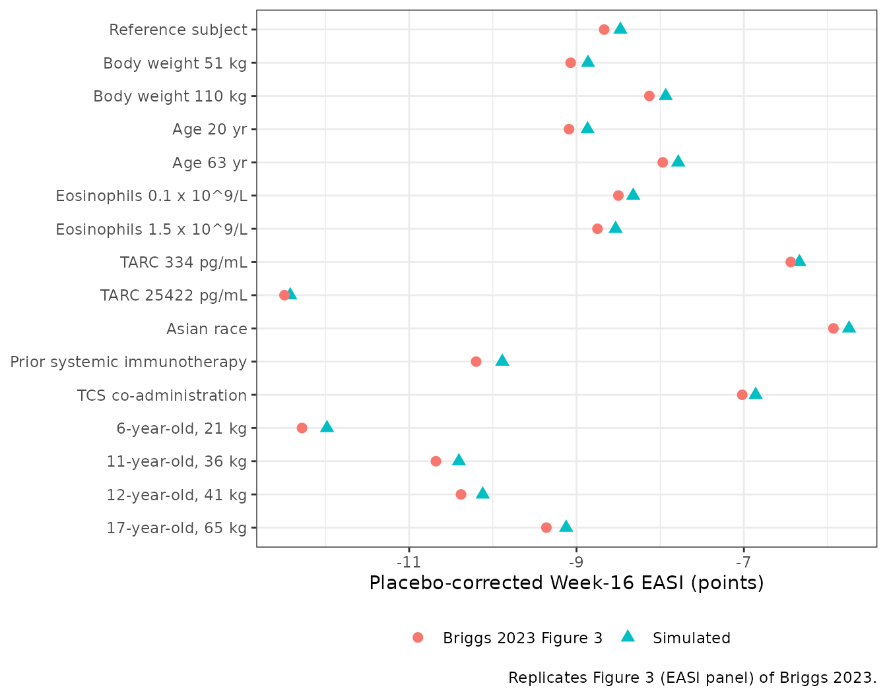
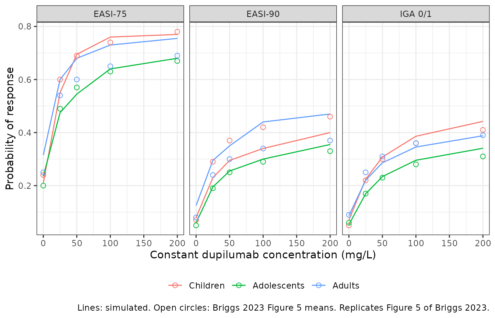
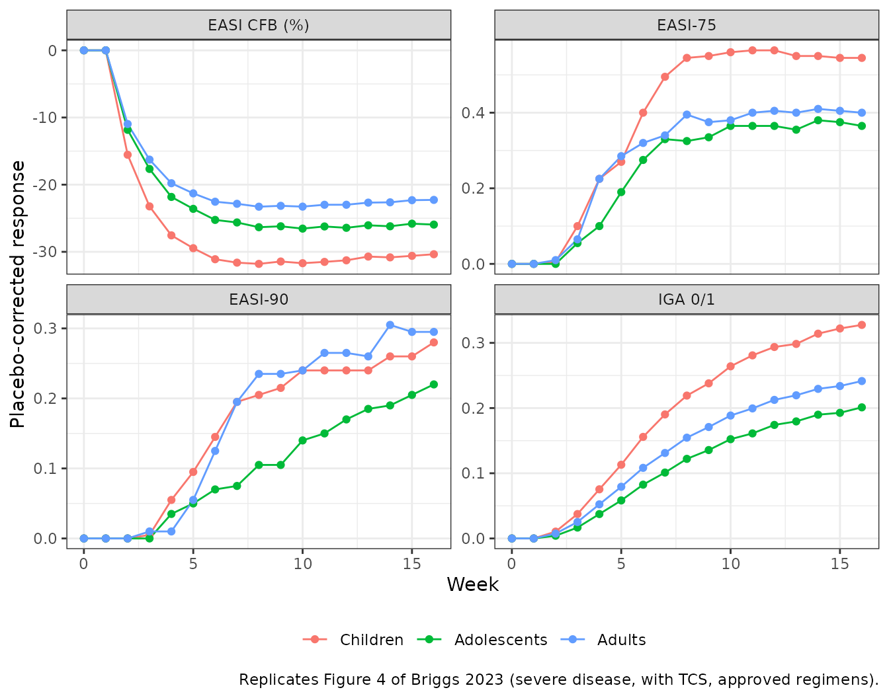

# Dupilumab EASI and IGA exposure-response in atopic dermatitis (Briggs 2023)

## Model and source

Briggs et al. (2023) pooled one Phase IIb and five Phase III dupilumab
studies in moderate-to-severe atopic dermatitis (2,366 adults, 243
adolescents and 359 children aged 6-11 years) and fitted two separate
exposure-response models, one per efficacy instrument. Each is a
separate file in nlmixr2lib:

| Model | Endpoint | Form |
|----|----|----|
| `Briggs_2023_dupilumab_easi` | Eczema Area and Severity Index, fitted as `(EASI + 1)^0.4` | baseline + hyperbolic placebo + type I indirect response (Imax on kin) |
| `Briggs_2023_dupilumab_iga` | Investigator’s Global Assessment 0-4 | cumulative probit with a hyperbolic placebo term and an indirect-response drug signal times a slope |

Both models are PD-only. The source analysis was sequential: individual
predicted dupilumab concentrations from the age-group population PK
models (Kovalenko 2020 for adults, Kovalenko 2021 for adolescents and
children, reprinted as Briggs 2023 Table S1) drove the exposure-response
fit. Here the concentration is the input column `CP_DUPILUMAB_MGL`
(mg/L). The PK models are shipped separately as
`Kovalenko_2020_dupilumab_covariate`,
`Kovalenko_2021_dupilumab_adolescent_covariate` and
`Kovalenko_2021_dupilumab_children_covariate`; the Figure 4 section
below uses them to produce the concentration column.

- Citation: Briggs E, Kamal MA, Kosloski MP, Linsmeier I, Jusko N,
  Dolphin N, Chittenden J, Simpson EL, Paller AS, Siegfried EC, Shumel
  B, Levit NA, Bansal A, Davis JD, Chapel S, Smith DE, Huniti N.
  Integrated Exposure-Response of Dupilumab in Children, Adolescents,
  and Adults With Atopic Dermatitis Using Categorical and Continuous
  Efficacy Assessments: A Population Analysis. Pharm Res.
  2023;40(11):2653-2666. <doi:10.1007/s11095-023-03616-8>.
- Article: <https://doi.org/10.1007/s11095-023-03616-8> (open access;
  PMC10733507)

``` r

# Expected warnings are muffled, and only those: solves of the
# zeroRe() models with per-subject etas supplied as data columns ("multi-subject
# simulation without ... 'omega'"), and the ordinal IGA endpoint, which has no
# residual-error parameter ("No sigma parameters").
solve_quiet <- function(ui, data, ...) {
  withCallingHandlers(
    as.data.frame(rxode2::rxSolve(ui, data, ...)),
    warning = function(w) {
      if (grepl("No sigma parameters|multi-subject simulation without", conditionMessage(w))) {
        invokeRestart("muffleWarning")
      }
    }
  )
}

easi_ui <- rxode2::rxode(readModelDb("Briggs_2023_dupilumab_easi"))
iga_ui <- rxode2::rxode(readModelDb("Briggs_2023_dupilumab_iga"))
easi_typ <- rxode2::zeroRe(easi_ui)
# zeroRe() on the ordinal IGA model also reports that it has no sigma.
iga_typ <- withCallingHandlers(
  rxode2::zeroRe(iga_ui),
  warning = function(w) {
    if (grepl("No sigma parameters", conditionMessage(w))) {
      invokeRestart("muffleWarning")
    }
  }
)
```

## Population

Briggs 2023 Table S3 summarises the 2,968 patients: mean age 37.7 (SD
13.7) years in adults, 14.4 (1.7) in adolescents and 8.5 (1.7) in
children; mean body weight 76.1, 65.0 and 31.5 kg; 41.9% female; 67.2%
White, 21.1% Asian and 8.1% Black. 45.8% had moderate (IGA 3) and 54.2%
severe (IGA 4) disease at baseline, but all children except one were
severe. Topical corticosteroids (TCS) were given in two studies: all
children (NCT03345914) and the adult CHRONOS study (NCT02260986). 31.8%
had prior systemic immunotherapy. Median baseline EASI was 30.8 (range
10.7-72), median baseline eosinophils 0.481 x 10^9/L and median baseline
TARC 2033.6 pg/mL. There were 29,413 EASI and 29,420 IGA observations.

Dosing was subcutaneous with a Day-1 loading dose of twice the
maintenance dose: adults 100 mg q4w to 300 mg qw, adolescents 200 or 300
mg q2w or 300 mg q4w, and children 100 or 200 mg q2w or 300 mg q4w with
TCS (Table I).

## Source trace

| Equation / parameter | Value | Source |
|----|----|----|
| EASI model equations | `(EASI + 1)^0.4 = BASE + Pmax t / (ET50 + t) + IDR`; `dR/dt = kin (1 - Imax C / (IC50 + C)) - kout R`, `kin = kout BASE` | Online Resource, “EASI model equations” |
| IGA model equations | `probit P(IGA <= m) = Q_m + Pmax t / (ET50 + t) + DSLP R`; `Q_3 = BASE`, `Q_m = Q_(m+1) - exp(beta_(m+1))`; `dR/dt = kout (1 - C / (IC50 + C)) - kout (R + 1)`, `kout = ln 2 / THFD` | Online Resource, “IGA model equations” |
| Tukey exponent lambda | 0.4 | Online Resource |
| EASI `lrbase` (BASE) | 30.4 EASI units | Table II |
| EASI `pmax` | -1.24 | Table II |
| EASI `let50` | 29.2 day | Table II |
| EASI `limax` | 0.266 | Table II |
| EASI `lic50` | 20.3 mg/L | Table II |
| EASI `lthalf_onset` | 13.7 day | Table II |
| EASI covariates on baseline (TCS, prior immunotherapy, age, log EOS, log TARC) | -0.0218, 0.0233, -0.0372, 0.0173, 0.0508 | Table II |
| EASI covariates on Pmax (TCS, prior immunotherapy) | 0.232, -0.166 | Table II |
| EASI covariates on Imax (weight, Asian race, log EOS) | -0.185, -0.374, -0.0570 | Table II |
| EASI `etalrbase`, `etapmax` (omega^2) | 0.0177 (exponential), 0.788 (additive) | Table II |
| EASI `addSd` | 0.422 | Table II |
| IGA `rbase` (BASE, IGA \<= 3) | -3.35 | Table III |
| IGA `lgap_iga2`, `lgap_iga1`, `lgap_iga0` | 2.64, 1.60, 1.75 | Table III “Baseline adjustment” rows |
| IGA `lpmax`, `let50` | 4.83, 6.37 day | Table III |
| IGA `slope` (DSLP) | -2.20 | Table III |
| IGA `lic50`, `lthalf_onset` | 27.1 mg/L, 19.7 day | Table III |
| IGA `e_iga_mod_rbase` | 4.39 | Table III |
| IGA covariates on Pmax (age, TCS, prior immunotherapy, moderate disease) | 0.0550, 0.229, -0.102, -0.727 | Table III |
| IGA covariates on DSLP (weight, Asian race, log EOS, log TARC) | -0.174, -0.222, -0.0776, -0.0938 | Table III |
| IGA `etarbase` (omega^2) | 1.49 (additive) | Table III |
| Covariate reference values (70 kg, 30 years, EOS 481 cells/uL, TARC 2033.6 pg/mL) |  | Figure 3 legend (reference patient) |

## Structural check: the indirect response under a constant concentration

With a constant concentration both latent states have a closed form,
`latent(t) = 1 - inh (1 - exp(-kout t))`, where `inh` is the fractional
inhibition of production. Both sides of this check use the same
parameters, so the only difference is ODE-solver error and a tight bound
is correct.

``` r

grid_cf <- expand.grid(time = c(0, 7, 28, 56, 112, 224), conc = c(0, 20, 68, 200)) |>
  mutate(
    id = as.integer(factor(conc)), evid = 0L,
    CP_DUPILUMAB_MGL = conc, AGE = 30, WT = 70, EOS = 481, TARC = 2033.6,
    RACE_ASIAN = 0, CONMED_STEROID_TOPICAL = 0, PRIOR_SYSTEMIC_IMMUNOTHERAPY = 0,
    IGA_MOD = 0
  ) |>
  arrange(id, time)

cf_easi <- solve_quiet(easi_typ, mutate(grid_cf, cmt = "latent_easi"))
cf_iga <- solve_quiet(iga_typ, mutate(grid_cf, cmt = "latent_iga"))

conc_cf <- grid_cf$conc
time_cf <- grid_cf$time
inh_easi <- 0.266 * conc_cf / (20.3 + conc_cf)
inh_iga <- conc_cf / (27.1 + conc_cf)
ref_easi <- 1 - inh_easi * (1 - exp(-log(2) / 13.7 * time_cf))
ref_iga <- 1 - inh_iga * (1 - exp(-log(2) / 19.7 * time_cf))
base_t <- 31.4^0.4
ref_easi_tukey <- base_t - 1.24 * time_cf / (29.2 + time_cf) + base_t * (ref_easi - 1)

stopifnot(
  all(abs(cf_easi$latent_easi - ref_easi) < 1e-5),
  all(abs(cf_iga$latent_iga - ref_iga) < 1e-5),
  all(abs(cf_easi$easi_tukey - ref_easi_tukey) < 1e-5),
  # Category probabilities of the ordinal IGA output sum to one.
  all(abs(cf_iga$p0 + cf_iga$p1 + cf_iga$p2 + cf_iga$p3 + cf_iga$p4 - 1) < 1e-10)
)
```

## Figure 3: individual covariate effects at Week 16

Figure 3 compares a reference patient (White, 70 kg, 30 years, no prior
systemic immunotherapy, no TCS, eosinophils 0.481 x 10^9/L, TARC 2033.6
pg/mL) with comparators that differ in one covariate, at a constant
dupilumab concentration of 68 mg/L and Week 16 (day 112). The EASI panel
shows the median of each patient’s EASI on dupilumab minus the same
patient on placebo; the IGA panel shows the difference in the proportion
of IGA 0/1 responders.

The paper prints no covariate functional forms or centring values. Power
forms `(x / ref)^theta` for the continuous covariates (Tables II-III
name the eosinophil and TARC effects “log baseline …”), linear
`1 + theta x` forms for the binary ones, and the Figure 3 reference
values as centres reproduce the plotted medians, as the table below
shows.

Each condition uses the same 196 patients, each simulated on dupilumab
and on placebo. Their random effects are not drawn at random: the two
EASI random effects form a 14 x 14 grid of normal quantiles and the IGA
random effect takes 196 normal quantiles. A median over 200 random draws
still moves by about 0.5 EASI points from one seed to the next, which is
as large as most of the covariate effects in the figure; the quantile
grid gives the large-cohort median with no simulation noise.

``` r

q14 <- qnorm((seq_len(14) - 0.5) / 14)
eta_fig3 <- expand.grid(z_base = q14, z_pmax = q14) |>
  mutate(
    pt = row_number(),
    etalrbase = z_base * sqrt(0.0177),
    etapmax = z_pmax * sqrt(0.788),
    etarbase = qnorm((pt - 0.5) / n()) * sqrt(1.49)
  ) |>
  select(pt, etalrbase, etapmax, etarbase)

ref_cov <- data.frame(
  AGE = 30, WT = 70, EOS = 481, TARC = 2033.6, RACE_ASIAN = 0,
  PRIOR_SYSTEMIC_IMMUNOTHERAPY = 0, CONMED_STEROID_TOPICAL = 0, IGA_MOD = 0
)
fig3_conditions <- tribble(
  ~condition, ~var1, ~val1, ~var2, ~val2, ~paper_easi, ~paper_iga,
  "Reference subject", NA, NA, NA, NA, -8.67, 0.16,
  "Body weight 51 kg", "WT", 51, NA, NA, -9.07, 0.17,
  "Body weight 110 kg", "WT", 110, NA, NA, -8.13, 0.14,
  "Age 20 yr", "AGE", 20, NA, NA, -9.09, 0.15,
  "Age 63 yr", "AGE", 63, NA, NA, -7.97, 0.18,
  "Eosinophils 0.1 x 10^9/L", "EOS", 100, NA, NA, -8.50, 0.20,
  "Eosinophils 1.5 x 10^9/L", "EOS", 1500, NA, NA, -8.75, 0.13,
  "TARC 334 pg/mL", "TARC", 334, NA, NA, -6.44, 0.21,
  "TARC 25422 pg/mL", "TARC", 25422, NA, NA, -12.49, 0.10,
  "Asian race", "RACE_ASIAN", 1, NA, NA, -5.93, 0.10,
  "Prior systemic immunotherapy", "PRIOR_SYSTEMIC_IMMUNOTHERAPY", 1, NA, NA, -10.20, 0.10,
  "TCS co-administration", "CONMED_STEROID_TOPICAL", 1, NA, NA, -7.02, 0.31,
  "6-year-old, 21 kg", "AGE", 6, "WT", 21, -12.28, 0.17,
  "11-year-old, 36 kg", "AGE", 11, "WT", 36, -10.68, 0.16,
  "12-year-old, 41 kg", "AGE", 12, "WT", 41, -10.38, 0.15,
  "17-year-old, 65 kg", "AGE", 17, "WT", 65, -9.36, 0.15
)

fig3_cov_row <- function(i) {
  cv <- ref_cov
  r <- fig3_conditions[i, ]
  if (!is.na(r$var1)) cv[[r$var1]] <- r$val1
  if (!is.na(r$var2)) cv[[r$var2]] <- r$val2
  cv$condition <- r$condition
  cv
}
fig3_cov <- bind_rows(lapply(seq_len(nrow(fig3_conditions)), fig3_cov_row))

fig3_events <- fig3_cov |>
  tidyr::crossing(eta_fig3, arm = c("dupilumab", "placebo"), time = c(0, 112)) |>
  mutate(
    CP_DUPILUMAB_MGL = ifelse(arm == "dupilumab", 68, 0),
    evid = 0L
  ) |>
  group_by(condition, pt, arm) |>
  mutate(id = cur_group_id()) |>
  ungroup() |>
  arrange(id, time)

fig3_easi <- solve_quiet(easi_typ, mutate(fig3_events, cmt = "latent_easi"), keep = c("condition", "pt", "arm"))
fig3_iga <- solve_quiet(iga_typ, mutate(fig3_events, cmt = "latent_iga"), keep = c("condition", "pt", "arm"))

fig3_easi_sum <- fig3_easi |>
  filter(time == 112) |>
  select(condition, pt, arm, easi) |>
  pivot_wider(names_from = arm, values_from = easi) |>
  group_by(condition) |>
  summarise(sim_easi = median(dupilumab - placebo), .groups = "drop")
fig3_iga_sum <- fig3_iga |>
  filter(time == 112) |>
  group_by(condition, arm) |>
  summarise(p = mean(prob_iga01), .groups = "drop") |>
  pivot_wider(names_from = arm, values_from = p) |>
  mutate(sim_iga = dupilumab - placebo) |>
  select(condition, sim_iga)

fig3_cmp <- fig3_conditions |>
  select(condition, paper_easi, paper_iga) |>
  left_join(fig3_easi_sum, by = "condition") |>
  left_join(fig3_iga_sum, by = "condition")

fig3_cmp |>
  mutate(across(c(sim_easi, paper_easi), \(x) round(x, 2)), across(c(sim_iga, paper_iga), \(x) round(x, 3))) |>
  select(condition, sim_easi, paper_easi, sim_iga, paper_iga) |>
  rename(
    "Condition" = condition,
    "EASI difference (simulated)" = sim_easi,
    "EASI difference (Figure 3)" = paper_easi,
    "IGA 0/1 difference (simulated)" = sim_iga,
    "IGA 0/1 difference (Figure 3)" = paper_iga
  ) |>
  knitr::kable(caption = "Replicates Figure 3 of Briggs 2023: placebo-corrected Week-16 response at 68 mg/L.")
```

| Condition | EASI difference (simulated) | EASI difference (Figure 3) | IGA 0/1 difference (simulated) | IGA 0/1 difference (Figure 3) |
|:---|---:|---:|---:|---:|
| Reference subject | -8.48 | -8.67 | 0.147 | 0.16 |
| Body weight 51 kg | -8.86 | -9.07 | 0.162 | 0.17 |
| Body weight 110 kg | -7.93 | -8.13 | 0.129 | 0.14 |
| Age 20 yr | -8.87 | -9.09 | 0.135 | 0.15 |
| Age 63 yr | -7.78 | -7.97 | 0.171 | 0.18 |
| Eosinophils 0.1 x 10^9/L | -8.32 | -8.50 | 0.181 | 0.20 |
| Eosinophils 1.5 x 10^9/L | -8.53 | -8.75 | 0.126 | 0.13 |
| TARC 334 pg/mL | -6.34 | -6.44 | 0.197 | 0.21 |
| TARC 25422 pg/mL | -12.42 | -12.49 | 0.099 | 0.10 |
| Asian race | -5.74 | -5.93 | 0.097 | 0.10 |
| Prior systemic immunotherapy | -9.89 | -10.20 | 0.096 | 0.10 |
| TCS co-administration | -6.86 | -7.02 | 0.287 | 0.31 |
| 6-year-old, 21 kg | -11.98 | -12.28 | 0.155 | 0.17 |
| 11-year-old, 36 kg | -10.41 | -10.68 | 0.146 | 0.16 |
| 12-year-old, 41 kg | -10.12 | -10.38 | 0.143 | 0.15 |
| 17-year-old, 65 kg | -9.12 | -9.36 | 0.133 | 0.15 |

Replicates Figure 3 of Briggs 2023: placebo-corrected Week-16 response
at 68 mg/L. {.table}

The simulated EASI medians are about 0.2 points smaller in magnitude
than the figure in nearly every row, an offset shared by the reference
patient, so the covariate contrasts themselves agree to within about
0.1-0.3 points. The IGA differences are about 0.01 lower throughout.

``` r

# The reference row of Figure 3 is read from the vertical line (EASI) and the
# plotted reference point (IGA); every other row is the printed median.
stopifnot(
  median(abs(fig3_cmp$sim_easi - fig3_cmp$paper_easi)) < 0.5,
  quantile(abs(fig3_cmp$sim_easi - fig3_cmp$paper_easi), 0.9) < 0.8,
  median(abs(fig3_cmp$sim_iga - fig3_cmp$paper_iga)) < 0.03,
  # Direction of every single-covariate contrast matches the paper.
  all(sign(fig3_cmp$sim_easi[-1] - fig3_cmp$sim_easi[1]) ==
    sign(fig3_cmp$paper_easi[-1] - fig3_cmp$paper_easi[1]) |
    abs(fig3_cmp$paper_easi[-1] - fig3_cmp$paper_easi[1]) < 0.2)
)
```

``` r

fig3_cmp |>
  select(condition, Simulated = sim_easi, "Briggs 2023 Figure 3" = paper_easi) |>
  pivot_longer(-condition, names_to = "source", values_to = "easi") |>
  mutate(condition = factor(condition, levels = rev(fig3_conditions$condition))) |>
  ggplot(aes(easi, condition, colour = source, shape = source)) +
  geom_point(size = 2.5) +
  labs(
    x = "Placebo-corrected Week-16 EASI (points)", y = NULL, colour = NULL, shape = NULL,
    caption = "Replicates Figure 3 (EASI panel) of Briggs 2023."
  ) +
  theme_bw() +
  theme(legend.position = "bottom")
```



## Virtual cohorts by age group

Figures 4 and 5 use 100 virtual patients per age group resampled with
their covariates from the dupilumab-treated analysis population, all
with severe disease (baseline IGA 4) and TCS. The individual data are
not available, so the cohorts here are drawn from the Table S3
summaries: age normal within the age-group bounds, body weight,
eosinophils and TARC lognormal with the tabulated mean and SD, and Asian
race and prior systemic immunotherapy Bernoulli with the tabulated
proportions. 200 patients per age group.

``` r

rlnorm_ms <- function(n, m, s) {
  s2 <- log(1 + (s / m)^2)
  exp(rnorm(n, log(m) - s2 / 2, sqrt(s2)))
}
cohort_spec <- tribble(
  ~agegrp, ~age_m, ~age_sd, ~age_lo, ~age_hi, ~wt_m, ~wt_sd, ~eos_m, ~eos_sd, ~tarc_m, ~tarc_sd, ~p_asian, ~p_prior, ~bmi, ~easi_bl,
  "Children", 8.5, 1.7, 6, 11.9, 31.5, 10.4, 830, 620, 3511, 6967, 0.078, 0.524, 17.8, 37.9,
  "Adolescents", 14.4, 1.7, 12, 17.9, 65.0, 21.8, 830, 650, 5960, 9414, 0.148, 0.449, 24.3, 35.5,
  "Adults", 37.7, 13.7, 18, 75, 76.1, 18.5, 580, 550, 6625, 13576, 0.237, 0.273, 26.1, 32.6
)
n_grp <- 200
set.seed(20231212)
make_cohort <- function(i) {
  s <- cohort_spec[i, ]
  data.frame(
    agegrp = s$agegrp,
    AGE = pmin(pmax(rnorm(n_grp, s$age_m, s$age_sd), s$age_lo), s$age_hi),
    WT = pmax(rlnorm_ms(n_grp, s$wt_m, s$wt_sd), 15),
    EOS = rlnorm_ms(n_grp, s$eos_m, s$eos_sd),
    TARC = rlnorm_ms(n_grp, s$tarc_m, s$tarc_sd),
    RACE_ASIAN = rbinom(n_grp, 1, s$p_asian),
    PRIOR_SYSTEMIC_IMMUNOTHERAPY = rbinom(n_grp, 1, s$p_prior),
    BMI = s$bmi,
    SCORE_EASI = s$easi_bl,
    etalrbase = rnorm(n_grp, 0, sqrt(0.0177)),
    etapmax = rnorm(n_grp, 0, sqrt(0.788)),
    etarbase = rnorm(n_grp, 0, sqrt(1.49))
  )
}
cohort <- bind_rows(lapply(seq_len(nrow(cohort_spec)), make_cohort)) |>
  mutate(
    agegrp = factor(agegrp, levels = c("Children", "Adolescents", "Adults")),
    pt = row_number(),
    CONMED_STEROID_TOPICAL = 1,
    IGA_MOD = 0,
    ALB = 44,
    RACE_WHITE = 1 - RACE_ASIAN
  )

cohort |>
  group_by(agegrp) |>
  summarise(
    n = n(), age = mean(AGE), weight = mean(WT), eos_median = median(EOS),
    tarc_median = median(TARC), asian = mean(RACE_ASIAN), prior = mean(PRIOR_SYSTEMIC_IMMUNOTHERAPY)
  ) |>
  mutate(across(where(is.numeric), \(x) signif(x, 3))) |>
  rename(
    "Age group" = agegrp, "N" = n, "Mean age (y)" = age, "Mean weight (kg)" = weight,
    "Median EOS (cells/uL)" = eos_median, "Median TARC (pg/mL)" = tarc_median,
    "Asian" = asian, "Prior systemic immunotherapy" = prior
  ) |>
  knitr::kable(caption = "Virtual cohorts drawn from Briggs 2023 Table S3.")
```

| Age group | N | Mean age (y) | Mean weight (kg) | Median EOS (cells/uL) | Median TARC (pg/mL) | Asian | Prior systemic immunotherapy |
|:---|---:|---:|---:|---:|---:|---:|---:|
| Children | 200 | 8.56 | 30.7 | 757 | 1700 | 0.105 | 0.530 |
| Adolescents | 200 | 14.40 | 70.8 | 539 | 3370 | 0.120 | 0.485 |
| Adults | 200 | 37.40 | 75.5 | 405 | 3790 | 0.245 | 0.245 |

Virtual cohorts drawn from Briggs 2023 Table S3. {.table}

## Figure 5: Week-16 response at a constant concentration

Figure 5 holds the dupilumab concentration constant over the 16 weeks
and plots Week-16 response against that concentration for patients with
severe disease on TCS. It is not placebo-corrected: the 0 mg/L column is
the placebo response. EASI-75 and EASI-90 are computed here from each
patient’s predicted EASI (without residual error) relative to that
patient’s predicted baseline; IGA 0/1 is the mean predicted probability.

``` r

fig5_conc <- c(0, 25, 50, 100, 200)
fig5_events <- cohort |>
  tidyr::crossing(conc = fig5_conc, time = c(0, 112)) |>
  mutate(CP_DUPILUMAB_MGL = conc, evid = 0L) |>
  group_by(pt, conc) |>
  mutate(id = cur_group_id()) |>
  ungroup() |>
  arrange(id, time)

fig5_easi <- solve_quiet(easi_typ, mutate(fig5_events, cmt = "latent_easi"), keep = c("agegrp", "pt", "conc"))
fig5_iga <- solve_quiet(iga_typ, mutate(fig5_events, cmt = "latent_iga"), keep = c("agegrp", "pt", "conc"))

fig5_sum <- fig5_easi |>
  select(agegrp, pt, conc, time, easi) |>
  pivot_wider(names_from = time, values_from = easi, names_prefix = "easi_") |>
  mutate(cfb = 100 * (easi_112 - easi_0) / easi_0) |>
  group_by(agegrp, conc) |>
  summarise(easi75 = mean(cfb <= -75), easi90 = mean(cfb <= -90), cfb = mean(cfb), .groups = "drop") |>
  left_join(
    fig5_iga |>
      filter(time == 112) |>
      group_by(agegrp, conc) |>
      summarise(iga01 = mean(prob_iga01), .groups = "drop"),
    by = c("agegrp", "conc")
  )

# Means read from Figure 5 (severe disease, with TCS) by the maintainers.
fig5_paper <- tribble(
  ~agegrp, ~conc, ~cfb, ~easi75, ~easi90, ~iga01,
  "Children", 0, -52, 0.24, 0.07, 0.05,
  "Children", 25, -76, 0.60, 0.29, 0.22,
  "Children", 50, -80, 0.69, 0.37, 0.30,
  "Children", 100, -83, 0.74, 0.42, 0.36,
  "Children", 200, -84, 0.78, 0.46, 0.41,
  "Adolescents", 0, -49, 0.20, 0.05, 0.06,
  "Adolescents", 25, -71, 0.49, 0.19, 0.17,
  "Adolescents", 50, -75, 0.57, 0.25, 0.23,
  "Adolescents", 100, -78, 0.63, 0.29, 0.28,
  "Adolescents", 200, -79, 0.67, 0.33, 0.31,
  "Adults", 0, -53, 0.25, 0.08, 0.09,
  "Adults", 25, -73, 0.54, 0.24, 0.25,
  "Adults", 50, -76, 0.60, 0.30, 0.31,
  "Adults", 100, -79, 0.65, 0.34, 0.36,
  "Adults", 200, -80, 0.69, 0.37, 0.39
) |>
  mutate(agegrp = factor(agegrp, levels = levels(cohort$agegrp)))

fig5_cmp <- left_join(fig5_sum, fig5_paper, by = c("agegrp", "conc"), suffix = c("_sim", "_paper"))
fig5_cmp |>
  mutate(across(c(cfb_sim, cfb_paper), \(x) round(x, 1)), across(c(easi75_sim:iga01_sim, easi75_paper:iga01_paper), \(x) round(x, 2))) |>
  select(agegrp, conc, cfb_sim, cfb_paper, easi75_sim, easi75_paper, easi90_sim, easi90_paper, iga01_sim, iga01_paper) |>
  rename(
    "Age group" = agegrp, "C (mg/L)" = conc,
    "EASI CFB % (sim)" = cfb_sim, "EASI CFB % (Fig 5)" = cfb_paper,
    "EASI-75 (sim)" = easi75_sim, "EASI-75 (Fig 5)" = easi75_paper,
    "EASI-90 (sim)" = easi90_sim, "EASI-90 (Fig 5)" = easi90_paper,
    "IGA 0/1 (sim)" = iga01_sim, "IGA 0/1 (Fig 5)" = iga01_paper
  ) |>
  knitr::kable(caption = "Replicates Figure 5 of Briggs 2023 (Week 16, severe disease, with TCS).")
```

| Age group | C (mg/L) | EASI CFB % (sim) | EASI CFB % (Fig 5) | EASI-75 (sim) | EASI-75 (Fig 5) | EASI-90 (sim) | EASI-90 (Fig 5) | IGA 0/1 (sim) | IGA 0/1 (Fig 5) |
|:---|---:|---:|---:|---:|---:|---:|---:|---:|---:|
| Children | 0 | -52.3 | -52 | 0.21 | 0.24 | 0.08 | 0.07 | 0.07 | 0.05 |
| Children | 25 | -74.2 | -76 | 0.55 | 0.60 | 0.23 | 0.29 | 0.22 | 0.22 |
| Children | 50 | -79.0 | -80 | 0.70 | 0.69 | 0.30 | 0.37 | 0.31 | 0.30 |
| Children | 100 | -82.3 | -83 | 0.76 | 0.74 | 0.34 | 0.42 | 0.39 | 0.36 |
| Children | 200 | -84.1 | -84 | 0.77 | 0.78 | 0.40 | 0.46 | 0.44 | 0.41 |
| Adolescents | 0 | -49.6 | -49 | 0.23 | 0.20 | 0.06 | 0.05 | 0.05 | 0.06 |
| Adolescents | 25 | -69.6 | -71 | 0.48 | 0.49 | 0.20 | 0.19 | 0.17 | 0.17 |
| Adolescents | 50 | -74.3 | -75 | 0.54 | 0.57 | 0.26 | 0.25 | 0.23 | 0.23 |
| Adolescents | 100 | -77.5 | -78 | 0.64 | 0.63 | 0.30 | 0.29 | 0.30 | 0.28 |
| Adolescents | 200 | -79.4 | -79 | 0.68 | 0.67 | 0.36 | 0.33 | 0.34 | 0.31 |
| Adults | 0 | -59.5 | -53 | 0.32 | 0.25 | 0.12 | 0.08 | 0.09 | 0.09 |
| Adults | 25 | -76.1 | -73 | 0.60 | 0.54 | 0.30 | 0.24 | 0.22 | 0.25 |
| Adults | 50 | -79.8 | -76 | 0.68 | 0.60 | 0.35 | 0.30 | 0.29 | 0.31 |
| Adults | 100 | -82.4 | -79 | 0.73 | 0.65 | 0.44 | 0.34 | 0.35 | 0.36 |
| Adults | 200 | -83.9 | -80 | 0.76 | 0.69 | 0.47 | 0.37 | 0.39 | 0.39 |

Replicates Figure 5 of Briggs 2023 (Week 16, severe disease, with TCS).
{.table}

Children and adolescents track Figure 5 closely. The adult rows run 3-7
points of EASI change from baseline more negative than the figure, most
at 0 mg/L, i.e. in the placebo response. The additive Pmax random effect
is large (omega^2 0.788 on the transformed scale), so the mean placebo
response of a 200-patient cohort moves by a few points between draws,
and these adults are drawn from summary statistics rather than
resampled; the children and adolescents carry the same uncertainty.

``` r

stopifnot(
  median(abs(fig5_cmp$cfb_sim - fig5_cmp$cfb_paper)) < 5,
  median(abs(fig5_cmp$easi75_sim - fig5_cmp$easi75_paper)) < 0.08,
  median(abs(fig5_cmp$easi90_sim - fig5_cmp$easi90_paper)) < 0.08,
  median(abs(fig5_cmp$iga01_sim - fig5_cmp$iga01_paper)) < 0.06
)
```

``` r

fig5_cmp |>
  select(agegrp, conc, "EASI-75" = easi75_sim, "EASI-90" = easi90_sim, "IGA 0/1" = iga01_sim) |>
  pivot_longer(-c(agegrp, conc), names_to = "endpoint", values_to = "sim") |>
  left_join(
    fig5_cmp |>
      select(agegrp, conc, "EASI-75" = easi75_paper, "EASI-90" = easi90_paper, "IGA 0/1" = iga01_paper) |>
      pivot_longer(-c(agegrp, conc), names_to = "endpoint", values_to = "paper"),
    by = c("agegrp", "conc", "endpoint")
  ) |>
  ggplot(aes(conc, colour = agegrp)) +
  geom_line(aes(y = sim)) +
  geom_point(aes(y = paper), shape = 1, size = 2) +
  facet_wrap(~endpoint) +
  labs(
    x = "Constant dupilumab concentration (mg/L)", y = "Probability of response", colour = NULL,
    caption = "Lines: simulated. Open circles: Briggs 2023 Figure 5 means. Replicates Figure 5 of Briggs 2023."
  ) +
  theme_bw() +
  theme(legend.position = "bottom")
```



## Figure 4: longitudinal placebo-corrected response with the approved regimens

Figure 4 simulates the approved weight-tiered regimens with TCS in
severe disease and subtracts the placebo response. Adults: 600 mg
loading dose then 300 mg q2w. Adolescents and children: 15 to \< 30 kg
600 mg then 300 mg q4w; 30 to \< 60 kg 400 mg then 200 mg q2w; \>= 60 kg
600 mg then 300 mg q2w.

The concentration column comes from the shipped age-group popPK models,
with their between-subject variability, evaluated on a daily grid. The
PK covariates not tabulated per patient in Briggs 2023 are set to the
age-group means of Table S3 (BMI, baseline EASI) or to the Kovalenko
reference value (albumin 44 g/L).

``` r

pk_models <- c(
  Children = "Kovalenko_2021_dupilumab_children_covariate",
  Adolescents = "Kovalenko_2021_dupilumab_adolescent_covariate",
  Adults = "Kovalenko_2020_dupilumab_covariate"
)
regimen <- cohort |>
  mutate(
    tier = case_when(
      agegrp == "Adults" | WT >= 60 ~ "600 mg then 300 mg q2w",
      WT >= 30 ~ "400 mg then 200 mg q2w",
      TRUE ~ "600 mg then 300 mg q4w"
    ),
    load = ifelse(tier == "400 mg then 200 mg q2w", 400, 600),
    maint = ifelse(tier == "400 mg then 200 mg q2w", 200, 300),
    tau = ifelse(tier == "600 mg then 300 mg q4w", 28, 14)
  )

pk_events_one <- function(r) {
  dose_times <- seq(0, 112, by = r$tau)
  doses <- data.frame(
    time = dose_times, amt = c(r$load, rep(r$maint, length(dose_times) - 1)),
    evid = 1L, cmt = "depot"
  )
  obs <- data.frame(time = 0:112, amt = 0, evid = 0L, cmt = "central")
  ev <- bind_rows(doses, obs)
  ev$id <- r$pt
  ev
}
pk_rows <- split(regimen, regimen$pt)
pk_events <- bind_rows(lapply(pk_rows, pk_events_one)) |>
  left_join(select(regimen, pt, agegrp, tier, WT, ALB, BMI, SCORE_EASI, RACE_WHITE), by = c("id" = "pt")) |>
  arrange(id, time, desc(evid))

rxode2::rxSetSeed(20231213)
pk_sim <- bind_rows(lapply(names(pk_models), function(g) {
  ui <- rxode2::rxode(readModelDb(pk_models[[g]]))
  d <- filter(pk_events, agegrp == g)
  solve_quiet(ui, d, keep = c("agegrp", "tier"), returnType = "data.frame") |>
    select(id, time, Cc, agegrp, tier)
}))
```

``` r

er_events <- pk_sim |>
  rename(pt = id, CP_DUPILUMAB_MGL = Cc) |>
  select(pt, time, CP_DUPILUMAB_MGL) |>
  filter(time %% 7 == 0 | time == 0) |>
  inner_join(select(cohort, -agegrp), by = "pt")
er_both <- bind_rows(
  mutate(er_events, arm = "dupilumab"),
  mutate(er_events, arm = "placebo", CP_DUPILUMAB_MGL = 0)
) |>
  mutate(evid = 0L) |>
  group_by(pt, arm) |>
  mutate(id = cur_group_id()) |>
  ungroup() |>
  arrange(id, time) |>
  left_join(select(cohort, pt, agegrp), by = "pt")

fig4_easi <- solve_quiet(easi_typ, mutate(er_both, cmt = "latent_easi"), keep = c("agegrp", "pt", "arm"))
fig4_iga <- solve_quiet(iga_typ, mutate(er_both, cmt = "latent_iga"), keep = c("agegrp", "pt", "arm"))

fig4_arm <- fig4_easi |>
  group_by(pt, arm) |>
  mutate(cfb = 100 * (easi - easi[time == 0]) / easi[time == 0]) |>
  ungroup() |>
  group_by(agegrp, arm, time) |>
  summarise(easi75 = mean(cfb <= -75), easi90 = mean(cfb <= -90), cfb = mean(cfb), .groups = "drop") |>
  left_join(
    fig4_iga |>
      group_by(agegrp, arm, time) |>
      summarise(iga01 = mean(prob_iga01), .groups = "drop"),
    by = c("agegrp", "arm", "time")
  )
fig4_pc <- fig4_arm |>
  pivot_longer(c(cfb, easi75, easi90, iga01), names_to = "endpoint") |>
  pivot_wider(names_from = arm, values_from = value) |>
  mutate(placebo_corrected = dupilumab - placebo, week = time / 7)
```

``` r

endpoint_labels <- c(cfb = "EASI CFB (%)", easi75 = "EASI-75", easi90 = "EASI-90", iga01 = "IGA 0/1")
fig4_pc |>
  mutate(endpoint = endpoint_labels[endpoint]) |>
  ggplot(aes(week, placebo_corrected, colour = agegrp)) +
  geom_line() +
  geom_point() +
  facet_wrap(~endpoint, scales = "free_y") +
  labs(
    x = "Week", y = "Placebo-corrected response", colour = NULL,
    caption = "Replicates Figure 4 of Briggs 2023 (severe disease, with TCS, approved regimens)."
  ) +
  theme_bw() +
  theme(legend.position = "bottom")
```



``` r

# Week-16 means read from Figure 4 by the maintainers.
fig4_paper <- tribble(
  ~agegrp, ~endpoint, ~paper,
  "Children", "cfb", -31, "Adolescents", "cfb", -26, "Adults", "cfb", -23,
  "Children", "easi75", 0.50, "Adolescents", "easi75", 0.37, "Adults", "easi75", 0.37,
  "Children", "easi90", 0.35, "Adolescents", "easi90", 0.19, "Adults", "easi90", 0.23,
  "Children", "iga01", 0.31, "Adolescents", "iga01", 0.17, "Adults", "iga01", 0.23
) |>
  mutate(agegrp = factor(agegrp, levels = levels(cohort$agegrp)))
fig4_cmp <- fig4_pc |>
  filter(time == 112) |>
  select(agegrp, endpoint, sim = placebo_corrected) |>
  left_join(fig4_paper, by = c("agegrp", "endpoint"))
fig4_cmp |>
  mutate(endpoint = endpoint_labels[endpoint], sim = signif(sim, 3)) |>
  rename("Age group" = agegrp, "Endpoint" = endpoint, "Simulated" = sim, "Figure 4" = paper) |>
  knitr::kable(caption = "Placebo-corrected Week-16 response (Figure 4 of Briggs 2023).")
```

| Age group   | Endpoint     | Simulated | Figure 4 |
|:------------|:-------------|----------:|---------:|
| Children    | EASI CFB (%) |   -30.400 |   -31.00 |
| Children    | EASI-75      |     0.545 |     0.50 |
| Children    | EASI-90      |     0.280 |     0.35 |
| Children    | IGA 0/1      |     0.328 |     0.31 |
| Adolescents | EASI CFB (%) |   -25.900 |   -26.00 |
| Adolescents | EASI-75      |     0.365 |     0.37 |
| Adolescents | EASI-90      |     0.220 |     0.19 |
| Adolescents | IGA 0/1      |     0.201 |     0.17 |
| Adults      | EASI CFB (%) |   -22.300 |   -23.00 |
| Adults      | EASI-75      |     0.400 |     0.37 |
| Adults      | EASI-90      |     0.295 |     0.23 |
| Adults      | IGA 0/1      |     0.241 |     0.23 |

Placebo-corrected Week-16 response (Figure 4 of Briggs 2023). {.table}

``` r


stopifnot(
  # Children improve more than adults on EASI, as in Figure 4 (-31% vs -23%).
  # The responder endpoints are not compared one by one: their child-adult
  # gaps are within the spread between 200-patient cohorts.
  fig4_cmp$sim[fig4_cmp$agegrp == "Children" & fig4_cmp$endpoint == "cfb"] <
    fig4_cmp$sim[fig4_cmp$agegrp == "Adults" & fig4_cmp$endpoint == "cfb"],
  abs(median(fig4_cmp$sim[fig4_cmp$endpoint == "cfb"] - fig4_cmp$paper[fig4_cmp$endpoint == "cfb"])) < 6,
  median(abs(fig4_cmp$sim[fig4_cmp$endpoint != "cfb"] - fig4_cmp$paper[fig4_cmp$endpoint != "cfb"])) < 0.08
)
```

## PKNCA: the dupilumab concentration input

The models take concentration as an input, so the NCA here characterises
the input series used for Figure 4: Weeks 12-16 (days 84-112) of the
approved regimens, one interval that spans one q4w or two q2w dosing
intervals. Briggs 2023 quotes 70-100 mg/L as the therapeutic
concentrations of dupilumab in adult and pediatric atopic dermatitis,
and fixes 68 mg/L as the Figure 3 concentration.

``` r

nca_conc <- pk_sim |>
  filter(!is.na(Cc)) |>
  mutate(group = paste(agegrp, tier, sep = ": "))
nca_dose <- pk_events |>
  filter(evid == 1) |>
  mutate(group = paste(agegrp, tier, sep = ": ")) |>
  select(id, time, amt, group)

conc_obj <- PKNCA::PKNCAconc(nca_conc, Cc ~ time | group + id, concu = "mg/L", timeu = "day")
dose_obj <- PKNCA::PKNCAdose(nca_dose, amt ~ time | group + id, doseu = "mg")
intervals <- data.frame(start = 84, end = 112, cmax = TRUE, cmin = TRUE, cav = TRUE)
nca_res <- PKNCA::pk.nca(PKNCA::PKNCAdata(conc_obj, dose_obj, intervals = intervals))

nca_tab <- as.data.frame(nca_res) |>
  filter(PPTESTCD %in% c("cmax", "cmin", "cav")) |>
  group_by(group, PPTESTCD) |>
  summarise(median = median(PPORRES), n = n(), .groups = "drop") |>
  pivot_wider(names_from = PPTESTCD, values_from = median)
nca_tab |>
  mutate(across(c(cmax, cmin, cav), \(x) signif(x, 3))) |>
  select(group, n, cmin, cav, cmax) |>
  rename(
    "Age group: regimen" = group, "N" = n, "Median Cmin (mg/L)" = cmin,
    "Median Cav (mg/L)" = cav, "Median Cmax (mg/L)" = cmax
  ) |>
  knitr::kable(caption = "Simulated dupilumab exposure over Weeks 12-16 (days 84-112).")
```

| Age group: regimen | N | Median Cmin (mg/L) | Median Cav (mg/L) | Median Cmax (mg/L) |
|:---|---:|---:|---:|---:|
| Adolescents: 400 mg then 200 mg q2w | 77 | 58.2 | 72.4 | 82.1 |
| Adolescents: 600 mg then 300 mg q2w | 123 | 57.8 | 72.0 | 82.6 |
| Adults: 600 mg then 300 mg q2w | 200 | 74.1 | 89.6 | 100.0 |
| Children: 400 mg then 200 mg q2w | 83 | 94.2 | 123.0 | 148.0 |
| Children: 600 mg then 300 mg q2w | 3 | 90.8 | 113.0 | 138.0 |
| Children: 600 mg then 300 mg q4w | 114 | 88.8 | 152.0 | 228.0 |

Simulated dupilumab exposure over Weeks 12-16 (days 84-112). {.table}

Median Weeks 12-16 troughs are about 74 mg/L in adults and about 90 mg/L
in children, inside the 70-100 mg/L range Briggs 2023 calls therapeutic,
and about 58 mg/L in adolescents. All lie above 50 mg/L, on the flat
upper part of the Figure 5 curves, so the Figure 4 placebo-corrected
responses at Week 16 differ between age groups mainly through the
covariates rather than through exposure.

## Assumptions and deviations

- **PD-only models.** The concentration is an input column. The source
  fit used the individual post-hoc PK of each patient; users must
  simulate a PK model (the shipped Kovalenko models, as above) to drive
  the models from doses.
- **Covariate forms and centring.** Briggs 2023 prints no covariate
  equations. Power forms for continuous covariates and linear
  `1 + theta x` forms for binary ones, centred on the Figure 3 reference
  patient (70 kg, 30 years, eosinophils 0.481 x 10^9/L, TARC 2033.6
  pg/mL), were chosen because they reproduce Figure 3. Exponential forms
  `exp(theta x)` for the binary covariates reproduce the IGA panel
  equally well but the EASI Asian-race row less well (-6.2 against the
  printed -5.93).
- **EASI baseline on the transformed scale.** The baseline (30.4 EASI
  units) is converted to `(30.4 + 1)^0.4` and its covariate effects and
  exponential IIV are applied on the transformed scale. Applying them to
  the raw score before transforming reproduces Figure 3 much less well
  (the TARC rows in particular).
- **Residual error read as an SD.** Table II gives 0.422 for the
  additive residual without saying whether it is a variance. As an SD it
  reproduces the time-0 5th-95th percentile band of the Figure 2 VPC
  (about 14-60 EASI points); as a variance (SD 0.65) the band would be
  10-67.
- **IDR state rescaled.** The EASI state is the paper’s R divided by
  BASE (starting at 1), and the IGA state is the paper’s R + 1 (also
  starting at 1). Both are algebraically identical to the published
  equations.
- **Back-transformed EASI floored at 0.** A transformed prediction below
  1 would back-transform to a negative EASI; `easi` floors it at 0.
- **IGA cutpoint gaps.** Table III prints the “baseline adjustments” as
  the gaps `exp(beta)` themselves (2.64, 1.60, 1.75); they are carried
  on the log scale as `lgap_iga*`.
- **Virtual cohorts.** Figures 4 and 5 resampled real patients. The
  cohorts here are drawn from the Table S3 means and SDs, with lognormal
  eosinophils and TARC, so they match the analysis population only in
  summary; responder rates are computed from predicted EASI without
  residual error. The children in Table S3 were all on TCS with severe
  disease, as in these simulations.
- **Figure values.** The Figure 4 and Figure 5 means were read from the
  plots by the maintainers, to about 0.01-0.02 on the probability axes;
  the Figure 3 values are the printed medians.
- No erratum to Briggs 2023 was found (Europe PMC search, 2026-11-07).
