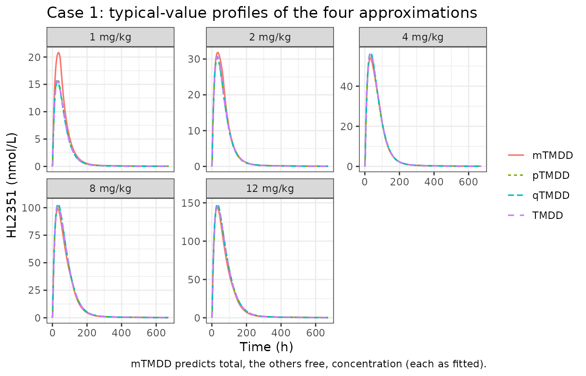
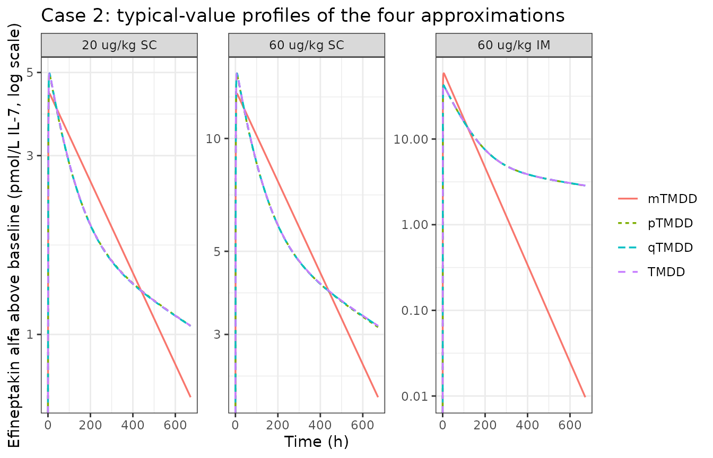
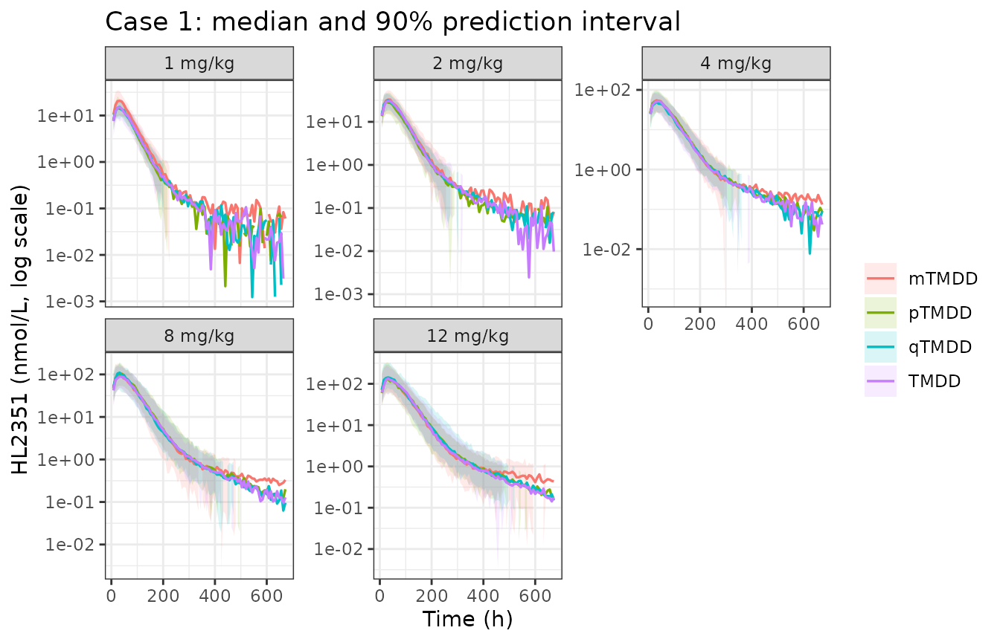
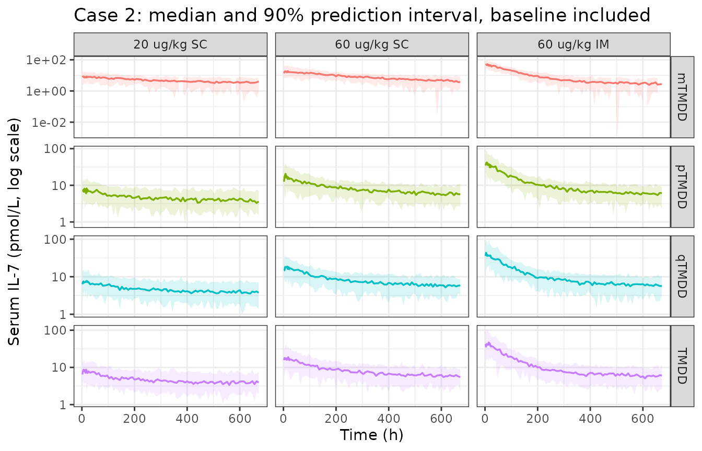

# TMDD approximations for HL2351 and efineptakin alfa (Byun 2024)

``` r

library(nlmixr2lib)
library(rxode2)
#> rxode2 5.1.8 using 2 threads (see ?getRxThreads)
#>   no cache: create with `rxCreateCache()`
library(dplyr)
#> 
#> Attaching package: 'dplyr'
#> The following objects are masked from 'package:stats':
#> 
#>     filter, lag
#> The following objects are masked from 'package:base':
#> 
#>     intersect, setdiff, setequal, union
library(tidyr)
library(ggplot2)
library(PKNCA)
#> 
#> Attaching package: 'PKNCA'
#> The following object is masked from 'package:stats':
#> 
#>     filter
```

## Validity of TMDD approximations

Byun 2024 (*PLoS Comput Biol* 20(4):e1012066,
<doi:10.1371/journal.pcbi.1012066>) asks when the usual simplifications
of a target-mediated drug disposition (TMDD) model can stand in for the
full binding model. It compares three of them:

- **mTMDD** – the Michaelis-Menten model obtained with the standard
  quasi-steady-state approximation (sQSSA);
- **qTMDD** – the quasi-steady-state model obtained with the total QSSA,
  where free drug is the positive root of a quadratic in the total drug;
- **pTMDD** – the paper’s new first-order (Pade) approximation of the
  qTMDD quadratic, which needs no square root.

It derives validity criteria `Lm`, `Lq` and `Lp` for each (Table 1),
condenses them into a simple rule on `C0 + km` versus `Rtot` (Table 3),
and then refits two clinical Fc-fusion protein datasets with the full
model and all three approximations. Those **eight refitted population PK
models** (Table 4, with NONMEM control streams in S1 Text) are what
nlmixr2lib ships:

``` r

models <- c(
  "Byun_2024_HL2351_tmdd", "Byun_2024_HL2351_mtmdd",
  "Byun_2024_HL2351_qtmdd", "Byun_2024_HL2351_ptmdd",
  "Byun_2024_efineptakin_alfa_tmdd", "Byun_2024_efineptakin_alfa_mtmdd",
  "Byun_2024_efineptakin_alfa_qtmdd", "Byun_2024_efineptakin_alfa_ptmdd"
)
mods <- lapply(setNames(models, models), readModelDb)
```

| Case | Approximation | Model | Observed quantity |
|:---|:---|:---|:---|
| 1: HL2351 (hIL-1Ra-hyFc) | TMDD (full) | Byun_2024_HL2351_tmdd | free |
| 1: HL2351 (hIL-1Ra-hyFc) | mTMDD | Byun_2024_HL2351_mtmdd | total |
| 1: HL2351 (hIL-1Ra-hyFc) | qTMDD | Byun_2024_HL2351_qtmdd | free |
| 1: HL2351 (hIL-1Ra-hyFc) | pTMDD | Byun_2024_HL2351_ptmdd | free |
| 2: efineptakin alfa (rhIL-7-hyFc) | TMDD (full) | Byun_2024_efineptakin_alfa_tmdd | free + baseline IL-7 |
| 2: efineptakin alfa (rhIL-7-hyFc) | mTMDD | Byun_2024_efineptakin_alfa_mtmdd | total + baseline IL-7 |
| 2: efineptakin alfa (rhIL-7-hyFc) | qTMDD | Byun_2024_efineptakin_alfa_qtmdd | free + baseline IL-7 |
| 2: efineptakin alfa (rhIL-7-hyFc) | pTMDD | Byun_2024_efineptakin_alfa_ptmdd | free + baseline IL-7 |

The eight models of Byun 2024 Table 4. {.table}

Both drugs share one structure (Byun 2024 S1 Text): extravascular
depot(s), an FcRn-bearing space in which drug either binds FcRn and is
recycled to plasma or is degraded, and target binding (IL1R for HL2351,
IL-7R for efineptakin alfa) in the central compartment. The four
variants differ only in how the two binding reactions are written:

| Variant | Binding in the FcRn space and in central |
|----|----|
| TMDD | explicit `kon`, `koff` with the complex as an ODE state |
| mTMDD | bound = `Rtot * C / (KSS + C)`, `C` = state concentration treated as free |
| qTMDD | free = `0.5 * ((Ct - Rtot - KSS) + sqrt((Ct - Rtot - KSS)^2 + 4 * KSS * Ct))` |
| pTMDD | bound = `Rtot * Ct / (KSS + Ct + Rtot)`, free = `Ct` - bound |

## Population

**Case 1, HL2351.** The five HL2351 cohorts (1, 2, 4, 8 and 12 mg/kg
single SC doses, n = 8 each) of the first-in-human study NCT02175056 in
healthy adult Korean men, first modelled by Ngo 2020
(<doi:10.1002/psp4.12555>; see `modellib("Ngo_2020_HL2351")`). Byun 2024
does not restate demographics; age 20-45 years is from Ngo 2020. The S1
Table dataset has 640 records (40 subjects, 472 observations to 672 h),
matching the 640 stated in the paper.

**Case 2, efineptakin alfa.** The healthy-subject study of Lee 2020
(<doi:10.1111/cts.12800>): single doses of 20 ug/kg SC, 60 ug/kg SC or
60 ug/kg IM (n = 8 each). Byun 2024 reports no demographics. The S2
Table dataset has 434 records (24 subjects, 410 observations to 672 h)
against 456 stated in the paper. The assay measures total serum IL-7, so
each subject’s observed baseline endogenous IL-7 (`BL_IL7`, 1.51-4.98
pmol/L) is added to the prediction.

## Source trace

| Quantity | Source |
|:---|:---|
| Structural estimates, IIV variances, residual error (all 8 models) | Byun 2024 Table 4 |
| Case 1 Ka2, Alag1, kon1/koff1/kon2/koff2, IIV on Ka2 and Alag1 | S1 Text (a)-(d) \$THETA / \$OMEGA (not in Table 4) |
| Case 1 FcRn total amount 749 nmol, Vp 5.06 L, Kdeg 0.0264 /h | S1 Text (a)-(d) \$THETA, FIX |
| Case 2 VIIM, VISC (route-specific absorption-space volume) | S1 Text (e)-(h) \$THETA 13-14 (not in Table 4) |
| Case 2 kon1, koff1, KD, FcRn, FR, kon2, koff2, Kup | S1 Text (e)-(h) \$PK hard-coded constants |
| Case 2 KSS1 = KD + Krec / kon1; KSS2 = (Kint + koff2) / kon2 | S1 Text (f)-(h) \$PK |
| Compartment order and ODEs | S1 Text (a)-(h) \$MODEL and \$DES |
| Observation and residual-error model | S1 Text (a)-(h) \$ERROR |
| Approximation formulas and validity criteria | Byun 2024 Table 1, Materials and methods |
| Simple validity rule | Byun 2024 Table 3 |
| Generic parameter sets | Byun 2024 Table 2 and Figure 2 legend |
| Datasets (record counts, dose amounts, baseline IL-7) | S1 Table and S2 Table |

Where each quantity comes from. {.table}

Every [`ini()`](https://nlmixr2.github.io/rxode2/reference/ini.html)
entry carries an in-file comment naming its Table 4 cell and the
matching `$THETA` / `$OMEGA` index of the control stream.

## The approximations on the paper’s generic parameter sets

Before the clinical models, the approximation formulas themselves can be
checked against the paper’s own claims. The chunk below codes the
one-compartment TMDD model with constant total target (`kint = kdeg`,
Byun 2024 Eq. 1-2) next to the three approximations of Table 1, and
measures each approximation’s maximum deviation from the full model’s
total drug, relative to the full model’s peak. The approximations are
written here directly from Table 1, independently of the library models.

``` r

generic <- rxode2::rxode2({
  km <- (koff + kint) / kon
  dq <- cq - rtot - km
  cqf <- 0.5 * (dq + sqrt(dq * dq + 4 * km * cq))
  d/dt(cf) <- -kel * cf - kon * cf * (rtot - rc) + koff * rc
  d/dt(rc) <- kon * cf * (rtot - rc) - (koff + kint) * rc
  d/dt(cm) <- -kel * cm - kint * rtot * cm / (km + cm)
  d/dt(cq) <- -kel * cqf - kint * rtot * cqf / (km + cqf)
  d/dt(cp) <- -kel * cp - (kint - kel) * rtot * cp / (km + rtot + cp)
  ctot <- cf + rc
})

genericError <- function(kel, kon, koff, kint, rtot, c0, tmax = 48) {
  s <- rxode2::rxSolve(
    generic,
    rxode2::et(seq(0, tmax, length.out = 401)),
    params = c(kel = kel, kon = kon, koff = koff, kint = kint, rtot = rtot),
    inits = c(cf = c0, rc = 0, cm = c0, cq = c0, cp = c0),
    returnType = "data.frame"
  )
  pk <- max(s$ctot)
  c(
    mTMDD = max(abs(s$cm - s$ctot)) / pk,
    qTMDD = max(abs(s$cq - s$ctot)) / pk,
    pTMDD = max(abs(s$cp - s$ctot)) / pk
  )
}
```

### Figure 2: the ratio C0 / Rtot decides

Figure 2 uses `kel = 0.05`, `kon = 0.5`, `koff = 0.1`, `kint = 1`,
`Rtot = 20` (so `km = 2.2`) and varies `C0 / Rtot`. The paper’s reading:
at `C0 / Rtot = 0.1` qTMDD and pTMDD are accurate but mTMDD is not; at 1
only qTMDD is accurate; at large ratios all three are.

``` r

fig2 <- lapply(c(0.1, 1, 10, 100), function(r) {
  e <- genericError(kel = 0.05, kon = 0.5, koff = 0.1, kint = 1, rtot = 20, c0 = 20 * r)
  tibble::tibble(ratio = r, model = names(e), error = unname(e))
}) |>
  bind_rows()

fig2 |>
  pivot_wider(names_from = model, values_from = error) |>
  rename("C0 / Rtot" = ratio) |>
  knitr::kable(digits = 3, caption = "Maximum relative deviation from the full TMDD model (Figure 2 parameters).")
```

| C0 / Rtot | mTMDD | qTMDD | pTMDD |
|----------:|------:|------:|------:|
|       0.1 | 0.688 | 0.057 | 0.046 |
|       1.0 | 0.310 | 0.052 | 0.136 |
|      10.0 | 0.045 | 0.005 | 0.092 |
|     100.0 | 0.008 | 0.000 | 0.012 |

Maximum relative deviation from the full TMDD model (Figure 2
parameters). {.table}

``` r


err <- function(r, m) fig2$error[fig2$ratio == r & fig2$model == m]
stopifnot(
  # C0 / Rtot = 0.1: qTMDD and pTMDD accurate, mTMDD not
  err(0.1, "qTMDD") < 0.1, err(0.1, "pTMDD") < 0.1, err(0.1, "mTMDD") > 0.1,
  # C0 / Rtot = 1: only qTMDD accurate
  err(1, "qTMDD") < 0.1, err(1, "pTMDD") > 0.1, err(1, "mTMDD") > 0.1,
  # C0 / Rtot = 100: all accurate
  all(fig2$error[fig2$ratio == 100] < 0.1)
)
```

The three regimes reproduce, which confirms that the pTMDD formula in
Table 1
(`dCtot/dt = -kel Ctot - (kint - kel) Rtot Ctot / (km + Rtot + Ctot)`)
has been read correctly. These are deterministic solves, so the
thresholds are exact.

### Table 2 cases and the validity criteria

Table 1’s criteria, evaluated at `C0 = 200` for the nine Table 2
parameter sets, next to the deviations measured as above:

``` r

tab2 <- tibble::tibble(
  case = 1:9,
  kon = c(0.1, 0.1, 0.5, 0.1, 0.1, 0.5, 0.1, 0.1, 1e-4),
  koff = c(0.01, 2, 0.5, 0.01, 2, 0.5, 0.01, 2, 0.1),
  kint = c(2, 2, 2, 0.2, 0.2, 0.2, 0.02, 0.02, 3),
  rtot = c(10, 10, 10, 100, 100, 1000, 1000, 1000, 1000),
  kel = 1e-5,
  c0 = 200
) |>
  mutate(
    km = (koff + kint) / kon,
    Lm = kel / (kon * (c0 + km)) + rtot / (c0 + km),
    Lq = kel / (kon * (c0 + km + rtot)) + kint * rtot / (kon * (c0 + km + rtot)^2),
    Lp = Lq + 4 * c0 * rtot / (c0 + rtot + km)^2
  )

errs <- t(mapply(genericError, tab2$kel, tab2$kon, tab2$koff, tab2$kint, tab2$rtot, tab2$c0))
tab2 <- bind_cols(tab2, as.data.frame(errs))

tab2 |>
  select(case, km, Lm, Lq, Lp, mTMDD, qTMDD, pTMDD) |>
  rename("Case" = case, "km" = km, "error mTMDD" = mTMDD, "error qTMDD" = qTMDD, "error pTMDD" = pTMDD) |>
  knitr::kable(digits = 3, caption = "Validity criteria (Table 1) and simulated deviations for the Table 2 cases, C0 = 200.")
```

| Case |      km |    Lm |    Lq |    Lp | error mTMDD | error qTMDD | error pTMDD |
|-----:|--------:|------:|------:|------:|------------:|------------:|------------:|
|    1 |    20.1 | 0.045 | 0.004 | 0.155 |       0.013 |       0.006 |       0.039 |
|    2 |    40.0 | 0.042 | 0.003 | 0.131 |       0.013 |       0.003 |       0.025 |
|    3 |     5.0 | 0.049 | 0.001 | 0.174 |       0.014 |       0.004 |       0.067 |
|    4 |     2.1 | 0.495 | 0.002 | 0.879 |       0.175 |       0.007 |       0.234 |
|    5 |    22.0 | 0.450 | 0.002 | 0.774 |       0.159 |       0.004 |       0.149 |
|    6 |     1.4 | 4.965 | 0.000 | 0.555 |       0.806 |       0.000 |       0.047 |
|    7 |     0.3 | 4.993 | 0.000 | 0.555 |       0.816 |       0.000 |       0.048 |
|    8 |    20.2 | 4.541 | 0.000 | 0.537 |       0.745 |       0.000 |       0.046 |
|    9 | 31000.0 | 0.032 | 0.029 | 0.030 |       0.028 |       0.025 |       0.025 |

Validity criteria (Table 1) and simulated deviations for the Table 2
cases, C0 = 200. {.table style="width:100%;"}

``` r


km_printed <- c(20, 40, 5, 2, 22, 1.4, 0.2, 20.2, 31000)
km_koff0 <- with(tab2, (ifelse(case %in% c(1, 4, 7), 0, koff) + kint) / kon)
stopifnot(
  # The printed km column is (koff + kint) / kon with the ORIGINAL koff = 0 in
  # cases 1, 4 and 7; the legend's change of koff to 0.01 was not carried into it.
  isTRUE(all.equal(km_koff0, km_printed)),
  !isTRUE(all.equal(tab2$km, km_printed)),
  # qTMDD: Lq < 0.6 and accurate in every case
  all(tab2$Lq < 0.6), all(tab2$qTMDD < 0.1),
  # mTMDD: Lm < 0.1 and accurate exactly in cases 1-3 and 9
  identical(which(tab2$Lm < 0.1), c(1L, 2L, 3L, 9L)),
  identical(which(tab2$mTMDD < 0.1), c(1L, 2L, 3L, 9L)),
  # pTMDD: inaccurate exactly where Lp > 0.6 (cases 4 and 5)
  identical(which(tab2$Lp > 0.6), c(4L, 5L)),
  identical(which(tab2$pTMDD > 0.1), c(4L, 5L))
)
```

Each criterion separates the accurate cases from the inaccurate ones
exactly. The Results text groups case 6 with cases 4 and 5 as a pTMDD
failure; with the Table 2 values case 6 has `Lp` = 0.555, essentially
the same as case 7, and its simulated deviation is small, so this
vignette reads case 6 as accurate (see Assumptions and deviations).

## Case 1: HL2351

### Parameter cross-check: KSS from the full model

The qTMDD constants are quasi-steady-state combinations of the full
model’s rate constants, so the full TMDD estimates predict them. In
central, `KSS2 = (koff2 + Kint) / kon2`. In the absorption space the S1
Text (a) binding flux is `kon1 * (A / V2) * (FcRn - complex)` with FcRn
as an amount, which gives `KSS1 = V2 * (koff1 + Krec) / kon1` in nmol.

``` r

# Byun 2024 Table 4 and S1 Text (a), full TMDD model
kon1 <- 0.249; koff1 <- 0.466; krec <- 0.0346; v2 <- 117
kon2 <- 6.47; koff2 <- 95.4; kint <- 0.206
kss_case1 <- tibble::tibble(
  Constant = c("KSS1 (nmol)", "KSS2 (nmol/L)"),
  `From full TMDD` = c(v2 * (koff1 + krec) / kon1, (koff2 + kint) / kon2),
  `qTMDD (Table 4)` = c(233, 14.1),
  `pTMDD (Table 4)` = c(162, 14.7),
  `mTMDD (Table 4)` = c(5.97, 67.8)
)
knitr::kable(kss_case1, digits = 1, caption = "Case 1 QSS constants implied by the full model against the estimates.")
```

| Constant      | From full TMDD | qTMDD (Table 4) | pTMDD (Table 4) | mTMDD (Table 4) |
|:--------------|---------------:|----------------:|----------------:|----------------:|
| KSS1 (nmol)   |          235.2 |           233.0 |           162.0 |             6.0 |
| KSS2 (nmol/L) |           14.8 |            14.1 |            14.7 |            67.8 |

Case 1 QSS constants implied by the full model against the estimates.
{.table style="width:100%;"}

``` r


stopifnot(all(abs(kss_case1$`qTMDD (Table 4)` / kss_case1$`From full TMDD` - 1) < 0.06))
```

The independently estimated qTMDD constants agree with the full model to
within a few percent (233 vs 235 nmol; 14.1 vs 14.8 nmol/L), and so does
the pTMDD `KSS2`. pTMDD’s `KSS1` (162 nmol) is lower: in the absorption
space the dose (hundreds to thousands of nmol) is of the order of the
749 nmol of FcRn, which is the `C0 ~ Rtot` regime where the first-order
approximation is weakest, and the estimate compensates. The mTMDD
constants are not comparable, because its Michaelis-Menten terms act on
the total and absorb the bound fraction.

### Typical-value profiles

Doses are converted from mg/kg for a 70 kg subject at 10.31 nmol/mg
(molecular weight about 97 kDa).

``` r

NMOL_PER_MG <- 1e6 / 97000
case1_doses <- c(1, 2, 4, 8, 12)
case1_grid <- c(seq(0, 24, by = 1), seq(28, 672, by = 4))
case1_approx <- c(tmdd = "TMDD", mtmdd = "mTMDD", qtmdd = "qTMDD", ptmdd = "pTMDD")

case1_typ <- lapply(names(case1_approx), function(a) {
  mod <- rxode2::zeroRe(mods[[paste0("Byun_2024_HL2351_", a)]])
  lapply(case1_doses, function(d) {
    ev <- rxode2::et(amt = d * 70 * NMOL_PER_MG, cmt = "depot", time = 0) |>
      rxode2::et(case1_grid, cmt = "central")
    rxode2::rxSolve(mod, ev, returnType = "data.frame") |>
      mutate(model = case1_approx[[a]], arm = paste(d, "mg/kg"))
  }) |>
    bind_rows()
}) |>
  bind_rows() |>
  mutate(arm = factor(arm, levels = paste(case1_doses, "mg/kg")))
#> ℹ parameter labels from comments will be replaced by 'label()'
#> ℹ omega/sigma items treated as zero: 'etalka1', 'etalka2', 'etalkrec', 'etalkdeg', 'etalcl', 'etalkup', 'etaltlag'
#> ℹ omega/sigma items treated as zero: 'etalka1', 'etalka2', 'etalkrec', 'etalkdeg', 'etalcl', 'etalkup', 'etaltlag'
#> ℹ omega/sigma items treated as zero: 'etalka1', 'etalka2', 'etalkrec', 'etalkdeg', 'etalcl', 'etalkup', 'etaltlag'
#> ℹ omega/sigma items treated as zero: 'etalka1', 'etalka2', 'etalkrec', 'etalkdeg', 'etalcl', 'etalkup', 'etaltlag'
#> ℹ omega/sigma items treated as zero: 'etalka1', 'etalka2', 'etalkrec', 'etalkdeg', 'etalcl', 'etalkup', 'etaltlag'
#> ℹ parameter labels from comments will be replaced by 'label()'
#> ℹ omega/sigma items treated as zero: 'etalka1', 'etalka2', 'etalkrec', 'etalkdeg', 'etalcl', 'etalkup', 'etaltlag'
#> ℹ omega/sigma items treated as zero: 'etalka1', 'etalka2', 'etalkrec', 'etalkdeg', 'etalcl', 'etalkup', 'etaltlag'
#> ℹ omega/sigma items treated as zero: 'etalka1', 'etalka2', 'etalkrec', 'etalkdeg', 'etalcl', 'etalkup', 'etaltlag'
#> ℹ omega/sigma items treated as zero: 'etalka1', 'etalka2', 'etalkrec', 'etalkdeg', 'etalcl', 'etalkup', 'etaltlag'
#> ℹ omega/sigma items treated as zero: 'etalka1', 'etalka2', 'etalkrec', 'etalkdeg', 'etalcl', 'etalkup', 'etaltlag'
#> ℹ parameter labels from comments will be replaced by 'label()'
#> ℹ omega/sigma items treated as zero: 'etalka1', 'etalka2', 'etalkrec', 'etalkdeg', 'etalcl', 'etalkup', 'etaltlag'
#> ℹ omega/sigma items treated as zero: 'etalka1', 'etalka2', 'etalkrec', 'etalkdeg', 'etalcl', 'etalkup', 'etaltlag'
#> ℹ omega/sigma items treated as zero: 'etalka1', 'etalka2', 'etalkrec', 'etalkdeg', 'etalcl', 'etalkup', 'etaltlag'
#> ℹ omega/sigma items treated as zero: 'etalka1', 'etalka2', 'etalkrec', 'etalkdeg', 'etalcl', 'etalkup', 'etaltlag'
#> ℹ omega/sigma items treated as zero: 'etalka1', 'etalka2', 'etalkrec', 'etalkdeg', 'etalcl', 'etalkup', 'etaltlag'
#> ℹ parameter labels from comments will be replaced by 'label()'
#> ℹ omega/sigma items treated as zero: 'etalka1', 'etalka2', 'etalkrec', 'etalkdeg', 'etalcl', 'etalkup', 'etaltlag'
#> ℹ omega/sigma items treated as zero: 'etalka1', 'etalka2', 'etalkrec', 'etalkdeg', 'etalcl', 'etalkup', 'etaltlag'
#> ℹ omega/sigma items treated as zero: 'etalka1', 'etalka2', 'etalkrec', 'etalkdeg', 'etalcl', 'etalkup', 'etaltlag'
#> ℹ omega/sigma items treated as zero: 'etalka1', 'etalka2', 'etalkrec', 'etalkdeg', 'etalcl', 'etalkup', 'etaltlag'
#> ℹ omega/sigma items treated as zero: 'etalka1', 'etalka2', 'etalkrec', 'etalkdeg', 'etalcl', 'etalkup', 'etaltlag'

ggplot(case1_typ, aes(time, Cc, colour = model, linetype = model)) +
  geom_line(linewidth = 0.6) +
  facet_wrap(~arm, scales = "free_y") +
  labs(
    x = "Time (h)", y = "HL2351 (nmol/L)", colour = NULL, linetype = NULL,
    title = "Case 1: typical-value profiles of the four approximations",
    caption = "mTMDD predicts total, the others free, concentration (each as fitted)."
  ) +
  theme_bw()
```



## Case 2: efineptakin alfa

### Parameter cross-check: the printed KSS values

Table 4 prints `KSS1` and `KSS2` for the three approximations although
neither is estimated: the control streams compute them from fixed
constants and the estimated `Krec`. Recomputing them from the printed
inputs:

``` r

kd1 <- 29823; kon1_2 <- 4.068e-4
kint_2 <- 0.642; koff2_2 <- 59.76; kon2_2 <- 2.0196e-3
kss_case2 <- tibble::tibble(
  Model = c("mTMDD", "qTMDD", "pTMDD"),
  `Krec (Table 4)` = c(4.68, 0.000602, 0.000619),
  `KSS1 recomputed` = kd1 + `Krec (Table 4)` / kon1_2,
  `KSS1 (Table 4)` = c(41327.42, 29824.48, 29824.52),
  `KSS2 recomputed` = (kint_2 + koff2_2) / kon2_2,
  `KSS2 (Table 4)` = 29007.90
)
knitr::kable(kss_case2, digits = c(0, 6, 2, 2, 1, 2), caption = "Case 2 QSS constants recomputed from the printed inputs.")
```

| Model | Krec (Table 4) | KSS1 recomputed | KSS1 (Table 4) | KSS2 recomputed | KSS2 (Table 4) |
|:---|---:|---:|---:|---:|---:|
| mTMDD | 4.680000 | 41327.42 | 41327.42 | 29907.9 | 29007.9 |
| qTMDD | 0.000602 | 29824.48 | 29824.48 | 29907.9 | 29007.9 |
| pTMDD | 0.000619 | 29824.52 | 29824.52 | 29907.9 | 29007.9 |

Case 2 QSS constants recomputed from the printed inputs. {.table}

``` r


stopifnot(
  all(abs(kss_case2$`KSS1 recomputed` - kss_case2$`KSS1 (Table 4)`) < 0.05),
  abs(kss_case2$`KSS2 recomputed`[1] - 29907.9) < 0.1
)
```

`KSS1` reproduces Table 4 to the printed precision, which also confirms
that Table 4’s mTMDD `Krec` of 4.68 (not the control stream’s 4.69,
which gives 41352) is the final estimate. `KSS2` recomputes to 29907.9,
not the printed 29007.90; the printed value transposes two digits.

### Typical-value profiles

Doses are converted from ug/kg for a 70 kg subject at a molecular weight
of 104 kDa (S1 Text (e)); the models apply `F = 2` to express the dose
as IL-7 moieties. `BL_IL7` is set to zero here so the profiles show the
drug alone.

``` r

PMOL_PER_UG <- 1e6 / 104000
case2_arms <- tibble::tibble(
  arm = c("20 ug/kg SC", "60 ug/kg SC", "60 ug/kg IM"),
  ugkg = c(20, 60, 60),
  cmt = c("depot2", "depot2", "depot"),
  ROUTE_SC = c(1, 1, 0)
)
case2_grid <- c(seq(0, 24, by = 1), seq(28, 672, by = 4))

case2_typ <- lapply(names(case1_approx), function(a) {
  mod <- rxode2::zeroRe(mods[[paste0("Byun_2024_efineptakin_alfa_", a)]])
  lapply(seq_len(nrow(case2_arms)), function(i) {
    ev <- rxode2::et(amt = case2_arms$ugkg[i] * 70 * PMOL_PER_UG, cmt = case2_arms$cmt[i], time = 0) |>
      rxode2::et(case2_grid, cmt = "central") |>
      as.data.frame() |>
      mutate(ROUTE_SC = case2_arms$ROUTE_SC[i], BL_IL7 = 0)
    rxode2::rxSolve(mod, ev, returnType = "data.frame") |>
      mutate(model = case1_approx[[a]], arm = case2_arms$arm[i])
  }) |>
    bind_rows()
}) |>
  bind_rows() |>
  mutate(arm = factor(arm, levels = case2_arms$arm))
#> ℹ parameter labels from comments will be replaced by 'label()'
#> ℹ omega/sigma items treated as zero: 'etalq'
#> ℹ omega/sigma items treated as zero: 'etalq'
#> ℹ omega/sigma items treated as zero: 'etalq'
#> ℹ parameter labels from comments will be replaced by 'label()'
#> ℹ omega/sigma items treated as zero: 'etalq'
#> ℹ omega/sigma items treated as zero: 'etalq'
#> ℹ omega/sigma items treated as zero: 'etalq'
#> ℹ parameter labels from comments will be replaced by 'label()'
#> ℹ omega/sigma items treated as zero: 'etalq'
#> ℹ omega/sigma items treated as zero: 'etalq'
#> ℹ omega/sigma items treated as zero: 'etalq'
#> ℹ parameter labels from comments will be replaced by 'label()'
#> ℹ omega/sigma items treated as zero: 'etalq'
#> ℹ omega/sigma items treated as zero: 'etalq'
#> ℹ omega/sigma items treated as zero: 'etalq'

ggplot(case2_typ, aes(time, Cc, colour = model, linetype = model)) +
  geom_line(linewidth = 0.6) +
  facet_wrap(~arm, scales = "free_y") +
  scale_y_log10() +
  labs(
    x = "Time (h)", y = "Efineptakin alfa above baseline (pmol/L IL-7, log scale)",
    colour = NULL, linetype = NULL,
    title = "Case 2: typical-value profiles of the four approximations"
  ) +
  theme_bw()
#> Warning in scale_y_log10(): log-10 transformation introduced infinite values.
```



### Which regime each case is in

Byun 2024 places case 1 at `C0 / Rtot = 22.33` and case 2 at
`C0 / Rtot = 0.01` without defining `C0` for the clinical data. Taking
the typical peak drug concentration as `C0` and the fixed `Rtot` (2.23
nmol/L and 1060 pmol/L):

``` r

regime <- bind_rows(
  case1_typ |> filter(model == "TMDD") |> group_by(arm) |>
    summarise(cmax = max(Cc), .groups = "drop") |> mutate(case = "1: HL2351", rtot = 2.23),
  case2_typ |> filter(model == "TMDD") |> group_by(arm) |>
    summarise(cmax = max(Cc), .groups = "drop") |> mutate(case = "2: efineptakin alfa", rtot = 1060)
) |>
  mutate(ratio = cmax / rtot) |>
  select(case, arm, cmax, rtot, ratio)

regime |>
  rename("Case" = case, "Arm" = arm, "Typical Cmax" = cmax, "Rtot" = rtot, "Cmax / Rtot" = ratio) |>
  knitr::kable(digits = 3, caption = "Typical peak drug concentration relative to total target.")
```

| Case                | Arm         | Typical Cmax |    Rtot | Cmax / Rtot |
|:--------------------|:------------|-------------:|--------:|------------:|
| 1: HL2351           | 1 mg/kg     |       15.654 |    2.23 |       7.020 |
| 1: HL2351           | 2 mg/kg     |       30.741 |    2.23 |      13.785 |
| 1: HL2351           | 4 mg/kg     |       56.403 |    2.23 |      25.293 |
| 1: HL2351           | 8 mg/kg     |      101.755 |    2.23 |      45.630 |
| 1: HL2351           | 12 mg/kg    |      145.509 |    2.23 |      65.251 |
| 2: efineptakin alfa | 20 ug/kg SC |        4.975 | 1060.00 |       0.005 |
| 2: efineptakin alfa | 60 ug/kg SC |       14.925 | 1060.00 |       0.014 |
| 2: efineptakin alfa | 60 ug/kg IM |       42.418 | 1060.00 |       0.040 |

Typical peak drug concentration relative to total target. {.table}

``` r


stopifnot(
  all(regime$ratio[regime$case == "1: HL2351"] > 5),
  all(regime$ratio[regime$case == "2: efineptakin alfa"] < 0.1)
)
```

Case 1 sits well above `Rtot` at every dose (7 to 65; the paper’s 22.33
falls between the 2 and 4 mg/kg arms), and case 2 at 0.005 to 0.04 of it
(the paper’s 0.01 falls between the two SC arms): the two regimes the
paper uses them to represent.

## Non-compartmental comparison against the full model

Byun 2024 reports no NCA. Its claim is about agreement between the
fitted approximations and the fitted full model: in case 1 all three
approximations agree with TMDD, while in case 2 qTMDD and pTMDD agree
but mTMDD does not (Table 4 and Figure 3). The NCA below tests that
claim on the typical-value profiles, using each case’s full TMDD model
as the reference.

``` r

nca_conc <- bind_rows(
  case1_typ |> mutate(case = "1"),
  case2_typ |> mutate(case = "2")
) |>
  filter(!is.na(Cc)) |>
  mutate(arm = as.character(arm), id = 1L) |>
  select(case, model, arm, id, time, Cc)

nca_dose <- nca_conc |>
  distinct(case, model, arm, id) |>
  mutate(time = 0, amt = 1)

conc_obj <- PKNCA::PKNCAconc(nca_conc, Cc ~ time | case + model + arm + id)
dose_obj <- PKNCA::PKNCAdose(nca_dose, amt ~ time | case + model + arm + id)
intervals <- data.frame(start = 0, end = 672, cmax = TRUE, tmax = TRUE, auclast = TRUE)
nca_res <- PKNCA::pk.nca(PKNCA::PKNCAdata(conc_obj, dose_obj, intervals = intervals))
nca_tbl <- as.data.frame(nca_res)

nca_ref <- nca_tbl |>
  filter(model == "TMDD") |>
  select(case, arm, PPTESTCD, PPORRES)
nca_approx <- nca_tbl |>
  filter(model != "TMDD") |>
  select(case, model, arm, PPTESTCD, PPORRES)
nca_ref_by_model <- nca_approx |>
  distinct(case, model, arm) |>
  left_join(nca_ref, by = c("case", "arm"), relationship = "many-to-many")

cmp <- ncaComparisonTable(
  simulated = nca_approx,
  reference = nca_ref_by_model,
  by = c("case", "model", "arm"),
  params = c("cmax", "auclast"),
  tolerance_pct = 10
)
knitr::kable(cmp, caption = "Each approximation (Simulated) against the full TMDD model of the same case (Reference).")
```

| NCA parameter | case | model | arm         | Reference | Simulated | % diff   |
|:--------------|:-----|:------|:------------|:----------|:----------|:---------|
| Cmax          | 1    | mTMDD | 1 mg/kg     | 15.7      | 20.8      | +33.0%\* |
| Cmax          | 1    | mTMDD | 12 mg/kg    | 146       | 145       | -0.6%    |
| Cmax          | 1    | mTMDD | 2 mg/kg     | 30.7      | 31.8      | +3.5%    |
| Cmax          | 1    | mTMDD | 4 mg/kg     | 56.4      | 54        | -4.3%    |
| Cmax          | 1    | mTMDD | 8 mg/kg     | 102       | 99        | -2.7%    |
| Cmax          | 1    | pTMDD | 1 mg/kg     | 15.7      | 15.9      | +1.9%    |
| Cmax          | 1    | pTMDD | 12 mg/kg    | 146       | 146       | +0.1%    |
| Cmax          | 1    | pTMDD | 2 mg/kg     | 30.7      | 30.3      | -1.6%    |
| Cmax          | 1    | pTMDD | 4 mg/kg     | 56.4      | 55.7      | -1.2%    |
| Cmax          | 1    | pTMDD | 8 mg/kg     | 102       | 102       | +0.0%    |
| Cmax          | 1    | qTMDD | 1 mg/kg     | 15.7      | 15.6      | -0.6%    |
| Cmax          | 1    | qTMDD | 12 mg/kg    | 146       | 149       | +2.1%    |
| Cmax          | 1    | qTMDD | 2 mg/kg     | 30.7      | 30.7      | -0.2%    |
| Cmax          | 1    | qTMDD | 4 mg/kg     | 56.4      | 56.8      | +0.7%    |
| Cmax          | 1    | qTMDD | 8 mg/kg     | 102       | 103       | +1.6%    |
| Cmax          | 2    | mTMDD | 20 ug/kg SC | 4.97      | 4.39      | -11.8%\* |
| Cmax          | 2    | mTMDD | 60 ug/kg IM | 42.4      | 58.6      | +38.1%\* |
| Cmax          | 2    | mTMDD | 60 ug/kg SC | 14.9      | 13.2      | -11.8%\* |
| Cmax          | 2    | pTMDD | 20 ug/kg SC | 4.97      | 4.94      | -0.8%    |
| Cmax          | 2    | pTMDD | 60 ug/kg IM | 42.4      | 42.4      | -0.1%    |
| Cmax          | 2    | pTMDD | 60 ug/kg SC | 14.9      | 14.8      | -0.8%    |
| Cmax          | 2    | qTMDD | 20 ug/kg SC | 4.97      | 4.98      | +0.0%    |
| Cmax          | 2    | qTMDD | 60 ug/kg IM | 42.4      | 42.4      | -0.1%    |
| Cmax          | 2    | qTMDD | 60 ug/kg SC | 14.9      | 14.9      | +0.0%    |
| AUClast       | 1    | mTMDD | 1 mg/kg     | 1240      | 1580      | +28.0%\* |
| AUClast       | 1    | mTMDD | 12 mg/kg    | 14000     | 13400     | -4.7%    |
| AUClast       | 1    | mTMDD | 2 mg/kg     | 2580      | 2780      | +7.5%    |
| AUClast       | 1    | mTMDD | 4 mg/kg     | 5080      | 4970      | -2.2%    |
| AUClast       | 1    | mTMDD | 8 mg/kg     | 9670      | 9190      | -4.9%    |
| AUClast       | 1    | pTMDD | 1 mg/kg     | 1240      | 1250      | +1.3%    |
| AUClast       | 1    | pTMDD | 12 mg/kg    | 14000     | 14000     | -0.1%    |
| AUClast       | 1    | pTMDD | 2 mg/kg     | 2580      | 2530      | -1.8%    |
| AUClast       | 1    | pTMDD | 4 mg/kg     | 5080      | 4990      | -1.9%    |
| AUClast       | 1    | pTMDD | 8 mg/kg     | 9670      | 9600      | -0.7%    |
| AUClast       | 1    | qTMDD | 1 mg/kg     | 1240      | 1230      | -0.6%    |
| AUClast       | 1    | qTMDD | 12 mg/kg    | 14000     | 14200     | +1.3%    |
| AUClast       | 1    | qTMDD | 2 mg/kg     | 2580      | 2570      | -0.3%    |
| AUClast       | 1    | qTMDD | 4 mg/kg     | 5080      | 5090      | +0.3%    |
| AUClast       | 1    | qTMDD | 8 mg/kg     | 9670      | 9760      | +0.9%    |
| AUClast       | 2    | mTMDD | 20 ug/kg SC | 1260      | 1350      | +7.3%    |
| AUClast       | 2    | mTMDD | 60 ug/kg IM | 5710      | 4780      | -16.3%\* |
| AUClast       | 2    | mTMDD | 60 ug/kg SC | 3780      | 4050      | +7.3%    |
| AUClast       | 2    | pTMDD | 20 ug/kg SC | 1260      | 1260      | -0.2%    |
| AUClast       | 2    | pTMDD | 60 ug/kg IM | 5710      | 5710      | -0.1%    |
| AUClast       | 2    | pTMDD | 60 ug/kg SC | 3780      | 3760      | -0.4%    |
| AUClast       | 2    | qTMDD | 20 ug/kg SC | 1260      | 1260      | -0.2%    |
| AUClast       | 2    | qTMDD | 60 ug/kg IM | 5710      | 5710      | -0.0%    |
| AUClast       | 2    | qTMDD | 60 ug/kg SC | 3780      | 3770      | -0.2%    |

Each approximation (Simulated) against the full TMDD model of the same
case (Reference). {.table}

`*` marks a difference above 10%. Case 1 mTMDD predicts the total
concentration, as it was fitted to, so its comparison with the free-drug
TMDD prediction mixes two quantities; its departure is expected.

``` r

pct <- nca_approx |>
  inner_join(nca_ref, by = c("case", "arm", "PPTESTCD"), suffix = c("", "_ref")) |>
  filter(PPTESTCD %in% c("cmax", "auclast")) |>
  mutate(pct_diff = 100 * (PPORRES - PPORRES_ref) / PPORRES_ref)

pct |>
  group_by(case, model) |>
  summarise(max_abs_pct_diff = max(abs(pct_diff)), .groups = "drop") |>
  rename("Case" = case, "Model" = model, "Largest |% diff| (Cmax, AUC)" = max_abs_pct_diff) |>
  knitr::kable(digits = 1, caption = "Largest Cmax / AUC(0-672 h) difference from the full model, per approximation.")
```

| Case | Model | Largest \|% diff\| (Cmax, AUC) |
|:-----|:------|-------------------------------:|
| 1    | mTMDD |                           33.0 |
| 1    | pTMDD |                            1.9 |
| 1    | qTMDD |                            2.1 |
| 2    | mTMDD |                           38.1 |
| 2    | pTMDD |                            0.8 |
| 2    | qTMDD |                            0.2 |

Largest Cmax / AUC(0-672 h) difference from the full model, per
approximation. {.table}

``` r


stopifnot(
  # qTMDD and pTMDD reproduce the full model in both cases
  all(abs(pct$pct_diff[pct$model %in% c("qTMDD", "pTMDD")]) < 5),
  # mTMDD fails in case 2: the IM Cmax is far above the full model's
  pct$pct_diff[pct$case == "2" & pct$model == "mTMDD" & pct$arm == "60 ug/kg IM" & pct$PPTESTCD == "cmax"] > 20
)
```

The two approximations the paper recommends for the low-concentration
regime, qTMDD and pTMDD, reproduce the full model to within a few
percent in both cases, and mTMDD departs in case 2 as Table 4 and Figure
3 report.

## Simulated variability (Figure 3)

Figure 3 shows a visual predictive check per model. Without the
individual data in the package, this section simulates 50 subjects per
arm and model and shows the median and 90% prediction interval. For case
2 the subjects’ `BL_IL7` values are resampled from the 24 baselines in
the S2 Table dataset.

``` r

rxode2::rxSetSeed(20240424)
n_per_arm <- 50

case1_vpc <- lapply(names(case1_approx), function(a) {
  mod <- mods[[paste0("Byun_2024_HL2351_", a)]]
  ev <- lapply(seq_along(case1_doses), function(j) {
    rxode2::et(amt = case1_doses[j] * 70 * NMOL_PER_MG, cmt = "depot", time = 0) |>
      rxode2::et(seq(0, 672, by = 8), cmt = "central") |>
      as.data.frame() |>
      tidyr::crossing(sid = seq_len(n_per_arm)) |>
      mutate(id = (j - 1) * n_per_arm + sid, arm = paste(case1_doses[j], "mg/kg"))
  }) |>
    bind_rows() |>
    select(-sid) |>
    arrange(id, time, desc(evid))
  rxode2::rxSolve(mod, ev, keep = "arm", returnType = "data.frame") |>
    mutate(model = case1_approx[[a]])
}) |>
  bind_rows()
#> ℹ parameter labels from comments will be replaced by 'label()'
#> ℹ parameter labels from comments will be replaced by 'label()'
#> ℹ parameter labels from comments will be replaced by 'label()'
#> ℹ parameter labels from comments will be replaced by 'label()'

case1_vpc |>
  filter(time > 0) |>
  group_by(model, arm, time) |>
  summarise(
    p05 = quantile(sim, 0.05), p50 = median(sim), p95 = quantile(sim, 0.95),
    .groups = "drop"
  ) |>
  mutate(arm = factor(arm, levels = paste(case1_doses, "mg/kg"))) |>
  ggplot(aes(time, p50, colour = model, fill = model)) +
  geom_ribbon(aes(ymin = p05, ymax = p95), alpha = 0.15, colour = NA) +
  geom_line(linewidth = 0.6) +
  facet_wrap(~arm, scales = "free_y") +
  scale_y_log10() +
  labs(
    x = "Time (h)", y = "HL2351 (nmol/L, log scale)", colour = NULL, fill = NULL,
    title = "Case 1: median and 90% prediction interval"
  ) +
  theme_bw()
#> Warning in transformation$transform(x): NaNs produced
#> Warning in scale_y_log10(): log-10 transformation introduced infinite values.
#> Warning in transformation$transform(x): NaNs produced
#> Warning in scale_y_log10(): log-10 transformation introduced infinite values.
#> Warning in transformation$transform(x): NaNs produced
#> Warning in scale_y_log10(): log-10 transformation introduced infinite values.
#> Warning: Removed 754 rows containing missing values or values outside the scale range
#> (`geom_ribbon()`).
#> Warning: Removed 2 rows containing missing values or values outside the scale range
#> (`geom_line()`).
```



``` r

# Per-subject baseline serum IL-7 (pmol/L), Byun 2024 S2 Table, subjects 1-24.
bl_il7_obs <- c(
  2.341463415, 3.804878049, 2.390243902, 1.853658537, 2.146341463, 3.463414634,
  1.512195122, 3.414634146, 4.097560976, 2.243902439, 3.365853659, 2.146341463,
  2.634146341, 4.926829268, 2.585365854, 3.219512195, 4.829268293, 1.756097561,
  4.195121951, 2, 1.658536585, 4.43902439, 4.975609756, 3.170731707
)

case2_ev <- lapply(seq_len(nrow(case2_arms)), function(j) {
  rxode2::et(amt = case2_arms$ugkg[j] * 70 * PMOL_PER_UG, cmt = case2_arms$cmt[j], time = 0) |>
    rxode2::et(c(seq(0, 24, by = 2), seq(32, 672, by = 8)), cmt = "central") |>
    as.data.frame() |>
    tidyr::crossing(sid = seq_len(n_per_arm)) |>
    mutate(id = (j - 1) * n_per_arm + sid, arm = case2_arms$arm[j], ROUTE_SC = case2_arms$ROUTE_SC[j])
}) |>
  bind_rows() |>
  select(-sid) |>
  arrange(id, time, desc(evid))
case2_bl <- tibble::tibble(
  id = sort(unique(case2_ev$id)),
  BL_IL7 = sample(bl_il7_obs, length(unique(case2_ev$id)), replace = TRUE)
)
case2_ev <- left_join(case2_ev, case2_bl, by = "id")

case2_vpc <- lapply(names(case1_approx), function(a) {
  mod <- mods[[paste0("Byun_2024_efineptakin_alfa_", a)]]
  rxode2::rxSolve(mod, case2_ev, keep = "arm", returnType = "data.frame") |>
    mutate(model = case1_approx[[a]])
}) |>
  bind_rows()
#> ℹ parameter labels from comments will be replaced by 'label()'
#> ℹ parameter labels from comments will be replaced by 'label()'
#> ℹ parameter labels from comments will be replaced by 'label()'
#> ℹ parameter labels from comments will be replaced by 'label()'

case2_vpc |>
  filter(time > 0) |>
  group_by(model, arm, time) |>
  summarise(
    p05 = quantile(sim, 0.05), p50 = median(sim), p95 = quantile(sim, 0.95),
    .groups = "drop"
  ) |>
  mutate(arm = factor(arm, levels = case2_arms$arm)) |>
  ggplot(aes(time, p50, colour = model, fill = model)) +
  geom_ribbon(aes(ymin = p05, ymax = p95), alpha = 0.15, colour = NA) +
  geom_line(linewidth = 0.6) +
  facet_grid(model ~ arm, scales = "free_y") +
  scale_y_log10() +
  labs(
    x = "Time (h)", y = "Serum IL-7 (pmol/L, log scale)", colour = NULL, fill = NULL,
    title = "Case 2: median and 90% prediction interval, baseline included"
  ) +
  theme_bw() +
  theme(legend.position = "none")
#> Warning in transformation$transform(x): NaNs produced
#> Warning in scale_y_log10(): log-10 transformation introduced infinite values.
#> Warning: Removed 7 rows containing missing values or values outside the scale range
#> (`geom_ribbon()`).
```



The case 2 mTMDD interval is far wider than the others: its fit put an
IIV variance of 13.2 on Q (against 0.29 for the other three), one more
symptom of the misfit the paper reports for that approximation.

## Assumptions and deviations

- **Table 4 governs the values; the control streams govern the
  structure.** The S1 Text `$THETA` / `$OMEGA` blocks hold the final
  estimates re-used as starting values; they agree with Table 4 to
  within rounding (largest difference: case 2 qTMDD SC absorption rate,
  0.697 in Table 4 vs 0.672 in the stream). Quantities that Table 4 does
  not print are taken from the streams: case 1 `Ka2`, `Alag1`, `kon1`,
  `koff1`, `kon2`, `koff2` and the IIVs on `Ka2` and `Alag1`; case 2
  `VIIM` and `VISC`.
- **Table 4 prints the case 1 `Kdeg` as 0.264.** All four control
  streams fix it at 0.0264 /h, as does Ngo 2020 Table 1; 0.0264 is used.
- **Table 4 prints the case 2 `KSS2` as 29007.90.** The streams compute
  it as `(Kint + koff2) / kon2` = 29907.9 pmol/L (see the cross-check
  above); the models compute it the same way.
- **Table 4’s legend swaps `KSS1` and `KSS2`** (it calls `KSS1` the
  drug-target and `KSS2` the drug-FcRn constant) and describes `Vd` as
  the peripheral volume and `Kint` as the FcRn-complex internalisation
  rate. In the control streams, and in these models, `KSS1` is the FcRn
  constant, `KSS2` the target constant, `Vd` the volume of the FcRn
  space, and `Kint` the loss of the drug-target complex. Table 4’s
  additive-error unit (pmol/L) applies to case 2; case 1 works in
  nmol/L.
- **The absorption space of case 1 is `abs_site`**, as in the Ngo 2020
  and Jung 2023 HL2351 models. In case 2 the drug reaches the FcRn space
  only by uptake from the interstitial/vascular space, so that space is
  `endosome` and the interstitial/vascular one is `isf`.
- **Case 2 sets `Kup` to 0 when `TIME` is 0** (`IF(TIME.EQ.0) Kup=0`).
  NONMEM applies the parameters computed on a record over the interval
  that ends at that record, so this changes only the empty interval up
  to time 0. It is not reproduced.
- **Route in case 2.** The dataset `COHORT` (1 = SC 20, 2 = SC 60, 3 =
  IM 60 ug/kg) selects the volume of the absorption space; it is encoded
  as `ROUTE_SC` (1 = SC). IM doses go to `depot` and SC doses to
  `depot2`.
- **Case 2 mTMDD degrades the whole endosomal amount** (`Kdeg * A(5)`),
  whereas qTMDD and pTMDD degrade only the free amount; this follows the
  control streams.
- **Record counts.** Case 2’s dataset has 434 records against the 456
  stated in the paper.
- **`C0` is not defined for the clinical data.** The regime check above
  uses the typical peak concentration; that the paper’s 22.33 and 0.01
  both fall inside the simulated per-arm ranges suggests a comparable
  definition (for example a mid-range dose), but this is an inference.
- **Table 2’s `km` column uses `koff = 0` in cases 1, 4 and 7.** The
  legend says `koff` was changed from 0 to 0.01 in those cases, but the
  printed `km` (20, 2 and 0.2) is `kint / kon`; with `koff = 0.01` it is
  20.1, 2.1 and 0.3. The calculations here use `koff = 0.01` and the
  `km` it implies; the criteria and the accuracy pattern are the same
  either way.
- **Figure 1 grouping of case 6.** The text lists case 6 with cases 4
  and 5 as a pTMDD failure. From the Table 2 values case 6 has `Lp` of
  about 0.55, below the paper’s 0.6 threshold and equal to case 7’s, and
  the generic simulation shows a small pTMDD deviation. The vignette
  follows the criterion.
- **Illustrative dosing.** All simulations use a 70 kg subject for the
  weight-based doses; the datasets themselves dose by actual body
  weight.
- **Demographics.** Byun 2024 reports none; case 1’s are from Ngo 2020,
  and none are available for case 2.
