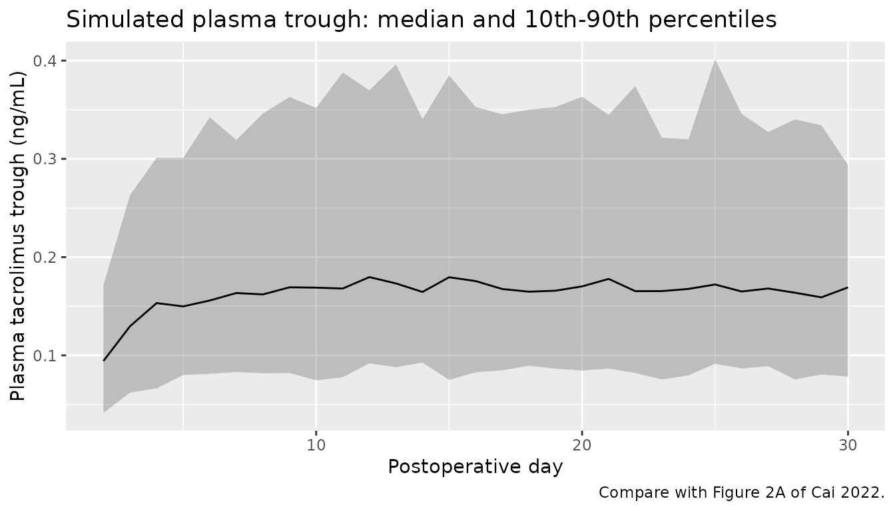
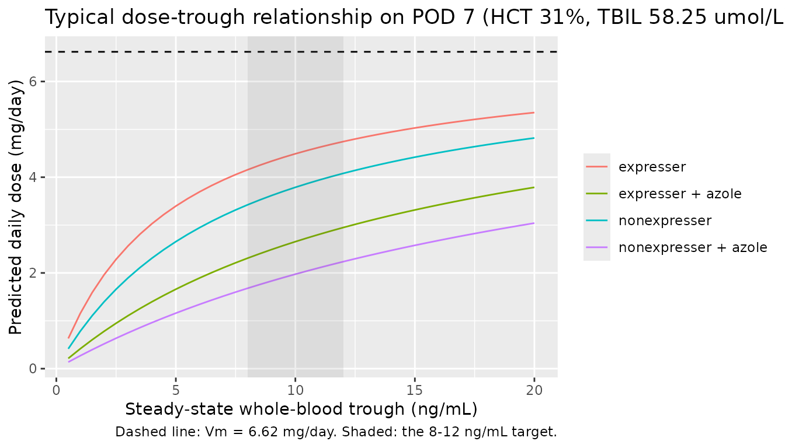
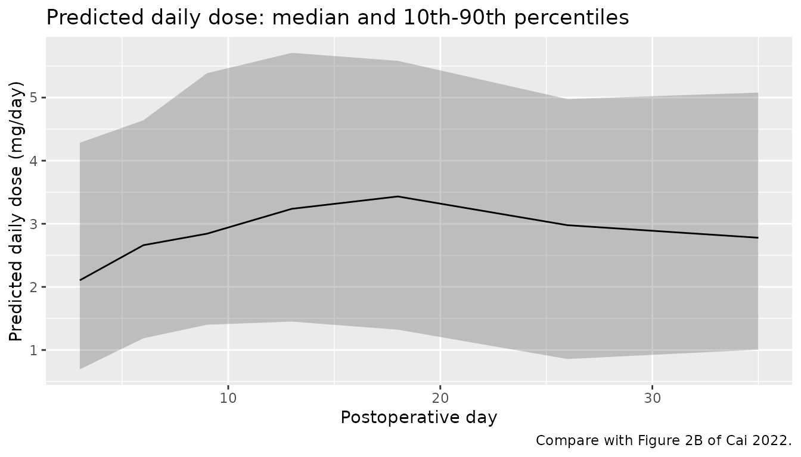

# Tacrolimus after liver transplantation: theory-based and Michaelis-Menten models (Cai 2022)

## Model and source

Cai et al. (2022) fitted two competing final models to the same 906
whole-blood tacrolimus troughs from 176 adult liver transplant
recipients and compared them:

1.  A **theory-based one-compartment model** (`Cai_2022_tacrolimus`)
    whose parameters are on the plasma scale; whole blood is linked to
    plasma through saturable binding to erythrocytes scaled by
    hematocrit.
2.  An **empirical steady-state Michaelis-Menten (MM) model**
    (`Cai_2022_tacrolimus_mm`) that predicts the patient’s total daily
    dose from the measured steady-state trough, with a time-varying Km.
    The authors judged it the better of the two and used it to propose
    starting doses (Table 6).

- Citation: Cai XJ, Li RD, Li JH, Tao YF, Zhang QB, Shen CH, Zhang XF,
  Wang ZX, Jiao Z. Prospective population pharmacokinetic study of
  tacrolimus in adult recipients early after liver transplantation: A
  comparison of Michaelis-Menten and theory-based pharmacokinetic
  models. Front Pharmacol. 2022;13:1031969.
  <doi:10.3389/fphar.2022.1031969>
- Article: <https://doi.org/10.3389/fphar.2022.1031969>

## Population

The cohort comprised 176 adults (150 men, 26 women) receiving a first
liver transplant from donation after cardiac death at Huashan Hospital,
Shanghai, between June 2018 and October 2019, followed until discharge.
Mean age was 50.7 years (range 18-74) and mean weight 64.5 kg (range
40-104). Troughs were taken in the early postoperative period
(postoperative day, POD, 2-72; median 10), on immediate-release oral
tacrolimus given every 12 h at 0.25-8 mg/day (median 2.5 mg/day). Median
hematocrit was 31.3% (15.4-53.6), median total bilirubin 58.25 umol/L
(5.1-786.3) and median AST 45 U/L (9-2547). Of the recipients, 47.2%
were CYP3A5 expressers (*1/*1 or *1/*3). Voriconazole or fluconazole was
co-administered at 56 of the 906 sampling occasions (Cai 2022 Tables 1
and 2).

The same information is available programmatically via
`readModelDb("Cai_2022_tacrolimus")()$population`.

## Source trace

Every `ini()` value carries an in-file comment pointing to its source.
The equations are printed in Section 3.2 of the paper; the estimates are
in Table 4.

| Model | Parameter | Value | Source |
|:---|:---|:---|:---|
| theory | lka (ka) | 4.48 1/h, fixed | Section 2.5.1 and Table 4 (from Zhu 2015) |
| theory | lcl (CLpl/F) | 234 L/h | Table 4; Section 3.2.1 final equation |
| theory | e_ast_cl | -0.216 | Table 4 theta AST; (AST/45)^theta |
| theory | e_dose_tac_cl_emax | 3.51 | Table 4 theta DDmax; 3.51 \* DD / (2.44 + DD) |
| theory | e_dose_tac_cl_ed50 | 2.44 mg/day | Table 4 theta DD50 |
| theory | e_cyp3a5_expr_cl | 0.168 | Table 4 theta CYP3A5\*1 (x 1.168) |
| theory | e_conmed_azole_cl | -0.575 | Table 4 theta VRCZ (x 0.425) |
| theory | lvc (Vpl/F) | 11000 L | Table 4 |
| theory | e_pod_vc | 0.887 | Table 4 theta POD; exp(0.887 \* POD / 15) |
| theory | etalcl | 29.7% CV | Table 4 omega CLpl/F |
| theory | etalvc | 59.2% CV | Table 4 omega Vpl/F |
| theory | propSd | 0.308 | Table 4 delta1 |
| theory | Bmax, KD (in model()) | 418 ug/L, 3.8 ug/L | Section 2.5.2.1, Eq. 6 |
| MM | lvmax (Vm) | 6.62 mg/day | Table 4 |
| MM | lkm (Km) | 6.46 ng/mL | Table 4 |
| MM | e_pod_km | 0.277 | Table 4 theta POD; (POD/15)^theta |
| MM | e_hct_km | 1.16 | Table 4 theta HCT; (HCT/31)^theta |
| MM | e_tbili_km | 0.286 | Table 4 theta TBIL; (TBIL/58.25)^theta |
| MM | e_cyp3a5_expr_km | -0.365 | Table 4 theta CYP3A5\*1 (x 0.635) |
| MM | e_conmed_azole_km | 2.15 | Table 4 theta VRCZ (x 3.15) |
| MM | etalkm | 65.3% CV | Table 4 omega Km |
| MM | propSd, addSd | 0.204, 0.568 mg/day | Table 4 delta1, delta2 |
| MM | time factor 10/theta | theta = min(POD, 10) | Section 2.5.2.2, Eq. 7 |

## Theory-based compartmental model

``` r

mod_t <- readModelDb("Cai_2022_tacrolimus")
ui_t <- rxode2::rxode(mod_t)
#> ℹ parameter labels from comments will be replaced by 'label()'
```

### Reference clearance

The Discussion states that a CYP3A5 nonexpresser with AST 45 U/L, no
triazole antifungal and 1 mg/day has CLpl/F of about 234 L/h. The
printed equation gives `234 * 3.51 * 1 / (2.44 + 1)`:

``` r

th <- ui_t$theta
cl_ref <- exp(th[["lcl"]]) * th[["e_dose_tac_cl_emax"]] * 1 /
  (th[["e_dose_tac_cl_ed50"]] + 1)
cl_ref
#> [1] 238.7616
# The Emax factor is 1.02 at 1 mg/day, so the quoted 234 L/h is the rounded
# equation intercept rather than a separate estimate.
stopifnot(abs(cl_ref / 234 - 1) < 0.05)
```

### Steady-state trough against the closed form

With postoperative day held constant the model is a linear
one-compartment oral model, so its steady-state trough has a closed
form. This checks the ODE encoding, the plasma unit conversion and the
whole-blood equation together.

``` r

tau <- 12
dd <- 2.5
pod <- 10
hct <- 31.3
ev_cf <- rxode2::et(amt = dd / 2, cmt = "depot", ii = tau, addl = 119) |>
  rxode2::et(seq(1428, 1440, by = 0.5), cmt = "central") |>
  as.data.frame() |>
  mutate(
    AST = 45, DOSE_TAC_MGD = dd, CYP3A5_EXPR = 0, CONMED_AZOLE = 0,
    POD = pod, HCT = hct
  )
sim_cf <- as.data.frame(rxode2::rxSolve(rxode2::zeroRe(mod_t), events = ev_cf))
#> ℹ parameter labels from comments will be replaced by 'label()'
#> ℹ omega/sigma items treated as zero: 'etalcl', 'etalvc'

cl <- exp(th[["lcl"]]) * th[["e_dose_tac_cl_emax"]] * dd / (th[["e_dose_tac_cl_ed50"]] + dd)
vc <- exp(th[["lvc"]]) * exp(th[["e_pod_vc"]] * pod / 15)
ka <- exp(th[["lka"]])
k <- cl / vc
ctrough_cf <- 1000 * (dd / 2) * ka / (vc * (ka - k)) *
  (exp(-k * tau) / (1 - exp(-k * tau)) - exp(-ka * tau) / (1 - exp(-ka * tau)))
cwb_cf <- ctrough_cf * (1 + (hct / 100) * 418 / (ctrough_cf + 3.8))

trough_sim <- sim_cf[sim_cf$time == 1440, ]
c(plasma_closed = ctrough_cf, plasma_sim = trough_sim$Cc,
  blood_closed = cwb_cf, blood_sim = trough_sim$Cwb)
#> plasma_closed    plasma_sim  blood_closed     blood_sim 
#>     0.2215016     0.2215008     7.4277517     7.4277253
# Same parameters on both sides, so the difference is solver error only.
stopifnot(
  abs(trough_sim$Cc / ctrough_cf - 1) < 1e-3,
  abs(trough_sim$Cwb / cwb_cf - 1) < 1e-3
)
```

At this typical reference patient the plasma trough is about 0.22 ng/mL
and the whole-blood trough about 7.4 ng/mL: whole blood carries roughly
34 times the plasma concentration at a hematocrit of 31%, which is why
the paper’s goodness-of-fit and VPC plots (Figures 1A and 2A) are on a
0-0.6 ng/mL scale.

### Virtual cohort

Observed data are not public. The cohort below draws covariates to
resemble Table 1: daily dose log-normal around the 2.5 mg/day median,
AST log-normal around 45 U/L, hematocrit normal around 31.8%, 47% CYP3A5
expressers and 10% of patients on a triazole antifungal. Dosing starts
on POD 1 and troughs are sampled each morning to POD 30. Postoperative
day is carried as a time-varying covariate.

``` r

set.seed(2022)
n_t <- 200
subj_t <- tibble(
  id = seq_len(n_t),
  DOSE_TAC_MGD = pmin(pmax(round(4 * exp(rnorm(n_t, log(2.5), 0.5))) / 4, 0.5), 8),
  AST = pmin(pmax(exp(rnorm(n_t, log(45), 0.8)), 9), 2547),
  HCT = pmin(pmax(rnorm(n_t, 31.8, 5), 15.4), 53.6),
  CYP3A5_EXPR = rbinom(n_t, 1, 0.472),
  CONMED_AZOLE = rbinom(n_t, 1, 0.10)
)
dose_times <- seq(0, 29 * 24 + 12, by = 12)
obs_times <- seq(24, 29 * 24, by = 24) - 0.01
ev_t <- bind_rows(
  tidyr::crossing(id = subj_t$id, time = dose_times) |>
    mutate(evid = 1, cmt = "depot"),
  tidyr::crossing(id = subj_t$id, time = obs_times) |>
    mutate(evid = 0, cmt = "central")
) |>
  left_join(subj_t, by = "id") |>
  mutate(
    amt = ifelse(evid == 1, DOSE_TAC_MGD / 2, 0),
    POD = 1 + time / 24
  ) |>
  arrange(id, time, desc(evid))
sim_t <- as.data.frame(rxode2::rxSolve(mod_t, events = ev_t)) |>
  mutate(POD = 1 + time / 24)
#> ℹ parameter labels from comments will be replaced by 'label()'
```

### Trough concentrations over the postoperative course

``` r

# Compare with Figure 2A of Cai 2022 (plasma scale). Simulated percentiles
# include residual error through the `sim` column.
sim_t |>
  mutate(day = round(POD)) |>
  group_by(day) |>
  summarise(
    p10 = quantile(sim, 0.1), p50 = median(sim), p90 = quantile(sim, 0.9),
    .groups = "drop"
  ) |>
  ggplot(aes(day, p50)) +
  geom_ribbon(aes(ymin = p10, ymax = p90), alpha = 0.25) +
  geom_line() +
  labs(
    x = "Postoperative day", y = "Plasma tacrolimus trough (ng/mL)",
    title = "Simulated plasma trough: median and 10th-90th percentiles",
    caption = "Compare with Figure 2A of Cai 2022."
  )
```



``` r

chk_t <- sim_t |>
  filter(POD >= 7) |>
  summarise(median_plasma = median(Cc), median_blood = median(Cwb))
chk_t
#>   median_plasma median_blood
#> 1     0.1765877      6.05498
stopifnot(
  # Figure 2A puts the median plasma trough near 0.2 ng/mL; Table 1 puts the
  # median whole-blood trough at 5.96 ng/mL. The cohort's doses were drawn
  # independently of concentration whereas the study titrated them to target,
  # so only an envelope is meaningful here; a 100-fold hematocrit-scale error
  # or a mg/ug slip on the volume falls far outside it.
  chk_t$median_plasma > 0.08, chk_t$median_plasma < 0.5,
  chk_t$median_blood > 3, chk_t$median_blood < 15
)
```

The simulated median whole-blood trough from POD 7 onward, 6.05 ng/mL,
is close to the observed Table 1 median of 5.96 ng/mL, and the median
plasma trough, 0.18 ng/mL, sits where Figure 2A places the observed
median (about 0.2 ng/mL).

### PKNCA over a steady-state dosing interval

The paper sampled troughs only and reports no NCA, so there is no
published table to compare against. PKNCA is used here to check internal
consistency: at steady state the AUC over a dosing interval must equal
the dose divided by clearance. Postoperative day is held at 14 so the
system reaches steady state.

``` r

ev_nca <- bind_rows(
  tidyr::crossing(id = subj_t$id, time = seq(0, 1428, by = 12)) |>
    mutate(evid = 1, cmt = "depot"),
  tidyr::crossing(id = subj_t$id, time = seq(1428, 1440, by = 0.5)) |>
    mutate(evid = 0, cmt = "central")
) |>
  left_join(subj_t, by = "id") |>
  mutate(amt = ifelse(evid == 1, DOSE_TAC_MGD / 2, 0), POD = 14) |>
  arrange(id, time, desc(evid))
sim_nca <- as.data.frame(rxode2::rxSolve(mod_t, events = ev_nca)) |>
  mutate(
    treatment = paste0(
      ifelse(CYP3A5_EXPR == 1, "CYP3A5 expresser", "CYP3A5 nonexpresser"),
      ifelse(CONMED_AZOLE == 1, " + azole", "")
    )
  )

conc_df <- sim_nca |>
  filter(!is.na(Cc)) |>
  select(id, time, Cc, treatment)
dose_df <- ev_nca |>
  filter(evid == 1) |>
  left_join(sim_nca |> distinct(id, treatment), by = "id") |>
  select(id, time, amt, treatment)

conc_obj <- PKNCA::PKNCAconc(conc_df, Cc ~ time | treatment + id)
dose_obj <- PKNCA::PKNCAdose(dose_df, amt ~ time | treatment + id)
intervals <- data.frame(
  start = 1428, end = 1440,
  cmax = TRUE, tmax = TRUE, cmin = TRUE, auclast = TRUE
)
nca_res <- PKNCA::pk.nca(PKNCA::PKNCAdata(conc_obj, dose_obj, intervals = intervals))

nca_wide <- as.data.frame(nca_res$result) |>
  select(treatment, id, PPTESTCD, PPORRES) |>
  tidyr::pivot_wider(names_from = PPTESTCD, values_from = PPORRES)

nca_wide |>
  group_by(treatment) |>
  summarise(
    N = n(),
    cmax = median(cmax), cmin = median(cmin), auclast = median(auclast),
    .groups = "drop"
  ) |>
  dplyr::rename(
    "Group" = treatment,
    "Cmax (ng/mL)" = cmax, "Cmin (ng/mL)" = cmin,
    "AUC0-12 (ng*h/mL)" = auclast
  ) |>
  knitr::kable(digits = 3, caption = "Median simulated plasma NCA over one steady-state 12 h interval, POD 14.")
```

| Group                       |   N | Cmax (ng/mL) | Cmin (ng/mL) | AUC0-12 (ng\*h/mL) |
|:----------------------------|----:|-------------:|-------------:|-------------------:|
| CYP3A5 expresser            |  83 |        0.243 |        0.192 |              2.673 |
| CYP3A5 expresser + azole    |  11 |        0.559 |        0.464 |              6.146 |
| CYP3A5 nonexpresser         |  94 |        0.272 |        0.228 |              3.065 |
| CYP3A5 nonexpresser + azole |  12 |        0.695 |        0.656 |              8.118 |

Median simulated plasma NCA over one steady-state 12 h interval, POD 14.
{.table}

``` r

cl_ind <- sim_nca |>
  filter(time == 1440) |>
  select(id, cl, DOSE_TAC_MGD)
chk_nca <- nca_wide |>
  left_join(cl_ind, by = "id") |>
  mutate(
    auc_ss = 1000 * (DOSE_TAC_MGD / 2) / cl,
    pct_diff = 100 * (auclast / auc_ss - 1)
  )
summary(chk_nca$pct_diff)
#>     Min.  1st Qu.   Median     Mean  3rd Qu.     Max. 
#> -4.37186 -0.24527 -0.14478 -0.24985 -0.09443 -0.06439
stopifnot(
  # Linear-up/log-down trapezoids on a 0.5 h grid against Dose/CL. Subjects with
  # a very large V/F and low CL/F are still approaching steady state after 60
  # days, so assert on the centre and a robust quantile, not the extremes.
  abs(median(chk_nca$pct_diff)) < 2,
  quantile(abs(chk_nca$pct_diff), 0.9) < 10
)
```

## Michaelis-Menten model

``` r

mod_m <- readModelDb("Cai_2022_tacrolimus_mm")
ui_m <- rxode2::rxode(mod_m)
#> ℹ parameter labels from comments will be replaced by 'label()'
```

The model has no compartments: each record supplies the measured
steady-state trough `CTROUGH` and the covariates, and the model returns
the predicted total daily dose `daily_dose` (mg/day),

`daily_dose = Vm * CTROUGH / ((10 / min(POD, 10)) * Km + CTROUGH)`.

### Starting-dose recommendations (Table 6)

Table 6 of the paper lists, for a POD-7 target trough of 8-12 ng/mL, the
daily dose ranges for each combination of CYP3A5 genotype, triazole
antifungal co-therapy, hematocrit band and total-bilirubin band.
Inverting the typical-value model at troughs of 8 and 12 ng/mL
reproduces it. The paper’s Supplementary Table S4 defines the 48
scenarios by band only, so the values used here (hematocrit 25, 35 and
45%; bilirubin 10, 51.3, 128.25 and 250 umol/L, i.e. band midpoints with
representative values for the open-ended bands) were chosen by the
maintainers.

``` r

scen <- tidyr::crossing(
  CYP3A5_EXPR = c(1, 0), CONMED_AZOLE = c(1, 0),
  HCT = c(25, 35, 45), TBILI = c(10, 51.3, 128.25, 250),
  CTROUGH = c(8, 12)
) |>
  mutate(id = row_number(), time = 0, evid = 0, POD = 7)
pred <- as.data.frame(rxode2::rxSolve(rxode2::zeroRe(mod_m), events = scen))
#> ℹ parameter labels from comments will be replaced by 'label()'
#> ℹ omega/sigma items treated as zero: 'etalkm'
#> Warning: multi-subject simulation without without 'omega'
scen$daily_dose <- pred$daily_dose

computed <- scen |>
  select(CYP3A5_EXPR, CONMED_AZOLE, HCT, TBILI, CTROUGH, daily_dose) |>
  tidyr::pivot_wider(names_from = CTROUGH, values_from = daily_dose, names_prefix = "c")

# Table 6 of Cai 2022, transcribed by row (TBIL band) and column
# (azole x hematocrit band); each cell is "low - high" mg/day.
published <- tibble::tribble(
  ~CYP3A5_EXPR, ~CONMED_AZOLE, ~HCT, ~TBILI, ~pub_low, ~pub_high,
  1, 1, 25, 10, 3.25, 4, 1, 1, 35, 10, 2.75, 3.25, 1, 1, 45, 10, 2.25, 3,
  1, 0, 25, 10, 5, 5.5, 1, 0, 35, 10, 4.5, 5, 1, 0, 45, 10, 4, 4.5,
  1, 1, 25, 51.3, 2.5, 3.25, 1, 1, 35, 51.3, 2, 2.75, 1, 1, 45, 51.3, 1.75, 2.25,
  1, 0, 25, 51.3, 4.5, 5, 1, 0, 35, 51.3, 3.75, 4.5, 1, 0, 45, 51.3, 3.25, 4,
  1, 1, 25, 128.25, 2.25, 3, 1, 1, 35, 128.25, 1.75, 2.25, 1, 1, 45, 128.25, 1.5, 2,
  1, 0, 25, 128.25, 4, 4.5, 1, 0, 35, 128.25, 3.5, 4, 1, 0, 45, 128.25, 3, 3.5,
  1, 1, 25, 250, 2, 2.5, 1, 1, 35, 250, 1.5, 2, 1, 1, 45, 250, 1.25, 1.75,
  1, 0, 25, 250, 3.75, 4.25, 1, 0, 35, 250, 3.25, 3.75, 1, 0, 45, 250, 2.75, 3.25,
  0, 1, 25, 10, 2.5, 3.25, 0, 1, 35, 10, 2, 2.5, 0, 1, 45, 10, 1.75, 2.25,
  0, 0, 25, 10, 4.5, 5, 0, 0, 35, 10, 3.75, 4.5, 0, 0, 45, 10, 3.25, 4,
  0, 1, 25, 51.3, 2, 2.5, 0, 1, 35, 51.3, 1.5, 2, 0, 1, 45, 51.3, 1.25, 1.75,
  0, 0, 25, 51.3, 3.75, 4.25, 0, 0, 35, 51.3, 3, 3.75, 0, 0, 45, 51.3, 2.5, 3.25,
  0, 1, 25, 128.25, 1.75, 2.25, 0, 1, 35, 128.25, 1.25, 1.75, 0, 1, 45, 128.25, 1, 1.5,
  0, 0, 25, 128.25, 3.25, 4.25, 0, 0, 35, 128.25, 2.75, 3.75, 0, 0, 45, 128.25, 2.25, 3.25,
  0, 1, 25, 250, 1.5, 2, 0, 1, 35, 250, 1.25, 1.5, 0, 1, 45, 250, 1, 1.25,
  0, 0, 25, 250, 3, 3.75, 0, 0, 35, 250, 2.5, 3, 0, 0, 45, 250, 2, 2.5
)

t6 <- published |>
  left_join(computed, by = c("CYP3A5_EXPR", "CONMED_AZOLE", "HCT", "TBILI")) |>
  mutate(
    Genotype = ifelse(CYP3A5_EXPR == 1, "*1/*1 or *1/*3", "*3/*3"),
    Azole = ifelse(CONMED_AZOLE == 1, "yes", "no"),
    Published = sprintf("%.2f - %.2f", pub_low, pub_high),
    Simulated = sprintf("%.2f - %.2f", c8, c12)
  )
t6 |>
  select(Genotype, Azole, HCT, TBILI, Published, Simulated) |>
  dplyr::rename(
    "CYP3A5" = Genotype, "Triazole antifungal" = Azole,
    "HCT (%)" = HCT, "TBIL (umol/L)" = TBILI,
    "Table 6 (mg/day)" = Published, "Typical model, C0 8-12 ng/mL (mg/day)" = Simulated
  ) |>
  knitr::kable(caption = "Replicates Table 6 of Cai 2022.")
```

| CYP3A5 | Triazole antifungal | HCT (%) | TBIL (umol/L) | Table 6 (mg/day) | Typical model, C0 8-12 ng/mL (mg/day) |
|:---|:---|---:|---:|:---|:---|
| *1/*1 or *1/*3 | yes | 25 | 10.00 | 3.25 - 4.00 | 3.52 - 4.17 |
| *1/*1 or *1/*3 | yes | 35 | 10.00 | 2.75 - 3.25 | 2.88 - 3.55 |
| *1/*1 or *1/*3 | yes | 45 | 10.00 | 2.25 - 3.00 | 2.42 - 3.07 |
| *1/*1 or *1/*3 | no | 25 | 10.00 | 5.00 - 5.50 | 5.18 - 5.58 |
| *1/*1 or *1/*3 | no | 35 | 10.00 | 4.50 - 5.00 | 4.69 - 5.19 |
| *1/*1 or *1/*3 | no | 45 | 10.00 | 4.00 - 4.50 | 4.27 - 4.84 |
| *1/*1 or *1/*3 | yes | 25 | 51.30 | 2.50 - 3.25 | 2.75 - 3.42 |
| *1/*1 or *1/*3 | yes | 35 | 51.30 | 2.00 - 2.75 | 2.15 - 2.78 |
| *1/*1 or *1/*3 | yes | 45 | 51.30 | 1.75 - 2.25 | 1.75 - 2.32 |
| *1/*1 or *1/*3 | no | 25 | 51.30 | 4.50 - 5.00 | 4.58 - 5.10 |
| *1/*1 or *1/*3 | no | 35 | 51.30 | 3.75 - 4.50 | 3.99 - 4.60 |
| *1/*1 or *1/*3 | no | 45 | 51.30 | 3.25 - 4.00 | 3.52 - 4.17 |
| *1/*1 or *1/*3 | yes | 25 | 128.25 | 2.25 - 3.00 | 2.34 - 2.99 |
| *1/*1 or *1/*3 | yes | 35 | 128.25 | 1.75 - 2.25 | 1.79 - 2.37 |
| *1/*1 or *1/*3 | yes | 45 | 128.25 | 1.50 - 2.00 | 1.44 - 1.94 |
| *1/*1 or *1/*3 | no | 25 | 128.25 | 4.00 - 4.50 | 4.19 - 4.78 |
| *1/*1 or *1/*3 | no | 35 | 128.25 | 3.50 - 4.00 | 3.57 - 4.22 |
| *1/*1 or *1/*3 | no | 45 | 128.25 | 3.00 - 3.50 | 3.09 - 3.75 |
| *1/*1 or *1/*3 | yes | 25 | 250.00 | 2.00 - 2.50 | 2.06 - 2.68 |
| *1/*1 or *1/*3 | yes | 35 | 250.00 | 1.50 - 2.00 | 1.55 - 2.09 |
| *1/*1 or *1/*3 | yes | 45 | 250.00 | 1.25 - 1.75 | 1.23 - 1.69 |
| *1/*1 or *1/*3 | no | 25 | 250.00 | 3.75 - 4.25 | 3.89 - 4.51 |
| *1/*1 or *1/*3 | no | 35 | 250.00 | 3.25 - 3.75 | 3.25 - 3.92 |
| *1/*1 or *1/*3 | no | 45 | 250.00 | 2.75 - 3.25 | 2.77 - 3.44 |
| *3/*3 | yes | 25 | 10.00 | 2.50 - 3.25 | 2.78 - 3.44 |
| *3/*3 | yes | 35 | 10.00 | 2.00 - 2.50 | 2.17 - 2.80 |
| *3/*3 | yes | 45 | 10.00 | 1.75 - 2.25 | 1.77 - 2.34 |
| *3/*3 | no | 25 | 10.00 | 4.50 - 5.00 | 4.60 - 5.12 |
| *3/*3 | no | 35 | 10.00 | 3.75 - 4.50 | 4.01 - 4.62 |
| *3/*3 | no | 45 | 10.00 | 3.25 - 4.00 | 3.54 - 4.19 |
| *3/*3 | yes | 25 | 51.30 | 2.00 - 2.50 | 2.06 - 2.68 |
| *3/*3 | yes | 35 | 51.30 | 1.50 - 2.00 | 1.55 - 2.08 |
| *3/*3 | yes | 45 | 51.30 | 1.25 - 1.75 | 1.23 - 1.69 |
| *3/*3 | no | 25 | 51.30 | 3.75 - 4.25 | 3.89 - 4.51 |
| *3/*3 | no | 35 | 51.30 | 3.00 - 3.75 | 3.25 - 3.91 |
| *3/*3 | no | 45 | 51.30 | 2.50 - 3.25 | 2.77 - 3.44 |
| *3/*3 | yes | 25 | 128.25 | 1.75 - 2.25 | 1.71 - 2.27 |
| *3/*3 | yes | 35 | 128.25 | 1.25 - 1.75 | 1.26 - 1.73 |
| *3/*3 | yes | 45 | 128.25 | 1.00 - 1.50 | 0.99 - 1.38 |
| *3/*3 | no | 25 | 128.25 | 3.25 - 4.25 | 3.46 - 4.12 |
| *3/*3 | no | 35 | 128.25 | 2.75 - 3.75 | 2.82 - 3.49 |
| *3/*3 | no | 45 | 128.25 | 2.25 - 3.25 | 2.36 - 3.01 |
| *3/*3 | yes | 25 | 250.00 | 1.50 - 2.00 | 1.48 - 2.00 |
| *3/*3 | yes | 35 | 250.00 | 1.25 - 1.50 | 1.08 - 1.50 |
| *3/*3 | yes | 45 | 250.00 | 1.00 - 1.25 | 0.84 - 1.19 |
| *3/*3 | no | 25 | 250.00 | 3.00 - 3.75 | 3.15 - 3.81 |
| *3/*3 | no | 35 | 250.00 | 2.50 - 3.00 | 2.52 - 3.17 |
| *3/*3 | no | 45 | 250.00 | 2.00 - 2.50 | 2.08 - 2.70 |

Replicates Table 6 of Cai 2022. {.table}

``` r

dev <- c(t6$c8 - t6$pub_low, t6$c12 - t6$pub_high)
summary(dev)
#>     Min.  1st Qu.   Median     Mean  3rd Qu.     Max. 
#> -0.26273  0.01956  0.10217  0.10260  0.19063  0.33898
stopifnot(
  # Table 6 is printed in 0.25 mg steps from a Monte Carlo simulation, so a
  # deviation of one step is expected; a mis-transcribed exponent, a dropped
  # 10/theta time factor or a swapped covariate effect moves dozens of cells
  # by 0.5 mg or more.
  median(abs(dev)) < 0.2,
  max(abs(dev)) < 0.4
)
```

### Dose-trough relationship

``` r

curve_df <- tidyr::crossing(
  CTROUGH = seq(0.5, 20, by = 0.5), CYP3A5_EXPR = c(0, 1), CONMED_AZOLE = c(0, 1)
) |>
  mutate(id = row_number(), time = 0, evid = 0, POD = 7, HCT = 31, TBILI = 58.25)
curve_df$daily_dose <- as.data.frame(
  rxode2::rxSolve(rxode2::zeroRe(mod_m), events = curve_df)
)$daily_dose
#> ℹ parameter labels from comments will be replaced by 'label()'
#> ℹ omega/sigma items treated as zero: 'etalkm'
#> Warning: multi-subject simulation without without 'omega'
curve_df |>
  mutate(
    group = paste0(
      ifelse(CYP3A5_EXPR == 1, "expresser", "nonexpresser"),
      ifelse(CONMED_AZOLE == 1, " + azole", "")
    )
  ) |>
  ggplot(aes(CTROUGH, daily_dose, colour = group)) +
  geom_line() +
  geom_hline(yintercept = exp(ui_m$theta[["lvmax"]]), linetype = "dashed") +
  annotate("rect", xmin = 8, xmax = 12, ymin = -Inf, ymax = Inf, alpha = 0.1) +
  labs(
    x = "Steady-state whole-blood trough (ng/mL)",
    y = "Predicted daily dose (mg/day)", colour = NULL,
    title = "Typical dose-trough relationship on POD 7 (HCT 31%, TBIL 58.25 umol/L)",
    caption = "Dashed line: Vm = 6.62 mg/day. Shaded: the 8-12 ng/mL target."
  )
```



### Stochastic predictions over the postoperative course

The cohort below assigns each simulated patient five troughs drawn
around the Table 1 median of 5.96 ng/mL at random postoperative days,
with hematocrit and bilirubin drawn to resemble Table 1. The model’s
predicted daily doses (with between-subject and residual variability,
the `sim` column) are compared with the Table 1 median dose and with
Figure 2B.

``` r

set.seed(2023)
n_m <- 200
subj_m <- tibble(
  id = seq_len(n_m),
  CYP3A5_EXPR = rbinom(n_m, 1, 0.472),
  CONMED_AZOLE = rbinom(n_m, 1, 0.10)
)
ev_m <- tidyr::crossing(id = subj_m$id, occ = 1:5) |>
  left_join(subj_m, by = "id") |>
  mutate(
    time = occ, evid = 0,
    POD = sample(2:40, n(), replace = TRUE),
    CTROUGH = pmin(pmax(exp(rnorm(n(), log(5.96), 0.5)), 1), 23),
    HCT = pmin(pmax(rnorm(n(), 31.8, 5), 15.4), 53.6),
    TBILI = pmin(pmax(exp(rnorm(n(), log(58.25), 0.9)), 5.1), 786.3)
  )
sim_m <- as.data.frame(rxode2::rxSolve(mod_m, events = ev_m, keep = "POD"))
#> ℹ parameter labels from comments will be replaced by 'label()'

sim_m |>
  mutate(pod_bin = cut(POD, c(1, 4, 7, 10, 15, 20, 30, 40))) |>
  group_by(pod_bin) |>
  summarise(
    p10 = quantile(sim, 0.1), p50 = median(sim), p90 = quantile(sim, 0.9),
    POD = median(POD), .groups = "drop"
  ) |>
  ggplot(aes(POD, p50)) +
  geom_ribbon(aes(ymin = p10, ymax = p90), alpha = 0.25) +
  geom_line() +
  labs(
    x = "Postoperative day", y = "Predicted daily dose (mg/day)",
    title = "Predicted daily dose: median and 10th-90th percentiles",
    caption = "Compare with Figure 2B of Cai 2022."
  )
```



``` r

med_dose <- median(sim_m$daily_dose)
med_dose
#> [1] 2.99652
stopifnot(
  # Table 1 median daily dose 2.5 mg/day; Figure 2B median about 2-3.5 mg/day
  # after the first postoperative week.
  med_dose > 1.5, med_dose < 4.5
)
```

The rise of the predicted dose over the first ten days followed by a
slow decline mirrors Figure 2B: the `10 / min(POD, 10)` factor inflates
Km, and so lowers the dose needed for a given trough, in the first
postoperative days, while the `(POD / 15)^0.277` term raises Km
thereafter.

## Assumptions and deviations

- **Hematocrit scale in the erythrocyte-binding equation.** Section
  2.5.2.1 says HCT is entered “as %”. Taken literally, with HCT = 31 the
  whole-blood to plasma ratio would be about 3,400 instead of the about
  34 that maps the observed 6 ng/mL whole-blood troughs onto the 0.1-0.6
  ng/mL plasma scale of Figures 1A and 2A. The model therefore divides
  HCT (supplied in percent) by 100, as does `Storset_2014_tacrolimus`,
  which uses the same equation and constants.
- **Scale of the theory-based residual error.** The goodness-of-fit and
  VPC plots of the theory-based model are on the plasma scale, so the
  30.8% proportional error is applied to the plasma concentration `Cc`.
  The whole-blood concentration `Cwb` is an algebraic output without its
  own residual error.
- **POD normaliser.** Both final-model equations divide POD by 15 days,
  while the Table 1 median is 10 days. The printed equations are
  followed; the Table 6 reproduction above, which is sensitive to the
  POD terms, supports them.
- **Between-subject variability.** Table 4 reports BSV in percent. It is
  read as a coefficient of variation of a log-normal random effect and
  converted with `omega^2 = log(CV^2 + 1)`.
- **Output of the MM model.** The paper’s MM model predicts the daily
  dose from the trough (the y-axes of Figures 1B, 2B and 3B are in
  mg/day, and the additive residual error is in mg/day), so the model
  returns the predicted daily dose `daily_dose` with the trough supplied
  as the covariate `CTROUGH`. It is not converted to a compartmental
  model, because that would require a volume and an absorption rate that
  the paper does not estimate.
- **Triazole antifungals.** Table 4 labels the antifungal effect “VRCZ”
  while the text and equations call it TAF (voriconazole and
  fluconazole). It is encoded with `CONMED_AZOLE`, covering both.
- **Absorption.** Ka is fixed at 4.48 1/h from Zhu et al. (2015), as in
  the paper; bioavailability is not identifiable from oral troughs and
  CL/F and V/F are apparent values.
- **Table 6 scenarios.** Supplementary Table S4 of the paper defines the
  Table 6 scenarios by hematocrit and bilirubin band only. The
  representative values above were chosen by the maintainers, and the
  reproduction uses the typical model rather than the paper’s
  200-replicate Monte Carlo simulation.
- **Base models.** Only the two final models are provided; the
  base-model estimates of Table 3 are not packaged.
