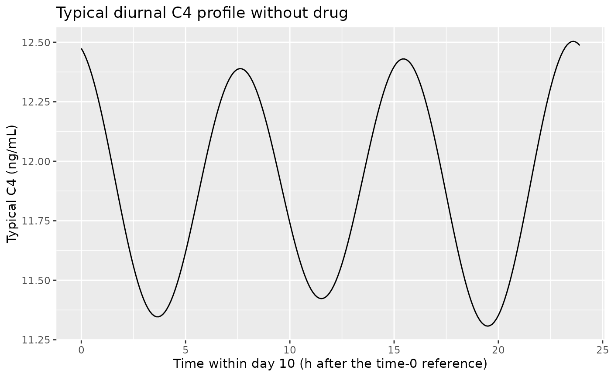
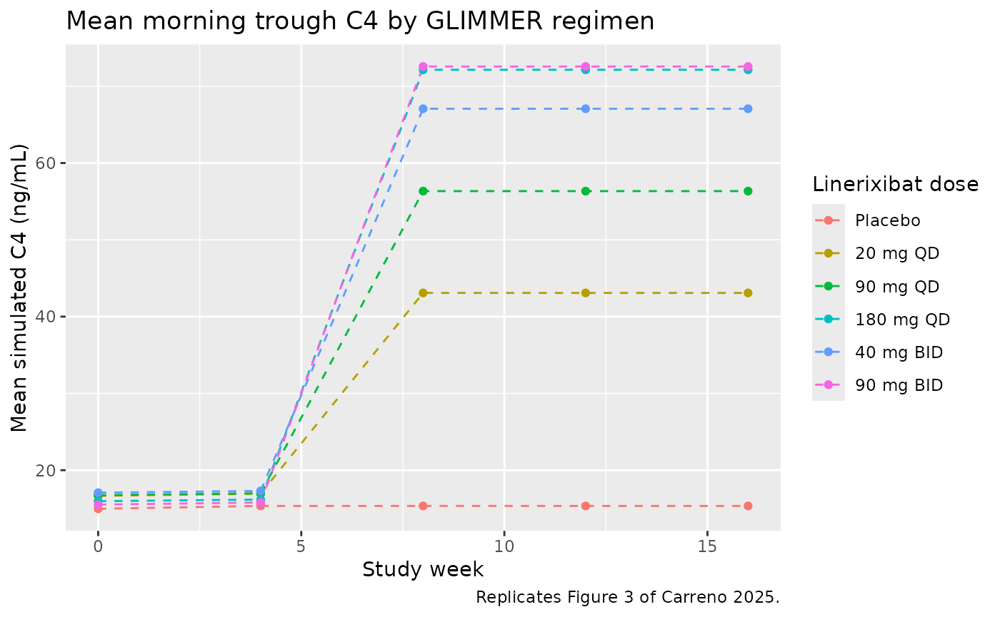
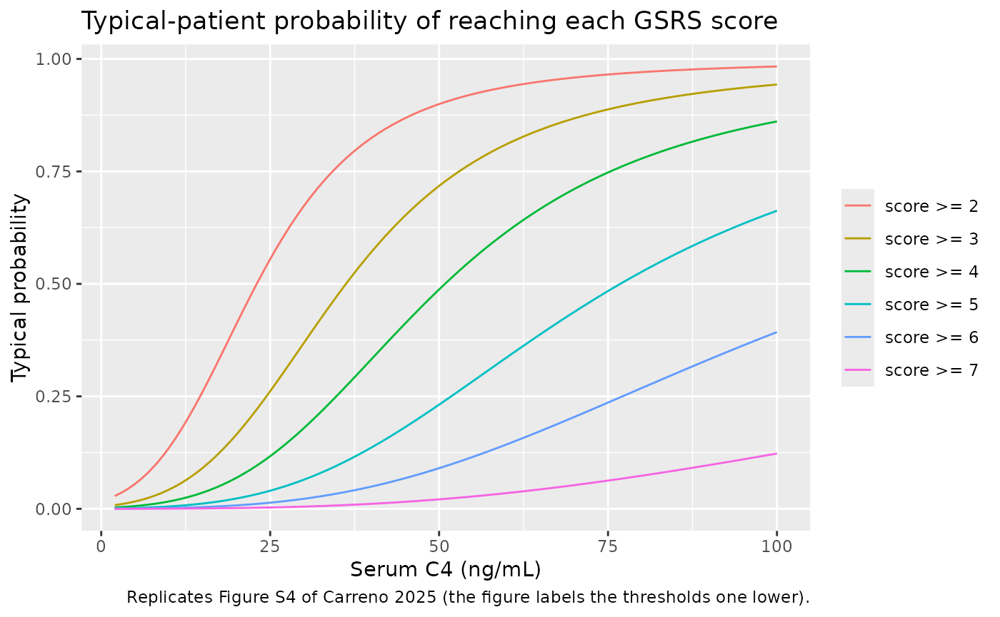

# Linerixibat C4 and GSRS diarrhea bother (Carreno 2025)

## Model and source

- Citation: Carreno F, Mehta R, Sherman AR, Collins J, Swift B. Analysis
  of C4 Concentrations to Predict Impact of Patient-Reported Diarrhea
  Associated With the Ileal Bile Acid Transporter Inhibitor Linerixibat.
  CPT Pharmacometrics Syst Pharmacol. 2025;14(3):596-605.
  <doi:10.1002/psp4.13300>
- Description: Kinetic-pharmacodynamic (K-PD) model of serum
  7-alpha-hydroxy-4-cholesten-3-one (C4), a marker of bile acid
  synthesis, after oral linerixibat (an ileal bile acid transporter
  inhibitor) in healthy volunteers and patients with primary biliary
  cholangitis, linked to a longitudinal proportional-odds model of the
  patient-reported GSRS diarrhea-bother score (Question 11, scores 1-7)
  in patients with primary biliary cholangitis and pruritus (Carreno
  2025). Linerixibat is minimally absorbed, so the dose enters a virtual
  compartment that empties first-order at a fixed rate; the dose rate
  leaving it stimulates the zero-order C4 synthesis rate through an Emax
  function. C4 synthesis follows a dual-cosine diurnal rhythm (8-h and
  12-h periods) whose first amplitude falls with the individual baseline
  C4. The cumulative logits of the GSRS score carry an Emax function of
  the model-predicted C4 concentration and one between-subject random
  effect shared by all thresholds.
- Article: <https://doi.org/10.1002/psp4.13300> (open access,
  PMC11919258)

Linerixibat is an ileal bile acid transporter (IBAT) inhibitor with an
oral bioavailability of about 0.05%, so no plasma PK model drives the
response. The dose enters a virtual compartment (a
kinetic-pharmacodynamic, K-PD, model) whose output rate stimulates the
synthesis of serum 7-alpha-hydroxy-4-cholesten-3-one (C4), the bile acid
synthesis marker. The predicted C4 then drives a proportional-odds model
of the patient-reported GSRS Question 11 score, “Have you been bothered
by diarrhea during the past week?”, scored 1 (no discomfort) to 7 (very
severe discomfort).

## Population

The C4 K-PD model was fitted to 3292 C4 concentrations from 255
participants in five studies (Table 1 and Table S1): 86 healthy
volunteers in three phase 1 studies (NCT01416324 single doses 0.1-60 mg
and 30 mg BID; NCT01607385 3-90 mg BID for 12 days; NCT02801981 single
10-180 mg doses in Japanese volunteers) and 169 patients with primary
biliary cholangitis (PBC) and pruritus (NCT01899703, 45 then 90 mg BID;
GLIMMER, NCT02966834, 20, 90 or 180 mg QD or 40 or 90 mg BID for 12
weeks after a 4-week placebo run-in). 63% of the participants were
female; geometric mean age ranged from 31 to 55 years and geometric mean
body weight from 62.8 to 82.2 kg across studies. Baseline C4 geometric
means were 7.4-14.1 ng/mL. The GSRS proportional-odds model used the 147
GLIMMER patients (713 run-in and 1640 treatment-period observations).

The same information is available programmatically via
`readModelDb("Carreno_2025_linerixibat")()$population`.

## Source trace

Every `ini()` value carries an in-file comment pointing to its source.
The structural equations are in Supplementary Methods S1 (Equation 1 and
the virtual-compartment equations) and in Figure 1 of the article.

| Equation / parameter | Value | Source location |
|----|----|----|
| `d/dt(depot_kpd) = -KDE * A`; `DR = KDE * A` | n/a | Supplementary Methods S1, virtual compartment |
| `EFF = Emax * DR / (EDK50 + DR)` | n/a | Supplementary Methods S1; Figure 1 |
| `d/dt(C4) = Kin * (1 + CYR1 + CYR2) * (1 + EFF) - Kout * C4` | n/a | Supplementary Equation 1; Figure 1 |
| `CYR1 = AMP * cos((t - Tpeak1) * 2 * pi / 8)`, `CYR2 = AMP2 * cos((t - Tpeak2) * 2 * pi / 12)` | n/a | Supplementary Methods S1, diurnal variation definition |
| `logit P(Y <= s) = f_s + eta` | n/a | Supplementary Methods S1, proportional-odds model |
| `lkel` (KDE) | 0.110 1/h, fixed | Table 2 |
| `lemax` (Emax) | 5.55 | Table 2 |
| `ledk50` (EDK50) | 3.03 mg/h | Table 2 |
| `lrbase` (Baseline) | 11.9 ng/mL | Table 2 |
| `lkout` (Kout) | 0.135 1/h | Table 2 |
| `kin_circ_famp1` (Amplitude1) | 0.268 | Table 2 |
| `tacro1` (Acrophase1) | 5.77 h | Table 2 |
| `e_rbase_kin_circ_famp1` (effect of baseline C4 on amplitude) | -0.0130 | Table 2 (functional form not printed; see Assumptions) |
| `kin_circ_famp2` (Amplitude2) | 0.0227 | Table 2 |
| `tacro2` (Acrophase2) | 21.7 h | Table 2 |
| `logite0` | 4.05 (= -(-4.05)) | Table 2, intercept m = 2 |
| `logitstep1` to `logitstep5` | 1.26, 0.983, 1.15, 1.11, 1.53 | Table 2, intercepts m = 3 to 7 |
| `lemax_gsrs_diarrhea` | 11.6 | Table 2, PO Emax |
| `lec50_gsrs_diarrhea` | 42.9 ng/mL | Table 2, PO EC50 |
| `etalrbase` | log(1 + 0.892^2) = 0.586 (89.2% CV) | Table 2 |
| `etalemax` | log(1 + 0.558^2) = 0.269 (55.8% CV) | Table 2 |
| `etaledk50` | log(1 + 3.58^2) = 2.63 (358% CV) | Table 2 |
| `etalogite0` | 5.44^2 = 29.6 (SD 5.44) | Table 2, IIV on the m = 2 intercept |
| `addSd_c4` | 0.000492 ng/mL, fixed | Table 2 |
| `propSd_c4` | 0.448 | Table 2 |

## Typical-value checks

``` r

mod <- readModelDb("Carreno_2025_linerixibat")
mod_typ <- rxode2::zeroRe(mod)
#> ℹ parameter labels from comments will be replaced by 'label()'
ini_val <- rxode2::rxode(mod)$theta
#> ℹ parameter labels from comments will be replaced by 'label()'
```

### Placebo: the diurnal rhythm averages to the baseline

Without drug the model is linear, so once the start-up transient has
decayed the 24-hour mean of C4 equals `Kin / Kout`, the baseline of 11.9
ng/mL. Both sides use the same parameters, so the check is tight.

``` r

ev_pbo <- rxode2::et(amt = 0, cmt = "depot_kpd") |>
  rxode2::et(seq(0, 10 * 24, by = 0.1), cmt = "c4")
s_pbo <- rxode2::rxSolve(mod_typ, ev_pbo, returnType = "data.frame")
#> ℹ omega/sigma items treated as zero: 'etalrbase', 'etalemax', 'etaledk50', 'etalogite0'
day10 <- s_pbo |> filter(time >= 9 * 24, time < 10 * 24)
mean_day10 <- mean(day10$c4)
stopifnot(abs(mean_day10 / exp(ini_val[["lrbase"]]) - 1) < 1e-3)
c(mean = mean_day10, min = min(day10$c4), max = max(day10$c4))
#>     mean      min      max 
#> 11.90000 11.30740 12.50384

ggplot(day10, aes(time - 9 * 24, c4)) +
  geom_line() +
  labs(
    x = "Time within day 10 (h after the time-0 reference)",
    y = "Typical C4 (ng/mL)",
    title = "Typical diurnal C4 profile without drug"
  )
```



The attenuation of the 8-h rhythm by C4 turnover (Kout = 0.135 1/h)
keeps the within-day swing to a few percent.

### Constant dose rate: closed-form steady state

A zero-order infusion into the virtual compartment at `R` mg/h holds the
dose rate at `R`, so the 24-hour mean of C4 settles at
`Baseline * (1 + Emax * R / (EDK50 + R))`.

``` r

rate <- 5 # mg/h
ev_inf <- rxode2::et(amt = rate * 24 * 20, rate = rate, cmt = "depot_kpd") |>
  rxode2::et(seq(0, 20 * 24, by = 0.1), cmt = "c4")
s_inf <- rxode2::rxSolve(mod_typ, ev_inf, returnType = "data.frame")
#> ℹ omega/sigma items treated as zero: 'etalrbase', 'etalemax', 'etaledk50', 'etalogite0'
mean_inf <- s_inf |> filter(time >= 18 * 24, time < 19 * 24) |> pull(c4) |> mean()
expected <- exp(ini_val[["lrbase"]]) *
  (1 + exp(ini_val[["lemax"]]) * rate / (exp(ini_val[["ledk50"]]) + rate))
stopifnot(abs(mean_inf / expected - 1) < 1e-3)
c(simulated = mean_inf, closed_form = expected)
#>   simulated closed_form 
#>    53.02391    53.02391
```

### Twice-daily versus once-daily dosing

The article reports that the twice-daily regimens raised C4 by
approximately 24% compared with a similar once-daily total daily dose
(90 mg BID versus 180 mg QD). The typical-subject morning trough after
four weeks reproduces it.

``` r

arms <- tibble::tribble(
  ~arm,         ~amt, ~ii,
  "Placebo",       0,  24,
  "20 mg QD",     20,  24,
  "90 mg QD",     90,  24,
  "180 mg QD",   180,  24,
  "40 mg BID",    40,  12,
  "90 mg BID",    90,  12
) |>
  mutate(arm = factor(arm, levels = arm))

typ_trough <- function(amt, ii) {
  ev <- rxode2::et(amt = amt, ii = ii, addl = 28 * 24 / ii - 1, cmt = "depot_kpd") |>
    rxode2::et(27 * 24, cmt = "c4")
  s <- rxode2::rxSolve(mod_typ, ev, returnType = "data.frame")
  s$c4[s$time == 27 * 24]
}
arms$typical_trough <- mapply(typ_trough, arms$amt, arms$ii)
#> ℹ omega/sigma items treated as zero: 'etalrbase', 'etalemax', 'etaledk50', 'etalogite0'
#> ℹ omega/sigma items treated as zero: 'etalrbase', 'etalemax', 'etaledk50', 'etalogite0'
#> ℹ omega/sigma items treated as zero: 'etalrbase', 'etalemax', 'etaledk50', 'etalogite0'
#> ℹ omega/sigma items treated as zero: 'etalrbase', 'etalemax', 'etaledk50', 'etalogite0'
#> ℹ omega/sigma items treated as zero: 'etalrbase', 'etalemax', 'etaledk50', 'etalogite0'
#> ℹ omega/sigma items treated as zero: 'etalrbase', 'etalemax', 'etaledk50', 'etalogite0'
knitr::kable(
  arms |>
    select(arm, typical_trough) |>
    dplyr::rename("Regimen" = arm, "Typical morning trough C4, day 28 (ng/mL)" = typical_trough),
  digits = 1
)
```

| Regimen   | Typical morning trough C4, day 28 (ng/mL) |
|:----------|------------------------------------------:|
| Placebo   |                                      12.5 |
| 20 mg QD  |                                      20.3 |
| 90 mg QD  |                                      35.9 |
| 180 mg QD |                                      46.6 |
| 40 mg BID |                                      44.4 |
| 90 mg BID |                                      57.6 |

``` r

ratio_bid_qd <- arms$typical_trough[arms$arm == "90 mg BID"] /
  arms$typical_trough[arms$arm == "180 mg QD"]
ratio_bid_qd
#> [1] 1.238218
stopifnot(abs(ratio_bid_qd - 1.24) < 0.03)
```

## Virtual GLIMMER cohort

The GLIMMER design is simulated: a 4-week placebo run-in followed by 12
weeks of linerixibat or placebo dosed in the morning (the second BID
dose 12 h later), with fasting morning C4 samples taken before the dose.
Each arm has 200 virtual patients drawn from the population model.

``` r

n_per_arm <- 200
run_in <- 28 * 24
obs_times <- c(0, 4, 5, 8, 12, 16) * 7 * 24

make_arm <- function(i, n) {
  a <- arms[i, ]
  ids <- (i - 1) * n + seq_len(n)
  obs <- tidyr::expand_grid(id = ids, time = obs_times) |>
    mutate(evid = 0, amt = 0, cmt = "c4", ii = 0, addl = 0)
  if (a$amt > 0) {
    dose <- tibble(
      id = ids, time = run_in, evid = 1, amt = a$amt, cmt = "depot_kpd",
      ii = a$ii, addl = 12 * 7 * 24 / a$ii - 1
    )
    obs <- bind_rows(obs, dose)
  }
  obs |> mutate(arm = a$arm)
}
events <- bind_rows(lapply(seq_len(nrow(arms)), make_arm, n = n_per_arm)) |>
  arrange(id, time, desc(evid)) |>
  mutate(arm = as.character(arm))
stopifnot(!anyDuplicated(events[, c("id", "time", "evid")]))
```

``` r

rxode2::rxSetSeed(20250214)
sim <- rxode2::rxSolve(mod, events, keep = "arm", returnType = "data.frame") |>
  mutate(arm = factor(arm, levels = levels(arms$arm)))
#> ℹ parameter labels from comments will be replaced by 'label()'
```

## Replicate published figures

### Figure 3: C4 trough by regimen

``` r

fig3 <- sim |>
  group_by(arm, week = time / (7 * 24)) |>
  summarise(mean_c4 = mean(c4), median_c4 = median(c4), .groups = "drop") |>
  filter(week != 5)

ggplot(fig3, aes(week, mean_c4, colour = arm)) +
  geom_line(linetype = "dashed") +
  geom_point() +
  labs(
    x = "Study week", y = "Mean simulated C4 (ng/mL)", colour = "Linerixibat dose",
    title = "Mean morning trough C4 by GLIMMER regimen",
    caption = "Replicates Figure 3 of Carreno 2025."
  )
```



The article’s Figure 3 shows means of about 19 (placebo), 34 (20 mg QD),
45 (90 mg QD), 50 (40 mg BID), 51 (180 mg QD) and 56 ng/mL (90 mg BID),
and the Results text gives medians (90% prediction intervals) of 16.7
(5.08, 41.1), 27.3 (8.21, 82.8), 36.2 (11.1, 110), 39.7 (12.4, 120),
40.9 (12.8, 121) and 44.2 (14.4, 131) ng/mL in the same order.

``` r

tab3 <- sim |>
  filter(time == 12 * 7 * 24) |>
  group_by(arm) |>
  summarise(
    mean = mean(c4),
    median = median(sim),
    p05 = quantile(sim, 0.05),
    p95 = quantile(sim, 0.95),
    .groups = "drop"
  ) |>
  mutate(
    paper_mean = c(19, 34, 45, 51, 50, 56),
    paper_median = c(16.7, 27.3, 36.2, 40.9, 39.7, 44.2),
    ratio_model = median / median[arm == "Placebo"],
    ratio_paper = paper_median / paper_median[arm == "Placebo"]
  )
knitr::kable(
  tab3 |>
    dplyr::rename(
      "Regimen" = arm, "Mean C4" = mean, "Median C4 (with residual)" = median,
      "5th pct" = p05, "95th pct" = p95, "Paper mean (Fig. 3)" = paper_mean,
      "Paper median (Results)" = paper_median,
      "Median / placebo, model" = ratio_model, "Median / placebo, paper" = ratio_paper
    ),
  digits = 2
)
```

| Regimen | Mean C4 | Median C4 (with residual) | 5th pct | 95th pct | Paper mean (Fig. 3) | Paper median (Results) | Median / placebo, model | Median / placebo, paper |
|:---|---:|---:|---:|---:|---:|---:|---:|---:|
| Placebo | 15.34 | 11.24 | 2.56 | 39.60 | 19 | 16.7 | 1.00 | 1.00 |
| 20 mg QD | 43.09 | 24.72 | 2.96 | 137.64 | 34 | 27.3 | 2.20 | 1.63 |
| 90 mg QD | 56.34 | 32.24 | 5.72 | 181.11 | 45 | 36.2 | 2.87 | 2.17 |
| 180 mg QD | 72.14 | 42.69 | 3.98 | 231.85 | 51 | 40.9 | 3.80 | 2.45 |
| 40 mg BID | 67.07 | 44.40 | 5.26 | 221.40 | 50 | 39.7 | 3.95 | 2.38 |
| 90 mg BID | 72.57 | 42.83 | 6.22 | 213.36 | 56 | 44.2 | 3.81 | 2.65 |

The dose ordering and the BID-over-QD advantage are reproduced. The
model’s placebo level is lower and its prediction interval wider than
the article’s, and its active-to-placebo ratios are larger at the higher
doses. The article’s simulation used the GLIMMER participants (Methods:
“The demographics of participants in GLIMMER were used for all
simulations”), whose observed baseline C4 had a geometric mean of 14.1
ng/mL (Table 1), and its narrow prediction intervals indicate that it
drew on the participants’ individual parameter estimates rather than on
fresh draws from the population distribution used here. Those individual
estimates are not published, so the comparison above is made on the
population model.

### Probability of moderate-to-very-severe diarrhea bother

The article reports that, after the first week of dosing, the
probability of a GSRS score of 4 or more rose over placebo by 9, 17, 20,
19 and 23 percentage points for 20, 90 and 180 mg QD and 40 and 90 mg
BID. The marginal probability over the large between-subject random
effect on the logits (SD 5.44) is integrated numerically for each
simulated patient’s C4.

``` r

eta_sd <- sqrt(rxode2::rxode(mod)$omega["etalogite0", "etalogite0"])
#> ℹ parameter labels from comments will be replaced by 'label()'
eta_grid <- seq(-6, 6, length.out = 241) * eta_sd
w <- dnorm(eta_grid, sd = eta_sd)
w <- w / sum(w)
lp3 <- ini_val[["logite0"]] + ini_val[["logitstep1"]] + ini_val[["logitstep2"]]
marg_ge4 <- function(c4) {
  eff <- exp(ini_val[["lemax_gsrs_diarrhea"]]) * c4 /
    (exp(ini_val[["lec50_gsrs_diarrhea"]]) + c4)
  vapply(eff, function(e) sum(w * (1 - plogis(lp3 + eta_grid - e))), numeric(1))
}
pge4 <- sim |>
  filter(time == 5 * 7 * 24) |>
  mutate(p_ge4_marg = marg_ge4(c4)) |>
  group_by(arm) |>
  summarise(p_ge4 = mean(p_ge4_marg), .groups = "drop") |>
  mutate(
    increase_model = 100 * (p_ge4 - p_ge4[arm == "Placebo"]),
    increase_paper = c(NA, 9, 17, 20, 19, 23)
  )
knitr::kable(
  pge4 |>
    dplyr::rename(
      "Regimen" = arm, "P(score >= 4)" = p_ge4,
      "Increase over placebo, model (points)" = increase_model,
      "Increase over placebo, paper (points)" = increase_paper
    ),
  digits = 2
)
```

| Regimen | P(score \>= 4) | Increase over placebo, model (points) | Increase over placebo, paper (points) |
|:---|---:|---:|---:|
| Placebo | 0.28 | 0.00 | NA |
| 20 mg QD | 0.38 | 10.79 | 9 |
| 90 mg QD | 0.45 | 17.01 | 17 |
| 180 mg QD | 0.46 | 18.60 | 20 |
| 40 mg BID | 0.48 | 20.11 | 19 |
| 90 mg BID | 0.49 | 21.56 | 23 |

``` r

d_inc <- (pge4$increase_model - pge4$increase_paper)[-1]
stopifnot(
  abs(median(d_inc)) < 3,
  max(abs(d_inc)) < 6
)
```

These increments depend on the logit random effect being an SD of 5.44
(the Table 2 footnote reports the SD for additive random effects);
reading 5.44 as a variance roughly doubles every increment.

### Figure S4: typical probability of each score threshold versus C4

``` r

c4_grid <- seq(2, 100, by = 1)
eff_grid <- exp(ini_val[["lemax_gsrs_diarrhea"]]) * c4_grid /
  (exp(ini_val[["lec50_gsrs_diarrhea"]]) + c4_grid)
steps <- c(0, cumsum(unlist(ini_val[paste0("logitstep", 1:5)])))
s4 <- tidyr::expand_grid(k = 2:7, i = seq_along(c4_grid)) |>
  mutate(
    c4 = c4_grid[i],
    p = 1 - plogis(ini_val[["logite0"]] + steps[k - 1] - eff_grid[i]),
    threshold = factor(paste0("score >= ", k), levels = paste0("score >= ", 2:7))
  )
ggplot(s4, aes(c4, p, colour = threshold)) +
  geom_line() +
  labs(
    x = "Serum C4 (ng/mL)", y = "Typical probability", colour = NULL,
    title = "Typical-patient probability of reaching each GSRS score",
    caption = "Replicates Figure S4 of Carreno 2025 (the figure labels the thresholds one lower)."
  )
```



The curves match Figure S4 in the mid-range (for example the typical
probability of a score of 2 or more is 0.38 at 19 ng/mL and 0.90 at 50
ng/mL, against about 0.37 and 0.89 read from the figure). Figure S4 sits
somewhat higher than the Emax form at the lowest and highest C4
concentrations; the figure legend runs from “scores \>= 1”, which the
model can only match if each label denotes the next score up.

## Assumptions and deviations

- **Effect of baseline C4 on the 8-h amplitude.** Table 2 reports an
  “effect of baseline C4 on amplitude” of -0.0130 but no equation. The
  maintainers chose to encode it as a linear change in the 8-h
  fractional amplitude per ng/mL of the individual baseline above the
  typical baseline of 11.9 ng/mL, so the typical amplitude is the
  tabulated 0.268. The uncentred linear form and a proportional centred
  form change the median morning trough C4 by less than 3% and the
  probability of a score of 4 or more by less than 0.5 points.
- **Time axis of the cosines.** Supplementary Equation 1 writes the
  rhythm in terms of “Time”. It is applied to the model time, with time
  0 at the first dose on Day 1, as in the source datasets; acrophases
  are therefore hours after that reference rather than clock times.
- **C4 initial condition.** C4 starts at the individual baseline rather
  than on the periodic diurnal cycle; the transient is a few percent and
  decays within about a day.
- **Proportional-odds parameterisation.** The article reports intercepts
  for `P(score >= m)`, with m = 2 the intercept and m = 3..7 positive
  decrements. The model follows the library’s `logit P(score <= m)`
  convention, so the m = 2 intercept enters with its sign flipped as
  `logite0` and the C4 Emax term is subtracted; the probabilities are
  identical.
- **C4 driving the GSRS model.** The article links the models with the
  IPPSE method (individual K-PD parameters and their standard errors).
  Here the individual predicted C4 at the observation time drives the
  logits. The article’s simulations used fasting morning C4, so evaluate
  the GSRS probabilities at the pre-dose morning time.
- **Logit random effect.** Table 2 prints 5.44 for the intercept IIV;
  the table footnote states that additive random effects are reported as
  SDs, so the variance is 5.44^2 = 29.59. The reproduction of the
  article’s simulated increments above supports this reading.
- **Population simulations.** The article’s GLIMMER simulations used the
  GLIMMER participants; the cohort here is drawn from the population
  model, so absolute C4 levels differ (see Figure 3 above).
