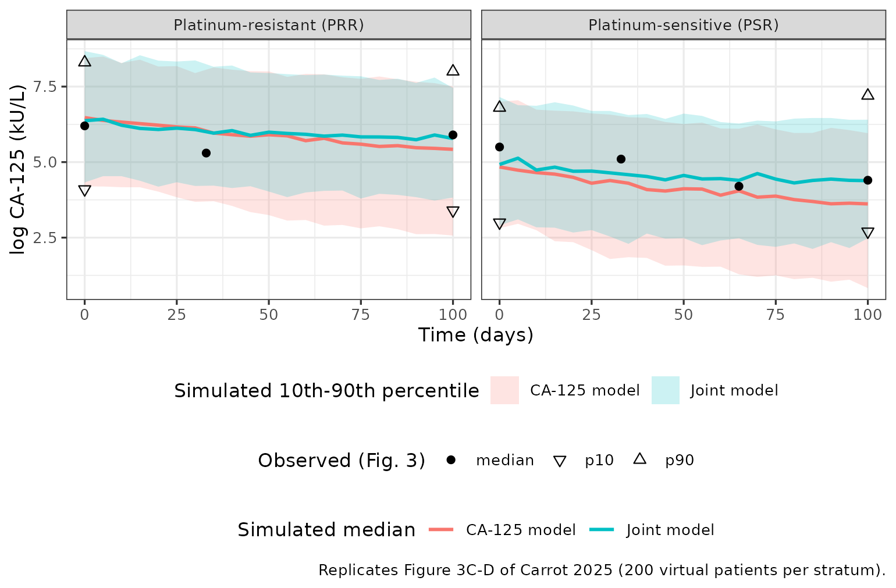
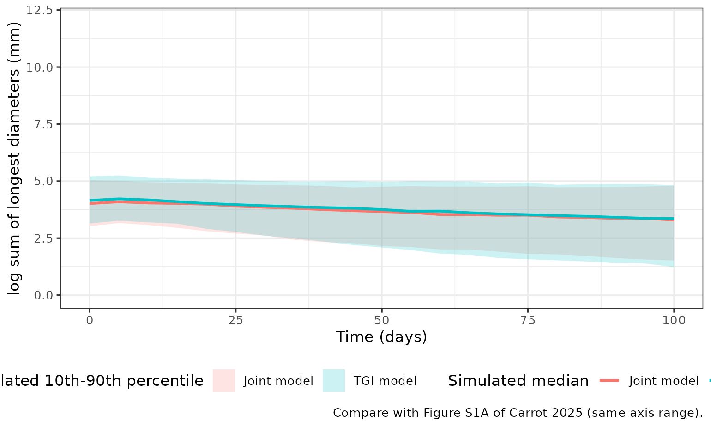
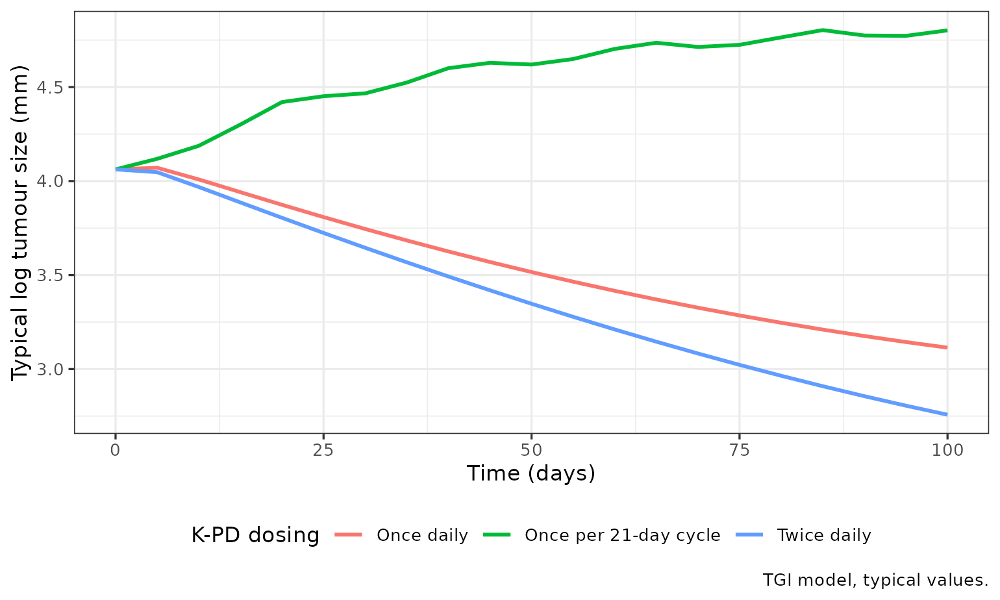

# CA-125 and tumour-size K-PD in recurrent ovarian cancer on bevacizumab + olaparib + durvalumab (Carrot 2025)

## Models and source

Carrot et al. (2025) fit three kinetic-pharmacodynamic (K-PD) models to
the first 100 treatment days of the BOLD phase II GINECO trial
(NCT04015739), in which patients with recurrent high-grade ovarian
cancer received bevacizumab, olaparib and durvalumab:

- `Carrot_2025_ovarianCancer_ca125` – the CA-125 kinetics model that
  yields the individual CA-125 elimination rate constant KELIM-B;
- `Carrot_2025_ovarianCancer_tgi` – a tumour growth inhibition (TGI)
  model of the sum of longest target-lesion diameters, fit on its own to
  check that the joint model was feasible;
- `Carrot_2025_ovarianCancer_ca125_tgi` – the joint model in the form of
  Wilbaux et al. (2014), where tumour-driven CA-125 production depends
  on the rate of change of tumour size. It yields KELIM-joint.

No drug concentrations were available, so each model uses a virtual
treatment amount: a dose of 1 arbitrary unit per administration enters a
treatment compartment (`depot`) and a transit compartment (`transit1`)
that share one rate constant K, and the transit amount inhibits CA-125
production (CA-125 model) or tumour proliferation (TGI and joint models)
through `1 - transit1 / (EC50 + transit1)`.

``` r

mod_ca <- readModelDb("Carrot_2025_ovarianCancer_ca125")
mod_ts <- readModelDb("Carrot_2025_ovarianCancer_tgi")
mod_joint <- readModelDb("Carrot_2025_ovarianCancer_ca125_tgi")
```

- Citation: Carrot A, Corbaux P, Colomban O, Lebreton C, Gladieff L,
  Tredan O, Selle F, Abdeddaim C, Leary A, D’Hondt V, Dubot C, Reverdy
  T, You B, Freyer G. Prognostic Value of a Joint K-PD Model With Tumor
  Size Dynamics and CA-125 Kinetics in Recurrent Ovarian Cancer
  Patients: BOLD Phase II GINECO Study. CPT Pharmacometrics Syst
  Pharmacol. 2025;14(8):1310-1321. <doi:10.1002/psp4.70025>
- Article: <https://doi.org/10.1002/psp4.70025>
- Predecessor joint model in this package:
  `Wilbaux_2014_ovarianCancer_ca125`

## Population

The analysis used 50 of the 74 BOLD patients: those with at least three
CA-125 values and at least two tumour-size measurements in the first 100
days (Figure 2). All had recurrent high-grade ovarian cancer after at
least one line of platinum-taxane chemotherapy; 28 had a
platinum-resistant relapse (PRR, progression less than 6 months after
the last platinum dose) and 22 a platinum-sensitive relapse (PSR). Table
1 gives FIGO stage III in 50.0% (PRR) and 72.7% (PSR), BRCA1/2-mutated
tumours in 3.6% and 36.4%, and three or more previous chemotherapy lines
in 53.5% and 50.0%. The data comprised 198 CA-125 values (median 4 per
patient) and 120 tumour sizes (median 2 per patient). Lesion diameters
below the 10 mm quantification limit (3.92% of values) were set to half
the limit. Age and body size are not reported.

The platinum-sensitivity status is a covariate of the CA-125 and joint
models: each estimates a separate typical baseline CA-125 and a separate
typical KELIM for PRR and PSR. It is supplied as the binary column
`PLATINUM_RESISTANT` (1 = PRR, 0 = PSR). It was tested in the TGI model
and not retained.

## Source trace

| Item | Source location | Value(s) |
|----|----|----|
| K-PD treatment and transit compartments, shared rate K | Figure 1; Supplementary Material S1 | dC1/dt = -K C1; dC2/dt = K C1 - K C2 |
| Inhibitory effect | Supplementary Material S1 | EFFECT = 1 - C2/(EC50 + C2) |
| CA-125 model ODE | Supplementary Material S1 | dC3/dt = KPROD EFFECT - KELIM C3 |
| TGI ODE | Methods 2.2; Supplementary Material S1 (joint model, tumour part) | dC3/dt = KPROL EFFECT - KREDUC C3 |
| Joint-model CA-125 ODE | Supplementary Material S1 | dC4/dt = KPROD1 + KPROD2 exp(K2 VARTS) - KELIM C4, VARTS = dC3/dt |
| Initial conditions | Supplementary Material S1 | C1(0) = C2(0) = 0; C3(0) = TS0 or CA-125_0; C4(0) = CA-125_0 |
| PRR / PSR selection of CA-125_0 and KELIM | Results 3.2; Supplementary Material S1 | ‘KELIM = KELIM_PRR if Cohort = PRR, KELIM_PSR if Cohort = PSR’ |
| Log-normal IIV, Table 2 IIV = omega^2 | Methods Eq. 2 | P_i = theta exp(eta_i), eta ~ N(0, omega^2) |
| Residual error W, additive on log-transformed data | Methods 2.2 and Eq. 1; Table 2 | `lnorm()` |
| CA-125 model parameters | Table 2, ‘CA-125 Kinetics model’ | K 1.16, KPROD 1.06, EC50 0.29, CA-125_0 559 / 141, KELIM 0.01 / 0.02, W 0.29 |
| CA-125 model IIV | Table 2 | K 1.26, KPROD 2.92, EC50 0.31, CA-125_0 2.75, KELIM 1.67 |
| TGI model parameters | Table 2, ‘TGI model’ | K 0.33, EC50 0.29, TS0 58.1, KREDUC 0.02, KPROL 3.67, W 0.084 |
| TGI model IIV | Table 2 | K 0.83, EC50 0.55, TS0 0.61, KREDUC 0.82, KPROL 1.73 |
| Joint model parameters | Table 2, ‘Joint model’ | K 0.30, EC50 0.40, TS0 57.8, KREDUC 0.02, KPROL 3.35, KPROD1 0.19, KPROD2 1.43, CA-125_0 567 / 144, KELIM 0.01 / 0.03, K2 0.18, W TS 0.084, W CA 0.29 |
| Joint model IIV | Table 2 | K 0.09, EC50 2.79, TS0 0.61, KREDUC 0.49, KPROL 0.81, KPROD1 1.51, KPROD2 1.71, CA-125_0 2.72, KELIM 1.93, K2 0.13 |
| Median individual KELIM by stratum | Results 3.2 | KELIM-B 0.0092 (PRR) / 0.029 (PSR); KELIM-joint 0.013 / 0.042 day^-1 |

Where Table 2 gives two values the first is PRR and the second PSR.

## Virtual cohort and dosing

The virtual cohort has 200 PRR and 200 PSR patients; no other covariate
enters the models. The paper fixes the K-PD dose at 1 for each treatment
administration but does not state how often an administration is
counted. The simulations below give one dose of 1 a.u. per day for 100
days, matching continuous daily oral olaparib. The section
‘Dosing-frequency sensitivity’ shows why that reading fits the paper and
a once-per-cycle dose does not.

``` r

n_per_arm <- 200
obs_times <- seq(0, 100, by = 5)

cohort <- data.frame(
  id = seq_len(2 * n_per_arm),
  PLATINUM_RESISTANT = rep(c(1L, 0L), each = n_per_arm)
)

make_events <- function(cohort, states, dose_times = 0:99) {
  doses <- merge(cohort, data.frame(time = dose_times)) |>
    mutate(evid = 1L, amt = 1, cmt = "depot")
  obs <- merge(
    cohort,
    expand.grid(time = obs_times, cmt = states, stringsAsFactors = FALSE)
  ) |>
    mutate(evid = 0L, amt = NA_real_)
  bind_rows(doses, obs) |>
    arrange(id, time, desc(evid))
}

ev_ca <- make_events(cohort, "ca125")
ev_ts <- make_events(cohort, "tumor_size")
ev_joint <- make_events(cohort, c("tumor_size", "ca125"))
```

## Simulation

``` r

rxode2::rxSetSeed(20250707)
sim_ca <- rxode2::rxSolve(
  mod_ca,
  events = ev_ca,
  keep = "PLATINUM_RESISTANT",
  returnType = "data.frame"
)
#> ℹ parameter labels from comments will be replaced by 'label()'
sim_ts <- rxode2::rxSolve(
  mod_ts,
  events = ev_ts,
  keep = "PLATINUM_RESISTANT",
  returnType = "data.frame"
)
#> ℹ parameter labels from comments will be replaced by 'label()'
sim_joint <- rxode2::rxSolve(
  mod_joint,
  events = ev_joint,
  keep = "PLATINUM_RESISTANT",
  returnType = "data.frame"
)
#> ℹ parameter labels from comments will be replaced by 'label()'

stratum_label <- function(x) {
  factor(
    ifelse(x == 1, "Platinum-resistant (PRR)", "Platinum-sensitive (PSR)"),
    levels = c("Platinum-resistant (PRR)", "Platinum-sensitive (PSR)")
  )
}

# CMT in the joint-model output is the endpoint's state number:
# 3 = tumor_size, 4 = ca125.
ca_long <- bind_rows(
  sim_ca |> mutate(model = "CA-125 model"),
  sim_joint |> filter(CMT == 4) |> mutate(model = "Joint model")
) |>
  mutate(stratum = stratum_label(PLATINUM_RESISTANT))

ts_long <- bind_rows(
  sim_ts |> mutate(model = "TGI model"),
  sim_joint |> filter(CMT == 3) |> mutate(model = "Joint model")
) |>
  mutate(stratum = stratum_label(PLATINUM_RESISTANT))
```

## Replicate published figures

### Figure 3C-D: CA-125 visual predictive check

The observed median and 10th / 90th percentiles of log CA-125 in Figure
3C-D were digitised by the maintainers from the published figure
(approximate, read to about 0.2 log units) and are overlaid as points.

``` r

fig3_obs <- tribble(
  ~stratum, ~time, ~stat, ~value,
  "Platinum-resistant (PRR)", 0, "median", 6.2,
  "Platinum-resistant (PRR)", 33, "median", 5.3,
  "Platinum-resistant (PRR)", 100, "median", 5.9,
  "Platinum-resistant (PRR)", 0, "p10", 4.1,
  "Platinum-resistant (PRR)", 100, "p10", 3.4,
  "Platinum-resistant (PRR)", 0, "p90", 8.3,
  "Platinum-resistant (PRR)", 100, "p90", 8.0,
  "Platinum-sensitive (PSR)", 0, "median", 5.5,
  "Platinum-sensitive (PSR)", 33, "median", 5.1,
  "Platinum-sensitive (PSR)", 65, "median", 4.2,
  "Platinum-sensitive (PSR)", 100, "median", 4.4,
  "Platinum-sensitive (PSR)", 0, "p10", 3.0,
  "Platinum-sensitive (PSR)", 100, "p10", 2.7,
  "Platinum-sensitive (PSR)", 0, "p90", 6.8,
  "Platinum-sensitive (PSR)", 100, "p90", 7.2
) |>
  mutate(stratum = factor(stratum, levels = levels(ca_long$stratum)))
```

``` r

ca_pct <- ca_long |>
  group_by(model, stratum, time) |>
  summarise(
    p10 = quantile(log(sim), 0.10),
    median = median(log(sim)),
    p90 = quantile(log(sim), 0.90),
    .groups = "drop"
  )

ggplot(ca_pct, aes(time)) +
  geom_ribbon(aes(ymin = p10, ymax = p90, fill = model), alpha = 0.2) +
  geom_line(aes(y = median, colour = model), linewidth = 0.9) +
  geom_point(
    data = fig3_obs,
    aes(time, value, shape = stat),
    inherit.aes = FALSE,
    size = 2
  ) +
  facet_wrap(~stratum) +
  scale_shape_manual(values = c(median = 16, p10 = 6, p90 = 2)) +
  labs(
    x = "Time (days)",
    y = "log CA-125 (kU/L)",
    colour = "Simulated median",
    fill = "Simulated 10th-90th percentile",
    shape = "Observed (Fig. 3)",
    caption = "Replicates Figure 3C-D of Carrot 2025 (200 virtual patients per stratum)."
  ) +
  theme_bw() +
  theme(legend.position = "bottom", legend.box = "vertical")
```



### Figure S1A: tumour-size dynamics

Figure S1A shows a lowess of the observed log tumour size falling by
about 0.6 log units over the first 80 days in both strata. The simulated
median log tumour size of both the TGI and the joint model falls by a
similar amount.

``` r

ts_pct <- ts_long |>
  group_by(model, time) |>
  summarise(
    p10 = quantile(log(sim), 0.10),
    median = median(log(sim)),
    p90 = quantile(log(sim), 0.90),
    .groups = "drop"
  )

ggplot(ts_pct, aes(time)) +
  geom_ribbon(aes(ymin = p10, ymax = p90, fill = model), alpha = 0.2) +
  geom_line(aes(y = median, colour = model), linewidth = 0.9) +
  coord_cartesian(ylim = c(0, 12)) +
  labs(
    x = "Time (days)",
    y = "log sum of longest diameters (mm)",
    colour = "Simulated median",
    fill = "Simulated 10th-90th percentile",
    caption = "Compare with Figure S1A of Carrot 2025 (same axis range)."
  ) +
  theme_bw() +
  theme(legend.position = "bottom")
```



``` r


ts_pct |>
  filter(time %in% c(0, 40, 80, 100)) |>
  select(model, time, median) |>
  tidyr::pivot_wider(names_from = time, values_from = median, names_prefix = "day_") |>
  dplyr::rename(
    "Model" = model,
    "Day 0" = day_0,
    "Day 40" = day_40,
    "Day 80" = day_80,
    "Day 100" = day_100
  ) |>
  knitr::kable(digits = 2, caption = "Simulated median log tumour size (mm).")
```

| Model       | Day 0 | Day 40 | Day 80 | Day 100 |
|:------------|------:|-------:|-------:|--------:|
| Joint model |  4.02 |   3.75 |   3.43 |    3.29 |
| TGI model   |  4.15 |   3.84 |   3.49 |    3.36 |

Simulated median log tumour size (mm). {.table}

## Individual KELIM

KELIM-B and KELIM-joint are the individual CA-125 elimination rate
constants the paper relates to survival. Results 3.2 reports their
medians by stratum from the empirical Bayes estimates. The simulated
medians below are of the individual `kout`, which centre on the Table 2
typical values (0.01 and 0.02 / 0.03 day^-1, printed to two decimals).
The median EBEs are shrunk towards the typical value (KELIM shrinkage
22.5% and 18.3%), so the two are expected to agree in order of magnitude
and in the PRR \< PSR ordering rather than exactly.

``` r

kelim_sim <- bind_rows(
  sim_ca |> mutate(model = "KELIM-B (CA-125 model)"),
  sim_joint |> mutate(model = "KELIM-joint (Joint model)")
) |>
  distinct(model, id, PLATINUM_RESISTANT, kout) |>
  group_by(model, PLATINUM_RESISTANT) |>
  summarise(simulated = median(kout), .groups = "drop")

kelim_ref <- tribble(
  ~model, ~PLATINUM_RESISTANT, ~published,
  "KELIM-B (CA-125 model)", 1L, 0.0092,
  "KELIM-B (CA-125 model)", 0L, 0.029,
  "KELIM-joint (Joint model)", 1L, 0.013,
  "KELIM-joint (Joint model)", 0L, 0.042
)

kelim_tab <- kelim_sim |>
  left_join(kelim_ref, by = c("model", "PLATINUM_RESISTANT")) |>
  mutate(stratum = as.character(stratum_label(PLATINUM_RESISTANT)))

kelim_tab |>
  select(model, stratum, simulated, published) |>
  dplyr::rename(
    "Parameter" = model,
    "Stratum" = stratum,
    "Simulated median kout (1/day)" = simulated,
    "Published median EBE (1/day)" = published
  ) |>
  knitr::kable(digits = 4)
```

| Parameter | Stratum | Simulated median kout (1/day) | Published median EBE (1/day) |
|:---|:---|---:|---:|
| KELIM-B (CA-125 model) | Platinum-sensitive (PSR) | 0.0181 | 0.0290 |
| KELIM-B (CA-125 model) | Platinum-resistant (PRR) | 0.0102 | 0.0092 |
| KELIM-joint (Joint model) | Platinum-sensitive (PSR) | 0.0229 | 0.0420 |
| KELIM-joint (Joint model) | Platinum-resistant (PRR) | 0.0104 | 0.0130 |

## Validation checks

These models describe a biomarker and a tumour burden driven by a
virtual treatment amount, so there are no drug concentrations to analyse
with PKNCA. The checks below follow the steady-state, closed-form and
centre-of-cohort patterns used for endogenous and mechanistic models.

``` r

# 1. Initial conditions reproduce the stratum-specific typical baselines
#    (same parameters on both sides, so the tolerance is tight).
typ_ev <- make_events(
  data.frame(id = 1:2, PLATINUM_RESISTANT = c(1L, 0L)),
  "ca125"
)
# Typical-value solves run one subject at a time: zeroRe() removes the
# random effects, and rxode2 warns about a multi-subject solve without them.
solve_typical <- function(mod, events) {
  bind_rows(lapply(split(events, events$id), function(ev) {
    rxode2::rxSolve(
      rxode2::zeroRe(mod),
      events = ev,
      keep = "PLATINUM_RESISTANT",
      returnType = "data.frame"
    )
  }))
}
typ_ca <- solve_typical(mod_ca, typ_ev)
#> ℹ parameter labels from comments will be replaced by 'label()'
#> ℹ omega/sigma items treated as zero: 'etalkel', 'etalkin', 'etalec50', 'etalrbase_ca125', 'etalkout'
#> ℹ parameter labels from comments will be replaced by 'label()'
#> ℹ omega/sigma items treated as zero: 'etalkel', 'etalkin', 'etalec50', 'etalrbase_ca125', 'etalkout'
base_ca <- typ_ca |> filter(time == 0)
stopifnot(
  abs(base_ca$ca125[base_ca$PLATINUM_RESISTANT == 1] / 559 - 1) < 1e-6,
  abs(base_ca$ca125[base_ca$PLATINUM_RESISTANT == 0] / 141 - 1) < 1e-6
)

# 2. Without treatment the CA-125 model is linear:
#    CA125(t) = KPROD/KELIM + (CA125_0 - KPROD/KELIM) exp(-KELIM t).
notx_ca <- solve_typical(mod_ca, typ_ev |> filter(evid == 0)) |>
  mutate(
    kelim = ifelse(PLATINUM_RESISTANT == 1, 0.01, 0.02),
    ca0 = ifelse(PLATINUM_RESISTANT == 1, 559, 141),
    closed = 1.06 / kelim + (ca0 - 1.06 / kelim) * exp(-kelim * time)
  )
#> ℹ parameter labels from comments will be replaced by 'label()'
#> ℹ omega/sigma items treated as zero: 'etalkel', 'etalkin', 'etalec50', 'etalrbase_ca125', 'etalkout'
#> ℹ parameter labels from comments will be replaced by 'label()'
#> ℹ omega/sigma items treated as zero: 'etalkel', 'etalkin', 'etalec50', 'etalrbase_ca125', 'etalkout'
stopifnot(max(abs(notx_ca$ca125 / notx_ca$closed - 1)) < 1e-4)

# 3. Without treatment the TGI model approaches KPROL / KREDUC:
#    TS(t) = KPROL/KREDUC + (TS0 - KPROL/KREDUC) exp(-KREDUC t).
notx_ts <- rxode2::rxSolve(
  rxode2::zeroRe(mod_ts),
  events = data.frame(
    id = 1L,
    time = obs_times,
    evid = 0L,
    amt = NA_real_,
    cmt = "tumor_size"
  ),
  returnType = "data.frame"
) |>
  mutate(closed = 3.67 / 0.02 + (58.1 - 3.67 / 0.02) * exp(-0.02 * time))
#> ℹ parameter labels from comments will be replaced by 'label()'
#> ℹ omega/sigma items treated as zero: 'etalkel', 'etalec50', 'etalrbase_tumor_size', 'etalkreduc', 'etalkprol'
stopifnot(max(abs(notx_ts$tumor_size / notx_ts$closed - 1)) < 1e-4)

# 4. Cohort centre: the simulated median log CA-125 at day 0 sits on the
#    stratum's typical baseline, and the median individual KELIM on the
#    stratum's typical KELIM. A mis-transcribed baseline or KELIM moves these
#    by far more than the tolerance.
base_med <- ca_long |>
  filter(time == 0) |>
  group_by(model, PLATINUM_RESISTANT) |>
  summarise(med = median(log(ipredSim)), .groups = "drop") |>
  mutate(
    typical = case_when(
      model == "CA-125 model" & PLATINUM_RESISTANT == 1 ~ log(559),
      model == "CA-125 model" ~ log(141),
      PLATINUM_RESISTANT == 1 ~ log(567),
      TRUE ~ log(144)
    )
  )
stopifnot(all(abs(base_med$med - base_med$typical) < 0.35))

kelim_typ <- c(0.01, 0.02, 0.01, 0.03)
kelim_chk <- kelim_tab |>
  arrange(model, desc(PLATINUM_RESISTANT)) |>
  mutate(typical = kelim_typ)
stopifnot(all(abs(log(kelim_chk$simulated / kelim_chk$typical)) < 0.3))

# 5. Treatment shrinks the typical tumour: under daily dosing the typical
#    log tumour size falls between day 0 and day 80, as in Figure S1A.
typ_ts <- rxode2::rxSolve(
  rxode2::zeroRe(mod_ts),
  events = make_events(data.frame(id = 1L, PLATINUM_RESISTANT = 0L), "tumor_size"),
  returnType = "data.frame"
)
#> ℹ parameter labels from comments will be replaced by 'label()'
#> ℹ omega/sigma items treated as zero: 'etalkel', 'etalec50', 'etalrbase_tumor_size', 'etalkreduc', 'etalkprol'
ts_fall <- log(typ_ts$tumor_size[typ_ts$time == 0]) -
  log(typ_ts$tumor_size[typ_ts$time == 80])
stopifnot(ts_fall > 0.3, ts_fall < 1.5)
```

All checks pass. The typical tumour size falls by 0.82 log units between
day 0 and day 80.

## Dosing-frequency sensitivity

The K-PD dose unit is fixed at 1 per administration, but the
administration frequency changes the predicted trajectories. With K =
0.33 day^-1 in the TGI model a dose given once per 21-day cycle washes
out within days, and the tumour then grows towards KPROL / KREDUC = 184
mm. Only daily or twice-daily dosing gives the tumour shrinkage seen in
Figure S1A; daily dosing is the closer of the two.

``` r

dose_schedules <- list(
  "Twice daily" = seq(0, 99.5, by = 0.5),
  "Once daily" = 0:99,
  "Once per 21-day cycle" = seq(0, 99, by = 21)
)
freq_sim <- bind_rows(lapply(names(dose_schedules), function(nm) {
  ev <- make_events(
    data.frame(id = 1L, PLATINUM_RESISTANT = 0L),
    "tumor_size",
    dose_times = dose_schedules[[nm]]
  )
  rxode2::rxSolve(rxode2::zeroRe(mod_ts), events = ev, returnType = "data.frame") |>
    mutate(schedule = nm)
}))
#> ℹ parameter labels from comments will be replaced by 'label()'
#> ℹ omega/sigma items treated as zero: 'etalkel', 'etalec50', 'etalrbase_tumor_size', 'etalkreduc', 'etalkprol'
#> ℹ parameter labels from comments will be replaced by 'label()'
#> ℹ omega/sigma items treated as zero: 'etalkel', 'etalec50', 'etalrbase_tumor_size', 'etalkreduc', 'etalkprol'
#> ℹ parameter labels from comments will be replaced by 'label()'
#> ℹ omega/sigma items treated as zero: 'etalkel', 'etalec50', 'etalrbase_tumor_size', 'etalkreduc', 'etalkprol'

ggplot(freq_sim, aes(time, log(tumor_size), colour = schedule)) +
  geom_line(linewidth = 0.9) +
  labs(
    x = "Time (days)",
    y = "Typical log tumour size (mm)",
    colour = "K-PD dosing",
    caption = "TGI model, typical values."
  ) +
  theme_bw() +
  theme(legend.position = "bottom")
```



## Assumptions and deviations

- **K-PD dosing frequency.** The paper fixes the virtual dose at 1 per
  administration but does not say how often an administration is
  counted. The simulations give one dose per day. Once-per-cycle dosing
  predicts tumour growth, contrary to Figure S1A (see the sensitivity
  section). The dosing is a property of the event table, not of the
  model files.
- **Table 2 IIV column is a variance.** Methods Eq. 2 defines the random
  effects as eta ~ N(0, omega^2) and the Table 2 IIV column is read as
  omega^2. Reading it as a standard deviation instead would make the
  10th-90th percentile spread of baseline log CA-125 about 7 log units,
  against about 4.2 observed in Figure 3C. The variance reading gives
  about 4.3.
- **One IIV per parameter across strata.** Table 2 prints the same IIV,
  RSE and shrinkage on the PRR and PSR rows of CA-125_0 and KELIM, so
  each model has a single eta for each of them.
- **Stratum-specific typical values.** Baseline CA-125 and KELIM are
  coded as two typical values selected by `PLATINUM_RESISTANT`
  (`lrbase_ca125_resistant` / `lrbase_ca125_sensitive`,
  `lkout_resistant` / `lkout_sensitive`), as the paper estimated them,
  rather than as a reference value plus an offset.
- **Rounded KELIM.** Table 2 prints the typical KELIM values to two
  decimals (0.01, 0.02, 0.03 day^-1); the model uses them as printed.
  The median individual values in Results 3.2 (0.0092 / 0.029 and 0.013
  / 0.042) are of the same magnitude.
- **CA-125 units.** Table 2 labels CA-125_0 and KPROD in ‘kU.mL^-1’. A
  baseline of 559 kU/mL would be 559,000 U/mL, far above the observed
  range in Figure 3 (log CA-125 up to about 10, i.e. about 22,000). The
  values are read as kU/L, which equals the conventional U/mL.
- **Residual error.** CA-125 and tumour size were log-transformed and W
  is an additive error on the log scale, encoded as `lnorm()`. The
  below-LOQ tumour sizes were imputed at LOQ/2 in the data, which is a
  data-handling step and not part of the model.
- **Survival models not extracted.** The Cox models of Table 3 and Table
  S2 relate PFS and OS to KELIM dichotomised at its median. They report
  hazard ratios but no baseline hazard, so they cannot be simulated and
  are not included.
- **Single-output observation name.**
  [`checkModelConventions()`](https://nlmixr2.github.io/nlmixr2lib/reference/checkModelConventions.md)
  warns that `ca125` is not a registered single-output name for
  `Carrot_2025_ovarianCancer_ca125`. CA-125 is the measured biomarker
  and the ODE state itself, the same name the joint model and
  `Wilbaux_2014_ovarianCancer_ca125` use, so it is kept.
- **No erratum.** No correction to Carrot 2025 was found in Europe PMC
  as of 2026-11-10.
