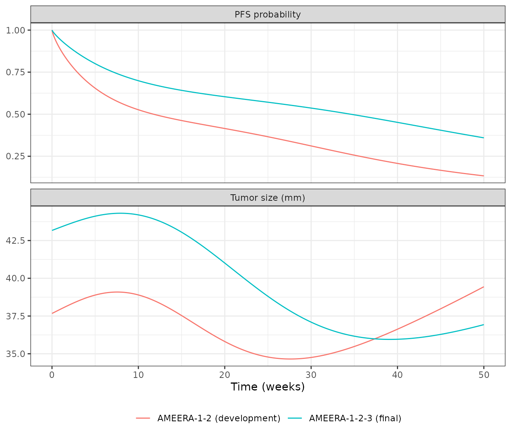
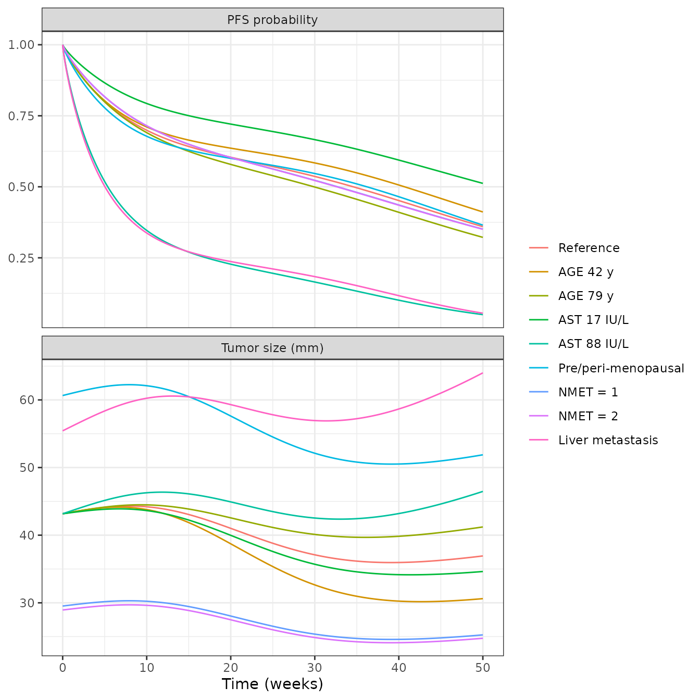
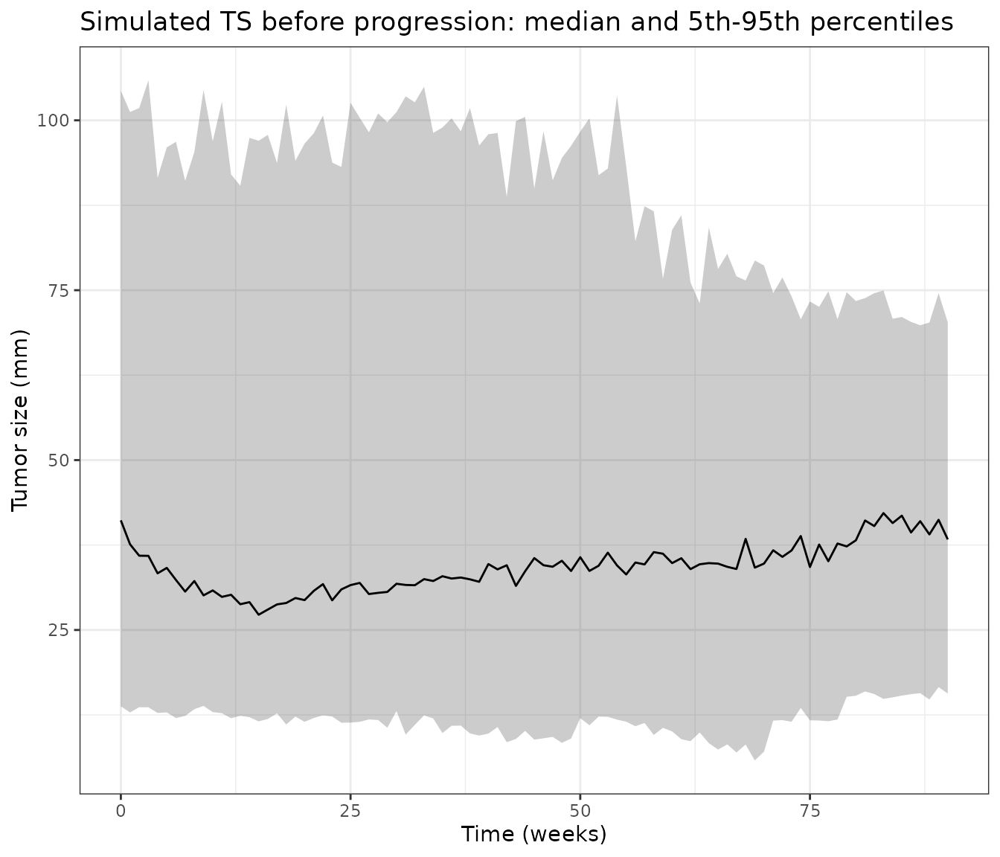
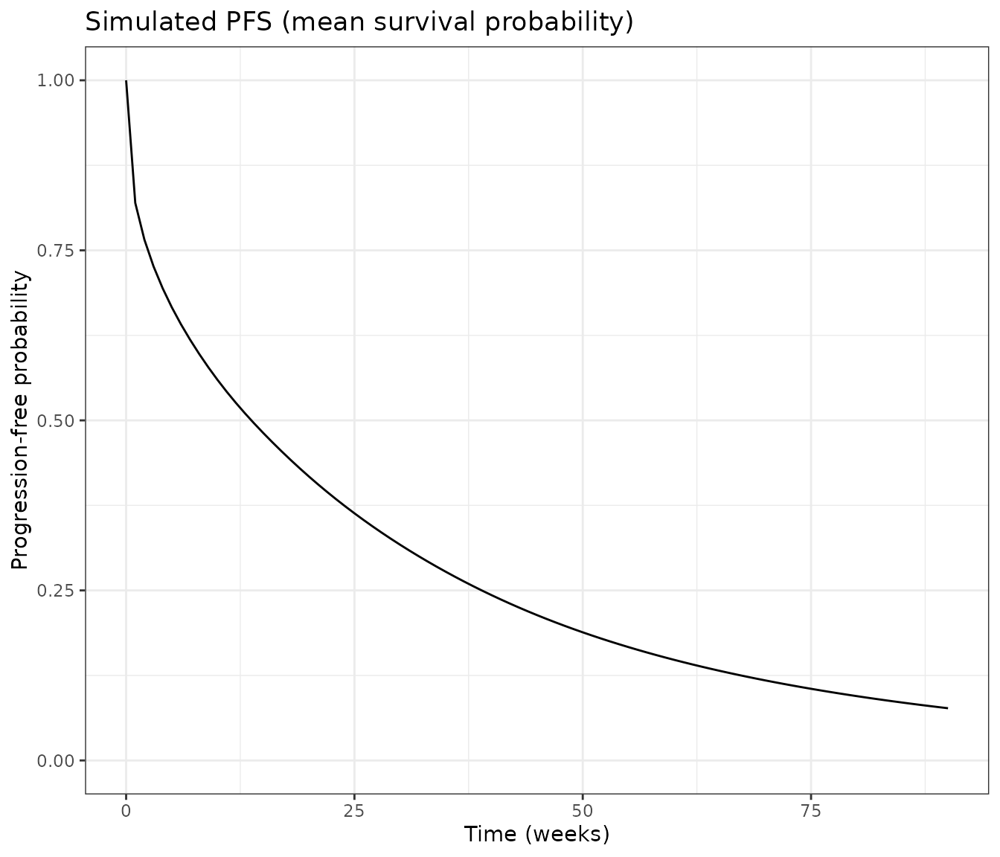

# Amcenestrant tumor dynamics and PFS (Cerou 2024)

## Model and source

- Citation: Cerou M, Thai HT, Deyme L, Fliscounakis-Huynh S,
  Cartot-Cotton S, Veyrat-Follet C. Joint modeling of tumor dynamics and
  progression-free survival in advanced breast cancer: Leveraging data
  from amcenestrant early phase I-II trials. CPT Pharmacometrics Syst
  Pharmacol. 2024;13(6):941-953. <doi:10.1002/psp4.13128>
- Article: <https://doi.org/10.1002/psp4.13128> (open access; Data S1
  holds Tables S1-S3 and the Monolix model file)

Cerou 2024 built a joint model of target-lesion tumor size (TS, RECIST
1.1 sum of longest diameters) and progression-free survival (PFS) for
the oral selective estrogen receptor degrader amcenestrant. The paper
reports two complete, jointly fitted models with the same structure, and
both are packaged:

| Model | Data | Role in the paper |
|----|----|----|
| `Cerou_2024_amcenestrant_ameera12` | AMEERA-1 + AMEERA-2, 75 patients | development model, externally evaluated on AMEERA-3 (Figure 2) |
| `Cerou_2024_amcenestrant` | AMEERA-1 + AMEERA-2 + AMEERA-3, 214 patients | final calibrated model (Table 3 right column, Figures 3-4) |

Structure (Methods and the Data S1 Monolix file):

- Amcenestrant PK: a dose into `depot`, three transit states and a
  two-compartment linear model, all transit steps at rate `KTR`.
- Effect delay: two first-order transit compartments at rate `ke0`, fed
  by the molar plasma concentration (molecular weight 554.48 g/mol); the
  second drives an Imax inhibition with Imax fixed to 1.
- Tumor: resistant cells `R` and treatment-sensitive cells `S`, both
  with proliferation `Kg = Ks / RE` and apoptosis `Ks`; the drug
  inhibits proliferation of the sensitive cells only. `TS = R + S`,
  `R(0) = pR * TS0`.
- PFS: Weibull baseline hazard `(s / Te) (t / Te)^(s - 1)`, multiplied
  by a covariate factor `E` and by `exp(betaL * dTS/dt)`.

**The PK enters as data.** The authors fed each patient’s
empirical-Bayes PK parameters from their amcenestrant population PK
model into Monolix as regressors (`KTR`, `CL`, `V1`, `Q`, `V2`). That
population PK model is cited only as a PAGE 2022 abstract that gives no
parameter values, and no amcenestrant population PK paper has been
published (literature check, 2026-11-09). The packaged models therefore
keep the authors’ design: the PK parameters are per-subject covariate
columns `KTR_INDIV` (1/day), `CL_INDIV` (L/day), `VC_INDIV` (L),
`Q_INDIV` (L/day) and `VP_INDIV` (L). To simulate, supply values for
these columns.

## Population

The calibration dataset (Table 1, Table 2) has 214 women with ER+/HER2-
advanced breast cancer: AMEERA-1 (non-Japanese, n = 68), AMEERA-2
(Japanese, n = 8) and the amcenestrant arm of the randomized phase II
AMEERA-3 (n = 138). Median age was 60 years (29-88); 47.2% had liver
metastases, 45.3% had metastases in three or more organs and 74.8% had
received a CDK4/6 inhibitor. Doses ranged from 20 to 600 mg once daily
(QD) or 300 mg twice daily; 194 patients (91%) received 400 mg QD. 178
patients had measurable target lesions and 36 had non-measurable disease
only. The development dataset is the 75 AMEERA-1 and AMEERA-2 patients
with measurable target lesions and at least one post-treatment
measurement.

``` r

str(readModelDb("Cerou_2024_amcenestrant")()$population)
#> List of 15
#>  $ species             : chr "human"
#>  $ n_subjects          : int 214
#>  $ n_studies           : int 3
#>  $ age_range           : chr "29-88 years"
#>  $ age_median          : chr "60 years"
#>  $ sex_female_pct      : num 100
#>  $ disease_state       : chr "ER+/HER2- advanced (locally advanced or metastatic) breast cancer"
#>  $ dose_range          : chr "amcenestrant 20-600 mg QD or 300 mg BID orally in 28-day cycles; 194/214 (91%) at 400 mg QD"
#>  $ regions             : chr "International (AMEERA-1 and AMEERA-3 non-Japanese; AMEERA-2 Japan)"
#>  $ n_measurable_ts     : int 178
#>  $ n_nonmeasurable_ts  : int 36
#>  $ liver_metastasis_pct: num 47.2
#>  $ nmet_ge3_pct        : num 45.3
#>  $ prior_cdk46_pct     : num 74.8
#>  $ notes               : chr "Calibration dataset AMEERA-1 (n = 68), AMEERA-2 (Japanese, n = 8) and the amcenestrant arm of AMEERA-3 (n = 138"| __truncated__
```

## Source trace

Every `ini()` value carries its source location as an in-file comment.
All parameter values are from Table 3; the structure is from Methods and
the Data S1 Monolix model.

| Parameter | AMEERA-1-2 (`_ameera12`) | AMEERA-1-2-3 (final) | Source |
|----|----|----|----|
| `lrbase` (TS0, mm) | 37.67 | 43.17 | Table 3 |
| `e_nmetlt3_rbase` (NMET \< 3) | -0.36 | – | Table 3 |
| `e_nmet1_rbase`, `e_nmet2_rbase` | – | -0.38, -0.40 | Table 3 |
| `e_lmet_rbase` (LIVMET) | 0.41 | 0.25 | Table 3 |
| `e_premenopausal_rbase` | – | 0.34 | Table 3 |
| `lks` (Ks, 1/day) | 0.09 fixed | 0.09 fixed | Table 3 |
| `logitre` (RE) | 0.988 | 0.992 | Table 3 |
| `e_albr_re`, `e_met_lymphnode_re`, `e_noprior_cdk46i_re` | 5.77, -0.90, 1.73 | – | Table 3 |
| `e_ast_re`, `e_lmet_re` | – | -0.57, -0.78 | Table 3 |
| `limax` (Imax) | 1 fixed | 1 fixed | Methods |
| `lic50` (IC50, umol/L) | 1.83 | 3.74 | Table 3; Results give 1014 and 2073 ng/mL |
| `lke0` (ke0, 1/day) | 0.005 fixed | 0.005 fixed | Table 3; grid search in Data S1 |
| `logitpr` (pR) | 0.714 | 0.660 | Table 3 |
| `e_age_pr` | – | 1.35 | Table 3 |
| `llam_haz` (Te, day) | 165 | 297.73 | Table 3 |
| `lk_haz` (s) | 0.79 | 0.84 | Table 3 |
| `e_tsslope_haz` (betaL, day/mm) | 10.20 | 10.73 | Table 3 |
| `e_alpr_haz` | 0.93 | – | Table 3 (beta E logtALKN) |
| `e_ast_haz`, `e_lmet_haz` | – | 0.68, 0.52 | Table 3 |
| omega TS0 / RE / pR / ke0 (SD) | 0.57 / 0.88 / 1.40 / 2.60 | 0.57 / 1.25 / 0.84 / 3.51 | Table 3 (printed x 100) |
| `addSd` (mm) / `propSd` | 0.53 / 0.0822 | 0.75 / 0.06 | Table 3 |
| Equations |  |  | Methods; Data S1 Monolix model file |

Two consistency checks on the transcription:

``` r

mw <- 554.48
ic50_ngml <- c(dev = 1.83, final = 3.74) * mw
kg <- c(dev = 0.09 / 0.988, final = 0.09 / 0.992)
ic50_ngml
#>      dev    final 
#> 1014.698 2073.755
kg
#>        dev      final 
#> 0.09109312 0.09072581
# Results: 'IC50 ... 1014 ng/mL, corresponding to ... 1.83 umol/L' and
# '3.74 umol/L (i.e., 2073 ng/mL)'; 'RE ... translates to kg of 0.091 day-1'.
stopifnot(
  abs(ic50_ngml[["dev"]] - 1014) < 2,
  abs(ic50_ngml[["final"]] - 2073) < 2,
  all(abs(kg - 0.091) < 0.0005)
)
```

## An illustrative amcenestrant PK input

The validation below needs PK parameter values. Because the authors’
population PK model is unpublished, the maintainers built a
typical-patient PK input from published noncompartmental results at 400
mg QD. The structure is the authors’ (depot, three transit states, two
compartments). CL/F is fixed to 400 mg / AUCtau at day 22 (39,800
h\*ng/mL; Tamura 2023, AMEERA-2, Table 3), and KTR, V1, Q and V2 were
chosen to match the day-22 median tmax (2.97 h), geometric-mean Cmax
(4,880 ng/mL) and a trough of 400 ng/mL, between the AMEERA-2 mean
trough (348 ng/mL, Results text) and the AMEERA-1 geometric-mean trough
at day 22 (466 ng/mL; Bardia 2022). **These values are not the authors’
population PK model.** The TGI and PFS predictions depend on PK mainly
through the average concentration (ke0 = 0.005/day averages away the
daily profile), and the average concentration is set by CL/F, which both
clinical papers report (10.1 and 10.6 L/h).

``` r

typical_pk <- data.frame(
  KTR_INDIV = 52.7, # 1/day
  CL_INDIV = 400 / 39.8 * 24, # L/day: 400 mg / AUCtau 39.8 mg*h/L
  VC_INDIV = 59.3, # L
  Q_INDIV = 64.2, # L/day
  VP_INDIV = 296 # L
)
typical_pk
#>   KTR_INDIV CL_INDIV VC_INDIV Q_INDIV VP_INDIV
#> 1      52.7  241.206     59.3    64.2      296
```

The PK part of the model is checked with PKNCA against the published
NCA. The model is linear, so day-1 exposure cannot exceed day-22
exposure; the published day-1 values are higher than day 22, which no
linear model reproduces, and the day-1 rows are shown for completeness.

``` r

mod_final <- readModelDb("Cerou_2024_amcenestrant")
ref_cov <- data.frame(
  MET_GE2 = 1, MET_GE3 = 1, LMET = 0, PREMENOPAUSAL = 0,
  AST = 28.4, AGE = 60
)
pk_obs <- sort(unique(c(seq(0, 1, by = 1 / 96), seq(21, 22, by = 1 / 96))))
pk_events <- dplyr::bind_rows(
  data.frame(
    id = 1L, time = 0, evid = 1L, amt = 400, cmt = "depot", ii = 1, addl = 21L
  ),
  data.frame(id = 1L, time = pk_obs, evid = 0L, amt = NA_real_, cmt = "central")
) |>
  dplyr::arrange(time, dplyr::desc(evid)) |>
  dplyr::bind_cols(typical_pk, ref_cov)

pk_sim <- rxode2::rxSolve(
  rxode2::zeroRe(mod_final), pk_events,
  returnType = "data.frame", method = "lsoda"
) |>
  # rxSolve() drops the id column for a single-subject solve
  dplyr::mutate(id = 1L, treatment = "400 mg QD")
#> ℹ parameter labels from comments will be replaced by 'label()'
#> ℹ omega/sigma items treated as zero: 'etalrbase', 'etalogitre', 'etalogitpr', 'etalke0'
```

``` r

conc <- pk_sim |>
  dplyr::filter(!is.na(Cc)) |>
  dplyr::transmute(id, treatment, time_h = time * 24, Cc = Cc * 1000) |> # ng/mL
  dplyr::distinct(id, treatment, time_h, .keep_all = TRUE)
dose <- data.frame(id = 1L, treatment = "400 mg QD", time_h = (0:21) * 24, amt = 400)

o_conc <- PKNCA::PKNCAconc(conc, Cc ~ time_h | treatment + id)
o_dose <- PKNCA::PKNCAdose(dose, amt ~ time_h | treatment + id)
intervals <- data.frame(
  start = c(0, 504), end = c(24, 528),
  cmax = TRUE, tmax = TRUE, auclast = TRUE, cmin = c(FALSE, TRUE),
  day = c("Day 1", "Day 22")
)
nca <- PKNCA::pk.nca(PKNCA::PKNCAdata(o_conc, o_dose, intervals = intervals[, 1:6]))
nca_res <- as.data.frame(nca) |>
  dplyr::mutate(treatment = ifelse(start == 0, "Day 1", "Day 22"))

# Tamura 2023 (AMEERA-2), 400 mg QD: Table 3 geometric means (tmax median);
# the day-22 trough is the arithmetic mean in the Results text (348 +/- 83.7).
reference <- data.frame(
  treatment = c("Day 1", "Day 22"),
  cmax = c(5500, 4880),
  tmax = c(2.90, 2.97),
  auclast = c(48500, 39800),
  cmin = c(NA, 348)
)
cmp <- nlmixr2lib::ncaComparisonTable(
  simulated = nca_res,
  reference = reference,
  by = "treatment",
  units = c(cmax = "ng/mL", tmax = "h", auclast = "h*ng/mL", cmin = "ng/mL")
)
knitr::kable(cmp, caption = "Illustrative typical PK against the AMEERA-2 NCA at 400 mg QD.")
```

| NCA parameter      | treatment | Reference | Simulated | % diff   |
|:-------------------|:----------|:----------|:----------|:---------|
| Cmax (ng/mL)       | Day 1     | 5500      | 4510      | -17.9%   |
| Cmax (ng/mL)       | Day 22    | 4880      | 4870      | -0.2%    |
| Cmin (ng/mL)       | Day 22    | 348       | 393       | +12.9%   |
| Tmax (h)           | Day 1     | 2.9       | 3         | +3.4%    |
| Tmax (h)           | Day 22    | 2.97      | 3         | +1.0%    |
| AUClast (h\*ng/mL) | Day 1     | 48500     | 31900     | -34.2%\* |
| AUClast (h\*ng/mL) | Day 22    | 39800     | 39600     | -0.6%    |

Illustrative typical PK against the AMEERA-2 NCA at 400 mg QD. {.table}

The day-22 Cmax, tmax and AUCtau match by construction, and the day-22
trough (about 390 ng/mL) sits between the AMEERA-2 (348 ng/mL) and
AMEERA-1 (466 ng/mL) values.

``` r

d22 <- nca_res |>
  dplyr::filter(treatment == "Day 22") |>
  dplyr::select(PPTESTCD, PPORRES) |>
  tidyr::pivot_wider(names_from = PPTESTCD, values_from = PPORRES)
stopifnot(
  abs(d22$auclast / 39800 - 1) < 0.03,
  abs(d22$cmax / 4880 - 1) < 0.05,
  d22$cmin > 348, d22$cmin < 466
)
```

## Typical-patient tumor and PFS trajectories

``` r

# One subject dosed 400 mg QD for `days`; observations every half day on the
# sensitive-cell state (TS, the hazard and survival are computed alongside).
make_events <- function(days, covs, obs_step = 0.5, id = 1L) {
  obs <- seq(0, days, by = obs_step)
  dplyr::bind_rows(
    data.frame(id = id, time = 0, evid = 1L, amt = 400, cmt = "depot", ii = 1, addl = days - 1L),
    data.frame(id = id, time = obs, evid = 0L, amt = NA_real_, cmt = "tumor_sensitive")
  ) |>
    dplyr::arrange(time, dplyr::desc(evid)) |>
    dplyr::bind_cols(typical_pk, covs[rep(1, length(obs) + 1), , drop = FALSE])
}
# `lsoda` is used throughout: the default `liblsoda` fails ("could not solve
# the system") on runs longer than about 250 days whose observation times
# coincide with the daily doses.
solve_typical <- function(model, events) {
  rxode2::rxSolve(rxode2::zeroRe(model), events, returnType = "data.frame", method = "lsoda")
}
```

``` r

mod_dev <- readModelDb("Cerou_2024_amcenestrant_ameera12")
ref_cov_dev <- data.frame(MET_GE3 = 1, LMET = 0, MET_LYMPHNODE = 0, PRIOR_CDK46I = 1, ALBR = 0.74, ALPR = 0.89)

typ <- dplyr::bind_rows(
  solve_typical(mod_final, make_events(350, ref_cov)) |> dplyr::mutate(model = "AMEERA-1-2-3 (final)"),
  solve_typical(mod_dev, make_events(350, ref_cov_dev)) |> dplyr::mutate(model = "AMEERA-1-2 (development)")
) |>
  dplyr::mutate(week = time / 7)
#> ℹ parameter labels from comments will be replaced by 'label()'
#> ℹ omega/sigma items treated as zero: 'etalrbase', 'etalogitre', 'etalogitpr', 'etalke0'
#> ℹ parameter labels from comments will be replaced by 'label()'
#> ℹ omega/sigma items treated as zero: 'etalrbase', 'etalogitre', 'etalogitpr', 'etalke0'

onset <- typ |>
  dplyr::group_by(model) |>
  dplyr::arrange(time, .by_group = TRUE) |>
  dplyr::summarise(
    sensitive_decline_week = week[which(diff(tumor_sensitive) < 0)[1]],
    ts_peak_week = week[which.max(TS * (week < 20))],
    ts_peak = max(TS[week < 20]),
    ts_nadir_week = week[which.min(TS)],
    ts_nadir = min(TS),
    pfs_week50 = surv[which.min(abs(week - 50))]
  )
knitr::kable(onset, digits = 2, caption = "Typical-patient landmarks at 400 mg QD (reference covariates).")
```

| model | sensitive_decline_week | ts_peak_week | ts_peak | ts_nadir_week | ts_nadir | pfs_week50 |
|:---|---:|---:|---:|---:|---:|---:|
| AMEERA-1-2 (development) | 3.71 | 7.57 | 39.09 | 27.57 | 34.65 | 0.13 |
| AMEERA-1-2-3 (final) | 4.36 | 7.93 | 44.31 | 39.14 | 35.95 | 0.36 |

Typical-patient landmarks at 400 mg QD (reference covariates). {.table
style="width:100%;"}

``` r

typ |>
  dplyr::select(week, model, `Tumor size (mm)` = TS, `PFS probability` = surv) |>
  tidyr::pivot_longer(-c(week, model)) |>
  ggplot(aes(week, value, colour = model)) +
  geom_line() +
  facet_wrap(~name, ncol = 1, scales = "free_y") +
  labs(x = "Time (weeks)", y = NULL, colour = NULL) +
  theme_bw() +
  theme(legend.position = "bottom")
```



The paper states that for a typical patient on 400 mg QD “the delay to
observe the TS decrease was about 4.6 weeks” with the final model and
“about 1.5 weeks” with the development model. Reading “TS decrease” as
the start of the decline of the sensitive-cell population (the first
moment the drug effect outweighs proliferation), the final model
reproduces the statement (row above); the development model gives about
3.7 weeks, not 1.5. No parameter of the development model can move that
onset by a factor of 2.5 at a plausible exposure (ke0 is fixed and the
onset scales with the square root of the exposure), so the 1.5-week
figure is noted as not reproduced.

``` r

stopifnot(
  abs(onset$sensitive_decline_week[onset$model == "AMEERA-1-2-3 (final)"] - 4.6) < 1
)
```

## Replicating Figure 3: covariate effects in the final model

Figure 3 of Cerou 2024 shows the typical TS (panel a) and PFS (panel b)
over 50 weeks at 400 mg QD when one covariate at a time moves away from
the reference (age 60 years, AST 28 IU/L, postmenopausal, metastases in
three or more organs, no liver metastasis). The table compares the
packaged model with values read from the figure by the maintainers
(accuracy about +/- 1 mm and +/- 0.03).

``` r

scenarios <- list(
  "Reference" = list(),
  "AGE 42 y" = list(AGE = 42),
  "AGE 79 y" = list(AGE = 79),
  "AST 17 IU/L" = list(AST = 17),
  "AST 88 IU/L" = list(AST = 88),
  "Pre/peri-menopausal" = list(PREMENOPAUSAL = 1),
  "NMET = 1" = list(MET_GE2 = 0, MET_GE3 = 0),
  "NMET = 2" = list(MET_GE2 = 1, MET_GE3 = 0),
  "Liver metastasis" = list(LMET = 1)
)
fig3 <- dplyr::bind_rows(lapply(names(scenarios), function(nm) {
  covs <- ref_cov
  for (v in names(scenarios[[nm]])) covs[[v]] <- scenarios[[nm]][[v]]
  solve_typical(mod_final, make_events(350, covs)) |> dplyr::mutate(scenario = nm)
})) |>
  dplyr::mutate(week = time / 7, scenario = factor(scenario, levels = names(scenarios)))
#> ℹ parameter labels from comments will be replaced by 'label()'
#> ℹ omega/sigma items treated as zero: 'etalrbase', 'etalogitre', 'etalogitpr', 'etalke0'
#> ℹ parameter labels from comments will be replaced by 'label()'
#> ℹ omega/sigma items treated as zero: 'etalrbase', 'etalogitre', 'etalogitpr', 'etalke0'
#> ℹ parameter labels from comments will be replaced by 'label()'
#> ℹ omega/sigma items treated as zero: 'etalrbase', 'etalogitre', 'etalogitpr', 'etalke0'
#> ℹ parameter labels from comments will be replaced by 'label()'
#> ℹ omega/sigma items treated as zero: 'etalrbase', 'etalogitre', 'etalogitpr', 'etalke0'
#> ℹ parameter labels from comments will be replaced by 'label()'
#> ℹ omega/sigma items treated as zero: 'etalrbase', 'etalogitre', 'etalogitpr', 'etalke0'
#> ℹ parameter labels from comments will be replaced by 'label()'
#> ℹ omega/sigma items treated as zero: 'etalrbase', 'etalogitre', 'etalogitpr', 'etalke0'
#> ℹ parameter labels from comments will be replaced by 'label()'
#> ℹ omega/sigma items treated as zero: 'etalrbase', 'etalogitre', 'etalogitpr', 'etalke0'
#> ℹ parameter labels from comments will be replaced by 'label()'
#> ℹ omega/sigma items treated as zero: 'etalrbase', 'etalogitre', 'etalogitpr', 'etalke0'
#> ℹ parameter labels from comments will be replaced by 'label()'
#> ℹ omega/sigma items treated as zero: 'etalrbase', 'etalogitre', 'etalogitpr', 'etalke0'

# Read from Figure 3 by the maintainers.
fig3_digitised <- data.frame(
  scenario = names(scenarios),
  ts0_fig = c(43.2, 43.2, 43.2, 43.2, 43.2, 60.6, 29.5, 29.0, 55.4),
  ts50_fig = c(36.8, 30.3, 41.1, 34.2, 46.7, 51.5, 25.1, 24.6, 63.5),
  pfs50_fig = c(0.35, 0.39, 0.33, 0.52, 0.05, 0.34, 0.36, 0.37, 0.04)
)
fig3_cmp <- fig3 |>
  dplyr::group_by(scenario) |>
  dplyr::summarise(
    ts0 = TS[time == 0][1],
    ts50 = TS[which.min(abs(week - 50))],
    pfs50 = surv[which.min(abs(week - 50))]
  ) |>
  dplyr::mutate(scenario = as.character(scenario)) |>
  dplyr::left_join(fig3_digitised, by = "scenario")
fig3_cmp |>
  dplyr::rename(
    Scenario = scenario,
    "TS0 model (mm)" = ts0, "TS0 Fig 3" = ts0_fig,
    "TS wk 50 model (mm)" = ts50, "TS wk 50 Fig 3" = ts50_fig,
    "PFS wk 50 model" = pfs50, "PFS wk 50 Fig 3" = pfs50_fig
  ) |>
  knitr::kable(digits = 2, caption = "Typical-patient TS and PFS by covariate (final model) against Figure 3.")
```

| Scenario | TS0 model (mm) | TS wk 50 model (mm) | PFS wk 50 model | TS0 Fig 3 | TS wk 50 Fig 3 | PFS wk 50 Fig 3 |
|:---|---:|---:|---:|---:|---:|---:|
| Reference | 43.17 | 36.93 | 0.36 | 43.2 | 36.8 | 0.35 |
| AGE 42 y | 43.17 | 30.61 | 0.41 | 43.2 | 30.3 | 0.39 |
| AGE 79 y | 43.17 | 41.22 | 0.32 | 43.2 | 41.1 | 0.33 |
| AST 17 IU/L | 43.17 | 34.63 | 0.51 | 43.2 | 34.2 | 0.52 |
| AST 88 IU/L | 43.17 | 46.47 | 0.05 | 43.2 | 46.7 | 0.05 |
| Pre/peri-menopausal | 60.65 | 51.89 | 0.37 | 60.6 | 51.5 | 0.34 |
| NMET = 1 | 29.52 | 25.26 | 0.35 | 29.5 | 25.1 | 0.36 |
| NMET = 2 | 28.94 | 24.76 | 0.35 | 29.0 | 24.6 | 0.37 |
| Liver metastasis | 55.43 | 64.00 | 0.06 | 55.4 | 63.5 | 0.04 |

Typical-patient TS and PFS by covariate (final model) against Figure 3.
{.table}

``` r

fig3 |>
  dplyr::filter(week <= 50) |>
  dplyr::select(week, scenario, `Tumor size (mm)` = TS, `PFS probability` = surv) |>
  tidyr::pivot_longer(-c(week, scenario)) |>
  ggplot(aes(week, value, colour = scenario)) +
  geom_line() +
  facet_wrap(~name, ncol = 1, scales = "free_y") +
  labs(x = "Time (weeks)", y = NULL, colour = NULL) +
  theme_bw()
```



Replicates Figure 3 of Cerou 2024. Baseline TS for every covariate level
is exact (it is closed form). Week-50 TS and PFS agree with the figure
for every covariate level. The intermediate shape differs: the published
reference curve peaks at about 44.3 mm near week 7 (reproduced) but
reaches its nadir of about 32.5 mm near week 24, whereas the packaged
model with the illustrative PK reaches about 36 mm near week 39. Raising
the exposure moves the peak earlier and so cannot reproduce both
landmarks; the authors’ own PK input, which the paper does not report,
is the likely cause. The published PFS curves are also flat for the
first two weeks, which suggests they were drawn from simulated event
times rather than from the hazard directly.

``` r

stopifnot(
  # Baseline TS is closed form: TS0 * exp(beta) for the covariate level.
  all(abs(fig3_cmp$ts0 / fig3_cmp$ts0_fig - 1) < 0.02),
  # Week-50 values: a sign or magnitude error in any covariate coefficient
  # moves these far outside the digitising accuracy.
  all(abs(fig3_cmp$ts50 / fig3_cmp$ts50_fig - 1) < 0.10),
  all(abs(fig3_cmp$pfs50 - fig3_cmp$pfs50_fig) < 0.06)
)
```

## Virtual-cohort simulation (compare with Figure 4)

Figure 4 shows the visual predictive check of the final model on all 214
patients. A virtual cohort of 200 patients on 400 mg QD is simulated
with covariates drawn to match Table 2 (all patients). Each simulated
patient progresses when the survival probability falls below a uniform
random draw, and TS is not counted after progression, as in the paper’s
VPC.

``` r

set.seed(20240601)
n_sub <- 200
nmet_draw <- sample(c(1, 2, 3), n_sub, replace = TRUE, prob = c(0.2735, 0.2735, 0.453))
cohort <- data.frame(
  id = seq_len(n_sub),
  LMET = rbinom(n_sub, 1, 0.472),
  MET_GE2 = as.integer(nmet_draw >= 2),
  MET_GE3 = as.integer(nmet_draw >= 3),
  PREMENOPAUSAL = 0,
  AGE = pmin(pmax(round(rnorm(n_sub, 60, 11)), 29), 88),
  AST = pmin(pmax(exp(rnorm(n_sub, log(28.4), 0.45)), 7), 180)
)
vpc_events <- dplyr::bind_rows(lapply(seq_len(n_sub), function(i) {
  make_events(630, cohort[i, -1, drop = FALSE], obs_step = 7, id = i)
}))

rxode2::rxSetSeed(20240601)
vpc <- rxode2::rxSolve(mod_final, vpc_events, returnType = "data.frame", method = "lsoda")
#> ℹ parameter labels from comments will be replaced by 'label()'
stopifnot(all(is.finite(vpc$surv)))

u <- data.frame(id = seq_len(n_sub), u = runif(n_sub))
vpc <- vpc |>
  dplyr::left_join(u, by = "id") |>
  dplyr::group_by(id) |>
  dplyr::mutate(progressed = cumsum(surv < u) > 0) |>
  dplyr::ungroup() |>
  dplyr::mutate(week = time / 7)
```

``` r

ts_pct <- vpc |>
  dplyr::filter(!progressed) |>
  dplyr::group_by(week) |>
  dplyr::filter(dplyr::n() >= 10) |>
  dplyr::summarise(
    p05 = quantile(sim, 0.05), p50 = quantile(sim, 0.5), p95 = quantile(sim, 0.95),
    .groups = "drop"
  )
pfs <- vpc |>
  dplyr::group_by(week) |>
  dplyr::summarise(pfs = mean(surv), .groups = "drop")

ggplot(ts_pct, aes(week)) +
  geom_ribbon(aes(ymin = p05, ymax = p95), alpha = 0.25) +
  geom_line(aes(y = p50)) +
  labs(x = "Time (weeks)", y = "Tumor size (mm)",
       title = "Simulated TS before progression: median and 5th-95th percentiles") +
  theme_bw()
```



``` r

ggplot(pfs, aes(week, pfs)) +
  geom_line() +
  scale_y_continuous(limits = c(0, 1)) +
  labs(x = "Time (weeks)", y = "Progression-free probability",
       title = "Simulated PFS (mean survival probability)") +
  theme_bw()
```



``` r

pfs_landmarks <- data.frame(
  week = c(12, 20, 40, 80),
  simulated = sapply(c(12, 20, 40, 80), function(w) pfs$pfs[which.min(abs(pfs$week - w))]),
  figure4_km = c(0.50, 0.40, 0.27, 0.12)
)
knitr::kable(pfs_landmarks, digits = 2,
             caption = "Simulated PFS against the Figure 4 Kaplan-Meier estimate (read by the maintainers).")
```

| week | simulated | figure4_km |
|-----:|----------:|-----------:|
|   12 |      0.53 |       0.50 |
|   20 |      0.42 |       0.40 |
|   40 |      0.24 |       0.27 |
|   80 |      0.09 |       0.12 |

Simulated PFS against the Figure 4 Kaplan-Meier estimate (read by the
maintainers). {.table}

``` r

ts_landmarks <- ts_pct |> dplyr::filter(week %in% c(0, 12, 24, 40))
knitr::kable(ts_landmarks, digits = 1, caption = "Simulated TS percentiles before progression.")
```

| week |  p05 |  p50 |   p95 |
|-----:|-----:|-----:|------:|
|    0 | 13.8 | 41.1 | 104.4 |
|   12 | 12.0 | 30.2 |  92.0 |
|   24 | 11.4 | 31.0 |  93.1 |
|   40 |  9.8 | 34.7 |  98.0 |

Simulated TS percentiles before progression. {.table}

Replicates Figure 4 of Cerou 2024 qualitatively. The observed median TS
in Figure 4 starts near 42 mm and settles around 30-35 mm, and the 95th
percentile starts above 100 mm; the simulated cohort has the same shape.
The simulated PFS curve follows the Kaplan-Meier estimate. Differences
come from the virtual cohort (no PK variability, all patients
postmenopausal, covariate distributions approximated from Table 2
medians and ranges) and from the interval-censored visit schedule of the
trials, which this continuous-time simulation does not reproduce.

## Assumptions and deviations

- **PK input.** The authors’ population PK model is unpublished; the
  packaged models take the per-subject PK parameters as covariate
  columns, as the Monolix model did. The PK values used in this article
  were built by the maintainers from the published AMEERA-1 and AMEERA-2
  noncompartmental results and carry no between-subject variability.
- **Omega scale.** Table 3 labels the random-effect magnitudes
  “coefficient of variation” but prints Monolix standard deviations
  multiplied by 100: Table S2 prints the same quantities as SDs (0.56,
  1.28, 0.92, 2.28 for the TGI-only calibrated model), and a coefficient
  of variation is not defined for the logit-normal RE. The models use
  variance = (printed value / 100)^2.
- **pR distribution.** Methods state log-normal random effects for every
  parameter except RE. With a log-normal pR of 0.66 and SD 0.84, about
  31% of patients would have pR above 1 and a negative sensitive-cell
  population. The models put pR on the logit scale, which keeps it in
  (0, 1).
- **Covariate centering.** Continuous covariates enter as log(value /
  median). AST is centred on the raw calibration-set median of 28.4 IU/L
  (Table 2); the paper uses AST normalised to the upper limit of normal,
  which is the same thing when all laboratories share an upper limit.
  Figure 3 labels the AST levels in IU/L (17, 28, 88), which supports
  this reading. For the development model the normalised albumin and
  alkaline phosphatase medians are not in the paper: 0.74 (albumin) and
  0.89 (alkaline phosphatase) come from the per-study medians in the
  authors’ PAGE 2022 poster on the same 75 patients. Raw alkaline
  phosphatase cannot be used instead: AMEERA-2 used a different upper
  limit.
- **NMET categories.** The final model’s NMET = 1 and NMET = 2
  indicators (reference three or more organs) are formed from `MET_GE2`
  and `MET_GE3`; a patient with no metastatic organ falls in the NMET =
  1 group.
- **Treatment start.** Monolix used a regressor `Tstart` for the start
  of the PFS clock. The packaged models start both the hazard and the
  drug at time 0; shift the dosing if the clock starts earlier.
- **Third effect compartment.** The Monolix file declares a third effect
  compartment `C3` that drives nothing; it is omitted.
- **Hazard numerics.** The Weibull term uses `t + 1e-6` days so that the
  shape below 1 does not give an infinite hazard at time 0, and the link
  exponent is capped at 50 because an ODE keeps integrating after a
  simulated progression; at the cap the hazard exceeds 1e18 per day and
  survival is already zero.
- **Development-model onset.** The development model does not reproduce
  the stated 1.5-week delay to tumor decrease (3.7 weeks with these PK
  values).
- **Figure 2 (external evaluation on AMEERA-3)** is not replicated:
  AMEERA-3 albumin, alkaline phosphatase and lymph-node-metastasis
  distributions are not reported.
