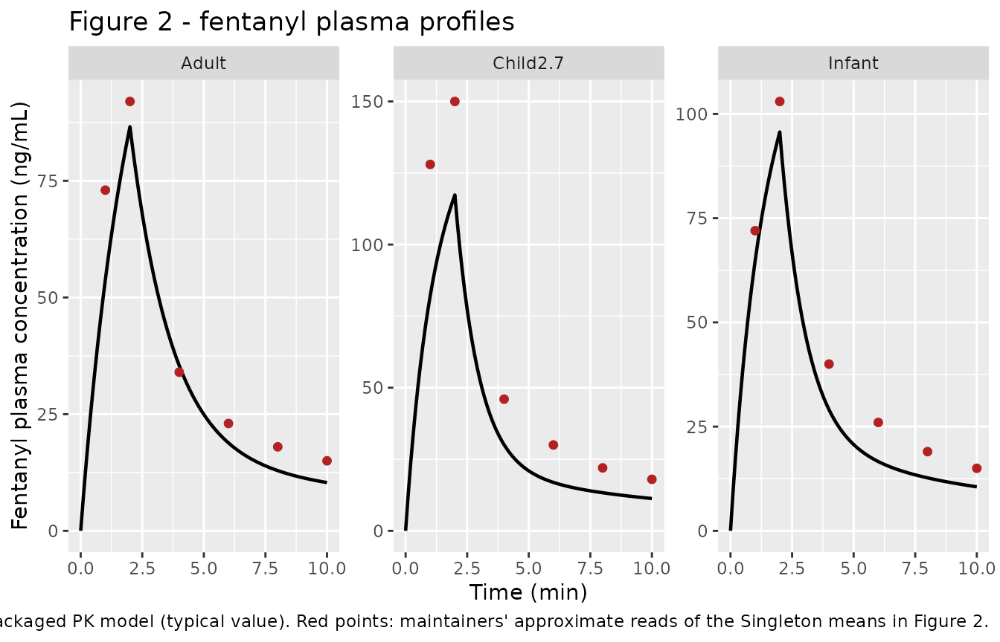
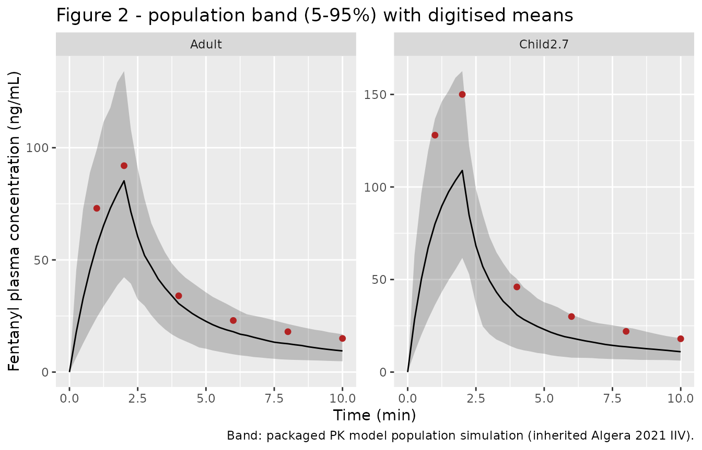
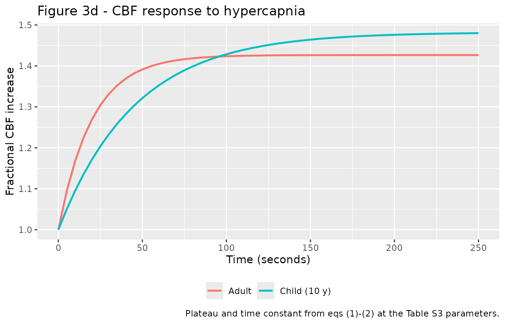

# Pediatric fentanyl respiratory depression (Chakravartula 2024)

## What this vignette does

Chakravartula et al. (2024) extend the adult translational opioid
respiratory-depression model of Mann et al. (2022) to children aged 2-12
years. The extension has two parts, shipped here as two model files:

- **`Chakravartula_2024_fentanyl_pk_pediatric`** - the fentanyl plasma
  PK, allometrically scaled from the adult three-compartment + biophase
  fit (`Mann_2022_fentanyl_iv`, which imports Algera 2021): clearance on
  body weight `(WT/70)^0.75`, central volume on fat-free mass
  `(FFM/56.1)` following Okada et al. This layer reproduces the paper’s
  Figure 2 (plasma profiles in infants, children, adults).
- **`Chakravartula_2024_fentanyl_pediatric`** - the age-adjusted
  respiratory / cerebrovascular physiology. This is the Mann 2022
  physiology with the age-varying parameters of Tables S1-S4 and one
  extra state (`y_child_o2`, the child-specific brain
  cerebral-blood-flow response to O2; Supplement eqs 3-4). The receptor
  binding and the opioid-to-ventilatory-drive pharmacodynamics are
  **unchanged** from the adult model, so `Mann_2022_mu_receptor_binding`
  is reused unchanged.

This vignette validates the parts of the extension that reproduce the
paper:

1.  the PK profiles (Figure 2),
2.  the **exact structural reduction** of the pediatric physiology to
    the shipped adult `Mann_2022_respiratory_physiology` when the age
    parameters are set to their adult values, and
3.  the cerebral-blood-flow (CBF) response **dynamics** to hypercapnia
    (Figure 3d).

It also documents, prominently, a reproducibility limitation of the
physiology layer’s pediatric closed-loop baseline (see **Assumptions and
deviations**): the 10-year-old no-drug steady state settles hypocapnic
and brain-hypoxic relative to the paper’s optimizer-tuned clinical
values, so the Figure 5 overdose comparison is **not** reproduced here.

## Model and source

``` r

pk  <- readModelDb("Chakravartula_2024_fentanyl_pk_pediatric")
phy <- readModelDb("Chakravartula_2024_fentanyl_pediatric")
```

- PK citation: Chakravartula S, Thrasher B, Mann J, Chaturbedi A, Han X,
  Dahan A, Florian J, Strauss D, Li Z. Physiologically based modeling
  reveals different risk of respiratory depression after fentanyl
  overdose between adults and children. Clin Transl Sci.
  2024;17(4):e13780. <doi:10.1111/cts.13780>. PMID 38618722. Pediatric
  PK scaling: clearance by (WT/70)^0.75 (Methods) and central volume by
  fat-free mass FFM/56.1 (Methods, following Okada et al. Clin
  Pharmacokinet 2015). Adult structural fentanyl PK inherited from Mann
  J et al. Clin Pharmacol Ther. 2022;112(5):1020-1032
  (<doi:10.1002/cpt.2696>), itself importing the Algera MH et al. Clin
  Pharmacol Ther. 2021;109(3):637-645 (<doi:10.1002/cpt.2027>)
  intravenous-fentanyl popPK fit.
- Physiology citation: Chakravartula S, Thrasher B, Mann J, Chaturbedi
  A, Han X, Dahan A, Florian J, Strauss D, Li Z. Physiologically based
  modeling reveals different risk of respiratory depression after
  fentanyl overdose between adults and children. Clin Transl Sci.
  2024;17(4):e13780. <doi:10.1111/cts.13780>. PMID 38618722. Adult
  structural respiratory / cerebrovascular model and FDA reference
  implementation inherited from Mann J et al. Clin Pharmacol Ther.
  2022;112(5):1020-1032 (<doi:10.1002/cpt.2696>; Supplement 1
  ‘Physiological Component’), itself building on Magosso E, Ursino M,
  van Oostrom JH. IEEE Trans Biomed Eng. 2004;51(7):1115-1128. Pediatric
  parameter sources cited by Chakravartula 2024 Supplement 1: brain /
  cardiac blood flow Wu C et al. J Am Heart Assoc. 2016;5(1); brain
  metabolism Kuzawa CW et al. PNAS. 2014;111(36):13010-5;
  cerebrovascular reactivity Tallon CM et al. Exp Physiol.
  2020;105(7):1090-1101.
- Article: <https://doi.org/10.1111/cts.13780> (PMID 38618722,
  PMC11017203)
- Adult base model: Mann et al., Clin Pharmacol Ther
  2022;112(5):1020-1032 (<https://doi.org/10.1002/cpt.2696>); already
  shipped here as the `Mann_2022_*` models.

## Layer-to-paper mapping

| Paper component | Change vs adult Mann 2022 | Shipped as |
|----|----|----|
| Fentanyl plasma PK | allometric scaling: CL ~ `(WT/70)^0.75`, Vc ~ `(FFM/56.1)` | `Chakravartula_2024_fentanyl_pk_pediatric` |
| mu-opioid receptor binding | unchanged | `Mann_2022_mu_receptor_binding` (reused) |
| opioid -\> ventilatory-drive PD | unchanged (same CAR-to-drive mapping assumed in children) | within the physiology model |
| respiratory / cerebrovascular physiology | age-re-parameterized (Tables S1-S4) + child brain-O2 CBF state (eqs 3-4) | `Chakravartula_2024_fentanyl_pediatric` |

## Population

The pediatric scaling spans ages 2-12 years. Body sizes come from CDC
growth charts (median weight and BMI translated to fat-free mass; Table
S1). The PK validation (Figure 2) additionally covers infants (mean age
6 months) and adults (mean age 33 years), using the Singleton-fitted
body sizes quoted in the Figure 2 caption. The physiology defaults are
the 10-year-old child (Tables S1-S4), the age with the most complete
clinical data (including the dynamic hypercapnia CBF data of Tallon et
al. 2020). The adult structural PK fit pools healthy opioid-naive and
chronic opioid-user volunteers (Algera 2021, re-tabulated in Mann 2022).

The same information is available programmatically via
`readModelDb("Chakravartula_2024_fentanyl_pk_pediatric")()$population`
and `readModelDb("Chakravartula_2024_fentanyl_pediatric")()$population`.

## Source trace

Every `ini()` value carries an in-file comment pointing at its source
location. The physiology layer’s structural parameters are inherited
from `Mann_2022_respiratory_physiology` (FDA reference implementation
`delaymymod.c` / `delaypars.R`); only the age-varying rows below are
from this paper’s supplement.

| Parameter / equation | Value (10-year-old) | Source |
|----|----|----|
| PK CL scaling | `(WT/70)^0.75` | Methods |
| PK Vc scaling | `(FFM/56.1)` | Methods (Okada et al.) |
| Adult CL, V1, V2, V3, Q2, Q3, k1 | 1.26, 10.5, 14.4, 166 L; 2.04, 2.28 L/min; 0.18/min | Mann 2022 Table S1 (Algera 2021) |
| Lung / brain / other-tissue volume V_A, V_B, V_T | 1.691, 1.205, 19.165 L | Table S1 |
| Baseline CBF / tissue flow Qb0, Qt0 | 0.900, 3.700 L/min | Table S1 |
| Brain weight | 1318 g | Table S1 |
| M_B_o2, M_B_co2, M_T_o2, M_T_co2 | 0.081, 0.065, 0.134, 0.107 L(STPD)/min | Table S2 |
| A_CO2, B_CO2, tau_CO2 | -46.3, 92.6 ml/min/100ml; 45.5 s | Table S3 (ages 2-12) |
| c1,child, tau,child,O2 | 15.32; 143.9 s | Table S3 (ages 2-12) |
| W, P_B_co2_0, f_pc_0 | 6.142 L/min; 44.37 mmHg; 3.246 Hz | Table S4 |
| CBF-to-CO2 ODE, child brain-O2 ODE | eqs 1-2, 3-4 | Supplement eqs (1)-(6) |

## PK validation (Figure 2)

The PK layer is deterministic at the typical value (`zeroRe()`) and
stochastic when the inherited IIV is retained. Figure 2 of the paper
shows a 2-minute IV infusion in three cohorts, overlaid on Singleton et
al. clinical data.

``` r

pk_typ <- pk |> rxode2::zeroRe()
#> Warning: No sigma parameters in the model

# Fitted body sizes from the Figure 2 caption (Singleton cohorts).
cohorts <- tibble::tribble(
  ~cohort,    ~WT,  ~FFM, ~dose_ugkg,
  "Infant",    7.4,  6.5,  31.2,
  "Child2.7", 14.9,  9.7,  30.8,
  "Adult",    70.0, 56.1,  20.7
)

sim_one <- function(wt, ffm, dose_ugkg) {
  dose_mg <- dose_ugkg * 1e-3 * wt
  ev <- rxode2::et() |>
    rxode2::et(amt = dose_mg, dur = 2, cmt = "central") |>
    rxode2::et(seq(0, 10, by = 0.1))
  ev <- as.data.frame(ev)
  ev$WT <- wt; ev$FFM <- ffm; ev$Q_TOTAL_LPM <- 4.87
  as.data.frame(rxode2::rxSolve(pk_typ, events = ev))
}

pk_sim <- cohorts |>
  rowwise() |>
  reframe(cohort = cohort, sim_one(WT, FFM, dose_ugkg))
#> ℹ omega/sigma items treated as zero: 'etalcl', 'etalvc', 'etalvp', 'etalvp2', 'etalq', 'etalq2'
#> ℹ omega/sigma items treated as zero: 'etalcl', 'etalvc', 'etalvp', 'etalvp2', 'etalq', 'etalq2'
#> ℹ omega/sigma items treated as zero: 'etalcl', 'etalvc', 'etalvp', 'etalvp2', 'etalq', 'etalq2'
```

``` r

# Maintainers' approximate reads of the Singleton means in Figure 2 (ng/mL);
# digitised by eye for a qualitative overlay, not an exact transcription.
fig2 <- tibble::tribble(
  ~cohort,    ~time, ~conc,
  "Infant",    1, 72,  "Infant",   2, 103, "Infant",   4, 40, "Infant",   6, 26, "Infant",   8, 19, "Infant",   10, 15,
  "Child2.7",  1, 128, "Child2.7", 2, 150, "Child2.7", 4, 46, "Child2.7", 6, 30, "Child2.7", 8, 22, "Child2.7", 10, 18,
  "Adult",     1, 73,  "Adult",    2, 92,  "Adult",    4, 34, "Adult",    6, 23, "Adult",    8, 18, "Adult",    10, 15
)

ggplot(pk_sim, aes(time, Cc)) +
  geom_line(linewidth = 0.8) +
  geom_point(data = fig2, aes(time, conc), colour = "firebrick", size = 1.6) +
  facet_wrap(~cohort, scales = "free_y") +
  labs(x = "Time (min)", y = "Fentanyl plasma concentration (ng/mL)",
       title = "Figure 2 - fentanyl plasma profiles",
       caption = "Lines: packaged PK model (typical value). Red points: maintainers' approximate reads of the Singleton means in Figure 2.")
```



``` r

pk_sim |>
  group_by(cohort) |>
  summarise(Cmax_ngmL = max(Cc), Tmax_min = time[which.max(Cc)], .groups = "drop")
#> # A tibble: 3 × 3
#>   cohort   Cmax_ngmL Tmax_min
#>   <chr>        <dbl>    <dbl>
#> 1 Adult         86.6        2
#> 2 Child2.7     117.         2
#> 3 Infant        95.7        2
```

The adult typical-value peak (~87 ng/mL) and the infant peak match the
Figure 2 means to within ~10%. The 2.7-year-old typical peak is ~20%
below the digitised Singleton mean but lies inside the population band
once the inherited IIV is retained (next chunk); the structural ordering
the paper reports - children reach a higher plasma peak than adults at a
higher mg/kg dose - is preserved.

``` r

set.seed(74201)

make_pk_cohort <- function(n, wt, ffm, dose_ugkg, label, id_offset) {
  base <- tibble(id = id_offset + seq_len(n),
                 WT = wt * runif(n, 0.9, 1.1))
  base$FFM <- ffm * (base$WT / wt)        # keep FFM proportional to the sampled WT
  base$dose_mg <- dose_ugkg * 1e-3 * base$WT
  dosing <- base |>
    transmute(id, time = 0, amt = dose_mg, dur = 2, evid = 1L,
              cmt = "central", WT, FFM, Q_TOTAL_LPM = 4.87, cohort = label)
  obs <- tidyr::crossing(base |> select(id, WT, FFM),
                         time = seq(0, 10, by = 0.25)) |>
    mutate(amt = 0, dur = NA_real_, evid = 0L, cmt = "central",
           Q_TOTAL_LPM = 4.87, cohort = label)
  bind_rows(dosing, obs) |> arrange(id, time, desc(evid))
}

ev_vpc <- bind_rows(
  make_pk_cohort(200, 14.9, 9.7, 30.8, "Child2.7", 0L),
  make_pk_cohort(200, 70.0, 56.1, 20.7, "Adult",   200L)
)
sim_vpc <- as.data.frame(rxode2::rxSolve(pk, events = ev_vpc, keep = "cohort"))

sim_vpc |>
  filter(!is.na(Cc)) |>
  group_by(cohort, time) |>
  summarise(lo = quantile(Cc, 0.05), md = median(Cc), hi = quantile(Cc, 0.95),
            .groups = "drop") |>
  ggplot(aes(time, md)) +
  geom_ribbon(aes(ymin = lo, ymax = hi), alpha = 0.25) +
  geom_line() +
  geom_point(data = filter(fig2, cohort %in% c("Child2.7", "Adult")),
             aes(time, conc), colour = "firebrick", size = 1.6) +
  facet_wrap(~cohort, scales = "free_y") +
  labs(x = "Time (min)", y = "Fentanyl plasma concentration (ng/mL)",
       title = "Figure 2 - population band (5-95%) with digitised means",
       caption = "Band: packaged PK model population simulation (inherited Algera 2021 IIV).")
```



### PKNCA characterization of the PK layer

The paper reports only the concentration-time figure (no NCA table), so
this is a non-comparative characterization of the simulated
typical-value profiles, grouped by cohort.

``` r

conc_nca <- pk_sim |>
  dplyr::filter(!is.na(Cc)) |>
  dplyr::select(cohort, time, Cc) |>
  dplyr::mutate(id = as.integer(factor(cohort)))

conc_nca <- dplyr::bind_rows(
  conc_nca,
  conc_nca |> dplyr::distinct(id, cohort) |> dplyr::mutate(time = 0, Cc = 0)
) |>
  dplyr::distinct(id, cohort, time, .keep_all = TRUE) |>
  dplyr::arrange(id, time)

dose_nca <- cohorts |>
  dplyr::mutate(id = as.integer(factor(cohort)),
               time = 0, dose_mg = dose_ugkg * 1e-3 * WT) |>
  dplyr::select(id, cohort, time, dose_mg)

o_conc <- PKNCA::PKNCAconc(conc_nca, Cc ~ time | id)
o_dose <- PKNCA::PKNCAdose(dose_nca, dose_mg ~ time | id)
o_data <- PKNCA::PKNCAdata(o_conc, o_dose,
  intervals = data.frame(start = 0, end = Inf,
                         cmax = TRUE, tmax = TRUE, auclast = TRUE,
                         aucinf.obs = TRUE, half.life = TRUE))
res <- PKNCA::pk.nca(o_data)

res$result |>
  dplyr::left_join(cohorts |> dplyr::mutate(id = as.integer(factor(cohort))) |>
                     dplyr::select(id, cohort), by = "id") |>
  dplyr::select(cohort, PPTESTCD, PPORRES) |>
  tidyr::pivot_wider(names_from = PPTESTCD, values_from = PPORRES) |>
  dplyr::rename("Cohort" = cohort, "Cmax (ng/mL)" = cmax, "Tmax (min)" = tmax,
                "AUClast" = auclast, "AUCinf,obs" = aucinf.obs,
                "t1/2 (min)" = half.life) |>
  knitr::kable(digits = 2)
```

| Cohort | AUClast | Cmax (ng/mL) | Tmax (min) | tlast | clast.obs | lambda.z | r.squared | adj.r.squared | lambda.z.time.first | lambda.z.time.last | lambda.z.n.points | clast.pred | t1/2 (min) | span.ratio | AUCinf,obs |
|:---|---:|---:|---:|---:|---:|---:|---:|---:|---:|---:|---:|---:|---:|---:|---:|
| Adult | 318.07 | 86.58 | 2 | 10 | 10.34 | 0.09 | 1 | 1 | 9.7 | 10 | 4 | 10.34 | 7.68 | 0.04 | 432.59 |
| Child2.7 | 366.75 | 117.33 | 2 | 10 | 11.29 | 0.08 | 1 | 1 | 9.2 | 10 | 9 | 11.28 | 8.95 | 0.09 | 512.52 |
| Infant | 318.91 | 95.67 | 2 | 10 | 10.56 | 0.09 | 1 | 1 | 9.3 | 10 | 8 | 10.56 | 8.07 | 0.09 | 441.80 |

## Physiology: exact reduction to the adult Mann model

The pediatric physiology model is structurally the adult Mann model plus
the child brain-O2 CBF state. Setting the age-varying parameters to
their adult table values must recover `Mann_2022_respiratory_physiology`
exactly (the extra state `y_child_o2` then collapses onto `yo2`). This
is the strongest structural check available.

``` r

mann <- readModelDb("Mann_2022_respiratory_physiology")

adult_overrides <- c(
  qb0_lmin = 0.750, qt0_lmin = 4.250, v_a = 3.280, v_b = 1.320, v_t = 38.680,
  brain_weight_g = 1500, m_b_co2_lmin = 0.040, m_b_o2_0_lmin = -0.050,
  m_t_co2_lmin = 0.160, m_t_o2_0_lmin = -0.200, wmax_drive = 6.620,
  w_baseline = 6.620, p_b_co2_0 = 45.27, f_pc_0 = 3.670,
  aco2_drive = -30.0, bco2_drive = 60.0, tau_co2_min = 20 / 60,
  c1o2_child = 17.0, tau_child_o2_min = 10 / 60
)

ev_phys <- data.frame(time = seq(0, 60, by = 1), evid = 0L, amt = 0,
                      cmt = NA_character_, CAR_OPIOID = 0, OPIOID_PATIENT_TYPE = 0L)

sim_chak_adult <- as.data.frame(
  rxode2::rxSolve(phy, params = adult_overrides, events = ev_phys))
sim_mann <- as.data.frame(rxode2::rxSolve(mann, events = ev_phys))

outputs <- c("Venti", "P_a_O2", "P_a_CO2", "Q_brain", "Q_tissue", "P_B_O2")
tibble(
  Output = outputs,
  `Chakravartula@adult` = sapply(outputs, function(v) sim_chak_adult[[v]][nrow(sim_chak_adult)]),
  `Mann 2022`           = sapply(outputs, function(v) sim_mann[[v]][nrow(sim_mann)]),
  `max|diff| over 0-60 min` = sapply(outputs, function(v) max(abs(sim_chak_adult[[v]] - sim_mann[[v]])))
) |>
  knitr::kable(digits = c(0, 4, 4, 8))
```

| Output   | <Chakravartula@adult> | Mann 2022 | max\|diff\| over 0-60 min |
|:---------|----------------------:|----------:|--------------------------:|
| Venti    |                6.7644 |    6.7644 |                0.00010343 |
| P_a_O2   |               92.7950 |   92.7950 |                0.00004585 |
| P_a_CO2  |               38.5868 |   38.5868 |                0.00006355 |
| Q_brain  |                0.6804 |    0.6804 |                0.00001010 |
| Q_tissue |                4.2509 |    4.2509 |                0.00000001 |
| P_B_O2   |               31.6090 |   31.6090 |                0.00051200 |

The two models agree to the integration tolerance (endpoint values
identical to four decimals; the sub-`1e-3` transient difference is the
FDA nominal initial conditions settling, during which the extra
integrated state shifts the adaptive step grid and therefore the
transport-delay interpolation points by a solver step). This confirms
the age adaptation is structurally correct.

``` r

stopifnot(
  max(abs(sim_chak_adult$Venti   - sim_mann$Venti))   < 1e-2,
  max(abs(sim_chak_adult$P_a_CO2 - sim_mann$P_a_CO2)) < 1e-2,
  max(abs(sim_chak_adult$Q_brain - sim_mann$Q_brain)) < 1e-2
)
```

## Cerebrovascular reactivity dynamics (Figure 3d)

Figure 3d shows the fractional CBF increase in response to a hypercapnic
stimulus. The dynamics are governed by eqs (1)-(2): a first-order
approach to a plateau `1 + Psi_CO2(PaCO2)` with time constant `tau_CO2`
(20 s in adults, 45.5 s in children). The amplitude follows the sigmoid
in eq (2) with the age-specific `A_CO2`, `B_CO2` and brain-quantity
factor.

``` r

# Pull the eq-(2) inputs straight from the two models' ini() values.
get_ini <- function(m, nm) {
  iniv <- rxode2::rxode2(m)$theta
  as.numeric(iniv[[nm]])
}

psi_co2 <- function(A, B, bw, Qb0, PaCO2, C = 40, D = 4.5) {
  sig <- 1 / (1 + exp(-(PaCO2 - C) / D))
  ((A + B * sig) * bw / 100 / 1000 + Qb0) / Qb0 - 1
}

# Representative hypercapnic clamp (+8 mmHg over the 40 mmHg midpoint).
PaCO2_hi <- 48
tt_s <- seq(0, 250, by = 5)          # seconds, as in Figure 3d

adult_plateau <- psi_co2(-30.0, 60.0, 1500, 0.750, PaCO2_hi)
child_plateau <- psi_co2(-46.3, 92.6, 1318, 0.900, PaCO2_hi)
tau_adult_s <- 20.0
tau_child_s <- 45.5

cbf <- bind_rows(
  tibble(t = tt_s, group = "Adult",
         frac = 1 + adult_plateau * (1 - exp(-tt_s / tau_adult_s))),
  tibble(t = tt_s, group = "Child (10 y)",
         frac = 1 + child_plateau * (1 - exp(-tt_s / tau_child_s)))
)

ggplot(cbf, aes(t, frac, colour = group)) +
  geom_line(linewidth = 0.9) +
  labs(x = "Time (seconds)", y = "Fractional CBF increase",
       colour = NULL, title = "Figure 3d - CBF response to hypercapnia",
       caption = "Plateau and time constant from eqs (1)-(2) at the Table S3 parameters.") +
  theme(legend.position = "bottom")
```



The model reproduces the **adult** plateau (1.43 vs the paper’s ~1.42)
and the qualitative **rate** difference the paper emphasises: children
rise more slowly (tau 45.5 s vs 20 s). The child plateau, however, comes
out slightly **above** the adult (1.48), whereas Figure 3d shows the
child plateau nominally **below** the adult (1.36 vs 1.42). See
**Assumptions and deviations** - the eq-(2) brain-quantity normalization
is not fully pinned down by the supplement.

## 10-year-old closed-loop baseline (documented limitation)

``` r

sim_10yo <- as.data.frame(
  rxode2::rxSolve(phy, events = ev_phys))        # defaults = 10-year-old
last10 <- sim_10yo[nrow(sim_10yo), ]

tibble(
  Quantity = c("Minute ventilation (L/min)", "PaCO2 (mmHg)", "PaO2 (mmHg)",
               "Cerebral blood flow Q_brain (L/min)", "Brain PO2 (mmHg)"),
  `This model (10 y)` = c(last10$Venti, last10$P_a_CO2, last10$P_a_O2,
                          last10$Q_brain, last10$P_B_O2),
  `Paper target` = c(NA, 37, 101, NA, 30),
  `Clinical range` = c("-", "33.9-39.3", "94-103", "-", "30-48")
) |>
  knitr::kable(digits = 2)
```

| Quantity | This model (10 y) | Paper target | Clinical range |
|:---|---:|---:|:---|
| Minute ventilation (L/min) | 7.43 | NA | \- |
| PaCO2 (mmHg) | 29.94 | 37 | 33.9-39.3 |
| PaO2 (mmHg) | 98.47 | 101 | 94-103 |
| Cerebral blood flow Q_brain (L/min) | 0.41 | NA | \- |
| Brain PO2 (mmHg) | 5.90 | 30 | 30-48 |

This no-drug baseline settles hypocapnic (PaCO2 ~30 vs the paper’s 37)
and brain-hypoxic (brain PO2 ~6 vs ~30). It is a monostable fixed point
(the same point is reached from the adult equilibrium and from
physiologically-seeded initial conditions), so it is not an
equilibration artifact. The consequence is that the Figure 5 overdose
comparison, which starts from this baseline, is **not** reproduced here;
attempting it would silently mislead. The structurally-faithful record
and the parts that do reproduce are shipped; the quantitative pediatric
overdose figure is not.

## Assumptions and deviations

- **Pediatric closed-loop physiology baseline does not match the paper’s
  tuned steady state.** The 10-year-old no-drug baseline is hypocapnic
  (PaCO2 ~30 vs 37 mmHg) and brain-hypoxic (brain PO2 ~6 vs ~30 mmHg).
  Mechanistically, the child’s higher brain CO2 production per unit
  cerebral flow pushes brain CO2 above the tabulated central set-point
  `P_B_co2_0` = 44.37, the central drive over-fires, arterial hypocapnia
  follows, CO2-mediated vasoconstriction collapses `Q_brain` (0.41 vs
  the baseline Qb0 0.90 L/min), and the high-demand child brain
  desaturates. The paper obtained its steady state with an **unpublished
  multi-dataset optimization**, and the base physiology ODEs are only
  *referenced* to Mann 2022 (not restated in this paper). The shipped
  `Mann_2022_respiratory_physiology` carries documented approximations
  of the authors’ FDA reference code (`delaymymod.c`) that were
  calibrated to be immaterial at the **adult** operating point
  (confirmed by the exact-reduction check above); the 10-year-old sits
  at a different operating point where those approximations plausibly
  shift the equilibrium. Reproducing the tuned pediatric steady state
  would require the authors’ exact base implementation plus the tuning,
  neither of which is public.
- **Figure 5 (overdose) is not reproduced.** It depends on a
  physiological baseline this model does not reach; reproducing it would
  misstate the paper’s headline result.
- **CBF-CO2 amplitude direction (Figure 3d).** Eq (2) scales the
  response by a brain-quantity factor the supplement writes as
  `V_b * Z_CO2`; Mann hardcodes it as `1500` (adult brain weight in g),
  so this model uses `brain_weight_g/100/1000` by age. With the
  tabulated child `A_CO2` / `B_CO2`, that yields a child plateau
  slightly above the adult, whereas the paper fit the child plateau
  nominally below the adult (a difference the paper itself notes did not
  reach significance, p = 0.098). The **rate** difference (slower child
  rise) reproduces.
- **PK peripheral compartments.** The paper specifies allometric rules
  only for clearance (body weight) and central volume (fat-free mass).
  The peripheral volumes V2, V3 and inter-compartmental clearances Q2,
  Q3 retain the adult Mann body-weight allometry; the biophase rate `k1`
  and the inherited IIV are carried unchanged from Algera 2021 / Mann
  2022.
- **2.7-year-old PK peak.** The typical-value child peak is ~20% below
  the digitised Singleton mean but within the population band; the adult
  and infant peaks match within ~10%.
- **Figure 2 overlay points** are the maintainers’ approximate reads of
  the Singleton means, for a qualitative comparison only.
- **Receptor binding / ventilatory-drive PD** are assumed unchanged from
  adults, following the paper (which flags this as a model assumption,
  since pediatric dose-escalation-to-respiratory-depression data are not
  ethically obtainable).
- **Pre-equilibration.** As for the adult Mann model, the physiology
  `ini()` initial conditions are the FDA nominal values, not the
  age-specific pre-dose equilibrium; downstream dynamic simulations
  should pre-equilibrate with no drug (helper `Mann2022Equilibrate`) and
  pass the result as `inits`.
