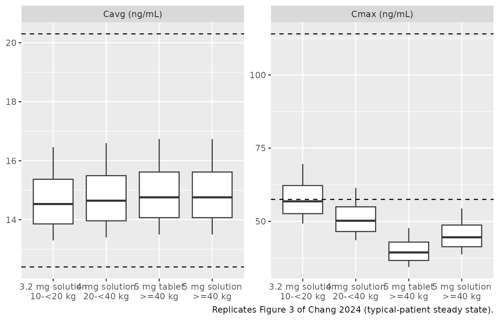
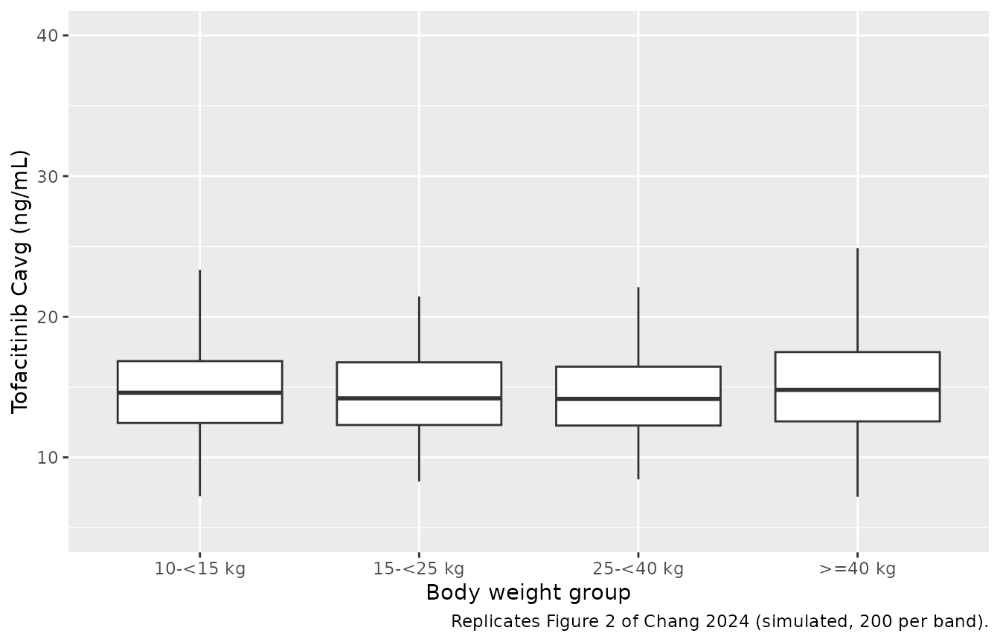
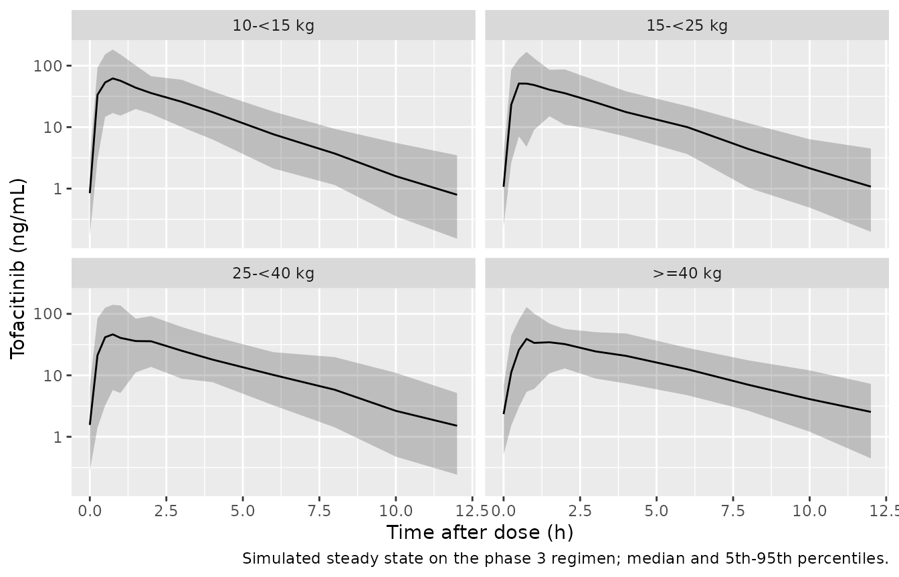

# Tofacitinib in juvenile idiopathic arthritis (Chang 2024)

## Model and source

- Citation: Chang C, Vong C, Wang X, Hazra A, Diehl A, Nicholas T,
  Mukherjee A. Tofacitinib pharmacokinetics in children and adolescents
  with juvenile idiopathic arthritis. CPT Pharmacometrics Syst
  Pharmacol. 2024;13(4):599-611. <doi:10.1002/psp4.13104>.
  PMID: 38298058. PMCID: PMC11015083.
- Description: One-compartment population PK model with first-order
  absorption and an absorption lag time for oral tofacitinib (tablet or
  1 mg/mL oral solution, weight-based doses twice daily) in 246 children
  and adolescents aged 2-17 years with juvenile idiopathic arthritis,
  pooled from a phase 1 (NCT01513902), a phase 3 (NCT02592434) and a
  long-term extension (NCT01500551) study (Chang 2024). The model is
  parameterized in apparent oral clearance (CL/F) and apparent volume of
  distribution (V/F), both allometric in time-varying body weight with
  estimated exponents (0.31 and 0.54) about the 46.3 kg median. The oral
  solution increases the absorption rate constant by a fractional 1.64
  over the tablet (ka x 2.64). V/F has no eta of its own: its deviation
  is 0.27 times the CL/F eta. Log-transformed observations with an
  additive log-scale residual whose SD switches at 1.08 h after dose and
  carries its own inter-individual variability, correlated with the CL/F
  and ka etas.
- Article: <https://doi.org/10.1002/psp4.13104>
- Open-access full text:
  <https://www.ncbi.nlm.nih.gov/pmc/articles/PMC11015083/>

Tofacitinib is an oral Janus kinase inhibitor. Chang 2024 pooled the
tofacitinib juvenile idiopathic arthritis (JIA) program – a phase 1
study (NCT01513902), the phase 3 randomized-withdrawal study
(NCT02592434) and the open-label long-term extension (NCT01500551) – and
fitted a one-compartment model with lagged first-order absorption,
parameterized in apparent oral clearance (CL/F) and apparent volume
(V/F). Time-varying body weight enters both with estimated allometric
exponents, and the 1 mg/mL oral solution is absorbed faster than the
tablet. The model was then used to propose a simplified three-band
weight-based regimen: 3.2 mg twice daily (solution) for 10 to \< 20 kg,
4 mg (solution) for 20 to \< 40 kg and 5 mg (tablet or solution) for \>=
40 kg.

The supplement prints the full NONMEM control stream of the final model
(`run55.mod`); the model file follows its `$PK` and `$ERROR` blocks line
by line.

``` r

mod <- rxode2::rxode2(readModelDb("Chang_2024_tofacitinib"))
tv <- rxode2::zeroRe(mod)
#> Warning: No sigma parameters in the model
```

## Population

Table 2 of Chang 2024 (PK analysis population, N = 246; 1392
concentration records, of which 65 below the 0.100 ng/mL LLOQ were
ignored):

| Characteristic | Value |
|----|----|
| Age, years | mean 11.6, range 2.0-17.0 |
| Body weight, kg | median 46.3, range 11.1-121.8 |
| Female | 74.0% |
| Race | White 87.8%, Black 2.0%, Other 10.2%, Asian 0% |
| JIA category | RF- polyarthritis 48.8%, RF+ polyarthritis 15.4%, extended oligoarthritis 12.6%, ERA 9.3%, jPsA 8.9%, sJIA without active systemic features 4.9% |
| Concomitant NSAIDs / glucocorticoids / methotrexate | 16.3% / 5.3% / 15.4% |
| Formulation at entry | oral solution 100, tablet 146 (11 switched during the studies) |

Doses were weight-banded (Table S1). Every dose below 5 mg was given as
the oral solution; 5 mg was given as a tablet to patients \>= 40 kg who
could swallow it. Body weight was re-measured repeatedly during the
phase 3 and extension studies and is time-varying in the model.

## Source trace

| Model quantity | Source location | Value |
|----|----|----|
| One-compartment, first-order absorption + lag | Results, PK modeling; supplement `$SUBROUTINE ADVAN2 TRANS2`, `ALAG1` | structure |
| `lcl` | Table 3, `CL/F (L/h)` | 26.05 |
| `lvc` | Table 3, `V/F (L)` | 89.22 |
| `lka` | Table 3, `k a (h-1)` | 2.78 |
| `ltlag` | Table 3, `Lag time (h)` | 0.19 |
| `e_wt_cl` | Table 3, `Exponent on CL/F` | 0.31 |
| `e_wt_vc` | Table 3, `Exponent on V/F` | 0.54 |
| Weight normalization 46.3 kg | Methods; control stream `(WT/46.3)**COEFCL` | 46.3 kg |
| `vc_eta_scale` | Table 3, `Covariance between CL/F and V/F` (THETA(6) `SCAL`); control stream `V = TVV*EXP(ETA(1)*SCAL)*...` | 0.27 |
| `e_form_solution_ka` | Table 3, `Formulation effect` (THETA(11)); control stream `KAFORM = (1 + THETA(11))` for FORM 4 | 1.64 |
| `etalcl` | Results, IIV CL/F 23.5%; Table 3, `IIVCL/F` 0.06 | 0.235^2 |
| `etalka` | Results, IIV ka 120.9%; Table 3, `IIVka` 1.46 | 1.209^2 |
| `etaruv` | Table 3, `IIVresidual error` | 0.25 |
| Off-diagonals | Table 3, `IIVCL/F-ka`, `IIVCL/F-residual error`, `IIVka-residual error` | -0.10, 0.07, -0.57 |
| `expSd_early` | Table 3, `Residual error before TAD = 1.08 h (%)`; control stream `PROP2` | 0.6796 |
| `expSd_late` | Table 3, `Residual error (%)`; control stream `PROP` | 0.4098 |
| Residual form | control stream `Y = LOG(IPRED) + W*EPS(1)`, `$SIGMA 1 FIX`, `W = PROP*EXP(ETA(3))` | `lnorm()` |
| Concentration units | control stream `S2 = V ;AMT = ug, Conc = ng/mL` | ng/mL |

Table 3 lists the fixed effects in the control stream’s `$THETA` order
(CL, V, KA, COEFCL, COEFV, SCAL, PROP, ALAG1, PROP2, KAFORM), which is
how the row labelled “Covariance between CL/F and V/F” is identified as
the scaling factor `SCAL`: V/F carries no eta of its own, and its
deviation is 0.27 times the CL/F eta.

## Typical values for the reference patient

The reference patient weighs 46.3 kg and takes the tablet. The paper
states an elimination half-life of 2.37 h and a steady-state 24-h AUC of
383 ng\*h/mL for 5 mg twice daily (Results, PK modeling).

``` r

single <- function(wt, form, dose = 5, end = 24, by = 0.001) {
  ev <- rxode2::et(amt = dose, cmt = "depot") |>
    rxode2::et(seq(0, end, by = by), cmt = "central") |>
    as.data.frame()
  ev$WT <- wt
  ev$FORM_SOLUTION <- form
  ev
}
ref_tab <- rxode2::rxSolve(tv, single(46.3, 0), returnType = "data.frame",
                           rtol = 1e-10, atol = 1e-12)
#> ℹ omega/sigma items treated as zero: 'etalcl', 'etalka', 'etaruv'
ref_sol <- rxode2::rxSolve(tv, single(46.3, 1), returnType = "data.frame",
                           rtol = 1e-10, atol = 1e-12)
#> ℹ omega/sigma items treated as zero: 'etalcl', 'etalka', 'etaruv'

typical <- data.frame(
  Quantity = c("CL/F (L/h)", "V/F (L)", "ka, tablet (1/h)", "Lag time (h)",
               "ka, oral solution (1/h)"),
  Model = c(ref_tab$cl[1], ref_tab$vc[1], ref_tab$ka[1], ref_tab$tlag[1],
            ref_sol$ka[1]),
  Paper = c(26.05, 89.22, 2.78, 0.19, 2.78 * (1 + 1.64))
)
knitr::kable(typical, digits = 4)
```

| Quantity                |   Model |   Paper |
|:------------------------|--------:|--------:|
| CL/F (L/h)              | 26.0500 | 26.0500 |
| V/F (L)                 | 89.2200 | 89.2200 |
| ka, tablet (1/h)        |  2.7800 |  2.7800 |
| Lag time (h)            |  0.1900 |  0.1900 |
| ka, oral solution (1/h) |  7.3392 |  7.3392 |

``` r

stopifnot(isTRUE(all.equal(typical$Model, typical$Paper, tolerance = 1e-8)))

t_half <- log(2) * ref_tab$vc[1] / ref_tab$cl[1]
auc24_ss <- 2 * 5 * 1000 / ref_tab$cl[1]
cat(sprintf("Half-life %.3f h (paper 2.37 h); steady-state AUC24 %.1f ng*h/mL (paper 383)\n",
            t_half, auc24_ss))
#> Half-life 2.374 h (paper 2.37 h); steady-state AUC24 383.9 ng*h/mL (paper 383)
stopifnot(abs(t_half - 2.37) < 0.005, abs(auc24_ss - 383) < 1)
```

### Oral solution versus tablet

The Results report that the solution gives a 113.9% (95% CI
108.0-120.7%) Cmax relative to the tablet for a typical 46.3 kg patient,
with comparable average concentration. The formulation enters ka only,
so the AUC ratio is exactly 1.

``` r

cmax_ratio <- max(ref_sol$Cc) / max(ref_tab$Cc)
cat(sprintf("Single 5 mg dose, 46.3 kg: Cmax solution / tablet = %.4f (paper 1.139)\n",
            cmax_ratio))
#> Single 5 mg dose, 46.3 kg: Cmax solution / tablet = 1.1398 (paper 1.139)
stopifnot(abs(cmax_ratio - 1.139) < 0.002)
```

This check is what fixes the size of the formulation effect; see
“Assumptions and deviations”.

## Steady-state exposure by weight band (Table S5)

Table S5 lists typical-patient steady-state Cavg, Cmax and Cmin at the
edges of each weight band, for the simplified regimen and for the phase
3 regimen. The doses below 5 mg are the oral solution; 5 mg at 40 kg is
the tablet. The profiles below are typical-value solves after five doses
(more than 20 half-lives), and PKNCA computes the exposure metrics over
the sixth dosing interval.

``` r

tab_s5 <- data.frame(
  regimen = rep(c("Simplified", "Phase 3"), each = 9),
  weight = rep(c(10, 14.9, 15, 19.9, 20, 24.9, 25, 39.9, 40), 2),
  dose = c(3.2, 3.2, 3.2, 3.2, 4, 4, 4, 4, 5,
           3, 3, 3.5, 3.5, 3.5, 3.5, 4, 4, 5),
  cav = c(16.45, 14.54, 14.51, 13.29, 16.59, 15.5, 15.48, 13.4, 16.73,
          15.42, 13.63, 15.87, 14.54, 14.52, 13.57, 15.48, 13.4, 16.73),
  cmax = c(69.28, 56.76, 56.57, 49.14, 61.27, 54.96, 54.85, 43.56, 47.68,
           64.95, 53.21, 61.87, 53.75, 53.61, 48.09, 54.85, 43.56, 47.68),
  cmin = c(0.61, 0.75, 0.76, 0.86, 1.08, 1.18, 1.18, 1.39, 1.87,
           0.57, 0.71, 0.83, 0.94, 0.95, 1.03, 1.18, 1.39, 1.87)
) |>
  dplyr::mutate(id = dplyr::row_number(), FORM_SOLUTION = as.integer(dose < 5))

tau <- 12
n_dose <- 6
t_last <- (n_dose - 1) * tau
make_ss_events <- function(subj, obs_times) {
  dplyr::bind_rows(lapply(seq_len(nrow(subj)), function(i) {
    s <- subj[i, ]
    rbind(
      data.frame(id = s$id, time = (seq_len(n_dose) - 1) * tau, amt = s$dose,
                 evid = 1L, cmt = "depot"),
      data.frame(id = s$id, time = t_last + obs_times, amt = 0,
                 evid = 0L, cmt = "central")
    ) |>
      dplyr::mutate(WT = s$weight, FORM_SOLUTION = s$FORM_SOLUTION)
  })) |>
    dplyr::arrange(id, time, dplyr::desc(evid))
}
ev_s5 <- make_ss_events(tab_s5, seq(0, tau, by = 0.01))
sim_s5 <- rxode2::rxSolve(tv, ev_s5, returnType = "data.frame",
                          rtol = 1e-10, atol = 1e-12) |>
  dplyr::left_join(dplyr::select(tab_s5, id, regimen, weight, dose), by = "id")
#> ℹ omega/sigma items treated as zero: 'etalcl', 'etalka', 'etaruv'
#> Warning: multi-subject simulation without without 'omega'
```

``` r

conc_s5 <- sim_s5 |>
  dplyr::filter(!is.na(Cc), time >= t_last) |>
  dplyr::mutate(time = time - t_last, Cc = pmax(Cc, 0))
stopifnot(all(sim_s5$Cc >= -1e-6 * max(sim_s5$Cc)))
dose_s5 <- tab_s5 |> dplyr::transmute(id, regimen, weight, time = 0, dose)

conc_obj <- PKNCA::PKNCAconc(conc_s5, Cc ~ time | regimen + weight + id)
dose_obj <- PKNCA::PKNCAdose(dose_s5, dose ~ time | regimen + weight + id)
intervals <- data.frame(start = 0, end = tau, cmax = TRUE, cmin = TRUE, cav = TRUE)
nca_s5 <- PKNCA::pk.nca(PKNCA::PKNCAdata(conc_obj, dose_obj, intervals = intervals))

cmp <- nlmixr2lib::ncaComparisonTable(
  simulated = nca_s5,
  reference = dplyr::select(tab_s5, regimen, weight, cav, cmax, cmin),
  by = c("regimen", "weight"),
  params = c("cav", "cmax", "cmin"),
  tolerance_pct = 3,
  units = c(cav = "ng/mL", cmax = "ng/mL", cmin = "ng/mL")
)
knitr::kable(cmp, digits = 2)
```

| NCA parameter | regimen    | weight | Reference | Simulated | % diff |
|:--------------|:-----------|-------:|:----------|:----------|:-------|
| Cmax (ng/mL)  | Simplified |   10.0 | 69.3      | 69.6      | +0.4%  |
| Cmax (ng/mL)  | Simplified |   14.9 | 56.8      | 56.9      | +0.3%  |
| Cmax (ng/mL)  | Simplified |   15.0 | 56.6      | 56.7      | +0.3%  |
| Cmax (ng/mL)  | Simplified |   19.9 | 49.1      | 49.3      | +0.2%  |
| Cmax (ng/mL)  | Simplified |   20.0 | 61.3      | 61.4      | +0.2%  |
| Cmax (ng/mL)  | Simplified |   24.9 | 55        | 55.1      | +0.2%  |
| Cmax (ng/mL)  | Simplified |   25.0 | 54.8      | 54.9      | +0.2%  |
| Cmax (ng/mL)  | Simplified |   39.9 | 43.6      | 43.6      | +0.0%  |
| Cmax (ng/mL)  | Simplified |   40.0 | 47.7      | 47.7      | +0.0%  |
| Cmax (ng/mL)  | Phase 3    |   10.0 | 65        | 65.2      | +0.4%  |
| Cmax (ng/mL)  | Phase 3    |   14.9 | 53.2      | 53.4      | +0.3%  |
| Cmax (ng/mL)  | Phase 3    |   15.0 | 61.9      | 62.1      | +0.3%  |
| Cmax (ng/mL)  | Phase 3    |   19.9 | 53.8      | 53.9      | +0.2%  |
| Cmax (ng/mL)  | Phase 3    |   20.0 | 53.6      | 53.7      | +0.2%  |
| Cmax (ng/mL)  | Phase 3    |   24.9 | 48.1      | 48.2      | +0.2%  |
| Cmax (ng/mL)  | Phase 3    |   25.0 | 54.8      | 54.9      | +0.2%  |
| Cmax (ng/mL)  | Phase 3    |   39.9 | 43.6      | 43.6      | +0.0%  |
| Cmax (ng/mL)  | Phase 3    |   40.0 | 47.7      | 47.7      | +0.0%  |
| Cmin (ng/mL)  | Simplified |   10.0 | 0.61      | 0.599     | -1.7%  |
| Cmin (ng/mL)  | Simplified |   14.9 | 0.75      | 0.747     | -0.4%  |
| Cmin (ng/mL)  | Simplified |   15.0 | 0.76      | 0.749     | -1.4%  |
| Cmin (ng/mL)  | Simplified |   19.9 | 0.86      | 0.856     | -0.4%  |
| Cmin (ng/mL)  | Simplified |   20.0 | 1.08      | 1.07      | -0.7%  |
| Cmin (ng/mL)  | Simplified |   24.9 | 1.18      | 1.18      | -0.4%  |
| Cmin (ng/mL)  | Simplified |   25.0 | 1.18      | 1.18      | -0.2%  |
| Cmin (ng/mL)  | Simplified |   39.9 | 1.39      | 1.39      | -0.3%  |
| Cmin (ng/mL)  | Simplified |   40.0 | 1.87      | 1.87      | -0.2%  |
| Cmin (ng/mL)  | Phase 3    |   10.0 | 0.57      | 0.562     | -1.4%  |
| Cmin (ng/mL)  | Phase 3    |   14.9 | 0.71      | 0.7       | -1.4%  |
| Cmin (ng/mL)  | Phase 3    |   15.0 | 0.83      | 0.82      | -1.2%  |
| Cmin (ng/mL)  | Phase 3    |   19.9 | 0.94      | 0.937     | -0.4%  |
| Cmin (ng/mL)  | Phase 3    |   20.0 | 0.95      | 0.939     | -1.2%  |
| Cmin (ng/mL)  | Phase 3    |   24.9 | 1.03      | 1.03      | -0.1%  |
| Cmin (ng/mL)  | Phase 3    |   25.0 | 1.18      | 1.18      | -0.2%  |
| Cmin (ng/mL)  | Phase 3    |   39.9 | 1.39      | 1.39      | -0.3%  |
| Cmin (ng/mL)  | Phase 3    |   40.0 | 1.87      | 1.87      | -0.2%  |
| Cavg (ng/mL)  | Simplified |   10.0 | 16.4      | 16.5      | +0.1%  |
| Cavg (ng/mL)  | Simplified |   14.9 | 14.5      | 14.5      | +0.1%  |
| Cavg (ng/mL)  | Simplified |   15.0 | 14.5      | 14.5      | +0.1%  |
| Cavg (ng/mL)  | Simplified |   19.9 | 13.3      | 13.3      | +0.1%  |
| Cavg (ng/mL)  | Simplified |   20.0 | 16.6      | 16.6      | +0.1%  |
| Cavg (ng/mL)  | Simplified |   24.9 | 15.5      | 15.5      | +0.1%  |
| Cavg (ng/mL)  | Simplified |   25.0 | 15.5      | 15.5      | +0.1%  |
| Cavg (ng/mL)  | Simplified |   39.9 | 13.4      | 13.4      | -0.0%  |
| Cavg (ng/mL)  | Simplified |   40.0 | 16.7      | 16.7      | +0.0%  |
| Cavg (ng/mL)  | Phase 3    |   10.0 | 15.4      | 15.4      | +0.1%  |
| Cavg (ng/mL)  | Phase 3    |   14.9 | 13.6      | 13.6      | +0.1%  |
| Cavg (ng/mL)  | Phase 3    |   15.0 | 15.9      | 15.9      | +0.1%  |
| Cavg (ng/mL)  | Phase 3    |   19.9 | 14.5      | 14.5      | +0.0%  |
| Cavg (ng/mL)  | Phase 3    |   20.0 | 14.5      | 14.5      | +0.0%  |
| Cavg (ng/mL)  | Phase 3    |   24.9 | 13.6      | 13.6      | -0.0%  |
| Cavg (ng/mL)  | Phase 3    |   25.0 | 15.5      | 15.5      | +0.1%  |
| Cavg (ng/mL)  | Phase 3    |   39.9 | 13.4      | 13.4      | -0.0%  |
| Cavg (ng/mL)  | Phase 3    |   40.0 | 16.7      | 16.7      | +0.0%  |

``` r

nca_wide <- as.data.frame(nca_s5$result) |>
  dplyr::filter(PPTESTCD %in% c("cav", "cmax", "cmin")) |>
  dplyr::select(regimen, weight, PPTESTCD, PPORRES)
s5_check <- tab_s5 |>
  dplyr::select(regimen, weight, cav, cmax, cmin) |>
  tidyr::pivot_longer(c(cav, cmax, cmin), names_to = "PPTESTCD", values_to = "paper") |>
  dplyr::inner_join(nca_wide, by = c("regimen", "weight", "PPTESTCD")) |>
  dplyr::mutate(pct_diff = 100 * (PPORRES / paper - 1))
stopifnot(nrow(s5_check) == 54)
# Deterministic typical-value solves against values printed to 2 decimals
# from unrounded estimates. Cav and Cmax agree within 0.6%; Cmin is printed
# to two significant figures (0.57-1.87 ng/mL), so its rounding alone is up
# to ~1%, and the rounded ka (2.78) moves the trough a further ~1%.
stopifnot(
  max(abs(s5_check$pct_diff[s5_check$PPTESTCD == "cav"])) < 0.5,
  max(abs(s5_check$pct_diff[s5_check$PPTESTCD == "cmax"])) < 1,
  max(abs(s5_check$pct_diff[s5_check$PPTESTCD == "cmin"])) < 3
)
```

Every Table S5 row is reproduced. The Cmax rows are the decisive ones:
with the solution’s ka at 2.78 x 2.64 = 7.34 1/h the oral-solution rows
agree to within 0.5%, whereas a ka of 2.78 x 1.64 = 4.56 1/h would
under-predict them by about 6%.

## Replicating Figure 3: proposed regimen across each weight band

Figure 3 shows typical-patient steady-state Cavg and Cmax across the
weights in each band of the proposed regimen. The paper does not state
the upper weight of the \>= 40 kg band; the 40-80 kg grid below matches
the Cavg range read off the figure. Dashed lines are the adult
rheumatoid-arthritis medians the paper draws for reference (read off the
figure; they come from the adult model, not from this one).

``` r

grid <- dplyr::bind_rows(
  data.frame(group = "3.2 mg solution\n10-<20 kg", weight = seq(10, 19.9, by = 0.1),
             dose = 3.2, FORM_SOLUTION = 1L),
  data.frame(group = "4 mg solution\n20-<40 kg", weight = seq(20, 39.9, by = 0.1),
             dose = 4, FORM_SOLUTION = 1L),
  data.frame(group = "5 mg tablet\n>=40 kg", weight = seq(40, 80, by = 0.5),
             dose = 5, FORM_SOLUTION = 0L),
  data.frame(group = "5 mg solution\n>=40 kg", weight = seq(40, 80, by = 0.5),
             dose = 5, FORM_SOLUTION = 1L)
) |>
  dplyr::mutate(id = dplyr::row_number(),
                group = factor(group, levels = unique(group)))
ev_grid <- make_ss_events(grid, seq(0, tau, by = 0.02))
sim_grid <- rxode2::rxSolve(tv, ev_grid, returnType = "data.frame") |>
  dplyr::filter(time >= t_last)
#> ℹ omega/sigma items treated as zero: 'etalcl', 'etalka', 'etaruv'
#> Warning: multi-subject simulation without without 'omega'
exp_grid <- sim_grid |>
  dplyr::group_by(id) |>
  dplyr::summarise(cmax = max(Cc), cl = cl[1], .groups = "drop") |>
  dplyr::left_join(grid, by = "id") |>
  dplyr::mutate(cavg = dose * 1000 / (cl * tau))

fig3 <- exp_grid |>
  tidyr::pivot_longer(c(cavg, cmax), names_to = "metric", values_to = "value") |>
  dplyr::mutate(metric = ifelse(metric == "cavg", "Cavg (ng/mL)", "Cmax (ng/mL)"))
adult_ref <- data.frame(
  metric = c("Cavg (ng/mL)", "Cavg (ng/mL)", "Cmax (ng/mL)", "Cmax (ng/mL)"),
  value = c(20.3, 12.4, 114, 57.5)
)
ggplot(fig3, aes(group, value)) +
  geom_boxplot() +
  geom_hline(data = adult_ref, aes(yintercept = value), linetype = "dashed") +
  facet_wrap(~metric, scales = "free_y") +
  labs(x = NULL, y = NULL,
       caption = "Replicates Figure 3 of Chang 2024 (typical-patient steady state).")
```



``` r


fig3_med <- exp_grid |>
  dplyr::group_by(group) |>
  dplyr::summarise(cavg = median(cavg), cmax = median(cmax), .groups = "drop") |>
  dplyr::mutate(cavg_fig = c(14.5, 14.6, 14.8, 14.8),
                cmax_fig = c(57, 50, 40, 45))
fig3_med |>
  dplyr::rename("Dose group" = group, "Median Cavg, model" = cavg,
                "Median Cmax, model" = cmax, "Median Cavg, Figure 3" = cavg_fig,
                "Median Cmax, Figure 3" = cmax_fig) |>
  knitr::kable(digits = 1)
```

| Dose group | Median Cavg, model | Median Cmax, model | Median Cavg, Figure 3 | Median Cmax, Figure 3 |
|:---|---:|---:|---:|---:|
| 3.2 mg solution |  |  |  |  |
| 10-\<20 kg | 14.5 | 56.8 | 14.5 | 57 |
| 4 mg solution |  |  |  |  |
| 20-\<40 kg | 14.6 | 50.2 | 14.6 | 50 |
| 5 mg tablet |  |  |  |  |
| \>=40 kg | 14.8 | 39.4 | 14.8 | 40 |
| 5 mg solution |  |  |  |  |
| \>=40 kg | 14.8 | 44.6 | 14.8 | 45 |

``` r

# Figure medians are read off the box plots to about +/- 0.3 ng/mL (Cavg)
# and +/- 1.5 ng/mL (Cmax).
stopifnot(
  max(abs(fig3_med$cavg / fig3_med$cavg_fig - 1)) < 0.04,
  max(abs(fig3_med$cmax / fig3_med$cmax_fig - 1)) < 0.06
)
```

As in the paper, Cavg is flat across the bands while Cmax rises as
weight falls, because the exponent on V/F (0.54) exceeds that on CL/F
(0.31). The highest Cmax, in the 10-\<20 kg band, sits at the adult 5 mg
twice-daily median.

## Replicating Figure 2: individual Cavg on the phase 3 regimen

Figure 2 plots the post hoc Cavg of the phase 3 patients by weight band
under the phase 3 dosing (Table S1: 3 mg for 10-\<15 kg, 3.5 mg for
15-\<25 kg, 4 mg for 25-\<40 kg, 5 mg for \>= 40 kg). Individual Cavg is
dose / (CL/F x tau), so it is driven by the CL/F eta. Weights are drawn
uniformly within each band (40-80 kg for the top band), 200 virtual
patients per band.

``` r

rxode2::rxSetSeed(20240131)
n_per_band <- 200
bands <- data.frame(
  band = c("10-<15 kg", "15-<25 kg", "25-<40 kg", ">=40 kg"),
  lo = c(10, 15, 25, 40), hi = c(15, 25, 40, 80),
  dose = c(3, 3.5, 4, 5), FORM_SOLUTION = c(1L, 1L, 1L, 0L),
  fig2_median = c(14.7, 15.3, 14.4, 14.9)
)
set.seed(20240131)
cohort <- bands[rep(seq_len(nrow(bands)), each = n_per_band), ] |>
  dplyr::mutate(id = dplyr::row_number(),
                weight = stats::runif(dplyr::n(), lo, hi),
                band = factor(band, levels = bands$band))
obs_t <- c(0, 0.25, 0.5, 0.75, 1, 1.5, 2, 3, 4, 6, 8, 10, 12)
ev_cohort <- make_ss_events(cohort, obs_t)
sim_cohort <- rxode2::rxSolve(mod, ev_cohort, returnType = "data.frame") |>
  dplyr::filter(time >= t_last) |>
  dplyr::left_join(dplyr::select(cohort, id, band, dose), by = "id")

cavg_ind <- sim_cohort |>
  dplyr::group_by(id, band, dose) |>
  dplyr::summarise(cl = cl[1], .groups = "drop") |>
  dplyr::mutate(cavg = dose * 1000 / (cl * tau))

ggplot(cavg_ind, aes(band, cavg)) +
  geom_boxplot(outlier.shape = NA) +
  coord_cartesian(ylim = c(5, 40)) +
  labs(x = "Body weight group", y = "Tofacitinib Cavg (ng/mL)",
       caption = "Replicates Figure 2 of Chang 2024 (simulated, 200 per band).")
```



``` r

fig2_chk <- cavg_ind |>
  dplyr::group_by(band) |>
  dplyr::summarise(median_cavg = median(cavg),
                   ratio_95_5 = stats::quantile(cavg, 0.95) / stats::quantile(cavg, 0.05),
                   .groups = "drop") |>
  dplyr::left_join(dplyr::select(bands, band, fig2_median), by = "band")
fig2_chk |>
  dplyr::rename("Weight band" = band, "Median Cavg, simulated" = median_cavg,
                "Median Cavg, Figure 2" = fig2_median,
                "95th / 5th percentile" = ratio_95_5) |>
  knitr::kable(digits = 2)
```

| Weight band | Median Cavg, simulated | 95th / 5th percentile | Median Cavg, Figure 2 |
|:---|---:|---:|---:|
| 10-\<15 kg | 14.60 | 2.22 | 14.7 |
| 15-\<25 kg | 14.20 | 2.11 | 15.3 |
| 25-\<40 kg | 14.16 | 2.21 | 14.4 |
| \>=40 kg | 14.80 | 2.15 | 14.9 |

``` r

# Centre only: a mis-transcribed CL/F, exponent or dose moves the median by
# tens of percent. Sampling SE of a 200-subject median is about 2%.
stopifnot(max(abs(fig2_chk$median_cavg / fig2_chk$fig2_median - 1)) < 0.12)
```

The simulated medians sit close to the figure’s, and the 5th-95th
percentile spread within each band stays under three-fold, consistent
with the paper’s “less than three-fold difference across all individual
Cavg values”.

## Simulated concentration-time profiles

Steady-state profiles with inter-individual and residual variability for
the same cohort (median and 90% prediction interval by band). Figure 1
of the paper is a prediction-corrected VPC against observed data, which
is not available here.

``` r

vpc <- sim_cohort |>
  dplyr::mutate(tad = time - t_last) |>
  dplyr::group_by(band, tad) |>
  dplyr::summarise(p05 = stats::quantile(sim, 0.05), p50 = stats::median(sim),
                   p95 = stats::quantile(sim, 0.95), .groups = "drop")
ggplot(vpc, aes(tad, p50)) +
  geom_ribbon(aes(ymin = p05, ymax = p95), alpha = 0.25) +
  geom_line() +
  scale_y_log10() +
  facet_wrap(~band) +
  labs(x = "Time after dose (h)", y = "Tofacitinib (ng/mL)",
       caption = "Simulated steady state on the phase 3 regimen; median and 5th-95th percentiles.")
```



## Assumptions and deviations

- **Formulation effect: the Results prose and the control stream
  disagree, and the control stream is followed.** The Results and
  Discussion describe the solution’s ka as “1.64-fold” that of the
  tablet (ka ratio 1.64). The control stream sets
  `KAFORM = (1 + THETA(11))` for the solution, and Table 3 lists the
  rows in `$THETA` order, so its “Formulation effect” of 1.64 is
  THETA(11) itself and the ka ratio is 2.64. Three independent results
  in the paper confirm the control-stream reading: the solution/tablet
  Cmax ratio of 113.9% for a typical 46.3 kg patient (1.140 with a ratio
  of 2.64, 1.079 with 1.64), and every oral-solution Cmax row of Table
  S5 (within 0.5% with 2.64, 6-7% low with 1.64).
- **Table 3 row label.** The row “Covariance between CL/F and V/F” is
  the scaling factor `SCAL` (THETA(6)) that multiplies the CL/F eta in
  V/F, not an omega element. It is encoded as `vc_eta_scale`.
- **IIV variances.** Table 3 prints the omega block to two decimals. The
  CL/F and ka diagonals are taken from the Results-text CVs (23.5% and
  120.9%) under CV = sqrt(omega) – the reading under which both round to
  the Table 3 values (0.06 and 1.46). The off-diagonals and the
  residual-SD variance are used as printed; the resulting block is
  positive definite.
- **Residual error** is encoded as `lnorm()`: the control stream models
  log-transformed concentrations, `Y = LOG(IPRED) + W*EPS(1)` with
  `$SIGMA 1 FIX`, so the thetas are log-scale SDs. The SD switches at
  1.08 h after dose and is scaled per subject by `exp(etaruv)`, an eta
  that is correlated with the CL/F and ka etas. A commented-out
  dose-dependent residual term (`THETA(8)`, fixed to 0) is not used by
  the final model.
- **Time-varying weight.** The model takes `WT` per record. The
  simulations here hold weight constant within a subject.
- **Weight distributions** for the Figure 2 and Figure 3 replications
  are uniform within each band, with the open top band capped at 80 kg;
  the paper does not report the within-band distributions.
- **Relative bioavailability study.** The healthy-adult crossover
  (Table 4) was analysed by NCA, not with this model, and is not
  reproduced; the model’s formulation effect is on ka only, consistent
  with the AUCinf ratio of 1.04 (90% CI 1.00-1.09) found there.
- **Covariates screened but not retained** (age, sex, race, JIA
  category, renal and hepatic laboratory values, concomitant
  medications, prior DMARD failures) are listed in the model’s
  `covariatesDataExcluded` where a canonical column exists.
