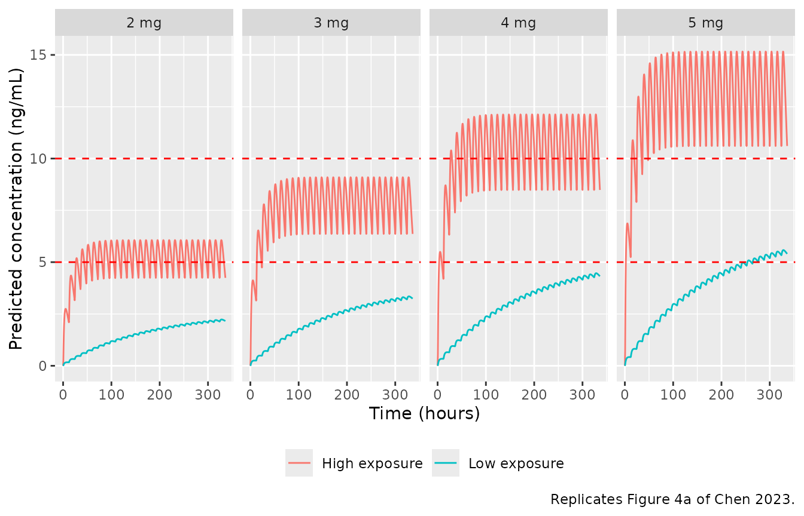
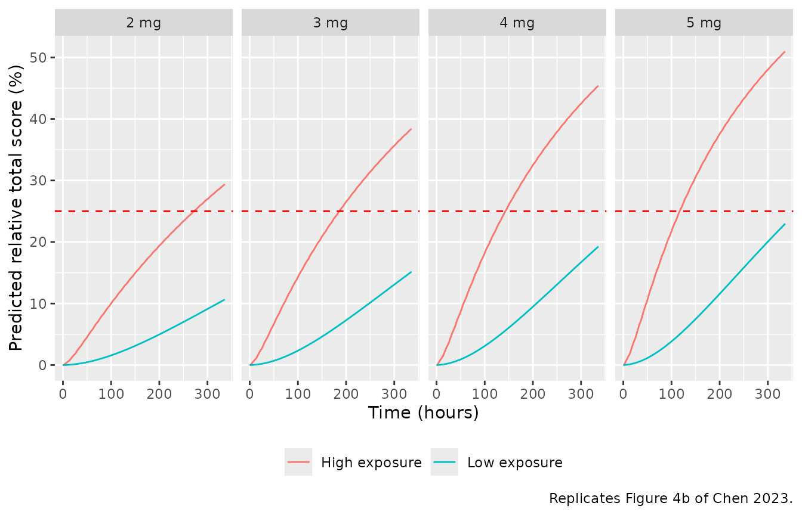
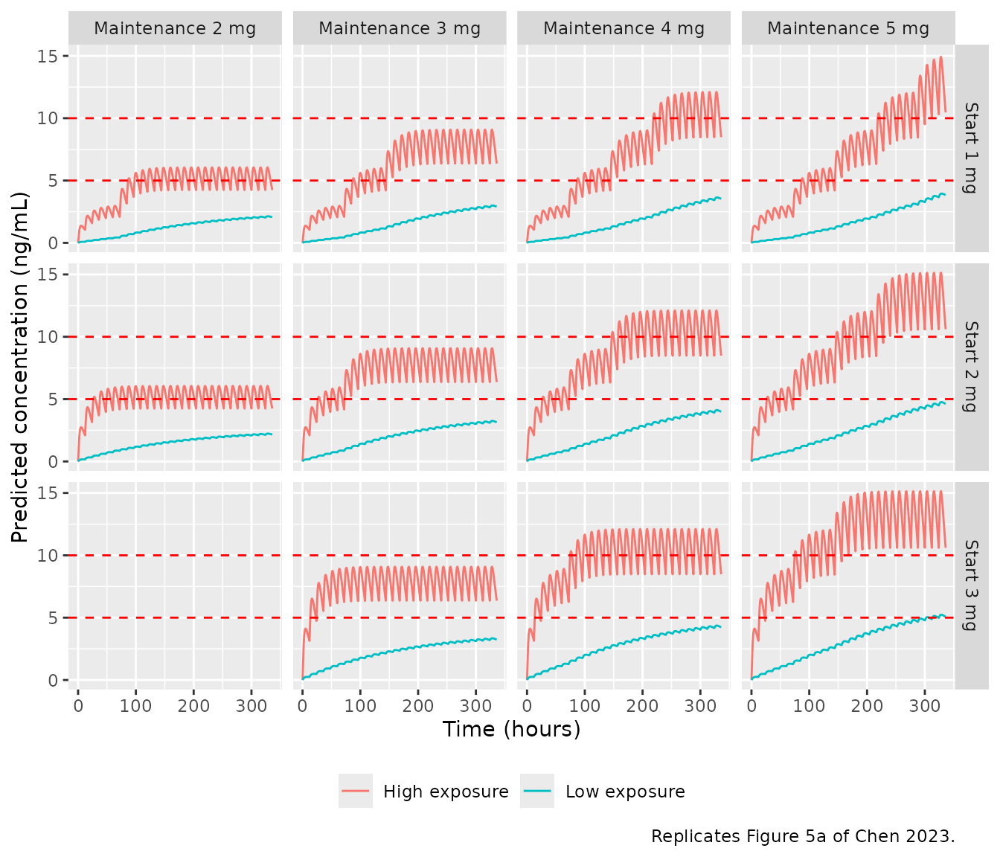
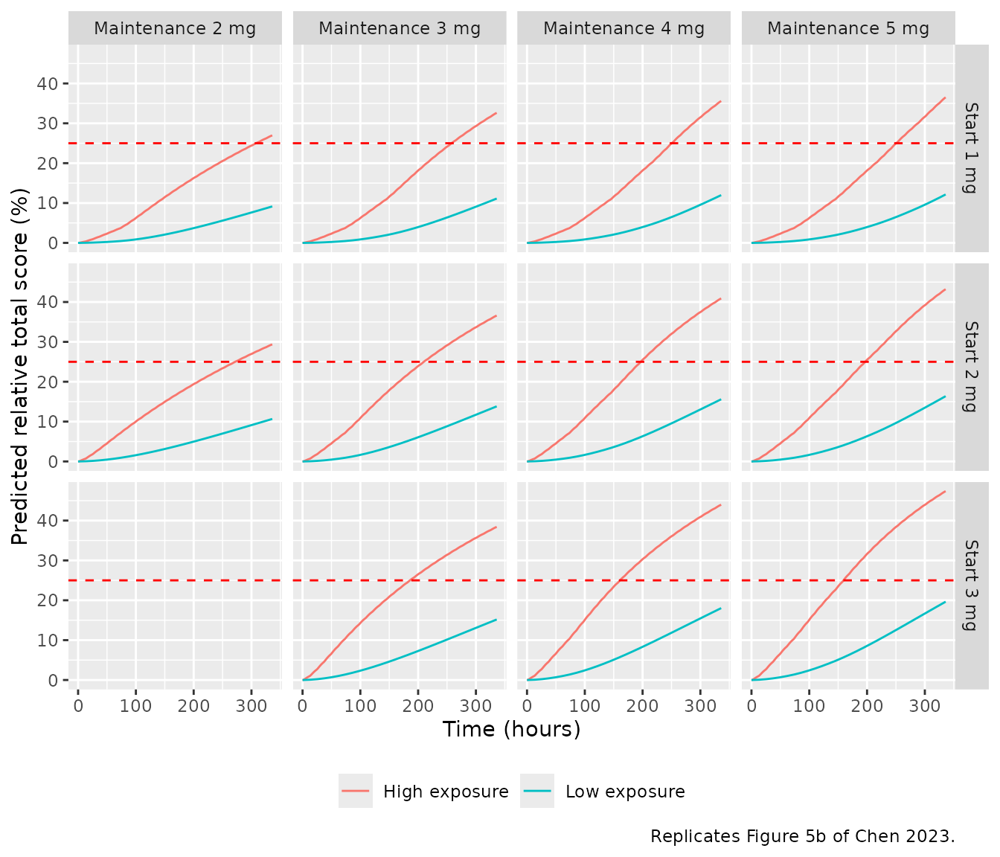
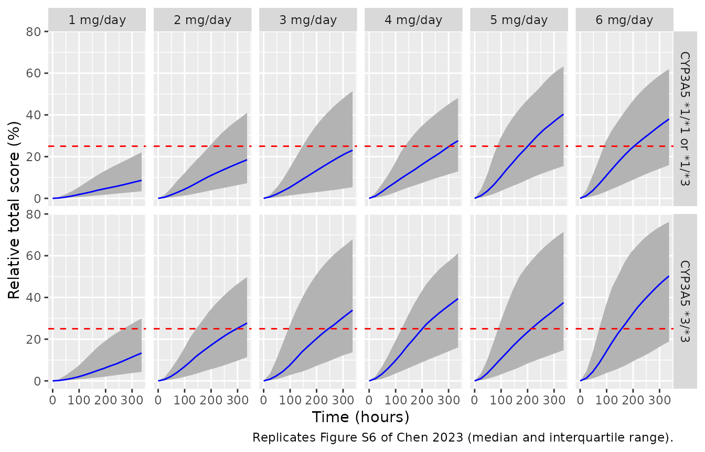
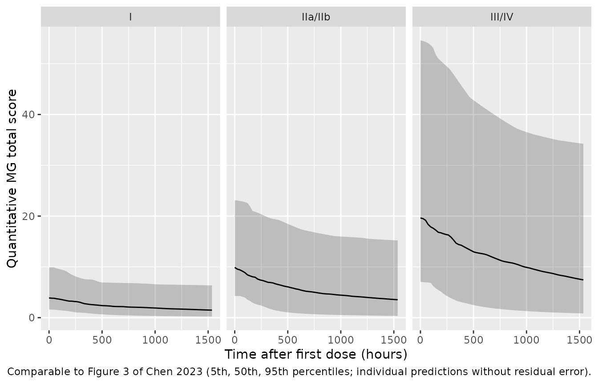

# Tacrolimus in myasthenia gravis (Chen 2023)

## Model and source

- Citation: Chen D, Yao Q, Chen W, Yin J, Hou S, Tian X, Zhao M, Zhang
  H, Yang L, Zhou T, Jin P. Population PK/PD model of tacrolimus for
  exploring the relationship between accumulated exposure and
  quantitative scores in myasthenia gravis patients. CPT Pharmacometrics
  Syst Pharmacol. 2023;12(7):963-976. <doi:10.1002/psp4.12966>
- Description: Population PK/PD model of oral tacrolimus in Chinese
  adults with myasthenia gravis (MG) (Chen 2023). PK: one-compartment
  model with first-order absorption and an absorption lag time, ka and
  tlag fixed to the values of the earlier Chen 2017 MG analysis because
  only trough whole-blood concentrations were collected; apparent
  clearance is 2.05-fold higher in CYP3A5 expressers (carriers of the
  functional star-1 allele) and apparent volume falls exponentially with
  serum total protein (centred on 65 g/L). PD: the Chinese quantitative
  MG total score (sum of nine item scores) falls from an
  Osserman-class-specific baseline through an Emax function of the
  cumulative tacrolimus AUC from the first dose, with Emax fixed at 1
  and a cumulative AUC50 of 4110 ng h/mL. The relative total score
  (percentage improvement from baseline, responder threshold 25%) is
  provided as a derived output.
- Article: <https://doi.org/10.1002/psp4.12966> (open access,
  PMC10349186)
- Supplement: Appendix S1 (Tables S1-S2 covariate screens, Figures
  S1-S7, and the NONMEM control streams of the final PK and PK/PD
  models)

Chen 2023 built the model sequentially: a population PK model of sparse
trough tacrolimus concentrations, then a PD model in which the Chinese
quantitative myasthenia-gravis (MG) total score falls with the
cumulative tacrolimus AUC (cAUC) computed from each patient’s empirical
Bayes PK estimates. The packaged model joins the two layers: the
bookkeeping state `auc_central` integrates `Cc` from the first dose,
which is the paper’s cAUC.

## Population

The data are a retrospective therapeutic-drug-monitoring cohort of 63
Chinese adults with MG treated at Beijing Hospital between January 2013
and June 2018 (Chen 2023 Table 1): 107 trough tacrolimus concentrations
from all 63 patients and 255 quantitative MG total scores from 55 of
them. Mean age was 52.4 years (range 21-87), mean weight 69.2 kg
(40.5-97), and 46.0% were female. Osserman classes were I 11.1%, IIa
20.6%, IIb 36.5%, III 6.3% and IV 25.4%, with no class V. CYP3A5
genotypes were \*3/\*3 44.4%, \*1/\*3 25.4%, \*1/\*1 11.1% and unknown
19.0%; serum total protein was 65.1 +/- 15.9 g/L (range 48-85). All
patients took pyridostigmine bromide. Tacrolimus was started at 1 mg/day
in two doses and titrated after at least 3 days to a 5-10 ng/mL trough
target, with dosing intervals of 8, 12, 24 or 48 h. The longest PD
observation was on day 64.

The same information is available programmatically via
`readModelDb("Chen_2023_tacrolimus")()$population`.

## Source trace

Values come from Table 2 (final models) and from the NONMEM control
streams in Appendix S1, which agree to the printed precision: each Table
2 IIV or residual percentage is the square root of the corresponding
`$OMEGA` or `$SIGMA` variance.

| Equation / parameter | Value | Source location |
|----|----|----|
| `lcl` (CL/F, CYP3A5 \*3/\*3) | log(15.7) L/h | Table 2; Eq. 7; `$THETA` TVCL |
| `lvc` (V/F at TP 65 g/L) | log(1410) L | Table 2; Eq. 9; `$THETA` TVV |
| `lka` | fixed(log(0.502)) 1/h | Table 2 (FIX, from Chen 2017) |
| `ltlag` | fixed(log(0.346)) h | Table 2 (FIX, from Chen 2017); `ALAG1` |
| `e_cyp3a5_expr_cl` | 2.05 | Table 2; Eq. 8; `$THETA` CYP3A5’s effect on CL |
| `e_tpro_vc` | -0.0817 per g/L | Table 2; Eq. 9; `VTP = EXP(THETA(6)*(TP-65))` |
| `etalcl`, `etalvc` | 0.233, 0.561 | `$OMEGA`; Table 2 IIV 48.3%, 74.9% |
| `propSd` | sqrt(0.0718) | `$SIGMA`; Table 2 proportional error 26.8% (additive `$SIGMA` 0 FIX omitted) |
| `lrbase` (TS0, Osserman I) | log(4.08) | Table 2; Eq. 10; `$THETA(1)` |
| `lrbase_osserman2` (TS0, IIa/IIb) | log(10.4) | Table 2; Eq. 11; `$THETA(4)` |
| `lrbase_osserman34` (TS0, III/IV) | log(19.0) | Table 2; Eq. 12; `$THETA(5)` |
| `lemax` | fixed(log(1)) | Table 2 Emax = 1 FIX; `$THETA(2)` |
| `lauc50` (EcAUC50) | log(4110) ng\*h/mL | Table 2; `$THETA(3)` |
| `etalrbase`, `etalauc50` | 0.355, 2.75 | `$OMEGA`; Table 2 IIV 59.6%, 165.8% (IIV on Emax 0 FIX omitted) |
| `propSd_mgts` | sqrt(0.0619) | `$SIGMA`; Table 2 proportional error 24.9% |
| One-compartment PK with lag | n/a | Methods ‘Population PK model’; `ADVAN2 TRANS2`, `S2 = V/1000` |
| `mgts = rbase * (1 - emax * cAUC / (auc50 + cAUC))` | n/a | Eq. 5; `$PRED` |
| `mgrts = 100 * (rbase - mgts) / rbase` | n/a | Eq. 6 |

## Typical-value replication of Figure 4

Figure 4 contrasts a “high exposure” patient (CYP3A5 \*3/\*3, total
protein 85 g/L, the dataset maximum) with a “low exposure” patient
(CYP3A5 expresser, total protein 48 g/L, the dataset minimum) at 2-5
mg/day given twice daily for 2 weeks, using typical parameter values.

``` r

mod <- readModelDb("Chen_2023_tacrolimus")
mod_typ <- rxode2::zeroRe(mod)
#> ℹ parameter labels from comments will be replaced by 'label()'

# Typical-value solve. zeroRe() removes the omega matrix on purpose and each
# scenario is its own id, so rxode2 warns "multi-subject simulation without
# 'omega'"; only that warning is muffled, any other one still surfaces.
muffle_no_omega <- function(w) {
  if (grepl("without 'omega'", conditionMessage(w), fixed = TRUE)) {
    invokeRestart("muffleWarning")
  }
}
solve_typical <- function(events) {
  withCallingHandlers(
    rxode2::rxSolve(mod_typ, events = events, returnType = "data.frame"),
    warning = muffle_no_omega
  )
}

# One subject's event rows: doses into depot, observations on central with
# dvid = 1 (two endpoints are declared, Cc and mgts).
make_subject <- function(id, dose_times, dose_amts, obs_times, expr, tpro,
                         osm2 = 1L, osm34 = 0L) {
  doses <- data.frame(
    id = id, time = dose_times, amt = dose_amts, evid = 1L,
    cmt = "depot", dvid = NA_integer_
  )
  obs <- data.frame(
    id = id, time = obs_times, amt = 0, evid = 0L,
    cmt = "central", dvid = 1L
  )
  dplyr::bind_rows(doses, obs) |>
    dplyr::mutate(
      CYP3A5_EXPR = expr, TPRO = tpro,
      DIS_MG_OSSERMAN2 = osm2, DIS_MG_OSSERMAN34 = osm34
    ) |>
    dplyr::arrange(time, dplyr::desc(evid))
}

# Daily dose split into two 12-hourly doses for every day before `end`.
bid_doses <- function(daily_dose, end = 336) {
  t <- seq(0, end - 12, by = 12)
  data.frame(time = t, amt = rep(daily_dose / 2, length(t)))
}

exposure <- data.frame(
  category = c("High exposure", "Low exposure"),
  expr = c(0L, 1L),
  tpro = c(85, 48)
)
```

``` r

fig4_design <- tidyr::expand_grid(exposure, daily_dose = 2:5) |>
  dplyr::mutate(id = dplyr::row_number())

fig4_events <- dplyr::bind_rows(lapply(seq_len(nrow(fig4_design)), function(i) {
  d <- fig4_design[i, ]
  dd <- bid_doses(d$daily_dose)
  make_subject(d$id, dd$time, dd$amt, seq(0, 336, by = 0.5), d$expr, d$tpro)
}))

fig4_sim <- solve_typical(fig4_events) |>
  dplyr::left_join(fig4_design, by = "id") |>
  dplyr::mutate(dose_label = paste(daily_dose, "mg"))
#> ℹ omega/sigma items treated as zero: 'etalcl', 'etalvc', 'etalrbase', 'etalauc50'
```

``` r

ggplot(fig4_sim, aes(time, Cc, colour = category)) +
  geom_line() +
  geom_hline(yintercept = c(5, 10), linetype = "dashed", colour = "red") +
  facet_wrap(~dose_label, nrow = 1) +
  labs(
    x = "Time (hours)", y = "Predicted concentration (ng/mL)", colour = NULL,
    caption = "Replicates Figure 4a of Chen 2023."
  ) +
  theme(legend.position = "bottom")
```



``` r

ggplot(fig4_sim, aes(time, mgrts, colour = category)) +
  geom_line() +
  geom_hline(yintercept = 25, linetype = "dashed", colour = "red") +
  facet_wrap(~dose_label, nrow = 1) +
  labs(
    x = "Time (hours)", y = "Predicted relative total score (%)", colour = NULL,
    caption = "Replicates Figure 4b of Chen 2023."
  ) +
  theme(legend.position = "bottom")
```



The values below were read by the maintainers from Figure 4b at 336 h
(precision about +/- 1 point).

``` r

fig4_published <- tibble::tribble(
  ~category,       ~daily_dose, ~rts_published,
  "High exposure", 2,           29,
  "High exposure", 3,           38,
  "High exposure", 4,           45,
  "High exposure", 5,           50,
  "Low exposure",  2,           14,
  "Low exposure",  3,           19.5,
  "Low exposure",  4,           24.5,
  "Low exposure",  5,           29
)

fig4_cmp <- fig4_sim |>
  dplyr::filter(time == 336) |>
  dplyr::select(category, daily_dose, rts_sim = mgrts) |>
  dplyr::inner_join(fig4_published, by = c("category", "daily_dose")) |>
  dplyr::mutate(pct_diff = 100 * (rts_sim - rts_published) / rts_published)

fig4_cmp |>
  dplyr::mutate(rts_sim = round(rts_sim, 1), pct_diff = round(pct_diff, 1)) |>
  dplyr::rename(
    "Exposure group" = category, "Daily dose (mg)" = daily_dose,
    "Simulated RTS at 336 h (%)" = rts_sim,
    "Figure 4b RTS at 336 h (%)" = rts_published,
    "Difference (%)" = pct_diff
  ) |>
  knitr::kable(caption = "Relative total score after 2 weeks: model vs. Figure 4b.")
```

| Exposure group | Daily dose (mg) | Simulated RTS at 336 h (%) | Figure 4b RTS at 336 h (%) | Difference (%) |
|:---|---:|---:|---:|---:|
| High exposure | 2 | 29.4 | 29.0 | 1.3 |
| High exposure | 3 | 38.4 | 38.0 | 1.1 |
| High exposure | 4 | 45.4 | 45.0 | 0.9 |
| High exposure | 5 | 51.0 | 50.0 | 1.9 |
| Low exposure | 2 | 10.7 | 14.0 | -23.9 |
| Low exposure | 3 | 15.2 | 19.5 | -22.2 |
| Low exposure | 4 | 19.3 | 24.5 | -21.4 |
| Low exposure | 5 | 23.0 | 29.0 | -20.8 |

Relative total score after 2 weeks: model vs. Figure 4b. {.table}

``` r


high4 <- dplyr::filter(fig4_cmp, category == "High exposure")
stopifnot(
  nrow(high4) == 4,
  # Typical-value solve against values read off the figure: the only error
  # is the reading precision of about 1 point on 29-50.
  all(abs(high4$pct_diff) < 5)
)
```

The high-exposure arm reproduces Figure 4b to the reading precision. The
low-exposure arm does not: Figure 4 shows it about 30% higher, for both
the concentration and the relative score, than the printed typical
values allow. The figure cannot be reconciled with those values. With
CL/F = 15.7 x 2.05 = 32.2 L/h, the average steady-state concentration at
5 mg/day is 5000 / 24 / 32.2 = 6.5 ng/mL, and a profile still rising
after 2 weeks must stay below that. Figure 4a, however, shows about 7
ng/mL at 336 h. The low arm’s apparent clearance in the figure is
therefore lower than the model’s expresser value, which suggests that a
different parameter set or covariate value was used for that arm. The
model is not adjusted to match it.

``` r

low_css_avg <- 5 * 1000 / 24 / (15.7 * 2.05)
low_sim_336 <- fig4_sim |>
  dplyr::filter(category == "Low exposure", daily_dose == 5, time == 336) |>
  dplyr::pull(Cc)
stopifnot(low_sim_336 < low_css_avg)
c(css_avg_bound = low_css_avg, simulated_336h = low_sim_336)
#>  css_avg_bound simulated_336h 
#>       6.472995       5.400997
```

## PKNCA check of the PK layer

Chen 2023 reports no NCA. The check below runs PKNCA over the last
dosing interval of the Figure 4 regimens (324-336 h). The high-exposure
patient (V/F = 275 L, half-life 12 h) is at steady state by then, so its
PKNCA average concentration must equal the closed form dose / (CL/F x
tau).

``` r

nca_conc <- fig4_sim |>
  dplyr::filter(!is.na(Cc), time >= 324) |>
  dplyr::mutate(treatment = paste(category, dose_label)) |>
  dplyr::select(id, time, Cc, treatment)

nca_dose <- fig4_events |>
  dplyr::filter(evid == 1, time >= 324) |>
  dplyr::left_join(fig4_design, by = "id") |>
  dplyr::mutate(treatment = paste(category, paste(daily_dose, "mg"))) |>
  dplyr::select(id, time, amt, treatment)

conc_obj <- PKNCA::PKNCAconc(nca_conc, Cc ~ time | treatment + id)
dose_obj <- PKNCA::PKNCAdose(nca_dose, amt ~ time | treatment + id)
intervals <- data.frame(
  start = 324, end = 336,
  cmax = TRUE, cmin = TRUE, tmax = TRUE, cav = TRUE
)
nca_res <- PKNCA::pk.nca(PKNCA::PKNCAdata(conc_obj, dose_obj, intervals = intervals))

nca_wide <- as.data.frame(nca_res$result) |>
  dplyr::select(treatment, PPTESTCD, PPORRES) |>
  tidyr::pivot_wider(names_from = PPTESTCD, values_from = PPORRES)

nca_wide |>
  dplyr::mutate(dplyr::across(c(cmax, cmin, cav), ~ round(.x, 2))) |>
  dplyr::select(treatment, cmax, cmin, tmax, cav) |>
  dplyr::rename(
    "Group" = treatment, "Cmax (ng/mL)" = cmax, "Cmin (ng/mL)" = cmin,
    "Tmax (h)" = tmax, "Cav (ng/mL)" = cav
  ) |>
  knitr::kable(caption = "PKNCA over 324-336 h, typical patients of Figure 4.")
```

| Group              | Cmax (ng/mL) | Cmin (ng/mL) | Tmax (h) | Cav (ng/mL) |
|:-------------------|-------------:|-------------:|---------:|------------:|
| High exposure 2 mg |         6.06 |         4.24 |      3.5 |        5.31 |
| High exposure 3 mg |         9.10 |         6.36 |      3.5 |        7.96 |
| High exposure 4 mg |        12.13 |         8.48 |      3.5 |       10.62 |
| High exposure 5 mg |        15.16 |        10.60 |      3.5 |       13.27 |
| Low exposure 2 mg  |         2.23 |         2.13 |      4.0 |        2.20 |
| Low exposure 3 mg  |         3.35 |         3.20 |      4.0 |        3.30 |
| Low exposure 4 mg  |         4.47 |         4.27 |      4.0 |        4.40 |
| Low exposure 5 mg  |         5.58 |         5.33 |      4.0 |        5.50 |

PKNCA over 324-336 h, typical patients of Figure 4. {.table}

``` r


high_cav <- nca_wide |>
  dplyr::filter(grepl("^High", treatment)) |>
  dplyr::mutate(
    daily_dose = as.numeric(sub(".* ([0-9]+) mg$", "\\1", treatment)),
    cav_closed = daily_dose / 2 * 1000 / (15.7 * 12)
  )
stopifnot(
  nrow(high_cav) == 4,
  # Linear-up/log-down trapezoid on a 0.5-h grid against the exact steady
  # state; the trapezoid error is a fraction of a percent.
  all(abs(high_cav$cav / high_cav$cav_closed - 1) < 0.01)
)
```

The high-exposure Cmax and Cmin (about 4-6.5 ng/mL at 2 mg/day and 10-16
ng/mL at 5 mg/day) match the fluctuation band of Figure 4a.

## Typical-value replication of Figure 5 (adaptive dosing)

In Figure 5 the daily dose starts at 1, 2 or 3 mg and rises by 1 mg
every 3 days until a maintenance dose of 2-5 mg/day is reached, always
given twice daily.

``` r

adaptive_doses <- function(start, maint, end = 336) {
  t <- seq(0, end - 12, by = 12)
  daily <- pmin(start + floor(t / 72), maint)
  data.frame(time = t, amt = daily / 2)
}

fig5_design <- tidyr::expand_grid(exposure, start = 1:3, maint = 2:5) |>
  dplyr::filter(maint >= start) |>
  dplyr::mutate(id = dplyr::row_number())

fig5_events <- dplyr::bind_rows(lapply(seq_len(nrow(fig5_design)), function(i) {
  d <- fig5_design[i, ]
  dd <- adaptive_doses(d$start, d$maint)
  make_subject(d$id, dd$time, dd$amt, seq(0, 336, by = 1), d$expr, d$tpro)
}))

fig5_sim <- solve_typical(fig5_events) |>
  dplyr::left_join(fig5_design, by = "id") |>
  dplyr::mutate(
    maint_label = paste("Maintenance", maint, "mg"),
    start_label = paste("Start", start, "mg")
  )
#> ℹ omega/sigma items treated as zero: 'etalcl', 'etalvc', 'etalrbase', 'etalauc50'
```

``` r

ggplot(fig5_sim, aes(time, Cc, colour = category)) +
  geom_line() +
  geom_hline(yintercept = c(5, 10), linetype = "dashed", colour = "red") +
  facet_grid(start_label ~ maint_label) +
  labs(
    x = "Time (hours)", y = "Predicted concentration (ng/mL)", colour = NULL,
    caption = "Replicates Figure 5a of Chen 2023."
  ) +
  theme(legend.position = "bottom")
```



``` r

ggplot(fig5_sim, aes(time, mgrts, colour = category)) +
  geom_line() +
  geom_hline(yintercept = 25, linetype = "dashed", colour = "red") +
  facet_grid(start_label ~ maint_label) +
  labs(
    x = "Time (hours)", y = "Predicted relative total score (%)", colour = NULL,
    caption = "Replicates Figure 5b of Chen 2023."
  ) +
  theme(legend.position = "bottom")
```



Values read from Figure 5b at 336 h for the high-exposure patient (rows
with y-axis labels; precision about +/- 1.5 points):

``` r

fig5_published <- tibble::tribble(
  ~start, ~maint, ~rts_published,
  1,      2,      27,
  1,      3,      33,
  1,      4,      36,
  1,      5,      37,
  2,      2,      29,
  2,      3,      37,
  2,      4,      41,
  2,      5,      43
)

fig5_cmp <- fig5_sim |>
  dplyr::filter(time == 336, category == "High exposure") |>
  dplyr::select(start, maint, rts_sim = mgrts) |>
  dplyr::inner_join(fig5_published, by = c("start", "maint")) |>
  dplyr::mutate(pct_diff = 100 * (rts_sim - rts_published) / rts_published)

fig5_cmp |>
  dplyr::mutate(rts_sim = round(rts_sim, 1), pct_diff = round(pct_diff, 1)) |>
  dplyr::rename(
    "Starting dose (mg/day)" = start, "Maintenance dose (mg/day)" = maint,
    "Simulated RTS at 336 h (%)" = rts_sim,
    "Figure 5b RTS at 336 h (%)" = rts_published,
    "Difference (%)" = pct_diff
  ) |>
  knitr::kable(caption = "High-exposure patient, adaptive dosing: model vs. Figure 5b.")
```

| Starting dose (mg/day) | Maintenance dose (mg/day) | Simulated RTS at 336 h (%) | Figure 5b RTS at 336 h (%) | Difference (%) |
|---:|---:|---:|---:|---:|
| 1 | 2 | 27.0 | 27 | -0.1 |
| 1 | 3 | 32.6 | 33 | -1.1 |
| 1 | 4 | 35.6 | 36 | -1.1 |
| 1 | 5 | 36.5 | 37 | -1.3 |
| 2 | 2 | 29.4 | 29 | 1.3 |
| 2 | 3 | 36.6 | 37 | -1.1 |
| 2 | 4 | 40.9 | 41 | -0.2 |
| 2 | 5 | 43.2 | 43 | 0.5 |

High-exposure patient, adaptive dosing: model vs. Figure 5b. {.table}

``` r


stopifnot(
  nrow(fig5_cmp) == 8,
  abs(median(fig5_cmp$pct_diff)) < 5,
  all(abs(fig5_cmp$pct_diff) < 10)
)
```

The low-exposure curves of Figure 5 are lower than the typical-value
model predicts, for the same reason as in Figure 4.

## Starting-dose claims (Figure S6)

Chen 2023 states that, at a total protein of 65 g/L, less than 3 mg/day
lets half of CYP3A5 \*3/\*3 patients reach a 25% relative score within 2
weeks, whereas expressers need more than 4 mg/day, and that 1 mg/day is
not enough for anyone. The typical-value relative score at 336 h
approximates the cohort median that Figure S6 plots, so it is checked
first.

``` r

s6_design <- tidyr::expand_grid(expr = 0:1, daily_dose = 1:6) |>
  dplyr::mutate(id = dplyr::row_number())
s6_events <- dplyr::bind_rows(lapply(seq_len(nrow(s6_design)), function(i) {
  d <- s6_design[i, ]
  dd <- bid_doses(d$daily_dose)
  make_subject(d$id, dd$time, dd$amt, c(0, 336), d$expr, 65)
}))
s6_typ <- solve_typical(s6_events) |>
  dplyr::filter(time == 336) |>
  dplyr::left_join(s6_design, by = "id") |>
  dplyr::mutate(genotype = ifelse(expr == 1, "\\*1/\\*1 or \\*1/\\*3", "\\*3/\\*3"))
#> ℹ omega/sigma items treated as zero: 'etalcl', 'etalvc', 'etalrbase', 'etalauc50'

s6_typ |>
  dplyr::select(genotype, daily_dose, mgrts) |>
  dplyr::mutate(mgrts = round(mgrts, 1)) |>
  tidyr::pivot_wider(names_from = daily_dose, values_from = mgrts, names_prefix = "dose_") |>
  dplyr::rename(
    "CYP3A5" = genotype, "1 mg" = dose_1, "2 mg" = dose_2, "3 mg" = dose_3,
    "4 mg" = dose_4, "5 mg" = dose_5, "6 mg" = dose_6
  ) |>
  knitr::kable(caption = "Typical relative total score (%) at 336 h, total protein 65 g/L.")
```

| CYP3A5             | 1 mg | 2 mg | 3 mg | 4 mg | 5 mg | 6 mg |
|:-------------------|-----:|-----:|-----:|-----:|-----:|-----:|
| \*3/\*3            | 14.0 | 24.5 | 32.8 | 39.4 | 44.8 | 49.4 |
| \*1/\*1 or \*1/\*3 |  8.5 | 15.7 | 21.8 | 27.2 | 31.8 | 35.9 |

Typical relative total score (%) at 336 h, total protein 65 g/L.
{.table}

``` r


rts_at <- function(e, d) s6_typ$mgrts[s6_typ$expr == e & s6_typ$daily_dose == d]
stopifnot(
  rts_at(0, 3) > 25, # *3/*3: under 3 mg/day suffices
  rts_at(1, 3) < 25, # expressers: 3 mg/day does not
  rts_at(1, 6) > 25,
  rts_at(0, 1) < 25, rts_at(1, 1) < 25 # 1 mg/day is not enough
)
```

For \*3/\*3 patients the typical score crosses 25% between 2 and 3
mg/day, as the paper states. For expressers it crosses between 3 and 4
mg/day, a little below the paper’s “more than 4 mg”; the median of the
stochastic cohort below is the closer analogue of the paper’s statement.

The stochastic version of Figure S6 (100 virtual patients per arm) shows
the spread produced by the 166% IIV on EcAUC50:

``` r

rxode2::rxSetSeed(20230701)
n_per_arm <- 100L
s6_vpc_design <- tidyr::expand_grid(expr = 0:1, daily_dose = 1:6, rep = seq_len(n_per_arm)) |>
  dplyr::mutate(id = dplyr::row_number())
s6_vpc_events <- dplyr::bind_rows(lapply(seq_len(nrow(s6_vpc_design)), function(i) {
  d <- s6_vpc_design[i, ]
  dd <- bid_doses(d$daily_dose)
  make_subject(d$id, dd$time, dd$amt, seq(0, 336, by = 24), d$expr, 65)
}))
s6_vpc <- rxode2::rxSolve(mod, events = s6_vpc_events, returnType = "data.frame") |>
  dplyr::left_join(s6_vpc_design, by = "id") |>
  dplyr::mutate(
    genotype = ifelse(expr == 1, "CYP3A5 *1/*1 or *1/*3", "CYP3A5 *3/*3"),
    dose_label = paste(daily_dose, "mg/day")
  )
#> ℹ parameter labels from comments will be replaced by 'label()'

s6_vpc |>
  dplyr::group_by(genotype, dose_label, time) |>
  dplyr::summarise(
    q25 = quantile(mgrts, 0.25), q50 = median(mgrts), q75 = quantile(mgrts, 0.75),
    .groups = "drop"
  ) |>
  ggplot(aes(time, q50)) +
  geom_ribbon(aes(ymin = q25, ymax = q75), fill = "grey70") +
  geom_line(colour = "blue") +
  geom_hline(yintercept = 25, linetype = "dashed", colour = "red") +
  facet_grid(genotype ~ dose_label) +
  labs(
    x = "Time (hours)", y = "Relative total score (%)",
    caption = "Replicates Figure S6 of Chen 2023 (median and interquartile range)."
  )
```



``` r


s6_vpc |>
  dplyr::filter(time == 336) |>
  dplyr::group_by(expr, daily_dose) |>
  dplyr::summarise(
    median_rts = round(median(mgrts), 1),
    pct_responders = round(100 * mean(mgrts > 25)),
    .groups = "drop"
  ) |>
  dplyr::mutate(genotype = ifelse(expr == 1, "\\*1/\\*1 or \\*1/\\*3", "\\*3/\\*3")) |>
  dplyr::select(genotype, daily_dose, median_rts, pct_responders) |>
  dplyr::rename(
    "CYP3A5" = genotype, "Daily dose (mg)" = daily_dose,
    "Median RTS at 336 h (%)" = median_rts,
    "RTS above 25% (% of patients)" = pct_responders
  ) |>
  knitr::kable(caption = "Stochastic cohort at 336 h, total protein 65 g/L (100 per arm).")
```

| CYP3A5 | Daily dose (mg) | Median RTS at 336 h (%) | RTS above 25% (% of patients) |
|:---|---:|---:|---:|
| \*3/\*3 | 1 | 13.3 | 29 |
| \*3/\*3 | 2 | 27.7 | 54 |
| \*3/\*3 | 3 | 33.9 | 57 |
| \*3/\*3 | 4 | 39.5 | 66 |
| \*3/\*3 | 5 | 37.5 | 63 |
| \*3/\*3 | 6 | 50.3 | 70 |
| \*1/\*1 or \*1/\*3 | 1 | 8.6 | 20 |
| \*1/\*1 or \*1/\*3 | 2 | 18.5 | 41 |
| \*1/\*1 or \*1/\*3 | 3 | 23.1 | 45 |
| \*1/\*1 or \*1/\*3 | 4 | 27.6 | 53 |
| \*1/\*1 or \*1/\*3 | 5 | 40.4 | 61 |
| \*1/\*1 or \*1/\*3 | 6 | 38.0 | 59 |

Stochastic cohort at 336 h, total protein 65 g/L (100 per arm). {.table}

With 100 patients per arm, the median and the responder fraction move by
a few points from one random draw to the next. Roughly half of the
\*3/\*3 patients pass 25% at 2 mg/day and roughly half of the expressers
at 4 mg/day, which matches the paper’s dose statements.

## Virtual-cohort VPC of the total score (Figure 3)

The pcVPC of Figure 3 is built from the observed, titrated regimens,
which are not available. The simulation below gives a comparable
picture: 150 virtual patients per Osserman group, with CYP3A5 expressers
at the cohort frequency after the paper’s reassignment of unknown
genotypes (29 of 63 = 46%), total protein drawn from a normal
distribution with the Table 1 mean and SD truncated to the observed
48-85 g/L, 1 mg/day for 3 days and then 2 mg/day, all twice daily, over
the 1536-h observation window.

``` r

rxode2::rxSetSeed(20230702)
set.seed(20230702)
n_per_group <- 150L
osm_groups <- data.frame(
  osserman = c("I", "IIa/IIb", "III/IV"),
  osm2 = c(0L, 1L, 0L),
  osm34 = c(0L, 0L, 1L),
  rbase_typ = c(4.08, 10.4, 19.0)
)
draw_tpro <- function(n) {
  x <- rnorm(n * 3, 65.1, 15.9)
  x <- x[x >= 48 & x <= 85]
  x[seq_len(n)]
}
vpc_design <- osm_groups[rep(seq_len(nrow(osm_groups)), each = n_per_group), ] |>
  dplyr::mutate(
    id = dplyr::row_number(),
    expr = rbinom(dplyr::n(), 1, 29 / 63),
    tpro = draw_tpro(dplyr::n())
  )
vpc_dose_times <- seq(0, 1536 - 12, by = 12)
vpc_dose_amts <- ifelse(vpc_dose_times < 72, 0.5, 1)
vpc_events <- dplyr::bind_rows(lapply(seq_len(nrow(vpc_design)), function(i) {
  d <- vpc_design[i, ]
  make_subject(d$id, vpc_dose_times, vpc_dose_amts, seq(0, 1536, by = 24),
    d$expr, d$tpro, osm2 = d$osm2, osm34 = d$osm34)
}))
vpc_sim <- rxode2::rxSolve(mod, events = vpc_events, returnType = "data.frame") |>
  dplyr::left_join(vpc_design, by = "id")
```

``` r

vpc_sim |>
  dplyr::group_by(osserman, time) |>
  dplyr::summarise(
    q05 = quantile(mgts, 0.05), q50 = median(mgts), q95 = quantile(mgts, 0.95),
    .groups = "drop"
  ) |>
  ggplot(aes(time, q50)) +
  geom_ribbon(aes(ymin = q05, ymax = q95), alpha = 0.25) +
  geom_line() +
  facet_wrap(~osserman, nrow = 1) +
  labs(
    x = "Time after first dose (hours)", y = "Quantitative MG total score",
    caption = "Comparable to Figure 3 of Chen 2023 (5th, 50th, 95th percentiles; individual predictions without residual error)."
  )
```



The simulated baseline medians recover the typical Osserman-group
baselines of Table 2. With 150 patients per group and a 59.6% IIV, the
standard error of a sample median is about 6%, so a 20% bound sits more
than three standard errors out.

``` r

vpc_bl <- vpc_sim |>
  dplyr::filter(time == 0) |>
  dplyr::group_by(osserman, rbase_typ) |>
  dplyr::summarise(median_ts0 = median(mgts), .groups = "drop") |>
  dplyr::mutate(pct_diff = 100 * (median_ts0 - rbase_typ) / rbase_typ)

vpc_bl |>
  dplyr::mutate(median_ts0 = round(median_ts0, 2), pct_diff = round(pct_diff, 1)) |>
  dplyr::rename(
    "Osserman group" = osserman, "Table 2 TS0" = rbase_typ,
    "Simulated median TS0" = median_ts0, "Difference (%)" = pct_diff
  ) |>
  knitr::kable(caption = "Baseline total score by Osserman group.")
```

| Osserman group | Table 2 TS0 | Simulated median TS0 | Difference (%) |
|:---------------|------------:|---------------------:|---------------:|
| I              |        4.08 |                 3.88 |           -4.9 |
| III/IV         |       19.00 |                19.62 |            3.3 |
| IIa/IIb        |       10.40 |                 9.89 |           -4.9 |

Baseline total score by Osserman group. {.table}

``` r


stopifnot(nrow(vpc_bl) == 3, all(abs(vpc_bl$pct_diff) < 20))
```

## Assumptions and deviations

- **Joint instead of sequential fit.** Chen 2023 computed each patient’s
  cAUC from the empirical Bayes PK estimates and then fitted the PD
  model with cAUC as a data item. The packaged model integrates `Cc` in
  the state `auc_central` instead, which gives the same cAUC for a given
  set of PK parameters.
- **Covariate coding.** The source `CYP3A5` column is 0 for \*1/\*1 and
  \*1/\*3 and 1 for \*3/\*3, so `CYP3A5_EXPR = 1 - CYP3A5`. The 12
  patients of unknown genotype were assigned by their base-model CL/F
  (six to each group). The source `OSM` column (1 = I, 2 = IIa, 3 = IIb,
  4 = III, 5 = IV) maps to `DIS_MG_OSSERMAN2 = OSM in (2, 3)` and
  `DIS_MG_OSSERMAN34 = OSM in (4, 5)`; both 0 is class I. No class-V
  patient was studied.
- **Stratum baselines.** The three Osserman baselines are separate
  thetas in the NONMEM code, not a reference plus shifts. The
  maintainers kept them one to one: `lrbase` holds the class-I value and
  `lrbase_osserman2` / `lrbase_osserman34` the other two.
- **Omitted zero-variance terms.** The PK `$SIGMA` additive term (0 FIX)
  and the PD IIV on Emax (0 FIX) contribute nothing and are not carried.
- **Specimen.** The paper calls the samples “plasma concentrations”, but
  the samples are EDTA venous blood measured by the ARCHITECT
  chemiluminescent microparticle immunoassay, which measures whole-blood
  tacrolimus. The central compartment is recorded as whole blood.
- **Figure 4 and 5 low-exposure arm.** As shown above, the published
  low-exposure curves lie above what the printed typical values can
  produce, while the high-exposure curves reproduce. The model keeps the
  printed values.
- **Model limits stated by the authors.** The PK/PD fit underpredicts
  the observed scores after about 500 h (Figure 3), there was no placebo
  arm, and the longest PD observation was on day 64, so long-term
  predictions should be read with caution.
