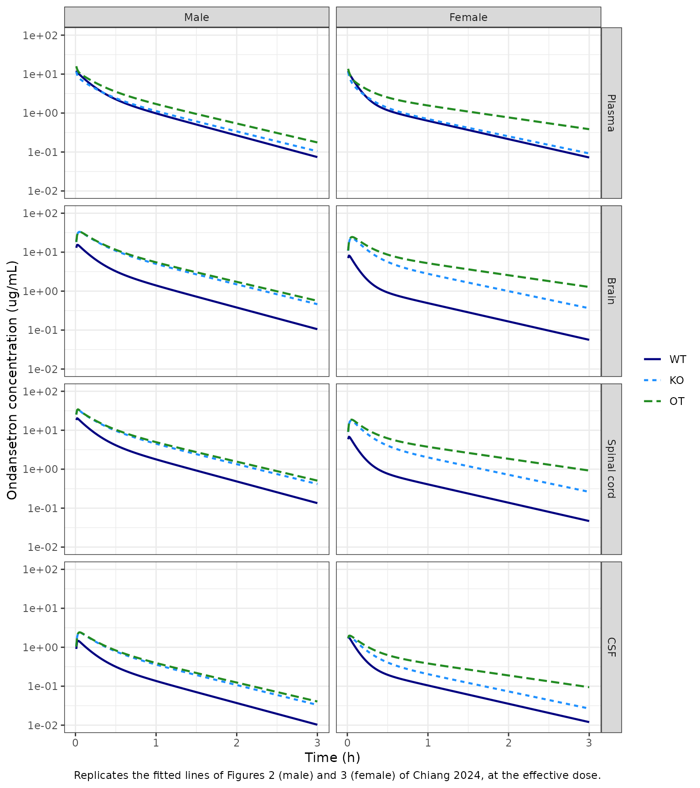
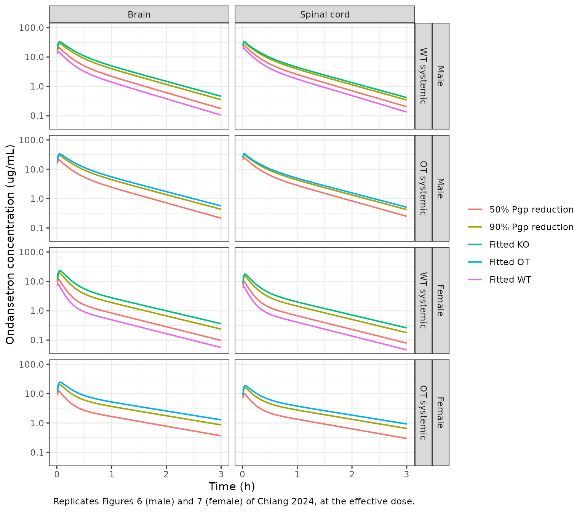

# Ondansetron CNS distribution with tariquidar in rats (Chiang 2024)

## Model and source

- Citation: Chiang M, Back H, Lee JB, Oh S, Guo T, Girgis S, Park C,
  Haroutounian S, Kagan L. Pharmacokinetic Modeling of the Effect of
  Tariquidar on Ondansetron Disposition into the Central Nervous System.
  Pharm Res. 2024;41(7):1401-1411. <doi:10.1007/s11095-024-03739-6>.
- Description (male): Preclinical (rat, male). Semi-physiological
  five-compartment PK model of intravenous ondansetron in male
  Sprague-Dawley rats (Chiang 2024): central and peripheral systemic
  disposition compartments with first-order elimination from central,
  and brain, spinal cord and cerebrospinal-fluid (CSF) compartments
  exchanging bidirectionally with central and with each other, plus
  first-order P-glycoprotein (Pgp) efflux from brain and spinal cord
  back to central. Fitted jointly to mean profiles of wild-type rats
  (ondansetron alone), Pgp-knockout (Mdr1a -/-) rats (Pgp efflux set to
  zero) and wild-type rats pretreated with the Pgp inhibitor tariquidar
  (separate central volume, elimination rate constant and Pgp efflux
  rate). CAUTION: with the published Table III values the model
  reproduces the paper’s concentrations only for an input dose of about
  0.7-0.8 mg/kg, 1/12 to 1/14 of the stated 10 mg/kg (see the vignette).
- Article: <https://doi.org/10.1007/s11095-024-03739-6> (open access,
  PMC11263240)
- Upstream model and wild-type / knockout data: Chiang M et al. Pharm
  Res. 2020;37:205, <https://doi.org/10.1007/s11095-020-02929-2>

Chiang 2024 fitted one semi-physiological model to the mean ondansetron
profiles of three groups of rats: wild-type rats given ondansetron alone
(WT), P-gp knockout rats given ondansetron alone (KO; data from the 2020
study), and wild-type rats given tariquidar 30 min before ondansetron
(OT; this study). Male and female rats were fitted separately with the
same structure, so the package carries two models:

| Model                                | Table III column |
|--------------------------------------|------------------|
| `Chiang_2024_ondansetron_male_rat`   | Male             |
| `Chiang_2024_ondansetron_female_rat` | Female           |

The group is selected with two covariates: `CONMED_TARIQUIDAR` (1 = OT
group) and `STRAIN_ABCB1A_KO` (1 = Mdr1a(-/-) knockout). The paper
studied tariquidar only in wild-type rats, so the two indicators are
never both 1.

## Population

Wild-type Sprague-Dawley rats (males 10-12 weeks, 300-350 g; females
12-14 weeks, 250-280 g) received ondansetron 10 mg/kg as an IV bolus,
alone or 30 min after tariquidar 7.5 mg/kg IV (Methods, Animals and
Experimental Design). Serial plasma samples were taken to 4 h, and
groups of n = 4-6 rats were sacrificed at 0.16-2.5 h for terminal
plasma, brain, spinal cord and cisterna-magna CSF. The WT and KO
(Mdr1a(-/-), SD-Abcb1a tm1sage) data come from the 2020 study. The model
was fitted to the mean profiles with the Ubiquity R package; there is no
between-animal variability.

The same information is available programmatically:

``` r

str(rxode2::rxode(readModelDb("Chiang_2024_ondansetron_male_rat"))$population)
#> List of 9
#>  $ species       : chr "rat (Sprague-Dawley, wild type and Mdr1a(-/-) Pgp knockout)"
#>  $ sex_female_pct: num 0
#>  $ n_studies     : num 2
#>  $ age_range     : chr "10-12 weeks"
#>  $ weight_range  : chr "300-350 g"
#>  $ disease_state : chr "healthy"
#>  $ dose_range    : chr "ondansetron 10 mg/kg IV bolus (jugular cannula or tail vein), alone or 30 min after tariquidar 7.5 mg/kg IV"
#>  $ regions       : chr "United States (Rutgers University)"
#>  $ notes         : chr "Mean (naive-pooled) concentration profiles fitted with the Ubiquity R package. Data: OT-M (ondansetron + tariqu"| __truncated__
```

## Model structure

Chiang 2024 Eqs. 1-5, with states A1 = `central`, A2 = `peripheral1`, A3
= `brain`, A4 = `spinal_cord` and A5 = `csf`:

``` math
\begin{aligned}
\frac{dA_1}{dt} &= k_{21}A_2 + (k_{31} + k_{Pgp})A_3 + (k_{41} + k_{Pgp})A_4 + k_{51}A_5 - (k_{el} + k_{12} + k_{13} + k_{14} + k_{15})A_1 \\
\frac{dA_2}{dt} &= k_{12}A_1 - k_{21}A_2 \\
\frac{dA_3}{dt} &= k_{13}A_1 + k_{53}A_5 - (k_{31} + k_{35} + k_{Pgp})A_3 \\
\frac{dA_4}{dt} &= k_{14}A_1 + k_{54}A_5 - (k_{41} + k_{45} + k_{Pgp})A_4 \\
\frac{dA_5}{dt} &= k_{15}A_1 + k_{35}A_3 + k_{45}A_4 - (k_{51} + k_{53} + k_{54})A_5
\end{aligned}
```

Table III estimates one constant for `k35 = k45` (`k_cns_csf`) and one
for `k53 = k54` (`k_csf_cns`). `kPgp` (`k_cns_central_pgp`) is set to
zero in knockout rats and replaced by the separately estimated
`kPgp,TRQ` in the OT group, which also has its own `V1,TRQ` and
`kel,TRQ`. Concentrations are amount divided by volume: plasma
`Cc = central / V1`, `Cbrain = brain / Vbrain`,
`Cspinal_cord = spinal_cord / Vspinal`, `Ccsf = csf / VCSF`.

## Source trace

Every value is from Chiang 2024 Table III. The in-file comments in
`inst/modeldb/specificDrugs/Chiang_2024_ondansetron_<sex>_rat.R` give
the same locations.

| Parameter (model name) | Table III symbol | Male | Female | Unit |
|----|----|----|----|----|
| `lvc` | V1 | 17.5 | 13.3 | mL |
| `lvc` + `e_conmed_tariquidar_vc` | V1,TRQ | 12.7 | 11.3 | mL |
| `lkel` | kel | 3.60 | 5.06 | 1/h |
| `lkel` + `e_conmed_tariquidar_kel` | kel,TRQ | 3.38 | 3.02 | 1/h |
| `lk12` / `lk21` | k12 / k21 | 2.14 / 2.62 | 4.37 / 2.32 | 1/h |
| `lk_central_brain` / `lk_brain_central` | k13 / k31 | 17.6 / 39.6 | 13.0 / 25.2 | 1/h |
| `lk_central_spinal_cord` / `lk_spinal_cord_central` | k14 / k41 | 9.37 / 71.0 | 3.60 / 31.5 | 1/h |
| `lk_central_csf` / `lk_csf_central` | k15 / k51 | 0.081 / 6.84 | 0.518 / 47.3 | 1/h |
| `lk_cns_csf` | k35 = k45 | 0.928 | 0.914 | 1/h |
| `lk_csf_cns` | k53 = k54 | 66.6 | 79.9 | 1/h |
| `lk_cns_central_pgp` | kPgp | 81.9 | 101 | 1/h |
| `lk_cns_central_pgp` + `e_conmed_tariquidar_k_cns_central_pgp` | kPgp,TRQ | 0.002 | 0.0001 | 1/h |
| `lv_brain` (fixed) | Vbrain | 1.8 | 1.8 | mL |
| `lv_spinal_cord` (fixed) | Vspinal | 0.6 | 0.6 | mL |
| `lvcsf` (fixed) | VCSF | 0.25 | 0.25 | mL |
| `propSd`, `propSd_<output>` | var_P (sqrt) | sqrt(0.05) | sqrt(0.03) | fraction |
| ODEs | Eqs. 1-5 |  |  |  |
| KO: `k_cns_central_pgp * (1 - STRAIN_ABCB1A_KO)` | Methods, ‘set to zero in KO rats’ |  |  |  |

The three `e_conmed_tariquidar_*` effects are log-ratios of the printed
OT value to the ondansetron-alone value (for example
`log(12.7 / 17.5)`), so the model returns the printed OT-group estimates
exactly. The residual model follows the upstream 2020 paper, which
defines the Ubiquity variance as `VAR = sigma1 * Yhat^2`; one `var_P` is
shared by all four matrices.

## The dose scale of the published parameters

Elimination occurs only from the central compartment, so the model’s
plasma AUC is `Dose / (kel * V1)` whatever the dose. With the OT-M Table
III values that clearance is only `3.38 * 12.7 = 43` mL/h, against the
525 mL/h that Table I reports from the noncompartmental analysis of the
same data. At the stated 10 mg/kg dose (about 3250 ug for a 325 g rat)
the model therefore predicts a plasma AUC of about 76 ug\*h/mL, against
the observed 6.13. The tissue concentrations scale the same way, because
the brain, spinal-cord and CSF volumes are fixed anatomical values.

The fitted curves in Figures 2 and 3 do agree with the Table III values
for an input of about 0.7-0.8 mg/kg. That is the dose for which
`Dose / (kel * V1)` equals the Table I AUC, and it is 1/12 to 1/14 of
the stated dose. Neither Chiang 2024 nor the upstream 2020 paper, which
shows the same gap, states what dose the fitting software received. The
maintainers therefore carry Table III exactly as printed, and this
article simulates the published figures at this effective dose,
back-solved from Table I for each sex:

``` r

male <- readModelDb("Chiang_2024_ondansetron_male_rat")
female <- readModelDb("Chiang_2024_ondansetron_female_rat")

# Effective dose = Table I AUC x kel,TRQ x V1,TRQ (OT group, this study).
dose_eff <- c(
  male = 6.13 * 3.38 * 12.7, # ug
  female = 5.65 * 3.02 * 11.3 # ug
)
# Nominal dose = 10 mg/kg x mid-range body weight (Methods, Animals).
bw_kg <- c(male = 0.325, female = 0.265)
dose_nominal <- 10 * 1000 * bw_kg # ug

tibble(
  Sex = names(dose_eff),
  `Nominal dose (ug)` = dose_nominal,
  `Effective dose (ug)` = round(dose_eff, 1),
  `Effective dose (mg/kg)` = round(dose_eff / 1000 / bw_kg, 2),
  `Nominal / effective` = round(dose_nominal / dose_eff, 1)
) |>
  knitr::kable(caption = "Nominal and effective (back-solved) ondansetron doses.")
```

| Sex | Nominal dose (ug) | Effective dose (ug) | Effective dose (mg/kg) | Nominal / effective |
|:---|---:|---:|---:|---:|
| male | 3250 | 263.1 | 0.81 | 12.4 |
| female | 2650 | 192.8 | 0.73 | 13.7 |

Nominal and effective (back-solved) ondansetron doses. {.table}

The model is linear, so every dose-independent quantity is unaffected by
this choice: tissue:plasma partition coefficients, half-lives, curve
shapes, and the relative effect of P-gp inhibition. The checks below
rely on those quantities.

## Simulation

There is no between-animal variability, so the published fits are
typical-value predictions. Only the residual error is removed.

``` r

# One typical rat per group: WT (ondansetron alone), KO (Pgp knockout) and OT
# (tariquidar pretreatment). Observation rows sit on the `central` ODE state
# with dvid = 1; every row returns all four concentrations.
groups <- tibble(
  group = c("WT", "KO", "OT"),
  CONMED_TARIQUIDAR = c(0, 0, 1),
  STRAIN_ABCB1A_KO = c(0, 1, 0)
)

make_events <- function(dose, times) {
  obs_times <- sort(unique(c(0, times)))
  bind_rows(lapply(seq_len(nrow(groups)), function(i) {
    bind_rows(
      tibble(time = 0, amt = dose, evid = 1L, cmt = "central", dvid = NA_integer_),
      tibble(time = obs_times, amt = 0, evid = 0L, cmt = "central", dvid = 1L)
    ) |>
      mutate(
        id = i,
        group = groups$group[i],
        CONMED_TARIQUIDAR = groups$CONMED_TARIQUIDAR[i],
        STRAIN_ABCB1A_KO = groups$STRAIN_ABCB1A_KO[i]
      )
  }))
}

simulate_sex <- function(mod, dose, times, params = NULL) {
  ev <- make_events(dose, times)
  typical <- rxode2::zeroRe(mod, which = "sigma")
  # The model has no IIV by design (fit to mean profiles), so rxode2's
  # "multi-subject simulation without omega" warning is expected here.
  sim <- withCallingHandlers(
    if (is.null(params)) {
      rxode2::rxSolve(typical, ev, keep = "group", returnType = "data.frame")
    } else {
      rxode2::rxSolve(typical, ev, params = params, keep = "group", returnType = "data.frame")
    },
    warning = function(w) {
      if (grepl("without 'omega'", conditionMessage(w), fixed = TRUE)) invokeRestart("muffleWarning")
    }
  )
  sim |>
    dplyr::select(id, group, time, Cc, Cbrain, Cspinal_cord, Ccsf)
}

fine_grid <- seq(0, 3, by = 0.01)
sim_fig <- bind_rows(
  simulate_sex(male, dose_eff[["male"]], fine_grid) |> mutate(sex = "Male"),
  simulate_sex(female, dose_eff[["female"]], fine_grid) |> mutate(sex = "Female")
)
```

## Replicate published figures

### Figures 2 and 3 – fitted profiles in WT, KO and OT rats

``` r

matrix_labels <- c(
  Cc = "Plasma", Cbrain = "Brain",
  Cspinal_cord = "Spinal cord", Ccsf = "CSF"
)
sim_fig |>
  pivot_longer(c(Cc, Cbrain, Cspinal_cord, Ccsf), names_to = "matrix", values_to = "conc") |>
  filter(time > 0) |>
  mutate(
    matrix = factor(matrix_labels[matrix], levels = matrix_labels),
    group = factor(group, levels = c("WT", "KO", "OT")),
    sex = factor(sex, levels = c("Male", "Female"))
  ) |>
  ggplot(aes(time, conc, colour = group, linetype = group)) +
  geom_line(linewidth = 0.8) +
  facet_grid(matrix ~ sex) +
  scale_y_log10() +
  coord_cartesian(ylim = c(0.01, 100)) +
  scale_colour_manual(values = c(WT = "navy", KO = "dodgerblue", OT = "forestgreen")) +
  labs(
    x = "Time (h)", y = "Ondansetron concentration (ug/mL)",
    colour = NULL, linetype = NULL,
    caption = paste(
      "Replicates the fitted lines of Figures 2 (male) and 3 (female) of",
      "Chiang 2024, at the effective dose."
    )
  ) +
  theme_bw()
```



At the effective dose the plasma curves start near 15-20 ug/mL and fall
by about two orders of magnitude by 3 h. The OT curves lie above WT and
KO in every matrix, and in brain and spinal cord the KO curves lie well
above WT. This is the pattern of the fitted lines in Figures 2 and 3.
Simulated at the nominal dose, the curves have the same shape but sit
12-14 times higher.

### Figures 6 and 7 – partial P-gp inhibition

The paper reduced the wild-type `kPgp` by 50% and 90%, keeping either
the WT systemic parameters (panels A, B) or the OT systemic parameters
(panels C, D). In the model this is an override of `lk_cns_central_pgp`.
For the OT panels the tariquidar effect on `kPgp` is also switched off,
so that `kPgp` is the reduced wild-type value.

``` r

pgp_scenarios <- function(mod, dose, times) {
  ui <- rxode2::rxode(mod)
  lkpgp <- ui$iniDf$est[ui$iniDf$name == "lk_cns_central_pgp"]
  bind_rows(lapply(c(1, 0.5, 0.1), function(frac) {
    sim <- simulate_sex(
      mod, dose, times,
      params = c(
        lk_cns_central_pgp = lkpgp + log(frac),
        e_conmed_tariquidar_k_cns_central_pgp = 0
      )
    )
    sim |> mutate(pgp_reduction = paste0(round(100 * (1 - frac)), "%"))
  }))
}

sim_pgp <- bind_rows(
  pgp_scenarios(male, dose_eff[["male"]], fine_grid) |> mutate(sex = "Male"),
  pgp_scenarios(female, dose_eff[["female"]], fine_grid) |> mutate(sex = "Female")
)

# Reference curves: fitted WT, KO and OT, as drawn in Figures 6 and 7.
fitted_ref <- sim_fig |> mutate(pgp_reduction = paste("Fitted", group))
scen <- sim_pgp |>
  filter(pgp_reduction != "0%", group != "KO") |>
  mutate(
    panel = ifelse(group == "WT", "WT systemic", "OT systemic"),
    pgp_reduction = paste(pgp_reduction, "Pgp reduction")
  )
refs <- bind_rows(
  fitted_ref |> filter(group %in% c("WT", "KO")) |> mutate(panel = "WT systemic"),
  fitted_ref |> filter(group == "OT") |> mutate(panel = "OT systemic")
)
bind_rows(scen, refs) |>
  pivot_longer(c(Cbrain, Cspinal_cord), names_to = "matrix", values_to = "conc") |>
  filter(time > 0) |>
  mutate(
    matrix = matrix_labels[matrix],
    panel = factor(panel, levels = c("WT systemic", "OT systemic")),
    sex = factor(sex, levels = c("Male", "Female"))
  ) |>
  ggplot(aes(time, conc, colour = pgp_reduction)) +
  geom_line(linewidth = 0.7) +
  facet_grid(sex + panel ~ matrix) +
  scale_y_log10() +
  coord_cartesian(ylim = c(0.05, 100)) +
  labs(
    x = "Time (h)", y = "Ondansetron concentration (ug/mL)", colour = NULL,
    caption = "Replicates Figures 6 (male) and 7 (female) of Chiang 2024, at the effective dose."
  ) +
  theme_bw()
```



The Results text quantifies Figure 6 (WT systemic parameters, male): 1 h
after the dose, a 50% and a 90% P-gp reduction raise the brain
concentration 1.5- and 3-fold and the spinal-cord concentration 1.2- and
2-fold. These ratios do not depend on the dose.

``` r

fold_1h <- sim_pgp |>
  filter(group == "WT", abs(time - 1) < 1e-8) |>
  group_by(sex) |>
  mutate(
    brain_fold = Cbrain / Cbrain[pgp_reduction == "0%"],
    spinal_fold = Cspinal_cord / Cspinal_cord[pgp_reduction == "0%"]
  ) |>
  ungroup() |>
  filter(pgp_reduction != "0%") |>
  select(sex, pgp_reduction, brain_fold, spinal_fold)

published_fold <- tibble(
  sex = "Male", pgp_reduction = c("50%", "90%"),
  brain_pub = c(1.5, 3), spinal_pub = c(1.2, 2)
)
fold_cmp <- left_join(fold_1h, published_fold, by = c("sex", "pgp_reduction"))
fold_cmp |>
  mutate(across(c(brain_fold, spinal_fold), \(x) round(x, 2))) |>
  rename(
    "Sex" = sex, "Pgp reduction" = pgp_reduction,
    "Brain fold (model)" = brain_fold, "Brain fold (paper)" = brain_pub,
    "Spinal cord fold (model)" = spinal_fold, "Spinal cord fold (paper)" = spinal_pub
  ) |>
  knitr::kable(caption = "Fold increase at 1 h over the fitted WT profile (WT systemic parameters).")
```

| Sex | Pgp reduction | Brain fold (model) | Spinal cord fold (model) | Brain fold (paper) | Spinal cord fold (paper) |
|:---|:---|---:|---:|---:|---:|
| Male | 50% | 1.58 | 1.43 | 1.5 | 1.2 |
| Male | 90% | 2.87 | 2.19 | 3.0 | 2.0 |
| Female | 50% | 1.70 | 1.66 | NA | NA |
| Female | 90% | 3.88 | 3.53 | NA | NA |

Fold increase at 1 h over the fitted WT profile (WT systemic
parameters). {.table}

``` r


male_fold <- filter(fold_cmp, sex == "Male")
# Deterministic typical-value solve: the brain folds sit within 6% of the
# quoted 1.5 and 3. The spinal-cord folds are discussed below.
stopifnot(all(abs(male_fold$brain_fold / male_fold$brain_pub - 1) < 0.10))
```

The brain folds agree with the text. The spinal-cord folds come out at
about 1.4 and 2.2, a little above the quoted 1.2 and 2. They are,
however, consistent with the curves drawn in Figure 6B, where the 50%
curve at 1 h lies well above the fitted WT curve.

## PKNCA validation

### Plasma (Table I)

Table I comes from a noncompartmental analysis of the observed OT plasma
profiles (sampling at 5, 10, 15, 30 and 45 min and 1, 1.5, 2, 2.5, 3 and
4 h), with the clearance and volume computed from the nominal 10 mg/kg
dose. The simulated OT profiles are sampled on that schedule and reach
PKNCA with the nominal dose. This reproduces the paper’s own
calculation: the model concentrations at the effective dose stand in for
the observed data.

``` r

plasma_times <- c(5, 10, 15, 30, 45) / 60
plasma_times <- c(plasma_times, 1, 1.5, 2, 2.5, 3, 4)
tissue_times <- c(0.16, 0.25, 0.5, 1, 1.5, 2, 2.5)

sim_nca <- bind_rows(
  simulate_sex(male, dose_eff[["male"]], sort(unique(c(plasma_times, tissue_times)))) |>
    mutate(sex = "Male"),
  simulate_sex(female, dose_eff[["female"]], sort(unique(c(plasma_times, tissue_times)))) |>
    mutate(sex = "Female")
) |>
  mutate(treatment = paste0(group, "-", substr(sex, 1, 1)))

plasma_nca_input <- sim_nca |>
  filter(!is.na(Cc), time == 0 | time %in% plasma_times) |>
  select(id, treatment, sex, time, Cc)
dose_nominal_df <- plasma_nca_input |>
  distinct(id, treatment, sex) |>
  mutate(time = 0, amt = dose_nominal[tolower(sex)])

conc_obj <- PKNCA::PKNCAconc(plasma_nca_input, Cc ~ time | treatment + id)
dose_obj <- PKNCA::PKNCAdose(dose_nominal_df, amt ~ time | treatment + id, route = "intravascular")
intervals <- data.frame(
  start = 0, end = Inf,
  aucinf.obs = TRUE, half.life = TRUE, mrt.iv.obs = TRUE,
  vss.iv.obs = TRUE, cl.obs = TRUE
)
nca_plasma <- PKNCA::pk.nca(PKNCA::PKNCAdata(conc_obj, dose_obj, intervals = intervals))

published_plasma <- tibble::tribble(
  ~treatment, ~half.life, ~aucinf.obs, ~mrt.iv.obs, ~vss.iv.obs, ~cl.obs,
  "OT-M", 0.638, 6.13, 0.577, 302, 525,
  "OT-F", 0.998, 5.65, 0.919, 396, 447
)
cmp_plasma <- nlmixr2lib::ncaComparisonTable(
  simulated = as.data.frame(nca_plasma) |> filter(treatment %in% published_plasma$treatment),
  reference = published_plasma,
  by = "treatment",
  units = c(
    half.life = "h", aucinf.obs = "h*ug/mL", mrt.iv.obs = "h",
    vss.iv.obs = "mL", cl.obs = "mL/h"
  ),
  tolerance_pct = 20
)
knitr::kable(
  cmp_plasma,
  caption = "Simulated (effective dose, nominal dose for NCA) vs. Table I. * differs by >20%."
)
```

| NCA parameter           | treatment | Reference | Simulated | % diff   |
|:------------------------|:----------|:----------|:----------|:---------|
| AUC0-∞ (obs) (h\*ug/mL) | OT-M      | 6.13      | 6.34      | +3.4%    |
| AUC0-∞ (obs) (h\*ug/mL) | OT-F      | 5.65      | 5.8       | +2.6%    |
| t½ (h)                  | OT-M      | 0.638     | 0.615     | -3.6%    |
| t½ (h)                  | OT-F      | 0.998     | 0.994     | -0.4%    |
| CL/F (mL/h)             | OT-M      | 525       | 513       | -2.4%    |
| CL/F (mL/h)             | OT-F      | 447       | 457       | +2.3%    |
| MRT (IV) (h)            | OT-M      | 0.577     | 0.689     | +19.3%   |
| MRT (IV) (h)            | OT-F      | 0.919     | 1.14      | +24.0%\* |
| Vss (IV) (mL)           | OT-M      | 302       | 353       | +16.9%   |
| Vss (IV) (mL)           | OT-F      | 396       | 521       | +31.6%\* |

Simulated (effective dose, nominal dose for NCA) vs. Table I. \* differs
by \>20%. {.table}

``` r

nca_plasma_wide <- as.data.frame(nca_plasma) |>
  filter(treatment %in% published_plasma$treatment) |>
  select(treatment, PPTESTCD, PPORRES) |>
  pivot_wider(names_from = PPTESTCD, values_from = PPORRES) |>
  left_join(published_plasma, by = "treatment", suffix = c("", "_pub"))
# Deterministic solve on the paper's sampling schedule. The half-life is dose-
# independent and matches Table I within 5% in both sexes. AUC, CL and Vss
# depend on the effective dose (back-solved from the Table I AUC), so they are
# compared at 20%: the residual difference is the trapezoid on the sparse
# schedule against the model's exact AUC.
stopifnot(
  all(abs(nca_plasma_wide$half.life / nca_plasma_wide$half.life_pub - 1) < 0.10),
  all(abs(nca_plasma_wide$aucinf.obs / nca_plasma_wide$aucinf.obs_pub - 1) < 0.20),
  all(abs(nca_plasma_wide$cl.obs / nca_plasma_wide$cl.obs_pub - 1) < 0.20)
)
```

The terminal half-life does not depend on the dose scale, and it agrees
with Table I in both sexes. AUC and CL agree because the effective dose
was back-solved from the Table I AUC. The model’s mean residence time is
19-24% longer than the Table I value, so Vss (= MRT x CL) comes out
17-32% larger. MRT does not depend on the dose either, so this is a
property of the fitted parameters. The likeliest cause is that the
observed 4-h profile resolves the model’s slow CNS-return phase less
well than the model does.

### Brain, spinal cord and CSF (Table II)

The tissue concentrations peak within minutes of the dose, before the
first terminal sacrifice at 0.16 h. A trapezoid on the paper’s terminal
schedule therefore underestimates the model’s tissue AUC by up to about
25%, from missing that peak alone. The model’s own tissue AUCs and
partition coefficients are computed with PKNCA on a dense grid (every
0.02 h to 8 h), from the same solve for plasma and tissue.

``` r

dense_grid <- seq(0, 8, by = 0.02)
sim_dense <- bind_rows(
  simulate_sex(male, dose_eff[["male"]], dense_grid) |> mutate(sex = "Male"),
  simulate_sex(female, dose_eff[["female"]], dense_grid) |> mutate(sex = "Female")
) |>
  mutate(treatment = paste0(group, "-", substr(sex, 1, 1)))

dense_long <- sim_dense |>
  rename(Cplasma = Cc) |>
  pivot_longer(c(Cplasma, Cbrain, Cspinal_cord, Ccsf), names_to = "matrix", values_to = "Cc") |>
  filter(!is.na(Cc)) |>
  mutate(matrix = unname(c(
    Cplasma = "Plasma", Cbrain = "Brain", Cspinal_cord = "Spinal cord", Ccsf = "CSF"
  )[matrix])) |>
  select(id, treatment, sex, matrix, time, Cc)
dose_dense <- dense_long |>
  distinct(id, treatment, sex, matrix) |>
  mutate(time = 0, amt = dose_eff[tolower(sex)])

nca_tissue <- PKNCA::pk.nca(PKNCA::PKNCAdata(
  PKNCA::PKNCAconc(dense_long, Cc ~ time | treatment + matrix + id),
  PKNCA::PKNCAdose(dose_dense, amt ~ time | treatment + matrix + id),
  intervals = data.frame(start = 0, end = Inf, aucinf.obs = TRUE, half.life = TRUE)
))

published_tissue <- tibble::tribble(
  ~treatment, ~matrix, ~half.life, ~aucinf.obs,
  "OT-M", "Brain", 0.580, 22.0,
  "OT-F", "Brain", 0.352, 19.16,
  "OT-M", "Spinal cord", 0.907, 15.0,
  "OT-F", "Spinal cord", 0.596, 15.6,
  "OT-M", "CSF", 0.517, 1.37,
  "OT-F", "CSF", 0.580, 1.49
)
cmp_tissue <- nlmixr2lib::ncaComparisonTable(
  simulated = as.data.frame(nca_tissue) |>
    filter(treatment %in% c("OT-M", "OT-F"), matrix != "Plasma"),
  reference = published_tissue,
  by = c("treatment", "matrix"),
  units = c(half.life = "h", aucinf.obs = "h*ug/mL"),
  tolerance_pct = 20
)
knitr::kable(cmp_tissue, caption = "Simulated (effective dose) vs. Table II. * differs by >20%.")
```

| NCA parameter           | treatment | matrix      | Reference | Simulated | % diff    |
|:------------------------|:----------|:------------|:----------|:----------|:----------|
| AUC0-∞ (obs) (h\*ug/mL) | OT-M      | Brain       | 22        | 19        | -13.6%    |
| AUC0-∞ (obs) (h\*ug/mL) | OT-M      | Spinal cord | 15        | 17.3      | +15.3%    |
| AUC0-∞ (obs) (h\*ug/mL) | OT-M      | CSF         | 1.37      | 1.36      | -0.4%     |
| AUC0-∞ (obs) (h\*ug/mL) | OT-F      | Brain       | 19.2      | 18.2      | -5.1%     |
| AUC0-∞ (obs) (h\*ug/mL) | OT-F      | Spinal cord | 15.6      | 13.2      | -15.6%    |
| AUC0-∞ (obs) (h\*ug/mL) | OT-F      | CSF         | 1.49      | 1.35      | -9.6%     |
| t½ (h)                  | OT-M      | Brain       | 0.58      | 0.616     | +6.3%     |
| t½ (h)                  | OT-M      | Spinal cord | 0.907     | 0.616     | -32.0%\*  |
| t½ (h)                  | OT-M      | CSF         | 0.517     | 0.616     | +19.2%    |
| t½ (h)                  | OT-F      | Brain       | 0.352     | 0.994     | +182.4%\* |
| t½ (h)                  | OT-F      | Spinal cord | 0.596     | 0.994     | +66.8%\*  |
| t½ (h)                  | OT-F      | CSF         | 0.58      | 0.994     | +71.4%\*  |

Simulated (effective dose) vs. Table II. \* differs by \>20%. {.table
style="width:100%;"}

The OT-group tissue AUCs are within about 20% of Table II. The tissue
half-lives in Table II are more scattered, because they come from
terminal samples of 4-6 rats per time point. They run from 0.35 to 0.91
h, whereas the model gives every compartment the same terminal half-life
as plasma (0.62 h in males, 1.0 h in females). In females, the model’s
tissue half-lives are well above the Table II values.

### Partition coefficients (Table II)

The partition coefficient is AUCtissue / AUCplasma. It does not depend
on the dose. Table II reports `KP_OT` from this study and copies `KP_WT`
and `KP_KO` from the 2020 study.

``` r

auc_dense <- as.data.frame(nca_tissue) |>
  filter(PPTESTCD == "aucinf.obs") |>
  select(treatment, matrix, auc = PPORRES)
kp <- auc_dense |>
  filter(matrix != "Plasma") |>
  left_join(
    auc_dense |> filter(matrix == "Plasma") |> select(treatment, auc_plasma = auc),
    by = "treatment"
  ) |>
  mutate(kp_model = auc / auc_plasma)

published_kp <- tibble::tribble(
  ~treatment, ~Brain, ~`Spinal cord`, ~CSF,
  "OT-M", 3.58, 2.44, 0.223, "OT-F", 3.39, 2.76, 0.263,
  "WT-M", 0.46, 0.39, 0.06, "WT-F", 0.71, 0.47, 0.11,
  "KO-M", 2.52, 1.78, 0.19, "KO-F", 3.04, 1.34, 0.22
) |>
  pivot_longer(-treatment, names_to = "matrix", values_to = "kp_paper")

kp_cmp <- left_join(kp, published_kp, by = c("treatment", "matrix")) |>
  mutate(pct_diff = 100 * (kp_model / kp_paper - 1))
kp_cmp |>
  mutate(across(c(kp_model, pct_diff), \(x) signif(x, 3))) |>
  arrange(matrix, treatment) |>
  select(matrix, treatment, kp_model, kp_paper, pct_diff) |>
  rename(
    "Matrix" = matrix, "Group" = treatment, "Kp (model)" = kp_model,
    "Kp (Table II)" = kp_paper, "Difference (%)" = pct_diff
  ) |>
  knitr::kable(caption = "Model partition coefficients vs. Table II.")
```

| Matrix      | Group | Kp (model) | Kp (Table II) | Difference (%) |
|:------------|:------|-----------:|--------------:|---------------:|
| Brain       | KO-F  |      3.770 |         3.040 |         24.100 |
| Brain       | KO-M  |      4.260 |         2.520 |         69.100 |
| Brain       | OT-F  |      3.210 |         3.390 |         -5.180 |
| Brain       | OT-M  |      3.090 |         3.580 |        -13.600 |
| Brain       | WT-F  |      0.753 |         0.710 |          6.080 |
| Brain       | WT-M  |      1.390 |         0.460 |        201.000 |
| CSF         | KO-F  |      0.278 |         0.220 |         26.600 |
| CSF         | KO-M  |      0.306 |         0.190 |         61.000 |
| CSF         | OT-F  |      0.238 |         0.263 |         -9.460 |
| CSF         | OT-M  |      0.222 |         0.223 |         -0.411 |
| CSF         | WT-F  |      0.160 |         0.110 |         45.500 |
| CSF         | WT-M  |      0.135 |         0.060 |        125.000 |
| Spinal cord | KO-F  |      2.730 |         1.340 |        104.000 |
| Spinal cord | KO-M  |      3.880 |         1.780 |        118.000 |
| Spinal cord | OT-F  |      2.330 |         2.760 |        -15.600 |
| Spinal cord | OT-M  |      2.820 |         2.440 |         15.400 |
| Spinal cord | WT-F  |      0.625 |         0.470 |         33.000 |
| Spinal cord | WT-M  |      1.770 |         0.390 |        354.000 |

Model partition coefficients vs. Table II. {.table}

``` r


kp_ot <- filter(kp_cmp, treatment %in% c("OT-M", "OT-F"))
# Deterministic; the OT-group Kp lie within about 16% of Table II in all six
# cells (brain -13 / -5%, spinal cord +16 / -15%, CSF 0 / -9%, male / female).
stopifnot(all(abs(kp_ot$pct_diff) < 20))
```

For the OT groups the model reproduces `KP_OT` within 16% in every
matrix. For the WT and KO groups the model partition coefficients are
well above the 2020 values in Table II: 3-fold above in WT male brain
and 4.5-fold above in WT male spinal cord. WT female brain is the
exception and agrees within 6%. These rows compare the 2024 joint refit
with the 2020 noncompartmental analysis, not with a model prediction.
The ratio of the fitted brain and plasma curves at 1 h in Figure 2
(about 1.3 for WT-M, about 5 for KO-M) agrees with the model (1.4 and
4.4), so the difference lies in the published refit and is not an
extraction error. It is listed below as a known deviation.

### Exposure at the nominal dose

For completeness, the model simulated at the stated 10 mg/kg dose:

``` r

nominal <- bind_rows(
  simulate_sex(male, dose_nominal[["male"]], c(1, 2)) |> mutate(sex = "Male"),
  simulate_sex(female, dose_nominal[["female"]], c(1, 2)) |> mutate(sex = "Female")
) |>
  filter(group == "OT", time == 1)
nominal_auc <- c(
  male = dose_nominal[["male"]] / (3.38 * 12.7),
  female = dose_nominal[["female"]] / (3.02 * 11.3)
)
tibble(
  Sex = c("Male", "Female"),
  `Model plasma AUC at 10 mg/kg (h*ug/mL)` = round(nominal_auc, 1),
  `Table I AUC (h*ug/mL)` = c(6.13, 5.65),
  `Model plasma C at 1 h (ug/mL)` = round(nominal$Cc, 1)
) |>
  knitr::kable(caption = "OT group at the nominal dose: the model is 12-14 times above the data.")
```

| Sex | Model plasma AUC at 10 mg/kg (h\*ug/mL) | Table I AUC (h\*ug/mL) | Model plasma C at 1 h (ug/mL) |
|:---|---:|---:|---:|
| Male | 75.7 | 6.13 | 21.1 |
| Female | 77.7 | 5.65 | 21.5 |

OT group at the nominal dose: the model is 12-14 times above the data.
{.table}

``` r

stopifnot(all(nominal_auc / c(6.13, 5.65) > 10))
```

## Assumptions and deviations

- **Dose scale.** The Table III parameters reproduce the paper’s
  concentrations only for an input of about 0.7-0.8 mg/kg, 1/12 to 1/14
  of the stated 10 mg/kg (see “The dose scale of the published
  parameters”). The upstream 2020 model shows the same gap. The
  maintainers carry Table III exactly as printed, without rescaling any
  parameter. The figures in this article use an effective dose
  back-solved from the Table I AUC: 263 ug in males and 193 ug in
  females. To predict the absolute concentrations after a known physical
  dose, scale that dose by the same factor. Dose-independent quantities
  (partition coefficients, half-lives, fold changes from P-gp
  inhibition) can be used directly.
- **Body weights** for the nominal dose are the mid-points of the
  Methods ranges (325 g male, 265 g female). The Table I CL and AUC
  imply 322 g and 253 g.
- **Shared rate constants.** Table III reports single values for
  `k35 = k45` and `k53 = k54`, and a single `kPgp` acting on both brain
  and spinal cord. These are encoded as `k_cns_csf`, `k_csf_cns` and
  `k_cns_central_pgp`, so CSF loses `2 * k_csf_cns * csf` (Eq. 5).
- **Tariquidar** is a time-fixed categorical covariate, as in the paper;
  its long half-life left no information for a concentration-driven
  inhibition model. `CONMED_TARIQUIDAR = 1` with `STRAIN_ABCB1A_KO = 1`
  was not studied.
- **Residual error.** `var_P` is taken as the proportional variance
  `sigma1` of the 2020 paper (`VAR = sigma1 * Yhat^2`), shared by all
  four matrices. The model has no between-animal variability because it
  was fitted to mean profiles.
- **Known deviations.** Against the 2020 noncompartmental values in
  Table II, the WT and KO partition coefficients are up to 4.5-fold
  higher (all but WT female brain more than 20% higher). The spinal-cord
  fold changes at 1 h (about 1.4 and 2.2) are above the 1.2 and 2 quoted
  in the Results. In females the tissue half-lives are well above the
  Table II terminal-sample values. All three are properties of the
  published fit and are not tuned.
- No erratum or correction notice for Chiang 2024 was found (checked
  2026-11-10).
