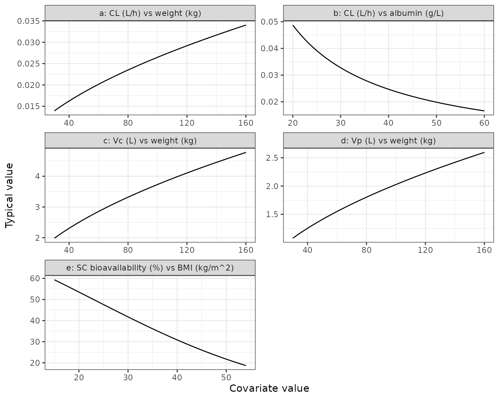
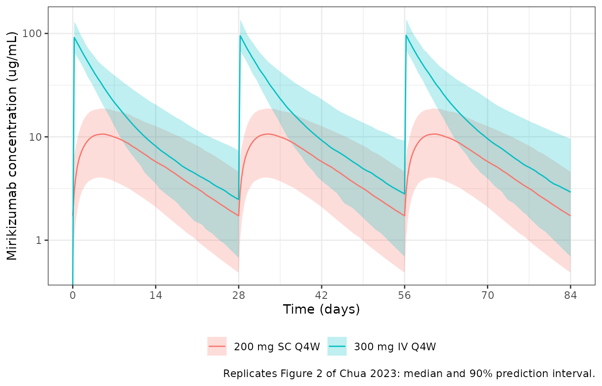
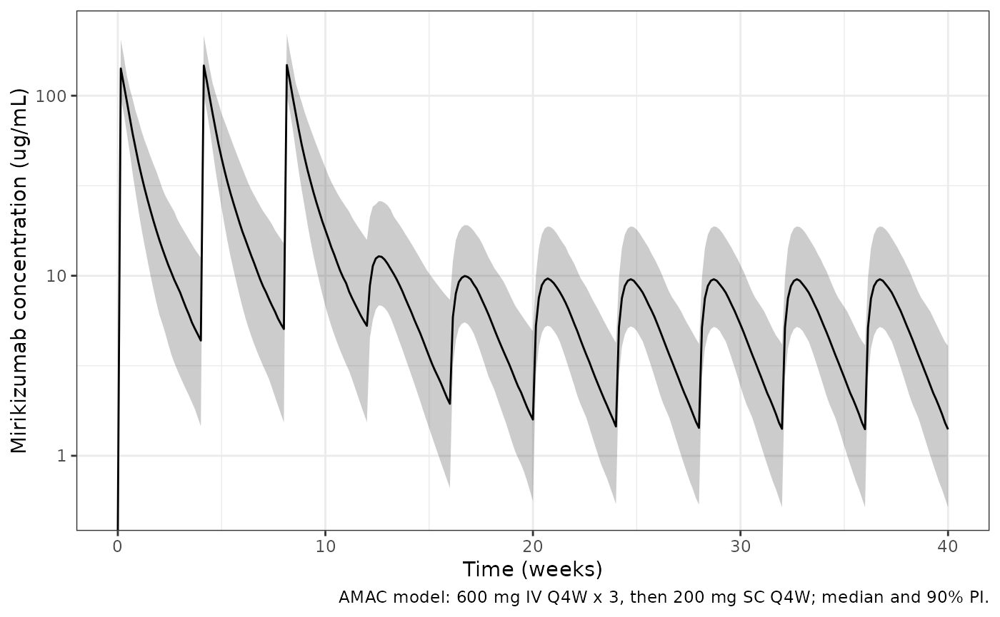
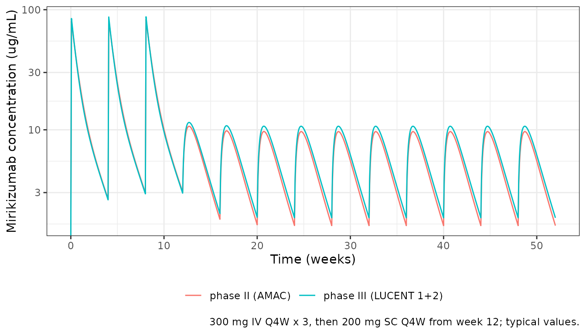

# Mirikizumab in ulcerative colitis (Chua 2023)

``` r

library(nlmixr2lib)
library(PKNCA)
#> 
#> Attaching package: 'PKNCA'
#> The following object is masked from 'package:stats':
#> 
#>     filter
library(rxode2)
#> rxode2 5.1.8 using 2 threads (see ?getRxThreads)
#>   no cache: create with `rxCreateCache()`
library(dplyr)
#> 
#> Attaching package: 'dplyr'
#> The following objects are masked from 'package:stats':
#> 
#>     filter, lag
#> The following objects are masked from 'package:base':
#> 
#>     intersect, setdiff, setequal, union
library(tidyr)
library(ggplot2)
```

## Model and source

Chua, Friedrich and Zhang (2023) characterised the population PK of
mirikizumab, a humanised IgG4 anti-IL-23p19 monoclonal antibody, in
patients with moderately to severely active ulcerative colitis. The
authors fitted the same structure – a linear two-compartment model with
first-order absorption of subcutaneous (SC) doses – twice, without
pooling the data:

- `Chua_2023_mirikizumab_phase2`: the phase II AMAC trial (233
  patients).
- `Chua_2023_mirikizumab_phase3`: the final model from the pooled phase
  III LUCENT 1 (induction) and LUCENT 2 (maintenance) trials (1129
  patients).

The two fits have different covariate structures, so both are provided.
The phase III model supports the approved regimen (300 mg IV every 4
weeks for three doses, then 200 mg SC every 4 weeks) and is the focus of
the paper’s simulations.

- Citation: Chua L, Friedrich S, Zhang XC. Mirikizumab Pharmacokinetics
  in Patients with Moderately to Severely Active Ulcerative Colitis:
  Results from Phase III LUCENT Studies. Clin Pharmacokinet.
  2023;62(10):1479-1491. <doi:10.1007/s40262-023-01281-z>
- Article: <https://doi.org/10.1007/s40262-023-01281-z>

## Population

Baseline characteristics from Chua 2023 Table 1:

| Characteristic | AMAC (phase II) | LUCENT 1+2 (phase III) |
|----|----|----|
| Patients (samples) | 233 (4103) | 1129 (7578) |
| Age, mean \[range\], years | 42.2 \[17-72\] | 42.6 \[18-79\] |
| Male, % | 59.2 | 60.9 |
| White / Asian / Black, % | 83.3 / 13.7 / 3.0 | 74.7 / 22.2 / 1.1 |
| Weight, mean (SD) \[range\], kg | 74.5 (16.6) \[39.6-122.0\] | 72.6 (17.1) \[34.0-152.0\] |
| BMI, mean (SD) \[range\], kg/m^2 | 25.2 (5.1) \[15.0-42.7\] | 24.9 (5.3) \[13.8-53.5\] |
| Albumin, mean (SD) \[range\], g/L | 41.1 (3.84) \[24-51\] | 42.8 (4.20) \[21-54\] |
| Biologic-naive, % | 35.2 | 43.7 |

AMAC randomised patients to 50, 200 or 600 mg IV every 4 weeks for
induction (the 50 and 200 mg arms were exposure-adjusted upward, to at
most 600 mg), followed by 200 mg SC every 4 or 12 weeks for maintenance,
using a lyophilised formulation. LUCENT 1 gave 300 mg IV every 4 weeks
for 12 weeks; LUCENT 2 gave responders 200 mg SC every 4 weeks from a
prefilled syringe. The same information is in each model’s `population`
metadata.

## Source trace

All values come from Chua 2023 Table 2 and its footnotes. Rate constants
and clearances are published per hour and are multiplied by 24 to give
the per-day values used in the model files.

| Quantity | AMAC (phase II) | LUCENT 1+2 (phase III) | Source |
|----|----|----|----|
| Ka (1/h) | 0.00757 | 0.00706 | Table 2 |
| CL (L/h) | 0.0230 | 0.022 | Table 2 |
| Q (L/h) | 0.00756 | 0.00870 | Table 2 |
| V1 = Vc (L) | 3.40 | 3.11 | Table 2 |
| V2 = Vp (L) | 1.58 | 1.69 | Table 2 |
| F1 (%) | 42.2 | 47.6 (logit scale) | Table 2, footnote e |
| Albumin on CL | (ALB/43.2)^-0.951 | (ALB/45.0)^-0.981 | Table 2, footnote c |
| Weight on CL and Q | – | (WT/70.7)^0.534 | Table 2, footnote c |
| Weight on V1 | (WT/75.4)^0.247 | (WT/70.7)^0.525 | Table 2, footnote d |
| Weight on V2 | – | (WT/70.7)^0.525 | Table 2, footnote d |
| BMI on logit(F1) | – | -0.0474 per kg/m^2 (centred at 25, see Assumptions) | Table 2 |
| IIV CL, V1, V2 (CV%) | 31.5, 25.0, 44.4 | 30.1, 18.1, 59.3 | Table 2, footnote b |
| Covariance CL-V1 | 0.0426 | 0.0241 | Table 2 |
| IIV F1 | 34.4% (log-normal) | 64.3% = 100 sqrt(OMEGA), logit scale | Table 2, footnotes b and e |
| Proportional error (%) | 25.4 | 19.6 | Table 2 |
| Additive error (ng/mL) | 98.7 | 171.0 | Table 2 |
| Two-compartment, first-order SC absorption | yes | yes | Methods, Model Development |

Log-normal IIV is converted with footnote b, CV% = 100 sqrt(exp(OMEGA) -
1), so OMEGA = log(1 + CV^2).

## Typical-value checks

### Half-life

The paper reports a typical half-life of 9.5 days for the phase III
model. The terminal (beta) half-life follows in closed form from the
typical micro-constants.

``` r

beta_half_life <- function(model_name) {
  th <- rxode2::rxode(readModelDb(model_name))$theta
  cl <- exp(th[["lcl"]])
  vc <- exp(th[["lvc"]])
  vp <- exp(th[["lvp"]])
  q <- exp(th[["lq"]])
  kel <- cl / vc
  k12 <- q / vc
  k21 <- q / vp
  s <- kel + k12 + k21
  beta <- (s - sqrt(s^2 - 4 * kel * k21)) / 2
  log(2) / beta
}
t_half <- c(
  phase2 = beta_half_life("Chua_2023_mirikizumab_phase2"),
  phase3 = beta_half_life("Chua_2023_mirikizumab_phase3")
)
#> ℹ parameter labels from comments will be replaced by 'label()'
#> ℹ parameter labels from comments will be replaced by 'label()'
round(t_half, 2)
#> phase2 phase3 
#>   9.61   9.50
stopifnot(abs(t_half[["phase3"]] - 9.5) < 0.05)
```

### Covariate relationships (Figure 3)

Replicates the model-estimated relationships in Figure 3 of Chua 2023
for the phase III model. Each panel varies one covariate with the others
at their reference values. The table compares the curves with end points
read from the figure by the maintainers.

``` r

th3 <- rxode2::rxode(readModelDb("Chua_2023_mirikizumab_phase3"))$theta
#> ℹ parameter labels from comments will be replaced by 'label()'
cl_h <- function(WT = 70.7, ALB = 45) {
  exp(th3[["lcl"]]) / 24 * (WT / 70.7)^th3[["e_wt_cl_q"]] *
    (ALB / 45)^th3[["e_alb_cl"]]
}
vc_l <- function(WT) exp(th3[["lvc"]]) * (WT / 70.7)^th3[["e_wt_vc_vp"]]
vp_l <- function(WT) exp(th3[["lvp"]]) * (WT / 70.7)^th3[["e_wt_vc_vp"]]
f_pct <- function(BMI) {
  100 * plogis(th3[["logitfdepot"]] + th3[["e_bmi_fdepot"]] * (BMI - 25))
}

curves <- bind_rows(
  tibble(panel = "a: CL (L/h) vs weight (kg)", x = 30:160, y = cl_h(WT = 30:160)),
  tibble(panel = "b: CL (L/h) vs albumin (g/L)", x = 20:60, y = cl_h(ALB = 20:60)),
  tibble(panel = "c: Vc (L) vs weight (kg)", x = 30:160, y = vc_l(30:160)),
  tibble(panel = "d: Vp (L) vs weight (kg)", x = 30:160, y = vp_l(30:160)),
  tibble(panel = "e: SC bioavailability (%) vs BMI (kg/m^2)", x = 15:54, y = f_pct(15:54))
)

ggplot(curves, aes(x, y)) +
  geom_line() +
  facet_wrap(~panel, scales = "free", ncol = 2) +
  labs(x = "Covariate value", y = "Typical value") +
  theme_bw()
```



``` r


fig3_points <- tibble::tribble(
  ~quantity, ~model, ~figure,
  "CL at albumin 20 g/L (L/h)", cl_h(ALB = 20), 0.048,
  "CL at albumin 60 g/L (L/h)", cl_h(ALB = 60), 0.017,
  "CL at weight 160 kg (L/h)", cl_h(WT = 160), 0.034,
  "Vc at weight 30 kg (L)", vc_l(30), 2.0,
  "Vc at weight 160 kg (L)", vc_l(160), 4.75,
  "F at BMI 15 kg/m^2 (%)", f_pct(15), 60,
  "F at BMI 54 kg/m^2 (%)", f_pct(54), 18
) |>
  mutate(pct_diff = 100 * (model - figure) / figure)

fig3_points |>
  rename(
    Quantity = quantity,
    Model = model,
    "Read from Figure 3" = figure,
    "Difference (%)" = pct_diff
  ) |>
  knitr::kable(digits = 3, caption = "Model curves against Figure 3 end points.")
```

| Quantity                   |  Model | Read from Figure 3 | Difference (%) |
|:---------------------------|-------:|-------------------:|---------------:|
| CL at albumin 20 g/L (L/h) |  0.049 |              0.048 |          1.548 |
| CL at albumin 60 g/L (L/h) |  0.017 |              0.017 |         -2.409 |
| CL at weight 160 kg (L/h)  |  0.034 |              0.034 |          0.082 |
| Vc at weight 30 kg (L)     |  1.983 |              2.000 |         -0.854 |
| Vc at weight 160 kg (L)    |  4.775 |              4.750 |          0.527 |
| F at BMI 15 kg/m^2 (%)     | 59.337 |             60.000 |         -1.105 |
| F at BMI 54 kg/m^2 (%)     | 18.684 |             18.000 |          3.800 |

Model curves against Figure 3 end points. {.table}

``` r


# Figure reading is accurate to a few percent; a wrong reference value or
# exponent moves these points by far more.
stopifnot(all(abs(fig3_points$pct_diff) < 10))
```

## Virtual cohort

Subject-level data are not public. The cohort draws BMI and height
independently and derives weight from them, so that weight and BMI are
correlated as in the real population – this matters because weight acts
on clearance and BMI on bioavailability. Albumin is drawn independently
and held at its baseline value. Marginals approximate LUCENT 1+2 Table
1.

``` r

set.seed(20230823)
rxode2::rxSetSeed(20230823)

make_cohort <- function(n, bmi_mean, alb_mean, alb_sd, id_offset = 0L) {
  male <- rbinom(n, 1, 0.61)
  height <- ifelse(male == 1, rnorm(n, 1.75, 0.07), rnorm(n, 1.62, 0.065))
  bmi <- pmin(pmax(rlnorm(n, log(bmi_mean) - 0.02, 0.2), 14), 54)
  tibble(
    id = id_offset + seq_len(n),
    BMI = bmi,
    WT = pmin(pmax(bmi * height^2, 34), 152),
    ALB = pmin(pmax(rnorm(n, alb_mean, alb_sd), 21), 54)
  )
}

n_arm <- 200
cohort3 <- make_cohort(n_arm, bmi_mean = 24.9, alb_mean = 42.8, alb_sd = 4.2)

cohort3 |>
  summarise(across(c(WT, BMI, ALB), list(mean = mean, sd = sd, min = min, max = max))) |>
  pivot_longer(everything(), names_to = c("covariate", ".value"), names_sep = "_") |>
  knitr::kable(digits = 1, caption = "Virtual LUCENT 1+2 cohort.")
```

| covariate | mean |   sd |  min |   max |
|:----------|-----:|-----:|-----:|------:|
| WT        | 70.9 | 17.3 | 35.6 | 131.0 |
| BMI       | 24.9 |  5.2 | 14.2 |  44.7 |
| ALB       | 42.8 |  4.4 | 28.6 |  54.0 |

Virtual LUCENT 1+2 cohort. {.table}

## Simulation of the phase III regimens (Figure 2)

Figure 2 of Chua 2023 shows 300 mg IV every 4 weeks over the 12-week
induction period and 200 mg SC every 4 weeks at steady state (weeks 24
to 36). The same cohort receives each regimen. IV doses are 30-minute
infusions.

``` r

inf_dur <- 0.5 / 24
iv_label <- "300 mg IV Q4W"
sc_label <- "200 mg SC Q4W"

iv_events <- bind_rows(
  tidyr::expand_grid(cohort3, time = c(0, 28, 56)) |>
    mutate(evid = 1L, amt = 300, rate = 300 / inf_dur, cmt = "central"),
  tidyr::expand_grid(cohort3, time = seq(0, 84, by = 0.25)) |>
    mutate(evid = 0L, amt = 0, rate = 0, cmt = "central")
) |>
  mutate(treatment = iv_label)

sc_events <- bind_rows(
  tidyr::expand_grid(cohort3, time = seq(0, 224, by = 28)) |>
    mutate(evid = 1L, amt = 200, rate = 0, cmt = "depot"),
  tidyr::expand_grid(cohort3, time = seq(168, 252, by = 0.25)) |>
    mutate(evid = 0L, amt = 0, rate = 0, cmt = "central")
) |>
  mutate(id = id + n_arm, treatment = sc_label)

events3 <- bind_rows(iv_events, sc_events) |>
  arrange(id, time, desc(evid))
stopifnot(!anyDuplicated(unique(events3[, c("id", "time", "evid")])))
```

``` r

mod3 <- readModelDb("Chua_2023_mirikizumab_phase3")
sim3 <- rxode2::rxSolve(mod3, events = events3, keep = "treatment", returnType = "data.frame")
#> ℹ parameter labels from comments will be replaced by 'label()'
```

``` r

fig2 <- sim3 |>
  mutate(plot_time = ifelse(treatment == sc_label, time - 168, time)) |>
  filter(plot_time >= 0, plot_time <= 84) |>
  group_by(treatment, plot_time) |>
  summarise(
    q05 = quantile(Cc, 0.05),
    q50 = median(Cc),
    q95 = quantile(Cc, 0.95),
    .groups = "drop"
  )

ggplot(fig2, aes(plot_time, q50, colour = treatment, fill = treatment)) +
  geom_ribbon(aes(ymin = q05, ymax = q95), alpha = 0.25, colour = NA) +
  geom_line() +
  scale_y_log10() +
  scale_x_continuous(breaks = seq(0, 84, by = 14)) +
  labs(
    x = "Time (days)",
    y = "Mirikizumab concentration (ug/mL)",
    colour = NULL, fill = NULL,
    caption = "Replicates Figure 2 of Chua 2023: median and 90% prediction interval."
  ) +
  theme_bw() +
  theme(legend.position = "bottom")
#> Warning in scale_y_log10(): log-10 transformation introduced infinite values.
#> log-10 transformation introduced infinite values.
#> log-10 transformation introduced infinite values.
#> log-10 transformation introduced infinite values.
```



## PKNCA validation

The paper reports median AUCtau and Cmax for each regimen (Results,
Covariate Effects) and geometric means of AUCtau, Cmax and trough
(Results, PK Model). The IV values are computed over the third induction
interval (days 56 to 84), the interval Figure 2 shows; the SC values
over the steady-state interval from day 224 to day 252.

``` r

sim_nca <- sim3 |>
  filter(!is.na(Cc)) |>
  select(id, time, Cc, treatment)
sim_nca <- bind_rows(
  sim_nca,
  sim_nca |> distinct(id, treatment) |> mutate(time = 0, Cc = 0)
) |>
  distinct(id, treatment, time, .keep_all = TRUE) |>
  arrange(id, treatment, time)

dose_nca <- events3 |>
  filter(evid == 1) |>
  select(id, time, amt, treatment)

conc_obj <- PKNCA::PKNCAconc(sim_nca, Cc ~ time | treatment + id)
dose_obj <- PKNCA::PKNCAdose(dose_nca, amt ~ time | treatment + id)
intervals <- data.frame(
  treatment = c(iv_label, sc_label),
  start = c(56, 224),
  end = c(84, 252),
  cmax = TRUE,
  cmin = TRUE,
  auclast = TRUE
)
nca_res <- PKNCA::pk.nca(PKNCA::PKNCAdata(conc_obj, dose_obj, intervals = intervals))
```

### Comparison against the published medians

``` r

published_median <- tibble::tribble(
  ~treatment, ~auclast, ~cmax,
  iv_label, 539, 99.4,
  sc_label, 165, 10.6
)

cmp <- nlmixr2lib::ncaComparisonTable(
  simulated = nca_res,
  reference = published_median,
  by = "treatment",
  units = c(auclast = "day*ug/mL", cmax = "ug/mL"),
  tolerance_pct = 20
)
knitr::kable(cmp, caption = "Simulated vs published medians. * differs from the paper by >20%.")
```

| NCA parameter        | treatment     | Reference | Simulated | % diff |
|:---------------------|:--------------|:----------|:----------|:-------|
| Cmax (ug/mL)         | 300 mg IV Q4W | 99.4      | 95.9      | -3.5%  |
| Cmax (ug/mL)         | 200 mg SC Q4W | 10.6      | 10.7      | +0.9%  |
| AUClast (day\*ug/mL) | 300 mg IV Q4W | 539       | 532       | -1.2%  |
| AUClast (day\*ug/mL) | 200 mg SC Q4W | 165       | 166       | +0.5%  |

Simulated vs published medians. \* differs from the paper by \>20%.
{.table}

### Comparison against the published geometric means

``` r

nca_long <- as.data.frame(nca_res$result) |>
  filter(PPTESTCD %in% c("auclast", "cmax", "cmin"))

geo <- nca_long |>
  group_by(treatment, PPTESTCD) |>
  summarise(
    simulated = exp(mean(log(PPORRES))),
    sim_geocv = 100 * sqrt(exp(var(log(PPORRES))) - 1),
    .groups = "drop"
  ) |>
  left_join(
    tibble::tribble(
      ~treatment, ~PPTESTCD, ~published, ~pub_geocv,
      iv_label, "auclast", 538, 34.4,
      iv_label, "cmax", 99.7, 22.7,
      iv_label, "cmin", 2.75, 101,
      sc_label, "auclast", 160, 57.6,
      sc_label, "cmax", 10.1, 52.1,
      sc_label, "cmin", 1.70, 83.3
    ),
    by = c("treatment", "PPTESTCD")
  ) |>
  mutate(pct_diff = 100 * (simulated - published) / published)

geo |>
  rename(
    Regimen = treatment,
    Parameter = PPTESTCD,
    "Simulated geometric mean" = simulated,
    "Simulated geoCV%" = sim_geocv,
    "Published geometric mean" = published,
    "Published geoCV%" = pub_geocv,
    "Difference (%)" = pct_diff
  ) |>
  knitr::kable(digits = 2, caption = "Geometric means (Chua 2023, Results, PK Model).")
```

| Regimen | Parameter | Simulated geometric mean | Simulated geoCV% | Published geometric mean | Published geoCV% | Difference (%) |
|:---|:---|---:|---:|---:|---:|---:|
| 200 mg SC Q4W | auclast | 157.61 | 55.45 | 160.00 | 57.6 | -1.49 |
| 200 mg SC Q4W | cmax | 10.11 | 50.70 | 10.10 | 52.1 | 0.13 |
| 200 mg SC Q4W | cmin | 1.64 | 75.89 | 1.70 | 83.3 | -3.69 |
| 300 mg IV Q4W | auclast | 534.82 | 32.07 | 538.00 | 34.4 | -0.59 |
| 300 mg IV Q4W | cmax | 95.79 | 20.84 | 99.70 | 22.7 | -3.92 |
| 300 mg IV Q4W | cmin | 2.69 | 101.93 | 2.75 | 101.0 | -2.32 |

Geometric means (Chua 2023, Results, PK Model). {.table}

``` r


# Centre of the exposure distribution: a wrong clearance, bioavailability or
# unit conversion shifts AUC by far more than 20%.
auc_geo <- geo |> filter(PPTESTCD == "auclast")
stopifnot(all(abs(auc_geo$pct_diff) < 20))
```

The simulated AUC and Cmax agree with the paper. The trough values have
geometric CVs near 100%, so their geometric means are the least stable
of the reported quantities and depend on the tail of the clearance
distribution.

### Covariate quartiles (Figure 4)

The paper reports medians within covariate quartiles. The cohort here is
virtual, so only the direction and rough size of each shift are expected
to agree.

``` r

auc_cmax <- nca_long |>
  filter(PPTESTCD != "cmin") |>
  select(id, treatment, PPTESTCD, PPORRES) |>
  pivot_wider(names_from = PPTESTCD, values_from = PPORRES) |>
  left_join(
    bind_rows(cohort3, mutate(cohort3, id = id + n_arm)) |> select(id, WT, ALB),
    by = "id"
  ) |>
  group_by(treatment) |>
  mutate(
    wt_q4 = WT >= quantile(WT, 0.75),
    alb_q1 = ALB <= quantile(ALB, 0.25)
  ) |>
  ungroup()

quartile_tbl <- bind_rows(
  auc_cmax |>
    filter(treatment == iv_label) |>
    summarise(
      comparison = "IV AUCtau: highest weight quartile / all",
      simulated = median(auclast[wt_q4]) / median(auclast),
      published = 451 / 539
    ),
  auc_cmax |>
    filter(treatment == iv_label) |>
    summarise(
      comparison = "IV Cmax: highest weight quartile / all",
      simulated = median(cmax[wt_q4]) / median(cmax),
      published = 84.4 / 99.4
    ),
  auc_cmax |>
    filter(treatment == iv_label) |>
    summarise(
      comparison = "IV AUCtau: lowest albumin quartile / all",
      simulated = median(auclast[alb_q1]) / median(auclast),
      published = 515 / 539
    ),
  auc_cmax |>
    filter(treatment == sc_label) |>
    summarise(
      comparison = "SC AUCtau: highest weight quartile / all",
      simulated = median(auclast[wt_q4]) / median(auclast),
      published = 124 / 165
    ),
  auc_cmax |>
    filter(treatment == sc_label) |>
    summarise(
      comparison = "SC Cmax: highest weight quartile / all",
      simulated = median(cmax[wt_q4]) / median(cmax),
      published = 7.65 / 10.6
    )
)

quartile_tbl |>
  rename(
    Comparison = comparison,
    "Simulated ratio of medians" = simulated,
    "Published ratio of medians" = published
  ) |>
  knitr::kable(digits = 2, caption = "Exposure in covariate quartiles relative to the whole population.")
```

| Comparison | Simulated ratio of medians | Published ratio of medians |
|:---|---:|---:|
| IV AUCtau: highest weight quartile / all | 0.84 | 0.84 |
| IV Cmax: highest weight quartile / all | 0.87 | 0.85 |
| IV AUCtau: lowest albumin quartile / all | 0.82 | 0.96 |
| SC AUCtau: highest weight quartile / all | 0.76 | 0.75 |
| SC Cmax: highest weight quartile / all | 0.75 | 0.72 |

Exposure in covariate quartiles relative to the whole population.
{.table}

The weight quartiles agree with Figure 4. The lowest-albumin quartile
shows a larger drop here than in the paper (515 vs 539 day\*ug/mL, a
ratio of 0.96). The virtual cohort holds each patient’s albumin at a
single value drawn independently of weight. In the trials, albumin was
time-varying and usually rose as the colitis responded to treatment, and
patients with low albumin may also have weighed less. Either effect
would bring that quartile’s clearance closer to the population’s, so
this row is not a check on the albumin exponent.

### Bioavailability distribution

The paper reports the individual (post hoc) SC bioavailability in LUCENT
1+2 as median 48% and geometric mean 44%, and in AMAC as median 43% and
geometric mean 42% (Discussion). The simulated individual values come
from the same draws used above.

``` r

f3 <- sim3 |>
  filter(treatment == sc_label) |>
  distinct(id, fdepot)
f_tbl <- tibble(
  model = "phase III (LUCENT 1+2)",
  sim_median = 100 * median(f3$fdepot),
  sim_geomean = 100 * exp(mean(log(f3$fdepot))),
  pub_median = 48,
  pub_geomean = 44
)
```

## The phase II AMAC model

The AMAC model is simulated for 600 mg IV every 4 weeks for three doses
followed by 200 mg SC every 4 weeks from week 12, one of the AMAC
regimens.

``` r

cohort2 <- make_cohort(n_arm, bmi_mean = 25.2, alb_mean = 41.1, alb_sd = 3.84, id_offset = 1000L)
events2 <- bind_rows(
  tidyr::expand_grid(cohort2, time = c(0, 28, 56)) |>
    mutate(evid = 1L, amt = 600, rate = 600 / inf_dur, cmt = "central"),
  tidyr::expand_grid(cohort2, time = seq(84, 252, by = 28)) |>
    mutate(evid = 1L, amt = 200, rate = 0, cmt = "depot"),
  tidyr::expand_grid(cohort2, time = seq(0, 280, by = 1)) |>
    mutate(evid = 0L, amt = 0, rate = 0, cmt = "central")
) |>
  arrange(id, time, desc(evid))

mod2 <- readModelDb("Chua_2023_mirikizumab_phase2")
sim2 <- rxode2::rxSolve(mod2, events = events2, returnType = "data.frame")
#> ℹ parameter labels from comments will be replaced by 'label()'

sim2 |>
  group_by(time) |>
  summarise(q05 = quantile(Cc, 0.05), q50 = median(Cc), q95 = quantile(Cc, 0.95)) |>
  ggplot(aes(time / 7, q50)) +
  geom_ribbon(aes(ymin = q05, ymax = q95), alpha = 0.25) +
  geom_line() +
  scale_y_log10() +
  labs(
    x = "Time (weeks)",
    y = "Mirikizumab concentration (ug/mL)",
    caption = "AMAC model: 600 mg IV Q4W x 3, then 200 mg SC Q4W; median and 90% PI."
  ) +
  theme_bw()
#> Warning in scale_y_log10(): log-10 transformation introduced infinite values.
#> log-10 transformation introduced infinite values.
#> log-10 transformation introduced infinite values.
#> log-10 transformation introduced infinite values.
```



``` r


f2 <- sim2 |> distinct(id, fdepot)
f_tbl <- bind_rows(
  f_tbl,
  tibble(
    model = "phase II (AMAC)",
    sim_median = 100 * median(f2$fdepot),
    sim_geomean = 100 * exp(mean(log(f2$fdepot))),
    pub_median = 43,
    pub_geomean = 42
  )
)
f_tbl |>
  rename(
    Model = model,
    "Simulated median F (%)" = sim_median,
    "Simulated geometric mean F (%)" = sim_geomean,
    "Post hoc median F (%)" = pub_median,
    "Post hoc geometric mean F (%)" = pub_geomean
  ) |>
  knitr::kable(digits = 1, caption = "Individual SC bioavailability, simulated vs reported post hoc.")
```

| Model | Simulated median F (%) | Simulated geometric mean F (%) | Post hoc median F (%) | Post hoc geometric mean F (%) |
|:---|---:|---:|---:|---:|
| phase III (LUCENT 1+2) | 46.7 | 44.7 | 48 | 44 |
| phase II (AMAC) | 42.9 | 43.0 | 43 | 42 |

Individual SC bioavailability, simulated vs reported post hoc. {.table}

``` r


# Medians of 200 draws: a mis-specified F scale (logit vs log) or a wrong
# typical value moves these by much more than 6 points.
stopifnot(all(abs(f_tbl$sim_median - f_tbl$pub_median) < 6))
```

Both models reproduce the reported medians. The gap between the median
and the geometric mean is wider for the phase III model because its IIV
acts on the logit scale with a large variance.

### Phase II vs phase III typical profiles

For the same typical patient (72.6 kg, BMI 24.9 kg/m^2, albumin 42.8
g/L) on the approved regimen, the two models give similar profiles; the
phase III model has slightly higher SC bioavailability, which the
authors attribute to the change from a lyophilised to a
prefilled-syringe formulation.

``` r

typical <- tibble(id = 1L, WT = 72.6, BMI = 24.9, ALB = 42.8)
events_typ <- bind_rows(
  tidyr::expand_grid(typical, time = c(0, 28, 56)) |>
    mutate(evid = 1L, amt = 300, rate = 300 / inf_dur, cmt = "central"),
  tidyr::expand_grid(typical, time = seq(84, 336, by = 28)) |>
    mutate(evid = 1L, amt = 200, rate = 0, cmt = "depot"),
  tidyr::expand_grid(typical, time = seq(0, 364, by = 0.5)) |>
    mutate(evid = 0L, amt = 0, rate = 0, cmt = "central")
) |>
  arrange(time, desc(evid))

typ <- bind_rows(
  rxode2::rxSolve(rxode2::zeroRe(mod2), events = events_typ, returnType = "data.frame") |>
    mutate(model = "phase II (AMAC)"),
  rxode2::rxSolve(rxode2::zeroRe(mod3), events = events_typ, returnType = "data.frame") |>
    mutate(model = "phase III (LUCENT 1+2)")
)
#> ℹ parameter labels from comments will be replaced by 'label()'
#> ℹ omega/sigma items treated as zero: 'etalcl', 'etalvc', 'etalvp', 'etalfdepot'
#> ℹ parameter labels from comments will be replaced by 'label()'
#> ℹ omega/sigma items treated as zero: 'etalcl', 'etalvc', 'etalvp', 'etalogitfdepot'

ggplot(typ, aes(time / 7, Cc, colour = model)) +
  geom_line() +
  scale_y_log10() +
  labs(
    x = "Time (weeks)",
    y = "Mirikizumab concentration (ug/mL)",
    colour = NULL,
    caption = "300 mg IV Q4W x 3, then 200 mg SC Q4W from week 12; typical values."
  ) +
  theme_bw() +
  theme(legend.position = "bottom")
#> Warning in scale_y_log10(): log-10 transformation introduced infinite values.
```



## Assumptions and deviations

- **BMI centring on logit(F1), phase III.** Table 2 gives the BMI slope
  (-0.0474) but not the value BMI is centred on. The maintainers used 25
  kg/m^2, the rounded LUCENT 1+2 mean (24.9). The resulting curve passes
  through the end points of the Figure 3e model curve (about 60% at BMI
  15 and 18% at BMI 54) and gives F = 47.6% at BMI 25; a centring a few
  units away would shift both end points visibly.
- **Linear-on-logit form of the BMI effect.** The paper names the effect
  (“Baseline BMI effect on F1”) without an equation. A slope on the
  logit of F1 matches Figure 3e; an exponential effect on F1 itself
  would give about 77% at BMI 15 and 12% at BMI 54, which the figure
  rules out.
- **IIV on F1, phase II.** Footnote e (IIV additive on the logit scale)
  is attached only to the LUCENT 1+2 F1 row. The AMAC F1 row therefore
  takes footnote b, the log-normal conversion, and F1 is modelled as F1
  = 0.422 exp(eta). About 0.5% of simulated AMAC patients have F1 \> 1.
  The near-equal reported median (43%) and geometric mean (42%) are
  consistent with a log-normal distribution.
- **Albumin is time-varying in both models.** The ESM covariate table
  lists only time-varying albumin as tested for AMAC, and footnote c
  writes “albumin” where it writes “baseline weight” for weight. The
  simulations here hold albumin at a baseline draw.
- **IV interval for the exposure comparison.** The paper calls its IV
  exposures steady-state values but simulates only the three induction
  doses (Figure 2). The comparison uses the third dosing interval, days
  56 to 84.
- **Virtual cohort.** Weight, BMI and albumin are drawn to match the
  Table 1 marginals; the paper simulated with the observed LUCENT 1+2
  baseline covariates.

## Reference

- Chua L, Friedrich S, Zhang XC. Mirikizumab Pharmacokinetics in
  Patients with Moderately to Severely Active Ulcerative Colitis:
  Results from Phase III LUCENT Studies. Clin Pharmacokinet.
  2023;62(10):1479-1491. <doi:10.1007/s40262-023-01281-z>
