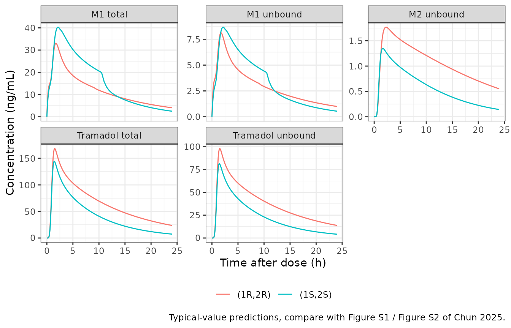
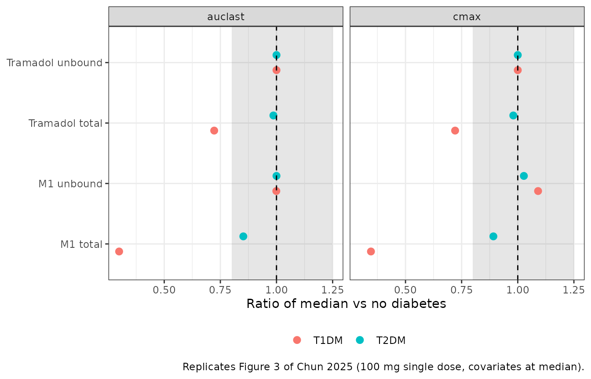
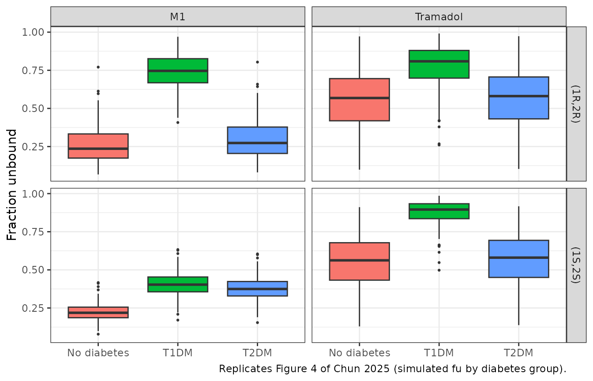
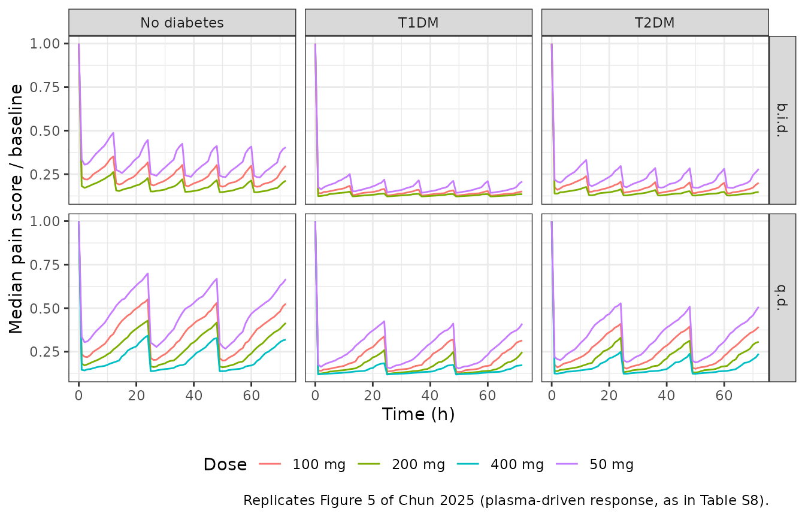
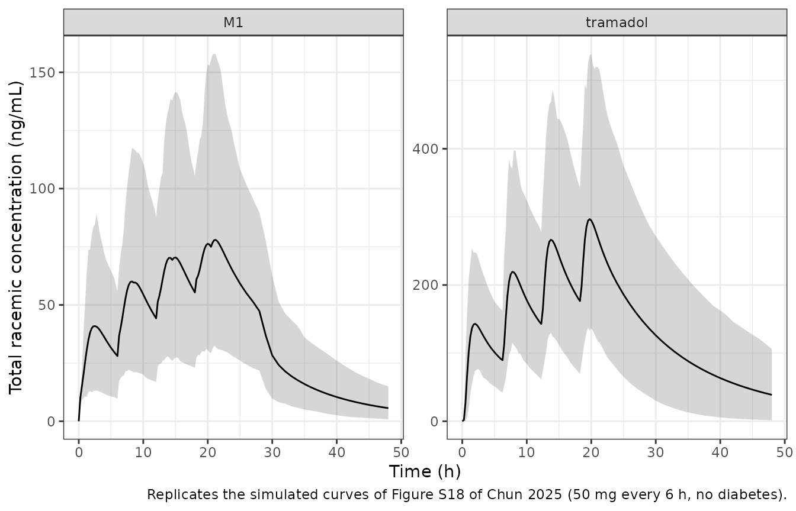

# Tramadol enantiomers, metabolites and pain score in neuropathic pain (Chun 2025)

## Model and source

Chun 2025 built two enantiomer-specific population PK models for oral
racemic tramadol in adults with chronic neuropathic pain, each
describing total and unbound tramadol, total and unbound
O-desmethyltramadol (M1) and unbound N-desmethyltramadol (M2). The
(1R,2R) model also carries the pain-score PD model, which is driven by
unbound (1R,2R)-M1, the mu-opioid agonist. The two enantiomers were
fitted separately, so they are packaged as two model files:

- `Chun_2025_tramadol_rr`: (1R,2R)-tramadol, M1, M2 and VAS pain score.

- `Chun_2025_tramadol_ss`: (1S,2S)-tramadol, M1 and M2.

- Citation: Chun D, Mehta P, Guzy S, Cicali B, Lauretti GR, Lanchote VL,
  Vozmediano V, De Moraes N. Enhanced Sensitivity to Tramadol in
  Diabetic Neuropathic Pain Compared to Nerve Compression Neuropathies:
  A Population PK/PD Model Analysis. CPT Pharmacometrics Syst Pharmacol.
  2025;14(4):781-795. <doi:10.1002/psp4.13315>

- Article: <https://doi.org/10.1002/psp4.13315> (open access; the
  Supporting Information holds the NONMEM control streams, Tables S6 and
  S7, and the authors’ rxode2 simulation code, Table S8).

``` r

mod_rr <- readModelDb("Chun_2025_tramadol_rr")
mod_ss <- readModelDb("Chun_2025_tramadol_ss")
ui_rr <- rxode2::rxode2(mod_rr)
#> ℹ parameter labels from comments will be replaced by 'label()'
ui_ss <- rxode2::rxode2(mod_ss)
#> ℹ parameter labels from comments will be replaced by 'label()'
```

### Structure

- **Tramadol**: two-compartment disposition of the unbound drug with a
  Weibull time-dependent absorption rate,
  `ka(t) = 1 - exp(-(ra * (t - tlag))^gam1)` per hour (Equation 4; `ra`
  is the reciprocal of the paper’s scale `beta`, `tlag` its location
  `gamma`). Unbound tramadol leaves the central compartment by M1
  formation (`fm_m1 * CLF,M1`), an “other” route (`0.3 * CLother`) and
  Michaelis-Menten formation of M2.
- **First pass**: the oral dose is split. A fraction `1 - fp` enters the
  tramadol depot and `fp = FRAC / (1 + FRAC)` enters a first-pass depot
  that delivers M1 directly at rate `Kmet1`. **Event tables must dose
  both `depot` and `depot_m1` with the full enantiomer amount**; the
  model’s `f()` splits it.
- **M1**: one compartment with biliary clearance into a gallbladder that
  releases at `Krel` between `STARTTIME` and `STARTTIME + DURATION`
  after the dose. The total M1 volume is scaled from the rat with an
  allometric exponent of 1 and divided by `fu_M1` to give the unbound
  volume.
- **Protein binding**: total = unbound / fu with `fu = 1 / (1 + Kb)`
  (Equations 1-3), for tramadol and for M1. Diabetes (type 1 or type 2)
  multiplies `Kb`.
- **Pain score**: `VAS = 100 * PD0 * (1 - Imax * Ce / (IC50 + Ce))`,
  with `Ce` an effect compartment driven by unbound (1R,2R)-M1
  (Equations 5 and 6), logit-normal IIV on `Imax` and `PD0` and an
  additive residual on the logit scale (Equations 7 and 8). Diabetes
  multiplies `IC50`.

Amounts are in nmol and concentrations in nmol/L of each enantiomer, as
in the source. A 100 mg racemic dose is 50 mg of each enantiomer,
189,846 nmol with the 263.37 g/mol molar mass the paper uses.

``` r

mw_tramadol <- 263.37 # g/mol, Chun 2025 Methods
mw_metab <- 249.35 # g/mol, M1 and M2
nmol_per_mg <- 1e6 / mw_tramadol
```

## Population

Thirty adults (16 women, 53%) aged 19-59 years with chronic neuropathic
pain for more than 3 months, enrolled at the Hospital of the University
of Sao Paulo, Brazil: 12 with neuropathic pain secondary to nerve
compression (cervical or lumbar disc herniation, carpal tunnel
syndrome), 9 with type 1 diabetes and 9 with type 2 diabetes (median
HbA1c 10.7%). Mean BMI 27.3 kg/m^2 (range 17.2-38.9). Each received one
100 mg oral dose of racemic tramadol after an 8-hour fast; 2145 total
and unbound concentrations of the tramadol, M1 and M2 enantiomers were
collected over 24 h, and 402 VAS pain scores from 27 patients (three
non-responders were excluded from the PD analysis). CYP2D6 activity was
phenotyped as the metoprolol / alpha-hydroxymetoprolol ratio in 0-8 h
urine (Chun 2025 Methods, Results “Data” and Table S2).

``` r

str(rxode2::rxode(mod_rr)$population[c("n_subjects", "age_range", "sex_female_pct", "regions")])
#> ℹ parameter labels from comments will be replaced by 'label()'
#> List of 4
#>  $ n_subjects    : int 30
#>  $ age_range     : chr "19-59 years"
#>  $ sex_female_pct: num 53.3
#>  $ regions       : chr "Brazil (Hospital of the University of Sao Paulo)"
```

## Source trace

Every `ini()` value carries an in-file comment naming its source. The
table collects them; the (1S,2S) column is blank for the PD parameters,
which exist only in the (1R,2R) model.

| Parameter | (1R,2R) | (1S,2S) | Source |
|----|----|----|----|
| Weibull shape `gam1` (alpha) | 2.96 | 3.63 | Table 1 |
| Weibull scale beta (h), `ra = 1/beta` | 0.762 | 0.779 | Table 1 (row labels swapped; roles from Table S6/S7 code) |
| Weibull location `tlag` (gamma, h) | 0.147 | 0.087 | Table 1 |
| `vc`, Vc,u/F (L) | 63.4 | 78.1 | Table 1 |
| `e_bmi_vc`, BMI power on Vc,u/F (ref 26.045 kg/m^2) | 3.87 | 3.43 | Table 1 beta1; Methods (reference) |
| `vp`, Vp,u/F (L) | 439 | 465 | Table 1 |
| `q`, Q,u/F (L/h) | 299 | 337 | Table 1 |
| `cl`, CLother,u (L/h) | 36.4 | 38.6 | Table 1 |
| `fm_other` (fixed) | 0.3 | 0.3 | Methods; Table S6/S7 (iii) |
| `kns`, Kb of tramadol | 0.718 | 0.774 | Table 1 |
| `e_t1dm_kns`, `e_t2dm_kns` | 0.311, 0.95 | 0.15, 0.93 | Table 1 beta2, beta3 |
| `fm_m1` | 0.538 | 0.415 | Table 1 |
| `cl_form_m1`, CLF,M1,u/F (L/h) | 58.8 | 159 | Table 1 |
| `e_cyp2d6_cl_form_m1` (ref ratio 0.610) | -0.523 | -0.161 | Table 1 beta4; Methods |
| `fprat_m1`, FRAC | 0.0661 | 0.0639 | Table 1 |
| `ka_m1`, Kmet1 (1/h) | 0.796 | 1.51 | Table 1 |
| `vc_m1`, total M1 volume (L, fixed) | 0.1 x 72.2/0.235 | 0.255 x 72.2/0.235 | Methods (rat scaling); Table S6/S7 |
| `cl_m1`, CLM1,u/F (L/h) | 42 | 120 | Table 1 |
| `kns_m1`, Kb of M1 | 3.07 | 3.65 | Table 1 |
| `e_t1dm_kns_m1`, `e_t2dm_kns_m1` | 0.105, 0.821 | 0.414, 0.467 | Table 1 beta5, beta6 |
| `cl_bile_m1`, CLbile,u/F (L/h) | 382 | 406 | Table 1 |
| `kehc_m1`, Krel,u (1/h) | 0.0019 | 0.039 | Table 1 |
| `tmeal1`, STARTTIME (h) | 2.85 | 2.53 | Table 1 |
| `dge`, DURATION (h) | 6.15 | 7.99 | Table 1 |
| `vmax_m2` (nmol/h) | 98.6 | 139 | Table 1 |
| `km_m2` (nmol, amount) | 16,300 | 21,500 | Table 1; Table S6/S7 (iii) code |
| `vc_m2`, VM2,u/F (L) | 3.13 | 2.03 | Table 1 |
| `cl_m2`, CLM2,u/F (L/h) | 7.75 | 13.4 | Table 1 |
| `e_cyp2d6_cl_m2` | -0.477 | -0.401 | Table 1 beta7 |
| `ke0` (1/h) | 0.0398 |  | Table 1 |
| `imax`, `e0` (PD0) | 0.908, 0.464 |  | Table 1 |
| `ic50` (nmol/L); T1DM, T2DM factors | 2.36; 0.229, 0.431 |  | Table 1 beta8, beta9 |
| IIV variances | Table 1 omega2 rows | Table 1 omega2 rows | Table 1; Table S8 |
| Residual variances | Table 1 sigma2 rows | Table 1 sigma2 rows | Table 1 |
| Parent ODEs, M1 ODEs with first pass and bile |  |  | Table S6/S7 (iii) `$DES`; Figure 1 |
| PD effect compartment and Imax model |  |  | Equations 5-8; Table S6 (iv) |

## Deterministic checks

The fraction unbound of each species in a subject without diabetes, and
the derived first-pass fraction and the M2 fraction that the paper
back-calculates as `fm2 = 1 - fm1 - fp - 0.3`, follow from the typical
values alone.

``` r

typical_values <- function(ui) {
  th <- ui$theta
  fp <- exp(th[["lfprat_m1"]]) / (1 + exp(th[["lfprat_m1"]]))
  c(
    fu = 1 / (1 + exp(th[["lkns"]])),
    fu_m1 = 1 / (1 + exp(th[["lkns_m1"]])),
    fp = fp,
    fm_m2 = 1 - th[["fm_m1"]] - fp - th[["fm_other"]]
  )
}
chk <- rbind(
  "(1R,2R) model" = typical_values(ui_rr),
  "(1S,2S) model" = typical_values(ui_ss),
  "(1R,2R) paper" = c(0.582, 0.246, 0.062, 0.10),
  "(1S,2S) paper" = c(0.564, 0.215, 0.060, 0.225)
)
knitr::kable(chk, digits = 3, caption = "Typical-value fractions against Table 1 and Figure S19.")
```

|               |    fu | fu_m1 |    fp | fm_m2 |
|:--------------|------:|------:|------:|------:|
| (1R,2R) model | 0.582 | 0.246 | 0.062 | 0.100 |
| (1S,2S) model | 0.564 | 0.215 | 0.060 | 0.225 |
| (1R,2R) paper | 0.582 | 0.246 | 0.062 | 0.100 |
| (1S,2S) paper | 0.564 | 0.215 | 0.060 | 0.225 |

Typical-value fractions against Table 1 and Figure S19. {.table}

``` r

stopifnot(
  max(abs(chk[1, ] - chk[3, ])) < 0.002,
  max(abs(chk[2, ] - chk[4, ])) < 0.002
)
```

## Virtual cohort

Observed data are not available. Covariates are set to the cohort
medians the paper uses for its own exposure comparisons (BMI 26.045
kg/m^2, metoprolol metabolic ratio 0.610) and the diabetes group is
varied.

Between-subject random effects are drawn in base R from each model’s
omega matrix and passed as data columns, with the rxode2 random effects
switched off (`omega = NA`). The same 200 draws are reused in every
diabetes group and dosing regimen, so the comparisons below are paired,
and the cohort is identical on any machine and thread count.

``` r

draw_etas <- function(ui, n) {
  om <- ui$omega
  stopifnot(all(om[upper.tri(om)] == 0))
  sds <- sqrt(diag(om))
  as.data.frame(lapply(sds, function(s) stats::rnorm(n, 0, s)))
}

groups <- tibble(
  group = factor(c("No diabetes", "T1DM", "T2DM"), levels = c("No diabetes", "T1DM", "T2DM")),
  DIS_DIAB = c(0L, 1L, 1L),
  DIS_DIAB_TYPE2 = c(0L, 0L, 1L)
)

# Event table for one regimen: doses of the racemate (mg) at `dose_times`,
# each split equally between the enantiomers and given to BOTH depots.
make_events <- function(etas, dose_mg_rac, dose_times, obs_times, grp, id_offset = 0L) {
  n <- nrow(etas)
  amt <- dose_mg_rac / 2 * nmol_per_mg
  subj <- bind_cols(tibble(id = id_offset + seq_len(n)), etas)
  doses <- tidyr::expand_grid(id = subj$id, time = dose_times, cmt = c("depot", "depot_m1")) |>
    mutate(amt = amt, evid = 1L, dvid = NA_integer_)
  obs <- tidyr::expand_grid(id = subj$id, time = obs_times) |>
    mutate(cmt = "central", amt = 0, evid = 0L, dvid = 1L)
  bind_rows(doses, obs) |>
    left_join(subj, by = "id") |>
    mutate(
      BMI = 26.045, CYP2D6 = 0.610,
      DIS_DIAB = grp$DIS_DIAB, DIS_DIAB_TYPE2 = grp$DIS_DIAB_TYPE2,
      group = grp$group
    ) |>
    arrange(id, time, desc(evid))
}

solve_typical <- function(ui, events, keep = "group") {
  rxode2::rxSolve(ui, events,
    returnType = "data.frame", omega = NA, sigma = NA,
    useLinCmt = FALSE, keep = keep
  )
}

n_per_arm <- 200L
set.seed(20250213)
etas_rr <- draw_etas(ui_rr, n_per_arm)
etas_ss <- draw_etas(ui_ss, n_per_arm)
zero_eta <- function(etas) etas[1, , drop = FALSE] * 0
```

## Typical single-dose profiles (Figure S1, Figure 2)

Typical-value profiles after 100 mg racemic tramadol in a subject
without diabetes. Figure S1 of the paper shows the observed individual
and mean concentrations; the observed means peak at roughly 70 ng/mL
(unbound) and 120 ng/mL (total) for (1R,2R)-tramadol at 1.5-2 h and
about 12 and 50 ng/mL for unbound and total (1R,2R)-M1.

``` r

grid <- sort(unique(c(seq(0, 4, by = 0.1), seq(4.5, 24, by = 0.5))))
typ <- bind_rows(
  solve_typical(ui_rr, make_events(zero_eta(etas_rr), 100, 0, grid, groups[1, ])) |>
    mutate(enantiomer = "(1R,2R)"),
  solve_typical(ui_ss, make_events(zero_eta(etas_ss), 100, 0, grid, groups[1, ])) |>
    mutate(enantiomer = "(1S,2S)")
) |>
  transmute(enantiomer, time,
    `Tramadol unbound` = Cunbound * mw_tramadol / 1000,
    `Tramadol total` = Cc * mw_tramadol / 1000,
    `M1 unbound` = Cunbound_m1 * mw_metab / 1000,
    `M1 total` = Cc_m1 * mw_metab / 1000,
    `M2 unbound` = Cc_m2 * mw_metab / 1000
  ) |>
  pivot_longer(-c(enantiomer, time), names_to = "analyte", values_to = "conc")

ggplot(typ, aes(time, conc, colour = enantiomer)) +
  geom_line() +
  facet_wrap(~analyte, scales = "free_y") +
  labs(x = "Time after dose (h)", y = "Concentration (ng/mL)", colour = NULL,
       caption = "Typical-value predictions, compare with Figure S1 / Figure S2 of Chun 2025.") +
  theme_bw() + theme(legend.position = "bottom")
```



``` r


typ_peak <- typ |> group_by(enantiomer, analyte) |>
  summarise(Cmax = max(conc), tmax = time[which.max(conc)], .groups = "drop")
knitr::kable(typ_peak, digits = c(0, 0, 1, 2), caption = "Typical-value peaks (ng/mL, h).")
```

| enantiomer | analyte          |  Cmax | tmax |
|:-----------|:-----------------|------:|-----:|
| (1R,2R)    | M1 total         |  33.1 |  1.7 |
| (1R,2R)    | M1 unbound       |   8.1 |  1.7 |
| (1R,2R)    | M2 unbound       |   1.8 |  2.3 |
| (1R,2R)    | Tramadol total   | 168.5 |  1.5 |
| (1R,2R)    | Tramadol unbound |  98.1 |  1.5 |
| (1S,2S)    | M1 total         |  40.3 |  2.1 |
| (1S,2S)    | M1 unbound       |   8.7 |  2.1 |
| (1S,2S)    | M2 unbound       |   1.3 |  1.7 |
| (1S,2S)    | Tramadol total   | 144.5 |  1.4 |
| (1S,2S)    | Tramadol unbound |  81.5 |  1.4 |

Typical-value peaks (ng/mL, h). {.table}

The typical (1R,2R)-tramadol peak sits close to the observed means. The
typical M1 curves lie below the observed means of Figure S1; with a 0.73
variance on the formation clearance and 0.49 on the biliary clearance
the mean of the observed profiles sits well above the typical curve.
Total concentrations are unbound divided by fu at every time, which the
model reproduces exactly:

``` r

chk_tu <- solve_typical(ui_rr, make_events(etas_rr[1:20, ], 100, 0, c(1, 4, 12), groups[2, ]))
stopifnot(
  max(abs(chk_tu$Cc * chk_tu$fu / chk_tu$Cunbound - 1)) < 1e-8,
  max(abs(chk_tu$Cc_m1 * chk_tu$fu_m1 / chk_tu$Cunbound_m1 - 1)) < 1e-8
)
```

## Effect of diabetes on exposure (Figure 3) and fu (Figure 4)

The paper simulated 500 subjects per diabetes group after a 100 mg
single dose with BMI and CYP2D6 activity at their medians and reported
the ratio of median AUC0-24 and Cmax against subjects without diabetes.
Here the same 200 paired subjects are solved in each group and exposures
are computed with PKNCA.

``` r

grid_nca <- sort(unique(c(0, seq(0.25, 4, by = 0.25), seq(5, 24, by = 1))))
sim_dm <- bind_rows(lapply(seq_len(nrow(groups)), function(i) {
  solve_typical(ui_rr, make_events(etas_rr, 100, 0, grid_nca, groups[i, ], id_offset = (i - 1L) * n_per_arm))
}))
dose_dm <- bind_rows(lapply(seq_len(nrow(groups)), function(i) {
  make_events(etas_rr, 100, 0, grid_nca, groups[i, ], id_offset = (i - 1L) * n_per_arm)
})) |>
  filter(evid == 1, cmt == "depot") |>
  select(id, time, amt, group)
```

``` r

nca_one <- function(sim, conc_col, label) {
  conc <- sim |>
    transmute(id, time, group, conc = .data[[conc_col]]) |>
    filter(!is.na(conc))
  conc <- bind_rows(conc, conc |> distinct(id, group) |> mutate(time = 0, conc = 0)) |>
    distinct(id, group, time, .keep_all = TRUE) |>
    arrange(id, time)
  conc_obj <- PKNCA::PKNCAconc(conc, conc ~ time | group + id)
  dose_obj <- PKNCA::PKNCAdose(dose_dm, amt ~ time | group + id)
  intervals <- data.frame(start = 0, end = 24, cmax = TRUE, auclast = TRUE)
  res <- PKNCA::pk.nca(PKNCA::PKNCAdata(conc_obj, dose_obj, intervals = intervals))
  as.data.frame(res) |> mutate(analyte = label)
}
nca_dm <- bind_rows(
  nca_one(sim_dm, "Cunbound", "Tramadol unbound"),
  nca_one(sim_dm, "Cc", "Tramadol total"),
  nca_one(sim_dm, "Cunbound_m1", "M1 unbound"),
  nca_one(sim_dm, "Cc_m1", "M1 total")
)
ratios <- nca_dm |>
  group_by(analyte, PPTESTCD, group) |>
  summarise(med = median(PPORRES), .groups = "drop") |>
  group_by(analyte, PPTESTCD) |>
  mutate(ratio = med / med[group == "No diabetes"]) |>
  ungroup() |>
  filter(group != "No diabetes")

ratios |>
  select(analyte, PPTESTCD, group, ratio) |>
  pivot_wider(names_from = group, values_from = ratio) |>
  rename(Analyte = analyte, `NCA parameter` = PPTESTCD) |>
  knitr::kable(digits = 2, caption = "Ratio of median exposure against subjects without diabetes (Figure 3).")
```

| Analyte          | NCA parameter | T1DM | T2DM |
|:-----------------|:--------------|-----:|-----:|
| M1 total         | auclast       | 0.30 | 0.85 |
| M1 total         | cmax          | 0.35 | 0.89 |
| M1 unbound       | auclast       | 1.00 | 1.00 |
| M1 unbound       | cmax          | 1.09 | 1.03 |
| Tramadol total   | auclast       | 0.72 | 0.99 |
| Tramadol total   | cmax          | 0.72 | 0.98 |
| Tramadol unbound | auclast       | 1.00 | 1.00 |
| Tramadol unbound | cmax          | 1.00 | 1.00 |

Ratio of median exposure against subjects without diabetes (Figure 3).
{.table}

``` r


ggplot(ratios, aes(ratio, analyte, colour = group)) +
  annotate("rect", xmin = 0.8, xmax = 1.25, ymin = -Inf, ymax = Inf, alpha = 0.15) +
  geom_point(size = 2.5, position = position_dodge(width = 0.5)) +
  geom_vline(xintercept = 1, linetype = 2) +
  facet_wrap(~PPTESTCD) +
  labs(x = "Ratio of median vs no diabetes", y = NULL, colour = NULL,
       caption = "Replicates Figure 3 of Chun 2025 (100 mg single dose, covariates at median).") +
  theme_bw() + theme(legend.position = "bottom")
```



The paper reports a 67% (type 1) and 14% (type 2) lower AUC of total
(1R,2R)-M1 and an unchanged unbound (1R,2R)-M1 AUC. Diabetes changes
only the binding constants, so the unbound M1 AUC moves little and the
total M1 AUC follows the change in fu.

``` r

r_auc <- function(an, grp) {
  v <- ratios$ratio[ratios$analyte == an & ratios$PPTESTCD == "auclast" & ratios$group == grp]
  if (length(v) != 1L) stop("no unique ratio for ", an, " / ", grp)
  v
}
stopifnot(
  abs(r_auc("M1 total", "T1DM") - (1 - 0.67)) < 0.08,
  abs(r_auc("M1 total", "T2DM") - (1 - 0.14)) < 0.08,
  abs(r_auc("M1 unbound", "T1DM") - 1) < 0.15,
  abs(r_auc("M1 unbound", "T2DM") - 1) < 0.15
)
```

``` r

fu_tab <- bind_rows(
  sim_dm |> distinct(id, group, fu, fu_m1) |> mutate(enantiomer = "(1R,2R)"),
  bind_rows(lapply(seq_len(nrow(groups)), function(i) {
    solve_typical(ui_ss, make_events(etas_ss, 100, 0, 1, groups[i, ], id_offset = (i - 1L) * n_per_arm))
  })) |> distinct(id, group, fu, fu_m1) |> mutate(enantiomer = "(1S,2S)")
) |>
  pivot_longer(c(fu, fu_m1), names_to = "species", values_to = "fu") |>
  mutate(species = ifelse(species == "fu", "Tramadol", "M1"))

ggplot(fu_tab, aes(group, fu, fill = group)) +
  geom_boxplot(outlier.size = 0.5) +
  facet_grid(enantiomer ~ species) +
  labs(x = NULL, y = "Fraction unbound", fill = NULL,
       caption = "Replicates Figure 4 of Chun 2025 (simulated fu by diabetes group).") +
  theme_bw() + theme(legend.position = "none")
```



``` r


fu_tab |> group_by(enantiomer, species, group) |>
  summarise(`median fu` = median(fu), .groups = "drop") |>
  pivot_wider(names_from = group, values_from = `median fu`) |>
  knitr::kable(digits = 3, caption = "Median simulated fraction unbound.")
```

| enantiomer | species  | No diabetes |  T1DM |  T2DM |
|:-----------|:---------|------------:|------:|------:|
| (1R,2R)    | M1       |       0.236 | 0.746 | 0.273 |
| (1R,2R)    | Tramadol |       0.568 | 0.809 | 0.581 |
| (1S,2S)    | M1       |       0.219 | 0.403 | 0.375 |
| (1S,2S)    | Tramadol |       0.562 | 0.895 | 0.580 |

Median simulated fraction unbound. {.table}

## Pain relief by dosing regimen (Table 2, Figure 5)

Table 2 reports the percentage of 500 simulated subjects per group with
substantial (\> 50% below baseline) or moderate (30-50%) pain relief, at
the time of maximum relief after a single dose and at the trough 72 h
into repeated dosing. Pain is normalised by each subject’s baseline, so
the residual error and `PD0` drop out and relief is
`Imax * Ce / (IC50 + Ce)`.

The authors’ simulation code (Table S8) evaluates that expression on the
**plasma** unbound M1 concentration rather than on the
effect-compartment concentration of the fitted PD model (Equations 5 and
6). Both are computed below: `relief_effect` uses the packaged model’s
effect compartment and `relief_plasma` mirrors Table S8.

``` r

regimens <- tribble(
  ~regimen, ~dose, ~tau,
  "50 mg q.d.", 50, 24,
  "100 mg q.d.", 100, 24,
  "200 mg q.d.", 200, 24,
  "400 mg q.d.", 400, 24,
  "50 mg b.i.d.", 50, 12,
  "100 mg b.i.d.", 100, 12,
  "200 mg b.i.d.", 200, 12
)
obs72 <- seq(0, 72, by = 1)
pd_events <- bind_rows(lapply(seq_len(nrow(regimens)), function(r) {
  bind_rows(lapply(seq_len(nrow(groups)), function(i) {
    k <- (r - 1L) * nrow(groups) + i
    make_events(etas_rr, regimens$dose[r], seq(0, 72 - regimens$tau[r], by = regimens$tau[r]),
      obs72, groups[i, ], id_offset = (k - 1L) * n_per_arm) |>
      mutate(regimen = regimens$regimen[r])
  }))
}))
sim_pd <- solve_typical(ui_rr, pd_events, keep = c("group", "regimen")) |>
  mutate(
    relief_effect = imax * effect / (ic50 + effect),
    relief_plasma = imax * Cunbound_m1 / (ic50 + Cunbound_m1),
    regimen = factor(regimen, levels = regimens$regimen)
  )
```

``` r

classify <- function(x) {
  c(substantial = 100 * mean(x > 0.5), moderate = 100 * mean(x >= 0.3 & x <= 0.5))
}
relief_summary <- function(sim, col) {
  max_sd <- sim |> filter(time <= 24) |> group_by(regimen, group, id) |>
    summarise(r = max(.data[[col]]), .groups = "drop")
  trough <- sim |> filter(time == 72) |> group_by(regimen, group, id) |>
    summarise(r = .data[[col]][1], .groups = "drop")
  bind_rows(
    max_sd |> mutate(when = "Maximum"),
    trough |> mutate(when = "Sustained")
  ) |>
    group_by(regimen, group, when) |>
    summarise(substantial = classify(r)[["substantial"]], moderate = classify(r)[["moderate"]], .groups = "drop")
}
tab_plasma <- relief_summary(sim_pd, "relief_plasma") |> mutate(driver = "plasma (Table S8)")
tab_effect <- relief_summary(sim_pd, "relief_effect") |> mutate(driver = "effect compartment (model)")

published_t2 <- tribble(
  ~regimen, ~group, ~when, ~substantial, ~moderate,
  "50 mg q.d.", "No diabetes", "Sustained", 22.4, 29.6,
  "50 mg q.d.", "T1DM", "Sustained", 61.0, 17.0,
  "50 mg q.d.", "T2DM", "Sustained", 51.0, 22.4,
  "100 mg q.d.", "No diabetes", "Sustained", 43.0, 23.0,
  "100 mg q.d.", "T1DM", "Sustained", 70.4, 11.6,
  "100 mg q.d.", "T2DM", "Sustained", 65.0, 15.6,
  "200 mg q.d.", "No diabetes", "Sustained", 59.0, 17.4,
  "200 mg q.d.", "T1DM", "Sustained", 75.4, 8.4,
  "200 mg q.d.", "T2DM", "Sustained", 74.8, 9.2,
  "400 mg q.d.", "No diabetes", "Sustained", 67.2, 13.6,
  "400 mg q.d.", "T1DM", "Sustained", 76.4, 7.8,
  "400 mg q.d.", "T2DM", "Sustained", 78.4, 7.6,
  "50 mg b.i.d.", "No diabetes", "Sustained", 61.2, 17.4,
  "50 mg b.i.d.", "T1DM", "Sustained", 76.0, 8.6,
  "50 mg b.i.d.", "T2DM", "Sustained", 77.4, 9.4,
  "100 mg b.i.d.", "No diabetes", "Sustained", 70.8, 12.2,
  "100 mg b.i.d.", "T1DM", "Sustained", 77.2, 7.6,
  "100 mg b.i.d.", "T2DM", "Sustained", 81.2, 6.4,
  "200 mg b.i.d.", "No diabetes", "Sustained", 73.4, 11.0,
  "200 mg b.i.d.", "T1DM", "Sustained", 77.6, 7.8,
  "200 mg b.i.d.", "T2DM", "Sustained", 81.8, 6.2,
  "50 mg q.d.", "No diabetes", "Maximum", 72.0, 12.6,
  "50 mg q.d.", "T1DM", "Maximum", 78.2, 7.2,
  "50 mg q.d.", "T2DM", "Maximum", 81.8, 6.2,
  "100 mg q.d.", "No diabetes", "Maximum", 74.6, 10.4,
  "100 mg q.d.", "T1DM", "Maximum", 78.4, 7.0,
  "100 mg q.d.", "T2DM", "Maximum", 82.6, 5.4,
  "200 mg q.d.", "No diabetes", "Maximum", 75.0, 10.4,
  "200 mg q.d.", "T1DM", "Maximum", 78.6, 7.0,
  "200 mg q.d.", "T2DM", "Maximum", 82.8, 5.2,
  "400 mg q.d.", "No diabetes", "Maximum", 75.6, 9.8,
  "400 mg q.d.", "T1DM", "Maximum", 78.6, 7.0,
  "400 mg q.d.", "T2DM", "Maximum", 83.0, 5.0
)

cmp_t2 <- published_t2 |>
  inner_join(tab_plasma |> mutate(group = as.character(group), regimen = as.character(regimen)),
    by = c("regimen", "group", "when"), suffix = c("_paper", "_plasma")) |>
  inner_join(tab_effect |> mutate(group = as.character(group), regimen = as.character(regimen)) |>
    select(regimen, group, when, substantial_effect = substantial),
    by = c("regimen", "group", "when"))
stopifnot(nrow(cmp_t2) == nrow(published_t2))

cmp_t2 |>
  transmute(when, regimen, group,
    paper = sprintf("%.1f/%.1f", substantial_paper, moderate_paper),
    plasma = sprintf("%.1f/%.1f", substantial_plasma, moderate_plasma),
    effect = sprintf("%.1f", substantial_effect)
  ) |>
  rename(`Relief at` = when, Regimen = regimen, Group = group,
    `Paper (substantial/moderate %)` = paper,
    `Plasma-driven (substantial/moderate %)` = plasma,
    `Effect compartment (substantial %)` = effect) |>
  knitr::kable(caption = "Table 2 of Chun 2025 against the packaged (1R,2R) model.")
```

| Relief at | Regimen | Group | Paper (substantial/moderate %) | Plasma-driven (substantial/moderate %) | Effect compartment (substantial %) |
|:---|:---|:---|:---|:---|:---|
| Sustained | 50 mg q.d. | No diabetes | 22.4/29.6 | 22.5/32.0 | 61.5 |
| Sustained | 50 mg q.d. | T1DM | 61.0/17.0 | 59.0/16.5 | 73.5 |
| Sustained | 50 mg q.d. | T2DM | 51.0/22.4 | 49.5/19.0 | 69.5 |
| Sustained | 100 mg q.d. | No diabetes | 43.0/23.0 | 47.0/19.5 | 67.5 |
| Sustained | 100 mg q.d. | T1DM | 70.4/11.6 | 67.5/11.5 | 74.0 |
| Sustained | 100 mg q.d. | T2DM | 65.0/15.6 | 59.5/16.5 | 74.0 |
| Sustained | 200 mg q.d. | No diabetes | 59.0/17.4 | 57.5/18.0 | 73.5 |
| Sustained | 200 mg q.d. | T1DM | 75.4/8.4 | 70.0/12.0 | 74.5 |
| Sustained | 200 mg q.d. | T2DM | 74.8/9.2 | 68.0/11.5 | 74.0 |
| Sustained | 400 mg q.d. | No diabetes | 67.2/13.6 | 67.5/11.5 | 74.0 |
| Sustained | 400 mg q.d. | T1DM | 76.4/7.8 | 73.5/11.5 | 77.0 |
| Sustained | 400 mg q.d. | T2DM | 78.4/7.6 | 71.0/11.5 | 74.5 |
| Sustained | 50 mg b.i.d. | No diabetes | 61.2/17.4 | 64.0/13.5 | 69.0 |
| Sustained | 50 mg b.i.d. | T1DM | 76.0/8.6 | 73.5/10.5 | 74.0 |
| Sustained | 50 mg b.i.d. | T2DM | 77.4/9.4 | 71.5/10.0 | 74.0 |
| Sustained | 100 mg b.i.d. | No diabetes | 70.8/12.2 | 70.5/10.5 | 74.0 |
| Sustained | 100 mg b.i.d. | T1DM | 77.2/7.6 | 74.5/10.5 | 75.0 |
| Sustained | 100 mg b.i.d. | T2DM | 81.2/6.4 | 73.5/10.5 | 74.0 |
| Sustained | 200 mg b.i.d. | No diabetes | 73.4/11.0 | 73.5/10.0 | 74.0 |
| Sustained | 200 mg b.i.d. | T1DM | 77.6/7.8 | 75.5/10.0 | 77.0 |
| Sustained | 200 mg b.i.d. | T2DM | 81.8/6.2 | 74.5/11.0 | 75.5 |
| Maximum | 50 mg q.d. | No diabetes | 72.0/12.6 | 69.5/11.5 | 42.5 |
| Maximum | 50 mg q.d. | T1DM | 78.2/7.2 | 75.0/10.0 | 70.5 |
| Maximum | 50 mg q.d. | T2DM | 81.8/6.2 | 74.0/10.0 | 64.0 |
| Maximum | 100 mg q.d. | No diabetes | 74.6/10.4 | 73.5/8.5 | 60.5 |
| Maximum | 100 mg q.d. | T1DM | 78.4/7.0 | 75.5/10.0 | 74.0 |
| Maximum | 100 mg q.d. | T2DM | 82.6/5.4 | 75.0/10.0 | 71.0 |
| Maximum | 200 mg q.d. | No diabetes | 75.0/10.4 | 74.5/10.0 | 70.0 |
| Maximum | 200 mg q.d. | T1DM | 78.6/7.0 | 76.5/9.0 | 74.0 |
| Maximum | 200 mg q.d. | T2DM | 82.8/5.2 | 75.5/10.0 | 74.0 |
| Maximum | 400 mg q.d. | No diabetes | 75.6/9.8 | 75.5/10.0 | 74.0 |
| Maximum | 400 mg q.d. | T1DM | 78.6/7.0 | 77.5/8.0 | 75.0 |
| Maximum | 400 mg q.d. | T2DM | 83.0/5.0 | 76.5/9.0 | 74.0 |

Table 2 of Chun 2025 against the packaged (1R,2R) model. {.table}

``` r

d_sub <- cmp_t2$substantial_plasma - cmp_t2$substantial_paper
# The fraction above 50% relief is dominated by the logit-normal Imax
# distribution (variance 8.97); a mis-transcribed IC50, ke0 or Imax moves
# these percentages by tens of points.
stopifnot(
  abs(median(d_sub)) < 6,
  quantile(abs(d_sub), 0.9) < 15
)
```

With the plasma driver the packaged model tracks Table 2. The ranking
the paper draws from it holds: subjects with diabetes respond to lower
doses, and subjects with compression neuropathy gain more from
twice-daily than from once-daily dosing. Driving the response through
the effect compartment, as the fitted PD model does, keeps relief high
at trough because `ke0` = 0.04 1/h gives the effect site a 17 h
equilibration half-life.

``` r

sim_pd |>
  filter(regimen %in% c("50 mg q.d.", "100 mg q.d.", "200 mg q.d.", "400 mg q.d.",
                        "50 mg b.i.d.", "100 mg b.i.d.", "200 mg b.i.d.")) |>
  mutate(freq = ifelse(grepl("b.i.d", regimen), "b.i.d.", "q.d."),
         dose = sub(" mg.*", " mg", regimen)) |>
  group_by(time, group, freq, dose) |>
  summarise(pain = median(1 - relief_plasma), .groups = "drop") |>
  ggplot(aes(time, pain, colour = dose)) +
  geom_line() +
  facet_grid(freq ~ group) +
  labs(x = "Time (h)", y = "Median pain score / baseline", colour = "Dose",
       caption = "Replicates Figure 5 of Chun 2025 (plasma-driven response, as in Table S8).") +
  theme_bw() + theme(legend.position = "bottom")
```



## Multiple dosing (Figure S18)

Figure S18 compares the final model with the mean total tramadol and M1
concentrations of Karhu 2010 after 50 mg immediate-release racemic
tramadol every 6 hours. Both enantiomer models are summed. The paper’s
simulated mean reaches about 140 ng/mL after the first dose and about
320 ng/mL after the fourth dose for total tramadol, and about 40 and 80
ng/mL for total M1.

``` r

grid48 <- sort(unique(c(seq(0, 24, by = 0.25), seq(25, 48, by = 1))))
s18 <- function(ui, etas) {
  solve_typical(ui, make_events(etas, 50, c(0, 6, 12, 18), grid48, groups[1, ])) |>
    select(id, time, Cc, Cc_m1)
}
sum18 <- inner_join(s18(ui_rr, etas_rr), s18(ui_ss, etas_ss), by = c("id", "time"), suffix = c("_rr", "_ss")) |>
  transmute(id, time,
    tramadol = (Cc_rr + Cc_ss) * mw_tramadol / 1000,
    M1 = (Cc_m1_rr + Cc_m1_ss) * mw_metab / 1000
  ) |>
  pivot_longer(c(tramadol, M1), names_to = "analyte", values_to = "conc") |>
  group_by(analyte, time) |>
  summarise(mean = mean(conc), q05 = quantile(conc, 0.05), q95 = quantile(conc, 0.95), .groups = "drop")

ggplot(sum18, aes(time, mean)) +
  geom_ribbon(aes(ymin = q05, ymax = q95), alpha = 0.2) +
  geom_line() +
  facet_wrap(~analyte, scales = "free_y") +
  labs(x = "Time (h)", y = "Total racemic concentration (ng/mL)",
       caption = "Replicates the simulated curves of Figure S18 of Chun 2025 (50 mg every 6 h, no diabetes).") +
  theme_bw()
```



``` r


peaks18 <- sum18 |> filter(time <= 24) |>
  mutate(dose = cut(time, c(0, 6, 12, 18, 24), labels = paste("dose", 1:4), include.lowest = TRUE)) |>
  group_by(analyte, dose) |>
  summarise(peak = max(mean), .groups = "drop") |>
  mutate(figure_s18 = case_when(
    analyte == "tramadol" & dose == "dose 1" ~ 140,
    analyte == "tramadol" & dose == "dose 4" ~ 320,
    analyte == "M1" & dose == "dose 1" ~ 38,
    analyte == "M1" & dose == "dose 4" ~ 80
  ))
peaks18 |>
  rename(Analyte = analyte, Dose = dose, `Simulated peak mean (ng/mL)` = peak,
         `Figure S18, read from the plot (ng/mL)` = figure_s18) |>
  knitr::kable(digits = 0)
```

| Analyte | Dose | Simulated peak mean (ng/mL) | Figure S18, read from the plot (ng/mL) |
|:---|:---|---:|---:|
| M1 | dose 1 | 41 | 38 |
| M1 | dose 2 | 60 | NA |
| M1 | dose 3 | 70 | NA |
| M1 | dose 4 | 78 | 80 |
| tramadol | dose 1 | 143 | 140 |
| tramadol | dose 2 | 219 | NA |
| tramadol | dose 3 | 266 | NA |
| tramadol | dose 4 | 297 | 320 |

``` r

# The Figure S18 values are read off the plotted curve to about 5%. The
# M1 peaks in particular separate the fraction-of-dose reading of the
# first-pass split from the alternatives discussed under Assumptions.
chk18 <- peaks18 |> filter(!is.na(figure_s18))
stopifnot(nrow(chk18) == 4L, all(abs(log(chk18$peak / chk18$figure_s18)) < 0.2))
```

The summed enantiomer models reproduce the published simulated means of
Figure S18 for both tramadol and M1 at the first and the fourth dose.

## Assumptions and deviations

- **Two dosing records per dose.** The dose is split between the
  tramadol depot (`1 - fp`) and the first-pass depot (`fp`) by `f()`, as
  described in Figure 1, Table 1 and the mass balance of Figure S19 and
  as implied by the authors’ simulation code (Table S8), whose depot
  outflows are not scaled. The NONMEM `$DES` blocks (Tables S6 and S7)
  instead multiply the two depot outflow rates by `1 - fp` and `fp`; how
  the estimation dataset apportioned the amounts between the two depots
  is not reported. The fraction-of-dose reading is the one that
  reproduces the published 6% first-pass share and the simulated M1
  means of Figure S18; dosing both depots in full with the scaled
  outflows roughly doubles the total amount reaching the body and, in
  the maintainers’ check, raised the mean total (1R,2R)-M1 concentration
  at 3 h by about 80%.
- **Time after dose.** The Weibull absorption rate and the gallbladder
  release window are read against the time after the most recent dose.
  The source data are single-dose, where this equals time since the
  dose; the authors’ own simulation code uses time since the start of
  the simulation, so later doses there are absorbed at the plateau rate
  of 1 per hour from the moment they are given.
- **Weibull parameter labels.** Table 1 labels gamma “scale” and beta
  “location”; the NONMEM code uses gamma as the location (lag) and beta
  as the scale, and the model follows the code. The IIV on beta is
  carried on its reciprocal `ra`, which has the same variance.
- **IIV on the central volume.** Table 1 labels the 1.29 / 1.09 variance
  and the BMI exponent as applying to Vp; the NONMEM code, Table S3 and
  the Results text place both on the central volume.
- **Michaelis-Menten constant of M2.** Table 1 prints `Km` in nmol/L,
  but the NONMEM and rxode2 code divide by the central **amount**;
  `km_m2` is in nmol.
- **IC50 values in the text.** The Results text quotes IC50 = 2.91
  nmol/L (no diabetes), 0.156 (T1DM) and 0.515 nmol/L (T2DM). Table 1
  and the code give 2.36 nmol/L with multipliers 0.229 and 0.431 (0.54
  and 1.02 nmol/L); the model uses Table 1.
- **(1S,2S) code differences.** The authors’ simulation code for (1S,2S)
  uses Kmet1 = 1.59 1/h and the (1R,2R) BMI exponent 3.87, and for
  (1R,2R) CLM1,u/F = 47.7 L/h; the model uses the Table 1 values (1.51,
  3.43 and 42).
- **Pain-score scale.** The paper fits the VAS divided by 100. The model
  reports `score` in mm (0-100) with the same logit-scale residual,
  `logitNorm(addSd_score, 0, 100)`.
- **Dose amount.** The paper does not say whether the 100 mg Tramal dose
  was converted to moles as the base or as the hydrochloride; this
  vignette converts 50 mg per enantiomer with the 263.37 g/mol base
  molar mass, which reproduces the observed peak of (1R,2R)-tramadol.
- **Covariates in the simulations.** BMI and the metoprolol metabolic
  ratio are held at their medians, as the paper states for Figure 3; the
  paper does not state the covariates used for Table 2 and Figure S18.
