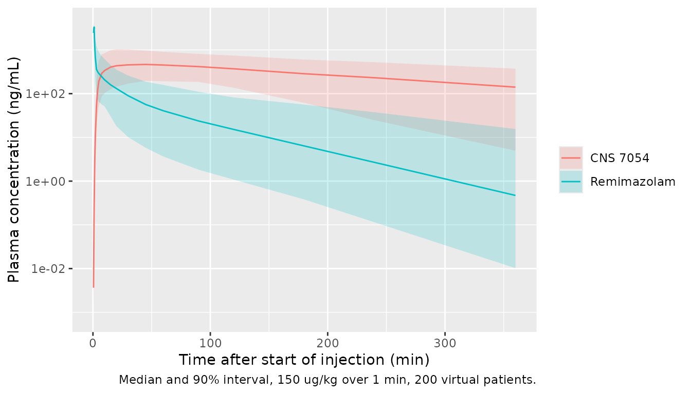
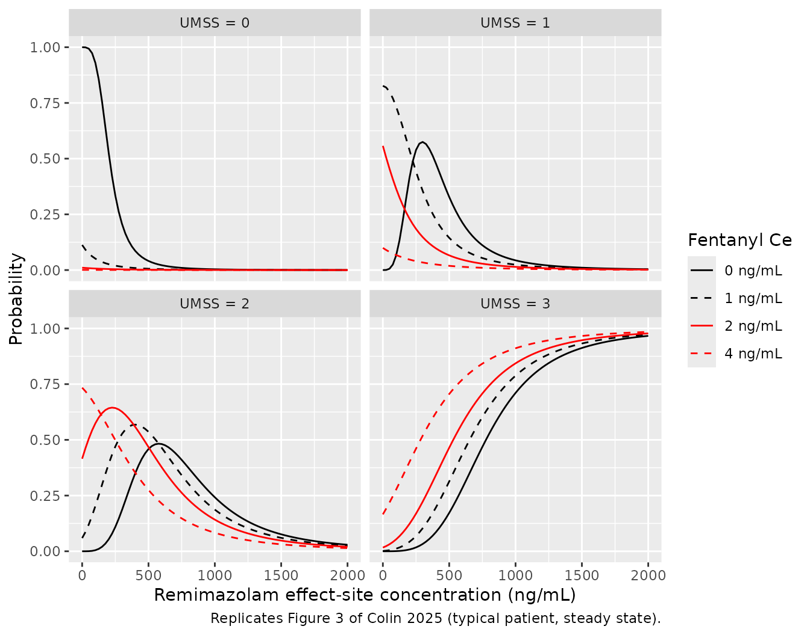

# Remimazolam and fentanyl procedural sedation in children (Colin 2025)

## Model and source

Colin 2025 reports two sequentially fitted models from the first age
cohort (6 to 18 years) of a paediatric procedural-sedation trial of
remimazolam:

- `Colin_2025_remimazolam` – joint population PK of remimazolam and its
  inactive metabolite CNS 7054.

- `Colin_2025_remimazolam_umss` – the proportional-odds PK/PD model of
  the University of Michigan Sedation Scale (UMSS), driven by
  remimazolam and fentanyl effect-site concentrations. It carries the PK
  layer above unchanged, plus the Ginsberg 1996 paediatric fentanyl PK
  model.

- Citation: Colin PJ, Bichajian LH, Curt VR, Koomen JV, Stohr T, Struys
  MMRF, Mason KP. Pharmacokinetics and Pharmacodynamics of Remimazolam
  for Procedural Sedation in Children and Adolescents. Anesthesiology.
  2025;143(2):368-382. <doi:10.1097/ALN.0000000000005560>. PMC12227205.

- PK description: Joint population pharmacokinetic model for intravenous
  remimazolam and its inactive carboxylic-acid metabolite CNS 7054 in 31
  children and adolescents aged 6 to 18 years undergoing procedural
  sedation (Colin 2025, NCT04851717). Remimazolam follows a
  three-compartment model and is assumed to be eliminated entirely by
  conversion to CNS 7054, which reaches its one-compartment central
  volume through a chain of five transit compartments and is eliminated
  linearly. Every clearance and volume is scaled a priori by body weight
  (exponents 0.75 and 1, reference 70 kg); age, sex and fentanyl
  coadministration were tested on remimazolam clearance and none was
  retained.

- PK/PD description: Sequential population PK/PD proportional-odds model
  for the University of Michigan Sedation Scale (UMSS, 0 awake to 4
  unarousable) produced by intravenous remimazolam, with or without
  fentanyl, in 31 children and adolescents aged 6 to 18 years undergoing
  procedural sedation (Colin 2025, NCT04851717). The remimazolam / CNS
  7054 pharmacokinetics of modellib(‘Colin_2025_remimazolam’) are
  carried forward unchanged and fentanyl plasma concentrations come from
  the weight-proportional two-compartment paediatric model of
  Ginsberg 1996. Each drug drives its own effect compartment; the
  effect-site concentrations, normalised by category-specific EC50s, are
  summed under a simplified Minto response surface (additive
  interaction) and give the probabilities of UMSS \>= 1, \>= 2 and \>= 3
  through one sigmoid with a shared Hill coefficient. UMSS 4 was not
  observed and is not modelled. Age, sex, fentanyl coadministration and
  procedure type were tested on the remimazolam EC50 and none was
  retained.

- Article: <https://doi.org/10.1097/ALN.0000000000005560> (open access,
  PMC12227205)

- Supplement (NONMEM code for both models):
  <https://links.lww.com/ALN/E8>

## Population

Thirty-one patients aged 6 to 18 years (mean 12.3, SD 3.6) weighing 20.5
to 106 kg (mean 50.6, SD 21.2), 12 girls and 19 boys, were sedated with
intravenous remimazolam for elective diagnostic or therapeutic
procedures (lumbar puncture, endoscopy, bone marrow aspiration and
others) in the United States (Colin 2025 Table 3). Investigators chose
the dosing modality and the use of fentanyl, which gave four arms: bolus
(n = 5), bolus + fentanyl (n = 11), infusion (n = 5) and infusion +
fentanyl (n = 10), all targeting UMSS 2 to 3 under the revised dosing
protocol of Table 2. The PK model used 170 remimazolam and 160 CNS 7054
plasma concentrations; the PD model used 1,920 UMSS scores, of which 295
recorded after rescue sedation were excluded.

The same information is available programmatically:

``` r

str(rxode2::rxode(readModelDb("Colin_2025_remimazolam_umss"))$population)
#> ℹ parameter labels from comments will be replaced by 'label()'
#> List of 14
#>  $ species       : chr "human"
#>  $ n_subjects    : int 31
#>  $ n_studies     : int 1
#>  $ age_range     : chr "6-18 years"
#>  $ age_mean      : chr "12.3 years (SD 3.6)"
#>  $ weight_range  : chr "20.5-106 kg"
#>  $ weight_mean   : chr "50.6 kg (SD 21.2)"
#>  $ sex_female_pct: num 38.7
#>  $ disease_state : chr "Children and adolescents (ASA physical status I-III) undergoing elective diagnostic or therapeutic procedures u"| __truncated__
#>  $ dose_range    : chr "Intravenous remimazolam initial bolus 125-150 ug/kg (max 5-7 mg) or initial infusion 5.0-7.5 ug/kg/min, with to"| __truncated__
#>  $ regions       : chr "United States"
#>  $ n_observations: chr "1,920 UMSS scores (1,394 with and 526 without fentanyl coadministration), of which 295 recorded after rescue se"| __truncated__
#>  $ biomarkers    : chr "University of Michigan Sedation Scale: 0 awake and alert, 1 minimally sedated, 2 moderately sedated, 3 deeply s"| __truncated__
#>  $ notes         : chr "Fitted in NONMEM 7.4 with the Laplacian method using the individual pharmacokinetic parameter approach (individ"| __truncated__
```

## Source trace

Values come from Table 4 (PK), Table 5 (PD) and the two NONMEM control
streams of Supplemental Digital Content 1 (SDC1). The UMSS control
stream carries the final PK estimates as fixed log-scale thetas, and
those are the values encoded; each back-transforms to the Table 4 entry.

| Parameter / equation | Value | Source |
|----|----|----|
| `lvc`, `lvp`, `lvp2` (V1, V2, V3) | log 1.25, 10.8, 12.3 L/70 kg | Table 4; SDC1 THETA(1)-(3) = 0.223, 2.38, 2.51 |
| `lcl`, `lq`, `lq2` (CL, Q2, Q3) | log 0.70, 1.68, 0.23 L/min/70 kg | Table 4; SDC1 THETA(4)-(6) = -0.359, 0.519, -1.47 |
| `lvc_cns7054` (Vm) | log 12.2 L/70 kg | Table 4; SDC1 THETA(7) = 2.5 |
| `lcl_cns7054` (CLm) | exp(-2.69) = 0.0679 L/min/70 kg | SDC1 THETA(8); Table 4 4.07 L/h/70 kg |
| `lmtt` (MTT), 5 transit compartments, `ktr = 6 / MTT` | log 3.97 min | Table 4; SDC1 THETA(9), ‘N = 5’, ‘ktr = (N+1)/MTT’ |
| fraction metabolised to CNS 7054 | 1 | Methods; SDC1 `DADT(5) = k10*A(1) - ktr*A(5)` |
| CNS 7054 molecular-weight factor | 439.3 / 425.3 | SDC1 `MET = (A(4)/Vm)*1000*439.3/425.3` |
| Allometry: CL^0.75, V^1 on WT/70 | fixed | Methods; SDC1 ‘FSIZE = WEIGHT/70’ |
| IIV V2, CL, Vm, CLm | 92.4, 63.1, 49.5, 64.6 % (omega^2 = CV^2) | Table 4 and footnote |
| IIV V1, V3, Q2, Q3, MTT | omega^2 = 0.01, fixed | Results; SDC1 \$OMEGA ‘1E-2 FIX’ |
| `propSd`, `addSd` (remimazolam) | 0.411, 1 ng/mL (fixed) | Table 4; SDC1 THETA(10), THETA(11) = 0 FIX |
| `propSd_cns7054`, `addSd_cns7054` | 0.175, 22.9 ng/mL | Table 4; SDC1 THETA(12), THETA(13) |
| Combined error, variances add | – | SDC1 `SD = SQRT(IPRED*IPRED*PROP*PROP+ADD*ADD)` |
| Fentanyl CL, V1, V2, Q (Ginsberg 1996) | 0.019, 0.32, 1.49, 0.036 per kg | SDC1 UMSS stream `CL_FENT = 0.019*WEIGHT` etc. |
| `lke0`, `lke0_fentanyl` | log 0.230, log 0.125 1/min | Table 5 |
| `lhill` (gamma) | log 3.56 | Table 5 |
| `lec50`, `ldec50_umss2`, `ldec50_umss3` | log 206, 224, 347 ng/mL | Table 5; equations 1-2 |
| `lec50_fentanyl`, `ldec50_umss2_fentanyl`, `ldec50_umss3_fentanyl` | log 0.560, 1.60, 4.14 ng/mL | Table 5 |
| `beta2_u50` (Minto interaction) | 0, fixed | SDC1 THETA(23) ‘0 FIX’; Discussion |
| IIV remimazolam EC50 (all three categories) | 68.2 % (omega^2 = 0.682^2) | Table 5; SDC1 `EC50_k = TVEC50_k * EXP(ETA(1))` |
| IIV gamma, fentanyl EC50 | omega^2 = 0.01, fixed | SDC1 \$OMEGA ‘1E-2 FIX’ |
| Effect compartments `d/dt(effect) = ke0 * (Cc - effect)` | – | SDC1 \$DES DADT(12), DADT(13) |
| `U = Ce / EC50_k`; `E_k = (U_RMZ + U_FENT)^gamma / (1 + (U_RMZ + U_FENT)^gamma)` | – | Equations 3-5; SDC1 DRUG1-DRUG3 |
| `P(UMSS = 0) = 1 - E_1`, …, `P(UMSS = 3) = E_3` | – | Methods; SDC1 P0-P3 |

## Virtual cohort

The paper’s simulations used 5,000 virtual patients aged 6 to under 18
years, 50% girls, with body weight from the Sumpter and Holford
equation. That equation is not reproduced in the source, so weight here
is drawn from an approximate age-specific median (CDC 50th-percentile
weight-for-age, sexes averaged; external reference data, not from Colin
2025) with log-normal scatter (SD 0.25 on the log scale). Two hundred
virtual patients are used, and the same 200 are given every regimen. All
random numbers – weights, between-subject random effects and the uniform
draws that turn UMSS probabilities into scores – come from R’s own
generator, so the results do not depend on the rxode2 build or the
thread count.

``` r

set.seed(20250512)
n_sub <- 200

# Approximate CDC 50th-percentile weight-for-age (kg), sexes averaged.
# External reference data used only to build the virtual cohort.
cdc_wt <- data.frame(
  age = 6:18,
  wt = c(20.7, 23.0, 25.6, 28.6, 32.0, 36.0, 40.5, 45.3, 50.0, 54.0, 57.0, 59.5, 61.5)
)

cohort <- data.frame(id = seq_len(n_sub), AGE = runif(n_sub, 6, 18))
cohort$WT <- approx(cdc_wt$age, cdc_wt$wt, cohort$AGE)$y * exp(rnorm(n_sub, 0, 0.25))

summary(cohort[, c("AGE", "WT")])
#>       AGE               WT        
#>  Min.   : 6.016   Min.   : 13.16  
#>  1st Qu.: 9.347   1st Qu.: 28.82  
#>  Median :12.064   Median : 41.13  
#>  Mean   :12.016   Mean   : 43.47  
#>  3rd Qu.:15.070   3rd Qu.: 53.43  
#>  Max.   :17.982   Max.   :124.61
```

## Pharmacokinetics after a single bolus

A single 150 ug/kg remimazolam bolus (the revised-protocol induction
dose for the bolus arm), given over 1 minute, is simulated with the PK
model and its own between-subject variability. This is not a figure of
the paper – the trial had no single-dose arm – but it shows the
remimazolam and CNS 7054 profiles the model implies and feeds the NCA
below.

``` r

mod_pk <- readModelDb("Colin_2025_remimazolam")

obs_times <- c(0, 0.5, 1, 1.5, 2, 3, 4, 5, 7.5, 10, 15, 20, 30, 45, 60, 90, 120, 180, 240, 360)
pk_events <- bind_rows(
  cohort |>
    mutate(time = 0, amt = 0.150 * WT, rate = amt / 1, cmt = "central", evid = 1L),
  cohort |>
    tidyr::crossing(time = obs_times) |>
    mutate(amt = 0, rate = 0, cmt = NA_character_, evid = 0L, dvid = 1L)
) |>
  mutate(age_group = ifelse(AGE < 12, "6-11 years", "12-17 years")) |>
  arrange(id, time, desc(evid))

rxode2::rxSetSeed(20250512)
pk_sim <- rxode2::rxSolve(mod_pk, events = pk_events, keep = c("age_group", "WT"),
                          returnType = "data.frame")
#> ℹ parameter labels from comments will be replaced by 'label()'
```

``` r

pk_sim |>
  filter(time > 0) |>
  select(id, time, age_group, Remimazolam = Cc, `CNS 7054` = Cc_cns7054) |>
  pivot_longer(c(Remimazolam, `CNS 7054`), names_to = "analyte", values_to = "conc") |>
  group_by(time, analyte) |>
  summarise(
    q05 = quantile(conc, 0.05), q50 = median(conc), q95 = quantile(conc, 0.95),
    .groups = "drop"
  ) |>
  ggplot(aes(time, q50, colour = analyte, fill = analyte)) +
  geom_ribbon(aes(ymin = q05, ymax = q95), alpha = 0.2, colour = NA) +
  geom_line() +
  scale_y_log10() +
  labs(
    x = "Time after start of injection (min)", y = "Plasma concentration (ng/mL)",
    colour = NULL, fill = NULL,
    caption = "Median and 90% interval, 150 ug/kg over 1 min, 200 virtual patients."
  )
```



### PKNCA

``` r

nca_conc <- pk_sim |>
  filter(!is.na(Cc)) |>
  select(id, time, Cc, age_group)
nca_dose <- pk_events |>
  filter(evid == 1) |>
  transmute(id, time, amt, age_group, duration = 1)

conc_obj <- PKNCAconc(nca_conc, Cc ~ time | age_group + id)
dose_obj <- PKNCAdose(nca_dose, amt ~ time | age_group + id, route = "intravascular",
                      duration = "duration")
intervals <- data.frame(
  start = 0, end = Inf,
  cmax = TRUE, tmax = TRUE, aucinf.obs = TRUE, half.life = TRUE
)
nca_res <- pk.nca(PKNCAdata(conc_obj, dose_obj, intervals = intervals))
nca_tbl <- as.data.frame(nca_res)

nca_tbl |>
  filter(PPTESTCD %in% c("cmax", "tmax", "aucinf.obs", "half.life")) |>
  group_by(age_group, PPTESTCD) |>
  summarise(median = signif(median(PPORRES, na.rm = TRUE), 3), .groups = "drop") |>
  pivot_wider(names_from = PPTESTCD, values_from = median) |>
  rename(
    "Age group" = age_group, "Cmax (ng/mL)" = cmax, "Tmax (min)" = tmax,
    "AUC0-inf (ng*min/mL)" = aucinf.obs, "Terminal t1/2 (min)" = half.life
  ) |>
  knitr::kable(caption = "Median NCA parameters after 150 ug/kg remimazolam over 1 min.")
```

| Age group | AUC0-inf (ng\*min/mL) | Cmax (ng/mL) | Terminal t1/2 (min) | Tmax (min) |
|:---|---:|---:|---:|---:|
| 12-17 years | 16100 | 3620 | 56.5 | 1 |
| 6-11 years | 13000 | 3180 | 45.3 | 1 |

Median NCA parameters after 150 ug/kg remimazolam over 1 min. {.table}

Colin 2025 reports no NCA. Instead, the NCA area is checked against the
model’s own clearance: with all remimazolam eliminated by first-order
clearance, AUC0-inf must equal dose / CL for every subject. This uses
the same drawn parameters on both sides, so the agreement is limited
only by the NCA extrapolation beyond 6 h.

``` r

auc_check <- nca_tbl |>
  filter(PPTESTCD == "aucinf.obs") |>
  select(id, aucinf = PPORRES) |>
  left_join(
    pk_sim |> group_by(id) |> summarise(cl = first(cl), WT = first(WT), .groups = "drop"),
    by = "id"
  ) |>
  mutate(
    auc_expected = 0.150 * WT / cl * 1000,
    pct_diff = 100 * (aucinf - auc_expected) / auc_expected
  )
summary(auc_check$pct_diff)
#>     Min.  1st Qu.   Median     Mean  3rd Qu.     Max. 
#> -4.93698 -0.71219 -0.33713 -0.52632  0.02114  0.43886
stopifnot(
  abs(median(auc_check$pct_diff)) < 2,
  quantile(abs(auc_check$pct_diff), 0.9) < 5
)
```

## Exposure-response at steady state (Figure 3)

Figure 3 of Colin 2025 shows the probability of each UMSS score as a
function of the remimazolam effect-site concentration for background
fentanyl effect-site concentrations of 0, 1, 2 and 4 ng/mL. It is
reproduced here by running the PK/PD model to steady state: a typical 70
kg patient receives a constant remimazolam (and fentanyl) infusion at
the rate that gives the target plasma concentration, so the effect-site
concentrations equal the targets.

``` r

mod_pd <- readModelDb("Colin_2025_remimazolam_umss")
mod_pd_typ <- rxode2::zeroRe(mod_pd)
#> ℹ parameter labels from comments will be replaced by 'label()'

ss_grid <- tidyr::crossing(ce = seq(0, 2000, by = 25), cf = c(0, 1, 2, 4)) |>
  bind_rows(
    # Text check points (Results): EC50 for UMSS >= 3 with fentanyl.
    data.frame(ce = c(777, 655, 533, 287), cf = c(0, 1, 2, 4))
  ) |>
  mutate(id = row_number())

wt_ss <- 70
cl_typ <- exp(-0.359) * (wt_ss / 70)^0.75
cl_fent_typ <- 0.019 * wt_ss
t_inf <- 3000
ss_events <- bind_rows(
  ss_grid |> filter(ce > 0) |>
    transmute(id, time = 0, rate = ce / 1000 * cl_typ, amt = rate * t_inf,
              cmt = "central", evid = 1L),
  ss_grid |> filter(cf > 0) |>
    transmute(id, time = 0, rate = cf / 1000 * cl_fent_typ, amt = rate * t_inf,
              cmt = "central_fentanyl", evid = 1L),
  ss_grid |> transmute(id, time = t_inf - 60, amt = 0, rate = 0, cmt = NA_character_,
                       evid = 0L, dvid = 1L)
) |>
  mutate(WT = wt_ss) |>
  arrange(id, time, desc(evid))

ss_sim <- rxode2::rxSolve(mod_pd_typ, events = ss_events, returnType = "data.frame") |>
  left_join(ss_grid, by = "id")
#> ℹ omega/sigma items treated as zero: 'etalvc', 'etalvp', 'etalvp2', 'etalcl', 'etalq', 'etalq2', 'etalvc_cns7054', 'etalcl_cns7054', 'etalmtt', 'etalec50', 'etalhill', 'etalec50_fentanyl'
#> Warning: multi-subject simulation without without 'omega'

# Steady state reached: effect sites equal the targets.
stopifnot(
  max(abs(ss_sim$effect - ss_sim$ce)) < 0.005 * 2000,
  max(abs(ss_sim$effect_fentanyl - ss_sim$cf)) < 0.005 * 4
)
```

``` r

ss_sim |>
  filter(ce %% 25 == 0) |>
  select(ce, cf, `UMSS = 0` = prob_umss0, `UMSS = 1` = prob_umss1,
         `UMSS = 2` = prob_umss2, `UMSS = 3` = prob_umss3) |>
  pivot_longer(starts_with("UMSS"), names_to = "score", values_to = "prob") |>
  mutate(fentanyl = factor(paste(cf, "ng/mL"), levels = paste(c(0, 1, 2, 4), "ng/mL"))) |>
  ggplot(aes(ce, prob, colour = fentanyl, linetype = fentanyl)) +
  geom_line() +
  facet_wrap(~score) +
  scale_colour_manual(values = c("black", "black", "red", "red")) +
  scale_linetype_manual(values = c("solid", "dashed", "solid", "dashed")) +
  labs(
    x = "Remimazolam effect-site concentration (ng/mL)", y = "Probability",
    colour = "Fentanyl Ce", linetype = "Fentanyl Ce",
    caption = "Replicates Figure 3 of Colin 2025 (typical patient, steady state)."
  )
```



The Results quote several points of this surface; the model reproduces
them to the rounding of the text.

``` r

pick <- function(c_e, c_f) 100 * ss_sim$prob_umss_ge3[ss_sim$ce == c_e & ss_sim$cf == c_f][1]
ss_check <- data.frame(
  statement = c(
    "P(UMSS >= 3), Ce 250, no fentanyl", "P(UMSS >= 3), Ce 500, no fentanyl",
    "P(UMSS >= 3), Ce 1000, no fentanyl", "P(UMSS >= 3), Ce 1000, fentanyl 1",
    "P(UMSS >= 3), Ce 1000, fentanyl 2", "P(UMSS >= 3), Ce 1000, fentanyl 4",
    "P(UMSS >= 3), Ce 1500, no fentanyl", "P(UMSS >= 3), Ce 1500, fentanyl 4",
    "P(UMSS >= 3) at the stated EC50 777, no fentanyl",
    "P(UMSS >= 3) at the stated EC50 655, fentanyl 1",
    "P(UMSS >= 3) at the stated EC50 533, fentanyl 2",
    "P(UMSS >= 3) at the stated EC50 287, fentanyl 4"
  ),
  paper = c(1.7, 17, 71, 79, 84, 91, 91, 97, 50, 50, 50, 50),
  model = c(
    pick(250, 0), pick(500, 0), pick(1000, 0), pick(1000, 1), pick(1000, 2),
    pick(1000, 4), pick(1500, 0), pick(1500, 4),
    pick(777, 0), pick(655, 1), pick(533, 2), pick(287, 4)
  )
)
ss_check$model <- round(ss_check$model, 1)
knitr::kable(ss_check |> rename("Results statement" = statement, "Paper (%)" = paper,
                                "Model (%)" = model))
```

| Results statement                                 | Paper (%) | Model (%) |
|:--------------------------------------------------|----------:|----------:|
| P(UMSS \>= 3), Ce 250, no fentanyl                |       1.7 |       1.7 |
| P(UMSS \>= 3), Ce 500, no fentanyl                |      17.0 |      17.2 |
| P(UMSS \>= 3), Ce 1000, no fentanyl               |      71.0 |      71.1 |
| P(UMSS \>= 3), Ce 1000, fentanyl 1                |      79.0 |      78.8 |
| P(UMSS \>= 3), Ce 1000, fentanyl 2                |      84.0 |      84.3 |
| P(UMSS \>= 3), Ce 1000, fentanyl 4                |      91.0 |      91.1 |
| P(UMSS \>= 3), Ce 1500, no fentanyl               |      91.0 |      91.2 |
| P(UMSS \>= 3), Ce 1500, fentanyl 4                |      97.0 |      96.6 |
| P(UMSS \>= 3) at the stated EC50 777, no fentanyl |      50.0 |      50.0 |
| P(UMSS \>= 3) at the stated EC50 655, fentanyl 1  |      50.0 |      50.2 |
| P(UMSS \>= 3) at the stated EC50 533, fentanyl 2  |      50.0 |      50.3 |
| P(UMSS \>= 3) at the stated EC50 287, fentanyl 4  |      50.0 |      50.4 |

``` r

stopifnot(all(abs(ss_check$model - ss_check$paper) < 1.5))
```

## Time to peak effect

The paper’s simulations give a time to peak effect of 2.0 min (95%
prediction interval 1.6 to 3.9) for remimazolam and 7.0 min for
fentanyl. The remimazolam value is reproduced when the bolus is injected
over 1 minute, which is how remimazolam is labelled for administration;
an instantaneous bolus peaks earlier (median about 1.4 min). The
fentanyl model has no between-subject variability and its rate constants
do not depend on weight, so its time to peak is one number.

``` r

tp_events <- bind_rows(
  cohort |> transmute(id, time = 0, amt = 0.150 * WT, rate = amt, cmt = "central", evid = 1L),
  cohort |> transmute(id, time = 0, amt = 0.001 * WT, rate = 0, cmt = "central_fentanyl", evid = 1L),
  cohort |> tidyr::crossing(time = seq(0, 15, by = 0.02)) |>
    transmute(id, time, amt = 0, rate = 0, cmt = NA_character_, evid = 0L, dvid = 1L)
) |>
  left_join(cohort |> select(id, WT), by = "id") |>
  arrange(id, time, desc(evid))
rxode2::rxSetSeed(20250512)
tp_sim <- rxode2::rxSolve(mod_pd, events = tp_events, returnType = "data.frame")
#> ℹ parameter labels from comments will be replaced by 'label()'
tp <- tp_sim |>
  group_by(id) |>
  summarise(
    tpeak_rmz = time[which.max(effect)],
    tpeak_fent = time[which.max(effect_fentanyl)],
    .groups = "drop"
  )
tp_summary <- c(
  remimazolam_median = median(tp$tpeak_rmz),
  remimazolam_p2.5 = unname(quantile(tp$tpeak_rmz, 0.025)),
  remimazolam_p97.5 = unname(quantile(tp$tpeak_rmz, 0.975)),
  fentanyl = median(tp$tpeak_fent)
)
round(tp_summary, 2)
#> remimazolam_median   remimazolam_p2.5  remimazolam_p97.5           fentanyl 
#>               1.98               1.48               4.63               7.22
stopifnot(
  abs(tp_summary[["remimazolam_median"]] - 2.0) < 0.3,
  abs(tp_summary[["fentanyl"]] - 7.0) < 0.5
)
```

The simulated 95% interval for remimazolam is somewhat wider than the
paper’s at the upper end (about 4.6 vs 3.9 min), which depends on the
weight distribution of the virtual cohort. The fentanyl peak at 7.2 min
falls on the paper’s 7.0 min when read on its 30-s simulation grid.

## Titration to effect (Tables 6 and 7)

Colin 2025 evaluated dosing regimens by simulating titration to effect:
UMSS was simulated every 30 s, and a top-up bolus was given whenever two
consecutive scores were below 3, provided at least 3 min had passed
since the previous dose. The induction phase ends 15 min after the first
remimazolam bolus and the maintenance phase runs to 30 min. Fentanyl,
where used, was given 4 min before the first remimazolam bolus and again
10 min after it (50 and 25 ug for patients aged 12 years or older; 1 and
0.5 ug/kg below).

The four bolus regimens of Table 6 are re-simulated here: the revised
trial regimen (150 ug/kg, at most 7 mg per dose, without fentanyl; 125
ug/kg, at most 5 mg, with fentanyl) and the model-optimised regimen (200
ug/kg with no cap, with and without fentanyl). Each top-up equals the
initial bolus. Scores are drawn from the model’s category probabilities
with pre-generated uniform numbers, exactly as the supplement’s
simulation block does (‘IF(R.LE.PGE3) SDV=3’ and so on). The
bolus-plus-infusion regimens of Table 6 are not re-simulated because
their escalation rules are not specified in enough detail.

``` r

regimens <- data.frame(
  arm = 1:4,
  regimen = c("Revised, without fentanyl", "Optimised, without fentanyl",
              "Revised, with fentanyl", "Optimised, with fentanyl"),
  ug_per_kg = c(150, 200, 125, 200),
  cap_mg = c(7, Inf, 5, Inf),
  fentanyl = c(FALSE, FALSE, TRUE, TRUE)
)

# Between-subject random effects drawn in R from the model's own omega.
omega_mat <- rxode2::rxode(mod_pd)$omega
#> ℹ parameter labels from comments will be replaced by 'label()'
omega_pd <- setNames(diag(omega_mat), rownames(omega_mat))
etas <- as.data.frame(lapply(omega_pd, function(v) rnorm(n_sub, 0, sqrt(v))))

titr <- merge(cbind(cohort, etas), regimens) |>
  mutate(id = (arm - 1) * n_sub + id) |>
  arrange(id)
titr$dose_mg <- pmin(titr$ug_per_kg * titr$WT / 1000, titr$cap_mg)

t_first <- 4 # first remimazolam bolus, 4 min after the fentanyl loading dose
t_grid <- seq(0, 30, by = 0.5) # minutes after the first remimazolam bolus
u_draw <- matrix(runif(nrow(titr) * length(t_grid)), nrow(titr))

fent_doses <- titr |>
  filter(fentanyl) |>
  transmute(
    id,
    load = ifelse(AGE >= 12, 0.050, 0.001 * WT),
    maint = ifelse(AGE >= 12, 0.025, 0.0005 * WT)
  )
doses <- bind_rows(
  titr |> transmute(id, time = t_first, amt = dose_mg, rate = dose_mg, cmt = "central"),
  fent_doses |> transmute(id, time = 0, amt = load, rate = 0, cmt = "central_fentanyl"),
  fent_doses |> transmute(id, time = t_first + 10, amt = maint, rate = 0, cmt = "central_fentanyl")
) |>
  mutate(evid = 1L)

covs <- titr[, c("id", "WT", names(omega_pd))]
solve_now <- function(doses, t_obs) {
  ev <- bind_rows(
    doses,
    data.frame(id = titr$id, time = t_first + t_obs, amt = 0, rate = 0,
               cmt = NA_character_, evid = 0L, dvid = 1L)
  ) |>
    left_join(covs, by = "id") |>
    arrange(id, time, desc(evid))
  rxode2::rxSolve(mod_pd_typ, events = ev, returnType = "data.frame")
}

umss <- matrix(NA_real_, nrow(titr), length(t_grid))
last_dose <- rep(0, nrow(titr))
cp_end_induction <- rep(NA_real_, nrow(titr))
for (k in seq_along(t_grid)) {
  s <- solve_now(doses, t_grid[k])
  u <- u_draw[, k]
  umss[, k] <- ifelse(u <= s$prob_umss_ge3, 3,
               ifelse(u <= s$prob_umss_ge2, 2,
               ifelse(u <= s$prob_umss_ge1, 1, 0)))
  if (t_grid[k] == 15) cp_end_induction <- s$Cc
  if (k >= 2 && t_grid[k] < 30) {
    topup <- umss[, k] < 3 & umss[, k - 1] < 3 & (t_grid[k] - last_dose) >= 3
    if (any(topup)) {
      doses <- bind_rows(doses, data.frame(
        id = titr$id[topup], time = t_first + t_grid[k], amt = titr$dose_mg[topup],
        rate = titr$dose_mg[topup], cmt = "central", evid = 1L
      ))
      last_dose[topup] <- t_grid[k]
    }
  }
}
#> ℹ omega/sigma items treated as zero: 'etalvc', 'etalvp', 'etalvp2', 'etalcl', 'etalq', 'etalq2', 'etalvc_cns7054', 'etalcl_cns7054', 'etalmtt', 'etalec50', 'etalhill', 'etalec50_fentanyl'
#> Warning: multi-subject simulation without without 'omega'
#> ℹ omega/sigma items treated as zero: 'etalvc', 'etalvp', 'etalvp2', 'etalcl', 'etalq', 'etalq2', 'etalvc_cns7054', 'etalcl_cns7054', 'etalmtt', 'etalec50', 'etalhill', 'etalec50_fentanyl'
#> Warning: multi-subject simulation without without 'omega'
#> ℹ omega/sigma items treated as zero: 'etalvc', 'etalvp', 'etalvp2', 'etalcl', 'etalq', 'etalq2', 'etalvc_cns7054', 'etalcl_cns7054', 'etalmtt', 'etalec50', 'etalhill', 'etalec50_fentanyl'
#> Warning: multi-subject simulation without without 'omega'
#> ℹ omega/sigma items treated as zero: 'etalvc', 'etalvp', 'etalvp2', 'etalcl', 'etalq', 'etalq2', 'etalvc_cns7054', 'etalcl_cns7054', 'etalmtt', 'etalec50', 'etalhill', 'etalec50_fentanyl'
#> Warning: multi-subject simulation without without 'omega'
#> ℹ omega/sigma items treated as zero: 'etalvc', 'etalvp', 'etalvp2', 'etalcl', 'etalq', 'etalq2', 'etalvc_cns7054', 'etalcl_cns7054', 'etalmtt', 'etalec50', 'etalhill', 'etalec50_fentanyl'
#> Warning: multi-subject simulation without without 'omega'
#> ℹ omega/sigma items treated as zero: 'etalvc', 'etalvp', 'etalvp2', 'etalcl', 'etalq', 'etalq2', 'etalvc_cns7054', 'etalcl_cns7054', 'etalmtt', 'etalec50', 'etalhill', 'etalec50_fentanyl'
#> Warning: multi-subject simulation without without 'omega'
#> ℹ omega/sigma items treated as zero: 'etalvc', 'etalvp', 'etalvp2', 'etalcl', 'etalq', 'etalq2', 'etalvc_cns7054', 'etalcl_cns7054', 'etalmtt', 'etalec50', 'etalhill', 'etalec50_fentanyl'
#> Warning: multi-subject simulation without without 'omega'
#> ℹ omega/sigma items treated as zero: 'etalvc', 'etalvp', 'etalvp2', 'etalcl', 'etalq', 'etalq2', 'etalvc_cns7054', 'etalcl_cns7054', 'etalmtt', 'etalec50', 'etalhill', 'etalec50_fentanyl'
#> Warning: multi-subject simulation without without 'omega'
#> ℹ omega/sigma items treated as zero: 'etalvc', 'etalvp', 'etalvp2', 'etalcl', 'etalq', 'etalq2', 'etalvc_cns7054', 'etalcl_cns7054', 'etalmtt', 'etalec50', 'etalhill', 'etalec50_fentanyl'
#> Warning: multi-subject simulation without without 'omega'
#> ℹ omega/sigma items treated as zero: 'etalvc', 'etalvp', 'etalvp2', 'etalcl', 'etalq', 'etalq2', 'etalvc_cns7054', 'etalcl_cns7054', 'etalmtt', 'etalec50', 'etalhill', 'etalec50_fentanyl'
#> Warning: multi-subject simulation without without 'omega'
#> ℹ omega/sigma items treated as zero: 'etalvc', 'etalvp', 'etalvp2', 'etalcl', 'etalq', 'etalq2', 'etalvc_cns7054', 'etalcl_cns7054', 'etalmtt', 'etalec50', 'etalhill', 'etalec50_fentanyl'
#> Warning: multi-subject simulation without without 'omega'
#> ℹ omega/sigma items treated as zero: 'etalvc', 'etalvp', 'etalvp2', 'etalcl', 'etalq', 'etalq2', 'etalvc_cns7054', 'etalcl_cns7054', 'etalmtt', 'etalec50', 'etalhill', 'etalec50_fentanyl'
#> Warning: multi-subject simulation without without 'omega'
#> ℹ omega/sigma items treated as zero: 'etalvc', 'etalvp', 'etalvp2', 'etalcl', 'etalq', 'etalq2', 'etalvc_cns7054', 'etalcl_cns7054', 'etalmtt', 'etalec50', 'etalhill', 'etalec50_fentanyl'
#> Warning: multi-subject simulation without without 'omega'
#> ℹ omega/sigma items treated as zero: 'etalvc', 'etalvp', 'etalvp2', 'etalcl', 'etalq', 'etalq2', 'etalvc_cns7054', 'etalcl_cns7054', 'etalmtt', 'etalec50', 'etalhill', 'etalec50_fentanyl'
#> Warning: multi-subject simulation without without 'omega'
#> ℹ omega/sigma items treated as zero: 'etalvc', 'etalvp', 'etalvp2', 'etalcl', 'etalq', 'etalq2', 'etalvc_cns7054', 'etalcl_cns7054', 'etalmtt', 'etalec50', 'etalhill', 'etalec50_fentanyl'
#> Warning: multi-subject simulation without without 'omega'
#> ℹ omega/sigma items treated as zero: 'etalvc', 'etalvp', 'etalvp2', 'etalcl', 'etalq', 'etalq2', 'etalvc_cns7054', 'etalcl_cns7054', 'etalmtt', 'etalec50', 'etalhill', 'etalec50_fentanyl'
#> Warning: multi-subject simulation without without 'omega'
#> ℹ omega/sigma items treated as zero: 'etalvc', 'etalvp', 'etalvp2', 'etalcl', 'etalq', 'etalq2', 'etalvc_cns7054', 'etalcl_cns7054', 'etalmtt', 'etalec50', 'etalhill', 'etalec50_fentanyl'
#> Warning: multi-subject simulation without without 'omega'
#> ℹ omega/sigma items treated as zero: 'etalvc', 'etalvp', 'etalvp2', 'etalcl', 'etalq', 'etalq2', 'etalvc_cns7054', 'etalcl_cns7054', 'etalmtt', 'etalec50', 'etalhill', 'etalec50_fentanyl'
#> Warning: multi-subject simulation without without 'omega'
#> ℹ omega/sigma items treated as zero: 'etalvc', 'etalvp', 'etalvp2', 'etalcl', 'etalq', 'etalq2', 'etalvc_cns7054', 'etalcl_cns7054', 'etalmtt', 'etalec50', 'etalhill', 'etalec50_fentanyl'
#> Warning: multi-subject simulation without without 'omega'
#> ℹ omega/sigma items treated as zero: 'etalvc', 'etalvp', 'etalvp2', 'etalcl', 'etalq', 'etalq2', 'etalvc_cns7054', 'etalcl_cns7054', 'etalmtt', 'etalec50', 'etalhill', 'etalec50_fentanyl'
#> Warning: multi-subject simulation without without 'omega'
#> ℹ omega/sigma items treated as zero: 'etalvc', 'etalvp', 'etalvp2', 'etalcl', 'etalq', 'etalq2', 'etalvc_cns7054', 'etalcl_cns7054', 'etalmtt', 'etalec50', 'etalhill', 'etalec50_fentanyl'
#> Warning: multi-subject simulation without without 'omega'
#> ℹ omega/sigma items treated as zero: 'etalvc', 'etalvp', 'etalvp2', 'etalcl', 'etalq', 'etalq2', 'etalvc_cns7054', 'etalcl_cns7054', 'etalmtt', 'etalec50', 'etalhill', 'etalec50_fentanyl'
#> Warning: multi-subject simulation without without 'omega'
#> ℹ omega/sigma items treated as zero: 'etalvc', 'etalvp', 'etalvp2', 'etalcl', 'etalq', 'etalq2', 'etalvc_cns7054', 'etalcl_cns7054', 'etalmtt', 'etalec50', 'etalhill', 'etalec50_fentanyl'
#> Warning: multi-subject simulation without without 'omega'
#> ℹ omega/sigma items treated as zero: 'etalvc', 'etalvp', 'etalvp2', 'etalcl', 'etalq', 'etalq2', 'etalvc_cns7054', 'etalcl_cns7054', 'etalmtt', 'etalec50', 'etalhill', 'etalec50_fentanyl'
#> Warning: multi-subject simulation without without 'omega'
#> ℹ omega/sigma items treated as zero: 'etalvc', 'etalvp', 'etalvp2', 'etalcl', 'etalq', 'etalq2', 'etalvc_cns7054', 'etalcl_cns7054', 'etalmtt', 'etalec50', 'etalhill', 'etalec50_fentanyl'
#> Warning: multi-subject simulation without without 'omega'
#> ℹ omega/sigma items treated as zero: 'etalvc', 'etalvp', 'etalvp2', 'etalcl', 'etalq', 'etalq2', 'etalvc_cns7054', 'etalcl_cns7054', 'etalmtt', 'etalec50', 'etalhill', 'etalec50_fentanyl'
#> Warning: multi-subject simulation without without 'omega'
#> ℹ omega/sigma items treated as zero: 'etalvc', 'etalvp', 'etalvp2', 'etalcl', 'etalq', 'etalq2', 'etalvc_cns7054', 'etalcl_cns7054', 'etalmtt', 'etalec50', 'etalhill', 'etalec50_fentanyl'
#> Warning: multi-subject simulation without without 'omega'
#> ℹ omega/sigma items treated as zero: 'etalvc', 'etalvp', 'etalvp2', 'etalcl', 'etalq', 'etalq2', 'etalvc_cns7054', 'etalcl_cns7054', 'etalmtt', 'etalec50', 'etalhill', 'etalec50_fentanyl'
#> Warning: multi-subject simulation without without 'omega'
#> ℹ omega/sigma items treated as zero: 'etalvc', 'etalvp', 'etalvp2', 'etalcl', 'etalq', 'etalq2', 'etalvc_cns7054', 'etalcl_cns7054', 'etalmtt', 'etalec50', 'etalhill', 'etalec50_fentanyl'
#> Warning: multi-subject simulation without without 'omega'
#> ℹ omega/sigma items treated as zero: 'etalvc', 'etalvp', 'etalvp2', 'etalcl', 'etalq', 'etalq2', 'etalvc_cns7054', 'etalcl_cns7054', 'etalmtt', 'etalec50', 'etalhill', 'etalec50_fentanyl'
#> Warning: multi-subject simulation without without 'omega'
#> ℹ omega/sigma items treated as zero: 'etalvc', 'etalvp', 'etalvp2', 'etalcl', 'etalq', 'etalq2', 'etalvc_cns7054', 'etalcl_cns7054', 'etalmtt', 'etalec50', 'etalhill', 'etalec50_fentanyl'
#> Warning: multi-subject simulation without without 'omega'
#> ℹ omega/sigma items treated as zero: 'etalvc', 'etalvp', 'etalvp2', 'etalcl', 'etalq', 'etalq2', 'etalvc_cns7054', 'etalcl_cns7054', 'etalmtt', 'etalec50', 'etalhill', 'etalec50_fentanyl'
#> Warning: multi-subject simulation without without 'omega'
#> ℹ omega/sigma items treated as zero: 'etalvc', 'etalvp', 'etalvp2', 'etalcl', 'etalq', 'etalq2', 'etalvc_cns7054', 'etalcl_cns7054', 'etalmtt', 'etalec50', 'etalhill', 'etalec50_fentanyl'
#> Warning: multi-subject simulation without without 'omega'
#> ℹ omega/sigma items treated as zero: 'etalvc', 'etalvp', 'etalvp2', 'etalcl', 'etalq', 'etalq2', 'etalvc_cns7054', 'etalcl_cns7054', 'etalmtt', 'etalec50', 'etalhill', 'etalec50_fentanyl'
#> Warning: multi-subject simulation without without 'omega'
#> ℹ omega/sigma items treated as zero: 'etalvc', 'etalvp', 'etalvp2', 'etalcl', 'etalq', 'etalq2', 'etalvc_cns7054', 'etalcl_cns7054', 'etalmtt', 'etalec50', 'etalhill', 'etalec50_fentanyl'
#> Warning: multi-subject simulation without without 'omega'
#> ℹ omega/sigma items treated as zero: 'etalvc', 'etalvp', 'etalvp2', 'etalcl', 'etalq', 'etalq2', 'etalvc_cns7054', 'etalcl_cns7054', 'etalmtt', 'etalec50', 'etalhill', 'etalec50_fentanyl'
#> Warning: multi-subject simulation without without 'omega'
#> ℹ omega/sigma items treated as zero: 'etalvc', 'etalvp', 'etalvp2', 'etalcl', 'etalq', 'etalq2', 'etalvc_cns7054', 'etalcl_cns7054', 'etalmtt', 'etalec50', 'etalhill', 'etalec50_fentanyl'
#> Warning: multi-subject simulation without without 'omega'
#> ℹ omega/sigma items treated as zero: 'etalvc', 'etalvp', 'etalvp2', 'etalcl', 'etalq', 'etalq2', 'etalvc_cns7054', 'etalcl_cns7054', 'etalmtt', 'etalec50', 'etalhill', 'etalec50_fentanyl'
#> Warning: multi-subject simulation without without 'omega'
#> ℹ omega/sigma items treated as zero: 'etalvc', 'etalvp', 'etalvp2', 'etalcl', 'etalq', 'etalq2', 'etalvc_cns7054', 'etalcl_cns7054', 'etalmtt', 'etalec50', 'etalhill', 'etalec50_fentanyl'
#> Warning: multi-subject simulation without without 'omega'
#> ℹ omega/sigma items treated as zero: 'etalvc', 'etalvp', 'etalvp2', 'etalcl', 'etalq', 'etalq2', 'etalvc_cns7054', 'etalcl_cns7054', 'etalmtt', 'etalec50', 'etalhill', 'etalec50_fentanyl'
#> Warning: multi-subject simulation without without 'omega'
#> ℹ omega/sigma items treated as zero: 'etalvc', 'etalvp', 'etalvp2', 'etalcl', 'etalq', 'etalq2', 'etalvc_cns7054', 'etalcl_cns7054', 'etalmtt', 'etalec50', 'etalhill', 'etalec50_fentanyl'
#> Warning: multi-subject simulation without without 'omega'
#> ℹ omega/sigma items treated as zero: 'etalvc', 'etalvp', 'etalvp2', 'etalcl', 'etalq', 'etalq2', 'etalvc_cns7054', 'etalcl_cns7054', 'etalmtt', 'etalec50', 'etalhill', 'etalec50_fentanyl'
#> Warning: multi-subject simulation without without 'omega'
#> ℹ omega/sigma items treated as zero: 'etalvc', 'etalvp', 'etalvp2', 'etalcl', 'etalq', 'etalq2', 'etalvc_cns7054', 'etalcl_cns7054', 'etalmtt', 'etalec50', 'etalhill', 'etalec50_fentanyl'
#> Warning: multi-subject simulation without without 'omega'
#> ℹ omega/sigma items treated as zero: 'etalvc', 'etalvp', 'etalvp2', 'etalcl', 'etalq', 'etalq2', 'etalvc_cns7054', 'etalcl_cns7054', 'etalmtt', 'etalec50', 'etalhill', 'etalec50_fentanyl'
#> Warning: multi-subject simulation without without 'omega'
#> ℹ omega/sigma items treated as zero: 'etalvc', 'etalvp', 'etalvp2', 'etalcl', 'etalq', 'etalq2', 'etalvc_cns7054', 'etalcl_cns7054', 'etalmtt', 'etalec50', 'etalhill', 'etalec50_fentanyl'
#> Warning: multi-subject simulation without without 'omega'
#> ℹ omega/sigma items treated as zero: 'etalvc', 'etalvp', 'etalvp2', 'etalcl', 'etalq', 'etalq2', 'etalvc_cns7054', 'etalcl_cns7054', 'etalmtt', 'etalec50', 'etalhill', 'etalec50_fentanyl'
#> Warning: multi-subject simulation without without 'omega'
#> ℹ omega/sigma items treated as zero: 'etalvc', 'etalvp', 'etalvp2', 'etalcl', 'etalq', 'etalq2', 'etalvc_cns7054', 'etalcl_cns7054', 'etalmtt', 'etalec50', 'etalhill', 'etalec50_fentanyl'
#> Warning: multi-subject simulation without without 'omega'
#> ℹ omega/sigma items treated as zero: 'etalvc', 'etalvp', 'etalvp2', 'etalcl', 'etalq', 'etalq2', 'etalvc_cns7054', 'etalcl_cns7054', 'etalmtt', 'etalec50', 'etalhill', 'etalec50_fentanyl'
#> Warning: multi-subject simulation without without 'omega'
#> ℹ omega/sigma items treated as zero: 'etalvc', 'etalvp', 'etalvp2', 'etalcl', 'etalq', 'etalq2', 'etalvc_cns7054', 'etalcl_cns7054', 'etalmtt', 'etalec50', 'etalhill', 'etalec50_fentanyl'
#> Warning: multi-subject simulation without without 'omega'
#> ℹ omega/sigma items treated as zero: 'etalvc', 'etalvp', 'etalvp2', 'etalcl', 'etalq', 'etalq2', 'etalvc_cns7054', 'etalcl_cns7054', 'etalmtt', 'etalec50', 'etalhill', 'etalec50_fentanyl'
#> Warning: multi-subject simulation without without 'omega'
#> ℹ omega/sigma items treated as zero: 'etalvc', 'etalvp', 'etalvp2', 'etalcl', 'etalq', 'etalq2', 'etalvc_cns7054', 'etalcl_cns7054', 'etalmtt', 'etalec50', 'etalhill', 'etalec50_fentanyl'
#> Warning: multi-subject simulation without without 'omega'
#> ℹ omega/sigma items treated as zero: 'etalvc', 'etalvp', 'etalvp2', 'etalcl', 'etalq', 'etalq2', 'etalvc_cns7054', 'etalcl_cns7054', 'etalmtt', 'etalec50', 'etalhill', 'etalec50_fentanyl'
#> Warning: multi-subject simulation without without 'omega'
#> ℹ omega/sigma items treated as zero: 'etalvc', 'etalvp', 'etalvp2', 'etalcl', 'etalq', 'etalq2', 'etalvc_cns7054', 'etalcl_cns7054', 'etalmtt', 'etalec50', 'etalhill', 'etalec50_fentanyl'
#> Warning: multi-subject simulation without without 'omega'
#> ℹ omega/sigma items treated as zero: 'etalvc', 'etalvp', 'etalvp2', 'etalcl', 'etalq', 'etalq2', 'etalvc_cns7054', 'etalcl_cns7054', 'etalmtt', 'etalec50', 'etalhill', 'etalec50_fentanyl'
#> Warning: multi-subject simulation without without 'omega'
#> ℹ omega/sigma items treated as zero: 'etalvc', 'etalvp', 'etalvp2', 'etalcl', 'etalq', 'etalq2', 'etalvc_cns7054', 'etalcl_cns7054', 'etalmtt', 'etalec50', 'etalhill', 'etalec50_fentanyl'
#> Warning: multi-subject simulation without without 'omega'
#> ℹ omega/sigma items treated as zero: 'etalvc', 'etalvp', 'etalvp2', 'etalcl', 'etalq', 'etalq2', 'etalvc_cns7054', 'etalcl_cns7054', 'etalmtt', 'etalec50', 'etalhill', 'etalec50_fentanyl'
#> Warning: multi-subject simulation without without 'omega'
#> ℹ omega/sigma items treated as zero: 'etalvc', 'etalvp', 'etalvp2', 'etalcl', 'etalq', 'etalq2', 'etalvc_cns7054', 'etalcl_cns7054', 'etalmtt', 'etalec50', 'etalhill', 'etalec50_fentanyl'
#> Warning: multi-subject simulation without without 'omega'
#> ℹ omega/sigma items treated as zero: 'etalvc', 'etalvp', 'etalvp2', 'etalcl', 'etalq', 'etalq2', 'etalvc_cns7054', 'etalcl_cns7054', 'etalmtt', 'etalec50', 'etalhill', 'etalec50_fentanyl'
#> Warning: multi-subject simulation without without 'omega'
#> ℹ omega/sigma items treated as zero: 'etalvc', 'etalvp', 'etalvp2', 'etalcl', 'etalq', 'etalq2', 'etalvc_cns7054', 'etalcl_cns7054', 'etalmtt', 'etalec50', 'etalhill', 'etalec50_fentanyl'
#> Warning: multi-subject simulation without without 'omega'
#> ℹ omega/sigma items treated as zero: 'etalvc', 'etalvp', 'etalvp2', 'etalcl', 'etalq', 'etalq2', 'etalvc_cns7054', 'etalcl_cns7054', 'etalmtt', 'etalec50', 'etalhill', 'etalec50_fentanyl'
#> Warning: multi-subject simulation without without 'omega'
#> ℹ omega/sigma items treated as zero: 'etalvc', 'etalvp', 'etalvp2', 'etalcl', 'etalq', 'etalq2', 'etalvc_cns7054', 'etalcl_cns7054', 'etalmtt', 'etalec50', 'etalhill', 'etalec50_fentanyl'
#> Warning: multi-subject simulation without without 'omega'

rmz_doses <- doses |>
  filter(cmt == "central") |>
  mutate(t_rel = time - t_first)
k15 <- which(t_grid == 15)
titr <- titr |>
  mutate(
    cp15 = cp_end_induction,
    # Not yet at UMSS >= 3 at the end of induction: the two last scores
    # before 15 min both below 3, i.e. the top-up criterion is met.
    not_sedated = umss[, k15] < 3 & umss[, k15 - 1] < 3,
    umss15 = umss[, k15],
    n_induction = as.integer(table(factor(rmz_doses$id[rmz_doses$t_rel < 15], levels = id))),
    n_maintenance = as.integer(table(factor(rmz_doses$id[rmz_doses$t_rel >= 15], levels = id)))
  )
```

The paper does not define “not achieving a UMSS score of 3 or greater at
the end of the induction” operationally. Read as “the top-up criterion –
two consecutive scores below 3 – is met at 15 min”, the re-simulation
agrees with Table 6 within sampling error. The single score drawn at 15
min, shown in the last column of the first table, gives higher
percentages, because one 30-s draw is noisier than the two-draw
criterion.

``` r

table6_paper <- data.frame(
  regimen = regimens$regimen,
  cp_paper = c(762, 787, 626, 713),
  lt3_paper = c(21.0, 12.0, 22.0, 9.5),
  lvl1_paper = c(5.2, 10.2, 4.2, 12.8),
  lvl2_paper = c(22.2, 32.7, 19.5, 36.7),
  lvl3_paper = c(31.1, 31.0, 31.3, 30.7),
  lvlgt3_paper = c(41.6, 26.1, 44.9, 19.8),
  maint0_paper = c(3.8, 6.9, 2.5, 7.7),
  maint1_paper = c(29.6, 39.5, 25.7, 42.0)
)
table6_model <- titr |>
  group_by(regimen) |>
  summarise(
    cp_model = median(cp15),
    lt3_model = 100 * mean(not_sedated),
    single_model = 100 * mean(umss15 < 3),
    lvl1_model = 100 * mean(n_induction == 1),
    lvl2_model = 100 * mean(n_induction == 2),
    lvl3_model = 100 * mean(n_induction == 3),
    lvlgt3_model = 100 * mean(n_induction > 3),
    maint0_model = 100 * mean(n_maintenance == 0),
    maint1_model = 100 * mean(n_maintenance == 1),
    .groups = "drop"
  )
table6 <- left_join(table6_paper, table6_model, by = "regimen")

table6 |>
  transmute(
    Regimen = regimen,
    "Cp 15 min, paper" = cp_paper, "Cp 15 min, model" = round(cp_model),
    "UMSS < 3 %, paper" = lt3_paper, "UMSS < 3 %, model" = round(lt3_model, 1),
    "Level 1 %, paper / model" = sprintf("%.1f / %.1f", lvl1_paper, lvl1_model),
    "Level 2 %, paper / model" = sprintf("%.1f / %.1f", lvl2_paper, lvl2_model),
    "Level 3 %, paper / model" = sprintf("%.1f / %.1f", lvl3_paper, lvl3_model),
    "Level > 3 %, paper / model" = sprintf("%.1f / %.1f", lvlgt3_paper, lvlgt3_model),
    "Single score < 3 at 15 min %, model" = round(single_model, 1)
  ) |>
  knitr::kable(caption = paste(
    "Bolus regimens of Colin 2025 Table 6: median plasma remimazolam at the end",
    "of induction, percentage not yet at UMSS >= 3, and the dose level reached",
    "during induction (level 1 = initial bolus only)."
  ))
```

| Regimen | Cp 15 min, paper | Cp 15 min, model | UMSS \< 3 %, paper | UMSS \< 3 %, model | Level 1 %, paper / model | Level 2 %, paper / model | Level 3 %, paper / model | Level \> 3 %, paper / model | Single score \< 3 at 15 min %, model |
|:---|---:|---:|---:|---:|:---|:---|:---|:---|---:|
| Revised, without fentanyl | 762 | 663 | 21.0 | 21 | 5.2 / 5.5 | 22.2 / 18.0 | 31.1 / 30.5 | 41.6 / 46.0 | 36.5 |
| Optimised, without fentanyl | 787 | 773 | 12.0 | 15 | 10.2 / 10.0 | 32.7 / 31.5 | 31.0 / 29.5 | 26.1 / 29.0 | 26.5 |
| Revised, with fentanyl | 626 | 651 | 22.0 | 22 | 4.2 / 5.0 | 19.5 / 15.0 | 31.3 / 25.0 | 44.9 / 55.0 | 39.0 |
| Optimised, with fentanyl | 713 | 673 | 9.5 | 7 | 12.8 / 12.0 | 36.7 / 37.5 | 30.7 / 24.5 | 19.8 / 26.0 | 25.0 |

Bolus regimens of Colin 2025 Table 6: median plasma remimazolam at the
end of induction, percentage not yet at UMSS \>= 3, and the dose level
reached during induction (level 1 = initial bolus only). {.table
style="width:100%;"}

``` r


table6 |>
  transmute(
    Regimen = regimen,
    "0 top-ups 15-30 min %, paper / model" = sprintf("%.1f / %.1f", maint0_paper, maint0_model),
    "1 top-up 15-30 min %, paper / model" = sprintf("%.1f / %.1f", maint1_paper, maint1_model)
  ) |>
  knitr::kable(caption = "Top-up boluses in the maintenance phase (Colin 2025 Table 6).")
```

| Regimen | 0 top-ups 15-30 min %, paper / model | 1 top-up 15-30 min %, paper / model |
|:---|:---|:---|
| Revised, without fentanyl | 3.8 / 4.5 | 29.6 / 32.5 |
| Optimised, without fentanyl | 6.9 / 7.0 | 39.5 / 41.0 |
| Revised, with fentanyl | 2.5 / 4.5 | 25.7 / 24.0 |
| Optimised, with fentanyl | 7.7 / 6.5 | 42.0 / 42.5 |

Top-up boluses in the maintenance phase (Colin 2025 Table 6). {.table}

``` r


lvl_diff <- with(table6, abs(c(
  lvl1_model - lvl1_paper, lvl2_model - lvl2_paper,
  lvl3_model - lvl3_paper, lvlgt3_model - lvlgt3_paper
)))
stopifnot(
  # Sampling error of a 200-patient percentage is about 3 points; the dose
  # levels depend on the whole PK/PD chain and on the titration rule.
  max(lvl_diff) < 12,
  max(abs(table6$lt3_model - table6$lt3_paper)) < 10,
  # Exposure at the end of induction; the weight distribution here is an
  # approximation of the paper's Sumpter-Holford cohort.
  max(abs(table6$cp_model / table6$cp_paper - 1)) < 0.25
)
```

Table 7 and Figure 4 report the cumulative remimazolam dose for the
optimised regimen. The two bolus groups are compared below; the
cumulative dose depends directly on body weight, so it is the most
sensitive of these outputs to the approximate weight distribution.

``` r

cum_dose <- tidyr::crossing(id = titr$id, t = c(5, 10, 20, 30)) |>
  left_join(rmz_doses |> select(id, t_rel, amt), by = "id", relationship = "many-to-many") |>
  group_by(id, t) |>
  summarise(cum = sum(amt[t_rel <= t]), .groups = "drop") |>
  left_join(titr |> select(id, regimen), by = "id") |>
  filter(grepl("Optimised", regimen)) |>
  group_by(regimen, t) |>
  summarise(median = median(cum), p90 = quantile(cum, 0.9), .groups = "drop")

table7_paper <- data.frame(
  regimen = rep(c("Optimised, without fentanyl", "Optimised, with fentanyl"), each = 4),
  t = rep(c(5, 10, 20, 30), 2),
  median_paper = c(10.3, 14.9, 23.1, 30.6, 9.6, 13.8, 21.4, 28.6),
  p90_paper = c(20.6, 29.3, 47.3, 64.1, 19.3, 27.8, 44.4, 60.8)
)
table7 <- left_join(table7_paper, cum_dose, by = c("regimen", "t"))
table7 |>
  transmute(
    Regimen = regimen, "Time (min)" = t,
    "Median, paper" = median_paper, "Median, model" = round(median, 1),
    "90th percentile, paper" = p90_paper, "90th percentile, model" = round(p90, 1)
  ) |>
  knitr::kable(caption = "Cumulative remimazolam dose (mg), Colin 2025 Table 7, bolus groups.")
```

| Regimen | Time (min) | Median, paper | Median, model | 90th percentile, paper | 90th percentile, model |
|:---|---:|---:|---:|---:|---:|
| Optimised, without fentanyl | 5 | 10.3 | 12.2 | 20.6 | 23.9 |
| Optimised, without fentanyl | 10 | 14.9 | 18.1 | 29.3 | 36.4 |
| Optimised, without fentanyl | 20 | 23.1 | 26.2 | 47.3 | 59.4 |
| Optimised, without fentanyl | 30 | 30.6 | 35.1 | 64.1 | 80.8 |
| Optimised, with fentanyl | 5 | 9.6 | 11.0 | 19.3 | 22.7 |
| Optimised, with fentanyl | 10 | 13.8 | 16.4 | 27.8 | 35.8 |
| Optimised, with fentanyl | 20 | 21.4 | 24.7 | 44.4 | 51.7 |
| Optimised, with fentanyl | 30 | 28.6 | 32.5 | 60.8 | 71.6 |

Cumulative remimazolam dose (mg), Colin 2025 Table 7, bolus groups.
{.table style="width:100%;"}

``` r

stopifnot(abs(median(table7$median / table7$median_paper) - 1) < 0.3)
```

The model’s cumulative doses run about 15 to 25% above Table 7, and its
plasma concentration at the end of induction for the capped revised
regimen without fentanyl is about 13% below Table 6. Both point the same
way: the approximate weight distribution used here differs from the
paper’s, and with weight-proportional dosing every per-patient dose and
every cap moves with it. The dose-level and top-up distributions, which
do not depend on weight directly, agree closely.

## Assumptions and deviations

- **Two files, one PK layer.** The authors fit the PK model first and
  the UMSS model second, with each patient’s PK parameters fixed
  (individual PK parameter approach). `Colin_2025_remimazolam_umss`
  therefore carries the PK estimates as fixed values and the PK random
  effects with their Table 4 variances, also fixed, so the model can be
  simulated from scratch. The concentration residual errors are kept as
  fixed values (they are fixed thetas of the UMSS control stream) so
  that Cc and CNS 7054 can be simulated alongside the ordinal UMSS
  endpoint; they play no part in the UMSS likelihood.
- **Variance convention.** Table 4 states that the IIV is the square
  root of the NONMEM variance, so omega^2 = (CV/100)^2. Table 5 states
  only “CV%”; the same convention is assumed for the 68.2% IIV on the
  remimazolam EC50.
- **CNS 7054 conversion factor.** The supplement multiplies the CNS 7054
  amount by 439.3 / 425.3 (remimazolam over CNS 7054 molecular weight).
  The factor is kept exactly as coded, since the CNS 7054 volume was
  estimated with it in place.
- **Remimazolam additive error.** Fixed at 1 ng/mL in the source
  (`EXP(0 FIX)`), not estimated, and so encoded with `fixed()`.
- **Fentanyl.** No fentanyl concentrations were measured; the Ginsberg
  1996 model as coded in the supplement (per-kg clearances and volumes,
  no variability) supplies them. Fentanyl doses enter
  `central_fentanyl`. The supplement’s `OPIOID` flag only zeroes a
  fentanyl concentration that is already zero without fentanyl doses, so
  no flag column is needed.
- **Minto interaction.** The interaction coefficient is fixed to 0
  (additive interaction) as in the source; it is kept as the parameter
  `beta2_u50` so a user can explore synergy or infra-additivity. The
  supplement computes it only when fentanyl is present; with
  `beta2_u50 = 0` the guard has no effect.
- **UMSS 4.** Not observed before rescue sedation, so the model has four
  categories (0-3) and `prob_umss3` is P(UMSS \>= 3). The ordinal
  observation `umss ~ c(prob_umss0, prob_umss1, prob_umss2)` simulates
  category `k` as score `k - 1`.
- **Bolus administration.** The paper does not state how its simulations
  gave a bolus. A 1-min injection, the labelled administration for
  remimazolam, reproduces the reported 2.0 min time to peak effect, so
  it is used for every remimazolam bolus here.
- **Titration simulation.** The top-up rule follows Methods; the top-up
  size equals the initial bolus, and the end-of-induction criterion is
  read as the top-up criterion being met at 15 min. Virtual weights use
  an approximate CDC weight-for-age median rather than the Sumpter and
  Holford equation, and the cohort is 200 patients rather than 5,000.
  The bolus-plus-infusion regimens are not re-simulated.
- **Covariates not retained.** Age, sex, fentanyl coadministration and
  procedure type were tested and not retained in either model; they are
  recorded in `covariatesDataExcluded`.
