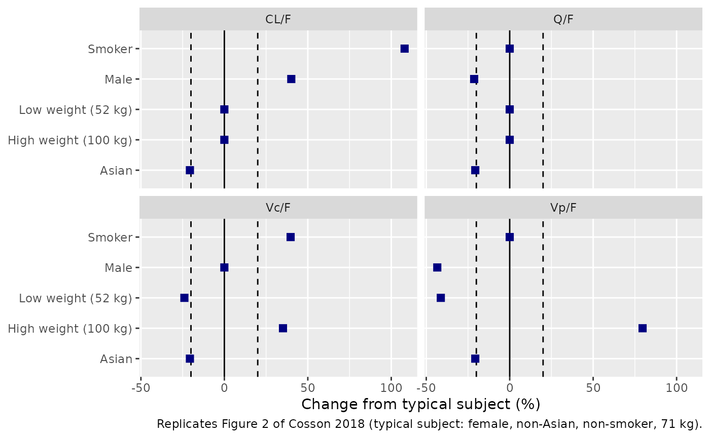
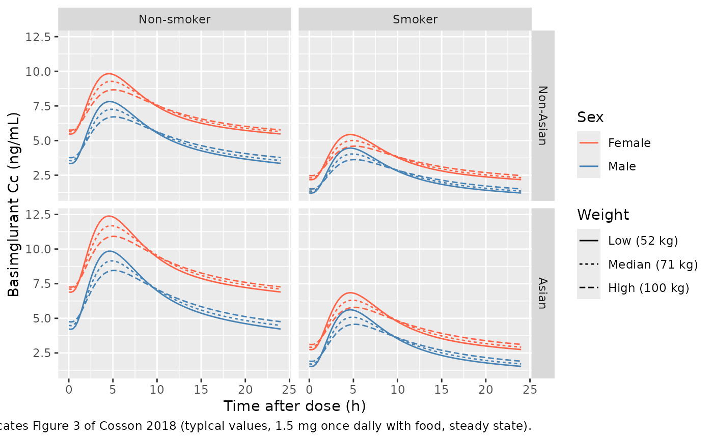
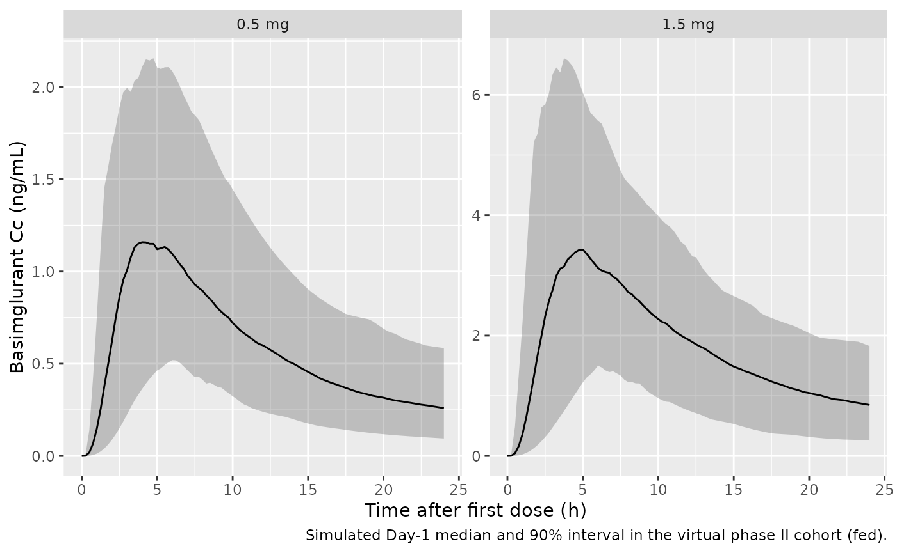
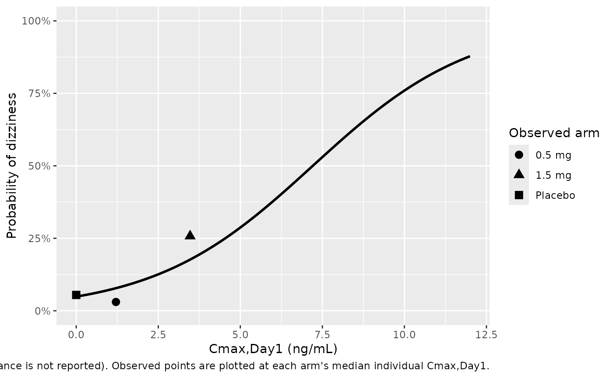

# Basimglurant PK and exposure-dizziness (Cosson 2018)

## Model and source

Cosson 2018 reports two models fitted in sequence: a population PK model
of oral modified-release (MR) basimglurant fitted in NONMEM, and a
logistic regression of dizziness incidence on the individual predicted
Day-1 peak concentration (Cmax,Day1) fitted with
[`glm()`](https://rdrr.io/r/stats/glm.html) in R. They are packaged as
two model files:

- `Cosson_2018_basimglurant` – population PK.
- `Cosson_2018_basimglurant_dizziness` – exposure-dizziness logistic
  model, whose exposure column `CMAX` is simulated with the PK model.

``` r

pk_mod <- readModelDb("Cosson_2018_basimglurant")
dz_mod <- readModelDb("Cosson_2018_basimglurant_dizziness")
pk_ui <- rxode2::rxode(pk_mod)
#> ℹ parameter labels from comments will be replaced by 'label()'
dz_ui <- rxode2::rxode(dz_mod)
```

- Citation: Cosson V, Schaedeli-Stark F, Arab-Alameddine M, Chavanne C,
  Guerini E, Derks M, Jaeschke G, Lindemann L, Umbricht D, Santarelli L.
  Population Pharmacokinetic and Exposure-dizziness Modeling for a
  Metabotropic Glutamate Receptor Subtype 5 Negative Allosteric
  Modulator in Major Depressive Disorder Patients. Clin Transl Sci.
  2018;11(5):523-531. <doi:10.1111/cts.12566>.
- PK description: Two-compartment population PK model for oral
  modified-release basimglurant (RO4917523, an mGlu5 negative allosteric
  modulator) in healthy adults and adults with major depressive disorder
  (Cosson 2018, 288 participants pooled from four phase I trials and one
  phase II trial). Absorption is a chain of three first-order transit
  compartments (depot plus two transit compartments, all at rate Ktr)
  after a lag time, with separate Ktr and lag-time estimates in the fed
  and fasted states; elimination is first order. Covariates: Asian race
  on fasted Ktr and on relative bioavailability, smoking and male sex on
  CL/F, body weight and smoking on Vc/F, male sex on Q/F, and body
  weight and male sex on Vp/F. The typical subject is a non-Asian female
  non-smoker weighing 71 kg. The companion Cmax-driven dizziness model
  is Cosson_2018_basimglurant_dizziness.
- Dizziness description: Logistic-regression exposure-safety model for
  the probability of dizziness (first occurrence, any severity) in
  adults with major depressive disorder taking oral modified-release
  basimglurant (Cosson 2018, 310 phase II patients: placebo, 0.5 mg or
  1.5 mg once daily). The linear predictor is -2.970 + 0.412 \*
  Cmax,Day1, where Cmax,Day1 (ng/mL) is the individual predicted peak
  concentration over the first 24-hour dosing interval, set to 0 for
  placebo patients. No PK layer and no ODE: exposure enters as the
  static per-patient column CMAX, simulated with
  modellib(‘Cosson_2018_basimglurant’). No between-subject random effect
  and no residual error are estimated (Bernoulli likelihood, R glm).
- Article: <https://doi.org/10.1111/cts.12566> (open access, PMC6132363)

## Population

The PK analysis pooled 3,533 plasma concentrations from 288 participants
in five trials: 88 healthy adults in four phase I studies (an MR-vs-IR
formulation and food-effect crossover, two drug-interaction studies with
fluvoxamine and carbamazepine, and a single- and multiple-dose study in
Japanese and Caucasian volunteers) and 200 adults with major depressive
disorder (MDD) in the phase II adjunctive-therapy trial NCT01437657.
Basimglurant MR was given orally once daily at 0.2 to 1.5 mg. 273
participants took it with food, 35 fasted, and 20 under both conditions;
58% were female and 17% Asian, with a median weight of 71.9 kg and a
median age of 43.5 years (Cosson 2018 Methods and Results “PK results”;
the paper has no demographics table).

The exposure-dizziness analysis used 310 phase II patients: 110 on
placebo (6 with dizziness), 99 on 0.5 mg (3) and 101 on 1.5 mg (26).
Only the first occurrence of dizziness, of any severity, was analysed.

``` r

str(pk_ui$population)
#> List of 13
#>  $ species       : chr "human"
#>  $ n_subjects    : int 288
#>  $ n_studies     : int 5
#>  $ n_observations: int 3533
#>  $ age_median    : chr "43.5 years"
#>  $ weight_median : chr "71.9 kg"
#>  $ sex_female_pct: num 58
#>  $ race_ethnicity: Named num 17
#>   ..- attr(*, "names")= chr "Asian"
#>  $ disease_state : chr "88 healthy adults (four phase I trials, including healthy Japanese and Caucasian participants) and 200 adults w"| __truncated__
#>  $ dose_range    : chr "0.2, 0.5, 0.7, 1 or 1.5 mg basimglurant modified-release tablet orally once daily, single and multiple doses"
#>  $ regions       : chr "Phase I sites in France and the United States; phase II sites not stated"
#>  $ co_medication : chr "Two phase I trials co-administered fluvoxamine or carbamazepine (drug-interaction studies); phase II patients c"| __truncated__
#>  $ notes         : chr "Cosson 2018 Methods 'Patient population and study design' and Results 'PK results'. 273 participants received b"| __truncated__
str(dz_ui$population)
#> List of 7
#>  $ species       : chr "human"
#>  $ n_subjects    : int 310
#>  $ n_studies     : int 1
#>  $ n_observations: chr "310 binary first-occurrence dizziness records (one per patient; landmark analysis)"
#>  $ disease_state : chr "adults with major depressive disorder and inadequate response to ongoing antidepressant treatment (adjunctive b"| __truncated__
#>  $ dose_range    : chr "placebo (n = 110), 0.5 mg (n = 99) or 1.5 mg (n = 101) basimglurant modified-release once daily"
#>  $ notes         : chr "Cosson 2018 Results 'Exposure-safety results'. Dizziness was reported by 6/110 placebo, 3/99 (0.5 mg) and 26/10"| __truncated__
```

## Source trace

Every `ini()` value carries an in-file comment naming its source. The
table collects them.

| Parameter | Value | Source location |
|----|----|----|
| `lcl` | log(8.87) L/h | Table 1, CL; CL/F equation |
| `lvc` | log(231) L | Table 1, Vc; Vc/F equation |
| `lq` | log(31.0) L/h | Table 1, Q; Q/F equation |
| `lvp` | log(1140) L | Table 1, Vp; Vp/F equation |
| `lktr_fasted` | log(4.52) 1/h | Table 1, Ktr fasted; Ktr equation |
| `lktr_fed` | log(0.999) 1/h | Table 1, Ktr fed; Ktr equation |
| `ltlag_fasted` | log(0.212) h | Table 1, lag time fasted; Tlag equation |
| `ltlag_fed` | log(0.120) h | Table 1, lag time fed; Tlag equation |
| `e_race_asian_ktr_fasted` | -0.588 | Table 1 (magnitude 0.588); sign from Ktr equation `(1 - 0.588 * ETHN)` |
| `e_sex_cl` | 0.401 | Table 1, gender on CL; CL/F equation |
| `e_smoke_cl` | 1.08 | Table 1, smoking on CL; CL/F equation |
| `e_wt_vc` | 0.879 | Table 1, body weight on Vc; Vc/F equation `(WT/71)^0.879` |
| `e_smoke_vc` | 0.397 | Table 1, smoking on Vc; Vc/F equation |
| `e_sex_q` | -0.213 | Table 1, gender on Q; Q/F equation |
| `e_wt_vp` | 1.71 | Table 1, body weight on Vp; Vp/F equation `(WT/71)^1.71` |
| `e_sex_vp` | -0.434 | Table 1, gender on Vp; Vp/F equation |
| `e_race_asian_fdepot` | 1.26 (ratio) | Table 1, ethnicity on F; Figure 2; Discussion (see Errata 1) |
| `etalcl`, `etalvc`, `etalq`, `etalvp` block | CV 71.3, 25.9, 36.3, 37.4%; six correlations | Table 1, BSV and correlation rows |
| `etalktr_fasted` | CV 41.9% | Table 1 |
| `etalktr_fed` | CV 53.8% | Table 1 |
| `propSd` | 0.262 | Table 1, proportional residual error (see Errata 2) |
| `logit_ref` | -2.970 | Table 2, intercept |
| `e_cmax_logit` | 0.412 per ng/mL | Table 2, slope |
| `addSd_prob_dizziness` | 0.001 (fixed) | not from the source; placeholder for the Bernoulli likelihood |
| Absorption chain | depot + 2 transit compartments, all at Ktr | Results: “a chain of three compartments, including the depot compartment” |
| Disposition | 2 compartments, first-order elimination | Abstract; Results “PK results” |
| Dizziness link | `logit(p) = -2.970 + 0.412 * Cmax,Day1` | Methods “Exposure-safety analysis”; Table 2 |

The covariate equations printed in Results “PK results” are, with the
typical subject a non-Asian, non-smoking 71 kg female (Figure 2
caption):

    Ktr  = 4.52 * (1 - FOOD) * (1 - 0.588 * ETHN) + 0.999 * FOOD
    Tlag = 0.212 * (1 - FOOD) + 0.12 * FOOD
    CL/F = 8.87 * (1 + 1.08 * SMOK) * (1 + 0.401 * SEX)
    Vc/F = 231 * (WT / 71)^0.879 * (1 + 0.397 * SMOK)
    Q/F  = 31.0 * (1 - 0.213 * SEX)
    Vp/F = 1140 * (1 - 0.434 * SEX) * (WT / 71)^1.71
    F    = 1 + 1.26 * ETHN        (printed; encoded as 1.26^ETHN, Errata 1)

`SEX` is a male indicator in the paper; the model stores the canonical
`SEXF` (1 = female) and applies each sex effect to `1 - SEXF`. `FOOD`
becomes `FED`, `SMOK` becomes `SMOKE`, and `ETHN` becomes `RACE_ASIAN`.
Between-subject variances are `omega^2 = log(CV^2 + 1)` from the Table 1
%CVs.

## Typical-value checks against the paper’s derived quantities

These checks use the typical-value model (`zeroRe()`), so both sides are
deterministic and the tolerances are tight.

``` r

pk_typ <- rxode2::zeroRe(pk_mod)
#> ℹ parameter labels from comments will be replaced by 'label()'

ref_cov <- data.frame(SEXF = 1, SMOKE = 0, RACE_ASIAN = 0, WT = 71, FED = 1)

# Typical apparent parameters for one covariate combination.
typ_par <- function(...) {
  cv <- ref_cov
  ov <- list(...)
  for (nm in names(ov)) cv[[nm]] <- ov[[nm]]
  ev <- data.frame(id = 1L, time = 0, amt = 0, evid = 0L, cmt = "central")
  o <- as.data.frame(rxode2::rxSolve(pk_typ, events = cbind(ev, cv)))
  c(cl = o$cl[1], vc = o$vc[1], q = o$q[1], vp = o$vp[1], f = o$fdepot[1])
}

# Terminal half-life of a two-compartment system from its apparent parameters.
thalf_term <- function(p) {
  k <- p[["cl"]] / p[["vc"]]
  k12 <- p[["q"]] / p[["vc"]]
  k21 <- p[["q"]] / p[["vp"]]
  s <- k + k12 + k21
  beta <- (s - sqrt(s^2 - 4 * k * k21)) / 2
  log(2) / beta
}

p_female <- typ_par()
#> ℹ omega/sigma items treated as zero: 'etalcl', 'etalvc', 'etalq', 'etalvp', 'etalktr_fasted', 'etalktr_fed'
p_male <- typ_par(SEXF = 0)
#> ℹ omega/sigma items treated as zero: 'etalcl', 'etalvc', 'etalq', 'etalvp', 'etalktr_fasted', 'etalktr_fed'
p_smoker <- typ_par(SMOKE = 1)
#> ℹ omega/sigma items treated as zero: 'etalcl', 'etalvc', 'etalq', 'etalvp', 'etalktr_fasted', 'etalktr_fed'
```

Cosson 2018 Discussion quotes terminal half-lives of 129 h (typical
female), 63 h (typical male) and 76 h (typical smoker), and “effective”
half-lives of 107 h (female) and 49 h (male). The effective values are
reproduced by `log(2) * Vss / CL`, i.e. `log(2)` times the mean
residence time.

``` r

thalf_tab <- tibble::tribble(
  ~quantity, ~published,
  "Terminal t1/2, typical female (h)", 129,
  "Terminal t1/2, typical male (h)", 63,
  "Terminal t1/2, typical smoker (h)", 76,
  "Effective t1/2 = ln2*Vss/CL, female (h)", 107,
  "Effective t1/2 = ln2*Vss/CL, male (h)", 49
) |>
  mutate(
    model = c(
      thalf_term(p_female), thalf_term(p_male), thalf_term(p_smoker),
      log(2) * (p_female[["vc"]] + p_female[["vp"]]) / p_female[["cl"]],
      log(2) * (p_male[["vc"]] + p_male[["vp"]]) / p_male[["cl"]]
    ),
    pct_diff = 100 * (model - published) / published
  )
knitr::kable(thalf_tab, digits = 2, caption = "Half-lives quoted in the Cosson 2018 Discussion.")
```

| quantity                                 | published |  model | pct_diff |
|:-----------------------------------------|----------:|-------:|---------:|
| Terminal t1/2, typical female (h)        |       129 | 129.06 |     0.05 |
| Terminal t1/2, typical male (h)          |        63 |  63.49 |     0.77 |
| Terminal t1/2, typical smoker (h)        |        76 |  76.40 |     0.52 |
| Effective t1/2 = ln2\*Vss/CL, female (h) |       107 | 107.14 |     0.13 |
| Effective t1/2 = ln2\*Vss/CL, male (h)   |        49 |  48.88 |    -0.26 |

Half-lives quoted in the Cosson 2018 Discussion. {.table}

``` r

# Published values are rounded to whole hours, so 1.5% covers the rounding.
stopifnot(all(abs(thalf_tab$pct_diff) < 1.5))
```

### Figure 2 – covariate effects on the apparent disposition parameters

Figure 2 shows each covariate effect as a percent change from the
typical subject. Low and high weight are 52 and 100 kg.

``` r

fig2 <- bind_rows(
  tibble(level = "Smoker", p = list(typ_par(SMOKE = 1))),
  tibble(level = "Male", p = list(typ_par(SEXF = 0))),
  tibble(level = "Asian", p = list(typ_par(RACE_ASIAN = 1))),
  tibble(level = "Low weight (52 kg)", p = list(typ_par(WT = 52))),
  tibble(level = "High weight (100 kg)", p = list(typ_par(WT = 100)))
) |>
  mutate(
    `CL/F` = sapply(p, function(x) x[["cl"]] / x[["f"]]),
    `Vc/F` = sapply(p, function(x) x[["vc"]] / x[["f"]]),
    `Q/F` = sapply(p, function(x) x[["q"]] / x[["f"]]),
    `Vp/F` = sapply(p, function(x) x[["vp"]] / x[["f"]])
  ) |>
  select(-p) |>
  pivot_longer(-level, names_to = "parameter", values_to = "value") |>
  mutate(
    ref = case_when(
      parameter == "CL/F" ~ p_female[["cl"]],
      parameter == "Vc/F" ~ p_female[["vc"]],
      parameter == "Q/F" ~ p_female[["q"]],
      parameter == "Vp/F" ~ p_female[["vp"]]
    ),
    pct_change = 100 * (value / ref - 1)
  )
#> ℹ omega/sigma items treated as zero: 'etalcl', 'etalvc', 'etalq', 'etalvp', 'etalktr_fasted', 'etalktr_fed'
#> ℹ omega/sigma items treated as zero: 'etalcl', 'etalvc', 'etalq', 'etalvp', 'etalktr_fasted', 'etalktr_fed'
#> ℹ omega/sigma items treated as zero: 'etalcl', 'etalvc', 'etalq', 'etalvp', 'etalktr_fasted', 'etalktr_fed'
#> ℹ omega/sigma items treated as zero: 'etalcl', 'etalvc', 'etalq', 'etalvp', 'etalktr_fasted', 'etalktr_fed'
#> ℹ omega/sigma items treated as zero: 'etalcl', 'etalvc', 'etalq', 'etalvp', 'etalktr_fasted', 'etalktr_fed'

ggplot(fig2, aes(pct_change, level)) +
  geom_vline(xintercept = 0) +
  geom_vline(xintercept = c(-20, 20), linetype = "dashed") +
  geom_point(shape = 15, colour = "navy", size = 2.5) +
  facet_wrap(~parameter) +
  labs(
    x = "Change from typical subject (%)", y = NULL,
    caption = "Replicates Figure 2 of Cosson 2018 (typical subject: female, non-Asian, non-smoker, 71 kg)."
  )
```



``` r


fig2 |>
  select(level, parameter, pct_change) |>
  pivot_wider(names_from = parameter, values_from = pct_change) |>
  knitr::kable(digits = 1, caption = "Percent change from the typical subject in the apparent parameters.")
```

| level                |  CL/F |  Vc/F |   Q/F |  Vp/F |
|:---------------------|------:|------:|------:|------:|
| Smoker               | 108.0 |  39.7 |   0.0 |   0.0 |
| Male                 |  40.1 |   0.0 | -21.3 | -43.4 |
| Asian                | -20.6 | -20.6 | -20.6 | -20.6 |
| Low weight (52 kg)   |   0.0 | -23.9 |   0.0 | -41.3 |
| High weight (100 kg) |   0.0 |  35.1 |   0.0 |  79.6 |

Percent change from the typical subject in the apparent parameters.
{.table}

The model reproduces every symbol in Figure 2 – smoker +108% on CL/F,
male +40% on CL/F, -21% on Q/F and -43% on Vp/F, weight -24%/+35% on
Vc/F and -41%/+80% on Vp/F, and Asian -21% on all four apparent
parameters (the reciprocal of the 1.26 relative bioavailability) – with
one exception. The Vc/F panel of Figure 2 has a symbol labelled “Male”
at +40% and none for smoking, but the model has no sex effect on Vc/F;
+39.7% is the smoking effect, and the Vc/F row “Smoker” above shows it.
The label in the figure is treated as a mislabel (Errata 3).

``` r

fig2_val <- function(lv, par) fig2$pct_change[fig2$level == lv & fig2$parameter == par]
stopifnot(
  abs(fig2_val("Asian", "CL/F") - 100 * (1 / 1.26 - 1)) < 0.01,
  abs(fig2_val("Smoker", "CL/F") - 108) < 0.01,
  abs(fig2_val("Male", "Vp/F") - (-43.4)) < 0.01
)
```

### Steady-state exposure claims in the Discussion

``` r

ss_profile <- function(cov, dose = 1.5) {
  ev <- rxode2::et(amt = dose, cmt = "depot", ii = 24, addl = 59) |>
    rxode2::et(seq(1416, 1440, by = 0.05), cmt = "central") |>
    as.data.frame()
  ev$id <- 1L
  as.data.frame(rxode2::rxSolve(
    pk_typ,
    events = cbind(ev, cov), maxsteps = 1e6
  ))
}
auc_trap <- function(t, c) sum(diff(t) * (head(c, -1) + tail(c, -1)) / 2)
ss_metric <- function(cov) {
  o <- ss_profile(cov)
  c(auc = auc_trap(o$time, o$Cc), cmax = max(o$Cc))
}
m_f <- ss_metric(ref_cov)
#> ℹ omega/sigma items treated as zero: 'etalcl', 'etalvc', 'etalq', 'etalvp', 'etalktr_fasted', 'etalktr_fed'
m_m <- ss_metric(transform(ref_cov, SEXF = 0))
#> ℹ omega/sigma items treated as zero: 'etalcl', 'etalvc', 'etalq', 'etalvp', 'etalktr_fasted', 'etalktr_fed'
m_s <- ss_metric(transform(ref_cov, SMOKE = 1))
#> ℹ omega/sigma items treated as zero: 'etalcl', 'etalvc', 'etalq', 'etalvp', 'etalktr_fasted', 'etalktr_fed'

ss_tab <- tibble::tribble(
  ~claim, ~published_pct,
  "Male vs female, AUC,ss", -30,
  "Male vs female, Cmax,ss", -20,
  "Smoker vs non-smoker, AUC,ss", -52
) |>
  mutate(model_pct = c(
    100 * (m_m[["auc"]] / m_f[["auc"]] - 1),
    100 * (m_m[["cmax"]] / m_f[["cmax"]] - 1),
    100 * (m_s[["auc"]] / m_f[["auc"]] - 1)
  ))
knitr::kable(ss_tab, digits = 1, caption = "Steady-state exposure differences quoted in the Cosson 2018 Discussion (1.5 mg fed).")
```

| claim                        | published_pct | model_pct |
|:-----------------------------|--------------:|----------:|
| Male vs female, AUC,ss       |           -30 |     -28.6 |
| Male vs female, Cmax,ss      |           -20 |     -21.7 |
| Smoker vs non-smoker, AUC,ss |           -52 |     -51.9 |

Steady-state exposure differences quoted in the Cosson 2018 Discussion
(1.5 mg fed). {.table}

``` r

# The paper rounds to the nearest 10% (sex) or 1% (smoking).
stopifnot(all(abs(ss_tab$model_pct - ss_tab$published_pct) < 3))
```

### Food and ethnicity effects on Day-1 absorption

The Discussion states that food reduced Day-1 Cmax by about 30% and
delayed Tmax by 2.5 h relative to the fasted state, and that ethnicity
delayed absorption by 1.5 h in Asian subjects under fasted conditions
only.

``` r

day1 <- function(cov, dose = 0.5) {
  ev <- rxode2::et(amt = dose, cmt = "depot") |>
    rxode2::et(seq(0, 24, by = 0.01), cmt = "central") |>
    as.data.frame()
  ev$id <- 1L
  o <- as.data.frame(rxode2::rxSolve(pk_typ, events = cbind(ev, cov)))
  c(cmax = max(o$Cc), tmax = o$time[which.max(o$Cc)])
}
d_fed <- day1(ref_cov)
#> ℹ omega/sigma items treated as zero: 'etalcl', 'etalvc', 'etalq', 'etalvp', 'etalktr_fasted', 'etalktr_fed'
d_fast <- day1(transform(ref_cov, FED = 0))
#> ℹ omega/sigma items treated as zero: 'etalcl', 'etalvc', 'etalq', 'etalvp', 'etalktr_fasted', 'etalktr_fed'
d_fast_asian <- day1(transform(ref_cov, FED = 0, RACE_ASIAN = 1))
#> ℹ omega/sigma items treated as zero: 'etalcl', 'etalvc', 'etalq', 'etalvp', 'etalktr_fasted', 'etalktr_fed'
d_fed_asian <- day1(transform(ref_cov, FED = 1, RACE_ASIAN = 1))
#> ℹ omega/sigma items treated as zero: 'etalcl', 'etalvc', 'etalq', 'etalvp', 'etalktr_fasted', 'etalktr_fed'

abs_tab <- tibble::tribble(
  ~claim, ~published, ~model,
  "Fed vs fasted, Day-1 Cmax change (%)", -30, 100 * (d_fed[["cmax"]] / d_fast[["cmax"]] - 1),
  "Fed vs fasted, Tmax delay (h)", 2.5, d_fed[["tmax"]] - d_fast[["tmax"]],
  "Asian vs non-Asian fasted, Tmax delay (h)", 1.5, d_fast_asian[["tmax"]] - d_fast[["tmax"]],
  "Asian vs non-Asian fed, Tmax delay (h)", 0, d_fed_asian[["tmax"]] - d_fed[["tmax"]]
)
knitr::kable(abs_tab, digits = 2, caption = "Day-1 absorption claims in the Cosson 2018 Discussion (typical female, 71 kg).")
```

| claim                                     | published |  model |
|:------------------------------------------|----------:|-------:|
| Fed vs fasted, Day-1 Cmax change (%)      |     -30.0 | -29.01 |
| Fed vs fasted, Tmax delay (h)             |       2.5 |   3.23 |
| Asian vs non-Asian fasted, Tmax delay (h) |       1.5 |   1.49 |
| Asian vs non-Asian fed, Tmax delay (h)    |       0.0 |   0.00 |

Day-1 absorption claims in the Cosson 2018 Discussion (typical female,
71 kg). {.table}

``` r

stopifnot(
  abs(abs_tab$model[1] - (-30)) < 3,
  abs(abs_tab$model[3] - 1.5) < 0.1,
  abs(abs_tab$model[4]) < 0.01
)
```

The model’s food-related Tmax delay is about 3.2 h against the 2.5 h
quoted. The Day-1 Cmax reduction and the Figure 3 steady-state profiles
(next section) both match, so the quoted 2.5 h is recorded as a known
deviation rather than gated; the paper does not say how that figure was
derived.

### Figure 3 – steady-state typical profiles by covariate

Figure 3 shows population-predicted steady-state profiles over one
dosing interval for each combination of smoking, sex, ethnicity and
weight (52, 71, 100 kg). The dose is not stated in the caption; 1.5 mg
once daily with food reproduces every non-Asian curve. The trough (t =
0) and peak values below were read from the vector paths of the
published figure (precision about 0.01 ng/mL).

``` r

fig3_pub <- tibble::tribble(
  ~SMOKE, ~RACE_ASIAN, ~SEXF, ~WT, ~trough_pub, ~peak_pub,
  0, 0, 1, 52, 5.48, 9.83,
  0, 0, 1, 71, 5.65, 9.27,
  0, 0, 1, 100, 5.75, 8.65,
  0, 0, 0, 52, 3.36, 7.82,
  0, 0, 0, 71, 3.56, 7.26,
  0, 0, 0, 100, 3.78, 6.71,
  1, 0, 1, 52, 2.18, 5.44,
  1, 0, 1, 71, 2.32, 5.01,
  1, 0, 1, 100, 2.48, 4.60,
  1, 0, 0, 52, 1.22, 4.46,
  1, 0, 0, 71, 1.36, 4.03,
  1, 0, 0, 100, 1.52, 3.63,
  0, 1, 1, 52, 8.70, 15.61,
  0, 1, 1, 71, 8.96, 14.71,
  0, 1, 1, 100, 9.13, 13.73,
  0, 1, 0, 52, 5.33, 12.41,
  0, 1, 0, 71, 5.65, 11.52,
  0, 1, 0, 100, 6.00, 10.65,
  1, 1, 1, 52, 3.46, 8.63,
  1, 1, 1, 71, 3.68, 7.95,
  1, 1, 1, 100, 3.93, 7.30,
  1, 1, 0, 52, 1.93, 7.07,
  1, 1, 0, 71, 2.16, 6.40,
  1, 1, 0, 100, 2.40, 5.76
)
```

``` r

fig3_cov <- fig3_pub |>
  select(SMOKE, RACE_ASIAN, SEXF, WT) |>
  mutate(id = row_number(), FED = 1)
fig3_ev <- rxode2::et(amt = 1.5, cmt = "depot", ii = 24, addl = 59) |>
  rxode2::et(seq(1416, 1440, by = 0.25), cmt = "central") |>
  as.data.frame() |>
  select(-any_of("id")) |>
  tidyr::crossing(fig3_cov) |>
  arrange(id, time, desc(evid))
fig3_sim <- as.data.frame(rxode2::rxSolve(
  pk_typ,
  events = fig3_ev, keep = c("SMOKE", "RACE_ASIAN", "SEXF", "WT"),
  maxsteps = 1e6
)) |>
  mutate(
    tad = time - 1416,
    Smoking = ifelse(SMOKE == 1, "Smoker", "Non-smoker"),
    Ethnicity = ifelse(RACE_ASIAN == 1, "Asian", "Non-Asian"),
    Sex = ifelse(SEXF == 1, "Female", "Male"),
    Weight = factor(WT, c(52, 71, 100), c("Low (52 kg)", "Median (71 kg)", "High (100 kg)"))
  )
#> ℹ omega/sigma items treated as zero: 'etalcl', 'etalvc', 'etalq', 'etalvp', 'etalktr_fasted', 'etalktr_fed'
#> Warning: multi-subject simulation without without 'omega'

ggplot(fig3_sim, aes(tad, Cc, colour = Sex, linetype = Weight)) +
  geom_line() +
  facet_grid(factor(Ethnicity, c("Non-Asian", "Asian")) ~ Smoking) +
  scale_colour_manual(values = c(Female = "tomato", Male = "steelblue")) +
  labs(
    x = "Time after dose (h)", y = "Basimglurant Cc (ng/mL)",
    caption = "Replicates Figure 3 of Cosson 2018 (typical values, 1.5 mg once daily with food, steady state)."
  )
```



``` r

fig3_cmp <- fig3_sim |>
  group_by(SMOKE, RACE_ASIAN, SEXF, WT) |>
  summarise(trough_model = Cc[tad == 0], peak_model = max(Cc), .groups = "drop") |>
  inner_join(fig3_pub, by = c("SMOKE", "RACE_ASIAN", "SEXF", "WT")) |>
  mutate(
    trough_ratio = trough_pub / trough_model,
    peak_ratio = peak_pub / peak_model
  )
stopifnot(nrow(fig3_cmp) == 24)

fig3_cmp |>
  select(SMOKE, RACE_ASIAN, SEXF, WT, trough_pub, trough_model, peak_pub, peak_model, trough_ratio, peak_ratio) |>
  knitr::kable(digits = 3, caption = "Figure 3 trough and peak: published vs model (ratio = published / model).")
```

| SMOKE | RACE_ASIAN | SEXF | WT | trough_pub | trough_model | peak_pub | peak_model | trough_ratio | peak_ratio |
|---:|---:|---:|---:|---:|---:|---:|---:|---:|---:|
| 0 | 0 | 0 | 52 | 3.36 | 3.354 | 7.82 | 7.816 | 1.002 | 1.001 |
| 0 | 0 | 0 | 71 | 3.56 | 3.560 | 7.26 | 7.257 | 1.000 | 1.000 |
| 0 | 0 | 0 | 100 | 3.78 | 3.777 | 6.71 | 6.710 | 1.001 | 1.000 |
| 0 | 0 | 1 | 52 | 5.48 | 5.476 | 9.83 | 9.829 | 1.001 | 1.000 |
| 0 | 0 | 1 | 71 | 5.65 | 5.645 | 9.27 | 9.276 | 1.001 | 0.999 |
| 0 | 0 | 1 | 100 | 5.75 | 5.766 | 8.65 | 8.665 | 0.997 | 0.998 |
| 0 | 1 | 0 | 52 | 5.33 | 4.227 | 12.41 | 9.848 | 1.261 | 1.260 |
| 0 | 1 | 0 | 71 | 5.65 | 4.486 | 11.52 | 9.144 | 1.259 | 1.260 |
| 0 | 1 | 0 | 100 | 6.00 | 4.759 | 10.65 | 8.455 | 1.261 | 1.260 |
| 0 | 1 | 1 | 52 | 8.70 | 6.900 | 15.61 | 12.385 | 1.261 | 1.260 |
| 0 | 1 | 1 | 71 | 8.96 | 7.113 | 14.71 | 11.688 | 1.260 | 1.259 |
| 0 | 1 | 1 | 100 | 9.13 | 7.265 | 13.73 | 10.917 | 1.257 | 1.258 |
| 1 | 0 | 0 | 52 | 1.22 | 1.216 | 4.46 | 4.456 | 1.003 | 1.001 |
| 1 | 0 | 0 | 71 | 1.36 | 1.356 | 4.03 | 4.031 | 1.003 | 1.000 |
| 1 | 0 | 0 | 100 | 1.52 | 1.513 | 3.63 | 3.627 | 1.005 | 1.001 |
| 1 | 0 | 1 | 52 | 2.18 | 2.181 | 5.44 | 5.434 | 1.000 | 1.001 |
| 1 | 0 | 1 | 71 | 2.32 | 2.318 | 5.01 | 5.004 | 1.001 | 1.001 |
| 1 | 0 | 1 | 100 | 2.48 | 2.475 | 4.60 | 4.596 | 1.002 | 1.001 |
| 1 | 1 | 0 | 52 | 1.93 | 1.533 | 7.07 | 5.614 | 1.259 | 1.259 |
| 1 | 1 | 0 | 71 | 2.16 | 1.709 | 6.40 | 5.079 | 1.264 | 1.260 |
| 1 | 1 | 0 | 100 | 2.40 | 1.906 | 5.76 | 4.570 | 1.259 | 1.260 |
| 1 | 1 | 1 | 52 | 3.46 | 2.748 | 8.63 | 6.847 | 1.259 | 1.260 |
| 1 | 1 | 1 | 71 | 3.68 | 2.921 | 7.95 | 6.306 | 1.260 | 1.261 |
| 1 | 1 | 1 | 100 | 3.93 | 3.119 | 7.30 | 5.791 | 1.260 | 1.261 |

Figure 3 trough and peak: published vs model (ratio = published /
model). {.table}

``` r


non_asian <- fig3_cmp |> filter(RACE_ASIAN == 0)
asian <- fig3_cmp |> filter(RACE_ASIAN == 1)
# Non-Asian curves: digitisation precision ~0.01 ng/mL on values >= 1.2 ng/mL;
# realised maximum deviation 0.7%.
stopifnot(max(abs(c(non_asian$trough_ratio, non_asian$peak_ratio) - 1)) < 0.015)
# Asian curves sit a further factor of 1.26 above the model -- the published
# figure carries 1.26^2 = 1.588 relative to non-Asian (Errata 1).
stopifnot(abs(median(c(asian$trough_ratio, asian$peak_ratio)) - 1.26) < 0.015)
```

All twelve non-Asian curves match within 1%. Every Asian curve in the
published figure is 1.26 times the model’s Asian curve, so Figure 3
carries the Asian bioavailability factor twice (1.26^2 = 1.588 relative
to the non-Asian curves). See Errata 1.

## Virtual phase II cohort

The paper reports simulated Cmax,Day1 for the phase II MDD population
(Table 3) and the individual predicted values of the analysed patients
(Results “Exposure-safety results”). The phase II covariate distribution
is not published; the cohort below uses the overall analysis-population
values (58% female, 17% Asian, median weight 71.9 kg with 5th-95th
percentiles of 52-100 kg) and an assumed 25% smoking prevalence. All
phase II patients are treated as fed.

``` r

rxode2::rxSetSeed(20181105)
set.seed(20181105)
n_per_arm <- 200L

make_cohort <- function(n, dose, id_offset) {
  tibble(
    id = id_offset + seq_len(n),
    treatment = paste(dose, "mg"),
    dose = dose,
    SEXF = rbinom(n, 1, 0.58),
    RACE_ASIAN = rbinom(n, 1, 0.17),
    SMOKE = rbinom(n, 1, 0.25),
    WT = exp(rnorm(n, log(71.9), log(100 / 52) / (2 * 1.645))),
    FED = 1
  )
}
subjects <- bind_rows(
  make_cohort(n_per_arm, 0.5, 0L),
  make_cohort(n_per_arm, 1.5, n_per_arm)
)

obs_times <- seq(0, 24, by = 0.25)
events <- bind_rows(
  subjects |> mutate(time = 0, amt = dose, evid = 1L, cmt = "depot"),
  subjects |>
    tidyr::crossing(time = obs_times) |>
    mutate(amt = NA_real_, evid = 0L, cmt = "central")
) |>
  arrange(id, time, desc(evid)) |>
  select(id, time, amt, evid, cmt, treatment, SEXF, RACE_ASIAN, SMOKE, WT, FED)
stopifnot(!anyDuplicated(unique(events[, c("id", "time", "evid")])))
```

## Simulation

``` r

sim <- rxode2::rxSolve(
  pk_mod,
  events = events,
  keep = c("treatment", "SEXF", "RACE_ASIAN", "SMOKE", "WT")
) |>
  as.data.frame()
#> ℹ parameter labels from comments will be replaced by 'label()'
```

``` r

sim |>
  filter(!is.na(Cc)) |>
  group_by(treatment, time) |>
  summarise(
    Q05 = quantile(Cc, 0.05), Q50 = median(Cc), Q95 = quantile(Cc, 0.95),
    .groups = "drop"
  ) |>
  ggplot(aes(time, Q50)) +
  geom_ribbon(aes(ymin = Q05, ymax = Q95), alpha = 0.25) +
  geom_line() +
  facet_wrap(~treatment, scales = "free_y") +
  labs(
    x = "Time after first dose (h)", y = "Basimglurant Cc (ng/mL)",
    caption = "Simulated Day-1 median and 90% interval in the virtual phase II cohort (fed)."
  )
```



## PKNCA validation

``` r

sim_nca <- sim |>
  filter(!is.na(Cc)) |>
  select(id, time, Cc, treatment)
sim_nca <- bind_rows(
  sim_nca,
  sim_nca |> distinct(id, treatment) |> mutate(time = 0, Cc = 0)
) |>
  distinct(id, treatment, time, .keep_all = TRUE) |>
  arrange(id, treatment, time)

conc_obj <- PKNCA::PKNCAconc(sim_nca, Cc ~ time | treatment + id)
dose_df <- events |>
  filter(evid == 1) |>
  select(id, time, amt, treatment)
dose_obj <- PKNCA::PKNCAdose(dose_df, amt ~ time | treatment + id)
intervals <- data.frame(start = 0, end = 24, cmax = TRUE, tmax = TRUE, auclast = TRUE)
nca_res <- PKNCA::pk.nca(PKNCA::PKNCAdata(conc_obj, dose_obj, intervals = intervals))
summary(nca_res)
#>  start end treatment   N     auclast        cmax              tmax
#>      0  24    0.5 mg 200 14.0 [44.5] 1.23 [45.3] 4.50 [1.25, 13.5]
#>      0  24    1.5 mg 200 42.1 [43.3] 3.56 [46.4] 5.00 [1.75, 12.8]
#> 
#> Caption: auclast, cmax: geometric mean and geometric coefficient of variation; tmax: median and range; N: number of subjects
```

### Comparison against the published Cmax,Day1

Table 3 of Cosson 2018 gives the median simulated Cmax,Day1 in the phase
II population: 1.47 ng/mL at 0.5 mg and 4.42 ng/mL at 1.5 mg.

``` r

published <- tibble::tribble(
  ~treatment, ~cmax,
  "0.5 mg", 1.47,
  "1.5 mg", 4.42
)
cmp <- nlmixr2lib::ncaComparisonTable(
  simulated = nca_res,
  reference = published,
  by = "treatment",
  units = c(cmax = "ng/mL"),
  tolerance_pct = 20
)
knitr::kable(cmp, caption = "Simulated vs published (Table 3) median Cmax,Day1. * differs from reference by >20%.")
```

| NCA parameter | treatment | Reference | Simulated | % diff |
|:--------------|:----------|:----------|:----------|:-------|
| Cmax (ng/mL)  | 0.5 mg    | 1.47      | 1.29      | -12.4% |
| Cmax (ng/mL)  | 1.5 mg    | 4.42      | 3.72      | -15.8% |

Simulated vs published (Table 3) median Cmax,Day1. \* differs from
reference by \>20%. {.table}

``` r

cmax_day1 <- as.data.frame(nca_res) |>
  filter(PPTESTCD == "cmax") |>
  select(id, treatment, CMAX = PPORRES)

cmax_ref <- tibble::tribble(
  ~treatment, ~table3_median, ~table3_pi, ~observed_median, ~observed_range,
  "0.5 mg", 1.47, "0.592-3.73", 1.21, "0.42-3.26",
  "1.5 mg", 4.42, "1.77-11.2", 3.47, "1.04-9.62"
)
cmax_summary <- cmax_day1 |>
  group_by(treatment) |>
  summarise(
    median = median(CMAX),
    q025 = quantile(CMAX, 0.025),
    q975 = quantile(CMAX, 0.975),
    .groups = "drop"
  ) |>
  inner_join(cmax_ref, by = "treatment")
stopifnot(nrow(cmax_summary) == 2)
cmax_summary |>
  dplyr::rename(
    "Dose" = treatment,
    "Sim. median" = median,
    "Sim. 2.5th" = q025,
    "Sim. 97.5th" = q975,
    "Table 3 median" = table3_median,
    "Table 3 95% PI" = table3_pi,
    "Phase II EBE median" = observed_median,
    "Phase II EBE range" = observed_range
  ) |>
  knitr::kable(digits = 2, caption = "Cmax,Day1 (ng/mL): virtual cohort vs Cosson 2018 Table 3 and the phase II individual predictions.")
```

| Dose | Sim. median | Sim. 2.5th | Sim. 97.5th | Table 3 median | Table 3 95% PI | Phase II EBE median | Phase II EBE range |
|:---|---:|---:|---:|---:|:---|---:|:---|
| 0.5 mg | 1.29 | 0.56 | 2.49 | 1.47 | 0.592-3.73 | 1.21 | 0.42-3.26 |
| 1.5 mg | 3.72 | 1.52 | 7.95 | 4.42 | 1.77-11.2 | 3.47 | 1.04-9.62 |

Cmax,Day1 (ng/mL): virtual cohort vs Cosson 2018 Table 3 and the phase
II individual predictions. {.table}

``` r


# Centre of the distribution, not its tails: a mis-transcribed volume, F or
# unit moves the median by tens of percent.
med_ratio <- cmax_summary$median / cmax_summary$table3_median
stopifnot(all(abs(med_ratio - 1) < 0.25))
# Linear PK: the 1.5 mg median is three times the 0.5 mg median within
# sampling noise (Table 3 itself assumes linearity).
med_of <- function(trt) cmax_summary$median[cmax_summary$treatment == trt]
stopifnot(abs(med_of("1.5 mg") / med_of("0.5 mg") / 3 - 1) < 0.15)
```

The simulated medians fall between the phase II individual predictions
(1.21 and 3.47 ng/mL) and the Table 3 simulation (1.47 and 4.42 ng/mL).
Table 3 used the unpublished phase II covariate distribution, and the
Asian share and smoking prevalence above are assumptions, so a
difference of this size is expected. If the Table 3 simulation also
applied the Asian bioavailability factor twice, as Figure 3 does (Errata
1), its medians would sit higher for that reason too.

## Exposure-dizziness model

### Closed-form check of Table 2 and Table 3

Table 3 gives the predicted dizziness probability at the median, 2.5th
and 97.5th percentiles of Cmax,Day1 for six doses. The logistic model
reproduces every one of the eighteen probabilities from the printed Cmax
values.

``` r

dz_solve <- function(cmax) {
  ev <- data.frame(id = seq_along(cmax), time = 0, amt = 0, evid = 0L, CMAX = cmax)
  as.data.frame(rxode2::rxSolve(dz_mod, events = ev))$prob_dizziness
}
```

``` r

table3 <- tibble::tribble(
  ~dose, ~cmax_med, ~cmax_lo, ~cmax_hi, ~p_med, ~p_lo, ~p_hi,
  "0.5 mg", 1.47, 0.592, 3.73, 8.6, 6.1, 19,
  "1.5 mg", 4.42, 1.77, 11.2, 24, 9.6, 84,
  "2.0 mg", 5.89, 2.37, 14.9, 37, 12, 96,
  "2.5 mg", 7.36, 2.96, 18.6, 52, 15, 99,
  "3.0 mg", 8.83, 3.55, 22.4, 66, 18, 100,
  "4.0 mg", 11.8, 4.73, 29.8, 87, 27, 100
) |>
  mutate(
    model_med = 100 * dz_solve(cmax_med),
    model_lo = 100 * dz_solve(cmax_lo),
    model_hi = 100 * dz_solve(cmax_hi)
  )
#> Warning: There were 3 warnings in `mutate()`.
#> The first warning was:
#> ℹ In argument: `model_med = 100 * dz_solve(cmax_med)`.
#> Caused by warning:
#> ! multi-subject simulation without without 'omega'
#> ℹ Run `dplyr::last_dplyr_warnings()` to see the 2 remaining warnings.
knitr::kable(
  table3 |> select(dose, cmax_med, p_med, model_med, cmax_lo, p_lo, model_lo, cmax_hi, p_hi, model_hi),
  digits = 2,
  caption = "Cosson 2018 Table 3: published vs model dizziness probability (%) at the printed Cmax,Day1 percentiles."
)
```

| dose   | cmax_med | p_med | model_med | cmax_lo | p_lo | model_lo | cmax_hi | p_hi | model_hi |
|:-------|---------:|------:|----------:|--------:|-----:|---------:|--------:|-----:|---------:|
| 0.5 mg |     1.47 |   8.6 |      8.59 |    0.59 |  6.1 |     6.15 |    3.73 |   19 |    19.26 |
| 1.5 mg |     4.42 |  24.0 |     24.07 |    1.77 |  9.6 |     9.61 |   11.20 |   84 |    83.81 |
| 2.0 mg |     5.89 |  37.0 |     36.74 |    2.37 | 12.0 |    11.99 |   14.90 |   96 |    95.96 |
| 2.5 mg |     7.36 |  52.0 |     51.56 |    2.96 | 15.0 |    14.80 |   18.60 |   99 |    99.09 |
| 3.0 mg |     8.83 |  66.0 |     66.10 |    3.55 | 18.0 |    18.13 |   22.40 |  100 |    99.81 |
| 4.0 mg |    11.80 |  87.0 |     86.89 |    4.73 | 27.0 |    26.48 |   29.80 |  100 |    99.99 |

Cosson 2018 Table 3: published vs model dizziness probability (%) at the
printed Cmax,Day1 percentiles. {.table}

``` r

# Published to 2 significant figures (e.g. 9.6, 19, 84; 100 for >= 99.5).
pub <- c(table3$p_med, table3$p_lo, table3$p_hi)
mod <- c(table3$model_med, table3$model_lo, table3$model_hi)
stopifnot(all(abs(mod - pub) <= pmax(0.6, 0.03 * pub)))

# Odds ratio per ng/mL (Table 2 and Discussion: 1.510).
stopifnot(abs(exp(rxode2::rxode(dz_mod)$theta[["e_cmax_logit"]]) - 1.510) < 0.001)
```

### Figure 4 – exposure-response curve

``` r

curve_df <- tibble(CMAX = seq(0, 12, by = 0.05)) |>
  mutate(prob = dz_solve(CMAX))
#> Warning: There was 1 warning in `mutate()`.
#> ℹ In argument: `prob = dz_solve(CMAX)`.
#> Caused by warning:
#> ! multi-subject simulation without without 'omega'
observed <- tibble::tribble(
  ~arm, ~CMAX, ~events, ~n,
  "Placebo", 0, 6, 110,
  "0.5 mg", 1.21, 3, 99,
  "1.5 mg", 3.47, 26, 101
) |>
  mutate(rate = events / n)

ggplot(curve_df, aes(CMAX, prob)) +
  geom_line(linewidth = 1) +
  geom_point(data = observed, aes(CMAX, rate, shape = arm), size = 3) +
  scale_y_continuous(labels = scales::percent, limits = c(0, 1)) +
  labs(
    x = "Cmax,Day1 (ng/mL)", y = "Probability of dizziness", shape = "Observed arm",
    caption = paste(
      "Replicates the model curve of Figure 4 of Cosson 2018 (the 95% CI band is not",
      "reproduced: the intercept-slope covariance is not reported). Observed points",
      "are plotted at each arm's median individual Cmax,Day1."
    )
  )
```



### Predicted incidence in the virtual cohort

``` r

er_arm <- bind_rows(
  tibble(treatment = "Placebo", CMAX = rep(0, n_per_arm)),
  cmax_day1 |> select(treatment, CMAX)
) |>
  mutate(prob = dz_solve(CMAX)) |>
  group_by(treatment) |>
  summarise(model_mean_pct = 100 * mean(prob), .groups = "drop") |>
  inner_join(
    tibble::tribble(
      ~treatment, ~paper_pred_pct, ~observed_pct,
      "Placebo", 100 * plogis(-2.970), 100 * 6 / 110,
      "0.5 mg", 9, 100 * 3 / 99,
      "1.5 mg", 24, 100 * 26 / 101
    ),
    by = "treatment"
  )
#> Warning: There was 1 warning in `mutate()`.
#> ℹ In argument: `prob = dz_solve(CMAX)`.
#> Caused by warning:
#> ! multi-subject simulation without without 'omega'
stopifnot(nrow(er_arm) == 3)
er_arm |>
  dplyr::rename(
    "Arm" = treatment,
    "Model, mean predicted (%)" = model_mean_pct,
    "Paper, predicted (%)" = paper_pred_pct,
    "Observed (%)" = observed_pct
  ) |>
  knitr::kable(digits = 1, caption = "Dizziness incidence by arm. The paper's placebo prediction is the intercept alone; its active-arm predictions are from Results.")
```

| Arm     | Model, mean predicted (%) | Paper, predicted (%) | Observed (%) |
|:--------|--------------------------:|---------------------:|-------------:|
| 0.5 mg  |                       8.4 |                  9.0 |          3.0 |
| 1.5 mg  |                      22.2 |                 24.0 |         25.7 |
| Placebo |                       4.9 |                  4.9 |          5.5 |

Dizziness incidence by arm. The paper’s placebo prediction is the
intercept alone; its active-arm predictions are from Results. {.table}

``` r

p15 <- er_arm$model_mean_pct[er_arm$treatment == "1.5 mg"]
# Results quotes a 24% predicted risk at 1.5 mg. The mean over the cohort is
# robust to tail subjects; 15-35% still fails if the slope or Cmax scale is off.
stopifnot(p15 > 15, p15 < 35)
```

## Assumptions and deviations

1.  **Asian relative bioavailability (Errata 1).** The covariate
    equation is printed as `F = 1 + 1.26 * ETHN`, which would make Asian
    bioavailability 2.26 times the non-Asian value. Three other
    statements in the paper give a factor of 1.26: Table 1 lists the
    ethnicity effect on F as 1.26; Figure 2 shows Asian participants at
    -21% on every apparent parameter, which is 1/1.26 - 1; and the
    Discussion says that “Asians have slightly higher bioavailability
    (26%)”. The model uses 1.26 (`fdepot = 1.26^RACE_ASIAN`). Figure 3
    is consistent with neither reading: its Asian curves are 1.26^2 =
    1.588 times the matching non-Asian curves in every panel, which
    suggests that the simulation behind the figure applied the factor
    twice. The gate above confirms that every Asian curve in Figure 3 is
    exactly 1.26 times the model’s.
2.  **Residual error scale (Errata 2).** Table 1 lists “Proportional
    residual error \[% CV\]” as 0.262 with an RSE of 0.831. A 0.26%
    proportional error is implausible for LC-MS/MS data pooled across
    five trials. The value is read as a fraction (26.2% CV,
    `propSd = 0.262`). A later simulation study by overlapping authors
    (Duvnjak 2024, <doi:10.1002/psp4.13213>), which built its scenarios
    from this model, uses a 26.4% proportional error, consistent with
    this reading. The “RSE 0.831” cannot be interpreted with confidence
    and is not used.
3.  **Figure 2 label (Errata 3).** The Vc/F panel of Figure 2 labels a
    +40% symbol “Male”, but neither the equations nor Table 1 carry a
    sex effect on Vc/F. The symbol matches the smoking effect (+39.7%),
    and the panel has no other smoking symbol, so it is treated as a
    mislabel.
4.  **Signs of covariate effects.** Table 1 prints the ethnicity effect
    on fasted Ktr as 0.588 while the Ktr equation has
    `(1 - 0.588 * ETHN)`; the Discussion says absorption is delayed in
    Asian subjects. The model stores the signed coefficient -0.588 and
    applies `(1 + e * RACE_ASIAN)`, matching the equation. The sex
    effects on Q/F and Vp/F are negative in both Table 1 and the
    equations.
5.  **Between-subject variability.** Table 1 reports BSV as %CV for
    log-normal random effects without stating the conversion; the
    variances use `omega^2 = log(CV^2 + 1)`. The six reported
    correlations among CL, Vc, Q and Vp form a positive-definite block.
    Ktr has separate fed and fasted random effects; the paper does not
    report correlations for them, so they are independent. There is no
    BSV on lag time (Results).
6.  **Absorption chain.** “A chain of three compartments, including the
    depot compartment” is encoded as the depot plus two transit
    compartments, each emptying at Ktr into the next and the last into
    the central compartment, so the mean absorption time after the lag
    is 3/Ktr. The lag is applied to the depot. The Figure 3 match (peaks
    and troughs within 1%) supports this structure.
7.  **Food-related Tmax delay.** The model gives a fed-vs-fasted Day-1
    Tmax delay of about 3.2 h; the Discussion quotes 2.5 h without
    saying how it was derived. The Day-1 Cmax reduction (about 30%) and
    the Figure 3 profiles match, so this is recorded rather than gated.
8.  **Covariate coding.** The paper’s male indicator `SEX` is stored as
    the canonical `SEXF` and each sex effect is applied to `1 - SEXF`,
    so the female-reference typical values and coefficients are
    unchanged. `FOOD`, `SMOK` and `ETHN` map to `FED`, `SMOKE` and
    `RACE_ASIAN` without value changes. Body weight effects are power
    functions normalised to 71 kg.
9.  **Virtual phase II cohort.** The phase II covariate distribution is
    not published. The cohort uses the overall analysis-population sex
    and Asian shares, a log-normal weight matched to the 52 and 100 kg
    5th and 95th percentiles, an assumed 25% smoking prevalence, and fed
    dosing.
10. **Dizziness model residual.** The logistic regression has a
    Bernoulli likelihood and no residual error. `addSd_prob_dizziness`
    is a fixed placeholder of 0.001 so that the model has an observation
    statement; it is not from the paper.
11. **Figure 4 confidence band.** The band needs the intercept-slope
    covariance, which is not reported, so only the model curve is
    replicated.
12. **Supplement.** The supporting information (goodness-of-fit plots,
    pcVPCs and weight-by-covariate distributions, Figures S1-S3) was not
    used; the main text carries the complete parameter set. No
    correction notice for this article was found (EuropePMC, checked
    2026-10-11).
