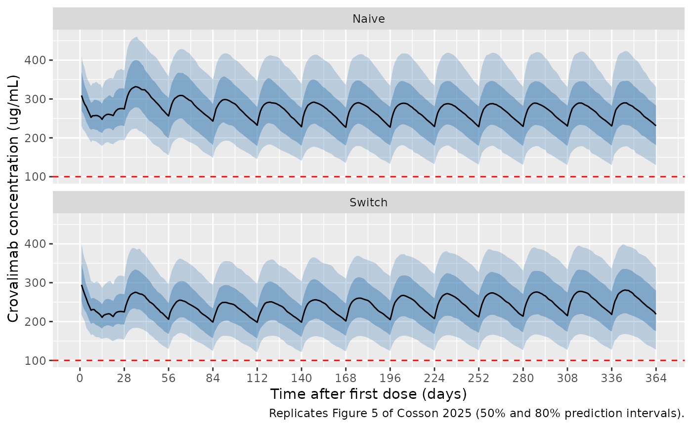

# Crovalimab (Cosson 2025)

## Model and source

- Citation: Cosson V, Fu R, Kulasekararaj A, Nishimura JI, Panse J, Roth
  A, Scheinberg P, Tong H, Yoon SS, Beveridge L, Gotanda K, Jaminion F,
  Henrich A, Lundberg P, Shi D, Sreckovic S, Zhang Y, Zhang Z, Benkali
  K, Buatois S. Pharmacokinetic characterization and exposure-response
  relationship of crovalimab in the COMMODORE 1, 2 and 3 and COMPOSER
  trials of patients with paroxysmal nocturnal haemoglobinuria. Br J
  Clin Pharmacol. 2025;91(5):1479. <doi:10.1111/bcp.16394>
- Description: Two-compartment population PK model of crovalimab
  (anti-C5 recycling monoclonal antibody) with first-order subcutaneous
  absorption and logit-normal bioavailability, plus an exponentially
  decaying additional clearance in patients switching from another C5
  inhibitor (transient drug-target-drug immune complexes), in healthy
  volunteers and patients with paroxysmal nocturnal haemoglobinuria from
  the COMPOSER and COMMODORE 1, 2 and 3 trials (Cosson 2025)
- Article: <https://doi.org/10.1111/bcp.16394> (open access;
  PMC12035591)
- Supplement: Supporting Information file 1 of the article (NONMEM
  control stream, Supplemental Results covariate equations and Table S3
  parameter estimates).

Crovalimab is a recycling anti-C5 monoclonal antibody given as a single
intravenous (IV) loading dose followed by subcutaneous (SC) loading and
every-4-week maintenance doses. The final population PK model is a
two-compartment model with first-order SC absorption and a logit-normal
bioavailability. Patients switching from eculizumab or ravulizumab,
which bind a different C5 epitope, form transient drug-target-drug
immune complexes with crovalimab; the model describes their faster early
elimination with an additional clearance `CLs` that decays exponentially
with time since the first crovalimab dose.

The paper also reports graphical PK/PD (CH50, free C5, normalised LDH)
and logistic exposure-safety analyses. Those are LOESS smooths and
logistic fits whose coefficients are not printed (only Wald p-values are
given in Figure 6 and Figure S6), so no PD or exposure-safety sub-model
can be packaged.

## Population

The analysis pooled 430 participants from four studies (Table S1): 9
healthy volunteers from COMPOSER Part 1, 210 patients with paroxysmal
nocturnal haemoglobinuria (PNH) naive to complement inhibition and 211
PNH patients switching from standard-dose eculizumab,
higher-than-approved-dose eculizumab (n = 10) or ravulizumab (n = 21).
Across studies, age ranged from 13 to 85 years and body weight from 40.6
to 140 kg (Table 2: naive median 65.2 kg and 35.5 years; switch median
71.0 kg and 44.0 years). The Phase III regimen (Table 1) is
weight-tiered: 1000 mg IV on day 1 (1500 mg at \>= 100 kg), 340 mg SC on
days 2, 8, 15 and 22, then 680 mg SC (1020 mg at \>= 100 kg) on day 29
and every 4 weeks. Anti-drug antibodies with titres \>= 10^4 occurred in
8.1% of the analysis population. Sex and race distributions are not
reported.

The same information is available programmatically via
`readModelDb("Cosson_2025_crovalimab")()$population`.

## Source trace

| Equation / parameter | Value | Source location |
|----|----|----|
| `lcl_exp_inf` (CL) | 0.0791 L/day | Table S3 ‘CL’; Results text |
| `lcl_exp_component` (CLs) | 0.0341 L/day | Table S3 ‘CLs’ |
| `lcl_exp_kdes` (Kd) | 0.0144 1/day | Table S3 ‘Kd’ |
| `lvc` (V2) | 3.23 L | Table S3 ‘V2’; Results text |
| `lq` (Q) | 0.168 L/day | Table S3 ‘Q’ |
| `lvp` (V3) | 2.32 L | Table S3 ‘V3’; Results text |
| `lka` (Ka) | 0.126 1/day | Table S3 ‘Ka’ |
| `logitfdepot` (F) | logit(0.830) | Table S3 ‘F’; logit-normal form from control stream `F1` |
| `e_wt_cl` | 0.75 (fixed) | Table S3 ‘WT on CL and Q’ (FIX); control stream `CLS = CLSP*CLWT` |
| `e_wt_vc` | 0.683824 | Supplemental Results covariate equations (Table S3: 0.684) |
| `e_ada_cl_exp_inf` | 0.247352 | Supplemental Results covariate equations (Table S3: 0.247) |
| `e_age_ka` | -0.459 | Table S3 ‘Age on Ka’; Supplemental Results equation |
| IIV CL, V2, Ka, F, V3, Q | 0.206, 0.224, 0.383, 1.16, 0.706, 0.584 (SD) | Table S3; variance = SD^2 |
| `propSd` | 0.113 | Table S3 ‘Proportional RUV’ |
| `addSdIntensive` / `addSdSparse` | 1.01 / 14.4 ug/mL | Table S3 ‘Additive RUV rich / sparse sampling’ |
| `etaaddSd` | 0.787 (SD) | Table S3 ‘IIV additive RUV’; control stream `THETA(9)*EXP(ETA(8))` |
| `cl = cl_exp_inf + cl_exp_component * exp(-cl_exp_kdes * t)` | n/a | Control stream `$DES` `(CLN + CLS*EXP(-KD*T))/V2` |
| `d/dt(depot)`, `d/dt(central)`, `d/dt(peripheral1)` | n/a | Control stream `$DES` (ADVAN6, 3 compartments) |
| Residual `Cc ~ add(addSd) + prop(propSd)` | n/a | Control stream `$ERROR` `W = SQRT(PROP^2*IPRED^2 + ADD^2)` |

Table S3 labels the IIV and residual-variability magnitudes “CV” and
notes that their RSEs are on the approximate SD scale. The supplement
`$OMEGA` block (0.0418, 0.0496, 0.140, 1.39, 0.494, 0.336, 0.617) equals
the squares of the Table S3 values to within the difference between the
listed initial estimates and the final estimates, so each value is an SD
on the eta scale and the model uses its square as the variance. The
logit-scale SD of 1.16 on F could not be a log-normal CV in any case.

## Typical-value checks

The paper states several typical-value quantities that follow directly
from the parameters. They are deterministic, so the checks are tight.

``` r

mod <- readModelDb("Cosson_2025_crovalimab")
ui <- rxode2::rxode(mod)
#> ℹ parameter labels from comments will be replaced by 'label()'
#> Warning: some etas defaulted to non-mu referenced, possible parsing error: etaaddSd
#> as a work-around try putting the mu-referenced expression on a simple line
th <- ui$theta

cl <- exp(th[["lcl_exp_inf"]])
vc <- exp(th[["lvc"]])
vp <- exp(th[["lvp"]])
q <- exp(th[["lq"]])

# Terminal half-life of the typical (75 kg, naive, ADA-negative) patient:
# the smaller root of the two-compartment characteristic polynomial.
k10 <- cl / vc
k12 <- q / vc
k21 <- q / vp
s <- k10 + k12 + k21
beta <- (s - sqrt(s^2 - 4 * k10 * k21)) / 2
thalf <- log(2) / beta

# Weight effects relative to 75 kg (Results: +35.1% / +31.6% at 112 kg,
# -29.6% / -27.4% at 47 kg for clearances / volumes).
wt_eff <- data.frame(
  WT = c(112, 112, 47, 47),
  parameter = c("clearances", "volumes", "clearances", "volumes"),
  published_pct = c(35.1, 31.6, -29.6, -27.4)
) |>
  mutate(
    exponent = ifelse(parameter == "clearances", th[["e_wt_cl"]], th[["e_wt_vc"]]),
    model_pct = 100 * ((WT / 75)^exponent - 1)
  )

# Switch clearance after 12 weeks as a share of total clearance
# (Discussion: 11.4%).
cls_84 <- exp(th[["lcl_exp_component"]]) * exp(-exp(th[["lcl_exp_kdes"]]) * 84)
share_84 <- 100 * cls_84 / (cl + cls_84)

knitr::kable(
  data.frame(
    Quantity = c("Terminal half-life (days)", "CLs share of total CL at week 12 (%)"),
    Published = c(53.1, 11.4),
    Model = signif(c(thalf, share_84), 3)
  ),
  caption = "Typical-value quantities stated in Cosson 2025 (Results and Discussion)."
)
```

| Quantity                             | Published | Model |
|:-------------------------------------|----------:|------:|
| Terminal half-life (days)            |      53.1 |  53.1 |
| CLs share of total CL at week 12 (%) |      11.4 |  11.4 |

Typical-value quantities stated in Cosson 2025 (Results and Discussion).
{.table}

``` r

knitr::kable(wt_eff, digits = c(0, 0, 1, 4, 1), caption = "Body-weight effects relative to 75 kg (Results).")
```

|  WT | parameter  | published_pct | exponent | model_pct |
|----:|:-----------|--------------:|---------:|----------:|
| 112 | clearances |          35.1 |   0.7500 |      35.1 |
| 112 | volumes    |          31.6 |   0.6838 |      31.6 |
|  47 | clearances |         -29.6 |   0.7500 |     -29.6 |
|  47 | volumes    |         -27.4 |   0.6838 |     -27.4 |

Body-weight effects relative to 75 kg (Results). {.table}

``` r


stopifnot(
  abs(thalf - 53.1) < 0.5,
  abs(share_84 - 11.4) < 0.1,
  all(abs(wt_eff$model_pct - wt_eff$published_pct) < 0.1)
)
```

### Typical steady-state trough with and without ADA

The Results report a steady-state trough of 219 ug/mL without ADA and
166 ug/mL with ADA titres \>= 10^4 “in a typical patient”. The patient
is taken here as the covariate reference (75 kg, 36 years, naive,
ADA-negative or ADA titre \>= 10^4) on the \< 100 kg regimen, with the
trough read just before the day-365 maintenance dose.

``` r

# Phase III regimen (Table 1). Day 1 = time 0. The IV infusion duration is not
# stated in the paper; a 1-hour infusion is assumed (rate in mg/day).
regimen_events <- function(id, WT) {
  hi <- WT >= 100
  iv <- if (hi) 1500 else 1000
  maint <- if (hi) 1020 else 680
  sc_times <- c(1, 7, 14, 21, seq(28, 336, by = 28))
  sc_amts <- c(rep(340, 4), rep(maint, length(seq(28, 336, by = 28))))
  bind_rows(
    data.frame(id = id, time = 0, amt = iv, rate = iv * 24, evid = 1, cmt = "central"),
    data.frame(id = id, time = sc_times, amt = sc_amts, rate = 0, evid = 1, cmt = "depot")
  )
}
obs_times <- sort(unique(c(seq(0, 336, by = 1), seq(336, 364, by = 0.25))))
obs_rows <- function(id) {
  data.frame(id = id, time = obs_times, amt = 0, rate = 0, evid = 0, cmt = "central")
}
```

``` r

typ_events <- bind_rows(
  regimen_events(1L, 75), obs_rows(1L),
  regimen_events(2L, 75), obs_rows(2L)
) |>
  mutate(
    WT = 75, AGE = 36,
    ADA_TITER = ifelse(id == 2L, 1e4, 0),
    CONMED_ECULIZUMAB_BL = 0, CONMED_RAVULIZUMAB_BL = 0,
    SAMPLE_INTENSIVE = 0
  ) |>
  arrange(id, time, desc(evid))

typ <- rxode2::rxSolve(rxode2::zeroRe(mod), events = typ_events, returnType = "data.frame")
#> ℹ parameter labels from comments will be replaced by 'label()'
#> Warning: some etas defaulted to non-mu referenced, possible parsing error: etaaddSd
#> as a work-around try putting the mu-referenced expression on a simple line
#> Warning: some etas defaulted to non-mu referenced, possible parsing error: etaaddSd
#> as a work-around try putting the mu-referenced expression on a simple line
#> ℹ omega/sigma items treated as zero: 'etalcl_exp_inf', 'etalvc', 'etalka', 'etalogitfdepot', 'etalvp', 'etalq', 'etaaddSd'
#> Warning: multi-subject simulation without without 'omega'
trough <- typ |>
  filter(time == 364) |>
  transmute(ADA = ifelse(id == 2L, "ADA titre >= 10^4", "No ADA"), model = Cc) |>
  mutate(published = ifelse(ADA == "No ADA", 219, 166), pct_diff = 100 * (model / published - 1))
knitr::kable(trough, digits = 1, caption = "Typical steady-state trough (ug/mL), Results section.")
```

| ADA                | model | published | pct_diff |
|:-------------------|------:|----------:|---------:|
| No ADA             | 219.8 |       219 |      0.4 |
| ADA titre \>= 10^4 | 169.7 |       166 |      2.2 |

Typical steady-state trough (ug/mL), Results section. {.table}

``` r

stopifnot(all(abs(trough$pct_diff) < 5))
```

## Virtual cohort

Observed data are not public. The cohorts below approximate Table 2:
body weight log-normal with the published mean and SD, truncated to the
observed range; age normal with the published mean and SD, truncated to
the observed range. Each cohort has 200 patients. Naive patients carry
no switch indicator; switch patients are coded as switching from
eculizumab (`CONMED_ECULIZUMAB_BL = 1`; the model treats ravulizumab
identically). All patients are ADA-negative and observations are on the
sparse-sampling stratum.

``` r

rxode2::rxSetSeed(20251)
set.seed(20251)

rtrunc_lnorm <- function(n, mean, sd, lo, hi) {
  s2 <- log(1 + (sd / mean)^2)
  mu <- log(mean) - s2 / 2
  out <- numeric(0)
  while (length(out) < n) {
    x <- rlnorm(n, mu, sqrt(s2))
    out <- c(out, x[x >= lo & x <= hi])
  }
  out[seq_len(n)]
}
rtrunc_norm <- function(n, mean, sd, lo, hi) {
  out <- numeric(0)
  while (length(out) < n) {
    x <- rnorm(n, mean, sd)
    out <- c(out, x[x >= lo & x <= hi])
  }
  out[seq_len(n)]
}

make_cohort <- function(n, cohort, wt_mean, wt_sd, wt_lo, wt_hi,
                        age_mean, age_sd, age_lo, age_hi, switch, id_offset) {
  subj <- data.frame(
    id = id_offset + seq_len(n),
    WT = rtrunc_lnorm(n, wt_mean, wt_sd, wt_lo, wt_hi),
    AGE = rtrunc_norm(n, age_mean, age_sd, age_lo, age_hi)
  )
  ev <- bind_rows(lapply(seq_len(n), function(i) {
    bind_rows(regimen_events(subj$id[i], subj$WT[i]), obs_rows(subj$id[i]))
  }))
  ev |>
    left_join(subj, by = "id") |>
    mutate(
      cohort = cohort,
      ADA_TITER = 0,
      CONMED_ECULIZUMAB_BL = switch,
      CONMED_RAVULIZUMAB_BL = 0,
      SAMPLE_INTENSIVE = 0
    )
}

events <- bind_rows(
  make_cohort(200, "Naive", 67.9, 15.0, 42.0, 140, 39.2, 15.1, 13, 76, 0, id_offset = 0L),
  make_cohort(200, "Switch", 72.9, 17.9, 40.6, 132, 45.0, 15.3, 16, 85, 1, id_offset = 200L)
) |>
  arrange(id, time, desc(evid))
stopifnot(!anyDuplicated(unique(events[, c("id", "time", "evid")])))
```

## Simulation

``` r

sim <- rxode2::rxSolve(mod, events = events, keep = c("cohort", "WT"), returnType = "data.frame")
#> ℹ parameter labels from comments will be replaced by 'label()'
#> Warning: some etas defaulted to non-mu referenced, possible parsing error: etaaddSd
#> as a work-around try putting the mu-referenced expression on a simple line
```

## Replicate published figures

### Figure 5: simulated concentration-time profiles

``` r

# Replicates Figure 5 of Cosson 2025: median with 50% and 80% prediction
# intervals for naive (A) and switch (B) patients on the recommended regimen.
sim |>
  filter(time >= 1 / 24) |>
  group_by(cohort, time) |>
  summarise(
    p10 = quantile(Cc, 0.10), p25 = quantile(Cc, 0.25),
    p50 = median(Cc),
    p75 = quantile(Cc, 0.75), p90 = quantile(Cc, 0.90),
    .groups = "drop"
  ) |>
  ggplot(aes(time, p50)) +
  geom_ribbon(aes(ymin = p10, ymax = p90), fill = "steelblue", alpha = 0.3) +
  geom_ribbon(aes(ymin = p25, ymax = p75), fill = "steelblue", alpha = 0.5) +
  geom_line() +
  geom_hline(yintercept = 100, linetype = "dashed", colour = "red") +
  facet_wrap(~cohort, ncol = 1) +
  scale_x_continuous(breaks = seq(0, 364, by = 28)) +
  labs(
    x = "Time after first dose (days)", y = "Crovalimab concentration (ug/mL)",
    caption = "Replicates Figure 5 of Cosson 2025 (50% and 80% prediction intervals)."
  )
```



### Proportion of patients above 100 ug/mL throughout treatment

The Results report that 92.8% of naive and 91.4% of switch patients were
predicted to stay above 100 ug/mL over the whole treatment course.

``` r

above <- sim |>
  filter(time >= 1) |>
  group_by(cohort, id) |>
  summarise(always_above = all(Cc > 100), .groups = "drop") |>
  group_by(cohort) |>
  summarise(model_pct = 100 * mean(always_above), .groups = "drop") |>
  mutate(published_pct = c(Naive = 92.8, Switch = 91.4)[cohort])
knitr::kable(above, digits = 1, caption = "Patients with concentrations above 100 ug/mL from day 2 to day 365 (%).")
```

| cohort | model_pct | published_pct |
|:-------|----------:|--------------:|
| Naive  |        97 |          92.8 |
| Switch |        95 |          91.4 |

Patients with concentrations above 100 ug/mL from day 2 to day 365 (%).
{.table}

``` r

# With 200 patients per cohort the binomial SE is about 2 percentage points;
# the cohort covariates are approximations of Table 2. Across three cohort
# draws the differences ranged from -1.9 to +4.7 points. A mis-transcribed
# clearance, volume or bioavailability moves this share by tens of points.
stopifnot(all(abs(above$model_pct - above$published_pct) < 10))
```

## PKNCA validation

NCA over the last maintenance interval (days 337 to 365, i.e. time 336
to 364), grouped by cohort. The paper reports a median steady-state Tmax
of 8.27 days after SC administration across the Phase III studies
(pooled over naive and switch patients). Steady-state Cmax and trough
are digitised by the maintainers from the median curves of Figure 5
(approximately 270 and 215 ug/mL for naive patients, 255 and 203 ug/mL
for switch patients).

``` r

sim_nca <- sim |>
  filter(!is.na(Cc), time >= 336, time <= 364) |>
  select(id, time, Cc, cohort)

conc_obj <- PKNCA::PKNCAconc(sim_nca, Cc ~ time | cohort + id)
dose_df <- events |>
  filter(evid == 1, time == 336) |>
  select(id, time, amt, cohort)
dose_obj <- PKNCA::PKNCAdose(dose_df, amt ~ time | cohort + id)
intervals <- data.frame(start = 336, end = 364, cmax = TRUE, tmax = TRUE, cmin = TRUE, auclast = TRUE)
nca_res <- PKNCA::pk.nca(PKNCA::PKNCAdata(conc_obj, dose_obj, intervals = intervals))

# PKNCA reports tmax relative to the interval start (the day-337 dose).
nca_long <- as.data.frame(nca_res$result)

published <- tibble::tribble(
  ~cohort, ~cmax, ~tmax, ~cmin,
  "Naive", 270, 8.27, 215,
  "Switch", 255, 8.27, 203
)
cmp <- nlmixr2lib::ncaComparisonTable(
  simulated = nca_long,
  reference = published,
  by = "cohort",
  params = c("cmax", "tmax", "cmin"),
  units = c(cmax = "ug/mL", tmax = "day", cmin = "ug/mL"),
  tolerance_pct = 20
)
knitr::kable(cmp, caption = "Simulated vs. published steady-state NCA (medians). * differs from reference by >20%.")
```

| NCA parameter | cohort | Reference | Simulated | % diff |
|:--------------|:-------|:----------|:----------|:-------|
| Cmax (ug/mL)  | Naive  | 270       | 291       | +7.9%  |
| Cmax (ug/mL)  | Switch | 255       | 281       | +10.4% |
| Cmin (ug/mL)  | Naive  | 215       | 231       | +7.2%  |
| Cmin (ug/mL)  | Switch | 203       | 218       | +7.4%  |
| Tmax (day)    | Naive  | 8.27      | 8.38      | +1.3%  |
| Tmax (day)    | Switch | 8.27      | 8.75      | +5.8%  |

Simulated vs. published steady-state NCA (medians). \* differs from
reference by \>20%. {.table}

``` r

sim_med <- nca_long |>
  filter(PPTESTCD %in% c("cmax", "cmin")) |>
  group_by(cohort, PPTESTCD) |>
  summarise(sim = median(PPORRES), .groups = "drop") |>
  left_join(
    tidyr::pivot_longer(published, c(cmax, cmin), names_to = "PPTESTCD", values_to = "ref"),
    by = c("cohort", "PPTESTCD")
  )
# Medians of 200 patients against values digitised from a published median
# curve. Across three cohort draws the four ratios ranged from +3% to +13%
# (mean +7% to +8%), so the centre is gated tightly and each row loosely.
# A dose, volume or bioavailability error moves all four by >= 20%.
ratio <- sim_med$sim / sim_med$ref - 1
stopifnot(
  abs(mean(ratio)) < 0.15,
  all(abs(ratio) < 0.25)
)

# Median steady-state Tmax against the published 8.27 days. The typical
# patient peaks at 8.25 days; the cohort median sits on the 0.25-day grid.
# An absorption rate off by a factor of 2 moves Tmax by several days.
tmax_med <- nca_long |>
  filter(PPTESTCD == "tmax") |>
  group_by(cohort) |>
  summarise(tmax = median(PPORRES), .groups = "drop")
stopifnot(all(abs(tmax_med$tmax - 8.27) < 1.5))
```

Simulated steady-state median Cmax and trough sit a few percent to about
13% above the values read from Figure 5, depending on the cohort draw,
and the share of patients staying above 100 ug/mL is usually a few
points above the published 92.8% and 91.4%. Both differences point the
same way and are consistent with the simulated cohorts being entirely
ADA-negative (8.1% of the analysis population had titres \>= 10^4, which
raise CL by 24.7%) and with the Table 2 marginals standing in for the
paper’s representative population. The typical-patient trough, which
removes the cohort entirely, matches the published value to within 0.5%.

## Assumptions and deviations

- The IV infusion duration is not reported; a 1-hour infusion is
  assumed. With a 53-day terminal half-life the choice has no visible
  effect beyond the first hours.
- Time in the switch clearance `exp(-Kd * t)` is time since the first
  crovalimab dose (the NONMEM `$DES` `T`). Simulations must start the
  event table at the first crovalimab dose.
- The source switch-status column `SWITCH` codes three prior agents
  (standard-dose eculizumab, high-dose eculizumab, ravulizumab) that the
  paper found to act alike on CLs. It is represented here by two
  baseline indicators, `CONMED_ECULIZUMAB_BL` and
  `CONMED_RAVULIZUMAB_BL`, and the model uses their maximum.
- The ADA effect uses a three-group titre categorisation in the source
  (`ADA3T3G`, groups 2 and 3 described as “medium or high titer ADA”).
  The Results identify these as titres \>= 10^4, so the model applies
  the 24.7% CL increase when `ADA_TITER >= 10000`.
- IIV on CLs, Kd and the proportional residual error is fixed to 0 in
  the source control stream and is omitted.
- Residual error: the source uses a rich-sampling additive SD (COMPOSER
  Part 1 healthy volunteers and study YO42311) and a sparse-sampling
  additive SD with between-subject variability on its magnitude,
  selected here by `SAMPLE_INTENSIVE`.
- Virtual cohorts approximate Table 2 marginals only. Sex and race are
  not reported and are not model covariates. All simulated patients are
  ADA-negative because the paper does not say whether its Figure 5
  population included ADA-positive patients.
- The paper’s PK/PD (CH50, free C5, LDH) and exposure-safety analyses
  are graphical or logistic regressions with unreported coefficients and
  are not packaged.
- No erratum or correction notice was found for the article (Europe PMC
  search, 2026-11-04).
