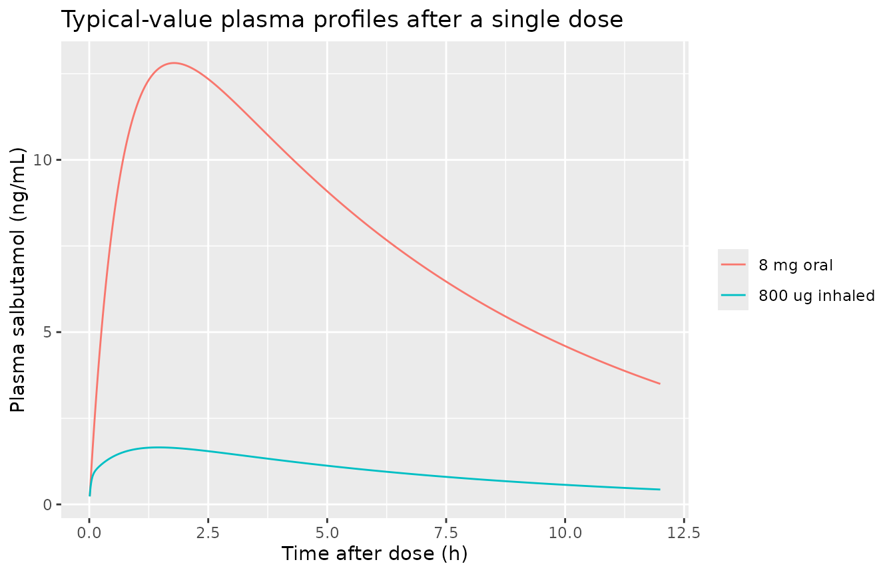
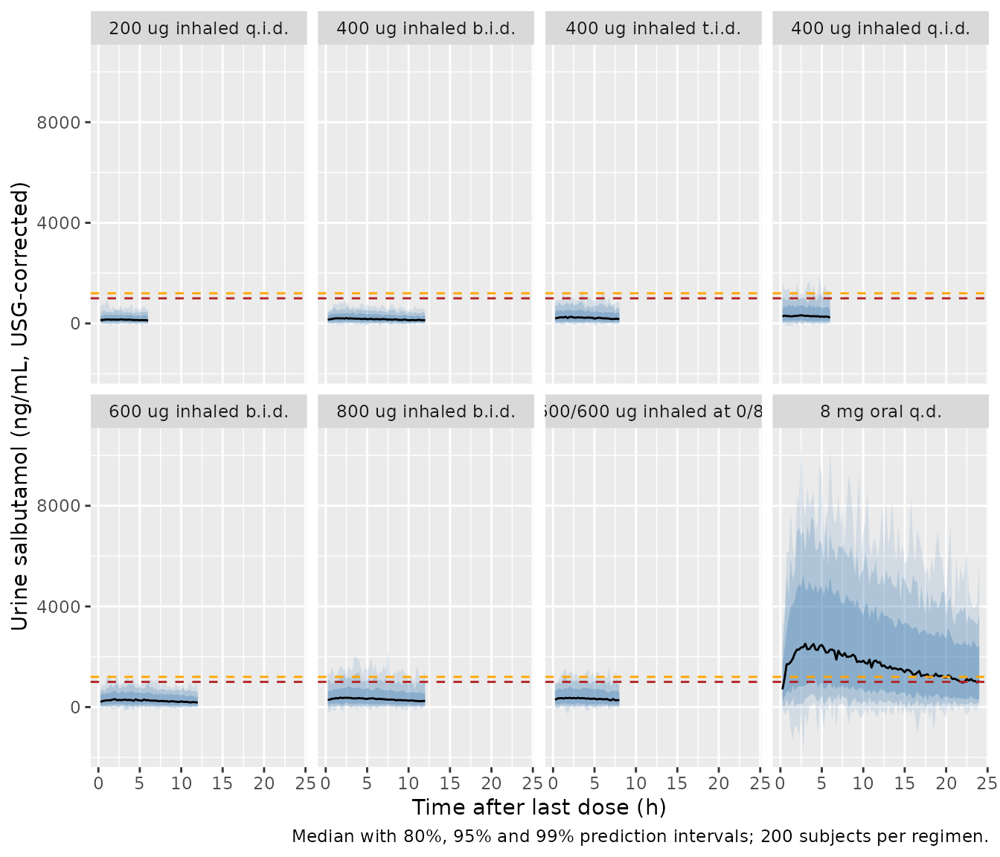
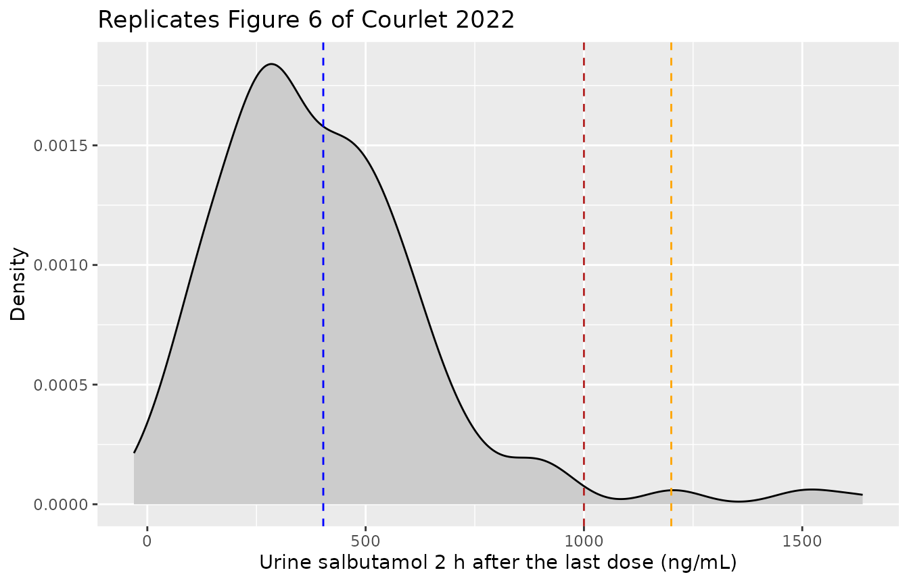
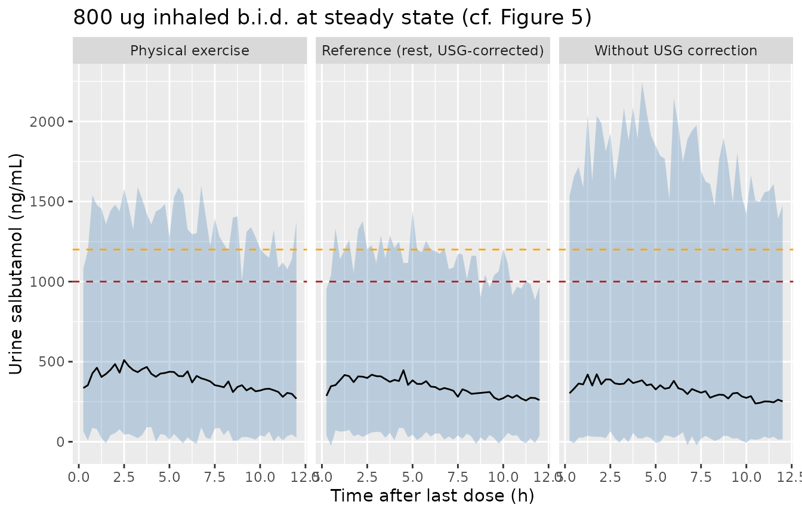

# Salbutamol plasma and urine MBMA (Courlet 2022)

## Model and source

- Citation: Courlet P, Buclin T, Biollaz J, Mazzoni I, Rabin O, Guidi M.
  Model-based meta-analysis of salbutamol pharmacokinetics and practical
  implications for doping control. CPT Pharmacometrics Syst Pharmacol.
  2022;11(4):469-481. <doi:10.1002/psp4.12773>.
- Description: MBMA. One-compartment population PK model of salbutamol
  (albuterol) in plasma and urine, fitted jointly to individual and
  aggregate (study-mean) data from 13 published studies in healthy
  volunteers, trained athletes and asthmatics (Courlet 2022, WADA
  doping-control analysis). An inhaled dose splits into a fixed 20% lung
  fraction absorbed first-order from a lung depot and an 80% swallowed
  fraction absorbed first-order from the gut with the oral
  bioavailability; an oral dose enters the gut depot only. Urinary
  excretion of unchanged salbutamol is a first-order arm of the total
  clearance into a cumulative urine compartment, and the urine
  concentration is that amount divided by the urine volume produced at a
  constant rate since the last bladder voiding. Physical exercise lowers
  urine production by 15%; urine-production IIV differs between
  USG-corrected and uncorrected records; aggregate records scale every
  random effect by N^-0.25.
- Article: <https://doi.org/10.1002/psp4.12773> (open access, with
  Supplementary Materials S1-S8)

Courlet et al. pooled individual and study-mean (aggregate) salbutamol
plasma and urine concentrations from 13 published studies selected by
the World Anti-Doping Agency (WADA), fitted a one-compartment population
PK model with a urine compartment, and used it to ask how well the WADA
urinary threshold (T = 1000 ng/mL) and decision limit (DL = 1200 ng/mL)
separate permitted inhaled use from prohibited oral or supratherapeutic
use.

``` r

mod <- readModelDb("Courlet_2022_salbutamol_mbma")
ui <- rxode2::rxode(mod)
#> ℹ parameter labels from comments will be replaced by 'label()'
#> Warning: some etas defaulted to non-mu referenced, possible parsing error: etalcl, etalurprod, etalurprod_usg
#> as a work-around try putting the mu-referenced expression on a simple line
th <- ui$theta
```

## Population

The 13 studies (Supplementary Table S3) enrolled healthy volunteers,
trained or elite athletes and asthmatics. Study-mean ages were 21-29
years and mean body weights 70-84 kg; every study was in males or did
not report sex. Six studies contributed individual concentrations and
the rest arithmetic-mean profiles of 8-30 subjects. The analysis used
121 plasma concentrations (43 individual, 78 mean-profile points) and
796 urine concentrations (747 individual, 49 mean-profile points).
Inhaled doses were 200-1600 ug per administration (median 800 ug) and
oral doses 4-12 mg (median 8 mg). Urine was measured either as free or
as non-sulfated salbutamol, and as uncorrected or urine specific gravity
(USG)-corrected concentrations. The total number of subjects is not
stated (one study did not report its size).

``` r

str(mod()$population)
#> Warning: some etas defaulted to non-mu referenced, possible parsing error: etalcl, etalurprod, etalurprod_usg
#> as a work-around try putting the mu-referenced expression on a simple line
#> List of 10
#>  $ species       : chr "human"
#>  $ n_subjects    : int NA
#>  $ n_studies     : num 13
#>  $ age_range     : chr "Study means 21-29 years; individual data 22-45 years where reported (Table S3)"
#>  $ weight_range  : chr "Study means 70-84 kg; individual data 65-89 kg where reported (Table S3)"
#>  $ sex_female_pct: num NA
#>  $ disease_state : chr "Healthy volunteers, trained / elite athletes and asthmatics (with and without elite-athlete status); all studie"| __truncated__
#>  $ dose_range    : chr "Inhaled 200-1600 ug per administration (median 800 ug), daily 200-1600 ug; oral 4000-12000 ug per administratio"| __truncated__
#>  $ regions       : chr "Not reported (13 studies selected by WADA from the literature and WADA-funded projects)"
#>  $ notes         : chr "13 studies (Table S3): Pichon 2005 (10, aggregate), Sporer 2007 (30, aggregate), Sporer 2008 (8, aggregate), Ma"| __truncated__
```

## Source trace

| Equation / parameter | Value | Source location |
|----|----|----|
| `lfdepot_lung` (F1) | log(0.2), fixed | Table 1 |
| `logitfdepot_oral` (logit F2) | -0.328, fixed | Table 1; F2 = exp(x)/(1+exp(x)) per the Table 1 legend |
| `lka_lung` (ka1) | log(31.6 1/h), fixed | Table 1 |
| `lka_oral` (ka2) | log(1.47 1/h), fixed | Table 1 |
| `lvc` (V3) | log(205 L) | Table 1 |
| `lkurine` (k34) | log(0.0468 1/h) | Table 1 |
| `lcl` (CL) | log(28 L/h) | Table 1 |
| `lurprod` (UR_PROD) | log(0.0467 L/h) | Table 1 |
| `e_exercise_urprod` | -0.153 | Table 1, effect form (1 + physical x theta) in the legend |
| `etalcl` | 0.1416 (39% CV) | Table 1 |
| `etalurprod` (uncorrected) | 0.4367 (74% CV) | Table 1 |
| `etalurprod_usg` (USG-corrected) | 0.1349 (38% CV) | Table 1 |
| `propSd` | 0.40 | Table 1, proportional error plasma, individual |
| `propSd_aggregate` | 0.77 | Table 1, proportional error plasma, aggregate |
| `propSd_urineSal` | 0.46 | Table 1, proportional error urine, individual |
| `addSd_urineSal` | 18 ng/mL | Table 1, additive error urine, individual |
| `propSd_urineSal_aggregate` | 1.31 | Table 1, proportional error urine, aggregate |
| Lung and gut depots, F1 split | n/a | Figure 1; Methods, Base structural model; S1 Equation 6 |
| `k30 = CL/V3 - k34` | n/a | S1 Equation 2, CL = (k30 + k34) x V3 |
| `urineSal = urine / urine_vol`, `d/dt(urine_vol) = urprod` | n/a | Methods, Base structural model (constant urine production, bladder voided before each dose) |
| Exercise on UR_PROD | n/a | Results, Covariate analysis; S1 Equation 4 |
| Aggregate weight `N_ARM^-0.25` on etas and residual SDs | n/a | Table 1 and Table S6 footnotes; Results, Model evaluation (see Errata) |

## Deterministic checks of the derived quantities

The paper reports several secondary quantities that follow directly from
the Table 1 estimates. Each is recomputed below from the packaged
model’s own `ini()` values.

``` r

ke <- exp(th[["lcl"]]) / exp(th[["lvc"]])
tmax_eq5 <- function(ka) (log(ka) - log(ke)) / (ka - ke) # S1 Equation 5
derived <- tibble::tibble(
  quantity = c(
    "Oral bioavailability F2",
    "Half-life (h), S1 Eq 7",
    "Tmax after inhalation, lung fraction only (h)",
    "Tmax after oral dosing (h)",
    "Urine production during exercise (L/h)",
    "Non-urinary elimination k30 (1/h)"
  ),
  model = c(
    1 / (1 + exp(-th[["logitfdepot_oral"]])),
    log(2) / ke,
    tmax_eq5(exp(th[["lka_lung"]])),
    tmax_eq5(exp(th[["lka_oral"]])),
    exp(th[["lurprod"]]) * (1 + th[["e_exercise_urprod"]]),
    ke - exp(th[["lkurine"]])
  ),
  paper = c(NA, 5, 0.17, 1.8, 0.0396, NA)
)
knitr::kable(derived, digits = 4)
```

| quantity                                      |  model |  paper |
|:----------------------------------------------|-------:|-------:|
| Oral bioavailability F2                       | 0.4187 |     NA |
| Half-life (h), S1 Eq 7                        | 5.0748 | 5.0000 |
| Tmax after inhalation, lung fraction only (h) | 0.1730 | 0.1700 |
| Tmax after oral dosing (h)                    | 1.7819 | 1.8000 |
| Urine production during exercise (L/h)        | 0.0396 | 0.0396 |
| Non-urinary elimination k30 (1/h)             | 0.0898 |     NA |

``` r


stopifnot(
  abs(derived$model[2] - 5) < 0.1, # "a t1/2 of 5 h"
  round(derived$model[3], 2) == 0.17,
  round(derived$model[4], 1) == 1.8,
  round(derived$model[5], 4) == 0.0396,
  derived$model[6] > 0 # urinary arm is a fraction of the total clearance
)
```

The Results section also quotes the aggregate-data residual errors after
the sample-size weighting: 46% and 40% for plasma profiles of 8 and 13
subjects, and 78% and 56% for urine profiles of 8 and 30 subjects. The
model weights the unweighted Table 1 SDs by `N_ARM^-0.25`; the
`1 / sqrt(N_ARM)` weight printed in the Methods equation is shown for
comparison.

``` r

agg <- tibble::tibble(
  matrix = c("plasma", "plasma", "urine", "urine"),
  N_ARM = c(8, 13, 8, 30),
  raw = 100 * c(th[["propSd_aggregate"]], th[["propSd_aggregate"]],
                th[["propSd_urineSal_aggregate"]], th[["propSd_urineSal_aggregate"]]),
  paper = c(46, 40, 78, 56)
) |>
  dplyr::mutate(
    model_N_quarter = raw / N_ARM^0.25,
    printed_eq_sqrt = raw / sqrt(N_ARM)
  )
knitr::kable(agg, digits = 1)
```

| matrix | N_ARM | raw | paper | model_N_quarter | printed_eq_sqrt |
|:-------|------:|----:|------:|----------------:|----------------:|
| plasma |     8 |  77 |    46 |            45.8 |            27.2 |
| plasma |    13 |  77 |    40 |            40.6 |            21.4 |
| urine  |     8 | 131 |    78 |            77.9 |            46.3 |
| urine  |    30 | 131 |    56 |            56.0 |            23.9 |

``` r

# The raw SDs are themselves rounded to whole percent in Table 1, so allow 1.
stopifnot(all(abs(agg$model_N_quarter - agg$paper) <= 1))
```

## Event-table conventions

- **Inhaled dose:** two dose records with the same `amt` at the same
  time, one into `depot_lung` and one into `depot_oral`, with
  `ROUTE_ORAL = 0`. The model makes 20% of the first and 80% x F2 of the
  second bioavailable.
- **Oral dose:** one record into `depot_oral` with `ROUTE_ORAL = 1`.
- **Bladder voiding:** an `evid = 5` replacement record setting `urine`
  and `urine_vol` to 0. Urine concentrations are only defined after a
  voiding, so observations are taken strictly after it.
- **Observations:** two endpoints (`Cc`, `urineSal`). Observation rows
  carry `dvid` (1 = plasma, 2 = urine) with `cmt` left missing, so that
  the residual draw for that endpoint is returned in the `sim` column.
  Every observable is still returned as a column on every observation
  row.
- **Individual-level simulation:** `DTYPE_AGGREGATED = 0`, `N_ARM = 1`.
  The paper’s simulations are in individuals at rest with USG-corrected
  urine (`EXERCISE = 0`, `USG_CORRECTED = 1`).

``` r

endpoints <- ui$predDf[, c("var", "cmt")]
endpoints$dvid <- seq_len(nrow(endpoints))
stopifnot(identical(endpoints$var, c("Cc", "urineSal")))

# One subject's events for a regimen given as a data frame of dose times,
# amounts (ug) and routes. Doses repeat every 24 h for `days` days; the bladder
# is voided at every dose and at `extra_voids`; observations are at
# `obs_offsets` after the last dose on the endpoints listed in `obs_dvid`.
make_subject <- function(regimen, days, obs_offsets, obs_dvid, extra_voids = numeric(0)) {
  daily <- tidyr::expand_grid(day = seq_len(days) - 1, regimen) |>
    dplyr::mutate(time = time + 24 * day)
  last_dose <- max(daily$time)
  doses <- dplyr::bind_rows(
    daily |> dplyr::mutate(cmt = "depot_oral"),
    daily |> dplyr::filter(route == "inhaled") |> dplyr::mutate(cmt = "depot_lung")
  ) |>
    dplyr::transmute(time, amt, cmt, evid = 1L, dvid = NA_integer_,
                     ROUTE_ORAL = as.integer(route == "oral"))
  voids <- tidyr::expand_grid(time = sort(unique(c(daily$time, extra_voids))),
                              cmt = c("urine", "urine_vol")) |>
    dplyr::mutate(amt = 0, evid = 5L, dvid = NA_integer_)
  obs <- tidyr::expand_grid(time = last_dose + obs_offsets, dvid = obs_dvid) |>
    dplyr::mutate(amt = NA_real_, evid = 0L, cmt = NA_character_)
  dplyr::bind_rows(voids, doses, obs) |>
    # voiding precedes dosing precedes observation at a tied time
    dplyr::arrange(time, match(evid, c(5L, 1L, 0L)), dvid) |>
    tidyr::fill(ROUTE_ORAL, .direction = "downup") |>
    dplyr::mutate(last_dose = last_dose)
}

make_arm <- function(n, id_offset, ...) {
  one <- make_subject(...)
  tidyr::expand_grid(id = id_offset + seq_len(n), one) |>
    dplyr::mutate(EXERCISE = 0, USG_CORRECTED = 1, DTYPE_AGGREGATED = 0, N_ARM = 1)
}

inh <- function(times, amt) tibble::tibble(time = times, amt = amt, route = "inhaled")
oral <- function(times, amt) tibble::tibble(time = times, amt = amt, route = "oral")
```

## Typical-value plasma profiles and Tmax after inhalation

After inhalation, plasma salbutamol is the sum of a fast lung-absorbed
part and a slower swallowed part. The paper reports an intermediate Tmax
of 1.45 h for the sum (S1 Equation 6, solved numerically).

``` r

grid <- seq(0.01, 12, by = 0.01)
typ_events <- dplyr::bind_rows(
  make_arm(1, 0L, regimen = inh(0, 800), days = 1, obs_offsets = grid, obs_dvid = 1L) |>
    dplyr::mutate(scenario = "800 ug inhaled"),
  make_arm(1, 1L, regimen = oral(0, 8000), days = 1, obs_offsets = grid, obs_dvid = 1L) |>
    dplyr::mutate(scenario = "8 mg oral")
)
typ <- rxode2::rxSolve(rxode2::zeroRe(mod), events = typ_events, keep = "scenario",
                       useLinCmt = FALSE, addDosing = FALSE) |>
  as.data.frame()
#> ℹ parameter labels from comments will be replaced by 'label()'
#> Warning: some etas defaulted to non-mu referenced, possible parsing error: etalcl, etalurprod, etalurprod_usg
#> as a work-around try putting the mu-referenced expression on a simple line
#> Warning: No sigma parameters in the model
#> Warning: some etas defaulted to non-mu referenced, possible parsing error: etalcl, etalurprod, etalurprod_usg
#> as a work-around try putting the mu-referenced expression on a simple line
#> ℹ omega/sigma items treated as zero: 'etalcl', 'etalurprod', 'etalurprod_usg'
#> Warning: multi-subject simulation without without 'omega'

tmax_typ <- typ |>
  dplyr::group_by(scenario) |>
  dplyr::summarise(Tmax = time[which.max(Cc)], Cmax = max(Cc), .groups = "drop")
knitr::kable(tmax_typ, digits = 3,
             caption = "Typical-value Tmax (h) and Cmax (ng/mL) after a single dose.")
```

| scenario       | Tmax |   Cmax |
|:---------------|-----:|-------:|
| 8 mg oral      | 1.78 | 12.810 |
| 800 ug inhaled | 1.46 |  1.654 |

Typical-value Tmax (h) and Cmax (ng/mL) after a single dose. {.table}

``` r


stopifnot(
  abs(tmax_typ$Tmax[tmax_typ$scenario == "800 ug inhaled"] - 1.45) < 0.05,
  abs(tmax_typ$Tmax[tmax_typ$scenario == "8 mg oral"] - 1.8) < 0.05
)

ggplot(typ, aes(time, Cc, colour = scenario)) +
  geom_line() +
  labs(x = "Time after dose (h)", y = "Plasma salbutamol (ng/mL)", colour = NULL,
       title = "Typical-value plasma profiles after a single dose")
```



## PKNCA validation of the plasma profile

A 200-subject cohort per arm receives a single 800 ug inhalation or a
single 8 mg oral dose. Inter-individual variability is on clearance
only, so the NCA Tmax and half-life medians should match the paper’s
1.45 h / 1.8 h and 5 h.

``` r

rxode2::rxSetSeed(20221104)
set.seed(20221104)
N_PER_ARM <- 200L
nca_grid <- c(0.05, 0.1, 0.17, 0.25, 0.5, 0.75, 1, 1.25, 1.5, 1.75, 2, 2.5, 3, 4, 6, 8, 12, 16, 24)
nca_events <- dplyr::bind_rows(
  make_arm(N_PER_ARM, 0L, regimen = inh(0, 800), days = 1, obs_offsets = nca_grid, obs_dvid = 1L) |>
    dplyr::mutate(treatment = "800 ug inhaled"),
  make_arm(N_PER_ARM, N_PER_ARM, regimen = oral(0, 8000), days = 1, obs_offsets = nca_grid, obs_dvid = 1L) |>
    dplyr::mutate(treatment = "8 mg oral")
)
stopifnot(!anyDuplicated(unique(nca_events[, c("id", "time", "evid", "cmt", "dvid")])))

nca_sim <- rxode2::rxSolve(mod, events = nca_events, keep = "treatment",
                           useLinCmt = FALSE, addDosing = FALSE) |>
  as.data.frame()
#> ℹ parameter labels from comments will be replaced by 'label()'
#> Warning: some etas defaulted to non-mu referenced, possible parsing error: etalcl, etalurprod, etalurprod_usg
#> as a work-around try putting the mu-referenced expression on a simple line

conc_df <- nca_sim |>
  dplyr::filter(!is.na(Cc)) |>
  dplyr::select(id, time, Cc, treatment)
# Pre-dose row: extravascular, so Cc = 0 at time 0.
conc_df <- dplyr::bind_rows(
  conc_df,
  conc_df |> dplyr::distinct(id, treatment) |> dplyr::mutate(time = 0, Cc = 0)
) |>
  dplyr::distinct(id, treatment, time, .keep_all = TRUE) |>
  dplyr::arrange(id, time)

dose_df <- nca_events |>
  dplyr::filter(evid == 1L) |>
  dplyr::group_by(id, treatment, time) |>
  dplyr::summarise(amt = dplyr::first(amt), .groups = "drop")

nca_res <- PKNCA::pk.nca(PKNCA::PKNCAdata(
  PKNCA::PKNCAconc(conc_df, Cc ~ time | treatment + id),
  PKNCA::PKNCAdose(dose_df, amt ~ time | treatment + id),
  intervals = data.frame(start = 0, end = 24, cmax = TRUE, tmax = TRUE,
                         auclast = TRUE, half.life = TRUE)
))

published_nca <- tibble::tibble(
  treatment = c("800 ug inhaled", "8 mg oral"),
  tmax = c(1.45, 1.8),
  half.life = c(5, 5)
)
cmp_nca <- nlmixr2lib::ncaComparisonTable(
  simulated = nca_res,
  reference = published_nca,
  by = "treatment",
  params = c("tmax", "half.life"),
  units = c(tmax = "h", half.life = "h"),
  tolerance_pct = 20
)
knitr::kable(cmp_nca, caption = paste(
  "Median NCA Tmax and half-life vs the values quoted in the Results",
  "(Tmax 1.45 h after inhalation, 1.8 h oral; t1/2 5 h).", attr(cmp_nca, "footnote")
))
```

| NCA parameter | treatment      | Reference | Simulated | % diff |
|:--------------|:---------------|:----------|:----------|:-------|
| Tmax (h)      | 800 ug inhaled | 1.45      | 1.5       | +3.4%  |
| Tmax (h)      | 8 mg oral      | 1.8       | 1.75      | -2.8%  |
| t½ (h)        | 800 ug inhaled | 5         | 4.91      | -1.8%  |
| t½ (h)        | 8 mg oral      | 5         | 4.99      | -0.2%  |

Median NCA Tmax and half-life vs the values quoted in the Results (Tmax
1.45 h after inhalation, 1.8 h oral; t1/2 5 h). {.table}

``` r


nca_med <- as.data.frame(nca_res$result) |>
  dplyr::filter(PPTESTCD %in% c("tmax", "half.life")) |>
  dplyr::group_by(treatment, PPTESTCD) |>
  dplyr::summarise(med = median(PPORRES, na.rm = TRUE), .groups = "drop")
hl <- nca_med$med[nca_med$PPTESTCD == "half.life"]
stopifnot(
  length(hl) == 2L,
  all(abs(hl - 5) / 5 < 0.15),
  abs(nca_med$med[nca_med$PPTESTCD == "tmax" & nca_med$treatment == "8 mg oral"] - 1.8) <= 0.25,
  abs(nca_med$med[nca_med$PPTESTCD == "tmax" & nca_med$treatment == "800 ug inhaled"] - 1.45) <= 0.25
)
```

## Steady-state urine concentrations (Figure 4)

Figure 4 and the Results compare the urine concentrations measured
during the last dosing interval at steady state with the WADA T and DL.
The bladder is voided at the last dose and not again; concentrations are
USG-corrected, in individuals at rest, and include inter-individual and
residual variability. The paper does not state its sampling grid, so the
vignette samples every 0.25 h through the last dosing interval and
reports the percentage of samples above each limit. Dosing runs for 4
days, well past five half-lives.

``` r

regimens <- list(
  "200 ug inhaled q.i.d." = list(reg = inh(c(0, 6, 12, 18), 200), tau = 6),
  "400 ug inhaled b.i.d." = list(reg = inh(c(0, 12), 400), tau = 12),
  "400 ug inhaled t.i.d." = list(reg = inh(c(0, 8, 16), 400), tau = 8),
  "400 ug inhaled q.i.d." = list(reg = inh(c(0, 6, 12, 18), 400), tau = 6),
  "600 ug inhaled b.i.d." = list(reg = inh(c(0, 12), 600), tau = 12),
  "800 ug inhaled b.i.d." = list(reg = inh(c(0, 12), 800), tau = 12),
  "400/600/600 ug inhaled at 0/8/16 h" = list(reg = inh(c(0, 8, 16), c(400, 600, 600)), tau = 8),
  "8 mg oral q.d." = list(reg = oral(0, 8000), tau = 24)
)
ss_events <- dplyr::bind_rows(lapply(seq_along(regimens), function(i) {
  r <- regimens[[i]]
  offsets <- sort(unique(c(seq(0.25, r$tau, by = 0.25), 1.5)))
  make_arm(N_PER_ARM, (i - 1L) * N_PER_ARM, regimen = r$reg, days = 4,
           obs_offsets = offsets, obs_dvid = 2L) |>
    dplyr::mutate(regimen = names(regimens)[i])
}))
stopifnot(!anyDuplicated(unique(ss_events[, c("id", "time", "evid", "cmt", "dvid")])))

ss <- rxode2::rxSolve(mod, events = ss_events, keep = c("regimen", "last_dose"),
                      useLinCmt = FALSE, addDosing = FALSE) |>
  as.data.frame() |>
  dplyr::filter(!is.na(sim)) |>
  dplyr::mutate(offset = round(time - last_dose, 3))
stopifnot(all(is.finite(ss$sim)), all(is.finite(ss$urineSal)))

exceed <- ss |>
  dplyr::group_by(regimen) |>
  dplyr::summarise(
    pct_T = 100 * mean(sim > 1000),
    pct_DL = 100 * mean(sim > 1200),
    .groups = "drop"
  )
paper_fig4 <- tibble::tribble(
  ~regimen, ~paper_T, ~paper_DL,
  "200 ug inhaled q.i.d.", 0, 0,
  "400 ug inhaled b.i.d.", 0, 0,
  "400 ug inhaled t.i.d.", NA, 0.2,
  "400 ug inhaled q.i.d.", NA, 0.6,
  "600 ug inhaled b.i.d.", 0.7, 0.3,
  "800 ug inhaled b.i.d.", 2.4, 1.2,
  "400/600/600 ug inhaled at 0/8/16 h", 1.9, 0.9,
  "8 mg oral q.d.", 66, 58
)
exceed_tab <- dplyr::left_join(paper_fig4, exceed, by = "regimen")
stopifnot(nrow(exceed_tab) == length(regimens), !anyNA(exceed_tab$pct_T))
exceed_tab |>
  dplyr::rename(
    "Regimen" = regimen,
    "Paper % > T" = paper_T, "Paper % > DL" = paper_DL,
    "Simulated % > T" = pct_T, "Simulated % > DL" = pct_DL
  ) |>
  knitr::kable(digits = 1, caption = paste(
    "Percentage of steady-state urine concentrations over the last dosing",
    "interval above the WADA threshold (1000 ng/mL) and decision limit",
    "(1200 ng/mL). Paper values from the Results text."
  ))
```

| Regimen | Paper % \> T | Paper % \> DL | Simulated % \> T | Simulated % \> DL |
|:---|---:|---:|---:|---:|
| 200 ug inhaled q.i.d. | 0.0 | 0.0 | 0.2 | 0.0 |
| 400 ug inhaled b.i.d. | 0.0 | 0.0 | 0.0 | 0.0 |
| 400 ug inhaled t.i.d. | NA | 0.2 | 0.6 | 0.2 |
| 400 ug inhaled q.i.d. | NA | 0.6 | 2.5 | 1.1 |
| 600 ug inhaled b.i.d. | 0.7 | 0.3 | 0.6 | 0.2 |
| 800 ug inhaled b.i.d. | 2.4 | 1.2 | 3.2 | 1.6 |
| 400/600/600 ug inhaled at 0/8/16 h | 1.9 | 0.9 | 2.8 | 1.0 |
| 8 mg oral q.d. | 66.0 | 58.0 | 72.4 | 64.7 |

Percentage of steady-state urine concentrations over the last dosing
interval above the WADA threshold (1000 ng/mL) and decision limit (1200
ng/mL). Paper values from the Results text. {.table}

``` r

# Replicates Figure 4 of Courlet 2022: median and prediction intervals of
# steady-state urine concentrations after the last dose.
fig4 <- ss |>
  dplyr::group_by(regimen, offset) |>
  dplyr::summarise(
    q005 = quantile(sim, 0.005), q025 = quantile(sim, 0.025), q10 = quantile(sim, 0.10),
    q50 = median(sim), q90 = quantile(sim, 0.90), q975 = quantile(sim, 0.975),
    q995 = quantile(sim, 0.995), .groups = "drop"
  ) |>
  dplyr::mutate(regimen = factor(regimen, levels = names(regimens)))
ggplot(fig4, aes(offset, q50)) +
  geom_ribbon(aes(ymin = q005, ymax = q995), fill = "steelblue", alpha = 0.15) +
  geom_ribbon(aes(ymin = q025, ymax = q975), fill = "steelblue", alpha = 0.25) +
  geom_ribbon(aes(ymin = q10, ymax = q90), fill = "steelblue", alpha = 0.35) +
  geom_line() +
  geom_hline(yintercept = 1000, colour = "firebrick", linetype = "dashed") +
  geom_hline(yintercept = 1200, colour = "orange", linetype = "dashed") +
  facet_wrap(~regimen, ncol = 4) +
  labs(x = "Time after last dose (h)", y = "Urine salbutamol (ng/mL, USG-corrected)",
       caption = "Median with 80%, 95% and 99% prediction intervals; 200 subjects per regimen.")
```



The worst-case comparison of the Results samples at the plasma Tmax (1.5
h after the last dose): the mean simulated concentration after 200 ug
q.i.d. is 174 ng/mL, 4.9% (T) and 2.4% (DL) of values exceed the limits
after 800 ug b.i.d., and 83% and 76% after 8 mg oral q.d. (Figure S8
part 2).

``` r

at_tmax <- ss |>
  dplyr::filter(offset == 1.5) |>
  dplyr::group_by(regimen) |>
  dplyr::summarise(mean_conc = mean(sim), pct_T = 100 * mean(sim > 1000),
                   pct_DL = 100 * mean(sim > 1200), n = dplyr::n(), .groups = "drop") |>
  dplyr::filter(regimen %in% c("200 ug inhaled q.i.d.", "800 ug inhaled b.i.d.", "8 mg oral q.d."))
paper_tmax <- tibble::tibble(
  regimen = c("200 ug inhaled q.i.d.", "800 ug inhaled b.i.d.", "8 mg oral q.d."),
  paper_mean = c(174, NA, NA), paper_T = c(0, 4.9, 83), paper_DL = c(0, 2.4, 76)
)
tmax_tab <- dplyr::left_join(paper_tmax, at_tmax, by = "regimen")
stopifnot(nrow(tmax_tab) == 3L, all(tmax_tab$n == N_PER_ARM))
knitr::kable(tmax_tab, digits = 1,
             caption = "Urine concentrations 1.5 h after the last dose at steady state.")
```

| regimen               | paper_mean | paper_T | paper_DL | mean_conc | pct_T | pct_DL |   n |
|:----------------------|-----------:|--------:|---------:|----------:|------:|-------:|----:|
| 200 ug inhaled q.i.d. |        174 |     0.0 |      0.0 |     175.4 |     0 |    0.0 | 200 |
| 800 ug inhaled b.i.d. |         NA |     4.9 |      2.4 |     408.7 |     3 |    1.5 | 200 |
| 8 mg oral q.d.        |         NA |    83.0 |     76.0 |    2205.6 |    86 |   78.5 | 200 |

Urine concentrations 1.5 h after the last dose at steady state. {.table}

## Figure 6: an arbitrary WADA-2017-compliant regimen

400 ug q.i.d. from 0 to 36 h, then 800 ug b.i.d. from 48 to 96 h, with
the bladder voided every 6 h and urine sampled 2 h after the last dose.
The paper reports 5.2% of concentrations above 1000 ng/mL and 2.5% above
1200 ng/mL.

``` r

fig6_reg <- inh(c(0, 6, 12, 18, 24, 30, 36, 48, 60, 72, 84, 96),
                c(rep(400, 7), rep(800, 5)))
fig6_events <- make_arm(N_PER_ARM, 0L, regimen = fig6_reg, days = 1,
                        obs_offsets = 2, obs_dvid = 2L,
                        extra_voids = seq(0, 96, by = 6))
fig6 <- rxode2::rxSolve(mod, events = fig6_events, useLinCmt = FALSE, addDosing = FALSE) |>
  as.data.frame() |>
  dplyr::filter(!is.na(sim))
stopifnot(nrow(fig6) == N_PER_ARM)
fig6_pct <- c(T = 100 * mean(fig6$sim > 1000), DL = 100 * mean(fig6$sim > 1200))
fig6_pct
#>   T  DL 
#> 2.5 2.0

ggplot(fig6, aes(sim)) +
  geom_density(fill = "grey80") +
  geom_vline(xintercept = mean(fig6$sim), colour = "blue", linetype = "dashed") +
  geom_vline(xintercept = 1000, colour = "firebrick", linetype = "dashed") +
  geom_vline(xintercept = 1200, colour = "orange", linetype = "dashed") +
  labs(x = "Urine salbutamol 2 h after the last dose (ng/mL)", y = "Density",
       title = "Replicates Figure 6 of Courlet 2022")
```



## Figure 5: exercise and USG correction

Physical exercise reduces urine production by 15% and so raises the
urine concentration for the same excreted amount; uncorrected urine
carries the larger 74% CV on urine production instead of 38%.

``` r

conds <- tibble::tribble(
  ~condition, ~EXERCISE, ~USG_CORRECTED,
  "Reference (rest, USG-corrected)", 0, 1,
  "Physical exercise", 1, 1,
  "Without USG correction", 0, 0
)
f5_events <- dplyr::bind_rows(lapply(seq_len(nrow(conds)), function(i) {
  make_arm(N_PER_ARM, (i - 1L) * N_PER_ARM, regimen = inh(c(0, 12), 800), days = 4,
           obs_offsets = seq(0.25, 12, by = 0.25), obs_dvid = 2L) |>
    dplyr::mutate(condition = conds$condition[i], EXERCISE = conds$EXERCISE[i],
                  USG_CORRECTED = conds$USG_CORRECTED[i])
}))
f5 <- rxode2::rxSolve(mod, events = f5_events, keep = c("condition", "last_dose"),
                      useLinCmt = FALSE, addDosing = FALSE) |>
  as.data.frame() |>
  dplyr::filter(!is.na(sim)) |>
  dplyr::mutate(offset = round(time - last_dose, 3))
f5_sum <- f5 |>
  dplyr::group_by(condition, offset) |>
  dplyr::summarise(q025 = quantile(sim, 0.025), q50 = median(sim),
                   q975 = quantile(sim, 0.975), .groups = "drop")
ggplot(f5_sum, aes(offset, q50)) +
  geom_ribbon(aes(ymin = q025, ymax = q975), fill = "steelblue", alpha = 0.3) +
  geom_line() +
  geom_hline(yintercept = 1000, colour = "firebrick", linetype = "dashed") +
  geom_hline(yintercept = 1200, colour = "orange", linetype = "dashed") +
  facet_wrap(~condition) +
  labs(x = "Time after last dose (h)", y = "Urine salbutamol (ng/mL)",
       title = "800 ug inhaled b.i.d. at steady state (cf. Figure 5)")
```



``` r


# Typical-value check: exercise scales the urine concentration by exactly
# 1 / (1 + e_exercise_urprod) = 1.18 at every time, because it acts only on
# the volume denominator.
typ5 <- rxode2::rxSolve(rxode2::zeroRe(mod),
                        events = f5_events |> dplyr::filter(id %in% c(1L, N_PER_ARM + 1L)),
                        keep = "condition", useLinCmt = FALSE, addDosing = FALSE) |>
  as.data.frame() |>
  dplyr::select(condition, time, urineSal) |>
  tidyr::pivot_wider(names_from = condition, values_from = urineSal)
#> ℹ parameter labels from comments will be replaced by 'label()'
#> Warning: some etas defaulted to non-mu referenced, possible parsing error: etalcl, etalurprod, etalurprod_usg
#> as a work-around try putting the mu-referenced expression on a simple line
#> Warning: No sigma parameters in the model
#> Warning: some etas defaulted to non-mu referenced, possible parsing error: etalcl, etalurprod, etalurprod_usg
#> as a work-around try putting the mu-referenced expression on a simple line
#> ℹ omega/sigma items treated as zero: 'etalcl', 'etalurprod', 'etalurprod_usg'
#> Warning: multi-subject simulation without without 'omega'
ratio <- typ5[["Physical exercise"]] / typ5[["Reference (rest, USG-corrected)"]]
stopifnot(all(abs(ratio - 1 / (1 + th[["e_exercise_urprod"]])) < 1e-6))
```

## Comparison with the published simulations

The model reproduces the deterministic quantities of the paper exactly
(half-life, the three Tmax values, urine production during exercise and
the four weighted aggregate residual errors) and the simulated ones
closely: the mean urine concentration at Tmax after 200 ug q.i.d.
matches the published 174 ng/mL, the inhaled regimens give the same low
single-digit exceedance percentages, and the oral 8 mg q.d. regimen sits
a few points above the published 66% / 58%, a difference within what the
unstated sampling grid and a 200-subject cohort allow.

``` r

pct <- function(r, col) exceed_tab[[col]][exceed_tab$regimen == r]
stopifnot(
  # Oral 8 mg q.d.: the bulk of concentrations lie above both limits. The
  # simulated values sit about 6 points above the paper's (72 / 65 at 16
  # threads), which depends on the unstated sampling grid; 15 admits that
  # offset plus cohort noise. A mis-transcribed CL, k34, UR_PROD or F2 moves
  # these by tens of points.
  abs(pct("8 mg oral q.d.", "pct_T") - 66) < 15,
  abs(pct("8 mg oral q.d.", "pct_DL") - 58) < 15,
  # Therapeutic inhaled dosing stays essentially below the limits.
  pct("200 ug inhaled q.i.d.", "pct_DL") < 1,
  pct("400 ug inhaled b.i.d.", "pct_DL") < 1,
  # 800 ug b.i.d. (WADA 2017 maximum): a few percent above T.
  pct("800 ug inhaled b.i.d.", "pct_T") < 8,
  # Worst case at Tmax. The mean of 200 right-skewed values is tail-driven:
  # 175, 178 and 201 ng/mL across three seeds, so allow 30%.
  abs(tmax_tab$mean_conc[tmax_tab$regimen == "200 ug inhaled q.i.d."] - 174) / 174 < 0.3,
  abs(tmax_tab$pct_T[tmax_tab$regimen == "8 mg oral q.d."] - 83) < 12,
  # Figure 6: a few percent above T after the mixed regimen.
  fig6_pct[["T"]] < 15
)
```

## Assumptions and deviations

- **Aggregate weighting.** The Methods equation prints the
  aggregate-data weight as `CL = TVCL x exp(ETA1 / sqrt(Nobs))`, an SD
  weight of `Nobs^-0.5`. The Table 1 and Table S6 footnotes give
  `omega^2 = omega_raw^2 / sqrt(Nobs)` and
  `sigma = sigma_raw / sqrt(Nobs)`, and the residual percentages quoted
  in the Results (46% / 40% plasma and 78% / 56% urine) are reproduced
  only by an SD weight of `Nobs^-0.25` (`1 / sqrt(Nobs)` would give 27%
  for 8 plasma subjects). The maintainers applied the `Nobs^-0.25` SD
  weight to every eta and residual SD of an aggregate record.
  Individual-level simulation (`N_ARM = 1`), which is all the paper’s
  own simulations use, is unaffected by this choice.
- **IIV scale.** Table 1 gives the IIVs as CV%. They are converted with
  `omega^2 = log(CV^2 + 1)`, the exact log-normal relation; the paper
  does not state which conversion it used.
- **Combined urine error.** The urine error for individual records
  combines a 46% proportional and an 18 ng/mL additive term. The paper
  does not state whether the two SDs add on the variance scale; the
  nlmixr2 default (variances add) is used.
- **Absorption.** The Methods mention that a zero-order absorption after
  inhalation was tested; the Results and Table 1 report a first-order
  one-compartment model with rate constants ka1 and ka2, and those are
  encoded.
- **F1 and F2.** The paper does not log-transform F1 and
  logit-transforms F2. Both are fixed without IIV, so storing F1 as
  `fixed(log(0.2))` does not change any prediction.
- **Urinary analyte.** Free and non-sulfated urine salbutamol share one
  urine compartment, as in the final model (the differentiating factor
  was estimated at 0.001 with a 34495% RSE).
- **Sampling grid of the exceedance percentages.** The paper reports the
  percentage of concentrations above T and DL “during the entire dosing
  interval” without its sampling times; the vignette uses a 0.25 h grid.
  With 200 subjects per regimen the small percentages (around 1%) are
  noisy, so the gate checks the oral 8 mg regimen tightly and the
  inhaled regimens only for staying low.
- **Subject count.** The total number of subjects is not stated, so
  `population$n_subjects` is `NA`.
