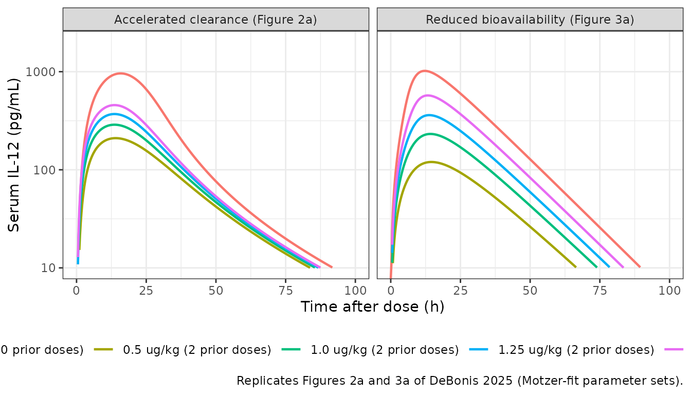
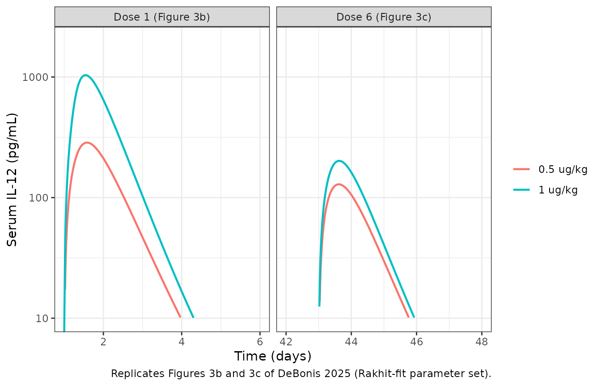
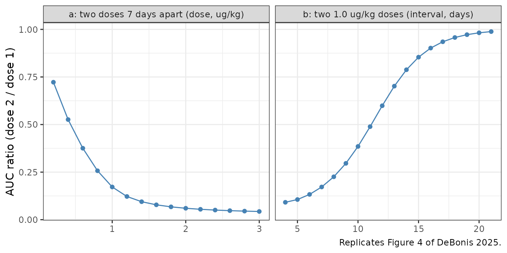
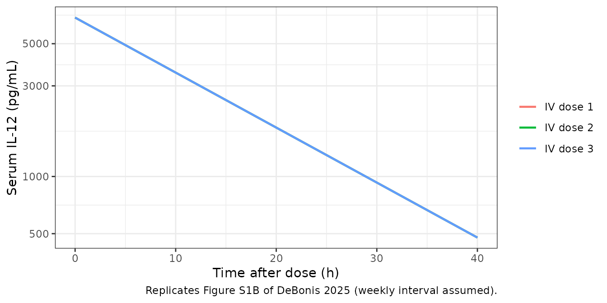
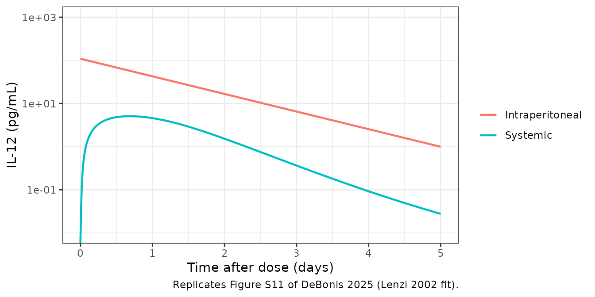
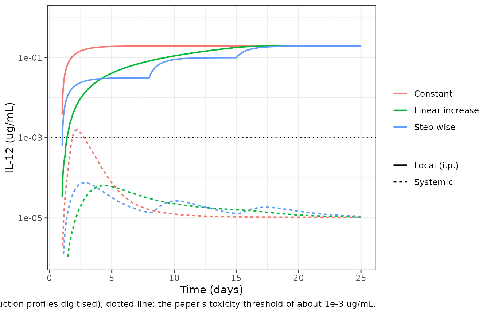

# Interleukin-12 PK desensitization QSP (DeBonis 2025)

## Model and source

- Citation: DeBonis J, Veiseh O, Igoshin OA. Uncovering the
  interleukin-12 pharmacokinetic desensitization mechanism and its
  consequences with mathematical modeling. CPT Pharmacometrics Syst
  Pharmacol. 2025;14(2):217-228. <doi:10.1002/psp4.13258>
- Description: QSP. Reduced-bioavailability model of subcutaneous
  recombinant human interleukin-12 (IL-12) pharmacokinetic
  desensitization in adults with advanced renal cell carcinoma (DeBonis
  2025, the paper’s preferred mechanism). IL-12 moves by lymph flow from
  the subcutaneous depot through the lymphatic system (lnode) into blood
  (central). In the lymphatic system it binds the IL-12 receptor on T
  cells irreversibly; the complex is internalised and, through
  quasi-steady-state STAT4 activation, up-regulates receptor production,
  so repeated doses are sequestered during lymphatic transit and less
  IL-12 reaches the blood. Deterministic mechanism model with no IIV and
  no residual error; parameters are the global-optimisation fit to the
  Motzer 1998 phase I data (Table S7), the set the paper uses for all
  later analyses.
- Article: <https://doi.org/10.1002/psp4.13258> (open access;
  PMC11812943)
- Supplement (Data S1: Tables S1-S11, Figures S1-S14, Equations S1-S39):
  <https://doi.org/10.1002/psp4.13258>
- Authors’ MATLAB code:
  <https://github.com/jcd111/IL-12-PK-Desensitization-Model> (commit
  `a9af561`, MIT licence)

Repeated doses of recombinant human interleukin-12 (rhIL-12) give lower
serum IL-12 exposure than the first dose (“PK desensitization”).
DeBonis, Veiseh and Igoshin built two mechanistic models that differ
only in where IL-12 meets its receptor on T cells, and fitted each to
the mean serum IL-12 data of three subcutaneous phase I trials in renal
cell carcinoma:

- **Reduced-bioavailability model** (`DeBonis_2025_il12_qsp`, the
  paper’s preferred mechanism): binding, internalisation and
  STAT4-driven receptor up-regulation happen in the **lymphatic
  system**, so repeated doses are sequestered on their way from the
  injection site to the blood.
- **Accelerated-clearance model**
  (`DeBonis_2025_il12_accelclearance_qsp`, the rejected alternative):
  the same receptor machinery sits in the **blood**, so receptor
  up-regulation increases systemic clearance.

The paper then adapts the reduced-bioavailability model to
intraperitoneal delivery: a single i.p. injection fitted to Lenzi 2002
(`DeBonis_2025_il12_ip_qsp`), and continuous local production from an
implant (`DeBonis_2025_il12_iplocal_qsp`). The four files share one
structure, so they share this article.

All four are deterministic mechanism models. The authors fitted mean
time-courses by least squares (particle swarm, then pattern search),
with no between-subject variability and no residual-error model, so none
is packaged.

``` r

mod_rb <- rxode2::rxode2(readModelDb("DeBonis_2025_il12_qsp"))
mod_ac <- rxode2::rxode2(readModelDb("DeBonis_2025_il12_accelclearance_qsp"))
mod_ip <- rxode2::rxode2(readModelDb("DeBonis_2025_il12_ip_qsp"))
mod_local <- rxode2::rxode2(readModelDb("DeBonis_2025_il12_iplocal_qsp"))
```

## Population

The subcutaneous models were fitted to mean serum IL-12 data from three
phase I trials in adults with advanced renal cell carcinoma (Table S1):
Motzer 1998 (51 patients; 0.1-1.5 ug/kg on days 1, 8 and 15 of 28-day
cycles, a fixed cycle followed by an escalating cycle), Portielje 1999
(28 enrolled, 25 analysed; a test dose followed one week later by
three-times-weekly dosing for two weeks; only Cmax, AUC and tmax were
reported) and Rakhit 1999 (24 patients; 0.1, 0.5 or 1.0 ug/kg on days 1,
8 and 15 of 28-day cycles). The i.p. model was fitted to the mean i.p.
and serum IL-12 profile of Lenzi 2002 (0.3 ug/kg i.p.). Time-course
values were digitised by the authors from the trial publications. Doses
in ug/kg were converted to pmol at an assumed 70 kg and the 70 kDa
molecular weight of IL-12, so 1 ug/kg = 1000 pmol.

The packaged files carry the Motzer-fit parameter set, which the paper
uses for every downstream analysis (Results, “Analysis of model
behavior”). The `population` metadata of each file restates this
(`readModelDb("DeBonis_2025_il12_qsp")()$population`).

## Model structure and naming

The paper writes Eqs. S1-S39 for concentrations (pmol/mL). The packaged
files write the same equations for amounts (pmol), which is what a dose
record delivers: each state equals the paper’s concentration times its
compartment volume. Every rate constant is unchanged, and the binding
term `kon * IL12_x * R_x` becomes `kon * lnode * target / V_L` (or
`/ V_B`). The injection-site volume V_S then cancels, which is why it
does not appear in the files. Serum IL-12 is reported as
`Cc = central / V_B * 70000` in pg/mL.

| Paper symbol | Meaning | Package name |
|----|----|----|
| IL12_S, IL12_P | IL-12 at the SC injection site / in the peritoneal cavity | `depot`, `depot_ip` |
| IL12_L | IL-12 in the lymphatic system | `lnode` |
| IL12_B | IL-12 in blood | `central` |
| R_x, C_x | free receptor, IL-12:receptor complex (lymph in RB, blood in AC) | `target`, `complex` |
| pSTAT_x | fraction of maximal STAT4 activation (QSS) | `pstat` |
| J_LS, J_LP | SC / i.p. to lymph transport rate | `ka`, `ka_ip` |
| J_BL | lymph to blood transport rate | `k_lnode_central` |
| k_CB | systemic clearance rate constant | `kel` |
| k_CR | unbound receptor internalisation | `kdeg` |
| k_on, k_int | association, complex internalisation | `kon`, `kint` |
| N_L, N_B | IL-12R+ T cells in lymph / blood | `ntcell_lnode`, `ntcell_central` |
| R_0 | basal receptor per T cell (pmol/cell) | `r0_cell` |
| alpha | STAT4-driven receptor production coefficient | `kupreg` |
| IC_pSTAT | complexes per cell for half-maximal STAT4 activation | `ic_pstat` |
| F | absolute bioavailability (via k_DG) | `fdepot` |
| beta | fraction of the nominal i.p. dose present at injection | `fdose_ip` |
| V_L, V_B, V_P | lymph, blood, peritoneal volumes | `v_lnode`, `vc`, `v_ip` |

## Source trace

| Item | Value | Source |
|----|----|----|
| SC / lymph / blood transport, RB model | n/a | Eqs. 1-3 (main text); Eqs. S11, S12, S15 |
| Receptor binding, complex, receptor up-regulation, RB | n/a | Eqs. 6, 9; Eqs. S12-S14 |
| Complexes per cell, STAT4 QSS | 6.023e11 molecules/pmol | Eqs. 7-8; Eqs. S16-S17 |
| k_R = k_CR R_0 | n/a | Eq. 11; Eq. S18 |
| k_DG = (1 - F) / F J_LS | n/a | Eq. 4; Eq. S19 |
| Dose as initial condition D / V_S | n/a | Eq. 5; Eq. S20 |
| Accelerated-clearance model | n/a | Eqs. S1-S10 |
| i.p. injection model, IL12_P,0 = beta D / V_P | n/a | Eqs. S21-S30 |
| Local production model, kpr(t) | n/a | Eqs. S31-S39 |
| RB parameters (k_CB 1.6, k_CR 0.46, k_on 200, k_int 0.56, N_L 3.8e10, alpha 5.0e-6, R_0 5.6e-9, J_LS 1.6, J_BL 70, IC_pSTAT 1.4e6) | see file | Table S7, Motzer column |
| AC parameters (k_CB 2.3, k_CR 0.46, k_on 210, k_int 0.46, N_B 8.0e10, alpha 8.8e-6, R_0 2.1e-9, J_LS 0.79, J_BL 4.33, F 1, IC_pSTAT 1.8e6) | see file | Table S5, Motzer column |
| i.p. parameters (k_CB 2.0, k_CR 0.46, k_on 5.4, k_int 0.46, N_L 1.0e9, alpha 1.0e-5, R_0 1.7e-9, J_LP 0.94, J_BL 43, IC_pSTAT 9.1e2, beta 5.3e-3) | see file | Table S10 |
| Local production parameters | see file | Table S11 |
| F = 1 in the RB model | 1 | Table S3 |
| V_L | 33 mL | Table S3 (Varkhede 2018) |
| V_B | 5100 mL | Table S3 |
| V_P | 1020 mL | Authors’ code, `build_RB_Lenzi_model.m` (not printed in the paper) |
| Molecular weight | 70 kDa | Methods, “Mathematical models of IL-12 PK”; authors’ code |
| Body weight | 70 kg | Authors’ code, `build_RB_Motzer_model.m` (not printed in the paper) |

## Shared helpers

``` r

ug_kg_to_pmol <- function(dose_ug_kg, wt = 70) dose_ug_kg * wt * 1e6 / 70000

# Replace the packaged parameter values with another published set. `p` is on
# the natural scale and named without the leading "l" of the ini() names.
with_params <- function(mod, p) {
  do.call(rxode2::ini, c(list(mod), as.list(stats::setNames(log(unname(p)), paste0("l", names(p))))))
}

solve_regimen <- function(mod, dose_time, amt, times, cmt = "depot") {
  ev <- rxode2::et(amt = unname(amt), time = unname(dose_time), cmt = cmt) |>
    rxode2::et(times)
  as.data.frame(rxode2::rxSolve(mod, ev, atol = 1e-10, rtol = 1e-8))
}
```

## Motzer 1998 fits (Figures 2a and 3a)

Motzer’s regimens are the fixed cycle (1.0 ug/kg on days 1, 8 and 15;
the plot shows dose 1) and four escalating cycles whose plotted dose is
the day-15 target dose after two smaller doses. The intermediate doses
are taken from the authors’ code (0.1 and 0.25 ug/kg before a 0.5 ug/kg
target; 0.1 and 0.5 ug/kg before 1.0, 1.25 or 1.5 ug/kg).

``` r

motzer <- tibble::tribble(
  ~regimen, ~d1, ~d2, ~d3, ~plot_dose_day,
  "1.0 ug/kg (0 prior doses)", 1.0, 1.0, 1.0, 1,
  "0.5 ug/kg (2 prior doses)", 0.1, 0.25, 0.5, 15,
  "1.0 ug/kg (2 prior doses)", 0.1, 0.5, 1.0, 15,
  "1.25 ug/kg (2 prior doses)", 0.1, 0.5, 1.25, 15,
  "1.5 ug/kg (2 prior doses)", 0.1, 0.5, 1.5, 15
)
times <- seq(0, 21, by = 1 / 96)

sim_motzer <- function(mod, label) {
  dplyr::bind_rows(lapply(seq_len(nrow(motzer)), function(i) {
    r <- motzer[i, ]
    s <- solve_regimen(mod, c(1, 8, 15), ug_kg_to_pmol(c(r$d1, r$d2, r$d3)), times)
    s |>
      dplyr::mutate(tad_h = (time - r$plot_dose_day) * 24) |>
      dplyr::filter(tad_h >= 0, tad_h <= 100) |>
      dplyr::transmute(model = label, regimen = r$regimen, tad_h, Cc)
  }))
}
motzer_sim <- dplyr::bind_rows(
  sim_motzer(mod_ac, "Accelerated clearance (Figure 2a)"),
  sim_motzer(mod_rb, "Reduced bioavailability (Figure 3a)")
)
motzer_sim$regimen <- factor(motzer_sim$regimen, levels = motzer$regimen)
```

``` r

ggplot(motzer_sim, aes(tad_h, Cc, colour = regimen)) +
  geom_line(linewidth = 0.8) +
  facet_wrap(~model) +
  scale_y_log10(limits = c(10, 2000)) +
  labs(
    x = "Time after dose (h)", y = "Serum IL-12 (pg/mL)", colour = NULL,
    caption = "Replicates Figures 2a and 3a of DeBonis 2025 (Motzer-fit parameter sets)."
  ) +
  theme_bw() +
  theme(legend.position = "bottom")
#> Warning in scale_y_log10(limits = c(10, 2000)): log-10 transformation
#> introduced infinite values.
#> Warning: Removed 711 rows containing missing values or values outside the scale range
#> (`geom_line()`).
```



Peak serum IL-12 of the reduced-bioavailability curves, against the
curve peaks read by the maintainers from Figure 3a:

``` r

fig3a_peak <- tibble::tribble(
  ~regimen, ~digitised_cmax,
  "1.0 ug/kg (0 prior doses)", 1000,
  "0.5 ug/kg (2 prior doses)", 120,
  "1.0 ug/kg (2 prior doses)", 240,
  "1.25 ug/kg (2 prior doses)", 370,
  "1.5 ug/kg (2 prior doses)", 600
)
peak_rb <- motzer_sim |>
  dplyr::filter(model == "Reduced bioavailability (Figure 3a)") |>
  dplyr::group_by(regimen = as.character(regimen)) |>
  dplyr::summarise(cmax = max(Cc), tmax_h = tad_h[which.max(Cc)], .groups = "drop") |>
  dplyr::inner_join(fig3a_peak, by = "regimen") |>
  dplyr::mutate(pct_diff = 100 * (cmax / digitised_cmax - 1))
stopifnot(nrow(peak_rb) == 5L)
peak_rb |>
  dplyr::rename(
    "Regimen" = regimen, "Simulated Cmax (pg/mL)" = cmax, "Simulated tmax (h)" = tmax_h,
    "Figure 3a peak (pg/mL)" = digitised_cmax, "% difference" = pct_diff
  ) |>
  knitr::kable(digits = 1)
```

| Regimen | Simulated Cmax (pg/mL) | Simulated tmax (h) | Figure 3a peak (pg/mL) | % difference |
|:---|---:|---:|---:|---:|
| 0.5 ug/kg (2 prior doses) | 120.0 | 14.5 | 120 | 0.0 |
| 1.0 ug/kg (0 prior doses) | 1019.0 | 12.2 | 1000 | 1.9 |
| 1.0 ug/kg (2 prior doses) | 231.8 | 14.2 | 240 | -3.4 |
| 1.25 ug/kg (2 prior doses) | 360.5 | 13.7 | 370 | -2.6 |
| 1.5 ug/kg (2 prior doses) | 572.5 | 13.2 | 600 | -4.6 |

``` r

# Deterministic solve against peaks read off a log axis (about +/-5%).
stopifnot(all(abs(peak_rb$pct_diff) < 12))
```

Without prior exposure the 1.0 ug/kg peak is about 1000 pg/mL; two
smaller doses one and two weeks earlier cut the 1.0 ug/kg peak to about
a quarter of that, which is the desensitization the model was built to
explain.

## Rakhit 1999 fit (Figures 3b and 3c)

The same reduced-bioavailability structure refitted to Rakhit 1999
(Table S7, Rakhit column), dosing 0.5 or 1.0 ug/kg on days 1, 8, 15, 29,
36 and 43.

``` r

p_rb_rakhit <- c(
  kel = 2.4, kdeg = 0.50, kon = 200, kint = 0.59, ntcell_lnode = 3.3e10,
  kupreg = 3.1e-6, r0_cell = 5.5e-9, ka = 1.2, k_lnode_central = 130, ic_pstat = 9.8e5
)
mod_rb_rakhit <- with_params(mod_rb, p_rb_rakhit)
#> ℹ change initial estimate of `lkel` to `0.8754687373539`
#> ℹ change initial estimate of `lkdeg` to `-0.693147180559945`
#> ℹ change initial estimate of `lkon` to `5.29831736654804`
#> ℹ change initial estimate of `lkint` to `-0.527632742082372`
#> ℹ change initial estimate of `lntcell_lnode` to `24.2197733984129`
#> ℹ change initial estimate of `lkupreg` to `-12.6841084464732`
#> ℹ change initial estimate of `lr0_cell` to `-19.018517744708`
#> ℹ change initial estimate of `lka` to `0.182321556793955`
#> ℹ change initial estimate of `lk_lnode_central` to `4.86753445045558`
#> ℹ change initial estimate of `lic_pstat` to `13.7953078506468`
rakhit_sim <- dplyr::bind_rows(lapply(c(0.5, 1.0), function(d) {
  solve_regimen(
    mod_rb_rakhit, c(1, 8, 15, 29, 36, 43), rep(ug_kg_to_pmol(d), 6),
    seq(0, 48, by = 1 / 96)
  ) |>
    dplyr::mutate(dose = paste(d, "ug/kg"))
})) |>
  dplyr::mutate(panel = dplyr::case_when(
    time >= 1 & time <= 6 ~ "Dose 1 (Figure 3b)",
    time >= 42 & time <= 48 ~ "Dose 6 (Figure 3c)"
  )) |>
  dplyr::filter(!is.na(panel))

ggplot(rakhit_sim, aes(time, Cc, colour = dose)) +
  geom_line(linewidth = 0.8) +
  facet_wrap(~panel, scales = "free_x") +
  scale_y_log10(limits = c(10, 2000)) +
  labs(
    x = "Time (days)", y = "Serum IL-12 (pg/mL)", colour = NULL,
    caption = "Replicates Figures 3b and 3c of DeBonis 2025 (Rakhit-fit parameter set)."
  ) +
  theme_bw()
#> Warning in scale_y_log10(limits = c(10, 2000)): log-10 transformation
#> introduced infinite values.
#> Warning: Removed 969 rows containing missing values or values outside the scale range
#> (`geom_line()`).
```



## Portielje 1999 PK metrics (Tables S4 and S6)

Portielje 1999 reported only Cmax, AUC and tmax after the test dose
(dose 1) and after the last of six three-times-weekly doses (dose 7).
The paper’s Tables S4 and S6 list what its fitted models predict for
those metrics, so re-simulating the Portielje-fit parameter sets and
comparing with the paper’s *predicted* values checks the packaged
equations end to end. Doses follow the authors’ code: days 1, 8, 10, 12,
15, 17 and 19, AUC over the 7 days after doses 1 and 7.

``` r

p_rb_portielje <- c(
  kel = 2.4, kdeg = 1.7, kon = 200, kint = 0.66, ntcell_lnode = 1.7e11,
  kupreg = 4.4e-6, r0_cell = 1.8e-9, ka = 2.9, k_lnode_central = 150, ic_pstat = 1.8e6
)
p_ac_portielje <- c(
  kel = 0.8, kdeg = 0.46, kon = 210, kint = 0.46, ntcell_central = 6.3e10,
  kupreg = 2.6e-6, r0_cell = 8.1e-9, ka = 2.9, k_lnode_central = 4.4, fdepot = 0.77,
  ic_pstat = 1.8e6
)
portielje_days <- c(1, 8, 10, 12, 15, 17, 19)
portielje_models <- list(
  "Reduced bioavailability" = with_params(mod_rb, p_rb_portielje),
  "Accelerated clearance" = with_params(mod_ac, p_ac_portielje)
)
#> ℹ change initial estimate of `lkel` to `0.8754687373539`
#> ℹ change initial estimate of `lkdeg` to `0.53062825106217`
#> ℹ change initial estimate of `lkon` to `5.29831736654804`
#> ℹ change initial estimate of `lkint` to `-0.415515443961666`
#> ℹ change initial estimate of `lntcell_lnode` to `25.8590642739967`
#> ℹ change initial estimate of `lkupreg` to `-12.3339060170401`
#> ℹ change initial estimate of `lr0_cell` to `-20.1354791720443`
#> ℹ change initial estimate of `lka` to `1.06471073699243`
#> ℹ change initial estimate of `lk_lnode_central` to `5.01063529409626`
#> ℹ change initial estimate of `lic_pstat` to `14.4032972228664`
#> ℹ change initial estimate of `lkel` to `-0.22314355131421`
#> ℹ change initial estimate of `lkdeg` to `-0.776528789498996`
#> ℹ change initial estimate of `lkon` to `5.34710753071747`
#> ℹ change initial estimate of `lkint` to `-0.776528789498996`
#> ℹ change initial estimate of `lntcell_central` to `24.8664005633379`
#> ℹ change initial estimate of `lkupreg` to `-12.8599991129368`
#> ℹ change initial estimate of `lr0_cell` to `-18.631401775268`
#> ℹ change initial estimate of `lka` to `1.06471073699243`
#> ℹ change initial estimate of `lk_lnode_central` to `1.48160454092422`
#> ℹ change initial estimate of `lfdepot` to `-0.261364764134408`
#> ℹ change initial estimate of `lic_pstat` to `14.4032972228664`

portielje <- dplyr::bind_rows(lapply(names(portielje_models), function(m) {
  dplyr::bind_rows(lapply(c(0.5, 1.0), function(d) {
    s <- solve_regimen(
      portielje_models[[m]], portielje_days, rep(ug_kg_to_pmol(d), 7),
      seq(0, 27, by = 1 / 240)
    )
    dplyr::bind_rows(
      s |> dplyr::filter(time >= 1, time <= 8) |> dplyr::mutate(tad = (time - 1) * 24, dose_number = "dose 1"),
      s |> dplyr::filter(time >= 19, time <= 26) |> dplyr::mutate(tad = (time - 19) * 24, dose_number = "dose 7")
    ) |>
      dplyr::mutate(model = m, dose = paste(d, "ug/kg"))
  }))
})) |>
  dplyr::mutate(id = 1L, scenario = paste(model, dose, dose_number, sep = " | "))
```

PKNCA computes Cmax, tmax and AUC over each 168-hour dosing window, with
time in hours after the dose. Each window carries a dose record at time
0; the pre-dose concentration of dose 7 is the residual from dose 6.

``` r

conc_obj <- PKNCA::PKNCAconc(
  portielje |> dplyr::filter(!is.na(Cc)) |> dplyr::select(scenario, id, tad, Cc),
  Cc ~ tad | scenario + id
)
dose_obj <- PKNCA::PKNCAdose(
  portielje |> dplyr::distinct(scenario, id) |> dplyr::mutate(tad = 0, amt = 1),
  amt ~ tad | scenario + id
)
intervals <- data.frame(start = 0, end = 168, cmax = TRUE, tmax = TRUE, auclast = TRUE)
nca_res <- PKNCA::pk.nca(PKNCA::PKNCAdata(conc_obj, dose_obj, intervals = intervals))
```

``` r

# Tables S6 (RB) and S4 (AC), 'Predicted' columns.
predicted <- tibble::tribble(
  ~scenario, ~cmax, ~auclast, ~tmax,
  "Reduced bioavailability | 0.5 ug/kg | dose 1", 330, 7400, 10,
  "Reduced bioavailability | 0.5 ug/kg | dose 7", 170, 4100, 10,
  "Reduced bioavailability | 1 ug/kg | dose 1", 1300, 26000, 9.8,
  "Reduced bioavailability | 1 ug/kg | dose 7", 290, 6800, 10,
  "Accelerated clearance | 0.5 ug/kg | dose 1", 430, 7600, 9.1,
  "Accelerated clearance | 0.5 ug/kg | dose 7", 240, 4000, 7.4,
  "Accelerated clearance | 1 ug/kg | dose 1", 1100, 21000, 12,
  "Accelerated clearance | 1 ug/kg | dose 7", 350, 5900, 7.6
)
stopifnot(all(predicted$scenario %in% portielje$scenario))
cmp_pred <- nlmixr2lib::ncaComparisonTable(
  simulated = nca_res,
  reference = predicted,
  by = "scenario",
  units = c(cmax = "pg/mL", auclast = "pg*h/mL", tmax = "h"),
  tolerance_pct = 10
)
knitr::kable(
  cmp_pred,
  caption = "Simulated vs. the paper's own model predictions (Tables S4 and S6). * differs by >10%."
)
```

| NCA parameter | scenario | Reference | Simulated | % diff |
|:---|:---|:---|:---|:---|
| Cmax (pg/mL) | Reduced bioavailability \| 0.5 ug/kg \| dose 1 | 330 | 321 | -2.7% |
| Cmax (pg/mL) | Reduced bioavailability \| 0.5 ug/kg \| dose 7 | 170 | 173 | +1.5% |
| Cmax (pg/mL) | Reduced bioavailability \| 1 ug/kg \| dose 1 | 1300 | 1280 | -1.6% |
| Cmax (pg/mL) | Reduced bioavailability \| 1 ug/kg \| dose 7 | 290 | 294 | +1.3% |
| Cmax (pg/mL) | Accelerated clearance \| 0.5 ug/kg \| dose 1 | 430 | 416 | -3.4% |
| Cmax (pg/mL) | Accelerated clearance \| 0.5 ug/kg \| dose 7 | 240 | 231 | -3.7% |
| Cmax (pg/mL) | Accelerated clearance \| 1 ug/kg \| dose 1 | 1100 | 1080 | -1.9% |
| Cmax (pg/mL) | Accelerated clearance \| 1 ug/kg \| dose 7 | 350 | 345 | -1.5% |
| Tmax (h) | Reduced bioavailability \| 0.5 ug/kg \| dose 1 | 10 | 9.6 | -4.0% |
| Tmax (h) | Reduced bioavailability \| 0.5 ug/kg \| dose 7 | 10 | 9.5 | -5.0% |
| Tmax (h) | Reduced bioavailability \| 1 ug/kg \| dose 1 | 9.8 | 9.3 | -5.1% |
| Tmax (h) | Reduced bioavailability \| 1 ug/kg \| dose 7 | 10 | 9.8 | -2.0% |
| Tmax (h) | Accelerated clearance \| 0.5 ug/kg \| dose 1 | 9.1 | 8.9 | -2.2% |
| Tmax (h) | Accelerated clearance \| 0.5 ug/kg \| dose 7 | 7.4 | 7.4 | +0.0% |
| Tmax (h) | Accelerated clearance \| 1 ug/kg \| dose 1 | 12 | 12 | +0.0% |
| Tmax (h) | Accelerated clearance \| 1 ug/kg \| dose 7 | 7.6 | 7.6 | -0.0% |
| AUClast (pg\*h/mL) | Reduced bioavailability \| 0.5 ug/kg \| dose 1 | 7400 | 7210 | -2.5% |
| AUClast (pg\*h/mL) | Reduced bioavailability \| 0.5 ug/kg \| dose 7 | 4100 | 4120 | +0.4% |
| AUClast (pg\*h/mL) | Reduced bioavailability \| 1 ug/kg \| dose 1 | 26000 | 25300 | -2.9% |
| AUClast (pg\*h/mL) | Reduced bioavailability \| 1 ug/kg \| dose 7 | 6800 | 6820 | +0.3% |
| AUClast (pg\*h/mL) | Accelerated clearance \| 0.5 ug/kg \| dose 1 | 7600 | 7440 | -2.0% |
| AUClast (pg\*h/mL) | Accelerated clearance \| 0.5 ug/kg \| dose 7 | 4000 | 3880 | -2.9% |
| AUClast (pg\*h/mL) | Accelerated clearance \| 1 ug/kg \| dose 1 | 21000 | 20900 | -0.4% |
| AUClast (pg\*h/mL) | Accelerated clearance \| 1 ug/kg \| dose 7 | 5900 | 5840 | -1.1% |

Simulated vs. the paper’s own model predictions (Tables S4 and S6). \*
differs by \>10%. {.table}

``` r

sim_tbl <- as.data.frame(nca_res$result) |>
  dplyr::select(scenario, PPTESTCD, sim = PPORRES)
pred_long <- predicted |>
  tidyr::pivot_longer(-scenario, names_to = "PPTESTCD", values_to = "ref")
chk <- dplyr::inner_join(sim_tbl, pred_long, by = c("scenario", "PPTESTCD")) |>
  dplyr::mutate(pct = 100 * (sim / ref - 1))
stopifnot(nrow(chk) == 24L)
# Deterministic solve of two-significant-figure parameter sets against
# two-significant-figure predictions: the realised spread is under 6% for
# every metric; a mis-transcribed rate constant or a unit slip moves these by
# tens of percent.
stopifnot(all(abs(chk$pct[chk$PPTESTCD != "tmax"]) < 8))
stopifnot(all(abs(chk$sim[chk$PPTESTCD == "tmax"] - chk$ref[chk$PPTESTCD == "tmax"]) < 1))
```

Both packaged structures reproduce the paper’s predictions for the
Portielje regimen to within the rounding of the published parameter
values. The fit to the clinical means is looser, as the paper’s own
Tables S4 and S6 show: the dose-7 Cmax is under-predicted at both dose
levels (about 170 against 255 and 290 against 376 pg/mL), and neither
the 17 h dose-1 tmax nor the 4 h (SD 0) dose-7 tmax reported at 1.0
ug/kg is reproduced by either mechanism. The comparison for the
reduced-bioavailability model:

``` r

reported <- tibble::tribble(
  ~scenario, ~cmax, ~auclast, ~tmax,
  "Reduced bioavailability | 0.5 ug/kg | dose 1", 362, 7400, 9.7,
  "Reduced bioavailability | 0.5 ug/kg | dose 7", 255, 3300, 9.5,
  "Reduced bioavailability | 1 ug/kg | dose 1", 1131, 31800, 17,
  "Reduced bioavailability | 1 ug/kg | dose 7", 376, 6000, 4
)
knitr::kable(
  nlmixr2lib::ncaComparisonTable(
    simulated = nca_res,
    reference = reported,
    by = "scenario",
    units = c(cmax = "pg/mL", auclast = "pg*h/mL", tmax = "h"),
    tolerance_pct = 20
  ),
  caption = paste(
    "Reduced-bioavailability model vs. the clinical means reported by Portielje 1999",
    "(Tables S4/S6 'Reported'; SDs are large, e.g. 1.0 ug/kg dose-1 Cmax 1131 +/- 1051 pg/mL).",
    "* differs by >20%."
  )
)
```

| NCA parameter | scenario | Reference | Simulated | % diff |
|:---|:---|:---|:---|:---|
| Cmax (pg/mL) | Reduced bioavailability \| 0.5 ug/kg \| dose 1 | 362 | 321 | -11.3% |
| Cmax (pg/mL) | Reduced bioavailability \| 0.5 ug/kg \| dose 7 | 255 | 173 | -32.3%\* |
| Cmax (pg/mL) | Reduced bioavailability \| 1 ug/kg \| dose 1 | 1130 | 1280 | +13.1% |
| Cmax (pg/mL) | Reduced bioavailability \| 1 ug/kg \| dose 7 | 376 | 294 | -21.9%\* |
| Tmax (h) | Reduced bioavailability \| 0.5 ug/kg \| dose 1 | 9.7 | 9.6 | -1.0% |
| Tmax (h) | Reduced bioavailability \| 0.5 ug/kg \| dose 7 | 9.5 | 9.5 | -0.0% |
| Tmax (h) | Reduced bioavailability \| 1 ug/kg \| dose 1 | 17 | 9.3 | -45.3%\* |
| Tmax (h) | Reduced bioavailability \| 1 ug/kg \| dose 7 | 4 | 9.8 | +145.0%\* |
| AUClast (pg\*h/mL) | Reduced bioavailability \| 0.5 ug/kg \| dose 1 | 7400 | 7210 | -2.5% |
| AUClast (pg\*h/mL) | Reduced bioavailability \| 0.5 ug/kg \| dose 7 | 3300 | 4120 | +24.7%\* |
| AUClast (pg\*h/mL) | Reduced bioavailability \| 1 ug/kg \| dose 1 | 31800 | 25300 | -20.6%\* |
| AUClast (pg\*h/mL) | Reduced bioavailability \| 1 ug/kg \| dose 7 | 6000 | 6820 | +13.7% |

Reduced-bioavailability model vs. the clinical means reported by
Portielje 1999 (Tables S4/S6 ‘Reported’; SDs are large, e.g. 1.0 ug/kg
dose-1 Cmax 1131 +/- 1051 pg/mL). \* differs by \>20%. {.table}

## Desensitization versus dose and dosing interval (Figure 4)

The paper’s measure of desensitization is the ratio of the serum AUC
after the second of two doses to the AUC after the first. Figure 4a
varies the dose with the doses 7 days apart; Figure 4b varies the
interval at 1.0 ug/kg. Both use the Motzer-fit reduced-bioavailability
parameters (the packaged values).

``` r

fig4_scen <- dplyr::bind_rows(
  # round() so the doses join exactly against the digitised table below.
  tibble::tibble(panel = "a", dose = round(seq(0.2, 3.0, by = 0.2), 1), tau = 7),
  tibble::tibble(panel = "b", dose = 1.0, tau = 4:21)
) |>
  dplyr::mutate(scenario = paste0(panel, ": ", dose, " ug/kg, tau ", tau, " d"))

fig4 <- dplyr::bind_rows(lapply(seq_len(nrow(fig4_scen)), function(i) {
  sc <- fig4_scen[i, ]
  solve_regimen(mod_rb, c(0, sc$tau), rep(ug_kg_to_pmol(sc$dose), 2), seq(0, sc$tau + 14, by = 1 / 96)) |>
    dplyr::mutate(scenario = sc$scenario, id = 1L)
}))

conc4 <- PKNCA::PKNCAconc(fig4 |> dplyr::select(scenario, id, time, Cc), Cc ~ time | scenario + id)
dose4 <- PKNCA::PKNCAdose(
  dplyr::bind_rows(
    fig4_scen |> dplyr::mutate(time = 0),
    fig4_scen |> dplyr::mutate(time = tau)
  ) |>
    dplyr::mutate(id = 1L, amt = ug_kg_to_pmol(dose)) |>
    dplyr::select(scenario, id, time, amt),
  amt ~ time | scenario + id
)
int4 <- dplyr::bind_rows(
  fig4_scen |> dplyr::transmute(scenario, start = 0, end = tau),
  fig4_scen |> dplyr::transmute(scenario, start = tau, end = tau + 14)
) |>
  dplyr::mutate(auclast = TRUE)
res4 <- PKNCA::pk.nca(PKNCA::PKNCAdata(conc4, dose4, intervals = as.data.frame(int4)))

auc_ratio <- as.data.frame(res4$result) |>
  dplyr::filter(PPTESTCD == "auclast") |>
  dplyr::mutate(interval = ifelse(start == 0, "first", "second")) |>
  dplyr::select(scenario, interval, PPORRES) |>
  tidyr::pivot_wider(names_from = interval, values_from = PPORRES) |>
  dplyr::mutate(auc_ratio = second / first) |>
  dplyr::inner_join(fig4_scen, by = "scenario")
```

``` r

fig4_digitised <- dplyr::bind_rows(
  tibble::tibble(
    panel = "a", tau = 7, dose = c(0.2, 0.6, 1.0, 1.6, 2.0, 3.0),
    digitised = c(0.72, 0.38, 0.17, 0.08, 0.06, 0.04)
  ),
  tibble::tibble(
    panel = "b", dose = 1.0, tau = c(4, 7, 10, 12, 14, 16, 21),
    digitised = c(0.09, 0.18, 0.39, 0.60, 0.79, 0.90, 0.99)
  )
)
plot4 <- dplyr::bind_rows(
  auc_ratio |> dplyr::filter(panel == "a") |> dplyr::mutate(x = dose, facet = "a: two doses 7 days apart (dose, ug/kg)"),
  auc_ratio |> dplyr::filter(panel == "b") |> dplyr::mutate(x = tau, facet = "b: two 1.0 ug/kg doses (interval, days)")
)
ggplot(plot4, aes(x, auc_ratio)) +
  geom_line(colour = "steelblue") +
  geom_point(colour = "steelblue") +
  facet_wrap(~facet, scales = "free_x") +
  labs(
    x = NULL, y = "AUC ratio (dose 2 / dose 1)",
    caption = "Replicates Figure 4 of DeBonis 2025."
  ) +
  theme_bw()
```



``` r


chk4 <- dplyr::inner_join(auc_ratio, fig4_digitised, by = c("panel", "dose", "tau"))
stopifnot(nrow(chk4) == nrow(fig4_digitised))
chk4 |>
  dplyr::select(panel, dose, tau, auc_ratio, digitised) |>
  dplyr::rename(
    "Panel" = panel, "Dose (ug/kg)" = dose, "Interval (days)" = tau,
    "Simulated AUC ratio" = auc_ratio, "Figure 4 (digitised)" = digitised
  ) |>
  knitr::kable(digits = 3)
```

| Panel | Dose (ug/kg) | Interval (days) | Simulated AUC ratio | Figure 4 (digitised) |
|:------|-------------:|----------------:|--------------------:|---------------------:|
| a     |          0.2 |               7 |               0.722 |                 0.72 |
| a     |          0.6 |               7 |               0.376 |                 0.38 |
| a     |          1.0 |               7 |               0.172 |                 0.17 |
| a     |          1.6 |               7 |               0.078 |                 0.08 |
| a     |          2.0 |               7 |               0.060 |                 0.06 |
| a     |          3.0 |               7 |               0.043 |                 0.04 |
| b     |          1.0 |               4 |               0.091 |                 0.09 |
| b     |          1.0 |               7 |               0.172 |                 0.18 |
| b     |          1.0 |              10 |               0.385 |                 0.39 |
| b     |          1.0 |              12 |               0.599 |                 0.60 |
| b     |          1.0 |              14 |               0.788 |                 0.79 |
| b     |          1.0 |              16 |               0.902 |                 0.90 |
| b     |          1.0 |              21 |               0.988 |                 0.99 |

``` r

# Deterministic; Figure 4 is read off a linear axis to about +/-0.02.
stopifnot(all(abs(chk4$auc_ratio - chk4$digitised) < 0.05))
```

## Repeated intravenous doses (Figure S1B)

In the reduced-bioavailability model the receptor sits only in the
lymphatic system, so IV IL-12 never meets it and repeated IV doses give
identical profiles: the paper’s argument that this model, unlike the
accelerated-clearance one, agrees with the negligible desensitization
seen in IV trials. The Figure S1B starting concentration (about 7000
pg/mL) corresponds to 0.5 ug/kg; the interval between IV doses is not
stated, and in this model it does not matter.

``` r

iv <- solve_regimen(mod_rb, c(0, 7, 14), rep(ug_kg_to_pmol(0.5), 3), seq(0, 16, by = 1 / 96), cmt = "central")
iv_dose <- dplyr::bind_rows(lapply(1:3, function(k) {
  iv |>
    dplyr::filter(time >= (k - 1) * 7, time <= (k - 1) * 7 + 40 / 24) |>
    dplyr::mutate(tad_h = (time - (k - 1) * 7) * 24, dose = paste("IV dose", k))
}))
ggplot(iv_dose, aes(tad_h, Cc, colour = dose)) +
  geom_line(linewidth = 0.8) +
  scale_y_log10() +
  labs(
    x = "Time after dose (h)", y = "Serum IL-12 (pg/mL)", colour = NULL,
    caption = "Replicates Figure S1B of DeBonis 2025 (weekly interval assumed)."
  ) +
  theme_bw()
```



``` r

c0 <- iv_dose |>
  dplyr::filter(tad_h == 0) |>
  dplyr::pull(Cc)
# Closed form at the dose instant: 500 pmol / 5100 mL * 70000 pg/pmol.
stopifnot(length(c0) == 3L, all(abs(c0 / (500 / 5100 * 70000) - 1) < 1e-3))
```

## Intraperitoneal injection (Figure S11)

A single 0.3 ug/kg i.p. dose (300 pmol) of which a fraction beta =
5.3e-3 appears in the 1020 mL peritoneal cavity, so the i.p.
concentration starts at `5.3e-3 * 300 / 1020 * 70000` = 109 pg/mL.

``` r

ip <- solve_regimen(mod_ip, 0, ug_kg_to_pmol(0.3), seq(0, 5, by = 1 / 96), cmt = "depot_ip")
ip_long <- ip |>
  dplyr::select(time, "Intraperitoneal" = Cip, "Systemic" = Cc) |>
  tidyr::pivot_longer(-time, names_to = "site", values_to = "conc")
ggplot(ip_long, aes(time, conc, colour = site)) +
  geom_line(linewidth = 0.8) +
  scale_y_log10(limits = c(1e-2, 1e3)) +
  labs(
    x = "Time after dose (days)", y = "IL-12 (pg/mL)", colour = NULL,
    caption = "Replicates Figure S11 of DeBonis 2025 (Lenzi 2002 fit)."
  ) +
  theme_bw()
#> Warning in scale_y_log10(limits = c(0.01, 1000)): log-10 transformation
#> introduced infinite values.
```



``` r

stopifnot(abs(ip$Cip[ip$time == 0] / (5.3e-3 * 300 / 1020 * 70000) - 1) < 1e-6)
```

The serum peak is about 5 pg/mL near 0.7 days and the i.p. concentration
falls to about 1 pg/mL by day 5, matching the fitted curves in Figure
S11.

## Continuous local production (Figure 5a)

Figure 5a compares three i.p. production profiles that reach the same
final rate: constant production from day 1, a three-step increase, and a
linear ramp. The figure does not print the rates; the maintainers read a
final rate of about 185 ug/day, steps of about 30 and 95 ug/day starting
on days 1 and 8 with the final rate from day 15, and a ramp from 0 on
day 1 to the final rate on day 15 off the upper panel. The ramp is
delivered here as quarter-day infusion steps.

``` r

kpr_f <- 185 * 1e6 / 70000 # pmol/day
infusion <- function(start, end, rate) {
  data.frame(time = start, amt = rate * (end - start), rate = rate)
}
ramp_t <- seq(1, 15, by = 0.25)
profiles <- list(
  "Constant" = infusion(1, 30, kpr_f),
  "Step-wise" = rbind(
    infusion(1, 8, kpr_f * 30 / 185), infusion(8, 15, kpr_f * 95 / 185), infusion(15, 30, kpr_f)
  ),
  "Linear increase" = rbind(
    infusion(head(ramp_t, -1), tail(ramp_t, -1), kpr_f * (head(ramp_t, -1) + 0.125 - 1) / 14),
    infusion(15, 30, kpr_f)
  )
)
local_sim <- dplyr::bind_rows(lapply(names(profiles), function(nm) {
  d <- profiles[[nm]]
  ev <- rxode2::et(amt = d$amt, rate = d$rate, time = d$time, cmt = "depot_ip") |>
    rxode2::et(seq(0, 25, by = 1 / 48))
  as.data.frame(rxode2::rxSolve(mod_local, ev, atol = 1e-10, rtol = 1e-8)) |>
    dplyr::mutate(profile = nm)
}))

local_long <- local_sim |>
  dplyr::select(time, profile, "Local (i.p.)" = Cip, "Systemic" = Cc) |>
  tidyr::pivot_longer(c("Local (i.p.)", "Systemic"), names_to = "site", values_to = "conc") |>
  dplyr::mutate(conc_ug_ml = conc / 1e6) |>
  dplyr::filter(conc_ug_ml > 0)
ggplot(local_long, aes(time, conc_ug_ml, colour = profile, linetype = site)) +
  geom_line(linewidth = 0.7) +
  geom_hline(yintercept = 1e-3, linetype = "dotted") +
  scale_y_log10(limits = c(1e-6, 1)) +
  labs(
    x = "Time (days)", y = "IL-12 (ug/mL)", colour = NULL, linetype = NULL,
    caption = paste(
      "Replicates Figure 5a of DeBonis 2025 (production profiles digitised);",
      "dotted line: the paper's toxicity threshold of about 1e-3 ug/mL."
    )
  ) +
  theme_bw()
#> Warning: Removed 28 rows containing missing values or values outside the scale range
#> (`geom_line()`).
```



``` r

sys_peak <- local_sim |>
  dplyr::group_by(profile) |>
  dplyr::summarise(peak_ug_ml = max(Cc) / 1e6, .groups = "drop")
knitr::kable(
  sys_peak |> dplyr::rename("Profile" = profile, "Peak systemic IL-12 (ug/mL)" = peak_ug_ml),
  digits = 6
)
```

| Profile         | Peak systemic IL-12 (ug/mL) |
|:----------------|----------------------------:|
| Constant        |                    0.001556 |
| Linear increase |                    0.000064 |
| Step-wise       |                    0.000075 |

``` r

ss_local <- local_sim |>
  dplyr::filter(profile == "Constant", time == 25) |>
  dplyr::pull(Cip)
# With F = 1 the steady-state i.p. amount is kpr / J_LP (Eq. S31).
stopifnot(abs(ss_local / (kpr_f / 0.94 / 1020 * 70000) - 1) < 1e-3)
# Figure 5a: constant production overshoots the toxicity threshold, the two
# gradual profiles stay well below it.
stopifnot(
  sys_peak$peak_ug_ml[sys_peak$profile == "Constant"] > 1e-3,
  all(sys_peak$peak_ug_ml[sys_peak$profile != "Constant"] < 2e-4)
)
```

Constant production gives a transient systemic peak of about 1.5e-3
ug/mL on day 2, above the toxicity threshold, before receptor
up-regulation in the lymphatic system cuts the flux into blood; the
step-wise and ramped profiles let the receptor pool grow first and keep
systemic IL-12 about twenty-fold lower, while all three reach the same
local concentration.

## Alternative published parameter sets

The packaged files carry the Motzer fits. The other sets the paper
reports can be loaded with `with_params()` as above:

``` r

alt <- tibble::tribble(
  ~parameter, ~rb_motzer, ~rb_rakhit, ~rb_motzer_rakhit, ~rb_portielje, ~rb_table_s8, ~ac_motzer, ~ac_rakhit, ~ac_portielje,
  "kel (k_CB, 1/day)", 1.6, 2.4, 2.0, 2.4, 1.3, 2.3, 2.3, 0.8,
  "kdeg (k_CR, 1/day)", 0.46, 0.50, 0.50, 1.7, 1.7, 0.46, 0.46, 0.46,
  "kon (mL/pmol/day)", 200, 200, 140, 200, 170, 210, 200, 210,
  "kint (1/day)", 0.56, 0.59, 0.61, 0.66, 0.61, 0.46, 0.49, 0.46,
  "ntcell (N_L or N_B, cells)", 3.8e10, 3.3e10, 9.3e10, 1.7e11, 2.9e9, 8.0e10, 2.6e10, 6.3e10,
  "kupreg (alpha, pmol/cell/day)", 5.0e-6, 3.1e-6, 6.7e-6, 4.4e-6, 5.7e-6, 8.8e-6, 4.2e-6, 2.6e-6,
  "r0_cell (R_0, pmol/cell)", 5.6e-9, 5.5e-9, 1.7e-9, 1.8e-9, 1.5e-8, 2.1e-9, 8.1e-9, 8.1e-9,
  "ka (J_LS, 1/day)", 1.6, 1.2, 1.1, 2.9, 0.80, 0.79, 0.78, 2.9,
  "k_lnode_central (J_BL, 1/day)", 70, 130, 70, 150, 12, 4.33, 6.2, 4.4,
  "ic_pstat (complexes/cell)", 1.4e6, 9.8e5, 1.8e6, 1.8e6, 9.5e5, 1.8e6, 1.1e6, 1.8e6,
  "fdepot (F)", 1, 1, 1, 1, 1, 1, 1, 0.77
)
alt |>
  dplyr::rename(
    "Parameter" = parameter, "RB Motzer (packaged)" = rb_motzer, "RB Rakhit" = rb_rakhit,
    "RB Motzer + Rakhit" = rb_motzer_rakhit, "RB Portielje" = rb_portielje,
    "RB Table S8" = rb_table_s8, "AC Motzer (packaged)" = ac_motzer,
    "AC Rakhit" = ac_rakhit, "AC Portielje" = ac_portielje
  ) |>
  knitr::kable(caption = "Tables S5 (AC), S7 (RB) and S8 (RB, low-dose nonlinearity set).")
```

| Parameter | RB Motzer (packaged) | RB Rakhit | RB Motzer + Rakhit | RB Portielje | RB Table S8 | AC Motzer (packaged) | AC Rakhit | AC Portielje |
|:---|---:|---:|---:|---:|---:|---:|---:|---:|
| kel (k_CB, 1/day) | 1.6e+00 | 2.4e+00 | 2.0e+00 | 2.4e+00 | 1.3e+00 | 2.30e+00 | 2.3e+00 | 8.0e-01 |
| kdeg (k_CR, 1/day) | 4.6e-01 | 5.0e-01 | 5.0e-01 | 1.7e+00 | 1.7e+00 | 4.60e-01 | 4.6e-01 | 4.6e-01 |
| kon (mL/pmol/day) | 2.0e+02 | 2.0e+02 | 1.4e+02 | 2.0e+02 | 1.7e+02 | 2.10e+02 | 2.0e+02 | 2.1e+02 |
| kint (1/day) | 5.6e-01 | 5.9e-01 | 6.1e-01 | 6.6e-01 | 6.1e-01 | 4.60e-01 | 4.9e-01 | 4.6e-01 |
| ntcell (N_L or N_B, cells) | 3.8e+10 | 3.3e+10 | 9.3e+10 | 1.7e+11 | 2.9e+09 | 8.00e+10 | 2.6e+10 | 6.3e+10 |
| kupreg (alpha, pmol/cell/day) | 5.0e-06 | 3.1e-06 | 6.7e-06 | 4.4e-06 | 5.7e-06 | 8.80e-06 | 4.2e-06 | 2.6e-06 |
| r0_cell (R_0, pmol/cell) | 0.0e+00 | 0.0e+00 | 0.0e+00 | 0.0e+00 | 0.0e+00 | 0.00e+00 | 0.0e+00 | 0.0e+00 |
| ka (J_LS, 1/day) | 1.6e+00 | 1.2e+00 | 1.1e+00 | 2.9e+00 | 8.0e-01 | 7.90e-01 | 7.8e-01 | 2.9e+00 |
| k_lnode_central (J_BL, 1/day) | 7.0e+01 | 1.3e+02 | 7.0e+01 | 1.5e+02 | 1.2e+01 | 4.33e+00 | 6.2e+00 | 4.4e+00 |
| ic_pstat (complexes/cell) | 1.4e+06 | 9.8e+05 | 1.8e+06 | 1.8e+06 | 9.5e+05 | 1.80e+06 | 1.1e+06 | 1.8e+06 |
| fdepot (F) | 1.0e+00 | 1.0e+00 | 1.0e+00 | 1.0e+00 | 1.0e+00 | 1.00e+00 | 1.0e+00 | 7.7e-01 |

Tables S5 (AC), S7 (RB) and S8 (RB, low-dose nonlinearity set). {.table}

The ensemble of locally optimised sets (Figure 3d, 50 per trial) is
shown only as distributions in the paper and is not reproduced.

## Assumptions and deviations

- **Amount-based equations.** The files integrate amounts (pmol) rather
  than the concentrations of Eqs. S1-S39; the two forms are
  algebraically identical for constant volumes. The injection volume V_S
  therefore drops out of the subcutaneous models, and the paper’s
  bolus-as-initial-condition (Eq. S20) is a dose record into `depot`.
- **Values not printed in the paper.** The 70 kg body weight, the 1020
  mL peritoneal volume V_P, the Portielje dosing days and the
  intermediate doses of the Motzer escalating cycles come from the
  authors’ deposited MATLAB code. The paper states only the 70 kDa
  molecular weight and that the injection volume was assumed to be 1 mL
  when unstated (Table S3).
- **Lymphatic volume.** Table S3 prints V_L = 33 mL; the authors’ code
  computes 33.26 mL from the Varkhede 2018 lymph-node volumes. The
  packaged files use the printed 33 mL (a 0.8% difference in lymphatic
  concentrations).
- **Avogadro conversion.** The main-text definition of A prints 6e12 per
  pmol; 6e23 per mol divided by 1e12 pmol per mol is 6e11, and Eqs. S6,
  S16, S26 and S36 and the authors’ code use 6.023e11. The files use
  6.023e11.
- **Accelerated-clearance cell count.** Table S5 labels the cell-count
  row N_L, but in this model the receptor-bearing T cells are in the
  blood (Eqs. S4, S6; Table S3 lists N_B for this role, and the authors’
  code uses the blood-cell bounds 8e8-8e10). The value is packaged as
  `ntcell_central`. Table S5 prints the Motzer alpha as “08.8e-6”, read
  as 8.8e-6.
- **i.p. transport rate label.** Table S10 labels the i.p.-to-lymph rate
  J_LS; Eqs. S21-S22 and Table S11 call it J_LP. Eqs. S29 and S39 write
  k_DG with J_LS; with F = 1 the term is zero either way.
- **Local production units.** Eq. S31 adds kpr(t), stated in pmol/day,
  to a concentration equation; the dimensionally consistent reading,
  used here, is an amount input of kpr(t) pmol/day into the peritoneal
  cavity.
- **Figure 5a production profiles** were digitised (final rate about 185
  ug/day; steps and ramp as described above). The systemic peak of the
  constant profile (about 1.5e-3 ug/mL) matches the figure.
- **No IIV and no residual error.** The paper fitted mean data by least
  squares and reports neither; the files are typical-value mechanism
  models.
- **Literature check.** No erratum or correction notice for DeBonis 2025
  was found in Europe PMC as of 2026-11-02.
