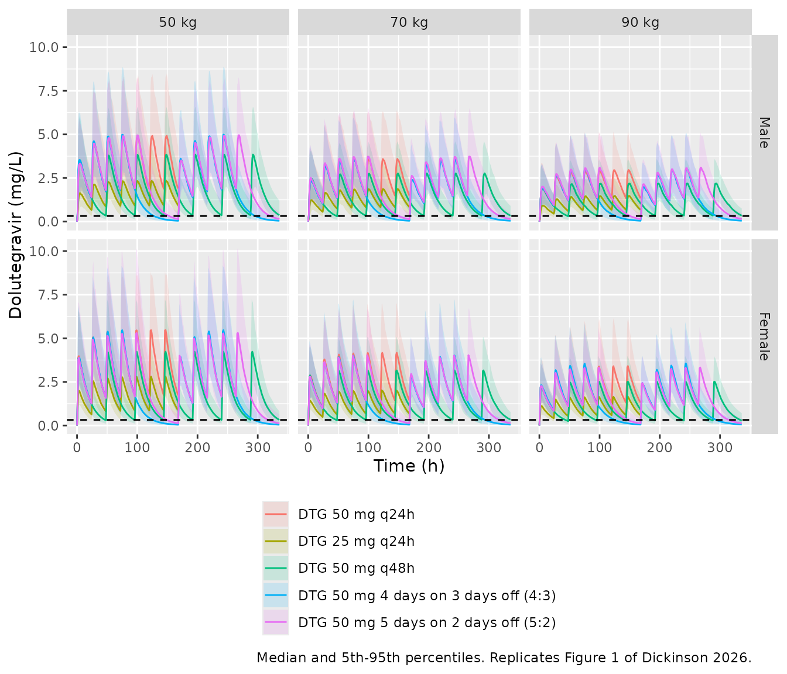
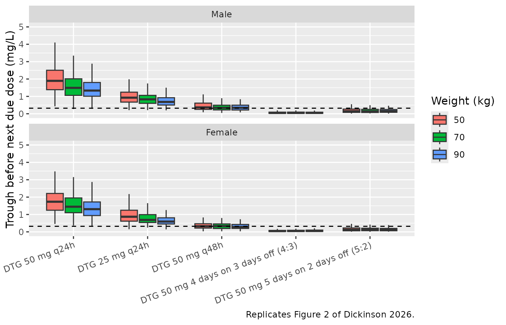

# Dolutegravir (Dickinson 2026)

## Model and source

- Citation: Dickinson L, Else L, Venter WDF, Boffito M, Brand R, Waitt
  C, Hill A, Khoo S. A model-based comparison of dose reduction
  strategies for fixed-dose dolutegravir-containing regimens. J
  Antimicrob Chemother. 2026;81(1):dkaf445. <doi:10.1093/jac/dkaf445>.
  Structure adapted from Kawuma AN, Wasmann RE, Dooley KE, Boffito M,
  Maartens G, Denti P. Population pharmacokinetic model and alternative
  dosing regimens for dolutegravir coadministered with rifampicin.
  Antimicrob Agents Chemother. 2022;66(6):e00215-22.
  <doi:10.1128/aac.00215-22>; every parameter VALUE below is from the
  2026 paper’s own Table 2.
- Description: Two-compartment population PK model for oral dolutegravir
  with lagged first-order absorption in healthy volunteers dosed to
  steady state and followed through drug washout, with allometric weight
  scaling and a lower absorption rate constant in men; developed to
  compare dose-reduction strategies for fixed-dose
  tenofovir-lamivudine-dolutegravir
- Article: <https://doi.org/10.1093/jac/dkaf445>
- Structural predecessor (fed lag time, random-effect layout,
  residual-error form): Kawuma 2022,
  <https://doi.org/10.1128/aac.00215-22>; see also
  `modellib("Kawuma_2023_dolutegravir")`.

Countries facing a shortage of fixed-dose tenofovir
disoproxil-lamivudine- dolutegravir (TLD) may need to stretch supplies.
Dickinson et al. re-estimated the Kawuma dolutegravir model on three
healthy-volunteer studies, two of which followed concentrations for 10
and 14 days after the last dose, so the model describes the washout that
matters when doses are skipped. The model was then used to compare the
standard regimen (50 mg once daily) with four dose-reduction strategies:
half a tablet daily (25 mg), one tablet every other day, 4 days on / 3
days off (4:3) and 5 days on / 2 days off (5:2). The pharmacodynamic
yardstick is the dolutegravir EC90 of 320 ng/mL (0.32 mg/L) from the
SPRING-1 dose-ranging study.

## Population

``` r

mod_meta <- rxode2::rxode(readModelDb("Dickinson_2026_dolutegravir"))
#> ℹ parameter labels from comments will be replaced by 'label()'
#> Warning: some etas defaulted to non-mu referenced, possible parsing error: etaiov_fdepot_1, etaiov_fdepot_2, etaiov_fdepot_3, etaiov_fdepot_4
#> as a work-around try putting the mu-referenced expression on a simple line
str(mod_meta$population)
#> List of 14
#>  $ species       : chr "human"
#>  $ n_subjects    : int 73
#>  $ n_studies     : int 3
#>  $ n_observations: int 825
#>  $ age_median    : chr "33.3 years"
#>  $ age_range     : chr "20.0-67.0 years"
#>  $ weight_median : chr "64.4 kg"
#>  $ weight_range  : chr "41.5-97.5 kg"
#>  $ sex_female_pct: num 60.3
#>  $ race_ethnicity: Named num [1:3] 46.6 49.3 4.1
#>   ..- attr(*, "names")= chr [1:3] "White" "Black" "Asian"
#>  $ disease_state : chr "healthy HIV-negative volunteers"
#>  $ dose_range    : chr "dolutegravir 50 mg once daily to steady state (6-15 days), alone or with emtricitabine/tenofovir alafenamide or"| __truncated__
#>  $ regions       : chr "United States (Pittsburgh), United Kingdom (London) and Uganda (Kampala)"
#>  $ notes         : chr "Pooled from three studies (Table 1): Pittsburgh NCT04302896 (n = 30, 14-day washout after day-15 final dose), S"| __truncated__
```

Seventy-three healthy HIV-negative adults (60.3% female; 49.3% Black,
46.6% White, 4.1% Asian) contributed 825 plasma concentrations (Table
1): Pittsburgh (NCT04302896, n = 30, 15 days of dosing then 14 days of
washout), SSAT061 (NCT02219217, n = 17, 10 days of dosing then 9 days of
washout) and DolACT (NCT02242799, n = 26, dolutegravir-alone period,
24-h steady-state profile). Median age was 33.3 years (range 20-67) and
median weight 64.4 kg (range 41.5-97.5). All doses were taken with food.

## Source trace

| Model element | Value | Source |
|----|----|----|
| Structure: two compartments, lagged first-order absorption | – | Methods ‘Pharmacokinetic modelling’; Figure S1 |
| `lcl` (CL/F) | 0.787 L/h | Table 2 |
| `lvc` (Vc/F) | 15.0 L | Table 2 |
| `lq` (Q/F) | 0.0093 L/h | Table 2 |
| `lvp` (Vp/F) | 0.671 L | Table 2 |
| `lka` (ka, female) | 2.58 1/h | Table 2; Results (‘0.71 versus 2.58 h-1’) |
| `ltlag` (lag time) | 0.836 h | Table 2 |
| `lfdepot` (relative F) | 1 fixed | Table 2 |
| `e_wt_cl` (weight on CL/F and Q/F) | 0.75 fixed | Table 2, footnote b |
| `e_wt_vc` (weight on Vc/F and Vp/F) | 1 fixed | Table 2, footnote b |
| Reference weight | 70 kg (assumed) | Not printed; see Assumptions |
| `e_sexf_ka` (male:female ka ratio) | 0.274 | Table 2 ‘Male sex on ka’; Results (‘72.6% lower’) |
| `etalcl` | log(1 + 0.215^2) | Table 2 ‘IIV CL/F’ 21.5% |
| `etalka` | log(1 + 1.36^2) | Table 2 ‘IIV ka’ 136% |
| `etaiov_fdepot_1..4` | log(1 + 0.303^2) | Table 2 ‘IOV F’ 30.3% |
| `propSd` | 0.223 | Table 2 ‘Proportional’ 22.3% |
| `addSd` | 0.0013 mg/L | Table 2 ‘Additive’ |
| EC90 | 0.32 mg/L | Methods ‘Simulations’ |

## Virtual cohort and simulation design

The paper simulated 1000 individuals at each of 50, 70 and 90 kg,
separately for men and women, under five regimens (Methods
‘Simulations’). Here each of the 30 regimen x sex x weight arms has 200
subjects. Trough timing follows the paper exactly: 24 h after dose 7 (50
mg and 25 mg daily, 7 doses), 48 h after dose 7 (50 mg every other day),
96 h after dose 8 (4:3, 8 doses) and 72 h after dose 10 (5:2, 10 doses).
Every trough therefore falls at 336 h except the two daily regimens (168
h).

Between-occasion variability on bioavailability is simulated as a single
draw per subject (`OCC = 1` on every record). The paper does not say how
occasions were assigned in its simulations; with this choice the
simulated proportions and medians land on the published ones (below).

``` r

regimens <- tibble::tribble(
  ~regimen, ~label,                                 ~amt, ~dose_days,                 ~trough,
  "std",    "DTG 50 mg q24h",                        50,  list(0:6),                   168,
  "half",   "DTG 25 mg q24h",                        25,  list(0:6),                   168,
  "q48",    "DTG 50 mg q48h",                        50,  list(seq(0, 12, by = 2)),    336,
  "r43",    "DTG 50 mg 4 days on 3 days off (4:3)",  50,  list(c(0:3, 7:10)),          336,
  "r52",    "DTG 50 mg 5 days on 2 days off (5:2)",  50,  list(c(0:4, 7:11)),          336
) |>
  mutate(
    dose_times = lapply(dose_days, function(d) unlist(d) * 24),
    last_dose = vapply(dose_times, max, numeric(1))
  )

n_per_arm <- 200
arms <- tidyr::expand_grid(regimen = regimens$regimen, SEXF = c(0, 1), WT = c(50, 70, 90)) |>
  mutate(arm = row_number())

make_arm_events <- function(arm_row) {
  reg <- regimens[regimens$regimen == arm_row$regimen, ]
  ids <- (arm_row$arm - 1) * n_per_arm + seq_len(n_per_arm)
  dose_times <- reg$dose_times[[1]]
  # 1-h grid for the profiles, 0.25-h grid over the final dosing interval for
  # the time below the EC90.
  obs_times <- sort(unique(c(
    seq(0, reg$trough, by = 1),
    seq(reg$last_dose, reg$trough, by = 0.25)
  )))
  dose <- tidyr::expand_grid(id = ids, time = dose_times) |>
    mutate(amt = reg$amt, evid = 1L, cmt = "depot")
  obs <- tidyr::expand_grid(id = ids, time = obs_times) |>
    mutate(amt = 0, evid = 0L, cmt = "central")
  bind_rows(dose, obs) |>
    mutate(
      regimen = arm_row$regimen, SEXF = arm_row$SEXF, WT = arm_row$WT,
      OCC = 1L, last_dose = reg$last_dose, trough = reg$trough
    )
}

events <- bind_rows(lapply(seq_len(nrow(arms)), function(i) make_arm_events(arms[i, ]))) |>
  arrange(id, time, desc(evid))
length(unique(events$id))
#> [1] 6000
```

``` r

mod <- readModelDb("Dickinson_2026_dolutegravir")
rxode2::rxSetSeed(20260111)
sim <- rxode2::rxSolve(
  mod, events,
  keep = c("regimen", "SEXF", "WT", "last_dose", "trough"),
  returnType = "data.frame"
) |>
  left_join(regimens |> select(regimen, label), by = "regimen") |>
  mutate(
    sex = factor(ifelse(SEXF == 1, "Female", "Male"), levels = c("Male", "Female")),
    label = factor(label, levels = regimens$label)
  )
#> ℹ parameter labels from comments will be replaced by 'label()'
#> Warning: some etas defaulted to non-mu referenced, possible parsing error: etaiov_fdepot_1, etaiov_fdepot_2, etaiov_fdepot_3, etaiov_fdepot_4
#> as a work-around try putting the mu-referenced expression on a simple line
```

## Replicate Figure 1: simulated profiles

``` r

fig1 <- sim |>
  filter(time == round(time)) |>
  group_by(label, sex, WT, time) |>
  summarise(
    p05 = quantile(Cc, 0.05), p50 = median(Cc), p95 = quantile(Cc, 0.95),
    .groups = "drop"
  )
ggplot(fig1, aes(time, p50, colour = label, fill = label)) +
  geom_ribbon(aes(ymin = p05, ymax = p95), alpha = 0.15, colour = NA) +
  geom_line() +
  geom_hline(yintercept = 0.32, linetype = "dashed") +
  facet_grid(sex ~ WT, labeller = labeller(WT = function(x) paste(x, "kg"))) +
  labs(
    x = "Time (h)", y = "Dolutegravir (mg/L)", colour = NULL, fill = NULL,
    caption = "Median and 5th-95th percentiles. Replicates Figure 1 of Dickinson 2026."
  ) +
  theme(legend.position = "bottom", legend.direction = "vertical")
```



The paper’s Figure 1 does not state its percentiles; the 5th-95th
percentile band is used here.

## Replicate Figure 2 and Table 3: troughs and target attainment

``` r

troughs <- sim |>
  filter(time == trough)

ggplot(troughs, aes(label, Cc, fill = factor(WT))) +
  geom_boxplot(outlier.shape = NA) +
  geom_hline(yintercept = 0.32, linetype = "dashed") +
  facet_wrap(~sex, ncol = 1) +
  coord_cartesian(ylim = c(0, 5)) +
  labs(
    x = NULL, y = "Trough before next due dose (mg/L)", fill = "Weight (kg)",
    caption = "Replicates Figure 2 of Dickinson 2026."
  ) +
  theme(axis.text.x = element_text(angle = 20, hjust = 1))
```



Time below the EC90 is measured, as in the paper, over the final
interval: from the first time after the last dose’s peak that the
concentration falls below 0.32 mg/L, to the trough. It is summarised
over the subjects whose trough is below the EC90.

``` r

final_interval <- sim |>
  filter(time >= last_dose) |>
  group_by(id) |>
  mutate(after_peak = time >= time[which.max(Cc)]) |>
  summarise(
    regimen = first(regimen), label = first(label), sex = first(sex), WT = first(WT),
    trough_conc = Cc[time == first(trough)],
    t_cross = suppressWarnings(min(time[after_peak & Cc < 0.32])),
    trough = first(trough),
    .groups = "drop"
  ) |>
  mutate(time_below = ifelse(trough_conc < 0.32, trough - t_cross, NA_real_))

sim_tab3 <- final_interval |>
  group_by(regimen, label, sex, WT) |>
  summarise(
    sim_pct_above = 100 * mean(trough_conc > 0.32),
    sim_median_time_below = median(time_below, na.rm = TRUE),
    .groups = "drop"
  )

# Dickinson 2026 Table 3: proportion of troughs above the EC90 (%) and median
# time below the EC90 (h); n = 1000 per arm.
paper_tab3 <- tibble::tribble(
  ~regimen, ~sex,     ~WT, ~paper_pct_above, ~paper_median_time_below,
  "std",    "Male",   50,  99.8,  NA,
  "std",    "Male",   70,  99.7,  NA,
  "std",    "Male",   90,  99.1,  NA,
  "half",   "Male",   50,  97.3,  1.99,
  "half",   "Male",   70,  94.9,  2.61,
  "half",   "Male",   90,  91.1,  2.45,
  "q48",    "Male",   50,  62.1,  6.92,
  "q48",    "Male",   70,  55.7,  7.11,
  "q48",    "Male",   90,  48.9,  8.58,
  "r43",    "Male",   50,  5.2,   40.31,
  "r43",    "Male",   70,  2.8,   41.69,
  "r43",    "Male",   90,  3.2,   42.63,
  "r52",    "Male",   50,  20.7,  19.56,
  "r52",    "Male",   70,  18.3,  21.07,
  "r52",    "Male",   90,  18.5,  20.26,
  "std",    "Female", 50,  99.8,  NA,
  "std",    "Female", 70,  99.3,  NA,
  "std",    "Female", 90,  98.7,  NA,
  "half",   "Female", 50,  95.6,  2.50,
  "half",   "Female", 70,  93.1,  2.57,
  "half",   "Female", 90,  88.7,  3.35,
  "q48",    "Female", 50,  55.8,  7.35,
  "q48",    "Female", 70,  48.5,  7.74,
  "q48",    "Female", 90,  41.6,  9.64,
  "r43",    "Female", 50,  2.5,   42.29,
  "r43",    "Female", 70,  1.5,   43.43,
  "r43",    "Female", 90,  2.0,   45.14,
  "r52",    "Female", 50,  15.3,  20.84,
  "r52",    "Female", 70,  14.1,  22.29,
  "r52",    "Female", 90,  14.6,  22.11
)

tab3 <- sim_tab3 |>
  mutate(sex = as.character(sex)) |>
  left_join(paper_tab3, by = c("regimen", "sex", "WT")) |>
  arrange(sex, label, WT)

tab3 |>
  transmute(
    Sex = sex, Regimen = label, `Weight (kg)` = WT,
    `Above EC90, paper (%)` = paper_pct_above,
    `Above EC90, simulated (%)` = round(sim_pct_above, 1),
    `Median time below, paper (h)` = paper_median_time_below,
    `Median time below, simulated (h)` = round(sim_median_time_below, 2)
  ) |>
  knitr::kable(caption = "Replicates Table 3 of Dickinson 2026 (200 simulated subjects per arm here, 1000 in the paper).")
```

| Sex | Regimen | Weight (kg) | Above EC90, paper (%) | Above EC90, simulated (%) | Median time below, paper (h) | Median time below, simulated (h) |
|:---|:---|---:|---:|---:|---:|---:|
| Female | DTG 50 mg q24h | 50 | 99.8 | 100.0 | NA | NA |
| Female | DTG 50 mg q24h | 70 | 99.3 | 100.0 | NA | NA |
| Female | DTG 50 mg q24h | 90 | 98.7 | 100.0 | NA | NA |
| Female | DTG 25 mg q24h | 50 | 95.6 | 96.0 | 2.50 | 3.88 |
| Female | DTG 25 mg q24h | 70 | 93.1 | 96.5 | 2.57 | 1.75 |
| Female | DTG 25 mg q24h | 90 | 88.7 | 95.0 | 3.35 | 3.50 |
| Female | DTG 50 mg q48h | 50 | 55.8 | 51.0 | 7.35 | 6.25 |
| Female | DTG 50 mg q48h | 70 | 48.5 | 51.0 | 7.74 | 8.38 |
| Female | DTG 50 mg q48h | 90 | 41.6 | 41.5 | 9.64 | 7.75 |
| Female | DTG 50 mg 4 days on 3 days off (4:3) | 50 | 2.5 | 3.0 | 42.29 | 42.88 |
| Female | DTG 50 mg 4 days on 3 days off (4:3) | 70 | 1.5 | 2.0 | 43.43 | 42.62 |
| Female | DTG 50 mg 4 days on 3 days off (4:3) | 90 | 2.0 | 1.5 | 45.14 | 43.25 |
| Female | DTG 50 mg 5 days on 2 days off (5:2) | 50 | 15.3 | 15.5 | 20.84 | 21.50 |
| Female | DTG 50 mg 5 days on 2 days off (5:2) | 70 | 14.1 | 10.0 | 22.29 | 19.75 |
| Female | DTG 50 mg 5 days on 2 days off (5:2) | 90 | 14.6 | 9.0 | 22.11 | 23.25 |
| Male | DTG 50 mg q24h | 50 | 99.8 | 100.0 | NA | NA |
| Male | DTG 50 mg q24h | 70 | 99.7 | 99.5 | NA | 2.00 |
| Male | DTG 50 mg q24h | 90 | 99.1 | 99.5 | NA | 1.25 |
| Male | DTG 25 mg q24h | 50 | 97.3 | 97.5 | 1.99 | 0.75 |
| Male | DTG 25 mg q24h | 70 | 94.9 | 96.5 | 2.61 | 1.75 |
| Male | DTG 25 mg q24h | 90 | 91.1 | 95.0 | 2.45 | 2.00 |
| Male | DTG 50 mg q48h | 50 | 62.1 | 60.0 | 6.92 | 5.50 |
| Male | DTG 50 mg q48h | 70 | 55.7 | 54.0 | 7.11 | 7.00 |
| Male | DTG 50 mg q48h | 90 | 48.9 | 56.0 | 8.58 | 8.75 |
| Male | DTG 50 mg 4 days on 3 days off (4:3) | 50 | 5.2 | 2.0 | 40.31 | 40.50 |
| Male | DTG 50 mg 4 days on 3 days off (4:3) | 70 | 2.8 | 2.0 | 41.69 | 41.88 |
| Male | DTG 50 mg 4 days on 3 days off (4:3) | 90 | 3.2 | 2.0 | 42.63 | 41.75 |
| Male | DTG 50 mg 5 days on 2 days off (5:2) | 50 | 20.7 | 18.0 | 19.56 | 18.12 |
| Male | DTG 50 mg 5 days on 2 days off (5:2) | 70 | 18.3 | 17.5 | 21.07 | 20.75 |
| Male | DTG 50 mg 5 days on 2 days off (5:2) | 90 | 18.5 | 17.0 | 20.26 | 20.00 |

Replicates Table 3 of Dickinson 2026 (200 simulated subjects per arm
here, 1000 in the paper). {.table}

With 200 subjects per arm the Monte-Carlo standard error of a proportion
near 50% is about 3.5 percentage points, so the comparison pools the six
sex x weight arms of each regimen (1200 subjects, standard error about
1.4 points) and checks the per-arm differences only on their median.

``` r

pooled <- tab3 |>
  group_by(regimen) |>
  summarise(
    sim = mean(sim_pct_above), paper = mean(paper_pct_above),
    .groups = "drop"
  ) |>
  mutate(diff = sim - paper)
knitr::kable(pooled, digits = 1, caption = "Mean proportion above the EC90 (%) over the six sex x weight arms of each regimen.")
```

| regimen |  sim | paper | diff |
|:--------|-----:|------:|-----:|
| half    | 96.1 |  93.4 |  2.6 |
| q48     | 52.2 |  52.1 |  0.1 |
| r43     |  2.1 |   2.9 | -0.8 |
| r52     | 14.5 |  16.9 | -2.4 |
| std     | 99.8 |  99.4 |  0.4 |

Mean proportion above the EC90 (%) over the six sex x weight arms of
each regimen. {.table}

``` r


time_below_check <- tab3 |>
  filter(regimen %in% c("q48", "r43", "r52")) |>
  mutate(pct_diff = 100 * (sim_median_time_below / paper_median_time_below - 1))

stopifnot(
  # A mis-transcribed CL/F, F or allometric exponent shifts the pooled
  # attainment of the every-other-day regimen (near 50%) by tens of points.
  all(abs(pooled$diff) < 6),
  median(abs(tab3$sim_pct_above - tab3$paper_pct_above)) < 4,
  # Time below the target is set by the elimination half-life over the
  # skipped days; the centre of the per-arm differences is checked.
  abs(median(time_below_check$pct_diff)) < 10
)
```

The paper’s Results also quote one percentile summary directly: the
trough at the end of three days off the 4:3 regimen in a 70 kg man has
median 47 ng/mL (P10-P90 11-183 ng/mL).

``` r

r43_m70 <- final_interval |>
  filter(regimen == "r43", sex == "Male", WT == 70) |>
  summarise(
    p10 = quantile(trough_conc, 0.10) * 1000,
    median = median(trough_conc) * 1000,
    p90 = quantile(trough_conc, 0.90) * 1000
  )
knitr::kable(
  bind_rows(
    tibble::tibble(source = "Dickinson 2026 (Discussion)", p10 = 11, median = 47, p90 = 183),
    r43_m70 |> mutate(source = "Simulated", .before = 1)
  ),
  digits = 1, caption = "4:3 trough (ng/mL), 70 kg man"
)
```

| source                      |  p10 | median |   p90 |
|:----------------------------|-----:|-------:|------:|
| Dickinson 2026 (Discussion) | 11.0 |     47 | 183.0 |
| Simulated                   | 13.3 |     48 | 153.4 |

4:3 trough (ng/mL), 70 kg man {.table}

``` r

stopifnot(abs(r43_m70$median / 47 - 1) < 0.3)
```

## PKNCA validation

Steady-state NCA over the seventh daily dosing interval (144-168 h) of
the two daily regimens. The paper reports no NCA, so the check is
against the model’s own closed form: at steady state AUC over one dosing
interval equals F x Dose / (CL/F), and with F fixed at 1 the median over
subjects is the dose divided by the typical CL/F,
`0.787 * (WT / 70)^0.75`.

``` r

nca_conc <- sim |>
  filter(regimen %in% c("std", "half"), time >= 144, time <= 168, time == round(time)) |>
  mutate(treatment = paste(regimen, sex, WT, sep = "_")) |>
  select(id, time, Cc, treatment, regimen, sex, WT) |>
  filter(!is.na(Cc))
# Guarantee the time = 144 h (start of interval) record per subject.
nca_conc <- bind_rows(
  nca_conc,
  nca_conc |> group_by(id, treatment) |> slice_min(time, n = 1) |> ungroup() |> mutate(time = 144)
) |>
  distinct(id, treatment, time, .keep_all = TRUE) |>
  arrange(id, time)

nca_dose <- sim |>
  filter(regimen %in% c("std", "half")) |>
  distinct(id, regimen, sex, WT) |>
  left_join(regimens |> select(regimen, amt), by = "regimen") |>
  mutate(treatment = paste(regimen, sex, WT, sep = "_"), time = 144) |>
  select(id, time, amt, treatment)

conc_obj <- PKNCA::PKNCAconc(nca_conc, Cc ~ time | treatment + id)
dose_obj <- PKNCA::PKNCAdose(nca_dose, amt ~ time | treatment + id)
intervals <- data.frame(start = 144, end = 168, cmax = TRUE, tmax = TRUE, cmin = TRUE, auclast = TRUE)
nca_res <- PKNCA::pk.nca(PKNCA::PKNCAdata(conc_obj, dose_obj, intervals = intervals))

nca_summary <- as.data.frame(nca_res$result) |>
  filter(PPTESTCD %in% c("auclast", "cmax", "cmin", "tmax")) |>
  tidyr::separate(treatment, into = c("regimen", "sex", "WT"), sep = "_") |>
  mutate(WT = as.numeric(WT)) |>
  group_by(regimen, sex, WT, PPTESTCD) |>
  summarise(median = median(PPORRES), .groups = "drop") |>
  tidyr::pivot_wider(names_from = PPTESTCD, values_from = median) |>
  left_join(regimens |> select(regimen, amt), by = "regimen") |>
  mutate(
    auc_closed_form = amt / (0.787 * (WT / 70)^0.75),
    pct_diff = 100 * (auclast / auc_closed_form - 1)
  )

nca_summary |>
  arrange(regimen, sex, WT) |>
  select(-amt) |>
  dplyr::rename(
    Regimen = regimen, Sex = sex, `Weight (kg)` = WT,
    `AUC0-24 (mg*h/L)` = auclast, `Cmax (mg/L)` = cmax, `Cmin (mg/L)` = cmin,
    `Tmax (h)` = tmax, `Dose/CL (mg*h/L)` = auc_closed_form, `Difference (%)` = pct_diff
  ) |>
  knitr::kable(digits = 2, caption = "Median steady-state NCA, day 7 of daily dosing")
```

| Regimen | Sex | Weight (kg) | AUC0-24 (mg\*h/L) | Cmax (mg/L) | Cmin (mg/L) | Tmax (h) | Dose/CL (mg\*h/L) | Difference (%) |
|:---|:---|---:|---:|---:|---:|---:|---:|---:|
| half | Female | 50 | 41.69 | 2.89 | 0.87 | 2.0 | 40.88 | 1.96 |
| half | Female | 70 | 30.97 | 2.07 | 0.69 | 2.0 | 31.77 | -2.51 |
| half | Female | 90 | 26.05 | 1.71 | 0.59 | 2.0 | 26.31 | -1.00 |
| half | Male | 50 | 39.83 | 2.40 | 0.92 | 4.0 | 40.88 | -2.59 |
| half | Male | 70 | 32.95 | 1.92 | 0.83 | 5.0 | 31.77 | 3.73 |
| half | Male | 90 | 26.22 | 1.51 | 0.68 | 5.0 | 26.31 | -0.35 |
| std | Female | 50 | 81.85 | 5.61 | 1.73 | 2.0 | 81.77 | 0.10 |
| std | Female | 70 | 64.87 | 4.39 | 1.44 | 2.0 | 63.53 | 2.11 |
| std | Female | 90 | 54.08 | 3.50 | 1.30 | 2.0 | 52.62 | 2.77 |
| std | Male | 50 | 82.33 | 5.08 | 1.89 | 4.0 | 81.77 | 0.68 |
| std | Male | 70 | 61.57 | 3.74 | 1.49 | 4.5 | 63.53 | -3.09 |
| std | Male | 90 | 53.50 | 3.07 | 1.33 | 5.0 | 52.62 | 1.67 |

Median steady-state NCA, day 7 of daily dosing {.table}

``` r


stopifnot(
  # 1-h trapezoids overstate AUC slightly on the absorption peak, and the
  # seventh day is not quite at steady state for the small slow peripheral
  # compartment, so a 10% envelope on the median is used.
  abs(median(nca_summary$pct_diff)) < 10,
  all(abs(nca_summary$pct_diff) < 15)
)
```

## Assumptions and deviations

- **Reference weight.** The paper scales all four disposition parameters
  allometrically but does not print the reference weight. 70 kg is
  assumed, as in the Kawuma model the paper adapted. Referencing the
  typical values to the 64.4 kg cohort median instead would raise CL/F
  by about 6% at every weight. The Table 3 replication at 50, 70 and 90
  kg agrees with the paper under the 70 kg assumption.
- **Variability percentages.** Table 2 reports IIV and IOV as
  percentages without saying how they were derived from the variances.
  The log-normal conversion omega^2 = log(1 + CV^2) is used. For CL/F
  (21.5%) and F (30.3%) the alternative reading omega = CV changes the
  variance by less than 5%; for ka (136%) it would change it from 1.05
  to 1.85, which moves the peak but has little effect on the troughs
  this model was built to predict.
- **Occasions.** IOV on F is retained with a single variance; occasions
  are defined as in the Kawuma model (‘with the pre-dose being treated
  as a separate occasion’). Four occasion slots are encoded. The
  simulations here give each subject one F draw; per-dose redraws are
  possible by incrementing `OCC`.
- **Lag time.** All three studies dosed with food, so the single lag
  time of 0.836 h is a fed lag time; there is no fasted lag in this
  model.
- **BLQ handling.** The paper fitted below-LLQ concentrations with the
  M3 method; this has no bearing on simulation.
- **Not encoded.** The Kawuma 2022 rifampicin effect on clearance was
  not part of this re-estimation (no volunteer received rifampicin).
