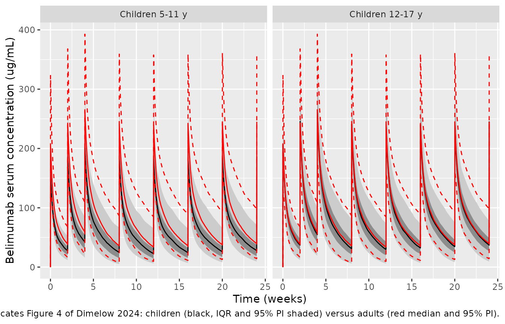
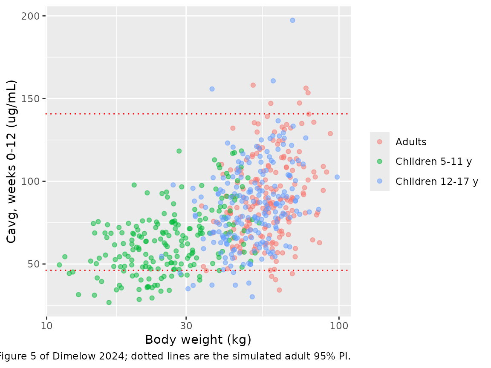

# Belimumab in paediatric lupus nephritis (Dimelow 2024)

## Model and source

Dimelow et al. (2024) extrapolated intravenous belimumab exposure from
adults with active lupus nephritis (LN) to children aged 5-17 years with
LN, to support a 10 mg/kg dose given on days 0, 14 and 28 and every 4
weeks thereafter. The pharmacokinetic engine is the adult LN population
PK model fitted to the BLISS-LN trial, which Dimelow 2024 cites to
Simeoni et al. (2024). Dimelow 2024 prints the model’s covariate
structure (Electronic Supplementary Material Section S5) but not its
estimates; those are in Simeoni 2024 Online Resource 7, so the packaged
model is named after that paper and this vignette reproduces the Dimelow
2024 paediatric extrapolation with it.

- Model: `Simeoni_2024_belimumab`
- Citation: Simeoni M, Yang S, Tompson DJ, Dimelow R. Longitudinal
  modeling of efficacy response in patients with lupus nephritis
  receiving belimumab. J Pharmacokinet Pharmacodyn. 2024;51(3):289-301.
  <doi:10.1007/s10928-024-09907-w> (PK model parameters: Online Resource
  7). Application: Dimelow R, Liefaard L, Green Y, Tomlinson R.
  Extrapolation of the Efficacy and Pharmacokinetics of Belimumab to
  Support its Use in Children with Lupus Nephritis. Clin Pharmacokinet.
  2024;63(9):1313-1326. <doi:10.1007/s40262-024-01422-y>
- Description: Linear two-compartment IV population PK model for
  belimumab in adults with active lupus nephritis (BLISS-LN), with
  baseline fat-free mass allometry on all disposition parameters and
  time-varying proteinuria (urine protein/creatinine ratio) and serum
  albumin on clearance (Simeoni 2024); used by Dimelow 2024 to
  extrapolate exposure to children aged 5-17 years with lupus nephritis
- Extrapolation article (Dimelow 2024):
  <https://doi.org/10.1007/s40262-024-01422-y>
- Parameter source (Simeoni 2024):
  <https://doi.org/10.1007/s10928-024-09907-w>

## Population

The model was fitted to the 224 adults with active, biopsy-confirmed LN
who received belimumab 10 mg/kg IV plus standard therapy in BLISS-LN
(BEL114054). In that arm (Simeoni 2024 Table 1) the median age was 31
years (18-63), median weight 59.0 kg (36.9-136.9), median baseline
fat-free mass (FFM) 38.1 kg (26.3-77.4), 88% were female and 51% Asian.
Disease activity was high at baseline: median urine protein/creatinine
ratio (uPCR) 2.61 g/g (0.18-16.57) and median serum albumin 31 g/L
(16-42). PK samples were taken on days 0, 3, 14, 28, 56, 168, 171, 364
and 728.

Dimelow 2024 applied the model unchanged to children with LN. Body
weight and body mass index (BMI) were sampled from NHANES for ages 5-17
years (90% female), scaled to 86% and 94% respectively so the
distributions matched children with SLE in the PLUTO study, and FFM was
computed with the Janmahasatian formula. Time courses of uPCR and
albumin were sampled from the adult BLISS-LN patients, on the basis that
baseline values and the response to standard therapy are similar in
adults and children with LN (Dimelow 2024 Table 2).

``` r

str(rxode2::rxode(readModelDb("Simeoni_2024_belimumab"))$population)
#> ℹ parameter labels from comments will be replaced by 'label()'
#> List of 16
#>  $ species       : chr "human"
#>  $ n_subjects    : num 224
#>  $ n_studies     : num 1
#>  $ age_range     : chr "18-63 years"
#>  $ age_median    : chr "31 years"
#>  $ weight_range  : chr "36.9-136.9 kg"
#>  $ weight_median : chr "59.0 kg"
#>  $ ffm_median    : chr "38.1 kg (range 26.3-77.4)"
#>  $ sex_female_pct: num 88
#>  $ race_ethnicity: chr "Asian 51%, White 33%, Black African ancestry 13%, American Indian 2%, multiple 1%"
#>  $ disease_state : chr "Active, biopsy-confirmed lupus nephritis (adults), on standard therapy (mycophenolate mofetil or cyclophosphami"| __truncated__
#>  $ dose_range    : chr "Belimumab 10 mg/kg IV on days 0, 14, 28 and every 28 days thereafter, for 104 weeks"
#>  $ regions       : chr "Multinational"
#>  $ renal_function: chr "Baseline eGFR median 99 (range 14-208) mL/min/1.73 m^2; uPCR median 2.61 (0.18-16.57) g/g; serum albumin median 31 (16-42) g/L"
#>  $ studies       : chr "BEL114054 (BLISS-LN; NCT01639339), belimumab arm"
#>  $ notes         : chr "Belimumab-arm demographics from Simeoni 2024 Table 1. PK samples on days 0, 3, 14, 28, 56, 168, 171, 364 and 72"| __truncated__
```

## Source trace

| Equation / parameter | Value | Source location |
|----|----|----|
| `lcl` (CL at FFM 38.4 kg, ALB 42 g/L, uPCR 0) | log(0.175 L/day) | Simeoni 2024 Online Resource 7: CL = 175 mL/day |
| `lvc` (V1) | log(2.728 L) | Online Resource 7: V1 = 2728 mL |
| `lq` (Q) | log(0.487 L/day) | Online Resource 7: Q = 487 mL/day |
| `lvp` (V2) | log(1.992 L) | Online Resource 7: V2 = 1992 mL |
| `e_ffm_cl` (FFM exponent on CL and Q) | 0.624 | Online Resource 7 (Q row: ‘See FFMBL on CL’) |
| `e_ffm_vc` (FFM exponent on V1 and V2) | 0.723 | Online Resource 7 (V2 row: ‘See FFMBL on V1’) |
| `e_alb_cl` (theta1, albumin exponent) | -1.74 | Online Resource 7 |
| `e_upcr_alb_cl` (theta2, attenuation by uPCR) | 0.0832 | Online Resource 7 |
| `e_upcr_cl` (linear uPCR effect on CL) | 0.0663 | Online Resource 7 |
| `etalcl`, `etalvc`, `etalvp` | 0.0593, 0.0322, 0.133 | Online Resource 7 (omega^2; CV 24.7%, 18.1%, 37.7%) |
| `etapropSd` (IIV on the proportional error) | 0.346 | Online Resource 7 (omega^2 PROP; CV 64.3%) |
| `propSd` | 0.241 | Online Resource 7 (PROP) |
| `addSd` | 0.1 mg/L, fixed | Online Resource 7 (ADD = 0.1 ug/mL, Fixed) |
| CL = CL_pop (FFM/38.4)^0.624 (ALB/42)^(theta1/(1 + theta2 uPCR)) (1 + theta uPCR) | n/a | Online Resource 7; Dimelow 2024 ESM Section S5 |
| V1, V2 ~ (FFM/38.4)^0.723; Q ~ (FFM/38.4)^0.624 | n/a | Online Resource 7; Dimelow 2024 ESM Section S5 |
| Two-compartment model, first-order distribution and elimination | n/a | Simeoni 2024 Online Resource 1; Dimelow 2024 Methods |
| Reference FFM 38.4 kg = BLISS-LN median over both arms (N = 448) | n/a | Simeoni 2024 Table 1, ‘Overall’ column |

## Virtual cohort

The individual BLISS-LN covariate records are not public, so the cohorts
below approximate them from published summaries.

- **Children (5-11 and 12-17 years).** Ages are uniform within each
  band. Median weight and BMI by year of age were digitised by the
  maintainers from the corrected NHANES sample in Dimelow 2024 Figure
  2b; between-subject spread is log-normal (SD 0.22 on log weight, 0.18
  on log BMI, correlation 0.8), chosen to cover the Figure 2b 95%
  prediction bands. 90% are female.
- **Adults.** Weight is log-normal around the BLISS-LN belimumab-arm
  median of 59 kg; BMI around an assumed 23 kg/m^2 (BLISS-LN BMI is not
  published); 88% female. FFM from the Janmahasatian formula then lands
  near the reported 38.1 kg median, which is checked below.
- **Proteinuria and albumin, all cohorts.** Baseline uPCR is log-normal
  around 2.6 g/g (Simeoni 2024 Table 1) and baseline albumin normal
  around 31 g/L, negatively correlated with uPCR. Each subject’s uPCR
  then falls as `uPCR0 * (0.14 + 0.86 exp(-k t))` and albumin rises
  towards 40.5 g/L. The recovery rates were set so that the cohort
  medians pass through the BLISS-LN values of Dimelow 2024 Table 2 (uPCR
  medians 2.47, 0.73 and 0.44 g/g and albumin medians 31, 38 and 40 g/L
  at baseline, 6 and 12 months).

``` r

set.seed(20241001)
rxode2::rxSetSeed(20241001)

n_per_arm <- 200

# Dimelow 2024 Figure 2b: corrected NHANES median weight (kg) and BMI (kg/m^2)
# by age, digitised.
growth <- tibble::tribble(
  ~age, ~wt_med, ~bmi_med,
  5,    17.0,    15.3,
  6,    19.0,    15.3,
  7,    21.5,    15.8,
  8,    24.5,    16.5,
  9,    27.0,    17.0,
  10,   31.0,    18.0,
  11,   37.0,    19.0,
  12,   41.0,    20.0,
  13,   45.0,    20.5,
  14,   46.0,    21.0,
  15,   52.0,    22.0,
  16,   53.0,    22.0,
  17,   55.0,    22.5
)

# Janmahasatian et al. 2005 fat-free mass (Dimelow 2024 ref. 25), vectorised
# over sex.
ffm_janmahasatian <- function(wt, bmi, sexf) {
  ifelse(
    sexf == 1,
    9270 * wt / (8780 + 244 * bmi),
    9270 * wt / (6680 + 216 * bmi)
  )
}

make_subjects <- function(n, cohort, id_offset, age_lo = NA, age_hi = NA) {
  z_wt <- rnorm(n)
  z_bmi <- 0.8 * z_wt + 0.6 * rnorm(n)
  if (cohort == "Adults") {
    age <- NA_real_
    wt <- 59 * exp(0.22 * z_wt)
    bmi <- 23 * exp(0.18 * z_bmi)
    sexf <- rbinom(n, 1, 0.88)
  } else {
    age <- runif(n, age_lo, age_hi + 1)
    wt <- approx(growth$age, growth$wt_med, xout = age, rule = 2)$y *
      exp(0.22 * z_wt)
    bmi <- approx(growth$age, growth$bmi_med, xout = age, rule = 2)$y *
      exp(0.18 * z_bmi)
    sexf <- rbinom(n, 1, 0.9)
  }
  z_upcr <- rnorm(n)
  z_rec <- rnorm(n)
  tibble(
    id = id_offset + seq_len(n),
    cohort = cohort,
    age = age,
    WT = wt,
    BMI = bmi,
    SEXF = sexf,
    FFM = ffm_janmahasatian(wt, bmi, sexf),
    upcr0 = pmin(pmax(2.6 * exp(0.8 * z_upcr), 0.15), 17),
    alb0 = pmin(pmax(31 + 5 * (-0.5 * z_upcr + sqrt(0.75) * rnorm(n)), 14), 43),
    k_upcr = 0.0092 * exp(0.5 * z_rec),
    k_alb = 0.0073 * exp(0.5 * z_rec)
  )
}

subjects <- bind_rows(
  make_subjects(n_per_arm, "Adults", 0L),
  make_subjects(n_per_arm, "Children 5-11 y", n_per_arm, 5, 11),
  make_subjects(n_per_arm, "Children 12-17 y", 2L * n_per_arm, 12, 17)
) |>
  mutate(cohort = factor(cohort, levels = c("Adults", "Children 5-11 y", "Children 12-17 y")))

# 10 mg/kg as a 1-hour infusion on days 0, 14, 28 and every 28 days after.
dose_times <- c(0, 14, 28, seq(56, 168, by = 28))
inf_dur <- 1 / 24
obs_times <- sort(unique(c(seq(0, 168, by = 1), dose_times + inf_dur)))

doses <- subjects |>
  tidyr::expand_grid(time = dose_times) |>
  mutate(evid = 1L, amt = 10 * WT, rate = amt / inf_dur)
obs <- subjects |>
  tidyr::expand_grid(time = obs_times) |>
  mutate(evid = 0L, amt = 0, rate = 0)

events <- bind_rows(doses, obs) |>
  mutate(
    cmt = "central",
    UPCR = upcr0 * (0.14 + 0.86 * exp(-k_upcr * time)),
    ALB = 40.5 - (40.5 - alb0) * exp(-k_alb * time)
  ) |>
  arrange(id, time, desc(evid)) |>
  select(id, time, evid, amt, rate, cmt, cohort, WT, FFM, ALB, UPCR)

# One dose row and one observation row at most per subject and time.
stopifnot(!anyDuplicated(events[, c("id", "time", "evid")]))
```

The simulated cohorts against the published body-size and disease
summaries:

``` r

subjects |>
  group_by(cohort) |>
  summarise(
    `Weight (kg)` = median(WT),
    `FFM (kg)` = median(FFM),
    `Baseline uPCR (g/g)` = median(upcr0),
    `Baseline albumin (g/L)` = median(alb0),
    .groups = "drop"
  ) |>
  knitr::kable(digits = 1, caption = "Median covariates by cohort.")
```

| cohort | Weight (kg) | FFM (kg) | Baseline uPCR (g/g) | Baseline albumin (g/L) |
|:---|---:|---:|---:|---:|
| Adults | 57.4 | 38.1 | 2.5 | 31.0 |
| Children 5-11 y | 26.0 | 19.0 | 2.8 | 30.9 |
| Children 12-17 y | 51.2 | 34.4 | 2.9 | 30.7 |

Median covariates by cohort. {.table}

Days 182 and 365 are outside the 24-week simulation grid, so the medians
at 6 and 12 months are evaluated directly from the recovery curves:

``` r

recovery <- subjects |>
  tidyr::expand_grid(time = c(0, 182, 365)) |>
  mutate(
    UPCR = upcr0 * (0.14 + 0.86 * exp(-k_upcr * time)),
    ALB = 40.5 - (40.5 - alb0) * exp(-k_alb * time)
  ) |>
  group_by(time) |>
  summarise(uPCR = median(UPCR), ALB = median(ALB), .groups = "drop")
knitr::kable(
  recovery,
  digits = 2,
  caption = "Cohort median uPCR (g/g) and albumin (g/L); BLISS-LN placebo medians in Dimelow 2024 Table 2 are 2.47 / 0.73 / 0.44 g/g and 31-32 / 38 / 40 g/L."
)
```

| time | uPCR |   ALB |
|-----:|-----:|------:|
|    0 | 2.70 | 30.94 |
|  182 | 0.85 | 38.16 |
|  365 | 0.52 | 39.91 |

Cohort median uPCR (g/g) and albumin (g/L); BLISS-LN placebo medians in
Dimelow 2024 Table 2 are 2.47 / 0.73 / 0.44 g/g and 31-32 / 38 / 40 g/L.
{.table}

``` r


adult_ffm <- median(subjects$FFM[subjects$cohort == "Adults"])
# The BLISS-LN belimumab arm median is 38.1 kg (Simeoni 2024 Table 1).
stopifnot(abs(adult_ffm / 38.1 - 1) < 0.10)
```

## Simulation

``` r

mod <- readModelDb("Simeoni_2024_belimumab")
sim <- rxode2::rxSolve(mod, events = events, keep = c("cohort", "WT")) |>
  as.data.frame()
#> ℹ parameter labels from comments will be replaced by 'label()'
```

## Replicate published figures

### Figure 4: concentration-time profiles

``` r

prof <- sim |>
  group_by(cohort, time) |>
  summarise(
    Q025 = quantile(Cc, 0.025),
    Q25 = quantile(Cc, 0.25),
    Q50 = median(Cc),
    Q75 = quantile(Cc, 0.75),
    Q975 = quantile(Cc, 0.975),
    .groups = "drop"
  )
adult_prof <- prof |>
  filter(cohort == "Adults") |>
  select(time, A50 = Q50, A025 = Q025, A975 = Q975)

prof |>
  filter(cohort != "Adults") |>
  left_join(adult_prof, by = "time") |>
  ggplot(aes(time / 7)) +
  geom_ribbon(aes(ymin = Q025, ymax = Q975), fill = "grey80") +
  geom_ribbon(aes(ymin = Q25, ymax = Q75), fill = "grey55") +
  geom_line(aes(y = Q50)) +
  geom_line(aes(y = A50), colour = "red") +
  geom_line(aes(y = A025), colour = "red", linetype = "dashed") +
  geom_line(aes(y = A975), colour = "red", linetype = "dashed") +
  facet_wrap(~cohort) +
  labs(
    x = "Time (weeks)", y = "Belimumab serum concentration (ug/mL)",
    caption = paste(
      "Replicates Figure 4 of Dimelow 2024: children (black, IQR and 95% PI shaded)",
      "versus adults (red median and 95% PI)."
    )
  )
```



### Figure 5: average concentration versus body weight

``` r

sim_nca <- sim |>
  filter(!is.na(Cc)) |>
  select(id, cohort, time, Cc)

conc_obj <- PKNCA::PKNCAconc(sim_nca, Cc ~ time | cohort + id)
dose_obj <- PKNCA::PKNCAdose(
  events |> filter(evid == 1) |> select(id, cohort, time, amt),
  amt ~ time | cohort + id
)
# Cmin (week N) is the pre-dose concentration at day 7N; its interval starts
# one day after the previous dose so the earlier trough is excluded.
intervals <- data.frame(
  start = c(0, 0, 56, 140, 57, 141),
  end = c(84, 168, 84, 168, 84, 168),
  cav = c(TRUE, TRUE, FALSE, FALSE, FALSE, FALSE),
  cmax = c(FALSE, FALSE, TRUE, TRUE, FALSE, FALSE),
  cmin = c(FALSE, FALSE, FALSE, FALSE, TRUE, TRUE)
)
nca_res <- PKNCA::pk.nca(PKNCA::PKNCAdata(conc_obj, dose_obj, intervals = intervals))

nca_long <- as.data.frame(nca_res) |>
  filter(PPTESTCD %in% c("cav", "cmax", "cmin")) |>
  mutate(
    window = case_when(
      PPTESTCD == "cav" & end == 84 ~ "Cavg (week 0-12)",
      PPTESTCD == "cav" & end == 168 ~ "Cavg (week 0-24)",
      PPTESTCD == "cmin" & end == 84 ~ "Cmin (week 12)",
      PPTESTCD == "cmin" & end == 168 ~ "Cmin (week 24)",
      PPTESTCD == "cmax" & end == 84 ~ "Cmax (week 8-12)",
      PPTESTCD == "cmax" & end == 168 ~ "Cmax (week 20-24)"
    )
  )
```

``` r

cavg12 <- nca_long |>
  filter(window == "Cavg (week 0-12)") |>
  select(id, cohort, cavg = PPORRES) |>
  left_join(distinct(events, id, WT), by = "id")
adult_lim <- quantile(cavg12$cavg[cavg12$cohort == "Adults"], c(0.025, 0.975))

ggplot(cavg12, aes(WT, cavg, colour = cohort)) +
  geom_point(alpha = 0.5) +
  geom_hline(yintercept = adult_lim, colour = "red", linetype = "dotted") +
  scale_x_log10() +
  labs(
    x = "Body weight (kg)", y = "Cavg, weeks 0-12 (ug/mL)", colour = NULL,
    caption = "Replicates Figure 5 of Dimelow 2024; dotted lines are the simulated adult 95% PI."
  )
```



## Comparison against published exposure summaries

Dimelow 2024 Table 4 reports the median (95% prediction interval) of
each exposure metric from 10,000 simulated adults and children; the
comparison below uses 200 per cohort.
[`ncaComparisonTable()`](https://nlmixr2.github.io/nlmixr2lib/reference/ncaComparisonTable.md)
compares medians.

``` r

published <- tibble::tribble(
  ~cohort,            ~window,             ~PPTESTCD, ~PPORRES,
  "Adults",           "Cavg (week 0-12)",  "cav",     89,
  "Adults",           "Cavg (week 0-24)",  "cav",     89,
  "Adults",           "Cmin (week 12)",    "cmin",    34,
  "Adults",           "Cmin (week 24)",    "cmin",    44,
  "Adults",           "Cmax (week 8-12)",  "cmax",    254,
  "Adults",           "Cmax (week 20-24)", "cmax",    259,
  "Children 5-11 y",  "Cavg (week 0-12)",  "cav",     62,
  "Children 5-11 y",  "Cavg (week 0-24)",  "cav",     62,
  "Children 5-11 y",  "Cmin (week 12)",    "cmin",    22,
  "Children 5-11 y",  "Cmin (week 24)",    "cmin",    28,
  "Children 5-11 y",  "Cmax (week 8-12)",  "cmax",    185,
  "Children 5-11 y",  "Cmax (week 20-24)", "cmax",    188,
  "Children 12-17 y", "Cavg (week 0-12)",  "cav",     85,
  "Children 12-17 y", "Cavg (week 0-24)",  "cav",     84,
  "Children 12-17 y", "Cmin (week 12)",    "cmin",    32,
  "Children 12-17 y", "Cmin (week 24)",    "cmin",    40,
  "Children 12-17 y", "Cmax (week 8-12)",  "cmax",    242,
  "Children 12-17 y", "Cmax (week 20-24)", "cmax",    247
)

cmp <- nlmixr2lib::ncaComparisonTable(
  simulated = nca_long |>
    mutate(cohort = as.character(cohort)) |>
    select(cohort, window, PPTESTCD, PPORRES),
  reference = published,
  by = c("cohort", "window"),
  units = c(cav = "ug/mL", cmin = "ug/mL", cmax = "ug/mL"),
  tolerance_pct = 20
)
knitr::kable(
  cmp,
  caption = "Simulated vs. Dimelow 2024 Table 4 medians. * differs by >20%."
)
```

| NCA parameter | cohort           | window            | Reference | Simulated | % diff |
|:--------------|:-----------------|:------------------|:----------|:----------|:-------|
| Cmax (ug/mL)  | Adults           | Cmax (week 8-12)  | 254       | 241       | -5.0%  |
| Cmax (ug/mL)  | Adults           | Cmax (week 20-24) | 259       | 242       | -6.4%  |
| Cmax (ug/mL)  | Children 5-11 y  | Cmax (week 8-12)  | 185       | 184       | -0.5%  |
| Cmax (ug/mL)  | Children 5-11 y  | Cmax (week 20-24) | 188       | 185       | -1.7%  |
| Cmax (ug/mL)  | Children 12-17 y | Cmax (week 8-12)  | 242       | 240       | -0.7%  |
| Cmax (ug/mL)  | Children 12-17 y | Cmax (week 20-24) | 247       | 243       | -1.7%  |
| Cmin (ug/mL)  | Adults           | Cmin (week 12)    | 34        | 33.8      | -0.6%  |
| Cmin (ug/mL)  | Adults           | Cmin (week 24)    | 44        | 39.7      | -9.7%  |
| Cmin (ug/mL)  | Children 5-11 y  | Cmin (week 12)    | 22        | 22.7      | +3.2%  |
| Cmin (ug/mL)  | Children 5-11 y  | Cmin (week 24)    | 28        | 27.9      | -0.5%  |
| Cmin (ug/mL)  | Children 12-17 y | Cmin (week 12)    | 32        | 29.7      | -7.2%  |
| Cmin (ug/mL)  | Children 12-17 y | Cmin (week 24)    | 40        | 37        | -7.4%  |
| Cavg (ug/mL)  | Adults           | Cavg (week 0-12)  | 89        | 86.4      | -3.0%  |
| Cavg (ug/mL)  | Adults           | Cavg (week 0-24)  | 89        | 84.3      | -5.3%  |
| Cavg (ug/mL)  | Children 5-11 y  | Cavg (week 0-12)  | 62        | 63.2      | +1.9%  |
| Cavg (ug/mL)  | Children 5-11 y  | Cavg (week 0-24)  | 62        | 61.5      | -0.8%  |
| Cavg (ug/mL)  | Children 12-17 y | Cavg (week 0-12)  | 85        | 82.2      | -3.2%  |
| Cavg (ug/mL)  | Children 12-17 y | Cavg (week 0-24)  | 84        | 82        | -2.4%  |

Simulated vs. Dimelow 2024 Table 4 medians. \* differs by \>20%. {.table
style="width:100%;"}

Table 4 also gives the share of each population below the adult 2.5th
percentile of Cavg (weeks 0-12), 41 ug/mL: 2.5% of adults, 15.3% of
children aged 5-11 years and 3.6% of children aged 12-17 years.

``` r

below <- cavg12 |>
  group_by(cohort) |>
  summarise(
    `Median Cavg wk 0-12 (ug/mL)` = median(cavg),
    `2.5th pct` = quantile(cavg, 0.025),
    `97.5th pct` = quantile(cavg, 0.975),
    `% below 41 ug/mL` = 100 * mean(cavg < 41),
    .groups = "drop"
  ) |>
  mutate(`Published % below 41 ug/mL` = c(2.5, 15.3, 3.6))
knitr::kable(below, digits = 1)
```

| cohort | Median Cavg wk 0-12 (ug/mL) | 2.5th pct | 97.5th pct | % below 41 ug/mL | Published % below 41 ug/mL |
|:---|---:|---:|---:|---:|---:|
| Adults | 86.4 | 46.2 | 140.8 | 1.0 | 2.5 |
| Children 5-11 y | 63.2 | 33.5 | 110.1 | 10.5 | 15.3 |
| Children 12-17 y | 82.2 | 38.5 | 129.4 | 3.0 | 3.6 |

``` r


med <- setNames(below$`Median Cavg wk 0-12 (ug/mL)`, as.character(below$cohort))
stopifnot(
  # Structural: a mis-transcribed clearance, exponent or unit moves the adult
  # median by tens of percent.
  abs(med[["Adults"]] / 89 - 1) < 0.20,
  abs(med[["Children 12-17 y"]] / 85 - 1) < 0.20,
  abs(med[["Children 5-11 y"]] / 62 - 1) < 0.25,
  # The paper's central finding: the weight-proportional dose under-exposes
  # the youngest children relative to adults (89 vs 62 ug/mL, about 30%).
  med[["Children 5-11 y"]] / med[["Adults"]] < 0.85
)
```

Dimelow 2024 Table 3 additionally reports the adult LN model simulation
as a geometric mean Cavg (weeks 0-12) of 87 ug/mL (CV 36%; 95% PI
41-161).

``` r

adult_cavg <- cavg12$cavg[cavg12$cohort == "Adults"]
tibble(
  `Geometric mean (ug/mL)` = exp(mean(log(adult_cavg))),
  `CV (%)` = 100 * sqrt(exp(var(log(adult_cavg))) - 1),
  `2.5th pct` = quantile(adult_cavg, 0.025),
  `97.5th pct` = quantile(adult_cavg, 0.975)
) |>
  knitr::kable(digits = 1, caption = "Adult Cavg (weeks 0-12); published 87 (CV 36%), 41-161.")
```

| Geometric mean (ug/mL) | CV (%) | 2.5th pct | 97.5th pct |
|-----------------------:|-------:|----------:|-----------:|
|                   85.4 |   29.8 |      46.2 |      140.8 |

Adult Cavg (weeks 0-12); published 87 (CV 36%), 41-161. {.table}

The medians of every Table 4 metric are reproduced closely in all three
cohorts, and so is the central finding: children aged 5-11 years have
about 30% lower exposure than adults on the same 10 mg/kg dose, while
adolescents match adults. The simulated distributions are somewhat
narrower than the published ones (adult CV near 30% against 36%, and
correspondingly fewer subjects below 41 ug/mL). The paper resampled the
observed BLISS-LN proteinuria and albumin trajectories, whose
between-patient spread (uPCR up to 17 g/g, albumin down to 14 g/L,
flares and non-responders) is wider than the smooth recovery curves used
here; that wider covariate spread is the most likely reason for the
wider published tails.

## Assumptions and deviations

- **Model source.** Dimelow 2024 prints only the covariate structure of
  the adult LN model (ESM Section S5); every estimate is from Simeoni
  2024 Online Resource 7, which Dimelow 2024 cites as the model’s
  origin.
- **Proteinuria units.** Simeoni 2024 Online Resource 7 defines the
  proteinuria covariate as the urine protein/creatinine ratio in g/g,
  the measure BLISS-LN collected every 4 weeks. Dimelow 2024 ESM Section
  S5 labels it g/day. The primary source’s g/g is used.
- **Residual error form.** Online Resource 7 lists a proportional
  (0.241) and a fixed additive (0.1 ug/mL) term, with between-patient
  variability on the proportional term, but does not print the
  combination rule. The conventional NONMEM form, SD = sqrt((prop \*
  f)^2 + add^2), is used (`combined2()`), with only the proportional SD
  scaled by `exp(etapropSd)`.
- **Infusion duration.** Neither paper states it; the labelled 1-hour
  infusion is used. It affects only Cmax.
- **Covariate time courses.** The individual uPCR and albumin profiles
  from BLISS-LN that Dimelow 2024 resampled are not public. Smooth
  exponential recovery curves were calibrated to the Table 2 placebo
  medians at baseline, 6 and 12 months; the BLISS-LN belimumab arm
  recovered somewhat faster, so the simulated exposures sit slightly low
  if anything. Early exposure (Cavg weeks 0-12) depends mostly on
  baseline uPCR and albumin, which match the trial.
- **Body size.** Paediatric medians were digitised from Dimelow 2024
  Figure 2b; the spread around them, the adult BMI (23 kg/m^2) and the
  weight-BMI correlation are assumptions. The Janmahasatian formula is
  applied to children as in Dimelow 2024, without a paediatric
  correction.
- **Cohort size.** 200 subjects per cohort instead of 10,000, so the
  2.5th and 97.5th percentiles are noisier than in the paper.
- **Figure 3 (VPC against the PLUTO paediatric SLE data)** is not
  reproduced because the observed PLUTO concentrations are not public.
- No correction notice was found for either paper as of 2026-10-30.
