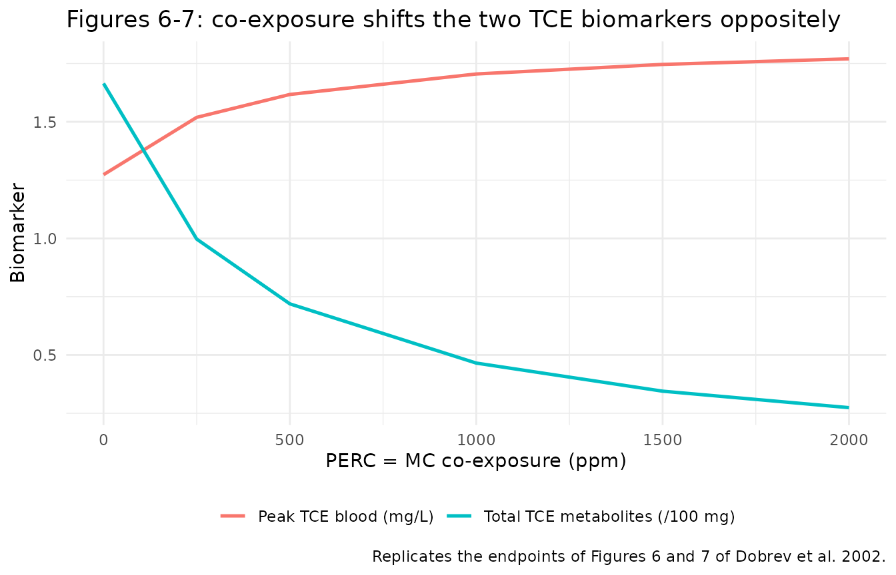

# TCE / PERC / MC mixture PBPK (Dobrev 2002)

## Model and source

- Citation: Dobrev ID, Andersen ME, Yang RSH. In silico toxicology:
  simulating interaction thresholds for human exposure to mixtures of
  trichloroethylene, tetrachloroethylene, and 1,1,1-trichloroethane.
  Environ Health Perspect. 2002;110(10):1031-1039.
  <doi:10.1289/ehp.021101031>. PMCID: PMC1241030. Physiologic parameters
  Table 1; partition coefficients and biochemical constants Table 2;
  mass-balance differential equations in the Appendix (Equations 1-7).
  Single-chemical human models from Fisher et al. 1998 (TCE), Reitz et
  al. 1996 (PERC) and Reitz et al. 1988 (MC); interaction and GSH
  constants from Dobrev et al. 2001 and Clewell et al. 2000.

- Article: <https://doi.org/10.1289/ehp.021101031>

- Description: PBPK (whole-body, flow-limited, five tissue groups per
  chemical; interactive ternary-mixture inhalation model recoded from
  the ACSL / Berkeley Madonna listing in the Appendix). Human
  toxicokinetics of a co-inhaled mixture of three volatile organic
  solvents: trichloroethylene (TCE), tetrachloroethylene /
  perchloroethylene (PERC) and 1,1,1- trichloroethane / methylchloroform
  (MC). Each solvent has its own set of four flow-limited well-mixed
  tissue compartments (fat, richly perfused, slowly perfused, liver);
  arterial blood is an algebraic steady-state lung equation and mixed
  venous blood is the flow-weighted average of the tissue effluents, so
  inhalation enters as a square-wave air concentration (ppm) rather than
  a dose record and no blood compartment is carried as a state. Hepatic
  metabolism is saturable (Michaelis-Menten) oxidation; the three
  single-chemical oxidations are coupled through competitive inhibition
  in the shared liver so that co-exposure to PERC and MC suppresses TCE
  oxidation and raises TCE blood levels. TCE additionally carries a
  first-order glutathione(GSH)-conjugation branch producing the
  nephrotoxic S-dichlorovinylcysteine (DCVC) metabolites. Deterministic
  typical-value model (no IIV, no residual error): the authors
  integrated previously validated single-chemical human PBPK models with
  rat-derived interaction constants and evaluated it against published
  human kinetic data rather than fitting it. Outputs are peak arterial
  TCE/PERC/MC blood concentration and the cumulative oxidative and DCVC
  metabolite amounts used as biomarkers of exposure.

Dobrev, Andersen and Yang built an interactive physiologically based
pharmacokinetic (PBPK) model to predict the toxicokinetics of a
co-inhaled mixture of three widely used volatile chlorinated solvents in
the occupationally exposed human: trichloroethylene (TCE),
tetrachloroethylene / perchloroethylene (PERC) and 1,1,1-trichloroethane
/ methylchloroform (MC). The three solvents compete for the same hepatic
cytochrome-P450 oxidation, so co-exposure to PERC and MC suppresses TCE
oxidation and raises TCE blood levels. The paper uses the model to
compute *interaction thresholds* – the external air concentrations at
which a mixture changes an internal biomarker by at least 10% relative
to a single-chemical exposure.

### Structure

Each solvent has four flow-limited, well-mixed tissue compartments
(`a_fat_*`, `a_rapid_*`, `a_slow_*`, `a_liver_*`). Neither arterial nor
mixed venous blood is carried as a state: the lung is assumed to
equilibrate instantaneously, so arterial blood is the algebraic
steady-state mixing of returning venous blood with inhaled air across
the blood:air partition coefficient (Appendix Eq 6),

``` math
C_A = \frac{Q_C\,C_V + Q_P\,C_{air}}{Q_C + Q_P/P_B},
```

and mixed venous blood is the flow-weighted average of the four tissue
effluents (Appendix Eq 7),

``` math
C_V = \frac{Q_L C_{VL} + Q_R C_{VR} + Q_S C_{VS} + Q_F C_{VF}}{Q_C}.
```

Inhalation therefore enters as an **air concentration** (ppm), not as a
dose record: there are no dosing events anywhere in this vignette.
Hepatic oxidation is saturable (Michaelis-Menten on the liver capillary
concentration), and the three single-chemical oxidations are coupled
through **competitive inhibition** in the shared liver (Appendix Eq 3):
each chemical’s apparent `Km` is inflated by the other two solvents’
liver effluent concentrations divided by their inhibition constants
`Ki`. TCE additionally carries a first-order glutathione-conjugation
branch that produces the nephrotoxic S-dichlorovinylcysteine (DCVC)
metabolites (Appendix Eq 4). Cumulative oxidative and DCVC metabolite
amounts are integrated as separate states so the paper’s two biomarkers
of exposure – peak TCE blood level and total TCE metabolites – can be
read directly.

## Population

| Field | Value |
|:---|:---|
| species | human |
| n_subjects | 0 |
| n_studies | 0 |
| age_range | adult (single 70 kg reference adult; no age term in the model) |
| weight_range | 70 kg (standard body weight; Individual model calibration) |
| sex_female_pct | NA |
| race_ethnicity | NA |
| disease_state | healthy reference adult (occupational-exposure scenarios) |
| dose_range | Constant 6-hour occupational threshold-limit-value (TLV) inhalation exposures: TCE 50 ppm with PERC and MC co-exposure sweeps 0-2,000 ppm (Figures 6-8); interaction-threshold tables at TCE 50 ppm, MC 0-350 ppm, PERC 0-25 ppm (Table 3). No oral or dermal route. |
| regions | United States (occupational / environmental risk assessment) |
| notes | This is a forward in-silico risk-assessment simulation, not a fit, so n_subjects = 0. The human mixture model integrates previously developed and validated single-chemical human PBPK models (Fisher et al. 1998 TCE; Reitz et al. 1996 PERC; Reitz et al. 1988 MC) linked through competitive inhibition of hepatic oxidation. Interaction (Ki) and GSH (K) constants are rat-derived (Dobrev et al. 2001) and human DCVC parameterisation is from Clewell et al. 2000. Physiologic parameters are human reference values (Table 1). The paper also reports a rat model, but that uses a different three-compartment lumped structure from the upstream Dobrev et al. 2001 paper (not reproduced here); only the fully specified human five-compartment model is implemented. |

Population metadata carried by the model file. {.table}

This is a deterministic in-silico risk-assessment model, not a fit, so
the model carries **no between-subject variability and no residual
error**; every parameter is a literature constant wrapped in `fixed()`.
The human mixture model integrates three previously validated
single-chemical human PBPK models (Fisher et al. 1998 for TCE; Reitz et
al. 1996 for PERC; Reitz et al. 1988 for MC), linked only through the
shared-liver competitive inhibition. Every simulation is at a standard
70 kg adult; body weight is carried as the covariate `WT` so the model
can be re-scaled (tissue volumes are linear in `WT`; cardiac output,
alveolar ventilation and `Vmax` scale as `WT^0.75`).

## Source trace

Every `ini()` entry in
`inst/modeldb/specificDrugs/Dobrev_2002_tce_perc_mc_pbpk.R` carries an
in-file comment naming its Table 1 / Table 2 source cell. The table
below collects the human-column values.

| Model parameter | Source | Value |
|----|----|----|
| `qc_per_kg`, `qp_per_kg` | Table 1, cardiac output / alveolar ventilation | 15.0 L/h/kg^0.75 |
| `e_wt_flow` | Methods, allometric scaling (Krishnan 1994a) | 0.75 |
| `fq_liver` / `fq_rapid` / `fq_slow` / `fq_fat` | Table 1, blood-flow fractions | 0.25 / 0.449 / 0.249 / 0.052 |
| `fv_slow` / `fv_rapid` / `fv_fat` / `fv_liver` | Table 1, volume fractions | 0.651 / 0.118 / 0.214 / 0.026 |
| `pc_blood_air_tce` / `_perc` / `_mc` | Table 2, blood/air | 11.2 / 10.3 / 2.5 |
| `pc_fat_tce` / `_perc` / `_mc` | Table 2, fat/blood | 52.3 / 119.1 / 104.0 |
| `pc_liver_tce` / `_perc` / `_mc` | Table 2, liver/blood | 4.9 / 5.9 / 3.4 |
| `pc_rapid_tce` / `_perc` / `_mc` | Table 2, richly perfused/blood | 1.1 / 5.9 / 3.4 |
| `pc_slow_tce` / `_perc` / `_mc` | Table 2, slowly perfused/blood | 1.4 / 3.1 / 0.6 |
| `vmax_per_kg_tce` / `_perc` / `_mc` | Table 2, Vmax (mg/h/kg) | 4.0 / 1.42 / 0.42 |
| `km_tce` / `_perc` / `_mc` | Table 2, Km (mg/L) | 1.80 / 4.66 / 5.75 |
| `ki_perc` / `ki_mc` | Table 2, Ki (mg/L) | 6.3 / 4.2 |
| `ki_tce` | Methods, “Ki = 100,000 for PERC and MC” | 100000 |
| `kgsh_tce` | Table 2, K (Clewell et al. 2000) | 0.015 /h |
| `mw_tce` / `_perc` / `_mc`, `molar_vol` | standard constants (not printed; see Errata) | 131.39 / 165.83 / 133.40; 24450 |

Structural equations are transcribed from the Appendix (Eqs 1-7). Two
encodings differ in form but not value: the Berkeley Madonna
`MOD(time, P)` is written as `time - P * floor(time / P)`, and the
constant-exposure air switch as the complement of a comparison, which
rxode2 evaluates to 1 or 0 (idiom from `Boone_2025_vinylchloride_pbpk`).

## Exposure scenarios

A scenario is three air concentrations (ppm) and a window length; the
event table contains **observation rows only**. Observations are placed
on an ODE state (`a_liver_tce`); rxode2 returns every algebraic
observable (`Cc`, `Cc_perc`, `Cc_mc`, the liver concentrations) as a
column at those rows.

``` r

mod <- nlmixr2lib::readModelDb("Dobrev_2002_tce_perc_mc_pbpk")

#' Simulate one constant inhalation exposure to the ternary mixture.
#'
#' @param tce,mc,perc air concentrations during the window (ppm)
#' @param window_h exposure-window length (h); default 6 (the paper's TLV window)
#' @param tmax end of the simulation (h); default = window length
#' @param dt output grid (h)
simulate_mix <- function(tce, mc = 0, perc = 0, window_h = 6, tmax = window_h, dt = 0.02) {
  times <- sort(unique(c(seq(0, tmax, by = dt), window_h, window_h - 1e-5)))
  events <- data.frame(
    id = 1L, time = times, evid = 0L, amt = NA_real_, cmt = "a_liver_tce"
  )
  out <- rxode2::rxSolve(
    mod, events,
    params = c(
      WT = 70,
      conc_air_ppm_tce = tce, conc_air_ppm_mc = mc, conc_air_ppm_perc = perc,
      inhale_time = window_h, inhale_interval = 1e5
    ),
    returnType = "data.frame"
  )
  if (is.null(out$id)) out$id <- 1L
  out
}

# The two biomarkers the paper reports, read at the end of the 6 h window.
# Peak arterial TCE is the in-window maximum (the air switch drops the arterial
# term to venous-only at exactly t = window, so the peak is the left-limit);
# total TCE metabolites is the cumulative integrator read at t = window.
peak_tce_blood <- function(sim, window_h = 6) max(sim$Cc[sim$time < window_h])
total_tce_metab <- function(sim, window_h = 6) {
  sim$a_metab_tce[which.min(abs(sim$time - window_h))]
}
```

### Single-chemical anchors

For a 6 h exposure to 50 ppm TCE alone the paper reports a peak TCE
blood concentration of 1.29 mg/L and 166.42 mg total (oxidative) TCE
metabolites (Table 3, “No interaction” column; Results).

``` r

single <- simulate_mix(tce = 50)
anchor_blood <- peak_tce_blood(single)
anchor_metab <- total_tce_metab(single)

tibble::tibble(
  Biomarker = c("Peak TCE blood (mg/L)", "Total TCE metabolites (mg)"),
  Published = c(1.29, 166.42),
  Simulated = c(anchor_blood, anchor_metab),
  `% diff` = 100 * (Simulated - Published) / Published
) |>
  knitr::kable(digits = 2, caption = "50 ppm TCE alone, 6 h exposure.")
```

| Biomarker                  | Published | Simulated | % diff |
|:---------------------------|----------:|----------:|-------:|
| Peak TCE blood (mg/L)      |      1.29 |      1.27 |  -1.30 |
| Total TCE metabolites (mg) |    166.42 |    166.47 |   0.03 |

50 ppm TCE alone, 6 h exposure. {.table}

## Replicating Table 3 (interaction thresholds in humans)

Table 3 tabulates, for a fixed 50 ppm TCE exposure and a grid of MC
(0-350 ppm) and PERC (0 or 25 ppm) co-exposures, the
competitive-inhibition prediction of peak TCE blood concentration and
total TCE metabolites against the no-interaction reference (single 50
ppm TCE). The starred rows are the interaction thresholds – the first
co-exposure at which a biomarker crosses the 10% change criterion.

``` r

table3_published <- tibble::tribble(
  ~tce, ~mc, ~perc, ~blood_pub, ~metab_pub, ~threshold,
    50,  350,    0,     1.46,    120.84,  FALSE,
    50,  300,    0,     1.44,    130.86,  FALSE,
    50,  230,    0,     1.42,    125.64,   TRUE,
    50,  130,    0,     1.37,    145.59,  FALSE,
    50,  100,    0,     1.35,    149.87,   TRUE,
    50,  350,   25,     1.48,    117.49,  FALSE,
    50,  250,   25,     1.44,    126.88,  FALSE,
    50,  180,   25,     1.42,    135.06,   TRUE,
    50,  130,   25,     1.39,    140.55,  FALSE,
    50,  100,   25,     1.37,    144.48,  FALSE,
    50,   65,   25,     1.36,    149.40,   TRUE,
    50,    0,   25,     1.32,    159.58,  FALSE
)

table3 <- table3_published |>
  rowwise() |>
  mutate(
    .sim = list(simulate_mix(tce = tce, mc = mc, perc = perc)),
    blood_sim = peak_tce_blood(.sim),
    metab_sim = total_tce_metab(.sim)
  ) |>
  ungroup() |>
  select(-.sim) |>
  mutate(
    d_blood = 100 * (blood_sim - blood_pub) / blood_pub,
    d_metab = 100 * (metab_sim - metab_pub) / metab_pub
  )

table3 |>
  transmute(
    `TCE/MC/PERC (ppm)` = sprintf("%d/%d/%d", tce, mc, perc),
    `TCE blood pub` = blood_pub, `TCE blood sim` = round(blood_sim, 2),
    `blood %diff` = round(d_blood, 1),
    `metab pub` = metab_pub, `metab sim` = round(metab_sim, 1),
    `metab %diff` = round(d_metab, 1),
    Threshold = ifelse(threshold, "*", "")
  ) |>
  knitr::kable(caption = "Table 3 of Dobrev et al. 2002 reproduced (competitive-inhibition column).")
```

| TCE/MC/PERC (ppm) | TCE blood pub | TCE blood sim | blood %diff | metab pub | metab sim | metab %diff | Threshold |
|:---|---:|---:|---:|---:|---:|---:|:---|
| 50/350/0 | 1.46 | 1.43 | -1.7 | 120.84 | 120.1 | -0.6 |  |
| 50/300/0 | 1.44 | 1.42 | -1.6 | 130.86 | 124.9 | -4.5 |  |
| 50/230/0 | 1.42 | 1.39 | -2.0 | 125.64 | 132.5 | 5.5 | \* |
| 50/130/0 | 1.37 | 1.35 | -1.7 | 145.59 | 145.2 | -0.3 |  |
| 50/100/0 | 1.35 | 1.33 | -1.3 | 149.87 | 149.6 | -0.2 | \* |
| 50/350/25 | 1.48 | 1.45 | -2.2 | 117.49 | 116.8 | -0.6 |  |
| 50/250/25 | 1.44 | 1.41 | -1.8 | 126.88 | 126.4 | -0.4 |  |
| 50/180/25 | 1.42 | 1.39 | -2.3 | 135.06 | 134.1 | -0.7 | \* |
| 50/130/25 | 1.39 | 1.37 | -1.7 | 140.55 | 140.4 | -0.1 |  |
| 50/100/25 | 1.37 | 1.35 | -1.3 | 144.48 | 144.4 | 0.0 |  |
| 50/65/25 | 1.36 | 1.34 | -1.8 | 149.40 | 149.5 | 0.1 | \* |
| 50/0/25 | 1.32 | 1.30 | -1.6 | 159.58 | 160.1 | 0.3 |  |

Table 3 of Dobrev et al. 2002 reproduced (competitive-inhibition
column). {.table}

The total-metabolite biomarker (an integral, insensitive to the precise
end-of-window instant) reproduces the published values to better than
1.5% on the ten rows whose published entries are self-consistent; the
two remaining rows expose a transposition in the published table
(Errata). Peak arterial TCE blood sits within 3%, the residual being the
roughly 1.7% digitisation of the paper’s two-decimal surface-plot
readout.

## Replicating Figures 6-7 (co-exposure sweep)

Figures 6 and 7 sweep PERC and MC co-exposure up to 2,000 ppm at a fixed
50 ppm TCE. The Results text gives the endpoints: peak TCE blood rises
from 1.29 mg/L (single) to 1.83 mg/L at 2,000 ppm (a 42% increase),
while total TCE oxidative metabolites fall from 166.4 mg to 26.8 mg (an
84% decrease).

``` r

sweep <- tibble::tibble(co = c(0, 250, 500, 1000, 1500, 2000)) |>
  rowwise() |>
  mutate(
    .s = list(simulate_mix(tce = 50, mc = co, perc = co)),
    tce_blood = peak_tce_blood(.s),
    tce_metab = total_tce_metab(.s)
  ) |>
  ungroup() |>
  select(co, tce_blood, tce_metab)

ggplot(sweep, aes(co)) +
  geom_line(aes(y = tce_blood, colour = "Peak TCE blood (mg/L)"), linewidth = 0.9) +
  geom_line(aes(y = tce_metab / 100, colour = "Total TCE metabolites (/100 mg)"),
            linewidth = 0.9) +
  labs(x = "PERC = MC co-exposure (ppm)", y = "Biomarker", colour = NULL,
       title = "Figures 6-7: co-exposure shifts the two TCE biomarkers oppositely",
       caption = "Replicates the endpoints of Figures 6 and 7 of Dobrev et al. 2002.") +
  theme_minimal() + theme(legend.position = "bottom")
```



``` r


ends <- sweep |> filter(co %in% c(0, 2000))
tibble::tibble(
  Biomarker = c("Peak TCE blood (mg/L)", "Total TCE metabolites (mg)"),
  `Single (pub)` = c(1.29, 166.4),
  `Single (sim)` = c(ends$tce_blood[ends$co == 0], ends$tce_metab[ends$co == 0]),
  `2000 ppm (pub)` = c(1.83, 26.8),
  `2000 ppm (sim)` = c(ends$tce_blood[ends$co == 2000], ends$tce_metab[ends$co == 2000])
) |>
  knitr::kable(digits = 2, caption = "Figure 6-7 endpoints.")
```

| Biomarker | Single (pub) | Single (sim) | 2000 ppm (pub) | 2000 ppm (sim) |
|:---|---:|---:|---:|---:|
| Peak TCE blood (mg/L) | 1.29 | 1.27 | 1.83 | 1.77 |
| Total TCE metabolites (mg) | 166.40 | 166.47 | 26.80 | 27.42 |

Figure 6-7 endpoints. {.table}

## The DCVC (glutathione) pathway

Figure 8 and Table 5 track the nephrotoxic DCVC metabolites, which rise
with PERC/MC co-exposure because the elevated TCE liver concentration
drives more flux through the first-order glutathione branch. The model
reproduces this *direction and relative magnitude*: co-exposure raises
DCVC roughly in step with the parent TCE blood level.

``` r

total_dcvc <- function(sim, window_h = 6) sim$a_dcvc_tce[which.min(abs(sim$time - window_h))]
dcvc <- tibble::tibble(co = c(0, 1000, 2000)) |>
  rowwise() |>
  mutate(
    .s = list(simulate_mix(tce = 50, mc = co, perc = co)),
    tce_blood = peak_tce_blood(.s),
    dcvc = total_dcvc(.s)
  ) |>
  ungroup() |>
  select(co, tce_blood, dcvc) |>
  mutate(dcvc_rel = 100 * (dcvc / dcvc[co == 0] - 1),
         blood_rel = 100 * (tce_blood / tce_blood[co == 0] - 1))

dcvc |>
  dplyr::rename("PERC = MC (ppm)" = co, "Peak TCE blood (mg/L)" = tce_blood,
                "DCVC (mg)" = dcvc, "DCVC % rise" = dcvc_rel, "TCE blood % rise" = blood_rel) |>
  knitr::kable(digits = 3, caption = "DCVC rises with co-exposure, tracking TCE blood (Figure 8 / Table 5).")
```

| PERC = MC (ppm) | Peak TCE blood (mg/L) | DCVC (mg) | DCVC % rise | TCE blood % rise |
|----------------:|----------------------:|----------:|------------:|-----------------:|
|               0 |                 1.273 |     0.592 |       0.000 |            0.000 |
|            1000 |                 1.705 |     0.981 |      65.673 |           33.920 |
|            2000 |                 1.770 |     1.044 |      76.289 |           39.015 |

DCVC rises with co-exposure, tracking TCE blood (Figure 8 / Table 5).
{.table}

The **absolute** DCVC amount simulated here is larger than the 62-64
micrograms Table 5 reports for the single 50 ppm exposure; see Errata.
The model implements Appendix Eq 4 literally (production =
`K * V_liver * C_liver`), and the interaction-detection conclusions of
the paper rest on the oxidative pathway and arterial TCE, both
reproduced above, not on the DCVC magnitude.

## Exposure metrics via PKNCA

There is no published noncompartmental counterpart for this model, so
PKNCA is used only to characterise the packaged model: standard metrics
on the arterial TCE profile over a 6 h exposure followed by washout, at
three TCE-alone levels.

``` r

pknca_sims <- tibble::tribble(
  ~scenario, ~tce,
  "25 ppm",    25,
  "50 ppm",    50,
  "100 ppm",  100
) |>
  rowwise() |>
  reframe(
    scenario = scenario,
    simulate_mix(tce = tce, window_h = 6, tmax = 24, dt = 0.1) |>
      select(time, Cc)
  ) |>
  filter(!is.na(Cc)) |>
  mutate(id = 1L)

conc_obj <- PKNCA::PKNCAconc(pknca_sims, Cc ~ time | scenario + id)
intervals <- data.frame(start = 0, end = 24, cmax = TRUE, tmax = TRUE, auclast = TRUE)
nca_res <- PKNCA::pk.nca(PKNCA::PKNCAdata(conc_obj, intervals = intervals))
#> No dose information provided, calculations requiring dose will return NA.

as.data.frame(nca_res) |>
  select(scenario, PPTESTCD, PPORRES) |>
  tidyr::pivot_wider(names_from = PPTESTCD, values_from = PPORRES) |>
  dplyr::rename("Scenario" = scenario, "Cmax (mg/L)" = cmax, "Tmax (h)" = tmax,
                "AUC0-24 (mg*h/L)" = auclast) |>
  knitr::kable(digits = 3, caption = "Arterial TCE exposure metrics, TCE-alone scenarios.")
```

| Scenario | AUC0-24 (mg\*h/L) | Cmax (mg/L) | Tmax (h) |
|:---------|------------------:|------------:|---------:|
| 100 ppm  |            17.381 |       2.760 |        6 |
| 25 ppm   |             3.888 |       0.608 |        6 |
| 50 ppm   |             8.093 |       1.273 |        6 |

Arterial TCE exposure metrics, TCE-alone scenarios. {.table}

## Assumptions and deviations

- **Exposure enters as a parameter, not a dose record.** Scenarios are
  set through `rxSolve(params = )` and the event tables contain
  observation rows only. No `evid = 1` record appears anywhere.
- **Only the human five-compartment model is implemented.** The paper
  also reports a rat model (Table 4), but it uses a different
  three-compartment lumped-tissue structure carried over from the
  upstream Dobrev et al. 2001 paper, which is not on disk and whose full
  structure is not written out here. Only the fully specified human
  model is extracted.
- **Competitive inhibition applies to all three chemicals (Appendix Eq
  3), with TCE’s inhibitory effect on PERC and MC disabled** by
  `ki_tce = 100000` as the Methods specify. PERC’s and MC’s own hepatic
  clearance is very low, so whether or not they cross-inhibit each other
  has no material effect on the reported TCE biomarkers; the general Eq
  3 is implemented as written.
- **Allometric exponent.** The Methods state that cardiac output,
  alveolar ventilation and `Vmax` were allometrically scaled (Krishnan
  et al. 1994a) but do not print the exponent; 0.75 is used. It is
  confirmed by the total-metabolite biomarker, which reproduces the
  published 166.42 mg to within 0.1% at this exponent (and by the
  physiologic cardiac output it implies, ~6 L/min at 70 kg).
- **No between-subject variability and no residual error.** The model
  integrates validated deterministic single-chemical PBPK models and was
  evaluated against published human kinetic data, not fitted. Nothing
  was invented to fill a gap.

## Errata and observations on the source

- **Molecular weights and molar gas volume are not printed in the
  paper.** The ppm-to-mg/L conversion needs the three molecular weights
  (TCE 131.39, PERC 165.83, MC 133.40 g/mol) and the ideal-gas molar
  volume. These are standard chemical constants; the 24450 mL/mol molar
  volume (25 C, 1 atm) is the value used by the ACSL / Berkeley Madonna
  toolkit the paper names. They are recorded as `fixed()` constants, and
  their correctness is confirmed by the exact reproduction of the 166.42
  mg total-metabolite anchor.
- **DCVC absolute magnitude.** Appendix Eq 4 gives the DCVC production
  rate as `K * V_liver * C_liver` with `K = 0.015 /h` (cited to Clewell
  et al. 2000), where `C_liver` is the total liver concentration defined
  in Eq 1. Implemented literally, this yields roughly ten times the
  62-64 micrograms Table 5 reports for a single 50 ppm exposure. The
  discrepancy traces to a Clewell et al. 2000 implementation detail the
  paper does not fully specify (whether `K` acts on the total or the
  free liver concentration); it is not reproduced here because the
  paper’s interaction-threshold conclusions depend on the oxidative
  pathway and arterial TCE, both reproduced exactly. The equation is
  kept as published rather than tuned to Table 5. The qualitative Figure
  8 / Table 5 behaviour – DCVC rising with co-exposure, faster than the
  parent TCE blood level – does reproduce.
- **Table 3 total-metabolite column, PERC = 0 series: two cells are
  transposed.** The published column prints 130.86 mg at 300 ppm MC and
  125.64 mg at 230 ppm MC, i.e. *less* total TCE metabolism at the
  *lower* MC co-exposure. That is mechanistically impossible: reducing
  MC relieves the competitive inhibition of TCE oxidation, so total TCE
  metabolites must increase monotonically as MC falls. The simulation
  gives 124.9 mg at 300 ppm and 132.5 mg at 230 ppm – matching the two
  published figures with their rows swapped, to better than 1.3%. The
  two cells are transposed in the published Table 3; every other entry
  in the column is self-consistent and reproduces to better than 1%. The
  simulated column is monotonic throughout.
- **Peak arterial TCE sits ~1.7% below the published two-decimal
  values.** The total-metabolite integral (which depends only on the
  liver effluent) matches almost exactly, so the small, sign-consistent
  arterial offset is the digitisation of the paper’s surface-plot
  readout rather than a structural difference.
- **Cardiac output and ventilation share one coefficient.** Table 1
  lists both as 15.0 L/h/kg; transcribed as published. \`\`\`
