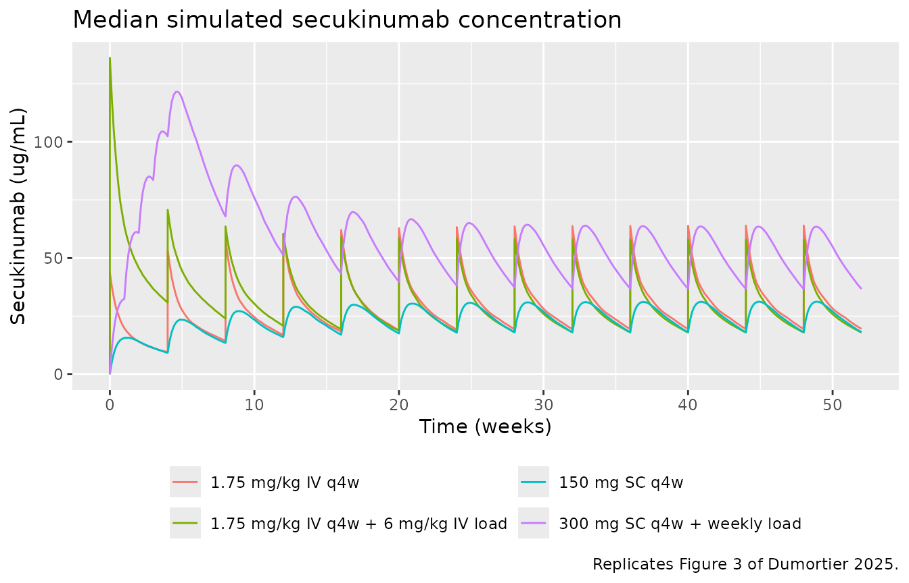
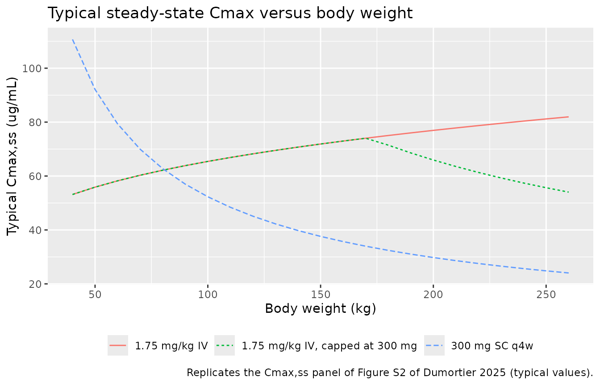
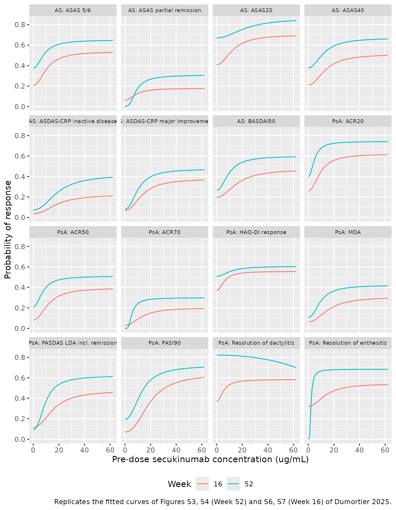

# Secukinumab SC-to-IV bridging (Dumortier 2025)

## Model and source

- Citation: Dumortier T, Valenzuela G, Churchill M, Mijatovic J, Bruin
  G, Pricop L, Richards H, Renard D, Singhal A, Marathe A.
  Model-Informed Drug Development-Based Bridging from Subcutaneous to
  Intravenous Secukinumab Dosing: Approval in Psoriatic Arthritis and
  Axial Spondyloarthritis. Clin Pharmacol Ther. 2025;118(2):480-488.
  <doi:10.1002/cpt.3716>.
- Description: Two-compartment population PK model for secukinumab
  (anti-IL-17A IgG1) after subcutaneous and intravenous dosing in adults
  with psoriatic arthritis, ankylosing spondylitis or non-radiographic
  axial spondyloarthritis (Dumortier 2025; 14 phase II/III trials, 5270
  patients). First-order SC absorption with ka fixed at 0.18/day and
  bioavailability 0.783; zero-order IV infusion into the central
  compartment; linear elimination. Baseline body weight (reference 84
  kg) scales CL, Vc and Vp by power functions, and CL is 1.13-fold
  higher in Asian patients. Correlated IIV on CL and Vc, independent IIV
  on Vp, proportional residual error. Used to select the approved 1.75
  mg/kg IV q4w regimen (with or without a 6 mg/kg IV loading dose).
- Article: <https://doi.org/10.1002/cpt.3716> (open access; PMC12272323)

Dumortier 2025 bridged subcutaneous (SC) secukinumab to an intravenous
(IV) regimen for psoriatic arthritis (PsA) and axial spondyloarthritis
(axSpA). A population PK model, fitted to 14 phase II/III trials,
identified 1.75 mg/kg IV every 4 weeks (q4w), with or without a 6 mg/kg
IV loading dose, as the regimen whose steady-state exposure lies between
the approved 150 mg and 300 mg SC q4w regimens. Landmark
exposure-response models for efficacy, fitted to SC-only data at Weeks
16 and 52, then predicted the efficacy of the IV regimen.

The paper contributes 33 models to nlmixr2lib:

- `Dumortier_2025_secukinumab` – the two-compartment population PK model
  (Supplementary Table S3 and the supplementary NONMEM control stream).
- 32 logistic sigmoid-Emax exposure-efficacy models, one per endpoint
  and assessment week, named
  `Dumortier_2025_secukinumab_<psa|as>_<w16|w52>_<endpoint>`. Each has
  the form `logit(p) = E0 + (Emax - E0) * Cmin^2 / (EC50^2 + Cmin^2)`
  (Hill fixed at 2) with the pre-dose concentration supplied in the
  `CTROUGH` column (ug/mL).

The exposure-safety analysis (semi-parametric Cox models with a
penalised spline of the 28-day running-average concentration) is not
packaged: the baseline hazard is non-parametric and the spline
coefficients are not reported, so there is no closed-form model to
encode.

## Population

The PK model was developed in 5270 patients from 14 trials (two phase II
IV studies and the phase III MEASURE 1-5, FUTURE 1-5, PREVENT and
INVIGORATE-2 studies; Table S1). Per Table 1, mean age was 45.1 years
(SD 12.9), mean body weight 81.6 kg (SD 19.4), 55% were male, 80% White
and 15% Asian; 58% had PsA, 31% ankylosing spondylitis (AS) and 10%
non-radiographic axSpA. The model was externally validated on the 516
axSpA patients of INVIGORATE-1 (Figure S1).

The exposure-efficacy models were fitted to SC-treated patients only: at
Week 52, 1595 PsA patients from FUTURE 1-5 and 934 AS patients from
MEASURE 1-5; at Week 16, placebo and SC patients from FUTURE 2-5 (PsA)
and MEASURE 2, 4 and 5 (AS), excluding arms with a 10 mg/kg IV loading
regimen.

``` r

str(rxode2::rxode(readModelDb("Dumortier_2025_secukinumab"))$population)
#> ℹ parameter labels from comments will be replaced by 'label()'
#> List of 12
#>  $ species       : chr "human"
#>  $ n_subjects    : int 5270
#>  $ n_studies     : int 14
#>  $ n_observations: chr "24149 serum secukinumab concentrations (4396 after IV and 19753 after SC dosing)"
#>  $ age_range     : chr "mean 45.1 years (SD 12.9)"
#>  $ weight_range  : chr "mean 81.6 kg (SD 19.4)"
#>  $ sex_female_pct: num 45
#>  $ race_ethnicity: Named num [1:7] 80 15 3 1 1 0 0
#>   ..- attr(*, "names")= chr [1:7] "White" "Asian" "Other" "Black" ...
#>  $ disease_state : chr "Psoriatic arthritis (58%), ankylosing spondylitis (31%) and non-radiographic axial spondyloarthritis (10%)"
#>  $ dose_range    : chr "0.1, 1 or 10 mg/kg IV at weeks 0 and 3 (phase II); 75, 150 or 300 mg SC q4w with or without weekly SC loading o"| __truncated__
#>  $ regions       : chr "Multinational"
#>  $ notes         : chr "Model-development population of Dumortier 2025 Table 1 (n = 5270). INVIGORATE-1 (n = 516, axSpA) was held out f"| __truncated__
```

## Source trace

### Population PK model

| Equation / parameter | Value | Source location |
|----|----|----|
| `lcl` (CL, 84 kg non-Asian) | log(0.171) L/day | Table S3 |
| `lvc` (Vc, 84 kg) | log(3.32) L | Table S3 |
| `lq` (Q) | log(0.35) L/day | Table S3 |
| `lvp` (Vp, 84 kg) | log(2.63) L | Table S3 |
| `lka` (KA) | fixed(log(0.18)) 1/day | Table S3 (‘0.18 (fixed)’); control stream `(0.18 FIX)` |
| `lfdepot` (F1) | log(0.783) | Table S3 |
| `e_wt_cl`, `e_wt_vc`, `e_wt_vp` | 0.892, 0.651, 0.712 | Table S3 ‘CL/Vc/Vp ~weight’ |
| `e_race_asian_cl` | 1.13 | Table S3 ‘CL ~Asian’ |
| `etalcl + etalvc` | c(0.0912, 0.0489, 0.0691) | Table S3 omega2 CL, covariance, omega2 Vc |
| `etalvp` | 0.113 | Table S3 omega2 Vp |
| `propSd` | sqrt(0.0544) | Table S3 ‘delta2 prop’ (variance) |
| `cl = CL * (WT/84)^e_wt_cl * e_race_asian_cl^RACE_ASIAN` | n/a | control stream `$PK` (TVCL) |
| `vc`, `vp` power weight scaling; no weight effect on Q | n/a | control stream `$PK` (TVV2, TVV3, TVQ) |
| Two-compartment ODEs, SC depot, IV into central | n/a | control stream `ADVAN4 TRANS4`; Supplementary Methods |
| `Cc = central / vc` (mg/L = ug/mL) | n/a | control stream `S2 = V2/1000` |

### Exposure-efficacy models

Dumortier 2025 prints the equation (main text Methods and Supplementary
Methods, Hill coefficient fixed at 2) but not E0, Emax or EC50 for any
endpoint. The maintainers recovered them by pixel-digitising the fitted
black curves in Figures S3 (PsA, Week 52), S4 (AS, Week 52), S6 (PsA,
Week 16) and S7 (AS, Week 16) of the supplementary Word file and
refitting the same equation by least squares. The panel axes were
calibrated from the detected tick marks. The refits reproduce the drawn
curves to within line width (RMSE 0.0003 to 0.0033 probability units
over 168 to 238 traced points per panel), so they read back the authors’
fitted curves rather than re-estimating anything from data.

``` r

er_models <- tibble::tribble(
  ~disease, ~week, ~token, ~endpoint,
  "PsA", 52, "acr20", "ACR20",
  "PsA", 52, "acr50", "ACR50",
  "PsA", 52, "acr70", "ACR70",
  "PsA", 52, "haqdi", "HAQ-DI response",
  "PsA", 52, "mda", "MDA",
  "PsA", 52, "pasdaslda", "PASDAS LDA incl. remission",
  "PsA", 52, "pasi90", "PASI90",
  "PsA", 52, "dactylitis", "Resolution of dactylitis",
  "PsA", 52, "enthesitis", "Resolution of enthesitis",
  "AS", 52, "asas56", "ASAS 5/6",
  "AS", 52, "asaspr", "ASAS partial remission",
  "AS", 52, "asas20", "ASAS20",
  "AS", 52, "asas40", "ASAS40",
  "AS", 52, "asdasid", "ASDAS-CRP inactive disease",
  "AS", 52, "asdasmi", "ASDAS-CRP major improvement",
  "AS", 52, "basdai50", "BASDAI50"
)
er_models <- dplyr::bind_rows(er_models, dplyr::mutate(er_models, week = 16)) |>
  dplyr::mutate(
    model = sprintf("Dumortier_2025_secukinumab_%s_w%d_%s", tolower(disease), week, token),
    figure = dplyr::case_when(
      disease == "PsA" & week == 52 ~ "Figure S3",
      disease == "AS" & week == 52 ~ "Figure S4",
      disease == "PsA" & week == 16 ~ "Figure S6",
      TRUE ~ "Figure S7"
    )
  )
er_ui <- lapply(er_models$model, function(nm) rxode2::rxode(readModelDb(nm)))
names(er_ui) <- er_models$model
er_models$output <- vapply(er_ui, function(ui) ui$predDf$var, character(1))
er_models$E0 <- vapply(er_ui, function(ui) ui$theta[["e0"]], numeric(1))
er_models$Emax <- vapply(er_ui, function(ui) ui$theta[["emax"]], numeric(1))
er_models$EC50 <- vapply(er_ui, function(ui) exp(ui$theta[["lec50"]]), numeric(1))

er_models |>
  dplyr::select(disease, week, endpoint, figure, output, E0, Emax, EC50) |>
  dplyr::rename(
    "Disease" = disease, "Week" = week, "Endpoint" = endpoint,
    "Source panel" = figure, "Output" = output, "EC50 (ug/mL)" = EC50
  ) |>
  knitr::kable(digits = 3, caption = "Digitised exposure-efficacy parameters (logit scale; Hill fixed at 2).")
```

| Disease | Week | Endpoint | Source panel | Output | E0 | Emax | EC50 (ug/mL) |
|:---|---:|:---|:---|:---|---:|---:|---:|
| PsA | 52 | ACR20 | Figure S3 | prob_acr20 | -0.414 | 1.060 | 5.27 |
| PsA | 52 | ACR50 | Figure S3 | prob_acr50 | -1.334 | 0.039 | 6.86 |
| PsA | 52 | ACR70 | Figure S3 | prob_acr70 | -14.683 | -0.851 | 1.49 |
| PsA | 52 | HAQ-DI response | Figure S3 | prob_haqdi_response | 0.028 | 0.430 | 10.90 |
| PsA | 52 | MDA | Figure S3 | prob_minimal_disease_activity | -2.140 | -0.313 | 7.77 |
| PsA | 52 | PASDAS LDA incl. remission | Figure S3 | prob_pasdas_lda | -2.262 | 0.494 | 7.70 |
| PsA | 52 | PASI90 | Figure S3 | prob_pasi90 | -1.432 | 0.956 | 12.20 |
| PsA | 52 | Resolution of dactylitis | Figure S3 | prob_dactylitis_resolution | 1.531 | -27.659 | 400.00 |
| PsA | 52 | Resolution of enthesitis | Figure S3 | prob_enthesitis_resolution | -7.517 | 0.769 | 0.97 |
| AS | 52 | ASAS 5/6 | Figure S4 | prob_asas56 | -0.507 | 0.621 | 8.68 |
| AS | 52 | ASAS partial remission | Figure S4 | prob_asas_partial_remission | -5.818 | -0.804 | 4.13 |
| AS | 52 | ASAS20 | Figure S4 | prob_asas20 | 0.710 | 1.841 | 26.90 |
| AS | 52 | ASAS40 | Figure S4 | prob_asas40 | -0.497 | 0.715 | 12.50 |
| AS | 52 | ASDAS-CRP inactive disease | Figure S4 | prob_asdas_inactive_disease | -2.537 | -0.322 | 14.40 |
| AS | 52 | ASDAS-CRP major improvement | Figure S4 | prob_asdas_major_improvement | -2.436 | -0.098 | 7.97 |
| AS | 52 | BASDAI50 | Figure S4 | prob_basdai50 | -1.020 | 0.407 | 9.26 |
| PsA | 16 | ACR20 | Figure S6 | prob_acr20 | -1.058 | 0.493 | 9.00 |
| PsA | 16 | ACR50 | Figure S6 | prob_acr50 | -2.422 | -0.425 | 9.24 |
| PsA | 16 | ACR70 | Figure S6 | prob_acr70 | -3.471 | -1.381 | 9.12 |
| PsA | 16 | HAQ-DI response | Figure S6 | prob_haqdi_response | -0.529 | 0.227 | 6.22 |
| PsA | 16 | MDA | Figure S6 | prob_minimal_disease_activity | -2.694 | -0.807 | 12.00 |
| PsA | 16 | PASDAS LDA incl. remission | Figure S6 | prob_pasdas_lda | -2.047 | -0.090 | 13.00 |
| PsA | 16 | PASI90 | Figure S6 | prob_pasi90 | -2.576 | 0.599 | 15.00 |
| PsA | 16 | Resolution of dactylitis | Figure S6 | prob_dactylitis_resolution | -0.528 | 0.338 | 5.68 |
| PsA | 16 | Resolution of enthesitis | Figure S6 | prob_enthesitis_resolution | -0.757 | 0.178 | 13.30 |
| AS | 16 | ASAS 5/6 | Figure S7 | prob_asas56 | -1.340 | 0.157 | 9.82 |
| AS | 16 | ASAS partial remission | Figure S7 | prob_asas_partial_remission | -2.716 | -1.527 | 7.05 |
| AS | 16 | ASAS20 | Figure S7 | prob_asas20 | -0.371 | 0.867 | 13.50 |
| AS | 16 | ASAS40 | Figure S7 | prob_asas40 | -1.320 | 0.058 | 12.60 |
| AS | 16 | ASDAS-CRP inactive disease | Figure S7 | prob_asdas_inactive_disease | -3.264 | -1.232 | 13.20 |
| AS | 16 | ASDAS-CRP major improvement | Figure S7 | prob_asdas_major_improvement | -2.605 | -0.490 | 10.30 |
| AS | 16 | BASDAI50 | Figure S7 | prob_basdai50 | -1.406 | -0.112 | 14.70 |

Digitised exposure-efficacy parameters (logit scale; Hill fixed at 2).
{.table}

## Virtual cohort

Dumortier 2025 simulated non-Asian patients whose body weights were
resampled from INVIGORATE-1 (axSpA) and INVIGORATE-2 (PsA). Individual
weights are not public; INVIGORATE-1 reports a mean of 78 kg (SD 18.2,
Table 1). The cohort below draws weight from a log-normal distribution
with mean 79 kg and SD 19 kg, truncated to 40-170 kg, all non-Asian.

``` r

set.seed(3716)
rxode2::rxSetSeed(3716)
n_per_arm <- 200
draw_wt <- function(n, mean = 79, sd = 19) {
  s2 <- log(1 + (sd / mean)^2)
  pmin(pmax(rlnorm(n, log(mean) - s2 / 2, sqrt(s2)), 40), 170)
}

tinf <- 0.5 / 24 # 30-minute infusion, in days
dose_days <- seq(0, 336, by = 28)
regimens <- tibble::tribble(
  ~regimen, ~route, ~maint, ~load,
  "1.75 mg/kg IV q4w", "IV", 1.75, NA,
  "1.75 mg/kg IV q4w + 6 mg/kg IV load", "IV", 1.75, 6,
  "150 mg SC q4w", "SC", 150, NA,
  "150 mg SC q4w + weekly load", "SC", 150, 150,
  "300 mg SC q4w + weekly load", "SC", 300, 300
)

make_cohort <- function(reg, id_offset) {
  subj <- tibble::tibble(id = id_offset + seq_len(n_per_arm), WT = draw_wt(n_per_arm), RACE_ASIAN = 0L)
  doses <- if (reg$route == "IV") {
    amt_mgkg <- c(if (is.na(reg$load)) reg$maint else reg$load, rep(reg$maint, length(dose_days) - 1))
    tidyr::expand_grid(subj, tibble::tibble(time = dose_days, mgkg = amt_mgkg)) |>
      dplyr::mutate(amt = mgkg * WT, rate = amt / tinf, cmt = "central", mgkg = NULL)
  } else {
    # Weekly loading at Weeks 0, 1, 2, 3 and 4, then q4w (Table S4 header).
    t_sc <- if (is.na(reg$load)) dose_days else sort(unique(c(c(0, 7, 14, 21), dose_days)))
    tidyr::expand_grid(subj, tibble::tibble(time = t_sc)) |>
      dplyr::mutate(amt = reg$maint, rate = 0, cmt = "depot")
  }
  obs_t <- sort(unique(c(
    seq(0, 364, by = 1),
    dose_days[-1] - 1e-3, # pre-dose troughs
    dose_days + tinf # end of infusion
  )))
  obs <- tidyr::expand_grid(subj, time = obs_t) |>
    dplyr::mutate(amt = 0, rate = 0, cmt = "central")
  dplyr::bind_rows(
    dplyr::mutate(doses, evid = 1L),
    dplyr::mutate(obs, evid = 0L)
  ) |>
    dplyr::mutate(regimen = reg$regimen) |>
    dplyr::arrange(id, time, dplyr::desc(evid))
}

events <- dplyr::bind_rows(lapply(seq_len(nrow(regimens)), function(i) {
  make_cohort(regimens[i, ], id_offset = (i - 1L) * n_per_arm)
}))
stopifnot(!anyDuplicated(unique(events[, c("id", "time", "evid")])))
```

## Simulation

``` r

mod <- readModelDb("Dumortier_2025_secukinumab")
sim <- rxode2::rxSolve(mod, events = events, keep = c("regimen", "WT"), returnType = "data.frame")
#> ℹ parameter labels from comments will be replaced by 'label()'
```

## Replicate published figures

### Figure 3 – median concentration-time profiles

``` r

sim |>
  dplyr::filter(regimen != "150 mg SC q4w + weekly load") |>
  dplyr::group_by(regimen, time) |>
  dplyr::summarise(Cc = median(Cc), .groups = "drop") |>
  ggplot(aes(time / 7, Cc, colour = regimen)) +
  geom_line() +
  labs(
    x = "Time (weeks)", y = "Secukinumab (ug/mL)", colour = NULL,
    title = "Median simulated secukinumab concentration",
    caption = "Replicates Figure 3 of Dumortier 2025."
  ) +
  theme(legend.position = "bottom") +
  guides(colour = guide_legend(ncol = 2))
```



### Table S4 – median pre-dose concentration by week

``` r

published_s4 <- tibble::tibble(
  week = seq(4, 48, by = 4),
  `1.75 mg/kg IV q4w` = c(9.2, 13.7, 15.9, 17.0, 17.6, 17.9, 18.0, 18.1, 18.1, 18.1, 18.1, 18.1),
  `1.75 mg/kg IV q4w + 6 mg/kg IV load` = c(31.2, 24.4, 21.1, 19.5, 18.7, 18.4, 18.2, 18.1, 18.1, 18.1, 18.1, 18.1),
  `150 mg SC q4w` = c(9.3, 13.8, 16.0, 17.1, 17.1, 18.0, 18.2, 18.2, 18.2, 18.2, 18.2, 18.2),
  `150 mg SC q4w + weekly load` = c(51.0, 33.3, 25.5, 21.8, 20.1, 19.2, 18.8, 18.6, 18.5, 18.4, 18.3, 18.2),
  `300 mg SC q4w + weekly load` = c(101.9, 66.5, 51.0, 43.7, 40.2, 38.5, 37.6, 37.2, 37.0, 36.8, 36.6, 36.4)
) |>
  tidyr::pivot_longer(-week, names_to = "regimen", values_to = "published")

trough <- sim |>
  dplyr::filter(abs(time - (round(time / 28) * 28 - 1e-3)) < 1e-6, time > 1) |>
  dplyr::mutate(week = round(time / 7)) |>
  dplyr::group_by(regimen, week) |>
  dplyr::summarise(simulated = median(Cc), .groups = "drop")

s4 <- dplyr::inner_join(published_s4, trough, by = c("regimen", "week")) |>
  dplyr::mutate(pct_diff = 100 * (simulated - published) / published)

s4 |>
  dplyr::filter(week %in% c(4, 8, 16, 24, 48)) |>
  dplyr::rename("Regimen" = regimen, "Week" = week, "Published median Cmin (ug/mL)" = published,
                "Simulated median Cmin (ug/mL)" = simulated, "Difference (%)" = pct_diff) |>
  knitr::kable(digits = 1, caption = "Median pre-dose concentration, simulated vs Table S4 of Dumortier 2025.")
```

| Week | Regimen | Published median Cmin (ug/mL) | Simulated median Cmin (ug/mL) | Difference (%) |
|---:|:---|---:|---:|---:|
| 4 | 1.75 mg/kg IV q4w | 9.2 | 9.5 | 3.7 |
| 4 | 1.75 mg/kg IV q4w + 6 mg/kg IV load | 31.2 | 30.8 | -1.3 |
| 4 | 150 mg SC q4w | 9.3 | 9.2 | -1.0 |
| 4 | 150 mg SC q4w + weekly load | 51.0 | 51.4 | 0.8 |
| 4 | 300 mg SC q4w + weekly load | 101.9 | 102.4 | 0.5 |
| 8 | 1.75 mg/kg IV q4w | 13.7 | 14.4 | 5.3 |
| 8 | 1.75 mg/kg IV q4w + 6 mg/kg IV load | 24.4 | 24.0 | -1.7 |
| 8 | 150 mg SC q4w | 13.8 | 13.5 | -2.2 |
| 8 | 150 mg SC q4w + weekly load | 33.3 | 33.9 | 1.9 |
| 8 | 300 mg SC q4w + weekly load | 66.5 | 67.9 | 2.1 |
| 16 | 1.75 mg/kg IV q4w | 17.0 | 18.3 | 7.6 |
| 16 | 1.75 mg/kg IV q4w + 6 mg/kg IV load | 19.5 | 19.5 | -0.2 |
| 16 | 150 mg SC q4w | 17.1 | 17.0 | -0.6 |
| 16 | 150 mg SC q4w + weekly load | 21.8 | 21.9 | 0.5 |
| 16 | 300 mg SC q4w + weekly load | 43.7 | 43.4 | -0.8 |
| 24 | 1.75 mg/kg IV q4w | 17.9 | 19.2 | 7.0 |
| 24 | 1.75 mg/kg IV q4w + 6 mg/kg IV load | 18.4 | 18.4 | -0.1 |
| 24 | 150 mg SC q4w | 18.0 | 17.9 | -0.7 |
| 24 | 150 mg SC q4w + weekly load | 19.2 | 19.3 | 0.4 |
| 24 | 300 mg SC q4w + weekly load | 38.5 | 38.1 | -1.0 |
| 48 | 1.75 mg/kg IV q4w | 18.1 | 19.5 | 7.9 |
| 48 | 1.75 mg/kg IV q4w + 6 mg/kg IV load | 18.1 | 17.9 | -0.9 |
| 48 | 150 mg SC q4w | 18.2 | 18.1 | -0.6 |
| 48 | 150 mg SC q4w + weekly load | 18.2 | 18.3 | 0.4 |
| 48 | 300 mg SC q4w + weekly load | 36.4 | 36.7 | 0.8 |

Median pre-dose concentration, simulated vs Table S4 of Dumortier 2025.
{.table style="width:100%;"}

``` r


stopifnot(
  abs(median(s4$pct_diff)) < 5,
  quantile(abs(s4$pct_diff), 0.9) < 15
)
```

Each regimen uses its own 200-subject weight sample, and the IV doses
scale with weight. A single arm can therefore sit a few percent off
Table S4 from sampling alone (the two IV arms reach the same steady
state, but their simulated medians differ by that margin).

## PKNCA validation

Steady-state Cmin, Cavg and Cmax over the last dosing interval (Weeks
48-52) are compared with Table 2. Table 2 pools the IV regimens with and
without loading (steady state does not depend on loading) and pools the
150 mg SC regimens with and without loading.

``` r

ss_map <- c(
  "1.75 mg/kg IV q4w" = "1.75 mg/kg IV q4w",
  "1.75 mg/kg IV q4w + 6 mg/kg IV load" = "1.75 mg/kg IV q4w",
  "150 mg SC q4w" = "150 mg SC q4w",
  "150 mg SC q4w + weekly load" = "150 mg SC q4w",
  "300 mg SC q4w + weekly load" = "300 mg SC q4w"
)
sim_nca <- sim |>
  dplyr::filter(!is.na(Cc)) |>
  dplyr::mutate(treatment = unname(ss_map[regimen])) |>
  dplyr::select(id, time, Cc, treatment)
sim_nca <- dplyr::bind_rows(
  sim_nca,
  sim_nca |> dplyr::distinct(id, treatment) |> dplyr::mutate(time = 0, Cc = 0)
) |>
  dplyr::distinct(id, treatment, time, .keep_all = TRUE) |>
  dplyr::arrange(id, treatment, time)

dose_df <- events |>
  dplyr::filter(evid == 1) |>
  dplyr::mutate(treatment = unname(ss_map[regimen])) |>
  dplyr::select(id, time, amt, treatment)

conc_obj <- PKNCA::PKNCAconc(sim_nca, Cc ~ time | treatment + id)
dose_obj <- PKNCA::PKNCAdose(dose_df, amt ~ time | treatment + id)
intervals <- data.frame(start = 336, end = 364, cmax = TRUE, cmin = TRUE, cav = TRUE)
nca_res <- PKNCA::pk.nca(PKNCA::PKNCAdata(conc_obj, dose_obj, intervals = intervals))
```

### Comparison against published steady-state exposure

``` r

published <- tibble::tribble(
  ~treatment, ~cmin, ~cav, ~cmax,
  "1.75 mg/kg IV q4w", 18.1, 29.2, 62.1,
  "300 mg SC q4w", 36.4, 50.1, 62.6,
  "150 mg SC q4w", 18.2, 25.1, 31.3
)
cmp <- nlmixr2lib::ncaComparisonTable(
  simulated = nca_res,
  reference = published,
  by = "treatment",
  units = c(cmin = "ug/mL", cav = "ug/mL", cmax = "ug/mL"),
  tolerance_pct = 20
)
knitr::kable(cmp, caption = "Simulated (median) vs. Table 2 (median) steady-state exposure. * differs by >20%.")
```

| NCA parameter | treatment         | Reference | Simulated | % diff |
|:--------------|:------------------|:----------|:----------|:-------|
| Cmax (ug/mL)  | 1.75 mg/kg IV q4w | 62.1      | 61.2      | -1.5%  |
| Cmax (ug/mL)  | 300 mg SC q4w     | 62.6      | 63.5      | +1.5%  |
| Cmax (ug/mL)  | 150 mg SC q4w     | 31.3      | 31.3      | -0.0%  |
| Cmin (ug/mL)  | 1.75 mg/kg IV q4w | 18.1      | 18.7      | +3.4%  |
| Cmin (ug/mL)  | 300 mg SC q4w     | 36.4      | 36.7      | +0.8%  |
| Cmin (ug/mL)  | 150 mg SC q4w     | 18.2      | 18.2      | -0.2%  |
| Cavg (ug/mL)  | 1.75 mg/kg IV q4w | 29.2      | 30.3      | +3.7%  |
| Cavg (ug/mL)  | 300 mg SC q4w     | 50.1      | 52.4      | +4.6%  |
| Cavg (ug/mL)  | 150 mg SC q4w     | 25.1      | 25.6      | +1.9%  |

Simulated (median) vs. Table 2 (median) steady-state exposure. \*
differs by \>20%. {.table}

``` r


nca_med <- as.data.frame(nca_res) |>
  dplyr::filter(PPTESTCD %in% c("cmin", "cav", "cmax")) |>
  dplyr::group_by(treatment, PPTESTCD) |>
  dplyr::summarise(sim = median(PPORRES), .groups = "drop") |>
  dplyr::inner_join(
    tidyr::pivot_longer(published, -treatment, names_to = "PPTESTCD", values_to = "pub"),
    by = c("treatment", "PPTESTCD")
  ) |>
  dplyr::mutate(pct = 100 * (sim - pub) / pub)
stopifnot(abs(median(nca_med$pct)) < 5, max(abs(nca_med$pct)) < 15)
```

The simulated medians sit close to Table 2. The key result of the paper
holds: 1.75 mg/kg IV q4w gives a median Cmin,ss matching 150 mg SC and a
median Cmax,ss matching 300 mg SC, with Cavg,ss in between.

### Terminal half-life

The Supplementary Methods report a mean terminal (beta) half-life of
28.5 days, derived from the individual CL, Vc, Q and Vp of the full
analysis population (15% Asian, mean weight 81.3 kg).

``` r

hl_cohort <- data.frame(
  id = 1:200, time = 0, evid = 0, amt = 0, cmt = "central",
  WT = draw_wt(200, mean = 81.3, sd = 19.3),
  RACE_ASIAN = rbinom(200, 1, 0.15)
)
pars <- rxode2::rxSolve(mod, events = hl_cohort, returnType = "data.frame")
k10 <- pars$cl / pars$vc
k12 <- pars$q / pars$vc
k21 <- pars$q / pars$vp
beta <- 0.5 * ((k10 + k12 + k21) - sqrt((k10 + k12 + k21)^2 - 4 * k21 * k10))
thalf <- log(2) / beta
c(mean = mean(thalf), cv_pct = 100 * sd(thalf) / mean(thalf))
#>     mean   cv_pct 
#> 27.33299 26.08511
stopifnot(abs(mean(thalf) - 28.5) / 28.5 < 0.1)
```

### Figure S2 – body weight and the 300 mg cap

``` r

wt_grid <- seq(40, 260, by = 10)
weight_events <- function(scheme, id_offset) {
  subj <- tibble::tibble(id = id_offset + seq_along(wt_grid), WT = wt_grid, RACE_ASIAN = 0L)
  doses <- tidyr::expand_grid(subj, time = dose_days)
  if (scheme == "300 mg SC q4w") {
    doses <- dplyr::mutate(doses, amt = 300, rate = 0, cmt = "depot")
    obs_t <- 336 + seq(0.5, 28, by = 0.5)
  } else {
    cap <- if (scheme == "1.75 mg/kg IV, capped at 300 mg") 300 else Inf
    doses <- dplyr::mutate(doses, amt = pmin(1.75 * WT, cap), rate = amt / tinf, cmt = "central")
    obs_t <- 336 + tinf
  }
  dplyr::bind_rows(
    dplyr::mutate(doses, evid = 1L),
    tidyr::expand_grid(subj, time = obs_t) |> dplyr::mutate(amt = 0, rate = 0, cmt = "central", evid = 0L)
  ) |>
    dplyr::mutate(scheme = scheme) |>
    dplyr::arrange(id, time, dplyr::desc(evid))
}
schemes <- c("1.75 mg/kg IV", "1.75 mg/kg IV, capped at 300 mg", "300 mg SC q4w")
wt_events <- dplyr::bind_rows(lapply(seq_along(schemes), function(i) weight_events(schemes[i], (i - 1L) * 1000L)))
wt_sim <- rxode2::rxSolve(rxode2::zeroRe(mod), events = wt_events, keep = c("scheme", "WT"),
                          returnType = "data.frame")
#> ℹ parameter labels from comments will be replaced by 'label()'
#> ℹ omega/sigma items treated as zero: 'etalcl', 'etalvc', 'etalvp'
#> Warning: multi-subject simulation without without 'omega'

wt_sim |>
  dplyr::group_by(scheme, WT) |>
  dplyr::summarise(Cmax = max(Cc), .groups = "drop") |>
  ggplot(aes(WT, Cmax, colour = scheme, linetype = scheme)) +
  geom_line() +
  labs(
    x = "Body weight (kg)", y = "Typical Cmax,ss (ug/mL)", colour = NULL, linetype = NULL,
    title = "Typical steady-state Cmax versus body weight",
    caption = "Replicates the Cmax,ss panel of Figure S2 of Dumortier 2025 (typical values)."
  ) +
  theme(legend.position = "bottom")
```



### Figures S3, S4, S6 and S7 – exposure-response curves

``` r

conc_grid <- seq(0, 62, by = 0.5)
er_curve <- function(nm) {
  d <- data.frame(id = seq_along(conc_grid), time = 0, evid = 0, CTROUGH = conc_grid)
  s <- rxode2::rxSolve(er_ui[[nm]], d, returnType = "data.frame")
  tibble::tibble(model = nm, CTROUGH = conc_grid, p = s[[er_ui[[nm]]$predDf$var]])
}
curves <- dplyr::bind_rows(lapply(er_models$model, er_curve)) |>
  dplyr::left_join(er_models, by = "model")
#> Warning: multi-subject simulation without without 'omega'
#> Warning: multi-subject simulation without without 'omega'
#> Warning: multi-subject simulation without without 'omega'
#> Warning: multi-subject simulation without without 'omega'
#> Warning: multi-subject simulation without without 'omega'
#> Warning: multi-subject simulation without without 'omega'
#> Warning: multi-subject simulation without without 'omega'
#> Warning: multi-subject simulation without without 'omega'
#> Warning: multi-subject simulation without without 'omega'
#> Warning: multi-subject simulation without without 'omega'
#> Warning: multi-subject simulation without without 'omega'
#> Warning: multi-subject simulation without without 'omega'
#> Warning: multi-subject simulation without without 'omega'
#> Warning: multi-subject simulation without without 'omega'
#> Warning: multi-subject simulation without without 'omega'
#> Warning: multi-subject simulation without without 'omega'
#> Warning: multi-subject simulation without without 'omega'
#> Warning: multi-subject simulation without without 'omega'
#> Warning: multi-subject simulation without without 'omega'
#> Warning: multi-subject simulation without without 'omega'
#> Warning: multi-subject simulation without without 'omega'
#> Warning: multi-subject simulation without without 'omega'
#> Warning: multi-subject simulation without without 'omega'
#> Warning: multi-subject simulation without without 'omega'
#> Warning: multi-subject simulation without without 'omega'
#> Warning: multi-subject simulation without without 'omega'
#> Warning: multi-subject simulation without without 'omega'
#> Warning: multi-subject simulation without without 'omega'
#> Warning: multi-subject simulation without without 'omega'
#> Warning: multi-subject simulation without without 'omega'
#> Warning: multi-subject simulation without without 'omega'
#> Warning: multi-subject simulation without without 'omega'

ggplot(curves, aes(CTROUGH, p, colour = factor(week))) +
  geom_line() +
  facet_wrap(~ paste(disease, endpoint, sep = ": "), ncol = 4) +
  labs(
    x = "Pre-dose secukinumab concentration (ug/mL)", y = "Probability of response",
    colour = "Week",
    caption = "Replicates the fitted curves of Figures S3, S4 (Week 52) and S6, S7 (Week 16) of Dumortier 2025."
  ) +
  theme(strip.text = element_text(size = 7), legend.position = "bottom")
```



### Predicted Week 52 efficacy of the IV and SC regimens

The Results section of Dumortier 2025 reports the mean predicted
response probability at Week 52, averaged over the simulated Cmin,ss
distribution of each regimen. The same calculation with the packaged PK
and exposure-response models:

``` r

cmin_ss <- sim |>
  dplyr::filter(abs(time - (336 - 1e-3)) < 1e-6) |>
  dplyr::mutate(treatment = unname(ss_map[regimen])) |>
  dplyr::select(id, treatment, CTROUGH = Cc)

predict_mean <- function(nm) {
  d <- dplyr::mutate(cmin_ss, time = 0, evid = 0)
  s <- rxode2::rxSolve(er_ui[[nm]], d, keep = "treatment", returnType = "data.frame")
  s$p <- s[[er_ui[[nm]]$predDf$var]]
  dplyr::summarise(dplyr::group_by(s, treatment), simulated = 100 * mean(p), .groups = "drop") |>
    dplyr::mutate(model = nm)
}

published_w52 <- tibble::tribble(
  ~disease, ~token, ~`1.75 mg/kg IV q4w`, ~`150 mg SC q4w`, ~`300 mg SC q4w`,
  "PsA", "acr20", 72, 71, 74,
  "PsA", "acr50", 46, 45, 49,
  "PsA", "acr70", 27, 27, 29,
  "PsA", "haqdi", 58, 57, 59,
  "PsA", "dactylitis", 81, 81, 76,
  "PsA", "enthesitis", 67, 67, 68,
  "PsA", "pasi90", 54, 53, 65,
  "AS", "asas20", 74, 75, 80,
  "AS", "asas40", 57, 58, 64
) |>
  tidyr::pivot_longer(-c(disease, token), names_to = "treatment", values_to = "published") |>
  dplyr::mutate(model = sprintf("Dumortier_2025_secukinumab_%s_w52_%s", tolower(disease), token))

er_cmp <- dplyr::bind_rows(lapply(unique(published_w52$model), predict_mean)) |>
  dplyr::inner_join(published_w52, by = c("model", "treatment")) |>
  dplyr::left_join(dplyr::select(er_models, model, endpoint), by = "model") |>
  dplyr::mutate(diff = simulated - published)
#> Warning: multi-subject simulation without without 'omega'
#> Warning: multi-subject simulation without without 'omega'
#> Warning: multi-subject simulation without without 'omega'
#> Warning: multi-subject simulation without without 'omega'
#> Warning: multi-subject simulation without without 'omega'
#> Warning: multi-subject simulation without without 'omega'
#> Warning: multi-subject simulation without without 'omega'
#> Warning: multi-subject simulation without without 'omega'
#> Warning: multi-subject simulation without without 'omega'

er_cmp |>
  dplyr::select(disease, endpoint, treatment, published, simulated, diff) |>
  dplyr::rename("Disease" = disease, "Endpoint" = endpoint, "Regimen" = treatment,
                "Published (%)" = published, "Simulated (%)" = simulated,
                "Difference (points)" = diff) |>
  knitr::kable(digits = 1, caption = "Mean predicted Week 52 response, simulated vs. Dumortier 2025 Results.")
```

| Disease | Endpoint | Regimen | Published (%) | Simulated (%) | Difference (points) |
|:---|:---|:---|---:|---:|---:|
| PsA | ACR20 | 1.75 mg/kg IV q4w | 72 | 71.4 | -0.6 |
| PsA | ACR20 | 150 mg SC q4w | 71 | 71.4 | 0.4 |
| PsA | ACR20 | 300 mg SC q4w | 74 | 73.5 | -0.5 |
| PsA | ACR50 | 1.75 mg/kg IV q4w | 46 | 45.9 | -0.1 |
| PsA | ACR50 | 150 mg SC q4w | 45 | 46.0 | 1.0 |
| PsA | ACR50 | 300 mg SC q4w | 49 | 49.4 | 0.4 |
| PsA | ACR70 | 1.75 mg/kg IV q4w | 27 | 27.4 | 0.4 |
| PsA | ACR70 | 150 mg SC q4w | 27 | 27.5 | 0.5 |
| PsA | ACR70 | 300 mg SC q4w | 29 | 29.3 | 0.3 |
| PsA | HAQ-DI response | 1.75 mg/kg IV q4w | 58 | 57.8 | -0.2 |
| PsA | HAQ-DI response | 150 mg SC q4w | 57 | 57.8 | 0.8 |
| PsA | HAQ-DI response | 300 mg SC q4w | 59 | 59.6 | 0.6 |
| PsA | Resolution of dactylitis | 1.75 mg/kg IV q4w | 81 | 80.9 | -0.1 |
| PsA | Resolution of dactylitis | 150 mg SC q4w | 81 | 80.7 | -0.3 |
| PsA | Resolution of dactylitis | 300 mg SC q4w | 76 | 76.3 | 0.3 |
| PsA | Resolution of enthesitis | 1.75 mg/kg IV q4w | 67 | 67.6 | 0.6 |
| PsA | Resolution of enthesitis | 150 mg SC q4w | 67 | 67.6 | 0.6 |
| PsA | Resolution of enthesitis | 300 mg SC q4w | 68 | 68.2 | 0.2 |
| PsA | PASI90 | 1.75 mg/kg IV q4w | 54 | 54.3 | 0.3 |
| PsA | PASI90 | 150 mg SC q4w | 53 | 54.3 | 1.3 |
| PsA | PASI90 | 300 mg SC q4w | 65 | 65.9 | 0.9 |
| AS | ASAS20 | 1.75 mg/kg IV q4w | 74 | 74.8 | 0.8 |
| AS | ASAS20 | 150 mg SC q4w | 75 | 74.9 | -0.1 |
| AS | ASAS20 | 300 mg SC q4w | 80 | 80.5 | 0.5 |
| AS | ASAS40 | 1.75 mg/kg IV q4w | 57 | 57.6 | 0.6 |
| AS | ASAS40 | 150 mg SC q4w | 58 | 57.6 | -0.4 |
| AS | ASAS40 | 300 mg SC q4w | 64 | 63.6 | -0.4 |

Mean predicted Week 52 response, simulated vs. Dumortier 2025 Results.
{.table}

``` r


stopifnot(
  abs(median(er_cmp$diff)) < 2,
  quantile(abs(er_cmp$diff), 0.9) < 4
)
```

## Assumptions and deviations

- **Exposure-response parameters are figure-derived.** No E0, Emax or
  EC50 is printed anywhere in the paper or supplement. All 96 values
  were digitised by the maintainers from the fitted curves of Figures
  S3, S4, S6 and S7 and refitted with the published equation (Hill fixed
  at 2, as the paper states). The refit RMSE per panel is in each
  model’s description. Three Week 52 PsA curves are only partly
  identified by the plotted range:
  - *ACR70* and *resolution of enthesitis*: the curve is already near
    zero at the left edge of the plot, so E0 is only bounded from above;
    the least-squares optimum is reported.
  - *Resolution of dactylitis*: the curve decreases with exposure and
    the plot shows only the start of the sigmoid, so EC50 and Emax are
    not separately identifiable. EC50 was set to 400 ug/mL, on the ridge
    of equally good fits (the limiting form over 0-62 ug/mL is
    `logit(p) = 1.529 - 1.785e-4 * Cmin^2`). Do not extrapolate any of
    these three models beyond 0-62 ug/mL.
- **Figure S3 HAQ-DI panel.** Its y-axis labels read 0.0, 0.3, 0.4, 0.6
  on equally spaced ticks; the “0.3” is a misprint for 0.2 (equal tick
  spacing of a linear axis) and the axis was calibrated as 0, 0.2, 0.4,
  0.6.
- **Endpoint definitions.** Supplementary Table S2 lists “ASDAS-CRP
  major improvement” twice; the second row (“ASDAS-CRP score \<= 1.3”)
  is ASDAS-CRP inactive disease, as the figure panels show. Table S2
  defines PASDAS LDA as a score between 1.9 and 3.2, whereas the figure
  panels are titled “PASDAS LDA including remission”; the packaged
  output follows the figures.
- **`CTROUGH` input.** The exposure-response models take the pre-dose
  concentration at the assessment visit as a covariate. At Week 52 this
  is Cmin,ss; at Week 16 it is the Week 16 pre-dose concentration (0 for
  placebo patients). The models do not compute exposure themselves.
- **Placeholder residual.** Each exposure-response model carries a fixed
  additive residual SD of 0.001 on the probability so nlmixr2 accepts
  the model; the source fits used a Bernoulli likelihood with no
  residual.
- **Fixed-to-zero random effects omitted.** The control stream declares
  `ETA(3)` (Q), `ETA(5)` (KA) and `ETA(6)` (logit F1) with variance
  `0 FIX`, and an additive residual `0 FIX`. They have no effect and are
  not carried. KA is fixed at 0.18/day as in the control stream and
  Table S3 (the Supplementary Methods text quotes 0.1801/day, the value
  estimated in psoriasis by Bruin 2017).
- **Weight effect on Q.** The main text lists a weight effect on the
  intercompartmental flow, but neither the control stream nor Table S3
  has one; Q is unscaled as in the control stream.
- **Final vs initial estimates.** The `$THETA`/`$OMEGA`/`$SIGMA` values
  in the supplementary control stream are initial estimates (e.g. CL
  0.181); the packaged values are the final estimates of Table S3.
- **Simulation design.** Infusion duration (30 minutes) and the
  body-weight distribution of the simulated INVIGORATE patients are not
  stated in the paper; a 30-minute infusion and a log-normal weight with
  mean 79 kg and SD 19 kg were used. Cohorts use 200 subjects per
  regimen instead of the paper’s 6000.
- **Exposure-safety models not packaged.** The Cox models with a
  penalised spline of the running-average concentration have a
  non-parametric baseline hazard and unreported spline coefficients.
- No erratum or correction notice was found for this article (Europe
  PMC, checked 2026-11-05).
