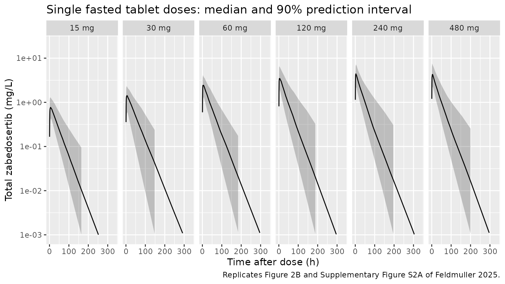
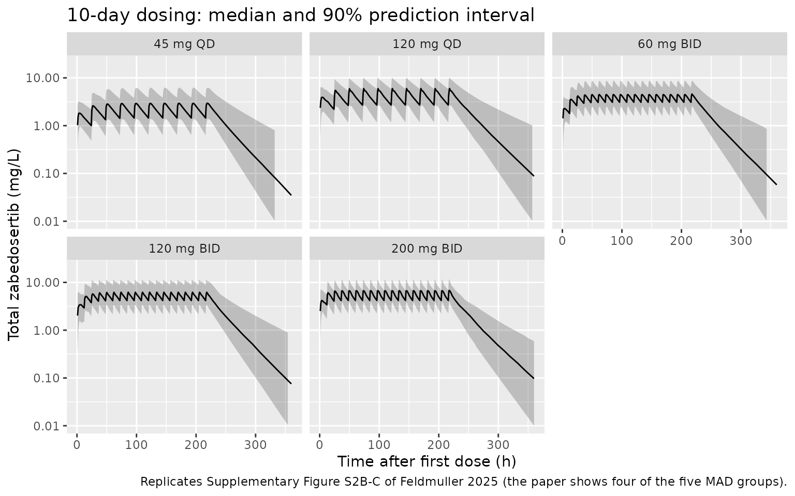
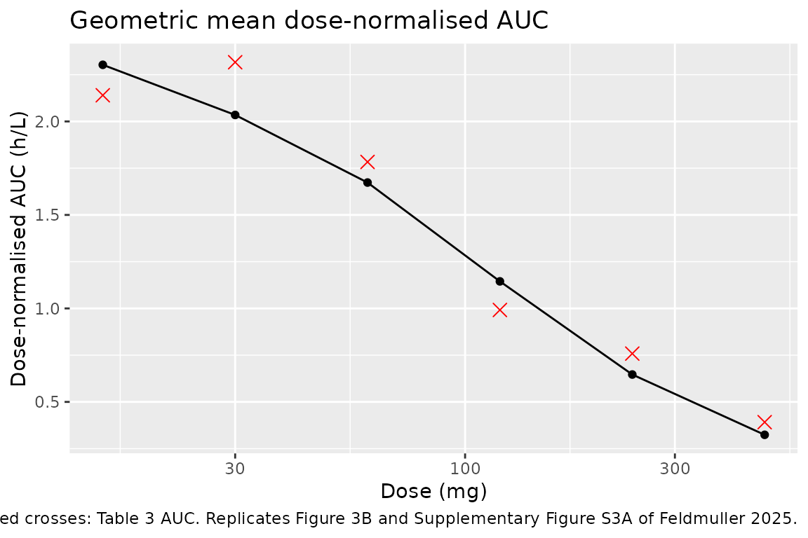
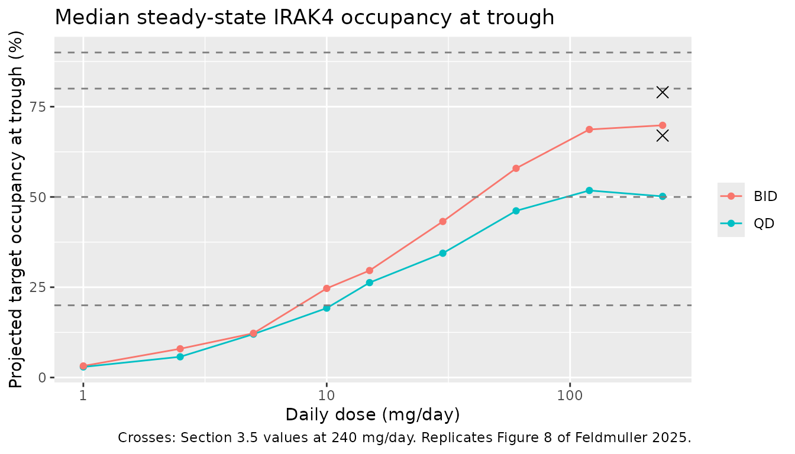

# Zabedosertib (Feldmuller 2025)

## Model and source

- Citation: Feldmuller M, Jodl SJ, Ploeger B, Wagenfeld A, Wiesinger H,
  Zollmann FS, Klein S, Zhang R, Rohde B, Hochel J. Zabedosertib, a
  novel interleukin-1 receptor-associated kinase-4 inhibitor, shows a
  favorable pharmacokinetic and safety profile across multiple phase 1
  studies. Front Pharmacol. 2025;16:1521505.
  <doi:10.3389/fphar.2025.1521505>. PMCID PMC12163019. Model structure
  from Supplementary Section 1.5 (Figure S1 and text); parameter
  estimates from Supplementary Table S4; target-occupancy inputs from
  Section 2.11, Section 3.5 and Supplementary Section 1.6.
- Description: One-compartment population PK model for oral zabedosertib
  (BAY 1834845, an IRAK4 inhibitor) in healthy adult men (Feldmuller
  2025). First-order absorption through one transit compartment (depot
  -\> transit1 -\> central, both steps at rate ka), a dose-dependent
  relative bioavailability that falls exponentially with the
  administered dose towards a fixed floor of 1%, linear elimination of
  UNBOUND drug, and capacity-limited binding of unbound drug to a
  high-affinity plasma binding partner (‘AGP’) in the central
  compartment with explicit association / dissociation kinetics (Kd
  fixed to the in vitro AGP affinity, 0.4 uM; dissociation rate and
  binding capacity estimated). The observed total plasma concentration
  is unbound plus bound. A target-occupancy sub-model links the
  model-predicted unbound plasma concentration to IRAK4 binding (Kd
  taken as the in vitro whole-blood IL-6 IC50, 86 nM; target residence
  time 5 min). IIV on unbound CL, unbound V, ka and binding capacity;
  combined proportional plus study-specific additive residual error.
- Article: <https://doi.org/10.3389/fphar.2025.1521505> (open access;
  the population PK model is in Supplementary Section 1.5)

Zabedosertib (BAY 1834845) is an oral interleukin-1 receptor-associated
kinase-4 (IRAK4) inhibitor. Feldmuller 2025 report three phase 1 studies
in healthy men. The population PK analysis pooled the
single-ascending-dose (SAD, NCT03054402) and multiple-ascending-dose
(MAD, NCT03493269) studies and explained two nonlinearities: exposure
that rises less than proportionally with dose (a dose-dependent relative
bioavailability), and less accumulation than the terminal half-life
predicts (capacity-limited binding to a high-affinity plasma binding
partner with slow dissociation, assumed to be alpha-1-acid glycoprotein,
AGP). The paper then projected IRAK4 target occupancy from the
model-predicted unbound concentration.

## Population

The model was fitted to 2500 plasma concentrations from 77 healthy men
(Supplementary Table S3): 45 SAD participants who took single tablet
doses of 15-480 mg fasted, and 32 MAD participants who took 45 or 120 mg
once daily (QD) or 60, 120 or 200 mg twice daily (BID) for 10 days after
a light meal, plus a single-dose period. SAD data after the liquid
formulation or in the fed state were excluded. Participants were 18-50
years old (mean 38 and 35.8 years in the SAD and MAD studies), with BMI
19.4-30.1 kg/m^2, and almost all White (Table 1). No body weight is
reported and no covariate analysis was done, so the model has no
demographic covariates.

The same information is available programmatically via
`readModelDb("Feldmuller_2025_zabedosertib")()$population`.

## Source trace

| Equation / parameter | Value | Source location |
|----|----|----|
| Structure: depot -\> transit -\> unbound central; unbound + binding partner \<-\> bound, all in the central volume `V_unb`; elimination from the unbound pool | n/a | Supplementary Figure S1 and Section 1.5 text |
| `F1 = fmin + (1 - fmin) * exp(-log(2) / d50 * DOSE)` | n/a | Supplementary Section 1.5 |
| `kon = koff / Kd` | n/a | Supplementary Section 1.5 (“estimated by dividing the koff by the Kd”) |
| `lcl` (Cl_unb) | 15.4 L/h | Table S4 |
| `lvc` (V_unb) | 7.84 L | Table S4 |
| `lka` (ka) | 1.2 1/h | Table S4 |
| `lkd_pb` (Kd) | 0.4 uM, fixed | Table S4 (fixed to the in vitro AGP affinity) |
| `lkoff_pb` (koff) | 0.058 1/h | Table S4 |
| `lbmax_pb` (‘AGP’) | 14.9 uM | Table S4 |
| `ld50_fdepot` (d50) | 204 mg | Table S4 |
| `fmin_fdepot` (fmin) | 0.01, fixed | Table S4 |
| `etalcl`, `etalvc`, `etalka`, `etalbmax_pb` | 0.293, 0.071, 0.39, 0.124 | Table S4 (omega^2) |
| `propSd` | sqrt(0.037) = 0.192 | Table S4 (sigma^2 prop) |
| `addSd`, `addSd_mad` | sqrt(0.25), sqrt(2.5) ug/L, fixed | Table S4 (sigma^2 add,SAD and add,MAD) |
| `lkd_irak4` | 0.086 uM, fixed | Section 3.5 (IL-6 release IC50 86 nM, taken as the IRAK4 Kd) |
| `lkoff_irak4` | 12 1/h, fixed | Section 2.11 (target residence time about 5 min) |
| Target binding `dTO/dt = kon * Cu * (1 - TO) - koff * TO` | n/a | Section 2.11 (second-order binding, first-order dissociation, drug in excess) |
| Molecular weight | 470.5 g/mol | Not in the paper; PubChem CID 121364961 (C20H21F3N4O4S) |

## Virtual cohorts

All participants were healthy men and the model has no demographic
covariates, so the virtual cohorts differ only in their dosing. Each
dose group has 100 virtual participants. `STUDY_NCT03493269` only
selects the additive residual error and does not affect the predictions
below.

``` r

mod <- readModelDb("Feldmuller_2025_zabedosertib")

# SAD study: sampling times of Supplementary Section 1.3.2 plus a regular grid
sad_doses <- c(15, 30, 60, 120, 240, 480)
sad_obs <- sort(unique(c(
  0, 0.5, 1, 1.5, 2, 2.5, 3, 3.5, 4, 5, 6, 8, 12, 24, 36, 48,
  seq(0, 336, by = 4)
)))
n_arm <- 100L

make_sad <- function(dose, id_offset) {
  ids <- id_offset + seq_len(n_arm)
  dose_rows <- tibble(id = ids, time = 0, amt = dose, evid = 1L, cmt = "depot")
  obs_rows <- tidyr::expand_grid(id = ids, time = sad_obs) |>
    mutate(amt = 0, evid = 0L, cmt = "central")
  bind_rows(dose_rows, obs_rows) |>
    mutate(treatment = paste(dose, "mg"), STUDY_NCT03493269 = 0L)
}

sad_events <- bind_rows(lapply(seq_along(sad_doses), function(i) {
  make_sad(sad_doses[i], id_offset = (i - 1L) * n_arm)
})) |>
  arrange(id, time, desc(evid))
stopifnot(!anyDuplicated(sad_events[, c("id", "time", "evid")]))

# MAD study: 10 days; on day 10 the BID groups took only the morning dose
mad_regimens <- tibble::tribble(
  ~treatment,   ~dose, ~ii,
  "45 mg QD",     45,  24,
  "120 mg QD",   120,  24,
  "60 mg BID",    60,  12,
  "120 mg BID",  120,  12,
  "200 mg BID",  200,  12
)
mad_obs <- sort(unique(c(seq(0, 360, by = 1), seq(216, 240, by = 0.5))))

make_mad <- function(treatment, dose, ii, id_offset) {
  ids <- id_offset + seq_len(n_arm)
  dose_times <- c(seq(0, 216 - ii, by = ii), 216)
  dose_rows <- tidyr::expand_grid(id = ids, time = dose_times) |>
    mutate(amt = dose, evid = 1L, cmt = "depot")
  obs_rows <- tidyr::expand_grid(id = ids, time = mad_obs) |>
    mutate(amt = 0, evid = 0L, cmt = "central")
  bind_rows(dose_rows, obs_rows) |>
    mutate(treatment = treatment, STUDY_NCT03493269 = 1L)
}

mad_events <- bind_rows(lapply(seq_len(nrow(mad_regimens)), function(i) {
  make_mad(
    mad_regimens$treatment[i], mad_regimens$dose[i], mad_regimens$ii[i],
    id_offset = 1000L + (i - 1L) * n_arm
  )
})) |>
  arrange(id, time, desc(evid))
stopifnot(!anyDuplicated(mad_events[, c("id", "time", "evid")]))
```

## Simulation

``` r

rxode2::rxSetSeed(20250530)
sim_sad <- rxode2::rxSolve(
  mod, events = sad_events, keep = "treatment", returnType = "data.frame"
)
#> ℹ parameter labels from comments will be replaced by 'label()'
rxode2::rxSetSeed(20250531)
sim_mad <- rxode2::rxSolve(
  mod, events = mad_events, keep = "treatment", returnType = "data.frame"
)

dose_levels <- paste(sad_doses, "mg")
sim_sad$treatment <- factor(sim_sad$treatment, levels = dose_levels)
sim_mad$treatment <- factor(sim_mad$treatment, levels = mad_regimens$treatment)
```

## Replicate published figures

### Single-dose profiles (Figure 2 and Supplementary Figure S2A)

``` r

sim_sad |>
  filter(time >= 0.5) |>
  group_by(treatment, time) |>
  summarise(
    Q05 = quantile(Cc, 0.05), Q50 = median(Cc), Q95 = quantile(Cc, 0.95),
    .groups = "drop"
  ) |>
  ggplot(aes(time, Q50)) +
  geom_ribbon(aes(ymin = Q05, ymax = Q95), alpha = 0.25) +
  geom_line() +
  facet_wrap(~treatment, nrow = 1) +
  scale_y_log10(limits = c(1e-3, 20)) +
  labs(
    x = "Time after dose (h)", y = "Total zabedosertib (mg/L)",
    title = "Single fasted tablet doses: median and 90% prediction interval",
    caption = "Replicates Figure 2B and Supplementary Figure S2A of Feldmuller 2025."
  )
#> Warning: Removed 234 rows containing missing values or values outside the scale range
#> (`geom_ribbon()`).
#> Warning: Removed 70 rows containing missing values or values outside the scale range
#> (`geom_line()`).
```



The simulated profiles rise to a broad peak in the first hours and then
fall with a terminal half-life of about a day, as in Figure 2. Peak
concentrations crowd together above 120 mg: the bioavailability falls
with dose and the binding partner saturates.

### Multiple-dose profiles (Supplementary Figure S2B and S2C)

``` r

sim_mad |>
  filter(time >= 0.5) |>
  group_by(treatment, time) |>
  summarise(
    Q05 = quantile(Cc, 0.05), Q50 = median(Cc), Q95 = quantile(Cc, 0.95),
    .groups = "drop"
  ) |>
  ggplot(aes(time, Q50)) +
  geom_ribbon(aes(ymin = Q05, ymax = Q95), alpha = 0.25) +
  geom_line() +
  facet_wrap(~treatment, nrow = 2) +
  scale_y_log10(limits = c(1e-2, 20)) +
  labs(
    x = "Time after first dose (h)", y = "Total zabedosertib (mg/L)",
    title = "10-day dosing: median and 90% prediction interval",
    caption = "Replicates Supplementary Figure S2B-C of Feldmuller 2025 (the paper shows four of the five MAD groups)."
  )
#> Warning: Removed 54 rows containing missing values or values outside the scale range
#> (`geom_ribbon()`).
```



### Dose proportionality (Figure 3 and Supplementary Figure S3A)

``` r

sad_auc_obs <- tibble::tribble(
  ~dose, ~auc,
  15,  32.1,
  30,  69.5,
  60,  107,
  120, 119,
  240, 182,
  480, 188
)

sim_sad |>
  group_by(id, treatment) |>
  summarise(auc = sum(diff(time) * (head(Cc, -1) + tail(Cc, -1)) / 2), .groups = "drop") |>
  mutate(dose = as.numeric(sub(" mg", "", treatment))) |>
  group_by(dose) |>
  summarise(gm = exp(mean(log(auc / dose))), .groups = "drop") |>
  ggplot(aes(dose, gm)) +
  geom_line() +
  geom_point() +
  geom_point(data = sad_auc_obs, aes(dose, auc / dose), shape = 4, size = 3, colour = "red") +
  scale_x_log10() +
  labs(
    x = "Dose (mg)", y = "Dose-normalised AUC (h/L)",
    title = "Geometric mean dose-normalised AUC",
    caption = paste(
      "Line: simulated AUC(0-336 h); red crosses: Table 3 AUC.",
      "Replicates Figure 3B and Supplementary Figure S3A of Feldmuller 2025."
    )
  )
```



## PKNCA validation

### Single dose (Table 3)

``` r

sad_nca_conc <- sim_sad |>
  filter(!is.na(Cc)) |>
  select(id, time, Cc, treatment)
sad_nca_conc <- bind_rows(
  sad_nca_conc,
  sad_nca_conc |> distinct(id, treatment) |> mutate(time = 0, Cc = 0)
) |>
  distinct(id, treatment, time, .keep_all = TRUE) |>
  arrange(id, treatment, time)

sad_dose <- sad_events |>
  filter(evid == 1) |>
  select(id, time, amt, treatment)

sad_intervals <- data.frame(
  start = 0, end = Inf,
  cmax = TRUE, tmax = TRUE, aucinf.obs = TRUE, half.life = TRUE
)

sad_nca <- PKNCA::pk.nca(PKNCA::PKNCAdata(
  PKNCA::PKNCAconc(sad_nca_conc, Cc ~ time | treatment + id),
  PKNCA::PKNCAdose(sad_dose, amt ~ time | treatment + id),
  intervals = sad_intervals
))

# Table 3: geometric means (tmax: median) after fasted tablet doses, SAD study
sad_published <- tibble::tribble(
  ~treatment, ~cmax, ~tmax, ~aucinf.obs, ~half.life,
  "15 mg",    1.13,  2.00,   32.1,       24.0,
  "30 mg",    1.92,  3.50,   69.5,       26.5,
  "60 mg",    2.91,  3.00,  107,         26.7,
  "120 mg",   3.30,  3.25,  119,         24.4,
  "240 mg",   4.43,  2.50,  182,         24.3,
  "480 mg",   4.65,  1.50,  188,         22.8
)

nlmixr2lib::ncaComparisonTable(
  simulated = sad_nca,
  reference = sad_published,
  by = "treatment",
  units = c(cmax = "mg/L", tmax = "h", aucinf.obs = "mg*h/L", half.life = "h"),
  tolerance_pct = 20
) |>
  dplyr::rename("Dose" = treatment) |>
  knitr::kable(caption = "Simulated (median) vs Table 3 (geometric mean; tmax median). * differs by >20%.")
```

| NCA parameter          | Dose   | Reference | Simulated | % diff    |
|:-----------------------|:-------|:----------|:----------|:----------|
| Cmax (mg/L)            | 15 mg  | 1.13      | 0.847     | -25.1%\*  |
| Cmax (mg/L)            | 30 mg  | 1.92      | 1.51      | -21.6%\*  |
| Cmax (mg/L)            | 60 mg  | 2.91      | 2.67      | -8.1%     |
| Cmax (mg/L)            | 120 mg | 3.3       | 3.9       | +18.2%    |
| Cmax (mg/L)            | 240 mg | 4.43      | 5.13      | +15.7%    |
| Cmax (mg/L)            | 480 mg | 4.65      | 4.69      | +0.8%     |
| Tmax (h)               | 15 mg  | 2         | 4         | +100.0%\* |
| Tmax (h)               | 30 mg  | 3.5       | 4         | +14.3%    |
| Tmax (h)               | 60 mg  | 3         | 3.5       | +16.7%    |
| Tmax (h)               | 120 mg | 3.25      | 3.5       | +7.7%     |
| Tmax (h)               | 240 mg | 2.5       | 3         | +20.0%    |
| Tmax (h)               | 480 mg | 1.5       | 3         | +100.0%\* |
| AUC0-∞ (obs) (mg\*h/L) | 15 mg  | 32.1      | 34        | +5.8%     |
| AUC0-∞ (obs) (mg\*h/L) | 30 mg  | 69.5      | 65.3      | -6.0%     |
| AUC0-∞ (obs) (mg\*h/L) | 60 mg  | 107       | 103       | -3.6%     |
| AUC0-∞ (obs) (mg\*h/L) | 120 mg | 119       | 135       | +13.8%    |
| AUC0-∞ (obs) (mg\*h/L) | 240 mg | 182       | 154       | -15.1%    |
| AUC0-∞ (obs) (mg\*h/L) | 480 mg | 188       | 155       | -17.7%    |
| t½ (h)                 | 15 mg  | 24        | 25.5      | +6.4%     |
| t½ (h)                 | 30 mg  | 26.5      | 27.4      | +3.6%     |
| t½ (h)                 | 60 mg  | 26.7      | 26        | -2.7%     |
| t½ (h)                 | 120 mg | 24.4      | 25.1      | +3.1%     |
| t½ (h)                 | 240 mg | 24.3      | 25        | +3.0%     |
| t½ (h)                 | 480 mg | 22.8      | 25.1      | +9.9%     |

Simulated (median) vs Table 3 (geometric mean; tmax median). \* differs
by \>20%. {.table}

``` r

sad_gm <- as.data.frame(sad_nca) |>
  filter(PPTESTCD %in% c("aucinf.obs", "half.life")) |>
  group_by(treatment, PPTESTCD) |>
  summarise(gm = exp(mean(log(PPORRES))), .groups = "drop") |>
  tidyr::pivot_wider(names_from = PPTESTCD, values_from = gm) |>
  inner_join(sad_published |> select(treatment, auc_pub = aucinf.obs, hl_pub = half.life),
    by = "treatment"
  ) |>
  mutate(
    auc_pct = 100 * (aucinf.obs / auc_pub - 1),
    hl_pct = 100 * (half.life / hl_pub - 1)
  )
knitr::kable(sad_gm, digits = 1, caption = "Geometric-mean AUC and half-life against Table 3.")
```

| treatment | aucinf.obs | half.life | auc_pub | hl_pub | auc_pct | hl_pct |
|:----------|-----------:|----------:|--------:|-------:|--------:|-------:|
| 120 mg    |      137.4 |      26.2 |   119.0 |   24.4 |    15.5 |    7.2 |
| 15 mg     |       34.6 |      26.6 |    32.1 |   24.0 |     7.7 |   10.7 |
| 240 mg    |      155.1 |      25.3 |   182.0 |   24.3 |   -14.8 |    3.9 |
| 30 mg     |       61.1 |      27.8 |    69.5 |   26.5 |   -12.1 |    4.8 |
| 480 mg    |      155.6 |      26.4 |   188.0 |   22.8 |   -17.2 |   15.8 |
| 60 mg     |      100.5 |      26.8 |   107.0 |   26.7 |    -6.1 |    0.6 |

Geometric-mean AUC and half-life against Table 3. {.table}

``` r


stopifnot(
  # A mis-transcribed clearance, d50 or binding constant shifts every dose
  # group by tens of percent.
  abs(median(sad_gm$auc_pct)) < 15,
  max(abs(sad_gm$auc_pct)) < 35,
  abs(median(sad_gm$hl_pct)) < 20
)
```

The model reproduces the single-dose exposure across the 32-fold dose
range, including the plateau of AUC above 240 mg. Simulated Cmax is
lower than observed at the two lowest doses and higher at 120-240 mg;
the paper notes that the profiles stay near a plateau from 2-3 h to
about 6 h after dosing, which a first-order absorption model with one
transit step reproduces only approximately, so Cmax and tmax are the
least well described quantities.

### Multiple dose, day 10 (Supplementary Section 4.7)

``` r

mad_nca_conc <- sim_mad |>
  filter(!is.na(Cc)) |>
  select(id, time, Cc, treatment)

mad_dose <- mad_events |>
  filter(evid == 1) |>
  select(id, time, amt, treatment)

mad_intervals <- mad_regimens |>
  transmute(
    treatment = factor(treatment, levels = mad_regimens$treatment),
    start = 216, end = 216 + ii,
    cmax = TRUE, auclast = TRUE
  ) |>
  as.data.frame()

mad_nca <- PKNCA::pk.nca(PKNCA::PKNCAdata(
  PKNCA::PKNCAconc(mad_nca_conc, Cc ~ time | treatment + id),
  PKNCA::PKNCAdose(mad_dose, amt ~ time | treatment + id),
  intervals = mad_intervals
))

# Supplementary 4.7: total zabedosertib on day 10 (geometric means); AUC over
# the dosing interval, AUC(0-24)md for QD and AUC(0-12)md for BID
mad_published <- tibble::tribble(
  ~treatment,   ~cmax, ~auclast,
  "45 mg QD",    2.81,  47.4,
  "120 mg QD",   4.18,  72.0,
  "60 mg BID",   4.29,  46.5,
  "120 mg BID",  6.01,  62.2,
  "200 mg BID",  6.19,  63.5
)

nlmixr2lib::ncaComparisonTable(
  simulated = mad_nca,
  reference = mad_published,
  by = "treatment",
  units = c(cmax = "mg/L", auclast = "mg*h/L"),
  tolerance_pct = 20
) |>
  dplyr::rename("Regimen" = treatment) |>
  knitr::kable(caption = "Simulated (median) vs Supplementary 4.7 (geometric mean), day 10 dosing interval. * differs by >20%.")
```

| NCA parameter     | Regimen    | Reference | Simulated | % diff   |
|:------------------|:-----------|:----------|:----------|:---------|
| Cmax (mg/L)       | 45 mg QD   | 2.81      | 3         | +6.6%    |
| Cmax (mg/L)       | 120 mg QD  | 4.18      | 6.42      | +53.6%\* |
| Cmax (mg/L)       | 60 mg BID  | 4.29      | 4.71      | +9.9%    |
| Cmax (mg/L)       | 120 mg BID | 6.01      | 6.45      | +7.3%    |
| Cmax (mg/L)       | 200 mg BID | 6.19      | 7.09      | +14.6%   |
| AUClast (mg\*h/L) | 45 mg QD   | 47.4      | 52.7      | +11.1%   |
| AUClast (mg\*h/L) | 120 mg QD  | 72        | 100       | +39.3%\* |
| AUClast (mg\*h/L) | 60 mg BID  | 46.5      | 45.6      | -1.9%    |
| AUClast (mg\*h/L) | 120 mg BID | 62.2      | 63        | +1.3%    |
| AUClast (mg\*h/L) | 200 mg BID | 63.5      | 66.5      | +4.8%    |

Simulated (median) vs Supplementary 4.7 (geometric mean), day 10 dosing
interval. \* differs by \>20%. {.table}

``` r

mad_gm <- as.data.frame(mad_nca) |>
  filter(PPTESTCD %in% c("cmax", "auclast")) |>
  group_by(treatment, PPTESTCD) |>
  summarise(gm = exp(mean(log(PPORRES))), .groups = "drop") |>
  tidyr::pivot_wider(names_from = PPTESTCD, values_from = gm) |>
  mutate(treatment = as.character(treatment)) |>
  inner_join(
    mad_published |> select(treatment, cmax_pub = cmax, auc_pub = auclast),
    by = "treatment"
  ) |>
  mutate(
    cmax_pct = 100 * (cmax / cmax_pub - 1),
    auc_pct = 100 * (auclast / auc_pub - 1)
  )
knitr::kable(mad_gm, digits = 2, caption = "Geometric-mean day-10 Cmax and AUCtau against Supplementary 4.7.")
```

| treatment  | auclast | cmax | cmax_pub | auc_pub | cmax_pct | auc_pct |
|:-----------|--------:|-----:|---------:|--------:|---------:|--------:|
| 120 mg BID |   61.38 | 6.42 |     6.01 |    62.2 |     6.86 |   -1.32 |
| 120 mg QD  |   95.57 | 5.96 |     4.18 |    72.0 |    42.51 |   32.73 |
| 200 mg BID |   64.84 | 7.15 |     6.19 |    63.5 |    15.58 |    2.11 |
| 45 mg QD   |   53.95 | 3.13 |     2.81 |    47.4 |    11.23 |   13.82 |
| 60 mg BID  |   46.44 | 4.78 |     4.29 |    46.5 |    11.52 |   -0.13 |

Geometric-mean day-10 Cmax and AUCtau against Supplementary 4.7.
{.table}

``` r


stopifnot(
  abs(median(mad_gm$auc_pct)) < 30,
  abs(median(mad_gm$cmax_pct)) < 30
)
```

The MAD participants took zabedosertib after a light meal, which raises
Cmax by about 1.4-fold without changing AUC (Table 6), whereas the model
has no food effect; the paper describes the model as one for fasted
tablets. The simulated day-10 AUC and Cmax are within about 15% of the
observed geometric means for four of the five regimens. The exception is
120 mg QD, where the model is about a third higher than the observed AUC
and about 40% higher than the observed Cmax. The observed 120 mg QD
group (n = 8) had a lower daily AUC than 60 mg BID (Table 5, Cav/D ratio
0.817), whereas the model, which applies the dose-dependent
bioavailability to each administration, predicts similar daily exposure
for the two regimens.

## Target occupancy (Figure 8)

The paper projected steady-state IRAK4 occupancy at trough from the
unbound plasma concentration predicted by the population PK model. Here
each regimen is given for 20 days so that the trough is at steady state.

``` r

to_grid <- tidyr::expand_grid(
  daily = c(1, 2.5, 5, 10, 15, 30, 60, 120, 240),
  regimen = c("QD", "BID")
) |>
  mutate(ii = ifelse(regimen == "QD", 24, 12), arm = row_number())
n_to <- 100L

to_events <- bind_rows(lapply(seq_len(nrow(to_grid)), function(i) {
  g <- to_grid[i, ]
  ids <- 5000L + (i - 1L) * n_to + seq_len(n_to)
  n_dose <- 20 * 24 / g$ii
  dose_rows <- tidyr::expand_grid(id = ids, time = seq(0, by = g$ii, length.out = n_dose)) |>
    mutate(amt = g$daily * g$ii / 24, evid = 1L, cmt = "depot")
  obs_rows <- tibble(id = ids, time = n_dose * g$ii, amt = 0, evid = 0L, cmt = "central")
  bind_rows(dose_rows, obs_rows) |>
    mutate(arm = g$arm, STUDY_NCT03493269 = 1L)
})) |>
  arrange(id, time, desc(evid))

rxode2::rxSetSeed(20250601)
sim_to <- rxode2::rxSolve(mod, events = to_events, keep = "arm", returnType = "data.frame")

to_summary <- sim_to |>
  group_by(arm) |>
  summarise(occ = median(occ_irak4), .groups = "drop") |>
  left_join(to_grid, by = "arm")

ggplot(to_summary, aes(daily, 100 * occ, colour = regimen)) +
  geom_line() +
  geom_point() +
  geom_hline(yintercept = c(20, 50, 80, 90), linetype = "dashed", colour = "grey50") +
  annotate("point", x = 240, y = c(79, 67), shape = 4, size = 3) +
  scale_x_log10() +
  labs(
    x = "Daily dose (mg/day)", y = "Projected target occupancy at trough (%)",
    colour = NULL,
    title = "Median steady-state IRAK4 occupancy at trough",
    caption = "Crosses: Section 3.5 values at 240 mg/day. Replicates Figure 8 of Feldmuller 2025."
  )
```



``` r

to_240 <- to_summary |> filter(daily == 240)
knitr::kable(
  to_240 |>
    mutate(published = ifelse(regimen == "BID", 79, 67), simulated = round(100 * occ, 1)) |>
    select(regimen, simulated, published),
  caption = "Median steady-state trough IRAK4 occupancy (%) at 240 mg/day."
)
```

| regimen | simulated | published |
|:--------|----------:|----------:|
| QD      |      50.2 |        67 |
| BID     |      69.8 |        79 |

Median steady-state trough IRAK4 occupancy (%) at 240 mg/day. {.table}

``` r


stopifnot(
  # The projection runs about 10-17 percentage points below the paper (see
  # Assumptions and deviations); these bounds pin the model's own behaviour.
  with(to_240, occ[regimen == "BID"] > occ[regimen == "QD"]),
  with(to_240, occ[regimen == "BID"] > 0.55 & occ[regimen == "BID"] < 0.85)
)
```

The model reproduces the shape of Figure 8 – occupancy rising over two
orders of magnitude of dose and levelling off above 120 mg/day, with BID
dosing above QD at every daily dose – but sits about 10-17 percentage
points below it (about 70% vs 79% for 120 mg BID, about 50% vs 67% for
240 mg QD). Expressed as occupancy odds, the gap is a nearly constant
factor of 1.6-2.0 across daily doses from 15 to 240 mg/day, which points
to a scale difference in the concentration or Kd used for the projection
rather than to the PK structure (total exposures match Table 3). The
paper does not give the unit conversion or the code of the projection,
and Figure 8 is labelled as a preliminary analysis, so the difference is
recorded here rather than tuned.

## Assumptions and deviations

- **Transit step rate.** Supplementary Figure S1 shows one transit
  compartment between the depot and the central compartment, but Table
  S4 lists a single absorption rate constant. Both steps run at `ka`,
  the only reading under which Table S4 is complete.
- **Volume of the bound pool.** Figure S1 draws the unbound drug, the
  binding partner and the bound drug inside one central compartment
  labelled `V_unb`, so bound and unbound drug share the volume `V_unb`
  and the observed total concentration is `(unbound + bound) / V_unb`.
- **Molecular weight.** Kd and the binding capacity are in uM while
  doses are in mg. The paper does not print the molecular weight; 470.5
  g/mol is the PubChem value for zabedosertib (CID 121364961).
- **Dose in the bioavailability equation.** `DOSE` is taken as the
  amount of each administration (`podo(depot)`), so 120 mg BID uses
  `F(120 mg)`.
- **Additive residual error units.** Table S4 gives the fixed additive
  variances (0.25 SAD, 2.5 MAD) without units. They are read as ug/L,
  the bioanalytical unit, which matches the lower limits of quantitation
  of the two studies (1.0 and 10.0 ug/L, Supplementary Table S2), and
  converted to mg/L. Both are negligible against the observed
  concentrations.
- **Food.** The MAD study was dosed after a light meal; the model has no
  food covariate (the paper describes it as a model for fasted tablets).
- **Unbound concentration.** The model’s unbound concentration `Cu` is a
  model state, not the unbound concentrations in Table 4, which the
  paper derived from total concentrations with an equilibrium binding
  formula (Supplementary Section 1.4.2). With a dissociation half-life
  of about 12 h the model’s unbound concentration is far from binding
  equilibrium after each dose, so the two are not comparable.
- **Target-occupancy projection.** The target Kd is the whole-blood IL-6
  release IC50 (86 nM) and the dissociation rate constant is the
  reciprocal of the 5-minute target residence time; the target is
  assumed to be in excess drug, as stated in Section 2.11. The
  projection does not reproduce the level of Figure 8 (see above).
- No correction notice linked to this article was found in Europe PMC as
  of 2026-11-04.
