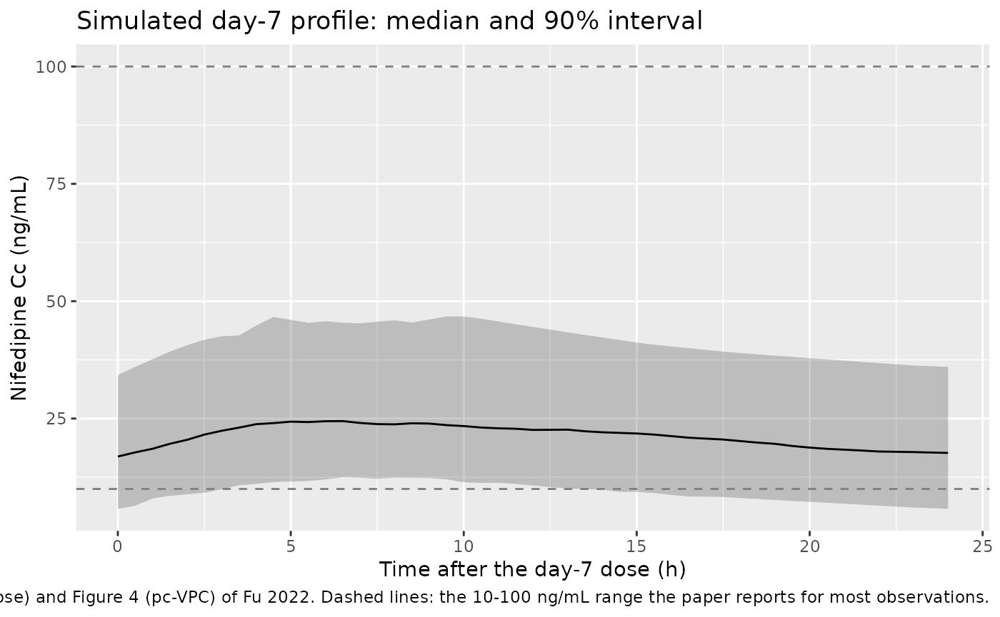
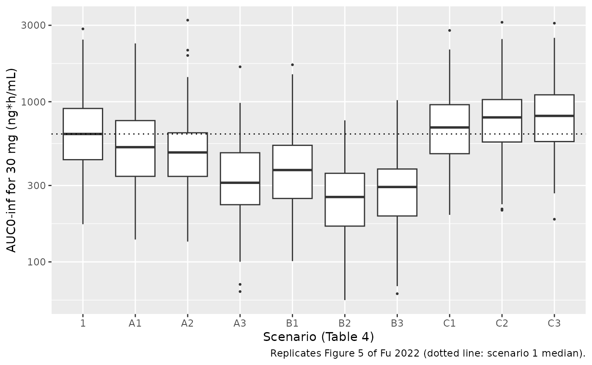
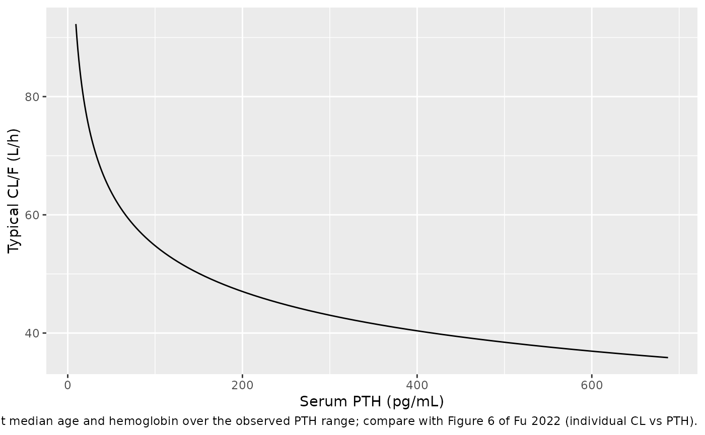

# Nifedipine (Fu 2022)

## Model and source

- Citation: Fu C, Pei Q, Liang W, Yang B, Li W, Liu J, Tan H, Guo C,
  Zhang H, Yang G. Population Pharmacokinetic Modelling for Nifedipine
  to Evaluate the Effect of Parathyroid Hormone on CYP3A in Patients
  with Chronic Kidney Disease. Drug Des Devel Ther. 2022;16:2261-2274.
  <doi:10.2147/DDDT.S362607>.
- Description: One-compartment population PK model for oral
  controlled-release nifedipine in Chinese adults with chronic kidney
  disease (stages 2-5, not on dialysis) and hypertension (Fu 2022).
  Zero-order input into the central compartment at an estimated constant
  rate K0 and first-order elimination; apparent clearance falls with
  age, hemoglobin and serum parathyroid hormone (power effects on the
  cohort medians), apparent volume rises with ALT; additive residual
  error.
- Article: <https://doi.org/10.2147/DDDT.S362607>
- Supplement (Tables S1-S2, structural-model screen and base model):
  <https://www.dovepress.com/get_supplementary_file.php?f=362607.docx>

Fu et al. fitted a population PK model to sparse day-7 concentrations of
controlled-release nifedipine, a CYP3A substrate, in patients with
chronic kidney disease (CKD) to test whether serum parathyroid hormone
(PTH), which down-regulates hepatic CYP3A in uraemic animals, lowers
CYP3A-mediated clearance in patients. The final model is one-compartment
with zero-order input at a constant estimated rate K0 (mg/h) and
first-order elimination, fitted with Phoenix NLME (FOCE-ELS). Age,
hemoglobin and PTH reduce CL/F; ALT increases V/F.

## Population

The analysis included 157 Chinese adults with CKD (KDIGO stage 2/3/4/5
in 11/20/62/64 patients) and hypertension who were not on dialysis,
treated at the Third Xiangya Hospital, Changsha, between August 2017 and
April 2019 (NCT03695107). Patients took nifedipine controlled-release 30
mg tablets (Bayer) for 7 days; the paper does not report each patient’s
daily dose, and its own simulations use 30 mg once daily, as do the
simulations below. Two to four samples per patient were drawn on day 7
(predose, 3-4 h, 6-8 h and 24 h post-dose), 612 concentrations in total.
Table 1 of the paper gives the covariate summary: median age 54 years
(24-84), BMI 23.4 kg/m^2 (15.81-36.70), GFR 16.85 mL/min/1.73 m^2
(4.84-73.93), PTH 156.84 pg/mL (9.34-687.27), hemoglobin 94 g/L
(40-177), ALT 14 U/L (1-81); male:female 63:94. Body weight was not
tabulated.

The same information is available programmatically via
`readModelDb("Fu_2022_nifedipine")()$population`.

## Source trace

| Equation / parameter | Value | Source location |
|----|----|----|
| `lcl` (CL/F) | log(49.61 L/h) | Table 3, tvCL |
| `lvc` (V/F) | log(2300.26 L) | Table 3, tvV |
| `lr1` (K0) | log(4.21 mg/h) | Table 3, tvK0 |
| `e_age_cl` | -0.22 | Table 3, dCLdAge |
| `e_hgb_cl` | -0.35 | Table 3, dCLdHb |
| `e_parathyroid_hormone_cl` | -0.22 | Table 3, dCLdPTH |
| `e_alt_vc` | 0.48 | Table 3, dVdALT |
| `etalcl` | log(0.5832^2 + 1) = 0.29276 | Table 3, IIV CL 58.32% |
| `etalvc` | log(0.45644^2 + 1) = 0.18925 | Table 3, IIV V 45.644% |
| `etalr1` | log(0.558^2 + 1) = 0.27107 | Table 3, IIV K0 55.80% |
| `addSd` | 8.12 ng/mL | Table 3, stdev0 |
| CL/F = tvCL/F (Age/54)^dCLdAge (Hb/94)^dCLdHb (PTH/156.84)^dCLdPTH exp(nCL/F) | n/a | Results p.4, final-model equation |
| V/F = tvV/F (ALT/14)^dVdALT exp(nV/F) | n/a | Results p.4, final-model equation |
| K0 = tvK0 exp(nK0) | n/a | Results p.4 |
| Covariate reference values = cohort medians | 54 y, 94 g/L, 156.84 pg/mL, 14 U/L | Methods (covariate model), Table 1 |
| One compartment, zero-order input, first-order elimination | n/a | Results; Table S1 (lowest OFV 5141.5) |
| Additive residual error | n/a | Methods Eq. 2; Results |

## Virtual cohort

Individual data are not public. The cohort below draws the four model
covariates independently from distributions centred on the Table 1
medians and truncated to the Table 1 ranges: age and hemoglobin normal,
PTH and ALT log-normal (both are right-skewed in Table 1).

``` r

set.seed(2022)
rxode2::rxSetSeed(2022)

# Truncated draws by inverse CDF so every value lies inside the Table 1 range.
rtrunc_norm <- function(n, mean, sd, lo, hi) {
  u <- stats::runif(n, stats::pnorm(lo, mean, sd), stats::pnorm(hi, mean, sd))
  stats::qnorm(u, mean, sd)
}
rtrunc_lnorm <- function(n, median, sdlog, lo, hi) {
  exp(rtrunc_norm(n, log(median), sdlog, log(lo), log(hi)))
}

n_sub <- 200
cohort <- tibble(
  id = seq_len(n_sub),
  AGE = rtrunc_norm(n_sub, 54, 13, 24, 84),
  HGB = rtrunc_norm(n_sub, 94, 22, 40, 177),
  PARATHYROID_HORMONE = rtrunc_lnorm(n_sub, 156.84, 0.8, 9.34, 687.27),
  ALT = rtrunc_lnorm(n_sub, 14, 0.6, 1, 81),
  treatment = "30 mg QD"
)

# 30 mg once daily for 7 days. rate = -1 tells rxode2 to use the modelled
# zero-order rate r1 (duration = dose / r1). Observations are on the
# central state; Cc is returned as a column.
dose_times <- seq(0, 144, by = 24)
obs_times <- sort(unique(c(seq(0, 144, by = 4), seq(144, 168, by = 0.5))))
doses <- tidyr::expand_grid(id = cohort$id, time = dose_times) |>
  mutate(evid = 1L, amt = 30, rate = -1, cmt = "central")
obs <- tidyr::expand_grid(id = cohort$id, time = obs_times) |>
  mutate(evid = 0L, amt = 0, rate = 0, cmt = "central")
events <- bind_rows(doses, obs) |>
  left_join(cohort, by = "id") |>
  arrange(id, time, desc(evid))
stopifnot(!anyDuplicated(events[, c("id", "time", "evid")]))
```

## Simulation

``` r

mod <- readModelDb("Fu_2022_nifedipine")
sim <- rxode2::rxSolve(
  mod,
  events = events,
  keep = c("treatment", "AGE", "HGB", "PARATHYROID_HORMONE", "ALT")
) |>
  as.data.frame()
#> ℹ parameter labels from comments will be replaced by 'label()'
day7 <- sim |>
  filter(time >= 144) |>
  mutate(tad = time - 144)
```

### Concentrations on day 7 (Figures 1 and 4)

``` r

day7 |>
  group_by(tad) |>
  summarise(
    Q05 = quantile(Cc, 0.05),
    Q50 = quantile(Cc, 0.50),
    Q95 = quantile(Cc, 0.95),
    .groups = "drop"
  ) |>
  ggplot(aes(tad, Q50)) +
  geom_ribbon(aes(ymin = Q05, ymax = Q95), alpha = 0.25) +
  geom_line() +
  geom_hline(yintercept = c(10, 100), linetype = "dashed", colour = "grey50") +
  labs(
    x = "Time after the day-7 dose (h)",
    y = "Nifedipine Cc (ng/mL)",
    title = "Simulated day-7 profile: median and 90% interval",
    caption = paste(
      "Compare with Figure 1 (observed concentrations vs time after dose)",
      "and Figure 4 (pc-VPC) of Fu 2022. Dashed lines: the 10-100 ng/mL",
      "range the paper reports for most observations."
    )
  )
```



The paper states that most observed concentrations lay between 10 and
100 ng/mL. The simulated day-7 concentrations at the paper’s sampling
times are centred inside that range.

``` r

sampled <- day7 |> filter(tad %in% c(0, 3.5, 7, 24))
in_band <- mean(sampled$Cc >= 10 & sampled$Cc <= 100)
c(median_Cc = median(sampled$Cc), fraction_10_100 = in_band)
#>       median_Cc fraction_10_100 
#>        20.33923         0.89750
stopifnot(
  # A tenfold error in CL/F, V/F or the mg -> ng/mL conversion moves the
  # median out of this band at once.
  median(sampled$Cc) > 10,
  median(sampled$Cc) < 100,
  # Most observations were in 10-100 ng/mL; a majority must be here too.
  in_band > 0.5
)
```

The typical-value day-7 profile for 30 mg once daily is set beside the
centre of the simulated-median band of the Figure 4 pc-VPC, which the
maintainers digitised at the four bin midpoints. A pc-VPC median follows
the median population prediction, so the comparison checks the model
level; the paper’s dataset may include daily doses other than 30 mg (see
Assumptions and deviations), so the table is not used as a gate.

``` r

fig4 <- tibble::tribble(
  ~tad, ~fig4_sim_median,
  3.4, 29,
  7.4, 31,
  11.9, 40,
  23.1, 21
)
typ_events <- events |>
  filter(id == 1) |>
  mutate(AGE = 54, HGB = 94, PARATHYROID_HORMONE = 156.84, ALT = 14) |>
  bind_rows(
    tibble(
      id = 1L,
      time = 144 + fig4$tad,
      evid = 0L,
      amt = 0,
      rate = 0,
      cmt = "central",
      AGE = 54,
      HGB = 94,
      PARATHYROID_HORMONE = 156.84,
      ALT = 14
    )
  ) |>
  arrange(time, desc(evid))
typ <- rxode2::rxSolve(rxode2::zeroRe(mod), events = typ_events) |>
  as.data.frame()
#> ℹ parameter labels from comments will be replaced by 'label()'
#> ℹ omega/sigma items treated as zero: 'etalcl', 'etalvc', 'etalr1'
fig4 |>
  mutate(
    model_typical = typ$Cc[match(round(144 + tad, 3), round(typ$time, 3))]
  ) |>
  rename(
    "Time after dose (h)" = tad,
    "Figure 4 simulated median (ng/mL, digitised)" = fig4_sim_median,
    "Model typical value, 30 mg QD (ng/mL)" = model_typical
  ) |>
  knitr::kable(digits = 1)
```

| Time after dose (h) | Figure 4 simulated median (ng/mL, digitised) | Model typical value, 30 mg QD (ng/mL) |
|---:|---:|---:|
| 3.4 | 29 | 24.5 |
| 7.4 | 31 | 28.9 |
| 11.9 | 40 | 26.3 |
| 23.1 | 21 | 20.6 |

## PKNCA validation

The paper reports no NCA. Because the system is linear, the AUC over the
day-7 dosing interval equals the single-dose AUC from 0 to 168 h, which
has a closed form in each subject’s own CL/F, V/F and K0:
`(Dose - A(168)) / CL`, with `A(168)` the amount of one dose still in
the body at 168 h. PKNCA’s day-7 `auclast` is compared with that per
subject.

``` r

sim_nca <- day7 |>
  filter(!is.na(Cc)) |>
  select(id, time, Cc, treatment)
dose_df <- events |>
  filter(evid == 1) |>
  select(id, time, amt, treatment)

conc_obj <- PKNCA::PKNCAconc(sim_nca, Cc ~ time | treatment + id)
dose_obj <- PKNCA::PKNCAdose(dose_df, amt ~ time | treatment + id)
intervals <- data.frame(
  start = 144,
  end = 168,
  cmax = TRUE,
  tmax = TRUE,
  cmin = TRUE,
  auclast = TRUE
)
nca_res <- PKNCA::pk.nca(
  PKNCA::PKNCAdata(conc_obj, dose_obj, intervals = intervals)
)
nca_wide <- as.data.frame(nca_res) |>
  select(id, treatment, PPTESTCD, PPORRES) |>
  tidyr::pivot_wider(names_from = PPTESTCD, values_from = PPORRES)

nca_wide |>
  group_by(treatment) |>
  summarise(
    across(c(cmax, tmax, cmin, auclast), ~ median(.x)),
    .groups = "drop"
  ) |>
  rename(
    "Regimen" = treatment,
    "Cmax (ng/mL)" = cmax,
    "Tmax (h after dose)" = tmax,
    "Cmin (ng/mL)" = cmin,
    "AUC144-168 (ng*h/mL)" = auclast
  ) |>
  knitr::kable(digits = 1, caption = "Median simulated day-7 NCA.")
```

| Regimen  | Cmax (ng/mL) | Tmax (h after dose) | Cmin (ng/mL) | AUC144-168 (ng\*h/mL) |
|:---------|-------------:|--------------------:|-------------:|----------------------:|
| 30 mg QD |         26.1 |                 7.5 |         16.9 |                 506.9 |

Median simulated day-7 NCA. {.table}

``` r

indiv <- sim |>
  filter(time == 0) |>
  distinct(id, cl, vc, r1)
dose_mg <- 30
expected <- indiv |>
  mutate(
    kel = cl / vc,
    t_inf = dose_mg / r1,
    # Amount of a single dose left at 168 h: infusion over t_inf, then decay.
    a_end = r1 / kel * (1 - exp(-kel * pmin(t_inf, 168))),
    a168 = a_end * exp(-kel * pmax(168 - t_inf, 0)),
    auc_expected = 1000 * (dose_mg - a168) / cl
  )
chk <- nca_wide |>
  inner_join(expected, by = "id") |>
  mutate(pct_diff = 100 * (auclast / auc_expected - 1))
summary(chk$pct_diff)
#>       Min.    1st Qu.     Median       Mean    3rd Qu.       Max. 
#> -2.317e-01 -1.497e-02 -7.974e-03 -1.313e-02 -4.003e-03 -7.497e-05
stopifnot(
  nrow(chk) == n_sub,
  # Same drawn parameters on both sides: the difference is trapezoidal
  # error on a 0.5 h grid plus integrator error, not physiology.
  abs(median(chk$pct_diff)) < 1,
  quantile(abs(chk$pct_diff), 0.9) < 3
)
```

## Dose adjustment by covariate scenario (Table 4, Figure 5)

The paper simulated AUC = Dose/CL for nine covariate scenarios against
the median-covariate reference (scenario 1) and recommended, in 7.5 mg
steps (quarter tablets), the dose that restores the reference AUC. Since
AUC is Dose/CL, the dose that matches the reference AUC exactly is
`30 * CL(scenario) / CL(reference)`, which depends only on the covariate
effects.

``` r

scenarios <- tibble::tribble(
  ~scenario, ~AGE, ~HGB, ~PARATHYROID_HORMONE, ~recommended,
  "1",  54,  94, 156.84, "30",
  "A1", 24,  94, 156.84, "37.5",
  "A2", 54,  40, 156.84, "45",
  "A3", 54,  94,   9.34, "52.5 or 60",
  "B1", 24,  40, 156.84, "52.5",
  "B2", 54,  40,   9.34, "75",
  "B3", 24,  94,   9.34, "67.5",
  "C1", 84,  94, 156.84, "30",
  "C2", 54, 177, 156.84, "30 or 22.5",
  "C3", 54,  94, 687.27, "22.5"
)

ini_vals <- rxode2::rxode(mod)$theta
#> ℹ parameter labels from comments will be replaced by 'label()'
cl_ratio <- with(
  scenarios,
  (AGE / 54)^ini_vals[["e_age_cl"]] *
    (HGB / 94)^ini_vals[["e_hgb_cl"]] *
    (PARATHYROID_HORMONE / 156.84)^ini_vals[["e_parathyroid_hormone_cl"]]
)
table4 <- scenarios |>
  mutate(
    exact_dose = 30 * cl_ratio,
    # Distance from the exact AUC-matching dose to the nearest of the
    # paper's recommended options.
    gap = mapply(
      function(rec, exact) min(abs(as.numeric(strsplit(rec, " or ")[[1]]) - exact)),
      recommended,
      exact_dose,
      USE.NAMES = FALSE
    )
  )
table4 |>
  select(scenario, AGE, HGB, PARATHYROID_HORMONE, exact_dose, recommended) |>
  rename(
    "Scenario" = scenario,
    "Age (y)" = AGE,
    "Hb (g/L)" = HGB,
    "PTH (pg/mL)" = PARATHYROID_HORMONE,
    "AUC-matching dose (mg)" = exact_dose,
    "Table 4 recommended dose (mg)" = recommended
  ) |>
  knitr::kable(digits = c(0, 0, 0, 2, 1, 0), caption = "Replicates Table 4 of Fu 2022.")
```

| Scenario | Age (y) | Hb (g/L) | PTH (pg/mL) | AUC-matching dose (mg) | Table 4 recommended dose (mg) |
|:---|---:|---:|---:|---:|:---|
| 1 | 54 | 94 | 156.84 | 30.0 | 30 |
| A1 | 24 | 94 | 156.84 | 35.9 | 37.5 |
| A2 | 54 | 40 | 156.84 | 40.5 | 45 |
| A3 | 54 | 94 | 9.34 | 55.8 | 52.5 or 60 |
| B1 | 24 | 40 | 156.84 | 48.4 | 52.5 |
| B2 | 54 | 40 | 9.34 | 75.3 | 75 |
| B3 | 24 | 94 | 9.34 | 66.7 | 67.5 |
| C1 | 84 | 94 | 156.84 | 27.2 | 30 |
| C2 | 54 | 177 | 156.84 | 24.0 | 30 or 22.5 |
| C3 | 54 | 94 | 687.27 | 21.7 | 22.5 |

Replicates Table 4 of Fu 2022. {.table}

Every recommendation in Table 4 lies within one 7.5 mg step of the exact
AUC-matching dose, which pins the signs, magnitudes and reference values
of all three CL/F covariate effects.

``` r

rec_options <- lapply(strsplit(table4$recommended, " or "), as.numeric)
rec_min <- vapply(rec_options, min, numeric(1))
rec_max <- vapply(rec_options, max, numeric(1))
stopifnot(
  # Within one quarter-tablet step of a recommended option.
  all(table4$gap <= 7.5),
  # Direction: a scenario the paper doses up needs more than 30 mg, one it
  # doses down needs less. A sign error on any CL/F exponent breaks this.
  all(table4$exact_dose[rec_min > 30] > 30),
  all(table4$exact_dose[rec_max < 30] < 30)
)
```

``` r

# 200 virtual patients per scenario (the paper used 1000); AUC = Dose / CL.
fig5_events <- scenarios |>
  select(scenario, AGE, HGB, PARATHYROID_HORMONE) |>
  tidyr::crossing(rep = seq_len(200)) |>
  mutate(
    id = row_number(),
    ALT = 14,
    time = 0,
    evid = 0L,
    amt = 0,
    rate = 0,
    cmt = "central"
  )
fig5 <- rxode2::rxSolve(mod, events = fig5_events, keep = "scenario") |>
  as.data.frame() |>
  mutate(
    auc = 1000 * 30 / cl,
    scenario = factor(scenario, levels = scenarios$scenario)
  )
ref_median <- median(fig5$auc[fig5$scenario == "1"])
ggplot(fig5, aes(scenario, auc)) +
  geom_boxplot(outlier.size = 0.5) +
  geom_hline(yintercept = ref_median, linetype = "dotted") +
  scale_y_log10() +
  labs(
    x = "Scenario (Table 4)",
    y = "AUC0-inf for 30 mg (ng*h/mL)",
    caption = "Replicates Figure 5 of Fu 2022 (dotted line: scenario 1 median)."
  )
```



### Clearance against PTH (Figure 6)

``` r

pth_grid <- tibble(PTH = exp(seq(log(9.34), log(687.27), length.out = 100))) |>
  mutate(cl = exp(ini_vals[["lcl"]]) * (PTH / 156.84)^ini_vals[["e_parathyroid_hormone_cl"]])
ggplot(pth_grid, aes(PTH, cl)) +
  geom_line() +
  labs(
    x = "Serum PTH (pg/mL)",
    y = "Typical CL/F (L/h)",
    caption = paste(
      "Typical CL/F at median age and hemoglobin over the observed PTH",
      "range; compare with Figure 6 of Fu 2022 (individual CL vs PTH)."
    )
  )
```



## Assumptions and deviations

- **Residual error scale.** Methods states that “a log transformation of
  the data was required”, yet the error model is additive with stdev0 =
  8.12. An additive SD of 8.12 on the log scale would be meaningless for
  data of 10-100 ng/mL, the Figure 2 goodness-of-fit axes are linear in
  ng/mL with scatter of about +/-10 ng/mL around the identity line, and
  Results justify the additive model by the 10-100 ng/mL concentration
  range. The model therefore uses a linear-scale additive SD of 8.12
  ng/mL.
- **IIV scale.** Table 3 reports IIV as a percentage without saying how
  it was derived. The maintainers read it as the coefficient of
  variation of a log-normal parameter, omega^2 = log(CV^2 + 1). Reading
  it instead as omega = CV/100 would give variances of 0.340 (CL),
  0.208 (V) and 0.311 (K0), about 10-20% larger; the omegas carry no
  standard errors to decide between the readings. The abstract quotes
  slightly different IIVs for CL/F (58.33%) and V/F (45.62%); the Table
  3 values are used.
- **Zero-order input.** K0 is a rate in mg/h (Table 3), so each dose is
  absorbed over dose/K0 (about 7.1 h for 30 mg at the typical K0). The
  model applies it as `rate(central) <- r1`; dose records must carry
  `rate = -1`. Bioavailability is not identifiable from oral data alone
  and is implicit in CL/F and V/F.
- **Covariate units.** Hemoglobin is in g/L (Table 1 median 94 g/L);
  data in g/dL must be multiplied by 10. PTH is in pg/mL; the paper does
  not name the assay (intact vs whole PTH).
- **Virtual cohort.** Table 1 gives only medians and ranges, so the
  covariates were drawn independently from truncated normal (age,
  hemoglobin) and log-normal (PTH, ALT) distributions; their spreads are
  the maintainers’ choice. Correlations between covariates (for example
  between PTH, hemoglobin and CKD stage) are ignored.
- **Table 4 rounding.** The AUC-matching doses for scenarios A2 (40.5
  mg) and B1 (48.4 mg) are closer to 37.5 mg and 45 mg than to the
  recommended 45 mg and 52.5 mg. The recommendations are consistent with
  rounding up to the next quarter tablet; the paper does not state its
  rounding rule.
- **Daily dose not reported.** The paper gives the tablet strength (30
  mg) and the 7-day treatment but not the daily dose each patient took.
  The digitised Figure 4 simulated-median band (about 29, 31, 40 and 21
  ng/mL at 3.4, 7.4, 11.9 and 23.1 h) agrees with the 30 mg
  typical-value profile at three of the four bins, but its 11.9 h bin is
  about 50% higher and later than a 30 mg dose can produce, since at the
  typical K0 a 30 mg dose is fully absorbed by about 7 h. With K0 a rate
  in mg/h, a larger daily dose is absorbed over a longer time and peaks
  later, so the dataset probably includes some higher doses. Simulations
  here use 30 mg once daily, as the paper’s own dose-adjustment
  simulations do.
- **Not reproduced.** The pc-VPC of Figure 4 is stratified by renal
  function, which is not a covariate in the final model; the simulated
  day-7 profile above is unstratified.
- No erratum or correction notice was found for this article on Europe
  PMC (checked 2026-10-16).
