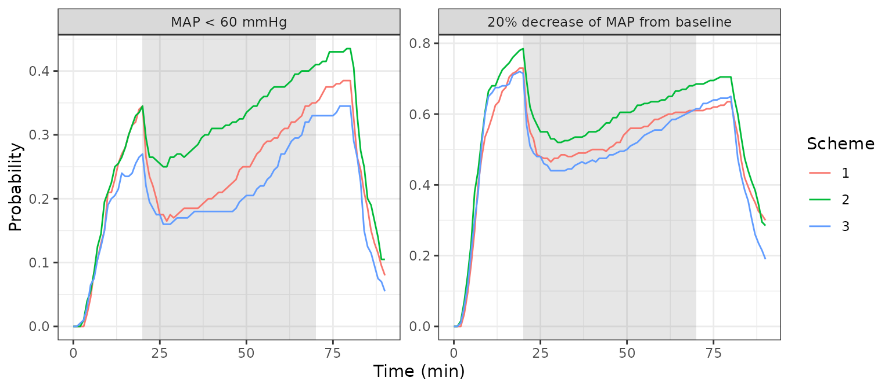

# Propofol and remifentanil haemodynamics (Garraza-Obaldia 2024)

## Model and source

- Citation: Garraza-Obaldia M, Jaramillo S, Parra-Guillen ZP, Valencia
  JF, Gambus PL, Troconiz IF. Pharmacodynamic Model of the Hemodynamic
  Effects of Propofol and Remifentanil and Their Interaction with
  Noxious Stimulation. Pharmaceutics. 2024;16(12):1615.
  <doi:10.3390/pharmaceutics16121615>.
- Description: Semi-mechanistic turnover PD model of the haemodynamic
  effects of propofol and remifentanil during general anaesthesia in
  adult women undergoing gynaecological surgery (Garraza-Obaldia 2024).
  Mean arterial pressure (MAP) and heart rate (HR) are two coupled
  indirect-response states: propofol inhibits MAP production (Emax in
  the predicted plasma propofol concentration), remifentanil inhibits HR
  production (sigmoid Emax in the predicted plasma remifentanil
  concentration), relative HR feeds back on MAP production as a power
  function, and the surgical stimulus (hysteroscopy) transiently raises
  MAP production with a monoexponentially dissipating effect. The
  predicted plasma concentrations from the Schnider (propofol) and Minto
  (remifentanil) target-controlled-infusion models are supplied as
  time-varying covariates; the model has no PK states.
- Article: <https://doi.org/10.3390/pharmaceutics16121615> (open access)
- Supplement:
  <https://www.mdpi.com/article/10.3390/pharmaceutics16121615/s1>

Garraza-Obaldia et al. modelled mean arterial pressure (MAP) and heart
rate (HR) in women anaesthetised with target-controlled infusions (TCI)
of propofol and remifentanil. Both responses are turnover
(indirect-response) states:

- propofol inhibits MAP production with an Emax function of its
  predicted plasma concentration (the Hill coefficient was not different
  from 1 and was removed);
- remifentanil inhibits HR production with a sigmoid Emax function of
  its predicted plasma concentration and has no direct effect on MAP;
- HR relative to its baseline feeds back on MAP production as
  `(HR / HR0)^FBHR`; the reverse feedback (MAP on HR) was not supported;
- the surgical stimulus (hysteroscopy) multiplies MAP production by
  `1 + thetaStim * exp(-kStim * (t - tStim))` from the start of surgery.

The drug exposures are the plasma concentrations that the TCI pumps
predicted from the Schnider (propofol) and Minto (remifentanil) PK
models; nothing was assayed. The packaged model therefore has no PK
states. The concentrations enter as the time-varying covariates
`CP_PROPOFOL_UGML` (ug/mL) and `CP_REMIFENTANIL_NGML` (ng/mL), and the
start of surgery as the time-fixed covariate `T_SURG_START` (min). Time
is in minutes.

## Population

The analysis used 77 ASA I-II women having outpatient gynaecological
surgery at Hospital Clinic de Barcelona; three patients with chronic
hypertension were excluded from the 80 enrolled (Results; Table 1). The
model was fitted to the 56-patient training group, all of whom had
hysteroscopy (mean age 42 years, SD 11; mean weight 62 kg, SD 9; mean
BMI 24 kg/m^2, SD 4). The 21-patient test group (other procedures) was
used for external validation. Patients were assigned to four step-up /
step-down TCI schemes: propofol alone, remifentanil alone, steady
propofol with varying remifentanil, and steady remifentanil with varying
propofol (Section 2.1; Table S1). MAP was measured non-invasively every
minute and HR by continuous ECG. Age, weight, BMI, surgery duration,
patient position and stimulus type were screened as covariates and none
was retained.

## Source trace

| Element | Value in model | Source location |
|----|----|----|
| MAP turnover ODE | `d/dt(map) = kin_map (1 - f) (hr/rbase_hr)^fb_hr h_stim - kout_map map` | Equation (1); Figure 2B |
| HR turnover ODE | `d/dt(hr) = kin_hr (1 - g) - kout_hr hr` | Equation (2); Figure 2B (MAP feedback on HR dropped, Section 3.1) |
| Production rates | `kin = kout * baseline` | Section 2.4 (steady state); derived 10.8 mmHg/min and 8.7 bpm/min in Section 3.1 |
| Propofol effect `f` | Emax, no Hill exponent | Equation (3); gamma removed (Section 3.1); Figure 2B |
| Remifentanil effect `g` | sigmoid Emax | Equation (4); Figure 2B |
| HR feedback `p` | `(hr/rbase_hr)^fb_hr` | Equation (5) |
| Stimulus `h` | `1 + emax_stim exp(-kstim (t - T_SURG_START))`, 1 before | Equation (7); Figure 2B |
| `lec50_propofol` | log(8.79) ug/mL | Table 2, C50Propo |
| `logitemax_propofol` | logit(0.88) | Table 2, EmaxPropo; logistic constraint (Section 2.4) |
| `lec50_remifentanil` | log(4.57) ng/mL | Table 2, C50Remi |
| `logitemax_remifentanil` | logit(0.69) | Table 2, EmaxRemi,HR |
| `lhill_remifentanil` | log(1.20) | Table 2, gammaRemi |
| `lrbase_map` | log(88.2) mmHg | Table 2, MAP0 |
| `lrbase_hr` | log(70.8) bpm | Table 2, HR0 |
| `lkout` | log(0.123) 1/min | Table 2, kout (one typical value for MAP and HR, Section 3.1) |
| `lfb_hr` | log(0.806) | Table 2, FBHR |
| `lkstim` | log(0.021) 1/min | Table 2, kStim |
| `lemax_stim` | log(0.284) | Table 2, thetaStim |
| `etalec50_propofol`, `etalkout_map` block | 0.733137, 0.76, 1.109710 | Table 2: IIV 104.0% and 142.6% CV; covariance 0.76 |
| `etalec50_remifentanil` | 0.730139 | Table 2, IIV C50Remi 103.7% CV |
| `etalrbase_map` | 0.00742009 | Table 2, IIV MAP0 8.63% CV |
| `etalrbase_hr` | 0.0205239 | Table 2, IIV HR0 14.4% CV |
| `etalkout_hr` | 0.991474 | Table 2, IIV kout,HR 130.2% CV |
| `etalkstim` | fixed(0.693147) | Section 3.1: variance held at the equivalent of a 100% CV |
| `addSd_map` | 5.53 mmHg | Table 2, residual error in MAP |
| `addSd_hr` | 4.30 bpm | Table 2, residual error in HR |

The IIV variances use `omega^2 = log(1 + CV^2)`, the inverse of the CV
definition in the footnote of Table 2 (`CV = sqrt(exp(omega^2) - 1)`).

## Deterministic checks

``` r

mod <- readModelDb("GarrazaObaldia_2024_propofol_remifentanil")
ui <- rxode2::rxode(mod)
#> ℹ parameter labels from comments will be replaced by 'label()'
th <- ui$theta
```

### Derived production rates and stimulus half-life

The paper reports the derived production rates and the half-life of the
stimulus effect.

``` r

derived <- tibble::tibble(
  Quantity = c("kin,MAP (mmHg/min)", "kin,HR (bpm/min)", "Stimulus half-life (min)"),
  Model = c(
    exp(th[["lkout"]]) * exp(th[["lrbase_map"]]),
    exp(th[["lkout"]]) * exp(th[["lrbase_hr"]]),
    log(2) / exp(th[["lkstim"]])
  ),
  Paper = c(10.8, 8.7, 33)
)
knitr::kable(derived, digits = 2, caption = "Derived quantities quoted in Results Sections 3.1 and 3.4 and the Discussion.")
```

| Quantity                 | Model | Paper |
|:-------------------------|------:|------:|
| kin,MAP (mmHg/min)       | 10.85 |  10.8 |
| kin,HR (bpm/min)         |  8.71 |   8.7 |
| Stimulus half-life (min) | 33.01 |  33.0 |

Derived quantities quoted in Results Sections 3.1 and 3.4 and the
Discussion. {.table}

``` r

stopifnot(all(abs(derived$Model / derived$Paper - 1) < 0.01))
```

### Steady state under constant concentrations

With constant drug concentrations and no stimulus, both ODEs settle at

- `HR_ss = HR0 * (1 - g(CRemi))`
- `MAP_ss = MAP0 * (1 - f(CPropo)) * (1 - g(CRemi))^FBHR`

The typical-value model is solved to 600 min (about 100 half-lives of
`kout`) over a grid of concentrations and compared with this closed
form.

``` r

ss_grid <- tidyr::expand_grid(cp = c(0, 2, 4, 8), cr = c(0, 1, 2, 4)) |>
  mutate(id = row_number())
ss_events <- ss_grid |>
  tidyr::crossing(time = c(0, 600)) |>
  transmute(
    id, time,
    evid = 0, amt = 0,
    CP_PROPOFOL_UGML = cp,
    CP_REMIFENTANIL_NGML = cr,
    T_SURG_START = 1e6
  ) |>
  arrange(id, time)

ss_sim <- rxode2::rxSolve(
  rxode2::zeroRe(ui), ss_events,
  rtol = 1e-10, atol = 1e-12, returnType = "data.frame"
) |>
  filter(time == 600)
#> ℹ omega/sigma items treated as zero: 'etalec50_propofol', 'etalkout_map', 'etalec50_remifentanil', 'etalrbase_map', 'etalrbase_hr', 'etalkout_hr', 'etalkstim'
#> Warning: multi-subject simulation without without 'omega'

emax_p <- plogis(th[["logitemax_propofol"]])
ec50_p <- exp(th[["lec50_propofol"]])
emax_r <- plogis(th[["logitemax_remifentanil"]])
ec50_r <- exp(th[["lec50_remifentanil"]])
hill_r <- exp(th[["lhill_remifentanil"]])
fb <- exp(th[["lfb_hr"]])

ss_check <- ss_grid |>
  mutate(
    f = emax_p * cp / (cp + ec50_p),
    g = emax_r * cr^hill_r / (cr^hill_r + ec50_r^hill_r),
    hr_closed = exp(th[["lrbase_hr"]]) * (1 - g),
    map_closed = exp(th[["lrbase_map"]]) * (1 - f) * (1 - g)^fb
  ) |>
  left_join(select(ss_sim, id, map, hr), by = "id")

ss_check |>
  select(cp, cr, map, map_closed, hr, hr_closed) |>
  dplyr::rename(
    "Propofol (ug/mL)" = cp,
    "Remifentanil (ng/mL)" = cr,
    "MAP solved (mmHg)" = map,
    "MAP closed form (mmHg)" = map_closed,
    "HR solved (bpm)" = hr,
    "HR closed form (bpm)" = hr_closed
  ) |>
  knitr::kable(digits = 2, caption = "Typical-value steady state against the closed form.")
```

| Propofol (ug/mL) | Remifentanil (ng/mL) | MAP solved (mmHg) | MAP closed form (mmHg) | HR solved (bpm) | HR closed form (bpm) |
|---:|---:|---:|---:|---:|---:|
| 0 | 0 | 88.20 | 88.20 | 70.80 | 70.80 |
| 0 | 1 | 81.31 | 81.31 | 64.01 | 64.01 |
| 0 | 2 | 74.67 | 74.67 | 57.58 | 57.58 |
| 0 | 4 | 64.83 | 64.83 | 48.32 | 48.32 |
| 2 | 0 | 73.81 | 73.81 | 70.80 | 70.80 |
| 2 | 1 | 68.05 | 68.05 | 64.01 | 64.01 |
| 2 | 2 | 62.49 | 62.49 | 57.58 | 57.58 |
| 2 | 4 | 54.25 | 54.25 | 48.32 | 48.32 |
| 4 | 0 | 63.93 | 63.93 | 70.80 | 70.80 |
| 4 | 1 | 58.94 | 58.94 | 64.01 | 64.01 |
| 4 | 2 | 54.12 | 54.12 | 57.58 | 57.58 |
| 4 | 4 | 46.99 | 46.99 | 48.32 | 48.32 |
| 8 | 0 | 51.22 | 51.22 | 70.80 | 70.80 |
| 8 | 1 | 47.22 | 47.22 | 64.01 | 64.01 |
| 8 | 2 | 43.36 | 43.36 | 57.58 | 57.58 |
| 8 | 4 | 37.65 | 37.65 | 48.32 | 48.32 |

Typical-value steady state against the closed form. {.table
style="width:100%;"}

``` r


# Same parameters on both sides, so only integration error separates them.
stopifnot(
  nrow(ss_check) == 16,
  max(abs(ss_check$map / ss_check$map_closed - 1)) < 1e-5,
  max(abs(ss_check$hr / ss_check$hr_closed - 1)) < 1e-5
)
```

Propofol at 4 ug/mL alone lowers the typical MAP by about 28%.
Remifentanil lowers MAP only through HR, and the HR feedback exponent
below 1 damps that effect.

## Replicating Figure 4: risk of hypotension

The paper simulated a 90-min procedure (Figure 1): induction targets
until 10 min, maintenance targets until 80 min, then both targets set to
zero, with hysteroscopy starting at 20 min. Three schemes paired the two
drugs at different effect-site targets:

``` r

schemes <- tibble::tibble(
  scheme = 1:3,
  propofol_induction = c(4.0, 4.5, 5.0),
  remifentanil_induction = c(3.0, 2.5, 2.0),
  propofol_maintenance = c(2.5, 3.0, 3.5),
  remifentanil_maintenance = c(2.0, 1.5, 1.0)
)
schemes |>
  dplyr::rename(
    "Scheme" = scheme,
    "Propofol induction (ug/mL)" = propofol_induction,
    "Remifentanil induction (ng/mL)" = remifentanil_induction,
    "Propofol maintenance (ug/mL)" = propofol_maintenance,
    "Remifentanil maintenance (ng/mL)" = remifentanil_maintenance
  ) |>
  knitr::kable(caption = "Effect-site targets of the three schemes (Figure 1B).")
```

| Scheme | Propofol induction (ug/mL) | Remifentanil induction (ng/mL) | Propofol maintenance (ug/mL) | Remifentanil maintenance (ng/mL) |
|---:|---:|---:|---:|---:|
| 1 | 4.0 | 3.0 | 2.5 | 2.0 |
| 2 | 4.5 | 2.5 | 3.0 | 1.5 |
| 3 | 5.0 | 2.0 | 3.5 | 1.0 |

Effect-site targets of the three schemes (Figure 1B). {.table}

The model is driven by *plasma* concentrations, which the paper obtained
by running the Schnider and Minto TCI algorithms. Neither PK model is in
this package, so here the plasma concentration is set equal to the
effect-site target (a step function). At a constant target, a TCI pump
holds plasma and effect site at the same concentration. The
approximation therefore differs from the paper only during the few
minutes after each target change. In those minutes a real pump
overshoots the plasma concentration on the way up and stops infusing on
the way down.

For each scheme 200 virtual patients are simulated (the paper used
1000). Hypotension is defined as in the paper: MAP below 60 mmHg, or a
fall of at least 20% from the individual baseline `MAP0`. The
probabilities use the individual predicted MAP, without residual error.

``` r

n_per_scheme <- 200
times <- 0:90

fig4_events <- schemes |>
  tidyr::crossing(subject = seq_len(n_per_scheme), time = times) |>
  mutate(
    id = (scheme - 1) * n_per_scheme + subject,
    evid = 0, amt = 0,
    CP_PROPOFOL_UGML = case_when(
      time < 10 ~ propofol_induction,
      time < 80 ~ propofol_maintenance,
      TRUE ~ 0
    ),
    CP_REMIFENTANIL_NGML = case_when(
      time < 10 ~ remifentanil_induction,
      time < 80 ~ remifentanil_maintenance,
      TRUE ~ 0
    ),
    T_SURG_START = 20
  ) |>
  select(id, time, evid, amt, CP_PROPOFOL_UGML, CP_REMIFENTANIL_NGML, T_SURG_START, scheme) |>
  arrange(id, time)

rxode2::rxSetSeed(20241215)
fig4_sim <- rxode2::rxSolve(
  ui, fig4_events,
  covsInterpolation = "locf", keep = "scheme", returnType = "data.frame"
)

risk <- fig4_sim |>
  group_by(scheme, time) |>
  summarise(
    p_below60 = mean(map < 60),
    p_drop20 = mean(map <= 0.8 * rbase_map),
    .groups = "drop"
  )
```

``` r

risk |>
  tidyr::pivot_longer(c(p_below60, p_drop20), names_to = "criterion", values_to = "probability") |>
  mutate(criterion = factor(
    criterion,
    levels = c("p_below60", "p_drop20"),
    labels = c("MAP < 60 mmHg", "20% decrease of MAP from baseline")
  )) |>
  ggplot(aes(time, probability, colour = factor(scheme))) +
  annotate("rect", xmin = 20, xmax = 70, ymin = -Inf, ymax = Inf, alpha = 0.15) +
  geom_line() +
  facet_wrap(~criterion, scales = "free_y") +
  labs(x = "Time (min)", y = "Probability", colour = "Scheme") +
  theme_bw()
```



*Replicates Figure 4 of Garraza-Obaldia 2024. The grey band is the
period of surgery (20-70 min).*

The paper reports a maximum probability before surgery of 0.35 (MAP \<
60 mmHg) and 0.70 (20% decrease), just before surgery starts, and a
maximum during and after surgery of 0.38 and 0.65, at the end of surgery
(Results Section 3.4).

``` r

pool <- risk |>
  group_by(time) |>
  summarise(p_below60 = mean(p_below60), p_drop20 = mean(p_drop20), .groups = "drop")
at <- function(tm, col) {
  v <- pool[[col]][pool$time == tm]
  if (length(v) != 1L) stop("no unique row at time ", tm)
  v
}
fig4_cmp <- tibble::tibble(
  Quantity = c(
    "P(MAP < 60), 20 min (start of surgery)",
    "P(20% decrease), 20 min (start of surgery)",
    "P(MAP < 60), 80 min (end of infusion)",
    "P(20% decrease), 80 min (end of infusion)"
  ),
  Simulated = c(at(20, "p_below60"), at(20, "p_drop20"), at(80, "p_below60"), at(80, "p_drop20")),
  Paper = c(0.35, 0.70, 0.38, 0.65)
)
knitr::kable(fig4_cmp, digits = 2, caption = "Peak hypotension risk, pooled over the three schemes (600 virtual patients), against Results Section 3.4.")
```

| Quantity                                   | Simulated | Paper |
|:-------------------------------------------|----------:|------:|
| P(MAP \< 60), 20 min (start of surgery)    |      0.32 |  0.35 |
| P(20% decrease), 20 min (start of surgery) |      0.74 |  0.70 |
| P(MAP \< 60), 80 min (end of infusion)     |      0.39 |  0.38 |
| P(20% decrease), 80 min (end of infusion)  |      0.66 |  0.65 |

Peak hypotension risk, pooled over the three schemes (600 virtual
patients), against Results Section 3.4. {.table}

``` r


# Cohort proportions (600 patients pooled, binomial SE <= 0.02): a 0.15
# envelope admits sampling noise and the plasma = target approximation.
# A mis-transcribed C50, Emax or baseline would move them by more.
stopifnot(
  all(abs(fig4_cmp$Simulated - fig4_cmp$Paper) < 0.15),
  # The stimulus at 20 min cuts the risk sharply (Figure 4: about 0.70 -> 0.48).
  at(25, "p_drop20") < at(20, "p_drop20") - 0.1,
  # Risk recovers after the targets go to zero at 80 min.
  at(90, "p_drop20") < at(80, "p_drop20") - 0.2
)
```

As in the paper, the three schemes give nearly the same risk profile,
and the risk climbs during surgery as the stimulus effect wears off.

## Size of the surgical stimulus

The paper’s abstract and Discussion describe the surgical stimulus as a
“predicted typical increase of 28 mmHg”. In the model, `thetaStim` =
0.284 is the fractional increase in MAP *production* at the start of
surgery. The typical-value MAP increase this produces is computed below,
both without drugs and under maintenance scheme 1, against the same
subject without surgery.

``` r

stim_events <- bind_rows(
  tibble::tibble(id = 1, time = 0:180, CP_PROPOFOL_UGML = 0, CP_REMIFENTANIL_NGML = 0, T_SURG_START = 20),
  tibble::tibble(id = 2, time = 0:180, CP_PROPOFOL_UGML = 0, CP_REMIFENTANIL_NGML = 0, T_SURG_START = 1e6),
  tibble::tibble(id = 3, time = 0:180, CP_PROPOFOL_UGML = 2.5, CP_REMIFENTANIL_NGML = 2.0, T_SURG_START = 20),
  tibble::tibble(id = 4, time = 0:180, CP_PROPOFOL_UGML = 2.5, CP_REMIFENTANIL_NGML = 2.0, T_SURG_START = 1e6)
) |>
  mutate(evid = 0, amt = 0)

stim_sim <- rxode2::rxSolve(
  rxode2::zeroRe(ui), stim_events,
  covsInterpolation = "locf", returnType = "data.frame"
)
#> ℹ omega/sigma items treated as zero: 'etalec50_propofol', 'etalkout_map', 'etalec50_remifentanil', 'etalrbase_map', 'etalrbase_hr', 'etalkout_hr', 'etalkstim'
#> Warning: multi-subject simulation without without 'omega'
stim_size <- stim_sim |>
  mutate(
    condition = ifelse(id <= 2, "No drugs", "Scheme 1 maintenance"),
    arm = ifelse(id %% 2 == 1, "surgery", "none")
  ) |>
  select(condition, arm, time, map) |>
  tidyr::pivot_wider(names_from = arm, values_from = map) |>
  mutate(increase = surgery - none) |>
  group_by(condition) |>
  summarise(peak_increase = max(increase), time_of_peak = time[which.max(increase)], .groups = "drop")

stim_size |>
  dplyr::rename(
    "Condition" = condition,
    "Peak MAP increase (mmHg)" = peak_increase,
    "Time of peak (min)" = time_of_peak
  ) |>
  knitr::kable(digits = 1, caption = "Typical-value MAP increase caused by the surgical stimulus starting at 20 min.")
```

| Condition            | Peak MAP increase (mmHg) | Time of peak (min) |
|:---------------------|-------------------------:|-------------------:|
| No drugs             |                     17.4 |                 37 |
| Scheme 1 maintenance |                     11.9 |                 37 |

Typical-value MAP increase caused by the surgical stimulus starting at
20 min. {.table}

The typical individual’s peak increase is well below 28 mmHg. The figure
of 28 matches `thetaStim` = 0.284, a 28% increase in MAP production at
the start of surgery, so the paper’s “28 mmHg” looks like that fraction
quoted with the wrong unit. The model uses the Table 2 estimate and is
not adjusted.

## PKNCA

There is no NCA in this vignette. The model has no PK states: drug
exposure is an input covariate, and the outputs are haemodynamic
responses. The checks above (closed-form steady state, derived
constants, and the Figure 4 replication) take its place.

## Assumptions and deviations

- **Plasma concentrations in the simulations.** The paper drove the
  model with plasma concentrations predicted by the Schnider and Minto
  TCI algorithms. Those PK models are not in nlmixr2lib, so the Figure 4
  replication sets plasma concentration equal to the effect-site target.
  This is exact at constant targets and approximate for a few minutes
  after each target change. Users with a TCI simulator should supply its
  predicted plasma concentrations in `CP_PROPOFOL_UGML` and
  `CP_REMIFENTANIL_NGML`.
- **Residual error in the hypotension probabilities.** The paper does
  not say whether its 1000 simulated MAP profiles included residual
  error. The probabilities here use individual predictions without it.
- **IIV on kStim.** Table 2 does not list it. Section 3.1 states that
  the variance was fixed to the equivalent of a 100% CV, which on the CV
  scale of the Table 2 footnote is `log(1 + 1^2) = log(2)`.
- **No IIV on Emax.** The Methods state that logistic models were used
  for IIV on the Emax parameters, but Table 2 reports no Emax variance,
  so the final model carries none. The Emax values are kept on the logit
  scale.
- **Covariance, not correlation.** Table 2 labels the C50Propo /
  kout,MAP entry (0.76) a covariance, and its bootstrap interval reaches
  1.43, which a correlation cannot. It is encoded as a covariance
  (implied correlation 0.84).
- **No end-of-surgery term.** Equation (7) has no offset at the end of
  surgery; the stimulus effect simply decays from its onset, as in the
  paper’s simulations.
- **Other noxious stimuli.** Laryngeal-mask insertion, oesophageal
  instrumentation and tetanic stimulation had no identifiable effect and
  are not in the model, so the laryngeal-mask insertion at 5 min in
  Figure 1 needs no input.
- **Surgical-stimulus magnitude.** The “typical increase of 28 mmHg” in
  the abstract and Discussion is not reproduced (see above); the Table 2
  estimate of `thetaStim` is used as published.
