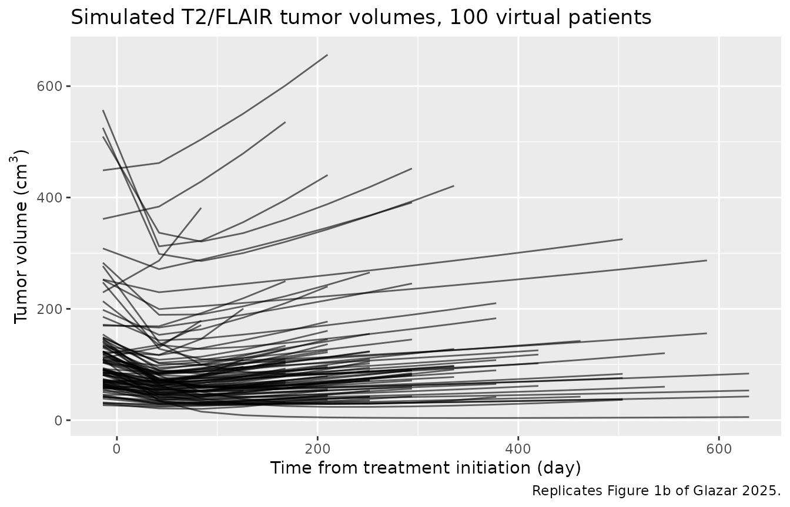
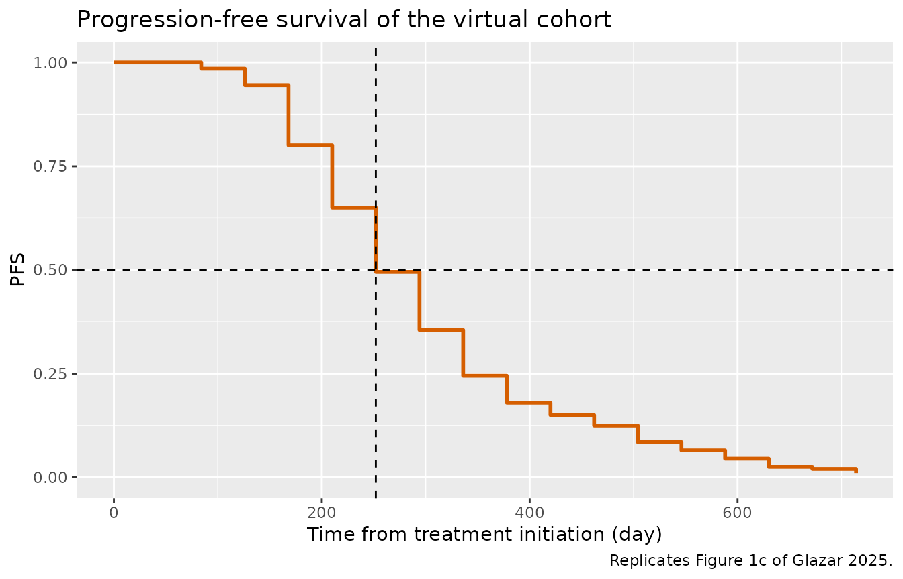

# Recurrent high-grade glioma tumor volume and progression (Glazar 2025)

``` r

library(nlmixr2lib)
library(rxode2)
library(dplyr)
library(tidyr)
library(ggplot2)
library(knitr)
```

## Model and source

- Citation: Glazar DJ, Sahebjam S, Yu HHM, Chen DT, Bhandari M,
  Enderling H. A sample size analysis of a mathematical model of
  longitudinal tumor volume and progression-free survival for Bayesian
  individual dynamic predictions in recurrent high-grade glioma. CPT
  Pharmacometrics Syst Pharmacol. 2025;14(3):495.
  <doi:10.1002/psp4.13290>. Parameter values are from Table 1 and the
  Stan code of Data S3; the time-to-progression solution and the Lambert
  W approximation are from Data S1 sections 3-5.
- Description: Claret tumor growth inhibition (TGI) model of T2/FLAIR
  non-enhancing tumor volume coupled with a deterministic threshold
  model of progression-free survival in recurrent high-grade glioma
  treated with hypofractionated stereotactic radiotherapy (HFSRT) plus
  bevacizumab plus an immune checkpoint inhibitor (Glazar 2025). Tumor
  volume grows exponentially at rate p and, from treatment initiation
  (time 0), is killed at rate kkill \* exp(-res \* t), where res is the
  rate of evolution of resistance. The individual time to progression
  ttp is the time the tumor reaches kappa = 1.4 times its analytic nadir
  (or its baseline when it never shrinks), computed in closed form with
  the Lambert W function. No pharmacokinetics and no dose input: the
  three treatment modalities are not separated. Log-normal IIV on all
  four parameters with a diagonal omega matrix; no covariates.
- Article: <https://doi.org/10.1002/psp4.13290> (open access;
  PMC11919271)

Glazar and colleagues (2025) couple a Claret tumor growth inhibition
(TGI) model of T2/FLAIR tumor volume with a threshold model of
progression-free survival (PFS) in recurrent high-grade glioma (rHGG),
and use it to study how many patients a trial needs to estimate the
accuracy of Bayesian individual dynamic PFS predictions. The packaged
model is the data-generating model of the paper: Equation 1 for tumor
volume, Equation 2 for the inter-individual variability, Equation 3 for
the residual error and Equation 4 for the time to progression, with the
population values of Table 1.

The tumor volume `tumor_size` (cm^3) obeys

`d/dt(tumor_size) = p * tumor_size - kkill * exp(-res * t) * tumor_size`

from treatment initiation (`t = 0`), where `p` is the exponential growth
rate (the paper’s `k_ge`), `kkill` the initial kill rate and `res` the
rate of evolution of resistance (the paper’s `lambda`). Before treatment
the tumor grows as `TS0 * exp(p * t)`. A patient progresses when the
tumor volume reaches `kappa = 1.4` times its nadir; the model output
`ttp` is that time, computed in closed form.

The three treatment modalities (hypofractionated stereotactic
radiotherapy, bevacizumab and an immune checkpoint inhibitor) act
together through `kkill` and `res`. There is no pharmacokinetics and no
dose input, so the event tables below contain observation records only,
and the PKNCA section of a usual validation is replaced by checks
against the closed-form solutions the paper derives in Data S1.

## Population

The population parameters were estimated from 52 patients with recurrent
high-grade glioma pooled from two phase I trials of hypofractionated
stereotactic re-irradiation with bevacizumab and immune checkpoint
blockade: NCT02313272 (with pembrolizumab) and NCT02829931 (with
nivolumab and ipilimumab). The estimation itself is reported in a
conference presentation and a doctoral dissertation (the paper’s
references 20 and 21); this paper gives the final population values
(Table 1) and uses them to simulate 2000 patients imaged two weeks
before treatment and every six weeks after it, with administrative
censoring at day 714. No demographics are tabulated.

The same information is available programmatically via
`readModelDb("Glazar_2025_glioma_tgi")()$population`.

## Source trace

| Equation / parameter | Value | Source location |
|----|----|----|
| `lrbase` (TS0) | log(101.12 cm^3) | Table 1; Data S3 `TS0_pop` |
| `lp` (k_ge) | log(0.0020 1/day) | Table 1; Data S3 `kge_pop` |
| `lkkill` (k_kill) | log(0.0245 1/day) | Table 1; Data S3 `kkill_pop` |
| `lres` (lambda) | log(0.0474 1/day) | Table 1; Data S3 `lambda_pop` |
| `kappa` | 1.4 (fixed) | Methods, Progression-free survival; Data S1 section 2; Data S2 |
| `etalrbase` | 0.65^2 = 0.4225 | Table 1 omega (SD of log-parameter, Equation 2) |
| `etalp` | 0.56^2 = 0.3136 | Table 1 omega |
| `etalkkill` | 0.20^2 = 0.04 | Table 1 omega |
| `etalres` | 0.73^2 = 0.5329 | Table 1 omega |
| `expSd` | 0.01 (fixed) | Equation 3 (`a = 0.01`); Data S3 `sigma` |
| `d/dt(tumor_size)` | n/a | Equation 1; analytic solution Data S1 Equation S2 |
| `ttp` | n/a | Equation 4; Data S1 Equations S3-S8 and the `TTE()` function of Data S2 |
| Lambert W approximation | n/a | Data S1 section 4 (`epsilon = 1e-12`) |

## Virtual cohort and simulation

Two hundred virtual patients, observed at the protocol scan times of the
paper (every 42 days after treatment initiation up to day 714). The
baseline scan two weeks before treatment initiation lies before the
model’s time zero; it is added below from the pre-treatment course
`TS0 * exp(-14 * p)`.

``` r

# rxSetSeed() makes the draw reproducible for a given number of solver
# threads, not across machines, so every assertion below holds for any cohort
# the model can produce.
rxode2::rxSetSeed(20250314)

mod <- readModelDb("Glazar_2025_glioma_tgi")
n_sub <- 200
scan_times <- seq(0, 714, by = 42)

events <- rxode2::et(scan_times, cmt = "tumor_size") |>
  rxode2::et(id = seq_len(n_sub))

# Noise-free tumor volumes, as in the paper's data generation (a = 0),
# solved with tight tolerances so the closed-form checks below test the model
# rather than the integrator.
sim <- rxode2::rxSolve(
  mod,
  events = events,
  returnType = "data.frame",
  rtol = 1e-10,
  atol = 1e-12
)
#> ℹ parameter labels from comments will be replaced by 'label()'
stopifnot(length(unique(sim$id)) == n_sub, !anyNA(sim$tumor_size))

subj <- sim |>
  dplyr::filter(time == 0) |>
  dplyr::select(id, rbase, p, kkill, res, ttp)
```

## Check 1: the ODE matches the analytic tumor-volume solution

Data S1 Equation S2 gives the solution of Equation 1 for `t >= 0`:
`TS(t) = TS0 * exp(p * t + kkill / res * (exp(-res * t) - 1))`.

``` r

ts_analytic <- function(t, ts0, p, kkill, res) {
  ts0 * exp(p * t + kkill / res * (exp(-res * t) - 1))
}

chk1 <- sim |>
  dplyr::mutate(
    ts_closed = ts_analytic(time, rbase, p, kkill, res),
    rel_err = abs(tumor_size / ts_closed - 1)
  )

max(chk1$rel_err)
#> [1] 9.40352e-10
# Same drawn parameters on both sides, so the difference is pure integration
# error and a tight bound is correct (realised about 1e-9).
stopifnot(nrow(chk1) == n_sub * length(scan_times), max(chk1$rel_err) < 1e-6)
```

## Check 2: the closed-form time to progression

Equation 4 solves `TS(TTP) = kappa * TS(t*)` with the Lambert W
function, where `t* = log(kkill / p) / res` is the time of the nadir
when `p < kkill` and `t* = 0` (no initial shrinkage) otherwise. The
model evaluates W with the authors’ closed-form approximation (Data S1
section 4). Here the same root is found numerically from the analytic
solution, on the log scale so it cannot overflow.

``` r

ttp_root <- function(ts0, p, kkill, res, kappa = 1.4) {
  log_ts <- function(t) p * t + kkill / res * (exp(-res * t) - 1)
  tstar <- if (p < kkill) log(kkill / p) / res else 0
  target <- log_ts(tstar) + log(kappa)
  stats::uniroot(
    function(t) log_ts(t) - target,
    lower = tstar,
    upper = tstar + 1e5,
    tol = 1e-12
  )$root
}

subj$ttp_root <- mapply(ttp_root, subj$rbase, subj$p, subj$kkill, subj$res)
subj$ttp_rel_err <- abs(subj$ttp / subj$ttp_root - 1)

c(n_branch_shrink = sum(subj$p < subj$kkill), max_rel_err = max(subj$ttp_rel_err))
#> n_branch_shrink     max_rel_err 
#>    2.000000e+02    9.638576e-09
# Deterministic given the drawn parameters; the residual is the error of the
# Lambert W approximation (realised below 1e-7 in 2000 draws).
stopifnot(max(subj$ttp_rel_err) < 1e-6)
```

The Table 1 values make `p >= kkill` (a tumor that never shrinks) very
rare, so the cohort above exercises only the first branch of Equation 4.
Typical values with hand-chosen growth and kill rates test both
branches, including a patient whose growth outpaces the kill rate.

``` r

mod_typ <- rxode2::zeroRe(mod)
#> ℹ parameter labels from comments will be replaced by 'label()'
branch_par <- data.frame(
  lp = log(c(0.0020, 0.010, 0.030, 0.050)),
  lkkill = log(c(0.0245, 0.0245, 0.0245, 0.0245))
)
branch_ev <- rxode2::et(0, cmt = "tumor_size") |> rxode2::et(id = 1:4)
branch <- rxode2::rxSolve(
  mod_typ,
  events = branch_ev,
  params = branch_par,
  returnType = "data.frame"
)
#> ℹ omega/sigma items treated as zero: 'etalrbase', 'etalp', 'etalkkill', 'etalres'
#> Warning: multi-subject simulation without without 'omega'
branch$ttp_root <- mapply(ttp_root, branch$rbase, branch$p, branch$kkill, branch$res)
branch_tab <- branch |>
  dplyr::transmute(
    p,
    kkill,
    branch = ifelse(p < kkill, "shrinks first", "never shrinks"),
    ttp_model = ttp,
    ttp_root,
    rel_err = abs(ttp / ttp_root - 1)
  )
branch_tab |>
  dplyr::rename(
    "Growth rate p (1/day)" = p,
    "Kill rate kkill (1/day)" = kkill,
    "Branch of Equation 4" = branch,
    "Model ttp (day)" = ttp_model,
    "Numerical root (day)" = ttp_root,
    "Relative error" = rel_err
  ) |>
  knitr::kable(digits = c(4, 4, 0, 2, 2, 10))
```

| Growth rate p (1/day) | Kill rate kkill (1/day) | Branch of Equation 4 | Model ttp (day) | Numerical root (day) | Relative error |
|---:|---:|:---|---:|---:|---:|
| 0.002 | 0.0245 | shrinks first | 242.19 | 242.19 | 0.00e+00 |
| 0.010 | 0.0245 | shrinks first | 71.94 | 71.94 | 7.40e-09 |
| 0.030 | 0.0245 | never shrinks | 22.52 | 22.52 | 1.67e-08 |
| 0.050 | 0.0245 | never shrinks | 10.90 | 10.90 | 3.23e-08 |

``` r


stopifnot(
  sum(branch_tab$p >= branch_tab$kkill) == 2,
  max(branch_tab$rel_err) < 1e-6
)
# The typical patient of Table 1 progresses 242.2 days after treatment
# initiation (the Lambert-W closed form evaluated at the Table 1 means).
stopifnot(abs(branch$ttp[1] - 242.19) < 0.01)
```

## Replicate Figure 1b: tumor volume trajectories

``` r

# Pre-treatment baseline scan at day -14 from the pre-treatment course of
# Equation 1 (no kill term before treatment), then the on-treatment scans.
baseline_scan <- subj |>
  dplyr::transmute(id, time = -14, tumor_size = rbase * exp(-14 * p))
scans <- dplyr::bind_rows(
  baseline_scan,
  sim |>
    dplyr::filter(time > 0) |>
    dplyr::select(id, time, tumor_size)
) |>
  dplyr::arrange(id, time)

# RANO-style detection on noise-free scans: progression is seen at the first
# scan whose volume reaches kappa times the smallest earlier scan (the nadir,
# or the baseline if the tumor never shrank).
detected <- scans |>
  dplyr::group_by(id) |>
  dplyr::mutate(
    prior_nadir = dplyr::lag(cummin(tumor_size)),
    pd = !is.na(prior_nadir) & tumor_size >= 1.4 * prior_nadir
  ) |>
  dplyr::summarise(
    t_detect = if (any(pd)) min(time[pd]) else NA_real_,
    .groups = "drop"
  )

# As in the paper, each trajectory is shown up to the scan at which
# progression is observed.
scans_plot <- scans |>
  dplyr::left_join(detected, by = "id") |>
  dplyr::filter(id <= 100, is.na(t_detect) | time <= t_detect)

ggplot(scans_plot, aes(time, tumor_size, group = id)) +
  geom_line(alpha = 0.6) +
  labs(
    x = "Time from treatment initiation (day)",
    y = expression("Tumor volume (cm"^3 * ")"),
    title = "Simulated T2/FLAIR tumor volumes, 100 virtual patients",
    caption = "Replicates Figure 1b of Glazar 2025."
  )
```



## Replicate Figure 1c: progression-free survival

With only administrative censoring at day 714, the Kaplan-Meier estimate
is one minus the empirical distribution of the scan at which progression
was detected.

``` r

pfs_times <- sort(unique(c(0, detected$t_detect[!is.na(detected$t_detect)], 714)))
pfs <- data.frame(
  time = pfs_times,
  pfs = vapply(
    pfs_times,
    function(tt) mean(is.na(detected$t_detect) | detected$t_detect > tt),
    numeric(1)
  )
)
median_detect <- min(pfs$time[pfs$pfs <= 0.5])

ggplot(pfs, aes(time, pfs)) +
  geom_step(colour = "#D55E00", linewidth = 1) +
  geom_hline(yintercept = 0.5, linetype = "dashed") +
  geom_vline(xintercept = median_detect, linetype = "dashed") +
  coord_cartesian(ylim = c(0, 1)) +
  labs(
    x = "Time from treatment initiation (day)",
    y = "PFS",
    title = "Progression-free survival of the virtual cohort",
    caption = "Replicates Figure 1c of Glazar 2025."
  )
```



``` r

pfs_tab <- data.frame(
  quantity = c(
    "Median TTP detected at 6-weekly scans (day)",
    "Median continuous TTP, model output ttp (day)",
    "Fraction progressed by day 714"
  ),
  simulated = c(
    median_detect,
    stats::median(subj$ttp),
    mean(!is.na(detected$t_detect))
  ),
  reported = c("294 (Methods); 273 (Figure 1 caption)", "not reported", "not reported")
)
pfs_tab |>
  dplyr::rename(
    "Quantity" = quantity,
    "Simulated (200 patients)" = simulated,
    "Glazar 2025" = reported
  ) |>
  knitr::kable(digits = 3)
```

| Quantity | Simulated (200 patients) | Glazar 2025 |
|:---|---:|:---|
| Median TTP detected at 6-weekly scans (day) | 252.000 | 294 (Methods); 273 (Figure 1 caption) |
| Median continuous TTP, model output ttp (day) | 248.935 | not reported |
| Fraction progressed by day 714 | 0.990 | not reported |

``` r


# Detection happens only at scan times, so the median detected TTP is a
# multiple of 42 days: the smallest scan time at which PFS falls to 0.5 or
# below. For the model it is 294 days (2e5 base-R closed-form draws). Over
# 5000 resampled 200-patient cohorts it is 294 days in 82%, 252 days in 18%
# and 336 days in 0.3%, so the gate admits the neighbouring scans. A
# mistranscribed growth or kill rate moves it by several scans. The
# continuous median is 258.5 days for the model; 99.9% of 200-patient
# cohorts fall within 227-296 days.
stopifnot(
  median_detect %in% c(252, 294, 336),
  abs(stats::median(subj$ttp) / 258.5 - 1) < 0.17,
  mean(!is.na(detected$t_detect)) > 0.9
)
```

For the model itself the median TTP detected at the six-weekly scans is
294 days (computed by the maintainers from 200,000 closed-form draws of
the Table 1 distributions), which is the median the paper reports for
its 2000 simulated patients. A cohort of 200 patients lands on 294 days
or, in about one draw in five, on the scan before it (252 days); this
rendering gives 252 days. The Figure 1 caption gives 273 days, the
midpoint of the 252-294-day interval between the scan before and the
scan at progression, consistent with the paper’s treatment of TTP as
interval-censored.

The continuous time to progression (the model’s `ttp`) is shorter than
the detected time because progression is only seen at the next
six-weekly scan, and because the analytic nadir lies below the smallest
scanned volume.

## Assumptions and deviations

- **Time origin.** Time zero of the model is treatment initiation, the
  origin of Equation 1. The baseline scan two weeks before treatment is
  obtained from the pre-treatment growth `TS0 * exp(p * t)` rather than
  by solving the model at negative times.
- **Parameter names.** The paper’s `k_ge` is the generic TGI growth
  constant `p` of the package conventions, and the paper’s `lambda`
  (rate of evolution of resistance) is `res`, the name used by the other
  Claret-type models in the package. `TS0` is the baseline `rbase`.
- **Continuous TTP.** The `TTE()` function of Data S2 rounds TTP up to
  whole days with `ceil()`. The model output `ttp` is not rounded.
- **Residual error.** Equation 3 is a log-normal residual with
  `a = 0.01`. The paper prints the unit `cm3`, but the term acts on the
  log scale and Data S3 uses it as the log-scale SD, so it is encoded as
  `expSd = 0.01`, fixed because the paper sets rather than estimates it.
  The paper’s own data generation is noise-free (`a = 0`); the
  simulations above set the noise aside by using the model prediction
  `tumor_size`.
- **Estimation source.** The Table 1 values were estimated from 52
  patients in work reported in a conference presentation and a
  dissertation (the paper’s references 20 and 21). This paper reports
  the final values in full, and the Stan code of Data S3 hard-codes the
  same values, so the model is transcribed from this paper alone. Glazar
  2025 calls them “selected for data generation” and notes that
  covariate effects were removed.
- **Survival definition.** Progression is defined only by the
  non-enhancing T2/FLAIR volume crossing 1.4 times its nadir; competing
  risks (enhancing lesions, new lesions, clinical deterioration) are not
  modelled, which the paper expects to make simulated PFS longer than
  clinical PFS (about 240 days).
