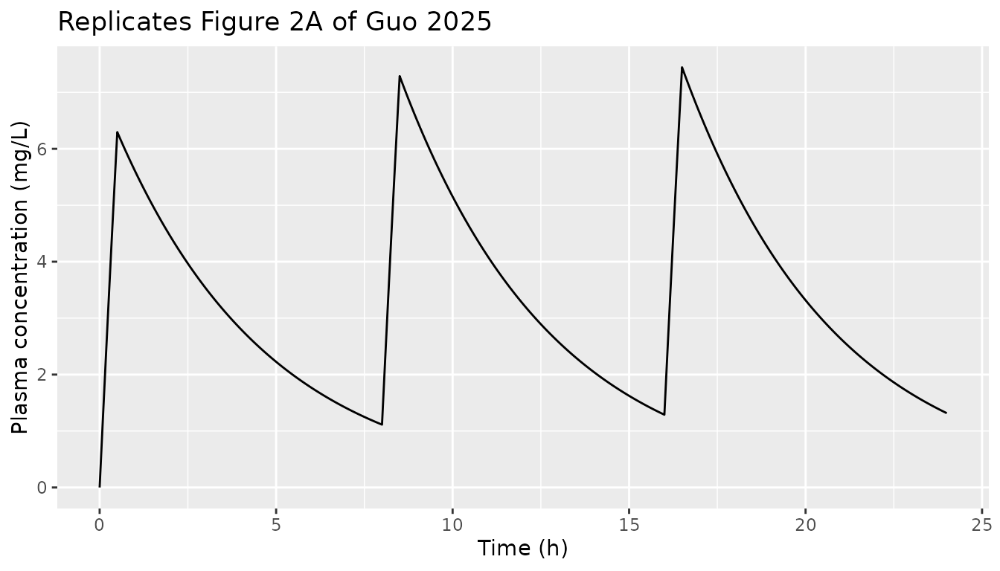
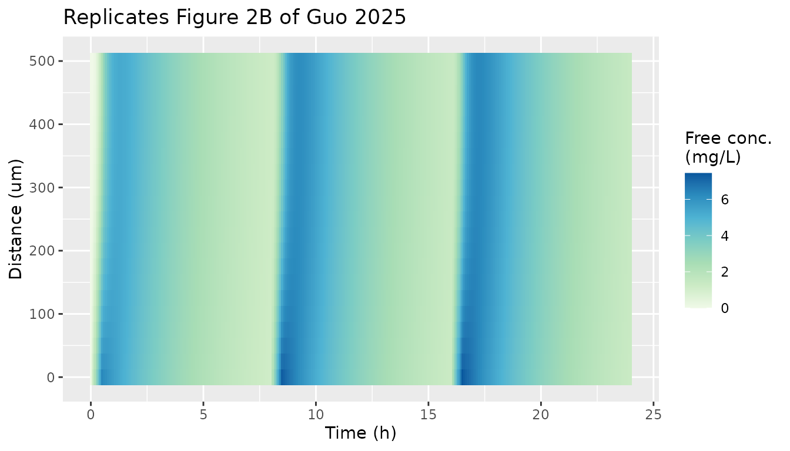
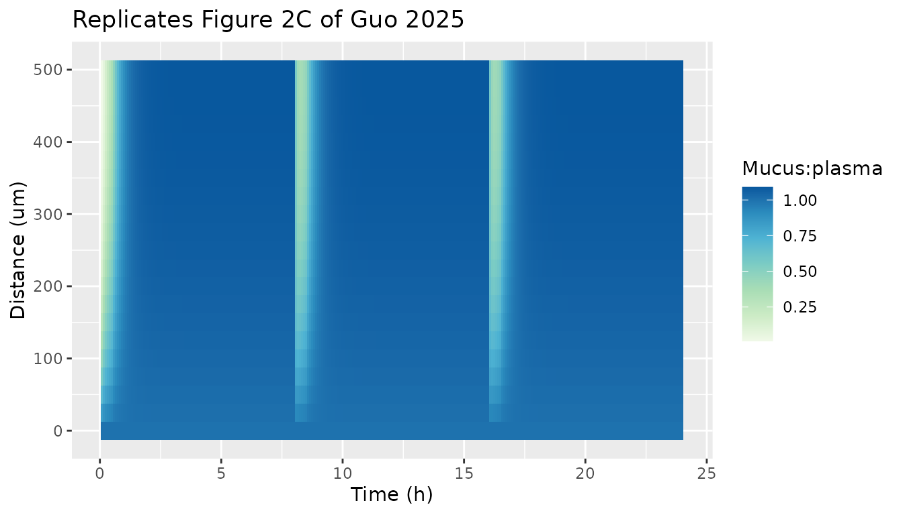
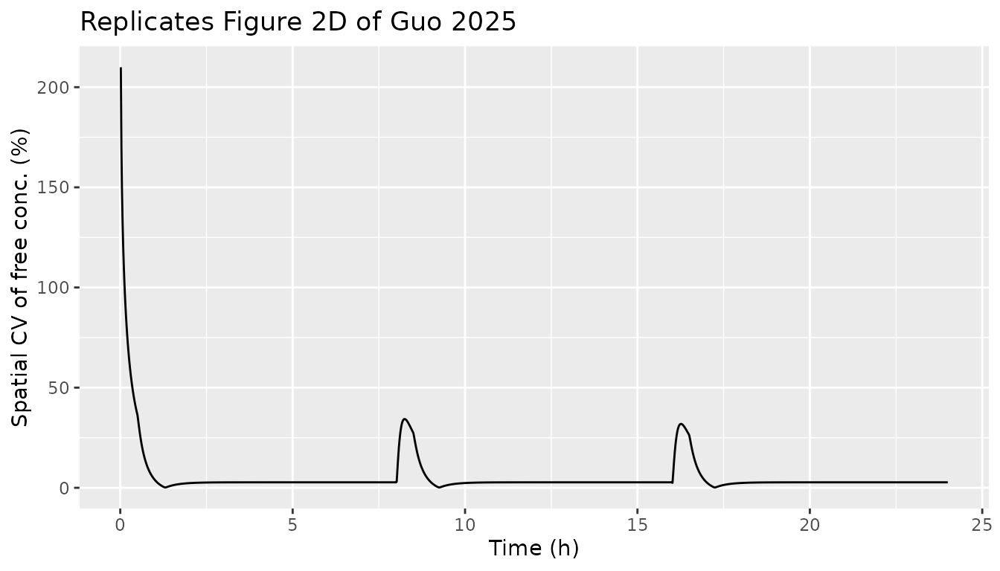
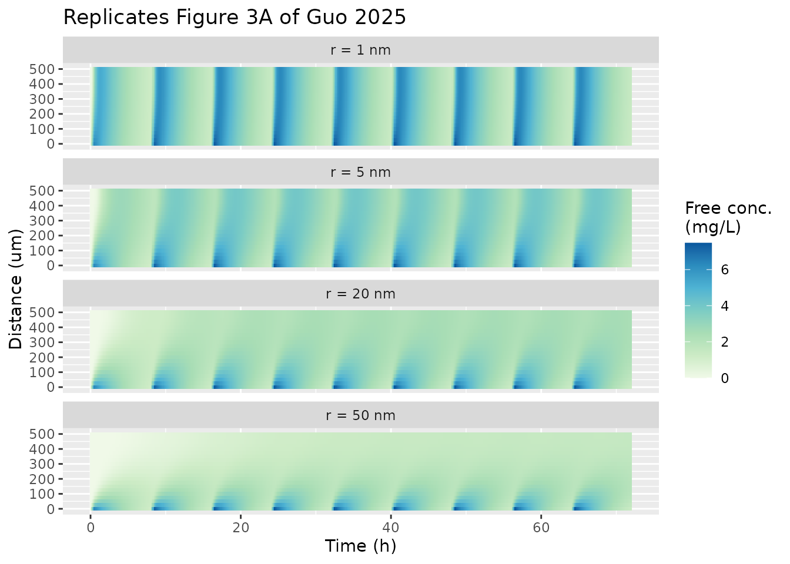
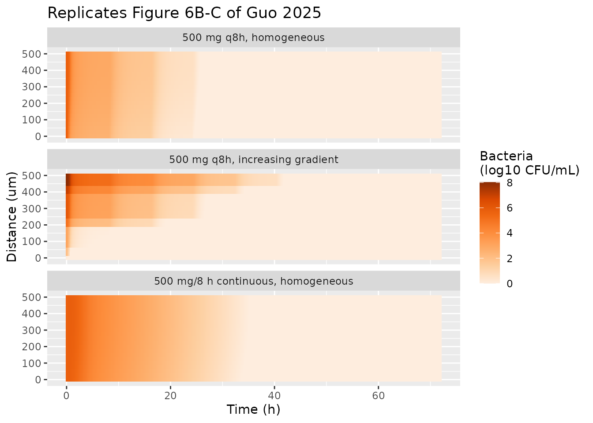

# Spatial PK and imipenem PK/PD in airway mucus (Guo 2025)

## Model and source

Guo 2025 contributes two models, both deterministic simulation
frameworks:

- `Guo_2025_mucus_spatial_pk` – the generic spatial PK framework for a
  hypothetical intravenously dosed drug diffusing across cystic fibrosis
  (CF) airway mucus.

- `Guo_2025_imipenem_mucus` – the imipenem case study, which couples the
  same mucus diffusion layer to a two-compartment imipenem plasma model
  and a two-subpopulation *Pseudomonas aeruginosa* kill model at every
  grid node.

- Citation: Guo Y, Yin J, Yonucu S, Knibbe CAJ, Guo T, van Hasselt JGC.
  Spatial Pharmacokinetic and Pharmacodynamic Modeling in Airway Mucus.
  Clin Pharmacokinet. 2025;64(12):1869-1883.
  <doi:10.1007/s40262-025-01575-4>. Equations 1-5 and Table 1 of the
  article, Equation S1 and Table S1 of the supplement; plasma volume,
  infusion duration and molecular weight from the authors’ deposited
  code (<https://github.com/vanhasseltlab/spatialPK>).

- Description (framework): Mechanistic spatial PK (method-of-lines
  discretised PDE). Diffusion of a hypothetical intravenously dosed drug
  across a 500 um layer of cystic fibrosis airway mucus (Guo 2025). A
  one-compartment plasma model sets the free concentration at the
  blood-mucus interface (instantaneous transfer, partition 1, no protein
  binding); within mucus the free drug diffuses by Fick’s second law
  with a Stokes-Einstein diffusion coefficient computed from the
  molecule/particle radius and a mucin-dependent micro-viscosity, binds
  reversibly to immobile mucins (kon, koff) and is removed with
  muco-ciliary clearance (free and bound alike); the air-mucus interface
  is a zero-flux face. The layer is discretised on the authors’ 25 um
  grid (21 nodes; 19 free and 20 bound drug states). Defaults are the
  paper’s Table 1 small molecule (r = 1 nm, D = 78.6 um^2/s, t1/2 3 h);
  the radius, half-life, mucin, binding and muco-ciliary knobs reproduce
  the Figure 3-5 sweeps. No inter-individual or residual variability
  (simulation framework).

- Description (imipenem): Mechanistic spatial PK/PD (method-of-lines
  discretised PDE). Imipenem killing of Pseudomonas aeruginosa inside a
  500 um layer of cystic fibrosis airway mucus (Guo 2025 case study).
  Plasma PK is the two-compartment imipenem model of van Hasselt 2016
  (CL 11.52 L/h, V1 9.37 L, V2 6.41 L, Q 13.68 L/h); the free
  concentration at the blood-mucus interface is the plasma concentration
  times the ELF penetration coefficient 0.444. Within mucus imipenem
  diffuses (Fick’s second law, Stokes-Einstein D for r = 1 nm, about
  78.6 um^2/s) and binds reversibly to immobile mucins; muco-ciliary
  clearance is set to zero. Immobile bacteria at every grid node follow
  a two-subpopulation (susceptible S, resistant R) logistic-growth model
  with linear concentration-driven kill and drug-independent S-to-R
  transfer. The layer is discretised on the authors’ 25 um grid (21
  nodes; 19 free drug, 20 bound drug, 20 S and 20 R states). The
  baseline inoculum is homogeneous at 10^5.67 CFU/mL; per-node log10
  offsets (dlog10b0_slab) give gradient baselines. Deterministic: no
  inter-individual or residual variability.

- Article: <https://doi.org/10.1007/s40262-025-01575-4> (open access,
  PMC12715044)

- Authors’ code: <https://github.com/vanhasseltlab/spatialPK>

## Population

No patients were studied. The paper simulates hypothetical drugs and a
typical adult, with physiological mucus parameters taken from CF sputum
and mucus-plug literature (Table 1 and Table S1): a 500 um mucus layer,
total mucin 2e-5 mol/L, a mucin-dependent micro-viscosity (Equation S1)
and muco-ciliary clearance 0.036 1/h. Hypothetical drugs vary in
molecule/particle radius (1, 5, 20, 50 nm), plasma half-life, mucin
binding affinity, mucin concentration and muco-ciliary clearance. The
imipenem case study uses the pooled imipenem plasma model of van Hasselt
2016 and in vitro *P. aeruginosa* time-kill parameters (Table S2).

``` r

readModelDb("Guo_2025_mucus_spatial_pk")()$population$notes
#> [1] "No patients were studied. Hypothetical drugs spanning molecule/particle radius 1, 5, 20 and 50 nm, plasma half-life 3-24 h (small) or 1-4 weeks (large), mucin association constant 10-10000 1/M, total mucin 1e-6 to 5e-5 mol/L and muco-ciliary clearance 0-0.36 1/h were simulated against CF physiological mucus parameters (Table 1, Table S1)."
readModelDb("Guo_2025_imipenem_mucus")()$population$notes
#> [1] "No patients were studied. A typical-value plasma PK model (van Hasselt 2016) drives the mucus boundary condition; bacterial PD parameters come from in vitro P. aeruginosa time-kill data (Guo 2024 bioRxiv). Three baseline bacterial spatial organisations (homogeneous, increasing and decreasing gradient) were simulated (Fig. S1, Table S3)."
```

## Model structure

The mucus layer obeys Equations 4-5 of the paper:

- free drug `A(x, t)`:
  `dA/dt = D d2A/dx2 - kon (M - A') A + koff A' - ke,m A`
- mucin-bound drug `A'(x, t)`:
  `dA'/dt = kon (M - A') A - koff A' - ke,m A'`

with `A(0, t)` equal to the plasma concentration (the imipenem model
multiplies it by the ELF penetration coefficient 0.444), `A = A' = 0` at
`t = 0`, and a zero-flux air-mucus interface. The diffusion coefficient
comes from the modified Stokes-Einstein equation (Equation 2),
`D = kB T / (6 c pi mu r)`, with `c = 2/3` for r \<= 1 nm (else 1) and
the micro-viscosity `mu = 128.87 M + 0.00176` (Equation S1).

rxode2 solves ODEs, so the PDE is written by the method of lines on the
authors’ own spatial grid: 25 um steps over 500 um, i.e. 21 nodes at
`x = (n - 1) * 25 um`. Node 1 is the blood-mucus interface, whose free
concentration is the boundary value `Cmucus_bc` (an algebraic output,
not a state). Nodes 2-20 carry the free-drug states `mucus_free_slab2` …
`mucus_free_slab20`, nodes 1-20 carry the bound-drug states
`mucus_bound_slab1` … `mucus_bound_slab20`, and node 21 is a copy of
node 20, which is how the authors’ finite-difference code imposes the
reflective air-mucus face. The authors integrated in time with an
explicit 0.5 s step; rxode2 integrates the same spatial discretisation
with an adaptive solver. The reproduction of every published AUC below
(all within 1%) is the evidence that this grid and the time integration
are adequate.

Convenience outputs: `Cmucus_free_mean` and `Cmucus_bound_mean` (mean
over the 21 nodes) and `Cmucus_free_cv` (the paper’s
spatial-heterogeneity metric, coefficient of variation of the free
concentration across nodes, in percent). The paper’s exposure metric
AUCf (“double integral of free drug concentration in mucus over time and
distance”, reported in mg\*h/L) is the time integral of
`Cmucus_free_mean`; this is how the authors’ code computes it.

In the imipenem model each node 1-20 also carries susceptible
(`bact_susceptible_slab<n>`) and resistant (`bact_resistant_slab<n>`)
bacteria in CFU/mL (Equations S2-S3), killed by the local free imipenem
concentration; `bact_total_mean` is the node-averaged total.

## Source trace

| Equation / parameter | Value | Source location |
|----|----|----|
| Fick’s second law, Eq. 1 / mucus PDEs | n/a | Equations 1, 4, 5 |
| Stokes-Einstein `D`, `c = 2/3` for r \<= 1 nm | n/a | Equation 2 and text below it |
| Micro-viscosity `mu = 128.87 M + 0.00176` | `visc_slope`, `visc_int` | Equation S1 |
| `kboltz` | 1.380649e-23 N\*m/K | Table S1 |
| `temp_k` | 310 K | Table S1 |
| `r_hyd` | 1 nm (framework default) | Table 1 title; Table S1 |
| `thick_mucus` | 500 um | Table 1, Table S2 |
| `mucin` | 2e-5 mol/L | Table 1, Table S2 |
| `kon`, `koff` | 100 1/(M\*s), 0.1 1/s | Table 1, Table S2 |
| `kel_mcc` (framework) | 0.036 1/h | Table 1 (printed 0.04), Fig. 4 caption (0.036), Table S1 (1e-5 1/s) |
| `kel_mcc` (imipenem) | 0 | Table S2 |
| Plasma one-compartment model | n/a | Equation 3 |
| `lcl`, `lvc` (framework) | 3.465 L/h, 15 L | authors’ code; reproduces the 3 h half-life of Fig. 4 |
| `mw` | 500 g/mol | authors’ code (`pde()`) |
| Spatial grid | 25 um, 21 nodes | Methods, Algorithm and Software |
| Imipenem `lcl`, `lvc`, `lvp`, `lq` | 11.52 L/h, 9.37 L, 6.41 L, 13.68 L/h | Table S2 (L/min x 60) |
| `relf` | 0.444 | Table S2 `P_ELF` |
| `kgs`, `kgr`, `ksr` | 1.67e-4, 0, 9.86e-6 1/s | Table S2 |
| `slope_s`, `slope_r` | 2.38e-4, 3.78e-5 L/(mg\*s) | Table S2 |
| `log10b0`, `log10bmax` | 5.67, 9.52 log10 CFU/mL | Table S2 |
| Bacterial PD ODEs | n/a | Equations S2-S3 |

## Simulation helpers

``` r

mod_pk <- readModelDb("Guo_2025_mucus_spatial_pk")
mod_pd <- readModelDb("Guo_2025_imipenem_mucus")

obs_grid <- seq(0, 72, by = 1 / 60)

# IV regimens; every dose is an infusion into the plasma compartment
regimen <- function(amt, ii, dur, end = 72) {
  et(amt = amt, dur = dur, ii = ii, addl = end / ii - 1, cmt = "central") |>
    et(seq(0, end, by = 1 / 60))
}

solve_scenario <- function(mod, ev, params = NULL, label) {
  s <- rxSolve(mod, ev, params = params, returnType = "data.frame")
  s$scenario <- label
  s$id <- 1L
  s
}

# Free concentration at each of the 21 grid nodes (node 21 = node 20)
free_long <- function(s) {
  free <- cbind(
    s$Cmucus_bc,
    as.matrix(s[, paste0("mucus_free_slab", 2:20)]),
    s$mucus_free_slab20
  )
  data.frame(
    time = rep(s$time, 21),
    distance = rep((0:20) * 25, each = nrow(s)),
    conc = as.vector(free),
    plasma = rep(s$Cc, 21)
  )
}
```

## Diffusion coefficients

The paper reports `D` of about 78.6 um^2/s for r = 1 nm, 10.5 um^2/s for
r = 5 nm, and 1.0-2.6 um^2/s for r = 20-50 nm at 2e-5 mol/L mucin.

``` r

d_tab <- bind_rows(lapply(c(1, 5, 20, 50), function(r) {
  s <- rxSolve(mod_pk, et(0), params = c(r_hyd = r), returnType = "data.frame")
  data.frame(`Radius (nm)` = r, `D (um^2/s)` = signif(s$diff_coef[1], 3), check.names = FALSE)
}))
knitr::kable(d_tab)
```

| Radius (nm) | D (um^2/s) |
|------------:|-----------:|
|           1 |      78.50 |
|           5 |      10.50 |
|          20 |       2.62 |
|          50 |       1.05 |

``` r

stopifnot(
  abs(d_tab[[2]][1] - 78.6) < 0.2,
  abs(d_tab[[2]][2] - 10.5) < 0.1,
  round(d_tab[[2]][3], 1) == 2.6, round(d_tab[[2]][4], 1) == 1.0
)
```

Using the rounded coefficients printed in Equation S1, r = 1 nm gives
78.5 um^2/s rather than the printed 78.6. The authors’ code carries
unrounded coefficients (`0.001 * (1.756757 + 1.288649e5 M)`), which give
78.6 exactly; the 0.1% difference has no visible effect on any output
below.

## Figure 2: small molecule, 100 mg every 8 h

``` r

s_fig2 <- solve_scenario(mod_pk, regimen(100, 8, 0.5, end = 24), label = "fig2")
f2 <- free_long(s_fig2)

ggplot(s_fig2, aes(time, Cc)) +
  geom_line() +
  labs(x = "Time (h)", y = "Plasma concentration (mg/L)",
       title = "Replicates Figure 2A of Guo 2025")
```



``` r


f2_plot <- f2 |> filter(abs(time * 12 - round(time * 12)) < 1e-6)
ggplot(f2_plot, aes(time, distance, fill = conc)) +
  geom_tile() +
  scale_fill_distiller("Free conc.\n(mg/L)", palette = 4, direction = 1) +
  labs(x = "Time (h)", y = "Distance (um)", title = "Replicates Figure 2B of Guo 2025")
```



``` r


ggplot(f2_plot |> filter(plasma > 0), aes(time, distance, fill = conc / plasma)) +
  geom_tile() +
  scale_fill_distiller("Mucus:plasma", palette = 4, direction = 1) +
  labs(x = "Time (h)", y = "Distance (um)", title = "Replicates Figure 2C of Guo 2025")
```



``` r


ggplot(s_fig2 |> filter(time > 0), aes(time, Cmucus_free_cv)) +
  geom_line() +
  labs(x = "Time (h)", y = "Spatial CV of free conc. (%)",
       title = "Replicates Figure 2D of Guo 2025")
```



``` r


# The paper: the mucus:plasma ratio reaches 1 within 2 h of every dose and the
# spatial CV drops below 3% about 1 h after every administration.
ratio_2h <- f2 |> filter(abs(time - 18) < 1e-6) |> summarise(r = min(conc / plasma))
cv_1h <- s_fig2 |> filter(time > 17.5, time < 17.6) |> pull(Cmucus_free_cv)
ratio_2h
#>   r
#> 1 1
range(cv_1h)
#> [1] 1.461454 1.674233
stopifnot(ratio_2h$r > 0.95, all(cv_1h < 5))
```

## Figure 3 and Figure 4A: drug- and system-specific factors

All scenarios are 100 mg every 8 h (0.5 h infusion) for 72 h; each
factor is varied with the others at their reference values
(`t1/2 = 3 h`, r = 1 nm, `Ka = 1000 1/M`, `M = 2e-5 mol/L`,
`ke,m = 0.036 1/h`). The binding affinity `Ka = kon / koff` is varied
through `kon` at the fixed `koff = 0.1 1/s`.

``` r

q8 <- regimen(100, 8, 0.5)
sweep_def <- bind_rows(
  data.frame(factor = "Radius", scenario = paste0("r = ", c(1, 5, 20, 50), " nm"),
             par = "r_hyd", value = c(1, 5, 20, 50)),
  data.frame(factor = "Half-life", scenario = paste0("t1/2 = ", c(3, 6, 12, 24), " h"),
             par = "lcl", value = log(c(0.05775, 0.0289, 0.01444, 0.00722) * 60)),
  data.frame(factor = "Binding", scenario = paste0("Ka = ", c(10, 100, 1000, 10000), " 1/M"),
             par = "kon", value = c(10, 100, 1000, 10000) * 0.1),
  data.frame(factor = "Mucin", scenario = paste0("M = ", c("1e-6", "5e-6", "1e-5", "5e-5"), " mol/L"),
             par = "mucin", value = c(1e-6, 5e-6, 1e-5, 5e-5)),
  data.frame(factor = "Muco-ciliary", scenario = paste0("ke,m = ", c(0, 0.0036, 0.036, 0.36), " 1/h"),
             par = "kel_mcc", value = c(0, 0.0036, 0.036, 0.36))
)
sweep_sims <- bind_rows(lapply(seq_len(nrow(sweep_def)), function(i) {
  solve_scenario(mod_pk, q8, params = setNames(sweep_def$value[i], sweep_def$par[i]),
                 label = sweep_def$scenario[i])
}))
```

``` r

radius_long <- bind_rows(lapply(paste0("r = ", c(1, 5, 20, 50), " nm"), function(sc) {
  free_long(sweep_sims |> filter(scenario == sc)) |> mutate(scenario = sc)
})) |>
  filter(abs(time * 6 - round(time * 6)) < 1e-6) |>
  mutate(scenario = factor(scenario, levels = paste0("r = ", c(1, 5, 20, 50), " nm")))
ggplot(radius_long, aes(time, distance, fill = conc)) +
  geom_tile() +
  facet_wrap(~scenario, ncol = 1) +
  scale_fill_distiller("Free conc.\n(mg/L)", palette = 4, direction = 1) +
  labs(x = "Time (h)", y = "Distance (um)", title = "Replicates Figure 3A of Guo 2025")
```



AUCf is computed with PKNCA on the node-averaged free concentration
(`Cmucus_free_mean`) over 0-72 h with linear trapezoids.

``` r

nca_auc72 <- function(sims) {
  # Keep only the columns PKNCA needs; the full simulation is ~100 columns wide.
  conc_data <- sims |>
    select(scenario, id, time, Cmucus_free_mean) |>
    filter(!is.na(Cmucus_free_mean))
  conc <- PKNCAconc(conc_data, Cmucus_free_mean ~ time | scenario / id)
  PKNCAdata(conc, intervals = data.frame(start = 0, end = 72, auclast = TRUE),
            options = list(auc.method = "linear")) |>
    pk.nca() |>
    suppressMessages()
}
sweep_nca <- nca_auc72(sweep_sims)

# Published AUCf (mg*h/L): Results text for radius and half-life; for binding,
# mucin and muco-ciliary clearance the paper reports only the 231-254 range.
ref_sweep <- data.frame(
  scenario = c(paste0("r = ", c(1, 5, 20, 50), " nm"), paste0("t1/2 = ", c(3, 6, 12, 24), " h")),
  auclast = c(251, 232, 183, 133, 251, 474, 831, 1276)
)
cmp_sweep <- ncaComparisonTable(
  sweep_nca |> as.data.frame() |> filter(scenario %in% ref_sweep$scenario),
  ref_sweep, by = "scenario", units = c(auclast = "mg*h/L")
)
knitr::kable(cmp_sweep, caption = "AUCf over 72 h: published (Figures 3B and 4A) vs simulated.")
```

| NCA parameter     | scenario    | Reference | Simulated | % diff |
|:------------------|:------------|:----------|:----------|:-------|
| AUClast (mg\*h/L) | r = 1 nm    | 251       | 251       | +0.0%  |
| AUClast (mg\*h/L) | r = 5 nm    | 232       | 232       | -0.0%  |
| AUClast (mg\*h/L) | r = 20 nm   | 183       | 183       | -0.2%  |
| AUClast (mg\*h/L) | r = 50 nm   | 133       | 133       | -0.0%  |
| AUClast (mg\*h/L) | t1/2 = 3 h  | 251       | 251       | +0.0%  |
| AUClast (mg\*h/L) | t1/2 = 6 h  | 474       | 474       | -0.0%  |
| AUClast (mg\*h/L) | t1/2 = 12 h | 831       | 831       | -0.0%  |
| AUClast (mg\*h/L) | t1/2 = 24 h | 1280      | 1280      | -0.1%  |

AUCf over 72 h: published (Figures 3B and 4A) vs simulated. {.table}

``` r

auc_check <- function(nca, ref) {
  sim <- as.data.frame(nca) |> filter(PPTESTCD == "auclast") |> select(scenario, sim = PPORRES)
  inner_join(ref, sim, by = "scenario") |> mutate(pct = 100 * (sim - auclast) / auclast)
}
# Deterministic model: the only difference from the paper is numerical.
stopifnot(all(abs(auc_check(sweep_nca, ref_sweep)$pct) < 1))

other <- as.data.frame(sweep_nca) |>
  filter(PPTESTCD == "auclast", !scenario %in% ref_sweep$scenario)
knitr::kable(other |> select(Scenario = scenario, `AUCf (mg*h/L)` = PPORRES) |>
               mutate(`AUCf (mg*h/L)` = round(`AUCf (mg*h/L)`, 1)),
             caption = "Binding, mucin and muco-ciliary sweeps; the paper reports 231-254 mg*h/L.")
```

| Scenario          | AUCf (mg\*h/L) |
|:------------------|---------------:|
| Ka = 10 1/M       |          251.1 |
| Ka = 100 1/M      |          251.1 |
| Ka = 1000 1/M     |          251.0 |
| Ka = 10000 1/M    |          250.6 |
| ke,m = 0 1/h      |          253.6 |
| ke,m = 0.0036 1/h |          253.3 |
| ke,m = 0.036 1/h  |          251.0 |
| ke,m = 0.36 1/h   |          230.5 |
| M = 1e-5 mol/L    |          251.9 |
| M = 1e-6 mol/L    |          252.7 |
| M = 5e-5 mol/L    |          248.2 |
| M = 5e-6 mol/L    |          252.4 |

Binding, mucin and muco-ciliary sweeps; the paper reports 231-254
mg\*h/L. {.table}

``` r

stopifnot(all(other$PPORRES > 229 & other$PPORRES < 256))
```

Peak spatial CV after the last administration (Figure 3C; paper: 29.9%,
48.6%, 47.5% and 62.9% for 1, 5, 20 and 50 nm):

``` r

peak_cv <- sweep_sims |>
  filter(grepl("^r = ", scenario), time > 64, time <= 72) |>
  group_by(scenario) |>
  summarise(simulated = max(Cmucus_free_cv, na.rm = TRUE), .groups = "drop") |>
  mutate(published = c("r = 1 nm" = 29.9, "r = 20 nm" = 47.5, "r = 5 nm" = 48.6,
                       "r = 50 nm" = 62.9)[scenario]) |>
  arrange(published)
knitr::kable(peak_cv |> rename(Scenario = scenario, `Simulated peak CV (%)` = simulated,
                               `Published peak CV (%)` = published), digits = 1)
```

| Scenario  | Simulated peak CV (%) | Published peak CV (%) |
|:----------|----------------------:|----------------------:|
| r = 1 nm  |                  31.5 |                  29.9 |
| r = 20 nm |                  47.4 |                  47.5 |
| r = 5 nm  |                  48.4 |                  48.6 |
| r = 50 nm |                  62.8 |                  62.9 |

``` r

stopifnot(all(abs(peak_cv$simulated - peak_cv$published) < 2.5))
```

The peak CV is the extreme of a fast transient at the start of each
infusion, so it is sensitive to time resolution: the authors’ explicit
scheme updates the boundary value once a minute, while rxode2 follows
the plasma profile continuously. The 1 nm value is 1.6 points higher
here; the larger molecules, whose transients are slower, agree within
0.2 points.

## Figure 5: dosing schedule at a fixed 300 mg/day

``` r

sched <- list(
  "q8h" = regimen(100, 8, 0.5),
  "q24h" = regimen(300, 24, 0.5),
  "continuous" = et(amt = 900, dur = 72, cmt = "central") |> et(obs_grid)
)
sched_sims <- bind_rows(lapply(c(1, 50), function(r) {
  bind_rows(lapply(names(sched), function(nm) {
    solve_scenario(mod_pk, sched[[nm]], params = c(r_hyd = r),
                   label = paste0("r = ", r, " nm, ", nm))
  }))
}))
sched_nca <- nca_auc72(sched_sims)
ref_sched <- data.frame(
  scenario = paste0("r = ", rep(c(1, 50), each = 3), " nm, ", rep(names(sched), 2)),
  auclast = c(251, 257, 241, 133, 145, 125)
)
cmp_sched <- ncaComparisonTable(sched_nca, ref_sched, by = "scenario",
                                units = c(auclast = "mg*h/L"))
knitr::kable(cmp_sched, caption = "AUCf over 72 h by dosing schedule: published (Figure 5B) vs simulated.")
```

| NCA parameter     | scenario              | Reference | Simulated | % diff |
|:------------------|:----------------------|:----------|:----------|:-------|
| AUClast (mg\*h/L) | r = 1 nm, q8h         | 251       | 251       | +0.0%  |
| AUClast (mg\*h/L) | r = 1 nm, q24h        | 257       | 257       | -0.1%  |
| AUClast (mg\*h/L) | r = 1 nm, continuous  | 241       | 241       | -0.1%  |
| AUClast (mg\*h/L) | r = 50 nm, q8h        | 133       | 133       | -0.0%  |
| AUClast (mg\*h/L) | r = 50 nm, q24h       | 145       | 145       | -0.3%  |
| AUClast (mg\*h/L) | r = 50 nm, continuous | 125       | 125       | +0.2%  |

AUCf over 72 h by dosing schedule: published (Figure 5B) vs simulated.
{.table}

``` r

stopifnot(all(abs(auc_check(sched_nca, ref_sched)$pct) < 1))
```

## Imipenem spatial PK/PD (Figure 6, Table S3)

Six regimens (250, 500 or 1000 mg every 8 h, as 0.5 h infusions or as a
continuous infusion of the same daily amount) are combined with three
baseline bacterial organisations. The gradient baselines follow the
authors’ code: 21 log10 densities drawn from a Poisson distribution with
mean 5.58 and sorted increasing (more bacteria at the air-mucus face) or
decreasing (more at the blood-mucus face). R’s Poisson generator is
deterministic for a given seed, so the draw below is the authors’ own.
Time to eradication (TTE) is the first time the total density is below 1
CFU/mL at every node.

``` r

set.seed(2022)
lognum <- rpois(21, 5.58)
baselines <- list(
  homogeneous = rep(5.67, 20),
  increasing = sort(lognum)[1:20],
  decreasing = sort(lognum, decreasing = TRUE)[1:20]
)
offsets <- function(b, b0 = 5.67) setNames(b - b0, paste0("dlog10b0_slab", 1:20))

imi_regimens <- list(
  "intermittent 250 mg" = regimen(250, 8, 0.5), "intermittent 500 mg" = regimen(500, 8, 0.5),
  "intermittent 1000 mg" = regimen(1000, 8, 0.5), "continuous 250 mg" = regimen(250, 8, 8),
  "continuous 500 mg" = regimen(500, 8, 8), "continuous 1000 mg" = regimen(1000, 8, 8)
)

tte <- function(s) {
  tot <- as.matrix(s[, paste0("bact_susceptible_slab", 1:20)]) +
    as.matrix(s[, paste0("bact_resistant_slab", 1:20)])
  i <- which(apply(tot, 1, max) < 1 & s$time > 0)
  if (length(i) == 0) NA_real_ else s$time[i[1]]
}

imi_sims <- list()
tte_tab <- expand.grid(regimen = names(imi_regimens), baseline = names(baselines),
                       stringsAsFactors = FALSE)
tte_tab$tte_model <- NA_real_
tte_tab$tte_b0_558 <- NA_real_
for (k in seq_len(nrow(tte_tab))) {
  ev <- imi_regimens[[tte_tab$regimen[k]]]
  b <- baselines[[tte_tab$baseline[k]]]
  s <- rxSolve(mod_pd, ev, params = offsets(b), returnType = "data.frame")
  imi_sims[[paste(tte_tab$regimen[k], tte_tab$baseline[k])]] <- s
  tte_tab$tte_model[k] <- tte(s)
  if (tte_tab$baseline[k] == "homogeneous") {
    s558 <- rxSolve(mod_pd, ev, params = c(log10b0 = 5.58, offsets(rep(5.58, 20), 5.58)),
                    returnType = "data.frame")
    tte_tab$tte_b0_558[k] <- tte(s558)
  }
}
tte_tab$published <- c(
  57.2, 25.3, 10.1, NA, 34.5, 17.2, # homogeneous
  NA, 41.7, 18.4, NA, 51.4, 25.6, # increasing gradient
  NA, 40.7, 17.4, NA, 50.2, 24.8 # decreasing gradient
)
knitr::kable(
  tte_tab |>
    mutate(across(c(tte_model, tte_b0_558), ~ round(.x, 1))) |>
    rename(Regimen = regimen, Baseline = baseline,
           `TTE, model default B0 5.67 (h)` = tte_model,
           `TTE, B0 5.58 (h)` = tte_b0_558,
           `Table S3 (h)` = published),
  caption = paste("Time to complete eradication within 72 h (NA = not achieved).",
                  "The B0 5.58 column applies to the homogeneous baseline only.")
)
```

| Regimen | Baseline | TTE, model default B0 5.67 (h) | TTE, B0 5.58 (h) | Table S3 (h) |
|:---|:---|---:|---:|---:|
| intermittent 250 mg | homogeneous | 57.8 | 57.4 | 57.2 |
| intermittent 500 mg | homogeneous | 25.6 | 25.4 | 25.3 |
| intermittent 1000 mg | homogeneous | 10.4 | 10.2 | 10.1 |
| continuous 250 mg | homogeneous | NA | NA | NA |
| continuous 500 mg | homogeneous | 35.2 | 34.6 | 34.5 |
| continuous 1000 mg | homogeneous | 17.6 | 17.2 | 17.2 |
| intermittent 250 mg | increasing | NA | NA | NA |
| intermittent 500 mg | increasing | 41.8 | NA | 41.7 |
| intermittent 1000 mg | increasing | 18.5 | NA | 18.4 |
| continuous 250 mg | increasing | NA | NA | NA |
| continuous 500 mg | increasing | 51.5 | NA | 51.4 |
| continuous 1000 mg | increasing | 25.7 | NA | 25.6 |
| intermittent 250 mg | decreasing | NA | NA | NA |
| intermittent 500 mg | decreasing | 40.7 | NA | 40.7 |
| intermittent 1000 mg | decreasing | 17.5 | NA | 17.4 |
| continuous 250 mg | decreasing | NA | NA | NA |
| continuous 500 mg | decreasing | 50.3 | NA | 50.2 |
| continuous 1000 mg | decreasing | 24.8 | NA | 24.8 |

Time to complete eradication within 72 h (NA = not achieved). The B0
5.58 column applies to the homogeneous baseline only. {.table}

``` r

gr <- tte_tab |> filter(baseline != "homogeneous")
hom <- tte_tab |> filter(baseline == "homogeneous")
stopifnot(
  identical(is.na(tte_tab$tte_model), is.na(tte_tab$published)),
  all(abs(gr$tte_model - gr$published) < 0.5, na.rm = TRUE),
  all(abs(hom$tte_b0_558 - hom$published) < 0.5, na.rm = TRUE),
  all(abs(hom$tte_model / hom$published - 1) < 0.05, na.rm = TRUE)
)
```

``` r

bact_long <- function(s, label) {
  tot <- cbind(
    as.matrix(s[, paste0("bact_susceptible_slab", 1:20)]) +
      as.matrix(s[, paste0("bact_resistant_slab", 1:20)])
  )
  tot <- cbind(tot, tot[, 20])
  data.frame(time = rep(s$time, 21), distance = rep((0:20) * 25, each = nrow(s)),
             log_cfu = pmax(log10(as.vector(tot)), 0), panel = label)
}
fig6 <- bind_rows(
  bact_long(imi_sims[["intermittent 500 mg homogeneous"]], "500 mg q8h, homogeneous"),
  bact_long(imi_sims[["intermittent 500 mg increasing"]], "500 mg q8h, increasing gradient"),
  bact_long(imi_sims[["continuous 500 mg homogeneous"]], "500 mg/8 h continuous, homogeneous")
) |> filter(abs(time * 4 - round(time * 4)) < 1e-6)
ggplot(fig6, aes(time, distance, fill = log_cfu)) +
  geom_tile() +
  facet_wrap(~panel, ncol = 1) +
  scale_fill_distiller("Bacteria\n(log10 CFU/mL)", palette = 7, direction = 1) +
  labs(x = "Time (h)", y = "Distance (um)", title = "Replicates Figure 6B-C of Guo 2025")
```



## Assumptions and deviations

- **Values taken from the authors’ code.** The article does not print
  the plasma volume of the hypothetical drug, the infusion duration, or
  the molecular weight that converts bound drug to mol/L in the binding
  term. They are taken from the authors’ public repository: `V = 15 L`
  with `CL = 0.05775 L/min` (a 3 h half-life; the half-life sweep keeps
  `V` and changes `CL`), 0.5 h infusions, and `MW = 500 g/mol`.
  Continuous infusion is the daily amount infused over the whole dosing
  interval.
- **Muco-ciliary clearance.** Table 1 prints `ke,m = 0.04 1/h`; the
  Figure 4 caption, Table S1 (1e-5 1/s) and the code use 0.036 1/h,
  which the framework model carries. Table S2 sets it to 0 for imipenem.
- **Diffusion coefficient for imipenem.** Table S2 lists `D = 79 um^2/s`
  directly; the model derives it from the Stokes-Einstein equation with
  r = 1 nm, as the authors’ code does, giving 78.5 um^2/s.
- **Baseline bacterial density.** Table S2 gives
  `B0 = 5.67 log10 CFU/mL`, which is the model default. The authors’
  code seeds the homogeneous baseline at 5.58 log10 CFU/mL and
  reproduces Table S3 to within 0.3 h at that value (column “B0 5.58”);
  at 5.67 the homogeneous TTEs are 1-3% longer. The gradient baselines
  are absolute per-node densities and do not depend on `B0`.
- **Gradient baselines.** These are a random draw in the authors’ code.
  The model accepts any baseline through the 20 per-node offsets
  `dlog10b0_slab<n>` (log10 CFU/mL relative to `log10b0`); the draw at
  node 21 is discarded because node 21 copies node 20.
- **Regimen in the authors’ code.** The deposited imipenem script doses
  every 6 h; the article and Table S3 use every 8 h, which this vignette
  follows and which reproduces Table S3.
- **Large-molecule half-life sweep (Figure 4B).** The script for the 600
  mg every 2 weeks large-molecule scenarios is not in the repository and
  the article does not print their plasma volume, so the mg\*day/L AUCf
  values of Figure 4B are not compared here. The model reproduces them
  once a volume is supplied through `lvc` and `lcl`.
- **Boundary condition and plasma model.** Mass transfer from plasma to
  mucus is instantaneous with partition coefficient 1 (0.444 for
  imipenem) and the mucus layer does not deplete plasma (“infinite
  source”), as in the paper. Delayed boundary conditions and other mucus
  thicknesses (Figures S7-S9) are supplement sensitivity analyses:
  `thick_mucus` changes the grid step (`dx = L / 20`), whereas the
  authors kept `dx = 25 um` and changed the node count.
- **No variability.** The paper is a deterministic simulation framework;
  neither model has inter-individual or residual variability.
