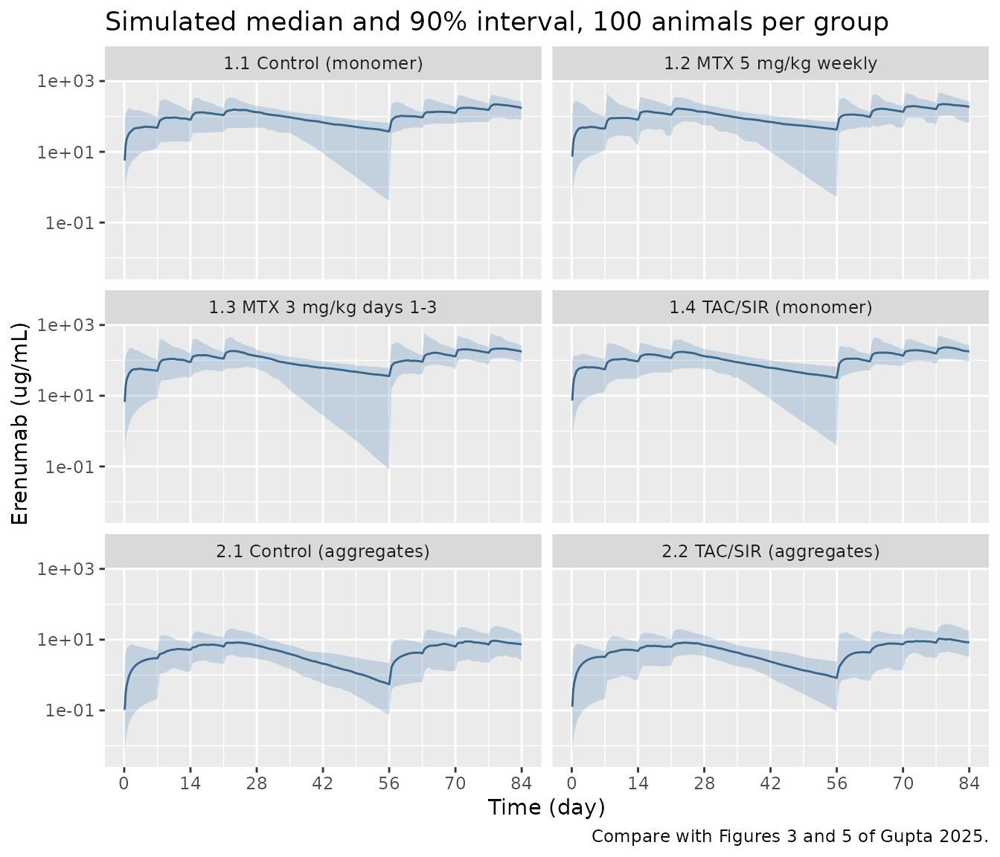
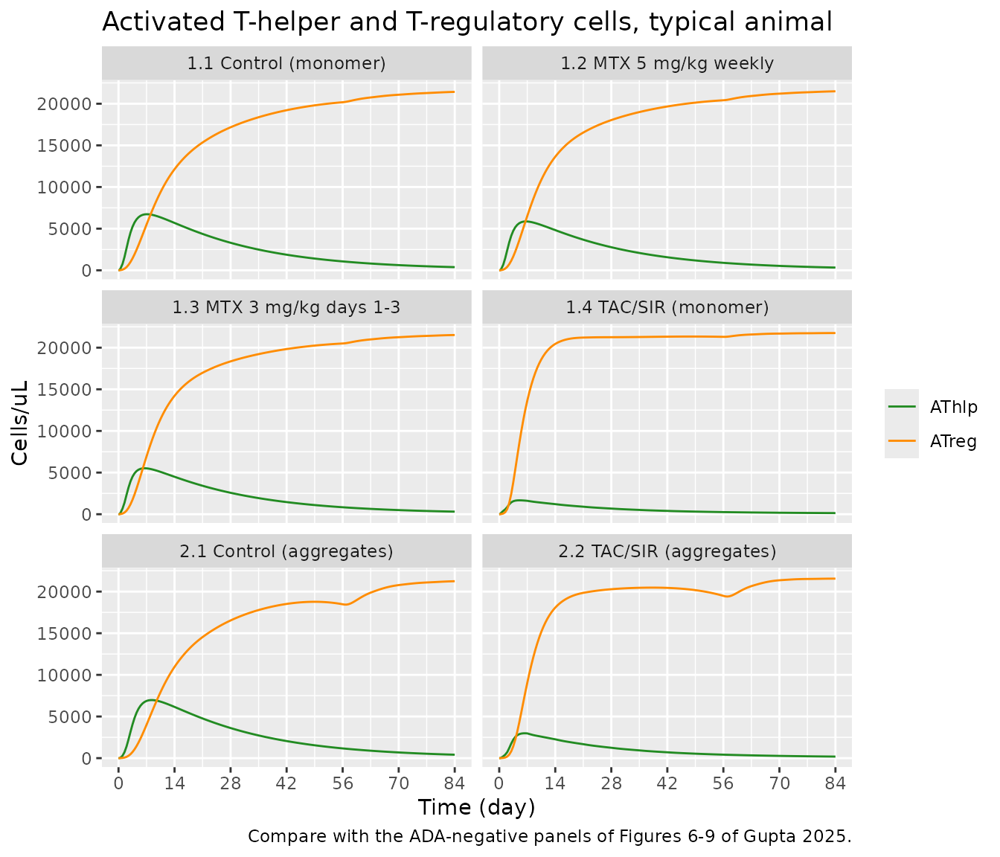
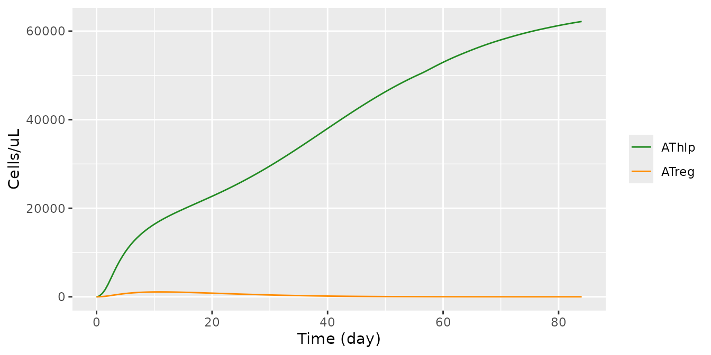
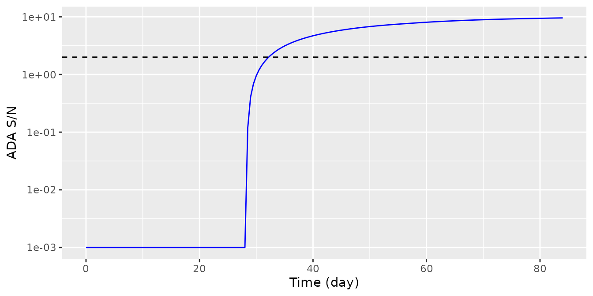
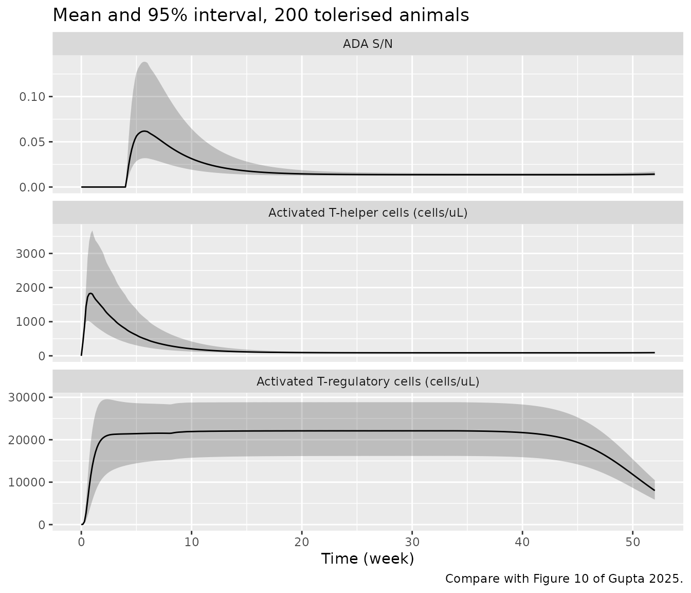

# Erenumab immune tolerance in rats (Gupta 2025)

## Model and source

- Citation: Gupta P, Ryman JT, Jawa V, Meibohm B. A Semi-Mechanistic
  Mathematical Model of Immune Tolerance Induction to Support
  Preclinical Studies of Human Monoclonal Antibodies in Rats.
  Pharmaceutics. 2025;17(7):845. <doi:10.3390/pharmaceutics17070845>. PK
  parameters from Table 1; immune-cell parameters from Table 2 and
  Supplementary Table S1; equations from Equations 1-12 and
  Supplementary Equations S1-S15.
- Description: Preclinical (rat). QSP. Integrated PK / semi-mechanistic
  immune-cell model of anti-drug antibody (ADA) formation and immune
  tolerance induction against the human IgG2 monoclonal antibody
  erenumab in Sprague-Dawley rats (Gupta 2025): one-compartment
  first-order absorption erenumab PK with aggregation-state effects on
  CL/F and ka and an ADA-magnitude power effect on CL/F, driving
  dendritic-cell maturation and CD4+ T-helper / T-regulatory cell
  activation and proliferation; tacrolimus (inhibits T-helper
  proliferation) and methotrexate (inhibits T-helper activation) carried
  as coupled one-compartment PK states.
- Article: <https://doi.org/10.3390/pharmaceutics17070845> (open access;
  the supplement with Equations S1-S15 and Table S1 is at
  <https://www.mdpi.com/article/10.3390/pharmaceutics17070845/s1>)

Gupta 2025 built the model in two steps. A one-compartment population PK
model of erenumab in rats (Monolix, Table 1) used the observed ADA
signal-to-noise ratio (S/N) as a time-varying covariate on clearance.
The individual PK profiles then drove a semi-mechanistic model of
dendritic cells, CD4+ T-helper cells and T-regulatory cells, whose
activated T-helper count generates the ADA response (Table 2, Figure 2).
Methotrexate inhibits the activation of naive T-helper cells and
tacrolimus inhibits the proliferation of activated T-helper cells.

The packaged model joins the two steps the way Figure 2 draws them: the
model-predicted ADA S/N, rather than an observed S/N column, enters the
clearance term of Equation 4, so ADA formation feeds back on erenumab
exposure. Tacrolimus and methotrexate are carried as their own
one-compartment PK states (doses in mg/kg into `depot_tacrolimus` and
`depot_methotrexate`), which reproduces the multiple-dose concentration
Equations S12 and S14 for any regimen.

## Population

Two 12-week immune-tolerance studies in Sprague-Dawley rats (Gupta 2025
Section 2.1, Figure 1), each split into an induction phase (weeks 1-4),
a washout phase (weeks 5-8) and a rechallenge phase (weeks 9-12).
Erenumab was given SC once weekly in weeks 1-4 and 9-12: 10 mg/kg
monomer in Study 1 and 1 mg/kg aggregates in Study 2. Study 1 had four
groups of 8 animals (1.1 control; 1.2 methotrexate 5 mg/kg IP weekly in
weeks 1-7; 1.3 methotrexate 3 mg/kg IP on days 1-3; 1.4 sirolimus 6
mg/kg PO on day 1 plus tacrolimus 2 mg/kg SC weekly in weeks 1-7), and
Study 2 had two groups of 10 (2.1 control; 2.2 tacrolimus/sirolimus as
in 1.4). The analysis used 1924 erenumab concentrations and 624 ADA
measurements from 52 animals, 14 of them ADA-positive. Animals weighed
about 270-290 g at purchase and 380-410 g at week 12 (Discussion). Sex
was not reported.

The same information is available programmatically via
`readModelDb("Gupta_2025_erenumab_rat")()$population`.

## Source trace

| Equation / parameter | Value | Source location |
|----|----|----|
| `lka` (ka, monomer) | 0.91 1/day | Table 1 |
| `lcl` (CL/F, monomer, ADA-negative) | 1.83 mL/day | Table 1 |
| `lvc` (Vd/F) | 32.6 mL | Table 1 |
| `e_aggregate_cl` | 2.40 | Table 1, Equation 3 |
| `e_aggregate_ka` | 0.12 | Table 1, Equation 3 |
| `e_ada_cl` | 0.37 | Table 1, Equation 4 |
| `sn_cutoff`, `sn_cutoff_s2` | 2, 1.5 | Section 2.1 (ADA-positivity threshold); Figure 2 legend |
| `etalcl` | 0.178^2 | Table 1 (IIV 17.8%) |
| `etalvc`, `etalvc_s2` | 0.869^2, 0.212^2 | Table 1 (IIV 86.9% Study 1, 21.2% Study 2) |
| `etaiov_lka_1` … `_8` | 1.83^2 | Table 1 (IOV 183%), Section 2.2.1 (eight occasions) |
| `addSd`, `propSd` | 0.09 ug/mL, 0.29 | Table 1 (Study 1) |
| `addSd_s2`, `propSd_s2` | 0.12 ug/mL, 0.13 | Table 1 (Study 2) |
| `betaND`, `ND0`, `deltaND` | 0.0924 1/day, 3700 cells/uL, 1.5 1/day | Table 2 C, Table S1 |
| `ec50`, `ec50_aggregate` | 9.85, 2.02 ug/mL | Table 2 C and A |
| `betaMD` | 0.2310 1/day | Table 2 C |
| `NThlp0`, `betaNThlp`, `deltaNThlp` | 723 cells/uL, 0.0056 1/day, 1.5 1/day | Table 2 C |
| `rhoAThlp`, `betaAThlp` | 2.45 1/day, 0.05 1/day | Table 2 A |
| `NTreg0`, `betaNTreg`, `deltaNTreg` | 62 cells/uL, 0.0056 1/day, 1.5 1/day | Table 2 C |
| `betaATreg` | 0.18 1/day | Table 2 C |
| `lrhoATreg`, `etalrhoATreg` | 3.02 1/day, 0.153^2 | Table 2 B |
| `lATreg50`, `etalATreg50` | 1000 cells/uL, 0.034^2 | Table 2 B |
| `ltlag_ada`, `etaltlag_ada` | 28.3 day, 0.53^2 | Table 2 B |
| `alphaADA`, `kADA` | 77 nmol/day, 0.138 1/day | Table 2 C |
| `kADAprop` (K), `nADA` (N) | 500 cells/day, 1000 nmol/uL | Table S1 |
| Tacrolimus `f_`, `ka_`, `kel_`, `vc_`, `ic50_tacrolimus` | 0.2, 7.2 1/day, 3.6 1/day, 10 L/kg, 0.2 nM | Table S1; Section 2.2.2 |
| Methotrexate `f_`, `ka_`, `kel_`, `vc_`, `ic50_methotrexate` | 1, 88.56 1/day, 56.41 1/day, 0.174 L/kg, 1 nM | Table S1; Section 2.2.2 |
| `mw_tacrolimus`, `mw_methotrexate` | 804.02, 454.44 g/mol | Molecular formulae (not in the source) |
| `d/dt(depot)`, `d/dt(central)` | n/a | Equations 5, S1-S2 |
| `d/dt(ND)`, `d/dt(MD)` | n/a | Equations 6, S4-S5 |
| `d/dt(NThlp)`, `d/dt(AThlp)` | n/a | Equations 7, 11, 12, S6, S7, S13, S15 |
| `d/dt(NTreg)`, `d/dt(ATreg)` | n/a | Equations 8, S8-S9 |
| `D` | n/a | Equation 9 |
| `ada`, `ada_sn` | n/a | Equations 10, S10-S11 |
| ADA effect on CL/F | n/a | Equation 4 |
| Tacrolimus / methotrexate concentrations | n/a | Equations S12, S14 |

## Virtual cohort

The six treatment groups of Figure 1 are rebuilt with 100 virtual
animals each. Erenumab doses are mg/kg, so the absolute amount needs a
body weight. The paper does not report individual weights. Body weight
is taken to rise linearly from 0.28 kg on day 0 to 0.395 kg on day 84,
the midpoints of the ranges given in the Discussion.

``` r

set.seed(2025)

ere_days <- c(0, 7, 14, 21, 56, 63, 70, 77)
obs_days <- sort(unique(c(seq(0, 84, by = 0.5), 0.1, 0.3)))
wt_kg <- function(t) 0.28 + (0.395 - 0.28) * t / 84

groups <- tibble::tribble(
  ~group,                        ~study2, ~agg, ~ere_mgkg, ~imm,
  "1.1 Control (monomer)",       0,       0,    10,        "none",
  "1.2 MTX 5 mg/kg weekly",      0,       0,    10,        "mtx5",
  "1.3 MTX 3 mg/kg days 1-3",    0,       0,    10,        "mtx3",
  "1.4 TAC/SIR (monomer)",       0,       0,    10,        "tac",
  "2.1 Control (aggregates)",    1,       1,    1,         "none",
  "2.2 TAC/SIR (aggregates)",    1,       1,    1,         "tac"
)

make_group <- function(g, n, id_offset, obs = obs_days, ere = ere_days) {
  doses <- tibble(time = ere, evid = 1L, cmt = "depot",
                  amt = g$ere_mgkg * wt_kg(ere) * 1000)
  imm <- switch(
    g$imm,
    none = NULL,
    mtx5 = tibble(time = seq(0, 42, by = 7), evid = 1L, cmt = "depot_methotrexate", amt = 5),
    mtx3 = tibble(time = 0:2, evid = 1L, cmt = "depot_methotrexate", amt = 3),
    tac  = tibble(time = seq(0, 42, by = 7), evid = 1L, cmt = "depot_tacrolimus", amt = 2)
  )
  obs_rows <- tibble(time = obs, evid = 0L, cmt = "central", amt = 0)
  one <- bind_rows(doses, imm, obs_rows) |>
    arrange(time, desc(evid))
  # One ka occasion per erenumab dose: OCC = number of erenumab doses so far.
  one$OCC <- pmax(1L, findInterval(one$time, ere))
  tidyr::crossing(id = id_offset + seq_len(n), one) |>
    mutate(
      group = g$group,
      FORM_ERENUMAB_AGGREGATE = g$agg,
      STUDY_ERENUMAB_S2 = g$study2
    ) |>
    arrange(id, time, desc(evid))
}

n_per_group <- 100
events <- bind_rows(lapply(seq_len(nrow(groups)), function(i) {
  make_group(groups[i, ], n_per_group, id_offset = (i - 1L) * n_per_group)
}))
stopifnot(!anyDuplicated(events[, c("id", "time", "evid", "cmt")]))
```

## Simulation

``` r

mod <- readModelDb("Gupta_2025_erenumab_rat")
keep_cols <- c("group", "FORM_ERENUMAB_AGGREGATE", "STUDY_ERENUMAB_S2")

rxode2::rxSetSeed(2025)
sim <- rxode2::rxSolve(mod, events = events, keep = keep_cols) |>
  as.data.frame()
#> ℹ parameter labels from comments will be replaced by 'label()'
#> Warning: some etas defaulted to non-mu referenced, possible parsing error: etalvc, etalvc_s2, etaiov_lka_1, etaiov_lka_2, etaiov_lka_3, etaiov_lka_4, etaiov_lka_5, etaiov_lka_6, etaiov_lka_7, etaiov_lka_8
#> as a work-around try putting the mu-referenced expression on a simple line

# Typical-value animal per group (all random effects zero).
mod_typ <- rxode2::zeroRe(mod)
#> ℹ parameter labels from comments will be replaced by 'label()'
#> Warning: some etas defaulted to non-mu referenced, possible parsing error: etalvc, etalvc_s2, etaiov_lka_1, etaiov_lka_2, etaiov_lka_3, etaiov_lka_4, etaiov_lka_5, etaiov_lka_6, etaiov_lka_7, etaiov_lka_8
#> as a work-around try putting the mu-referenced expression on a simple line
#> Warning: No sigma parameters in the model
#> Warning: some etas defaulted to non-mu referenced, possible parsing error: etalvc, etalvc_s2, etaiov_lka_1, etaiov_lka_2, etaiov_lka_3, etaiov_lka_4, etaiov_lka_5, etaiov_lka_6, etaiov_lka_7, etaiov_lka_8
#> as a work-around try putting the mu-referenced expression on a simple line
events_typ <- bind_rows(lapply(seq_len(nrow(groups)), function(i) {
  make_group(groups[i, ], 1, id_offset = i - 1L)
}))
sim_typ <- rxode2::rxSolve(mod_typ, events = events_typ, keep = keep_cols) |>
  as.data.frame()
#> ℹ omega/sigma items treated as zero: 'etalcl', 'etalvc', 'etalvc_s2', 'etaiov_lka_1', 'etaiov_lka_2', 'etaiov_lka_3', 'etaiov_lka_4', 'etaiov_lka_5', 'etaiov_lka_6', 'etaiov_lka_7', 'etaiov_lka_8', 'etalrhoATreg', 'etalATreg50', 'etaltlag_ada'
#> Warning: multi-subject simulation without without 'omega'
```

## Erenumab pharmacokinetics

### Closed-form check of the PK layer

While the typical animal stays below the ADA-positivity cut-off, CL/F is
constant and Equation 5 has the closed-form multiple-dose solution
below. The solved profile of the typical control animal (Group 1.1) is
checked against it. Both sides use the same parameters, so the
difference is integration error only.

``` r

typ_ctl <- sim_typ |> filter(group == "1.1 Control (monomer)")
stopifnot(max(typ_ctl$ada_sn) < 2)

ka <- 0.91; cl <- 1.83; vc <- 32.6; k <- cl / vc
dose_amt <- 10 * wt_kg(ere_days) * 1000
closed <- vapply(typ_ctl$time, function(t) {
  sum(ifelse(t >= ere_days,
             dose_amt * ka / (vc * (ka - k)) *
               (exp(-k * (t - ere_days)) - exp(-ka * (t - ere_days))), 0))
}, numeric(1))
rel_err <- abs(typ_ctl$Cc - closed)[closed > 1] / closed[closed > 1]
max(rel_err)
#> [1] 7.053784e-07
stopifnot(max(rel_err) < 1e-3)
```

### Concentration-time profiles

``` r

# Compare with Figures 3 and 5 of Gupta 2025: erenumab serum concentrations by
# treatment group (observed data and VPC in the paper).
sim |>
  filter(time != 0) |>
  group_by(group, time) |>
  summarise(
    Q05 = quantile(Cc, 0.05),
    Q50 = quantile(Cc, 0.50),
    Q95 = quantile(Cc, 0.95),
    .groups = "drop"
  ) |>
  ggplot(aes(time, Q50)) +
  geom_ribbon(aes(ymin = Q05, ymax = Q95), alpha = 0.25, fill = "steelblue") +
  geom_line(colour = "steelblue4") +
  facet_wrap(~group, ncol = 2) +
  scale_y_log10() +
  scale_x_continuous(breaks = seq(0, 84, 14)) +
  labs(x = "Time (day)", y = "Erenumab (ug/mL)",
       title = "Simulated median and 90% interval, 100 animals per group",
       caption = "Compare with Figures 3 and 5 of Gupta 2025.")
```



The aggregate groups have lower and later peaks than the monomer groups
because of the 10-fold lower dose, the 2.4-fold higher CL/F and the
8-fold slower absorption (Table 1). The wide intervals in Study 1 come
from the 86.9% IIV on Vd/F and the very large inter-occasion variability
on ka.

### PKNCA

Gupta 2025 reports no NCA, so the table below characterises the
simulated first dosing interval (days 0-7) and the last rechallenge
interval (days 77-84) without a published comparator.

``` r

sim_nca <- sim |>
  filter(!is.na(Cc)) |>
  select(id, time, Cc, group)
sim_nca <- bind_rows(
  sim_nca,
  sim_nca |> distinct(id, group) |> mutate(time = 0, Cc = 0)
) |>
  distinct(id, group, time, .keep_all = TRUE) |>
  arrange(id, group, time)

dose_df <- events |>
  filter(evid == 1, cmt == "depot") |>
  select(id, time, amt, group)

conc_obj <- PKNCA::PKNCAconc(sim_nca, Cc ~ time | group + id)
dose_obj <- PKNCA::PKNCAdose(dose_df, amt ~ time | group + id)
intervals <- data.frame(
  start = c(0, 77), end = c(7, 84),
  cmax = TRUE, tmax = TRUE, auclast = TRUE
)
nca_res <- PKNCA::pk.nca(PKNCA::PKNCAdata(conc_obj, dose_obj, intervals = intervals))

as.data.frame(nca_res) |>
  filter(PPTESTCD %in% c("cmax", "tmax", "auclast")) |>
  group_by(group, start, end, PPTESTCD) |>
  summarise(median = signif(median(PPORRES, na.rm = TRUE), 3), .groups = "drop") |>
  tidyr::pivot_wider(names_from = PPTESTCD, values_from = median) |>
  mutate(interval = paste0(start, "-", end, " d")) |>
  select(group, interval, cmax, tmax, auclast) |>
  rename(
    "Group" = group,
    "Interval" = interval,
    "Cmax (ug/mL)" = cmax,
    "Tmax (day)" = tmax,
    "AUC (ug*day/mL)" = auclast
  ) |>
  knitr::kable(caption = "Median simulated NCA parameters by group and dosing interval.")
```

| Group                    | Interval | Cmax (ug/mL) | Tmax (day) | AUC (ug\*day/mL) |
|:-------------------------|:---------|-------------:|-----------:|-----------------:|
| 1.1 Control (monomer)    | 0-7 d    |        52.90 |        3.5 |            298.0 |
| 1.1 Control (monomer)    | 77-84 d  |       228.00 |        2.0 |           1400.0 |
| 1.2 MTX 5 mg/kg weekly   | 0-7 d    |        52.10 |        3.0 |            324.0 |
| 1.2 MTX 5 mg/kg weekly   | 77-84 d  |       228.00 |        1.5 |           1440.0 |
| 1.3 MTX 3 mg/kg days 1-3 | 0-7 d    |        62.40 |        3.5 |            370.0 |
| 1.3 MTX 3 mg/kg days 1-3 | 77-84 d  |       221.00 |        1.5 |           1440.0 |
| 1.4 TAC/SIR (monomer)    | 0-7 d    |        69.70 |        3.5 |            412.0 |
| 1.4 TAC/SIR (monomer)    | 77-84 d  |       239.00 |        1.5 |           1490.0 |
| 2.1 Control (aggregates) | 0-7 d    |         3.03 |        7.0 |             14.6 |
| 2.1 Control (aggregates) | 77-84 d  |        10.60 |        2.0 |             57.5 |
| 2.2 TAC/SIR (aggregates) | 0-7 d    |         3.32 |        7.0 |             16.7 |
| 2.2 TAC/SIR (aggregates) | 77-84 d  |        12.00 |        1.5 |             68.7 |

Median simulated NCA parameters by group and dosing interval. {.table}

## Immune-cell kinetics and ADA

### Typical-value animal in each group

``` r

# Compare with the ADA-negative panels of Figures 6-9 of Gupta 2025.
sim_typ |>
  select(group, time, AThlp, ATreg) |>
  pivot_longer(c(AThlp, ATreg), names_to = "cell", values_to = "count") |>
  ggplot(aes(time, count, colour = cell)) +
  geom_line() +
  facet_wrap(~group, ncol = 2) +
  scale_colour_manual(values = c(AThlp = "forestgreen", ATreg = "darkorange")) +
  scale_x_continuous(breaks = seq(0, 84, 14)) +
  labs(x = "Time (day)", y = "Cells/uL", colour = NULL,
       title = "Activated T-helper and T-regulatory cells, typical animal",
       caption = "Compare with the ADA-negative panels of Figures 6-9 of Gupta 2025.")
```



``` r

typ_sum <- sim_typ |>
  group_by(group) |>
  summarise(
    AThlp_d28 = AThlp[time == 28],
    ATreg_d28 = ATreg[time == 28],
    AThlp_d84 = AThlp[time == 84],
    ATreg_d84 = ATreg[time == 84],
    max_sn = max(ada_sn),
    .groups = "drop"
  )
typ_sum |>
  mutate(across(where(is.numeric), \(x) signif(x, 3))) |>
  rename(
    "Group" = group,
    "AThlp day 28" = AThlp_d28,
    "ATreg day 28" = ATreg_d28,
    "AThlp day 84" = AThlp_d84,
    "ATreg day 84" = ATreg_d84,
    "Max ADA S/N" = max_sn
  ) |>
  knitr::kable(caption = "Typical-value cell counts (cells/uL) at the end of induction and rechallenge.")
```

| Group | AThlp day 28 | ATreg day 28 | AThlp day 84 | ATreg day 84 | Max ADA S/N |
|:---|---:|---:|---:|---:|---:|
| 1.1 Control (monomer) | 3300 | 17200 | 379 | 21400 | 0.2510 |
| 1.2 MTX 5 mg/kg weekly | 2770 | 18000 | 328 | 21500 | 0.2100 |
| 1.3 MTX 3 mg/kg days 1-3 | 2570 | 18400 | 310 | 21500 | 0.1950 |
| 1.4 TAC/SIR (monomer) | 679 | 21300 | 137 | 21800 | 0.0528 |
| 2.1 Control (aggregates) | 3620 | 16500 | 412 | 21200 | 0.2750 |
| 2.2 TAC/SIR (aggregates) | 1250 | 20300 | 187 | 21600 | 0.0937 |

Typical-value cell counts (cells/uL) at the end of induction and
rechallenge. {.table}

``` r


# The typical animal stays ADA-negative in every group, as most animals did
# (36 of 52 ADA-negative; Section 3).
cut_by_group <- ifelse(grepl("^2", typ_sum$group), 1.5, 2)
stopifnot(all(typ_sum$max_sn < cut_by_group))
# Tacrolimus inhibits T-helper proliferation: fewer activated T-helper cells
# than in the matching control at the end of induction.
stopifnot(
  typ_sum$AThlp_d28[typ_sum$group == "1.4 TAC/SIR (monomer)"] <
    typ_sum$AThlp_d28[typ_sum$group == "1.1 Control (monomer)"],
  typ_sum$AThlp_d28[typ_sum$group == "2.2 TAC/SIR (aggregates)"] <
    typ_sum$AThlp_d28[typ_sum$group == "2.1 Control (aggregates)"]
)
```

In the ADA-negative animals of Figures 6b, 7 and 8b the activated
T-regulatory cells reach roughly 20,000-55,000 cells/uL and outnumber
the activated T-helper cells, which return towards zero. The
typical-value animals above behave the same way, with T-regulatory
counts of about 21,000 cells/uL at the lower end of that range.

### An ADA-positive animal

ADA formation in this model hinges on the T-regulatory proliferation
rate `rhoATreg`, the most sensitive parameter in the paper’s sensitivity
analysis (Table 3, CCmax -85). An animal at the 2.5th percentile of its
distribution, `rhoATreg = 3.02 * exp(-1.96 * 0.153)`, is simulated
without immunosuppression.

``` r

# Compare with Figure 6a of Gupta 2025 (Group 1.1, ADA-positive animals).
rho_low <- 3.02 * exp(-1.96 * 0.153)
sim_pos <- rxode2::rxSolve(
  mod_typ,
  events = events_typ |> filter(group == "1.1 Control (monomer)"),
  params = c(lrhoATreg = log(rho_low))
) |>
  as.data.frame()
#> ℹ omega/sigma items treated as zero: 'etalcl', 'etalvc', 'etalvc_s2', 'etaiov_lka_1', 'etaiov_lka_2', 'etaiov_lka_3', 'etaiov_lka_4', 'etaiov_lka_5', 'etaiov_lka_6', 'etaiov_lka_7', 'etaiov_lka_8', 'etalrhoATreg', 'etalATreg50', 'etaltlag_ada'

p_cells <- sim_pos |>
  select(time, AThlp, ATreg) |>
  pivot_longer(-time, names_to = "cell", values_to = "count") |>
  ggplot(aes(time, count, colour = cell)) +
  geom_line() +
  scale_colour_manual(values = c(AThlp = "forestgreen", ATreg = "darkorange")) +
  labs(x = "Time (day)", y = "Cells/uL", colour = NULL)
p_ada <- ggplot(sim_pos, aes(time, pmax(ada_sn, 1e-3))) +
  geom_line(colour = "blue") +
  geom_hline(yintercept = 2, linetype = "dashed") +
  scale_y_log10() +
  labs(x = "Time (day)", y = "ADA S/N")
p_cells
```



``` r

p_ada
```



``` r


stopifnot(
  sim_pos$AThlp[sim_pos$time == 35] > sim_pos$ATreg[sim_pos$time == 35],
  max(sim_pos$ada_sn) > 2
)
```

The ADA-positive branch has activated T-helper cells outnumbering
activated T-regulatory cells, as in Figure 6a, and the predicted S/N
crosses the cut-off after the 28-day lag. Its magnitude, however, stays
within about one log unit of the cut-off, whereas the predicted curves
in Figure 6a climb to S/N 10⁴⁻¹⁰5 (see Assumptions and deviations).

### ADA incidence by group

Each virtual animal is classified ADA-positive when its predicted S/N
exceeds the study’s cut-off at any time during the 12 weeks.

``` r

observed_incidence <- tibble::tribble(
  ~group,                       ~observed,
  "1.1 Control (monomer)",      "2/8 (25%)",
  "1.2 MTX 5 mg/kg weekly",     "5/8 (62.5%)",
  "1.3 MTX 3 mg/kg days 1-3",   "1/8 (12.5%)",
  "1.4 TAC/SIR (monomer)",      "0/8 (0%)",
  "2.1 Control (aggregates)",   "6/10 (60%)",
  "2.2 TAC/SIR (aggregates)",   "0/10 (0%)"
)
incidence <- sim |>
  mutate(cut = ifelse(STUDY_ERENUMAB_S2 == 1, 1.5, 2)) |>
  group_by(group, id) |>
  summarise(pos = any(ada_sn > cut), .groups = "drop") |>
  group_by(group) |>
  summarise(simulated = mean(pos), .groups = "drop") |>
  left_join(observed_incidence, by = "group")
incidence |>
  mutate(simulated = sprintf("%.0f%%", 100 * simulated)) |>
  rename("Group" = group, "Simulated" = simulated,
         "Observed (Figure 4, Discussion)" = observed) |>
  knitr::kable(caption = "ADA incidence: 100 virtual animals per group versus the observed studies.")
```

| Group                    | Simulated | Observed (Figure 4, Discussion) |
|:-------------------------|:----------|:--------------------------------|
| 1.1 Control (monomer)    | 7%        | 2/8 (25%)                       |
| 1.2 MTX 5 mg/kg weekly   | 6%        | 5/8 (62.5%)                     |
| 1.3 MTX 3 mg/kg days 1-3 | 5%        | 1/8 (12.5%)                     |
| 1.4 TAC/SIR (monomer)    | 0%        | 0/8 (0%)                        |
| 2.1 Control (aggregates) | 13%       | 6/10 (60%)                      |
| 2.2 TAC/SIR (aggregates) | 2%        | 0/10 (0%)                       |

ADA incidence: 100 virtual animals per group versus the observed
studies. {.table}

The tacrolimus/sirolimus groups are essentially ADA-free, in line with
the studies. The simulated incidence in the control and methotrexate
groups is well below the observed incidence, and the model does not
separate the two methotrexate regimens from their control. Gupta 2025
fitted the immune model to each animal with its own PK and its own
`rhoATreg`, `ATreg50` and `Tlag`, and reports group incidences from
those individual fits, not from a population simulation; a population
simulation from the reported variances is therefore not expected to
reproduce them exactly.

## Chronic toxicology study after tolerance induction

Gupta 2025 Section 3.3 simulated a 6-month study in 1000 animals
tolerised with the tacrolimus/sirolimus regimen: weekly 10 mg/kg monomer
in weeks 1-4, tacrolimus in weeks 1-7, then weekly erenumab for 6 months
of rechallenge without immunosuppression. Only `rhoATreg` was sampled.
Here 200 animals are simulated the same way, with all other random
effects at zero, and erenumab given weekly from week 9 to week 34.

``` r

chronic_ere <- c(seq(0, 21, by = 7), seq(56, 231, by = 7))
chronic_obs <- seq(0, 364, by = 1)
n_chronic <- 200
ev_chronic <- make_group(groups[4, ], n_chronic, id_offset = 0L,
                         obs = chronic_obs, ere = chronic_ere) |>
  mutate(
    amt = ifelse(cmt == "depot", 10 * wt_kg(pmin(time, 84)) * 1000, amt),
    OCC = 1L
  )
par_chronic <- data.frame(
  id = seq_len(n_chronic),
  lrhoATreg = log(3.02) + rnorm(n_chronic, 0, 0.153)
)
sim_chronic <- rxode2::rxSolve(mod_typ, events = ev_chronic, params = par_chronic) |>
  as.data.frame()
#> ℹ omega/sigma items treated as zero: 'etalcl', 'etalvc', 'etalvc_s2', 'etaiov_lka_1', 'etaiov_lka_2', 'etaiov_lka_3', 'etaiov_lka_4', 'etaiov_lka_5', 'etaiov_lka_6', 'etaiov_lka_7', 'etaiov_lka_8', 'etalrhoATreg', 'etalATreg50', 'etaltlag_ada'
#> Warning: multi-subject simulation without without 'omega'

chronic_sum <- sim_chronic |>
  select(id, time, AThlp, ATreg, ada_sn) |>
  pivot_longer(c(AThlp, ATreg, ada_sn), names_to = "var", values_to = "value") |>
  group_by(var, time) |>
  summarise(
    mean = mean(value),
    lo = quantile(value, 0.025),
    hi = quantile(value, 0.975),
    .groups = "drop"
  )
ggplot(chronic_sum, aes(time / 7, mean)) +
  geom_ribbon(aes(ymin = lo, ymax = hi), alpha = 0.25) +
  geom_line() +
  facet_wrap(~var, scales = "free_y", ncol = 1,
             labeller = as_labeller(c(AThlp = "Activated T-helper cells (cells/uL)",
                                      ATreg = "Activated T-regulatory cells (cells/uL)",
                                      ada_sn = "ADA S/N"))) +
  labs(x = "Time (week)", y = NULL,
       title = "Mean and 95% interval, 200 tolerised animals",
       caption = "Compare with Figure 10 of Gupta 2025.")
```



``` r

max_sn_chronic <- sim_chronic |> group_by(id) |> summarise(m = max(ada_sn))
fig10 <- tibble::tribble(
  ~quantity,                                   ~published,
  "Peak mean AThlp (cells/uL)",                "about 120, near week 1",
  "Mean ATreg, week 5 (cells/uL)",             "about 30,000",
  "Mean ATreg, weeks 20-34 (cells/uL)",        "about 66,000",
  "Animals ADA-positive (S/N > 2)",            "none",
  "Mean ADA S/N at week 52",                   "about 0.8"
)
mean_at <- function(v, wk) {
  mean(sim_chronic[[v]][sim_chronic$time %in% (wk * 7)])
}
fig10$simulated <- c(
  sprintf("%.0f, week %.1f",
          max(chronic_sum$mean[chronic_sum$var == "AThlp"]),
          chronic_sum$time[chronic_sum$var == "AThlp"][
            which.max(chronic_sum$mean[chronic_sum$var == "AThlp"])] / 7),
  sprintf("%.0f", mean_at("ATreg", 5)),
  sprintf("%.0f", mean_at("ATreg", 20:34)),
  sprintf("%d of %d", sum(max_sn_chronic$m > 2), n_chronic),
  sprintf("%.2f", mean_at("ada_sn", 52))
)
fig10 |>
  rename("Quantity" = quantity, "Figure 10 (read from the plot)" = published,
         "This implementation" = simulated) |>
  knitr::kable(caption = "Chronic-study simulation against Figure 10 of Gupta 2025.")
```

| Quantity | Figure 10 (read from the plot) | This implementation |
|:---|:---|:---|
| Peak mean AThlp (cells/uL) | about 120, near week 1 | 1831, week 0.9 |
| Mean ATreg, week 5 (cells/uL) | about 30,000 | 21432 |
| Mean ATreg, weeks 20-34 (cells/uL) | about 66,000 | 22094 |
| Animals ADA-positive (S/N \> 2) | none | 0 of 200 |
| Mean ADA S/N at week 52 | about 0.8 | 0.01 |

Chronic-study simulation against Figure 10 of Gupta 2025. {.table}

``` r


# Tolerance is maintained: no animal crosses the ADA cut-off.
stopifnot(mean(max_sn_chronic$m > 2) < 0.05)
```

The qualitative result of Section 3.3 holds: once tolerised, continued
erenumab dosing keeps activated T-regulatory cells far above activated
T-helper cells and no animal becomes ADA-positive. The magnitudes do not
match Figure 10. The early T-helper peak is about 15-fold higher, the
T-regulatory plateau during continued dosing is about one third of the
published one and does not rise between week 5 and week 20, and the
predicted S/N falls with the T-helper count instead of settling at about
0.8. The paper’s own T-cell curves for the same regimen in the 12-week
study (Figure 7c, Figure 9) show T-regulatory counts of 20,000-60,000
cells/uL, closer to this implementation; the source does not say what
else differed in the Figure 10 simulation.

## Assumptions and deviations

- **ADA magnitude does not reproduce the published curves.** Equations
  10 and S10-S11 make ADA proportional to the current activated T-helper
  count, zero before `Tlag`, and the S/N is ADA divided by `N`.
  Implemented as printed, an animal with about 10,000 activated T-helper
  cells has an S/N of about 1.5. The predicted curves in Figures 6-9,
  though, reach S/N 10⁴⁻¹⁰5 at similar T-helper counts, are non-zero
  before `Tlag`, and in Figure 10 the S/N stays at about 0.8 for 40
  weeks after the activated T-helper cells have gone. The printed
  equations cannot produce these curves, and the source gives no other
  form. The equations are implemented as printed. The qualitative
  behaviour that carries the paper’s conclusions is reproduced:
  tacrolimus prevents ADA, T-regulatory cells dominate in ADA-negative
  animals and T-helper cells in ADA-positive ones. Above-cut-off ADA
  magnitudes, and with them the size of the ADA effect on clearance, are
  not, and neither are the group incidences or the Figure 10 cell counts
  (tables above).
- **ADA feedback on clearance uses the predicted S/N.** In the
  population PK fit, Equation 4 used the observed S/N of each sample.
  Here the model-predicted `ada_sn` takes its place, which closes the
  PK/ADA loop drawn in Figure 2. Because of the previous point, the
  predicted clearance increase in ADA-positive animals is modest (at
  most about 2-fold in the simulations above), much smaller than the 3-
  to 620-fold increase reported for the observed data.
- **Random-effect scale.** Monolix reports random effects as omega, the
  standard deviation of eta. The IIV and IOV percentages of Tables 1 and
  2 are taken as omega x 100 and squared into variances (for example
  `etaiov_lka ~ 1.83^2`). If they were instead coefficients of
  variation, the variances would be log(1 + CV^2); this changes the
  spread of the simulations only, not the typical values or the
  closed-form check above. The immune-model parameters are taken to be
  log-normally distributed, the Monolix default.
- **Residual error form.** Table 1 gives a combined additive (ug/mL) and
  proportional error per study without saying which Monolix combined
  form was used; it is encoded as `add + prop` (variances summed).
- **Molecular weights.** Tacrolimus and methotrexate concentrations from
  Equations S12 and S14 are in mg/L while their IC50 values are in nM.
  The conversion uses the molecular weights of tacrolimus (C44H69NO12,
  804.02 g/mol) and methotrexate (C20H22N8O5, 454.44 g/mol), which the
  source does not print. Without the conversion, tacrolimus would have
  almost no effect on ADA formation, contradicting Figures 7c and 9.
- **Immunosuppressant PK as ODE states.** Equations S12 and S14 are the
  steady-state multiple-dose Bateman functions for a dosing interval
  tau. They are encoded as one-compartment depot/central states dosed at
  the actual times, which equals the superposition of single doses and
  handles the 3-dose methotrexate regimen and the end of dosing after
  week 7. Sirolimus has no PK in the source; its contribution is folded
  into the tacrolimus IC50, as in the paper.
- **Methotrexate and the naive T-helper loss term.** Equation 11
  inhibits the formation of activated T-helper cells but Equation S6
  leaves the matching loss from the naive pool unchanged. This is
  implemented as printed.
- **Initial conditions.** The source gives initial values only for the
  naive pools (`ND0`, `NThlp0`, `NTreg0`). Mature dendritic cells and
  activated T cells start at zero; with no mature dendritic cells there
  is no activation until erenumab is present.
- **Time in the ADA equation** is time since the first erenumab dose.
- **`ATreg50`** is listed under “Model Fitting” in Table 2 and described
  as estimated in Section 3.2, but no RSE is printed for it; it is
  encoded as estimated (not fixed).
- **Body weight.** Absolute erenumab doses use a body weight rising
  linearly from 0.28 to 0.395 kg over 12 weeks; the paper reports only
  the ranges. The Discussion quotes Vd/F as 0.17 L/kg, which implies a
  body weight of about 0.19 kg and does not match those ranges; Vd/F is
  used in mL as given in Table 1.
- **ADA observations.** The residual error of the ADA S/N fit is not
  reported, so `ada_sn` is an output without an error model.
- No correction notice for the article was found as of 2026-11-05.
