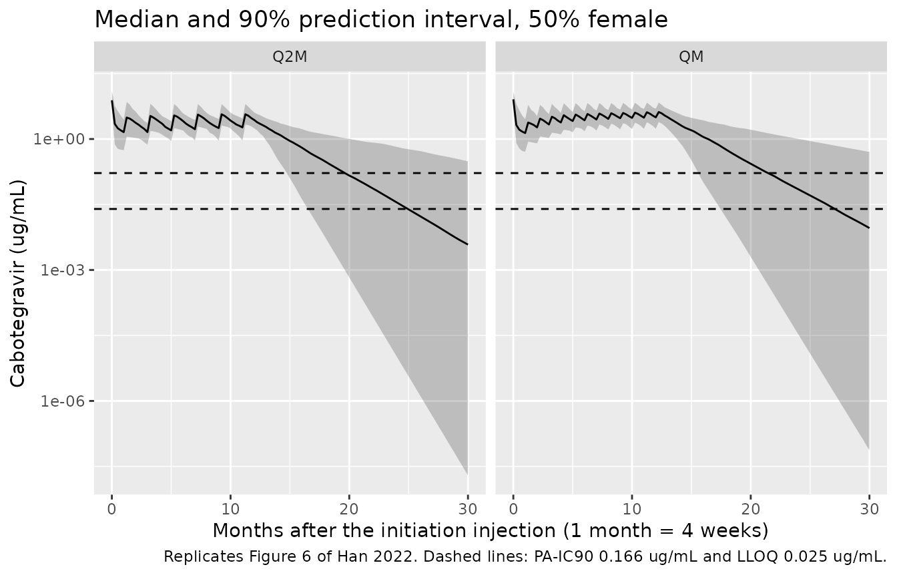

# Cabotegravir (Han 2022)

## Model and source

- Citation: Han K, Baker M, Lovern M, Paul P, Xiong Y, Patel P, Moore
  KP, Seal CS, Cutrell AG, D’Amico RD, Benn PD, Landovitz RJ, Marzinke
  MA, Spreen WR, Ford SL. Population pharmacokinetics of cabotegravir
  following administration of oral tablet and long-acting intramuscular
  injection in adult HIV-1-infected and uninfected subjects. Br J Clin
  Pharmacol. 2022;88(10):4607-4622. <doi:10.1111/bcp.15439>
- Description: Two-compartment population PK model for cabotegravir
  after once-daily oral tablets and long-acting (LA) intramuscular
  injection in adults with and without HIV-1 (Han 2022, 16 pooled phase
  1-3 studies). Oral and LA doses are absorbed first-order from separate
  depots, with oral bioavailability expressed relative to the LA
  injection (LA absolute bioavailability is the apparent-parameter
  reference). Baseline body weight scales CL/F and Q/F with one shared
  estimated exponent and V2/F and V3/F with another, at a 76.6 kg
  reference. Current smoking raises CL/F by 17.4%. The LA absorption
  rate constant is 50.9% lower in women, 47.8% higher when the dose is
  given as two split injections, falls with body mass index (power
  -0.766 at 25.4 kg/m^2) and rises with needle length (power 0.478 at
  1.5 inch); because LA absorption is rate-limiting (flip-flop), a
  slower LA absorption lowers the first trough but raises the
  steady-state trough.
- Article: [Br J Clin Pharmacol
  2022;88(10):4607-4622](https://doi.org/10.1111/bcp.15439) (open
  access, PMC9543358)

Cabotegravir is an integrase strand-transfer inhibitor given as a
once-daily oral tablet (for lead-in or bridging) and as a long-acting
(LA) intramuscular nanosuspension every one or two months, alone for
HIV-1 pre-exposure prophylaxis or with long-acting rilpivirine for
treatment. LA absorption is much slower than elimination, so after an
injection the decline of plasma concentration is governed by absorption
(flip-flop kinetics).

Dose oral tablets into `depot_oral` and LA injections into `depot_im`.
`INJ_SPLIT` and `NEEDLE_LEN_IN` describe each injection, so set them on
the LA dose records.

## Population

Han 2022 pooled 23 926 plasma concentrations from 1647 adults in 16
phase 1, 2 and 3 studies (Table 1): eight phase 1 oral studies in
healthy volunteers, the LA relative-bioavailability study 116815, LATTE
(oral induction, 10-60 mg), LATTE-2, FLAIR and ATLAS (HIV-1 treatment,
400 mg every 4 weeks or 600 mg every 8 weeks after an oral lead-in) and
HPTN 077 / ECLAIR (pre-exposure prophylaxis, 600-800 mg). 72.2% of the
subjects had HIV-1 infection, 25.7% were women, the median age was 36
years (18-74), median weight 76.6 kg (41.2-168.3) and median BMI 25.4
kg/m^2 (15.3-69.5). The cohort was 66.9% White, 23.9% Black, 3.4% Asian
and 5.6% other race, and 27.1% were current smokers (Table 2). A total
of 12 169 LA injections of 200-800 mg were recorded; 6.0% were given as
two split injections and 88.5% used a 1.5-inch needle. ATLAS-2M (647
subjects, 5097 concentrations) was held out for external validation.

The same information is available programmatically via
`readModelDb("Han_2022_cabotegravir")()$population`.

## Source trace

Every value is the ‘Final model’ column of Han 2022 Table 3. The
covariate equations are printed in Results 3.2 and their forms are
defined in Methods 2.2-2.3.

| Equation / parameter | Value | Source location |
|----|----|----|
| `lka_oral` (KAoral) | log(1.41) 1/h | Table 3 |
| `lka_im` (KALA) | log(0.000733) 1/h | Table 3 (0.00073 in the Results 3.2 equation) |
| `lfdepot_oral` (F1, oral relative to LA) | log(0.756) | Table 3 |
| `lcl` (CL/F) | log(0.151) L/h | Table 3 |
| `lvc` (V2/F) | log(5.27) L | Table 3 |
| `lq` (Q/F) | log(0.507) L/h | Table 3 |
| `lvp` (V3/F) | log(2.43) L | Table 3 |
| `e_wt_cl_q` | 0.618 | Table 3 ‘BWT on CL/F and Q/F’; reference 76.6 kg from the Results 3.2 equations |
| `e_wt_vc_vp` | 0.702 | Table 3 ‘BWT on V2/F and V3/F’ |
| `e_smoke_cl` | 0.174 | Table 3 ‘Smoke on CL/F 17.4%’; equation ‘(1 + 17.4% if current smoker)’ |
| `e_sexf_ka_im` | -0.509 | Table 3 ‘Female on KALA 50.9%’; equation ‘(1 - 50.9% if female)’ |
| `e_bmi_ka_im` | -0.766 | Table 3 ‘BMI exponent on KALA 0.766’, reference 25.4 kg/m^2; sign from Discussion |
| `e_inj_split_ka_im` | 0.478 | Table 3 ‘Split on KALA 47.8%’; equation ‘(1 + 47.8% if split)’ |
| `e_needle_len_in_ka_im` | 0.478 | Table 3 ‘NDL exponent on KALA’, reference 1.5 inch |
| `etalka_oral` | 0.58736 | Table 3 IIV 89.4%, log(1 + 0.894^2) |
| `etalka_im` | 0.28911 | Table 3 IIV 57.9% |
| `etalcl` | 0.052867 | Table 3 IIV 23.3% |
| `etalvc` | 0.040383 | Table 3 IIV 20.3% |
| `etalfdepot_oral` | 0.029827 | Table 3 IIV 17.4% |
| `addSd` | 0.0319 ug/mL | Table 3 ‘Add err’ |
| `propSd` | 0.273 | Table 3 ‘Prop err 27.3%’ |
| Two-compartment, first-order oral and LA absorption | n/a | Figure 1; Methods 2.2 |
| Power covariate form, `(1 + theta * IND)` categorical form | n/a | Methods 2.3; Results 3.2 equations |

## Typical-value checks against the paper’s half-lives

Results 3.2 gives four half-lives computed from the final model for a
76.6 kg subject. The oral terminal half-life is the slow disposition
phase of the two-compartment model (36.5 h in a non-smoker, 31.2 h in a
current smoker); the LA terminal half-life is `log(2) / KALA` because
absorption is rate limiting (5.6 weeks in men and 11.5 weeks in women at
BMI 25.4 kg/m^2, unsplit injection, 1.5-inch needle).

``` r

mod <- readModelDb("Han_2022_cabotegravir")
p <- rxode2::rxode(mod)$theta
#> ℹ parameter labels from comments will be replaced by 'label()'

beta_half_life <- function(cl, vc, q, vp) {
  k10 <- cl / vc
  k12 <- q / vc
  k21 <- q / vp
  s <- k10 + k12 + k21
  beta <- (s - sqrt(s^2 - 4 * k10 * k21)) / 2
  log(2) / beta
}

cl_ns <- exp(p[["lcl"]])
cl_sm <- exp(p[["lcl"]]) * (1 + p[["e_smoke_cl"]])
ka_im_m <- exp(p[["lka_im"]])
ka_im_f <- exp(p[["lka_im"]]) * (1 + p[["e_sexf_ka_im"]])

hl <- tibble::tribble(
  ~quantity, ~published, ~model,
  "Oral t1/2, non-smoker (h)", 36.5, beta_half_life(cl_ns, exp(p[["lvc"]]), exp(p[["lq"]]), exp(p[["lvp"]])),
  "Oral t1/2, current smoker (h)", 31.2, beta_half_life(cl_sm, exp(p[["lvc"]]), exp(p[["lq"]]), exp(p[["lvp"]])),
  "LA t1/2, men (weeks)", 5.6, log(2) / ka_im_m / 168,
  "LA t1/2, women (weeks)", 11.5, log(2) / ka_im_f / 168,
  "KALA ratio, BMI 32.5 vs 20.9", 1 - 0.286, (32.5 / 20.9)^p[["e_bmi_ka_im"]]
) |>
  mutate(pct_diff = 100 * (model - published) / published)

knitr::kable(hl, digits = 3, caption = "Half-lives and the BMI contrast from Han 2022 Results 3.2 and Discussion, recomputed from the packaged parameters.")
```

| quantity                      | published |  model | pct_diff |
|:------------------------------|----------:|-------:|---------:|
| Oral t1/2, non-smoker (h)     |    36.500 | 36.464 |   -0.098 |
| Oral t1/2, current smoker (h) |    31.200 | 31.238 |    0.122 |
| LA t1/2, men (weeks)          |     5.600 |  5.629 |    0.513 |
| LA t1/2, women (weeks)        |    11.500 | 11.464 |   -0.314 |
| KALA ratio, BMI 32.5 vs 20.9  |     0.714 |  0.713 |   -0.131 |

Half-lives and the BMI contrast from Han 2022 Results 3.2 and
Discussion, recomputed from the packaged parameters. {.table}

``` r


# Closed-form arithmetic on the packaged parameters, compared with values the
# paper rounds to three significant figures.
stopifnot(all(abs(hl$pct_diff) < 1.5))
```

## Virtual cohort

The individual data are not public. Han 2022 built each simulated
subgroup by resampling baseline weight, sex, BMI and smoking status from
the model-building subjects; that table is not published, so the virtual
cohorts below draw sex-specific heights and a log-normal BMI around the
cohort median of 25.4 kg/m^2 and set weight to BMI x height^2. The
resulting weight distribution (median about 77 kg, 5th-95th percentile
about 57-108 kg) is close to Table 2. Current smoking is drawn at 27.1%.
Every injection uses the 1.5-inch needle, as in the paper’s own
simulations, and is unsplit.

``` r

set.seed(4607)
rxode2::rxSetSeed(4607)

make_covariates <- function(n, p_female, bmi_floor = NA, id_offset = 0L) {
  sexf <- stats::rbinom(n, 1, p_female)
  height <- ifelse(sexf == 1, stats::rnorm(n, 1.63, 0.07), stats::rnorm(n, 1.76, 0.07))
  bmi <- if (is.na(bmi_floor)) {
    exp(stats::rnorm(n, log(25.4), 0.18))
  } else {
    bmi_floor + abs(stats::rnorm(n, 0, 3.5))
  }
  tibble(
    id = id_offset + seq_len(n),
    SEXF = sexf,
    BMI = bmi,
    WT = bmi * height^2,
    SMOKE = stats::rbinom(n, 1, 0.271),
    INJ_SPLIT = 0,
    NEEDLE_LEN_IN = 1.5
  )
}

# Regimen of Methods 2.4: 30 mg oral once daily for 4 weeks, then the 600 mg
# initiation injection 2 h after the last oral dose. A month is taken as
# 4 weeks (672 h).
oral_times <- (0:27) * 24
t_init <- 27 * 24 + 2
month <- 672
# The washout times after the final injection are reported in calendar
# months, so they are converted with 30.44 days per month.
cal_month <- 30.44 * 24

lead_in_doses <- function(cov) {
  bind_rows(
    tidyr::crossing(cov, tibble(time = oral_times, amt = 30, cmt = "depot_oral")),
    tidyr::crossing(cov, tibble(time = t_init, amt = 600, cmt = "depot_im"))
  ) |>
    mutate(evid = 1L)
}
```

## Trough after the initiation injection (Ctau-1)

Discussion reports the predicted median (5th-95th percentile) Ctau-1,
the trough one month after the 600 mg initiation injection, as 1.43
ug/mL (0.54-2.73) for the model-building population and 0.87 ug/mL
(0.32-1.98) for women with BMI \>= 30 kg/m^2, the subgroup with the
slowest LA absorption.

``` r

cov_all <- make_covariates(200, p_female = 0.257) |> mutate(group = "Model-building population")
cov_fbmi <- make_covariates(200, p_female = 1, bmi_floor = 30, id_offset = 200L) |>
  mutate(group = "Women, BMI >= 30 kg/m^2")
cov_ctau <- bind_rows(cov_all, cov_fbmi)

obs_ctau <- tidyr::crossing(
  cov_ctau,
  tibble(time = c(0, t_init + seq(0, month, by = 24)), amt = 0, cmt = "central", evid = 0L)
)
events_ctau <- bind_rows(lead_in_doses(cov_ctau), obs_ctau) |>
  arrange(id, time, desc(evid))
stopifnot(!anyDuplicated(unique(events_ctau[, c("id", "time", "evid", "cmt")])))

sim_ctau <- rxode2::rxSolve(
  mod,
  events = events_ctau,
  keep = c("group", "SEXF", "BMI"),
  returnType = "data.frame"
)
#> ℹ parameter labels from comments will be replaced by 'label()'
```

The comparison uses PKNCA on the initiation-injection interval; the last
observed concentration of the interval (`clast.obs`, sampled exactly one
month after the injection) is Ctau-1. `Cc` is the individual prediction
without residual error, as in the paper’s simulations.

``` r

nca_conc <- sim_ctau |>
  dplyr::filter(!is.na(Cc)) |>
  dplyr::select(id, time, Cc, group)

nca_dose <- events_ctau |>
  dplyr::filter(evid == 1) |>
  dplyr::select(id, time, amt, group)

conc_obj <- PKNCA::PKNCAconc(nca_conc, Cc ~ time | group + id)
dose_obj <- PKNCA::PKNCAdose(nca_dose, amt ~ time | group + id)
intervals <- data.frame(start = t_init, end = t_init + month, cmax = TRUE, tmax = TRUE, clast.obs = TRUE)
nca_res <- PKNCA::pk.nca(PKNCA::PKNCAdata(conc_obj, dose_obj, intervals = intervals))

published <- tibble::tribble(
  ~group, ~clast.obs,
  "Model-building population", 1.43,
  "Women, BMI >= 30 kg/m^2", 0.87
)
cmp <- nlmixr2lib::ncaComparisonTable(
  simulated = nca_res,
  reference = published,
  by = "group",
  params = "clast.obs",
  units = c(clast.obs = "ug/mL"),
  tolerance_pct = 20
)
knitr::kable(cmp, caption = "Median Ctau-1: simulated versus Han 2022 Discussion. * differs from the reference by more than 20%.")
```

| NCA parameter | group                     | Reference | Simulated | % diff |
|:--------------|:--------------------------|:----------|:----------|:-------|
| Clast (ug/mL) | Model-building population | 1.43      | 1.55      | +8.3%  |
| Clast (ug/mL) | Women, BMI \>= 30 kg/m^2  | 0.87      | 0.907     | +4.3%  |

Median Ctau-1: simulated versus Han 2022 Discussion. \* differs from the
reference by more than 20%. {.table style="width:100%;"}

``` r

ctau1 <- as.data.frame(nca_res$result) |>
  dplyr::filter(PPTESTCD == "clast.obs") |>
  group_by(group) |>
  summarise(
    sim_p05 = quantile(PPORRES, 0.05),
    sim_median = median(PPORRES),
    sim_p95 = quantile(PPORRES, 0.95),
    .groups = "drop"
  ) |>
  left_join(
    tibble::tribble(
      ~group, ~pub_p05, ~pub_median, ~pub_p95,
      "Model-building population", 0.54, 1.43, 2.73,
      "Women, BMI >= 30 kg/m^2", 0.32, 0.87, 1.98
    ),
    by = "group"
  )
ctau1 |>
  dplyr::rename(
    "Group" = group,
    "Sim 5th" = sim_p05, "Sim median" = sim_median, "Sim 95th" = sim_p95,
    "Paper 5th" = pub_p05, "Paper median" = pub_median, "Paper 95th" = pub_p95
  ) |>
  knitr::kable(digits = 2, caption = "Ctau-1 (ug/mL), 5th / 50th / 95th percentiles.")
```

| Group | Sim 5th | Sim median | Sim 95th | Paper 5th | Paper median | Paper 95th |
|:---|---:|---:|---:|---:|---:|---:|
| Model-building population | 0.64 | 1.55 | 3.35 | 0.54 | 1.43 | 2.73 |
| Women, BMI \>= 30 kg/m^2 | 0.40 | 0.91 | 2.09 | 0.32 | 0.87 | 1.98 |

Ctau-1 (ug/mL), 5th / 50th / 95th percentiles. {.table}

``` r


# Centre and robust-quantile checks only (see the repository notes on cohort
# extremes). A mis-transcribed KALA, CL/F, F1 or dose moves the median by far
# more than 25%; the 5th and 95th percentiles of 200 subjects are noisier and
# also absorb the approximate covariate resampling.
stopifnot(
  all(abs(ctau1$sim_median / ctau1$pub_median - 1) < 0.25),
  all(abs(ctau1$sim_p05 / ctau1$pub_p05 - 1) < 0.4),
  all(abs(ctau1$sim_p95 / ctau1$pub_p95 - 1) < 0.4)
)
```

The model-building group mixes men and women; within it the sex contrast
the paper reports (Ctau-1 28% lower in women) can be read off directly.

``` r

as.data.frame(nca_res$result) |>
  dplyr::filter(PPTESTCD == "clast.obs", group == "Model-building population") |>
  left_join(cov_all |> select(id, SEXF), by = "id") |>
  group_by(Sex = ifelse(SEXF == 1, "Female", "Male")) |>
  summarise(N = n(), `Median Ctau-1 (ug/mL)` = median(PPORRES), .groups = "drop") |>
  knitr::kable(digits = 2, caption = "Ctau-1 by sex within the model-building cohort (paper: 28% lower in women, Figure 5A).")
```

| Sex    |   N | Median Ctau-1 (ug/mL) |
|:-------|----:|----------------------:|
| Female |  52 |                  1.22 |
| Male   | 148 |                  1.61 |

Ctau-1 by sex within the model-building cohort (paper: 28% lower in
women, Figure 5A). {.table}

## Figure 6: one year of monthly and two-monthly dosing

Figure 6 shows the predicted profiles for one year of the QM regimen
(600 mg initiation injection, then 400 mg every month) and the Q2M
regimen (600 mg initiation, 600 mg one month later, then every 2 months)
in a population that is 50% female, without residual error. The final
injection falls 12 (QM) or 11 (Q2M) months after the initiation
injection. Results 3.3 adds that after the final injection
concentrations fall below the 0.025 ug/mL quantification limit in about
12-14 months, and below the protein-adjusted IC90 of 0.166 ug/mL in
about 7-9 months, in 50% of the population.

``` r

cov_qm <- make_covariates(200, p_female = 0.5, id_offset = 1000L) |> mutate(regimen = "QM")
cov_q2m <- make_covariates(200, p_female = 0.5, id_offset = 2000L) |> mutate(regimen = "Q2M")

la_qm <- tibble(time = t_init + (1:12) * month, amt = 400, cmt = "depot_im")
la_q2m <- tibble(time = t_init + c(1, 3, 5, 7, 9, 11) * month, amt = 600, cmt = "depot_im")
last_inj <- c(QM = t_init + 12 * month, Q2M = t_init + 11 * month)

obs_grid <- tibble(time = c(0, seq(t_init, t_init + 30 * month, by = 168)), amt = 0, cmt = "central", evid = 0L)

events_fig6 <- bind_rows(
  lead_in_doses(cov_qm),
  tidyr::crossing(cov_qm, la_qm) |> mutate(evid = 1L),
  lead_in_doses(cov_q2m),
  tidyr::crossing(cov_q2m, la_q2m) |> mutate(evid = 1L),
  tidyr::crossing(bind_rows(cov_qm, cov_q2m), obs_grid)
) |>
  arrange(id, time, desc(evid))
stopifnot(!anyDuplicated(unique(events_fig6[, c("id", "time", "evid", "cmt")])))

sim_fig6 <- rxode2::rxSolve(mod, events = events_fig6, keep = c("regimen"), returnType = "data.frame")
```

``` r

sim_fig6 |>
  dplyr::filter(time >= t_init) |>
  mutate(month_after_init = (time - t_init) / month) |>
  group_by(regimen, month_after_init) |>
  summarise(
    Q05 = quantile(Cc, 0.05), Q50 = median(Cc), Q95 = quantile(Cc, 0.95),
    .groups = "drop"
  ) |>
  ggplot(aes(month_after_init, Q50)) +
  geom_ribbon(aes(ymin = Q05, ymax = Q95), alpha = 0.25) +
  geom_line() +
  geom_hline(yintercept = c(0.025, 0.166), linetype = "dashed") +
  facet_wrap(~regimen) +
  scale_y_log10() +
  labs(
    x = "Months after the initiation injection (1 month = 4 weeks)",
    y = "Cabotegravir (ug/mL)",
    title = "Median and 90% prediction interval, 50% female",
    caption = "Replicates Figure 6 of Han 2022. Dashed lines: PA-IC90 0.166 ug/mL and LLOQ 0.025 ug/mL."
  )
```



``` r

time_below <- function(df, threshold) {
  df <- df[df$time >= df$last_inj, ]
  above <- df$time[df$Cc >= threshold]
  if (length(above) == 0) return(0)
  # first sampled time after the last time at or above the threshold
  t_cross <- min(df$time[df$time > max(above)], Inf)
  (t_cross - df$last_inj[1]) / cal_month
}

tail_df <- sim_fig6 |>
  mutate(last_inj = unname(last_inj[regimen])) |>
  group_by(regimen, id) |>
  group_modify(~ tibble(
    below_ic90 = time_below(.x, 0.166),
    below_lloq = time_below(.x, 0.025)
  )) |>
  ungroup()

tail_sum <- tail_df |>
  group_by(regimen) |>
  summarise(
    median_below_ic90 = median(below_ic90),
    median_below_lloq = median(below_lloq),
    .groups = "drop"
  )
tail_sum |>
  dplyr::rename(
    "Regimen" = regimen,
    "Median months to < 0.166 ug/mL (paper 7-9)" = median_below_ic90,
    "Median months to < 0.025 ug/mL (paper 12-14)" = median_below_lloq
  ) |>
  knitr::kable(digits = 1, caption = "Time from the final injection until concentrations fall below the PA-IC90 and the LLOQ (calendar months).")
```

| Regimen | Median months to \< 0.166 ug/mL (paper 7-9) | Median months to \< 0.025 ug/mL (paper 12-14) |
|:---|---:|---:|
| Q2M | 8.0 | 12.9 |
| QM | 8.7 | 14.0 |

Time from the final injection until concentrations fall below the
PA-IC90 and the LLOQ (calendar months). {.table}

``` r


# The paper's approximate ranges with one month of margin each side for the
# weekly sampling grid and the sampling error of a 200-subject median. Doubling
# or halving KALA, the parameter that governs the washout, moves these medians
# by several months.
stopifnot(
  all(tail_sum$median_below_ic90 > 6 & tail_sum$median_below_ic90 < 10),
  all(tail_sum$median_below_lloq > 11 & tail_sum$median_below_lloq < 15)
)
```

## Assumptions and deviations

- **IIV scale.** Table 3 prints IIV as a percentage without saying how
  it was computed. The variances use the log-normal conversion
  `omega^2 = log(1 + CV^2)`. If the percentages are instead
  `100 x omega`, the variances would be 0.799 (KAoral), 0.335 (KALA),
  0.0543 (CL/F), 0.0412 (V2/F) and 0.0303 (F1). The difference matters
  mainly for KAoral, whose 69% shrinkage makes it weakly identified
  anyway. The Ctau-1 percentiles above do not separate the two readings:
  the simulated 95th/5th percentile ratio is about 5 in both groups,
  against 5.1 and 6.2 in the paper, and the cohort covariate
  approximation moves that ratio as much as the alternative IIV scale
  would.
- **IIV correlations not published.** Results 3.2 states that
  off-diagonal covariances among KALA, CL/F and V2/F were estimated, but
  no values are reported in the paper or the supplement (which holds
  Figures S1-S4 only). The packaged model therefore has a diagonal IIV
  matrix. Prediction intervals of quantities that depend on two of these
  parameters together may be somewhat narrower or wider than the
  authors’.
- **IIV on F1.** The form of the F1 random effect is not printed; it is
  encoded as log-normal
  (`f(depot_oral) = exp(lfdepot_oral + etalfdepot_oral)`). F1 is a
  bioavailability relative to the LA injection, so values above 1 are
  not excluded by the model’s definition.
- **Sign of the BMI exponent.** The PDF prints `0.766` without a minus
  sign in Table 3, its bootstrap CI and the Results 3.2 equation. The
  Discussion’s statement that KALA is 28.6% lower at BMI 32.5 than at
  20.9 kg/m^2 fixes the exponent at -0.766, which the half-life table
  above confirms.
- **Needle length in inches.** `NEEDLE_LEN_IN` is in inches, as the
  paper records it, and the effect is centred at 1.5 inch. Split
  injection and needle length are per-injection covariates; supply them
  on the LA dose record and carry them forward, as the authors did with
  last observation carried forward.
- **Baseline covariates.** The final model uses baseline body weight;
  supply a constant `WT` per subject. `SMOKE = 1` means current smoker;
  never, former, ‘not current’ and unknown smokers are the reference
  group.
- **LA bioavailability.** The LA injection is the bioavailability
  reference (its absolute bioavailability is folded into every apparent
  parameter), and oral doses are scaled by F1 = 75.6%.
- **Below-quantification data.** The authors used the M3 likelihood for
  BQL concentrations after LA injections. This affects estimation only,
  not the packaged model.
- **Virtual cohort.** Covariates were drawn from approximate
  distributions rather than by resampling the study subjects. A month is
  taken as 4 weeks in the dosing schedules (the registrational monthly
  regimen is every 4 weeks), while the washout times after the final
  injection are expressed in calendar months to match the wording of
  Results 3.3. Expressed in 4-week months the same simulated washout
  medians are about 9 percent larger. The ATLAS-2M external-validation
  data were not available and are not reproduced.
