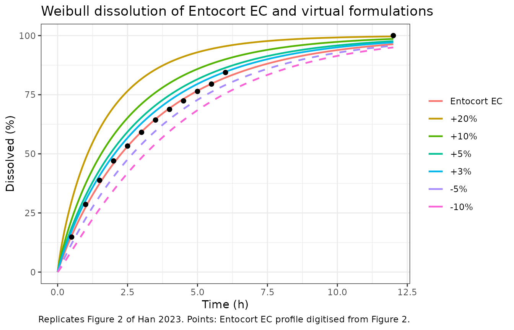

# Budesonide Entocort EC dissolution (Han 2023)

## Model and source

Han 2023 built a Simcyp whole-body PBPK model of the budesonide
controlled-release capsule Entocort EC in healthy volunteers and Crohn’s
disease patients, and used it for virtual bioequivalence trials
comparing local gut and systemic exposure across eight virtual test
formulations. The formulation enters that PBPK model as a Weibull
dissolution function fitted to the in vitro dissolution profile of the
Entocort EC pellets (Equation 4, Table 2, Supplementary Table S1). That
dissolution function is packaged here.

- Model: In vitro (biorelevant FaSSIF dissolution of Entocort EC
  pellets). Weibull dissolution (release) function for the budesonide
  controlled-release capsule Entocort EC, fitted by the authors to the
  in vitro dissolution profile of the pellets and used as the
  formulation input of their Simcyp whole-body PBPK model. Release-only:
  there is no budesonide disposition. The undissolved drug in the
  pellets (depot) dissolves with the Weibull hazard; the outputs are the
  cumulative amount dissolved (released) and the instantaneous
  dissolution rate. The Simcyp PBPK model the function fed (multilayer
  gut wall ADAM absorption, Rodgers and Rowland tissue distribution,
  CYP3A4 clearance) is not part of this model. The paper’s six virtual
  test formulations (Table 2) are reproduced by overriding lra and
  lgam1.
- Citation: Han C, Sun T, Chirumamilla SK, Bois FY, Xu M,
  Rostami-Hodjegan A. Understanding Discordance between In Vitro
  Dissolution, Local Gut and Systemic Bioequivalence of Budesonide in
  Healthy and Crohn’s Disease Patients through PBPK Modeling.
  Pharmaceutics. 2023;15(9):2237. <doi:10.3390/pharmaceutics15092237>.
  Weibull form from Equation (4); Entocort EC parameter values from
  Supplementary Table S1 (to five significant figures; Table 2 prints
  the same fit rounded to 3.12 and 0.94).
- Article: <https://doi.org/10.3390/pharmaceutics15092237>
- Supplement (Table S1):
  <https://www.mdpi.com/article/10.3390/pharmaceutics15092237/s1>

The PBPK model itself is not part of the package. Its tissue
distribution uses Simcyp’s Rodgers and Rowland method with only a global
Kp scalar (0.8) reported, its hepatic and gut clearance is a CYP3A4
intrinsic clearance per pmol of enzyme that needs Simcyp’s enzyme
abundances and organ scalars, and its absorption runs through Simcyp’s
eight-segment multilayer gut wall (M-ADAM) model with regional
absorption scalars applied to internal permeabilities. None of the organ
volumes, blood flows, tissue partition coefficients or enzyme abundances
behind those inputs are printed, so the PBPK model cannot be reproduced
from the publication.

## Population

The dissolution function is an in vitro curve fit, not a population
model. The source profile is the Entocort EC pellet dissolution in
fasted-state simulated intestinal fluid (FaSSIF) reported by Effinger et
al. (Eur J Pharm Sci 2021;157:105617; Han 2023 reference 22), sampled
every 0.5 h up to 6 h. Because the measured profile had not reached 100%
at its last sampling time, the authors added a 100% point at the end of
the profile (Section 2.4.4). There is no inter-individual variability
and no residual error. The same information is available
programmatically via
`readModelDb("Han_2023_budesonide_dissolution")()$population`.

The eight virtual test formulations of the paper were built by hand from
that reference profile. Six shift the percent dissolved by a fixed
number of percentage points at every sampling time (+20%, +10%, +5%,
+3%, -5%, -10%, capped at 100%) and were refitted to the same Weibull
function (Table 2). The other two keep the Entocort EC profile and
change only the enteric-coating trigger pH (5 or 6 instead of 5.5),
which affects release in vivo but not the in vitro dissolution curve.

## Source trace

| Equation / parameter | Value | Source location |
|----|----|----|
| Weibull dissolution, `F = Fmax * (1 - exp(-(t - Tlag)^beta / alpha))` | n/a | Equation (4) |
| `lra` (`ra = alpha^(-1/beta)`) | log(3.1196^(-1/0.93998)) = log(0.298) 1/h | Table S1 (Alpha = 3.1196, Beta = 0.93998); Table 2 (alpha = 3.12) |
| `lgam1` (`beta`) | log(0.93998) | Table S1 (Beta = 0.93998); Table 2 (beta = 0.94) |
| `lfdepot` (`Fmax / 100`) | log(1), fixed | Table S1 and Table 2 (Fmax = 100) |
| `Tlag` | 0 | not reported; see Assumptions |
| Virtual formulations (alpha, beta) | +20% (1.53, 0.87); +10% (2.14, 0.89); +5% (2.56, 0.91); +3% (2.77, 0.92); -5% (3.90, 1.01); -10% (5.01, 1.09) | Table 2 |
| Similarity factor `f2` | Equation (3) | Section 2.4.4 |
| Residual error, inter-individual variability | none | deterministic curve fit |

The canonical Weibull release input in nlmixr2lib leaves the fraction
still undissolved as `S(t) = exp(-(ra * t)^gam1)`. Matching it to
Equation (4) gives `gam1 = beta` and `ra = alpha^(-1/beta)`, so the
`lra` value is computed from the published `alpha` and `beta`, not
printed directly.

## Simulation

One 3 mg Entocort EC capsule is dosed into `depot` at the start of
dissolution, and the dissolved amount is read from the `released` sink.
The virtual formulations reuse the same model with `lra` and `lgam1`
overridden by the Table 2 values.

``` r

mod <- rxode2::rxode2(readModelDb("Han_2023_budesonide_dissolution"))

dose_mg <- 3
# Rounded so the 0.5 h sampling times below match exactly.
obs_h <- sort(unique(round(c(seq(0, 12, by = 0.05), 11, 12), 4)))
ev <- dplyr::bind_rows(
  data.frame(id = 1L, time = 0, amt = dose_mg, cmt = "depot", evid = 1L),
  data.frame(id = 1L, time = obs_h, amt = 0, cmt = "released", evid = 0L)
)

# Table 2 Weibull parameters, in the alpha / beta form of Equation (4).
# Entocort EC uses the full-precision Table S1 values carried by the model.
formulations <- tibble::tribble(
  ~formulation,   ~shift, ~alpha,  ~beta,   ~f2_published,
  "Entocort EC",  0,      3.1196,  0.93998, NA,
  "+20%",         20,     1.53,    0.87,    36.1,
  "+10%",         10,     2.14,    0.89,    50.8,
  "+5%",          5,      2.56,    0.91,    65.5,
  "+3%",          3,      2.77,    0.92,    75.8,
  "-5%",          -5,     3.90,    1.01,    65.5,
  "-10%",         -10,    5.01,    1.09,    50.8
) |>
  dplyr::mutate(formulation = factor(formulation, levels = formulation))

solve_formulation <- function(alpha, beta) {
  sim <- rxode2::rxSolve(
    mod,
    events = ev,
    params = c(lra = log(alpha^(-1 / beta)), lgam1 = log(beta)),
    rtol = 1e-10, atol = 1e-12
  )
  as.data.frame(sim) |>
    dplyr::transmute(time, released, releaseRate, pct = 100 * released / dose_mg)
}

sim <- formulations |>
  dplyr::rowwise() |>
  dplyr::reframe(formulation, shift, alpha, beta, solve_formulation(alpha, beta))
```

### Check against the published closed form

The ODE solution must reproduce Equation (4) evaluated at the published
parameters. Both sides use the same values, so the only difference is
integration error and a tight bound is appropriate.

``` r

weibull_pct <- function(t, alpha, beta) 100 * (1 - exp(-t^beta / alpha))

cf <- sim |>
  dplyr::mutate(pct_closed = weibull_pct(time, alpha, beta), diff = pct - pct_closed)

cf |>
  dplyr::group_by(formulation) |>
  dplyr::summarise(max_abs_diff = max(abs(diff))) |>
  dplyr::rename("Formulation" = formulation, "Max |ODE - Equation (4)| (points)" = max_abs_diff) |>
  knitr::kable(digits = 6)
```

| Formulation | Max \|ODE - Equation (4)\| (points) |
|:------------|------------------------------------:|
| Entocort EC |                             4.0e-06 |
| +20%        |                             4.9e-05 |
| +10%        |                             2.3e-05 |
| +5%         |                             1.2e-05 |
| +3%         |                             9.0e-06 |
| -5%         |                             0.0e+00 |
| -10%        |                             1.0e-06 |

``` r


stopifnot(max(abs(cf$diff)) < 0.01)
```

The model dissolves the whole capsule: at 24 h the undissolved fraction
of the Entocort EC profile is 0.0017, so `tad()` restarting at a second
daily capsule does not lose drug from the first.

## Replicate Figure 2

The points below were digitised by the maintainers from the thick blue
reference profile of Figure 2 (sampling times 0.5 to 6 h, with the 100%
end point). The lines are the packaged Weibull model at the Table 2
parameters.

``` r

# Entocort EC reference profile, digitised from Han 2023 Figure 2 (percent
# dissolved). The final point is the 100% assumed by the authors; the figure
# draws it at 11 h while Section 2.4.4 says 12 h.
ref_digitised <- data.frame(
  time = c(seq(0.5, 6, by = 0.5), 12),
  pct = c(14.8, 28.6, 38.8, 47.0, 53.3, 59.1, 64.3, 68.8, 72.4, 76.4, 79.5, 84.4, 100)
)
```

``` r

ggplot(sim, aes(time, pct, colour = formulation, linetype = shift < 0)) +
  geom_line(linewidth = 0.8) +
  geom_point(
    data = ref_digitised, aes(time, pct), inherit.aes = FALSE,
    colour = "black", size = 1.8
  ) +
  scale_linetype_manual(values = c(`FALSE` = "solid", `TRUE` = "dashed"), guide = "none") +
  coord_cartesian(xlim = c(0, 12), ylim = c(0, 100)) +
  labs(
    x = "Time (h)", y = "Dissolved (%)", colour = NULL,
    title = "Weibull dissolution of Entocort EC and virtual formulations",
    caption = "Replicates Figure 2 of Han 2023. Points: Entocort EC profile digitised from Figure 2."
  ) +
  theme_bw()
```



### Known-answer checks

The packaged curve, the digitised data and the published table are tied
together in three ways. All three are deterministic.

1.  **The packaged Entocort EC curve passes through the digitised
    reference profile.** Digitising error is about one percentage point.
    The bound applies to the twelve measured points (0.5 to 6 h). The
    100% end point was added by the authors rather than measured, and
    the fitted Weibull reaches only about 96% at 12 h, so it is shown in
    the table but not bounded.

``` r

sampling_h <- c(seq(0.5, 6, by = 0.5), 12)
ref_model <- sim |>
  dplyr::filter(formulation == "Entocort EC", round(time, 4) %in% sampling_h) |>
  dplyr::transmute(time = round(time, 4), pct_model = pct)
chk_ref <- dplyr::inner_join(ref_digitised, ref_model, by = "time") |>
  dplyr::mutate(diff = pct_model - pct)

chk_ref |>
  dplyr::rename(
    "Time (h)" = time, "Digitised (%)" = pct,
    "Model (%)" = pct_model, "Model - digitised (points)" = diff
  ) |>
  knitr::kable(digits = 1)
```

| Time (h) | Digitised (%) | Model (%) | Model - digitised (points) |
|---------:|--------------:|----------:|---------------------------:|
|      0.5 |          14.8 |      15.4 |                        0.6 |
|      1.0 |          28.6 |      27.4 |                       -1.2 |
|      1.5 |          38.8 |      37.5 |                       -1.3 |
|      2.0 |          47.0 |      45.9 |                       -1.1 |
|      2.5 |          53.3 |      53.2 |                       -0.1 |
|      3.0 |          59.1 |      59.4 |                        0.3 |
|      3.5 |          64.3 |      64.7 |                        0.4 |
|      4.0 |          68.8 |      69.3 |                        0.5 |
|      4.5 |          72.4 |      73.2 |                        0.8 |
|      5.0 |          76.4 |      76.7 |                        0.3 |
|      5.5 |          79.5 |      79.6 |                        0.1 |
|      6.0 |          84.4 |      82.2 |                       -2.2 |
|     12.0 |         100.0 |      96.4 |                       -3.6 |

``` r


measured <- chk_ref$time <= 6
stopifnot(
  nrow(chk_ref) == length(sampling_h),
  median(abs(chk_ref$diff[measured])) < 1.5,
  max(abs(chk_ref$diff[measured])) < 3,
  abs(chk_ref$diff[!measured] + 3.6) < 0.5
)
```

2.  **Refitting Equation (4) to the digitised profile recovers the
    published alpha and beta.** This also settles the form of the
    Weibull: with `alpha` dividing `t^beta`, as printed, the refit lands
    on the Table S1 values; reading `alpha` as a time scale inside the
    power, `(t / alpha)^beta`, would need `alpha` near 3.3 instead.

``` r

refit <- stats::nls(
  pct ~ 100 * (1 - exp(-time^beta / alpha)),
  data = ref_digitised,
  start = list(alpha = 3, beta = 1)
)
refit_coef <- stats::coef(refit)
data.frame(
  parameter = c("alpha", "beta"),
  published = c(3.1196, 0.93998),
  refit_to_digitised = unname(refit_coef[c("alpha", "beta")])
) |>
  dplyr::mutate(ratio = refit_to_digitised / published) |>
  dplyr::rename(
    "Parameter" = parameter, "Table S1" = published,
    "Refit to digitised Figure 2" = refit_to_digitised, "Ratio" = ratio
  ) |>
  knitr::kable(digits = 3)
```

| Parameter | Table S1 | Refit to digitised Figure 2 | Ratio |
|:----------|---------:|----------------------------:|------:|
| alpha     |     3.12 |                       3.100 | 0.994 |
| beta      |     0.94 |                       0.943 | 1.003 |

``` r


stopifnot(abs(refit_coef[["alpha"]] / 3.1196 - 1) < 0.03, abs(refit_coef[["beta"]] / 0.93998 - 1) < 0.03)
```

3.  **The similarity factors of Table 2 follow from the virtual
    profiles.** Equation (3) applied to the digitised reference and the
    shifted profiles (reference plus the shift at each of the twelve
    measured sampling times, capped at 100%, and the same 100% end point
    as the reference) must reproduce the published f2 values; applied to
    the packaged Weibull curves of each virtual formulation it must land
    close to them, which tests the Table 2 `alpha` / `beta` pairs. The
    mean shift of each Weibull curve over 0.5 to 6 h must also match the
    formulation’s nominal shift.

``` r

f2 <- function(r, t) 50 * log10(100 / sqrt(1 + mean((r - t)^2)))

model_at <- function(form) {
  sim |>
    dplyr::filter(formulation == form, round(time, 4) %in% sampling_h) |>
    dplyr::arrange(time) |>
    dplyr::pull(pct)
}
ref_curve <- model_at("Entocort EC")

chk_f2 <- formulations |>
  dplyr::filter(formulation != "Entocort EC") |>
  dplyr::rowwise() |>
  dplyr::mutate(
    f2_digitised = f2(ref_digitised$pct, pmin(c(ref_digitised$pct[1:12] + shift, 100), 100)),
    f2_weibull = f2(ref_curve, model_at(as.character(formulation))),
    mean_shift_weibull = mean(model_at(as.character(formulation))[1:12] - ref_curve[1:12])
  ) |>
  dplyr::ungroup()

chk_f2 |>
  dplyr::select(formulation, shift, f2_published, f2_digitised, f2_weibull, mean_shift_weibull) |>
  dplyr::rename(
    "Formulation" = formulation, "Nominal shift (points)" = shift,
    "f2, Table 2" = f2_published, "f2, digitised profiles" = f2_digitised,
    "f2, packaged Weibull curves" = f2_weibull,
    "Mean Weibull shift, 0.5-6 h (points)" = mean_shift_weibull
  ) |>
  knitr::kable(digits = 1)
```

| Formulation | Nominal shift (points) | f2, Table 2 | f2, digitised profiles | f2, packaged Weibull curves | Mean Weibull shift, 0.5-6 h (points) |
|:---|---:|---:|---:|---:|---:|
| +20% | 20 | 36.1 | 36.1 | 36.3 | 19.2 |
| +10% | 10 | 50.8 | 50.8 | 50.2 | 10.1 |
| +5% | 5 | 65.5 | 65.5 | 64.3 | 5.2 |
| +3% | 3 | 75.8 | 75.8 | 75.1 | 3.1 |
| -5% | -5 | 65.5 | 65.5 | 67.1 | -4.5 |
| -10% | -10 | 50.8 | 50.8 | 51.9 | -9.3 |

``` r


stopifnot(
  all(abs(chk_f2$f2_digitised - chk_f2$f2_published) < 0.3),
  all(abs(chk_f2$f2_weibull - chk_f2$f2_published) < 2.5),
  all(abs(chk_f2$mean_shift_weibull - chk_f2$shift) < 1.5)
)
```

The f2 values computed from the Weibull curves sit within about 1.6
units of Table 2, as expected for a three-parameter fit to a
hand-shifted profile; the digitised profiles reproduce Table 2 to the
printed precision.

## Dissolution milestones

The paper does not tabulate dissolution times, so these are reported for
reference only, from the closed-form inverse of Equation (4):
`t_p = (-alpha * log(1 - p))^(1/beta)`.

``` r

milestones <- formulations |>
  dplyr::mutate(
    t50 = (-alpha * log(1 - 0.5))^(1 / beta),
    t632 = alpha^(1 / beta),
    t80 = (-alpha * log(1 - 0.8))^(1 / beta),
    t90 = (-alpha * log(1 - 0.9))^(1 / beta)
  )
milestones |>
  dplyr::select(formulation, alpha, beta, t50, t632, t80, t90) |>
  dplyr::rename(
    "Formulation" = formulation, "alpha" = alpha, "beta" = beta,
    "t50% (h)" = t50, "t63.2% (h)" = t632, "t80% (h)" = t80, "t90% (h)" = t90
  ) |>
  knitr::kable(digits = 2)
```

| Formulation | alpha | beta | t50% (h) | t63.2% (h) | t80% (h) | t90% (h) |
|:------------|------:|-----:|---------:|-----------:|---------:|---------:|
| Entocort EC |  3.12 | 0.94 |     2.27 |       3.35 |     5.57 |     8.15 |
| +20%        |  1.53 | 0.87 |     1.07 |       1.63 |     2.82 |     4.25 |
| +10%        |  2.14 | 0.89 |     1.56 |       2.35 |     4.01 |     6.00 |
| +5%         |  2.56 | 0.91 |     1.88 |       2.81 |     4.74 |     7.03 |
| +3%         |  2.77 | 0.92 |     2.03 |       3.03 |     5.08 |     7.49 |
| -5%         |  3.90 | 1.01 |     2.68 |       3.85 |     6.16 |     8.79 |
| -10%        |  5.01 | 1.09 |     3.13 |       4.39 |     6.79 |     9.43 |

## Noncompartmental analysis

Not applicable. The model has no disposition, so there is no
concentration profile to analyse with PKNCA; the paper’s plasma and
gut-segment Cmax and AUC values (Tables 6 and 7) are outputs of the
Simcyp PBPK model, which is not packaged. The validation above uses the
dissolution profile the function was fitted to and the similarity
factors derived from it.

## Assumptions and deviations

- **PBPK model not packaged.** Only the formulation input (the Weibull
  dissolution function) is extracted. The whole-body PBPK model, the
  Crohn’s disease population changes (Table 4), the within-subject
  variability of the virtual bioequivalence trials (Table 5) and the
  bioequivalence heatmaps are Simcyp platform constructs whose
  organ-level parameters the paper does not print.
- **Weibull form.** Equation (4) divides `(t - Tlag)^beta` by `alpha`,
  which is Simcyp’s Weibull dissolution form. The refit of the digitised
  Figure 2 profile above confirms that reading.
- **Lag time.** Equation (4) includes `Tlag`, but no value is reported
  for any formulation. It is taken as zero, which the published `alpha`
  and `beta` require to reproduce Figure 2. In vivo, the Entocort EC
  coating starts to dissolve only above pH 5.5 (Table 2, trigger pH),
  after a 0.8 h mean pellet residence time in the stomach (Table S1);
  both belong to the PBPK model and are not represented here, so time
  zero of this model is the start of dissolution, not the time of
  capsule ingestion.
- **End of the profile.** Section 2.4.4 says 100% dissolution was
  assumed at 12 h; Figure 2 draws the 100% point at about 11 h. The f2
  values do not depend on that time, and the checks above use 12 h.
- **Precision.** The model uses the five-figure Table S1 values for
  Entocort EC; Table 2 prints the same fit rounded to `alpha = 3.12`,
  `beta = 0.94`. The virtual formulations are available only at the
  Table 2 precision.
- **Figure 2 legend.** The legend prints f2 = 65.6 for the +5%
  formulation (Table 2: 65.5) and “f2+50.8” for -10%; the Table 2 values
  are used.
- **Trigger-pH formulations.** The “pH threshold = 5” and “pH threshold
  = 6” formulations have the Entocort EC Weibull parameters and differ
  only in the in vivo trigger pH, so their in vitro dissolution curve is
  the reference curve.
