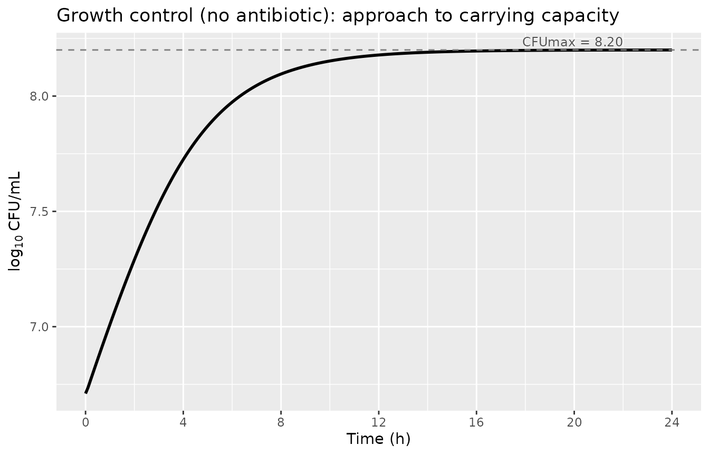
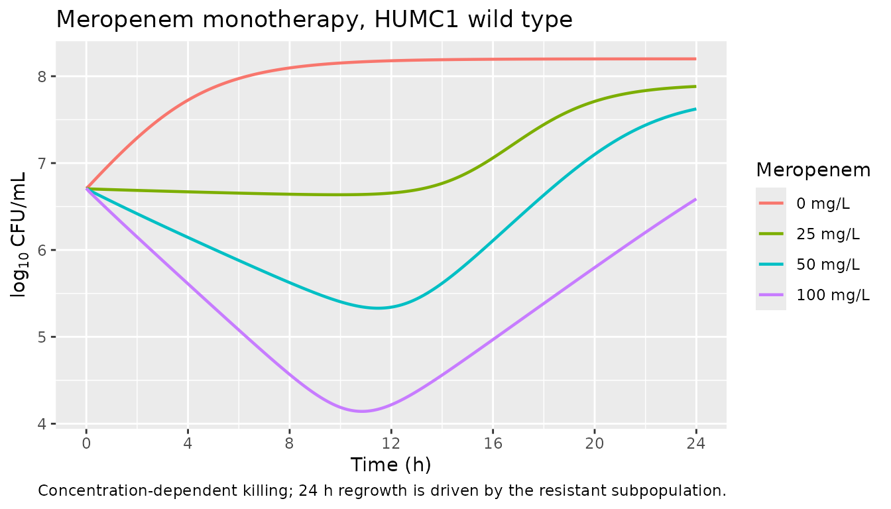
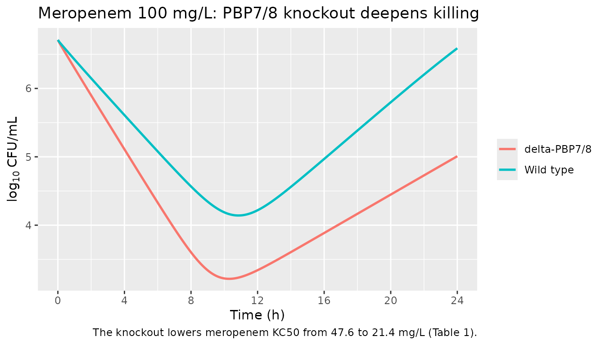

# PBP7/8 adjuvant effect on beta-lactam activity against CRAB (Ho 2025)

## Model and source

- Citation: Ho BM, Jin J, Sanborn J, Nguyen TD, Singh N, Cheng C, Nasief
  NN, Carlino-MacDonald U, Russo TA, Smith NM (2025). Pharmacodynamic
  Evaluation of Adjuvant Targets: Low Molecular Weight PBP7/8 Effects on
  beta-Lactam Activity Against Carbapenem-Resistant *Acinetobacter
  baumannii*. Pharmaceuticals (Basel) 18(6):918.
- Article: <https://doi.org/10.3390/ph18060918>

This vignette validates the packaged in-vitro mechanism-based
pharmacodynamic model (`Ho_2025_betalactam_pbp78_CRAB`) against the
structural equations (supplementary Figure S5) and the final parameter
estimates (Table 1) of the paper. The model has no human pharmacokinetic
component: drug exposure is a static broth concentration placed into
each drug state at time zero, matching the static-concentration
time-kill (SCTK) data the parameters were fit to. PKNCA-style
noncompartmental validation therefore does not apply; instead the
vignette uses the checks appropriate to a mechanistic bacterial-kill
model (growth-control approach to carrying capacity,
concentration-dependent killing, a known-answer check of the PBP7/8
covariate on KC50, and combination-therapy behaviour).

The central scientific question of the paper is whether inactivating the
low-molecular-weight penicillin-binding protein PBP7/8 (the `pbpG`
knockout) acts as a beta-lactam adjuvant. In the model this is a
covariate on KC50: the strain indicator `BACT` (0 = HUMC1 wild type, 1 =
HUMC1 delta-PBP7/8 knockout) lowers the effective KC50 of every drug.

## Population

The model was fit simultaneously to SCTK data from two isogenic clinical
isolates of *Acinetobacter baumannii* HUMC1: the carbapenem-resistant
wild type (meropenem MIC 32 mg/L, polymyxin B MIC 2 mg/L) and its
delta-PBP7/8 (`pbpG`) knockout. Experiments used cation-adjusted
Mueller-Hinton broth at 37 C with a starting inoculum near 10^7 CFU/mL;
viable counts were taken at 0, 1, 2, 4, 6, 8 and 24 h, with a limit of
detection of 10^2 CFU/mL. Sixteen monotherapy arms and 48
beta-lactam-plus-polymyxin-B combination arms per isolate were modelled.
The full record is available via `readModelDb(...)$population`.

``` r

mod_meta <- rxode2::rxode(readModelDb("Ho_2025_betalactam_pbp78_CRAB"))
mod_meta$population[c("species", "organism", "system", "temperature",
                      "starting_inoculum", "mic_values", "duration")]
#> $species
#> [1] "in vitro (Acinetobacter baumannii HUMC1 wild type and isogenic delta-PBP7/8 knockout)"
#> 
#> $organism
#> [1] "Acinetobacter baumannii HUMC1 (carbapenem-resistant clinical isolate) and its isogenic HUMC1 delta-PBP7/8 (pbpG) knockout"
#> 
#> $system
#> [1] "24 h static-concentration time-kill (SCTK) assay in cation-adjusted Mueller-Hinton broth (25 mg/L Ca2+, 12.5 mg/L Mg2+), 37 C under constant shaking; viable counts at 0, 1, 2, 4, 6, 8 and 24 h"
#> 
#> $temperature
#> [1] "37 C"
#> 
#> $starting_inoculum
#> [1] "~10^7 CFU/mL target; the model estimated 10^6.71 CFU/mL"
#> 
#> $mic_values
#> HUMC1 wild type, polymyxin B   HUMC1 wild type, meropenem 
#>                     "2 mg/L"                    "32 mg/L" 
#> 
#> $duration
#> [1] "24 h"
```

## Source trace

Every `ini()` parameter carries an in-file comment pointing to its
source in Ho 2025 Table 1; the ODE structure comes from supplementary
Figure S5 (equations 1-21). The table below collects the provenance.

| Equation / parameter | Value | Units | Source |
|----|----|----|----|
| LOGCFUmax (`log10cfumax`) | 8.20 | log10 CFU/mL | Table 1 |
| LOGINOC (`log10inoc`) | 6.71 | log10 CFU/mL | Table 1 |
| LOGMUTR (`log10mutr`) | 5.03 | – | Table 1 (MUTR = 10^-LOGMUTR, eq S5-5) |
| MGTS (`mgts`) | 75.3 | min | Table 1 |
| MGTR (`mgtr`) | 46.4 | min | Table 1 |
| KDiv (`lkdiv`, FIXED) | 50 | 1/h | Bulitta 2009 framework (ref 29); not reported in Ho 2025 |
| Kmax,S (MER/IMI/ATM/CEF/PMB) | 2.09 / 1.56 / 1.12 / 1.52 / 2.98 | 1/h | Table 1 |
| Kmax,R (MER/IMI/ATM/CEF/PMB) | 1.13 / 0.83 / 0.76 / 0.89 / 1.12 | 1/h | Table 1 |
| KC50 (MER/IMI/ATM/CEF/PMB) | 47.6 / 16.8 / 78.6 / 76.0 / 1.00 | mg/L | Table 1 |
| betaKC50 (MER/IMI/ATM/CEF/PMB) | -0.80 / -1.10 / -1.02 / -0.89 / -0.50 | – | Table 1 (PBP7/8-knockout effect) |
| Hill (MER/IMI/ATM/CEF/PMB) | 0.91 / 0.88 / 0.51 / 0.90 / 0.93 | – | Table 1 |
| Residual error | additive on log10 | log10 CFU/mL | Methods (magnitude not reported) |
| Life cycle (S1/S2 + R1/R2), RepF | n/a | – | Eqs S5-12,13,14,16,18,20 |
| Hill killing, KC50 covariate | n/a | – | Eqs S5-10,11 |

## Setup

``` r

mod <- rxode2::rxode(readModelDb("Ho_2025_betalactam_pbp78_CRAB"))
mod <- rxode2::zeroRe(mod) # paper reports no estimated IIV; simulate at typical value
#> Warning: No omega parameters in the model
```

The fast division rate `KDiv` (fixed at 50 /h) makes the life-cycle
system a fast transient at the start of each solve. The default LSODA
solver can fail on it; `dop853` is accurate and robust here, so every
solve below passes `method = "dop853"`. Because the paper reports no
estimated between-subject variability (interexperimental variability was
fixed at a 5% CV on each parameter), the model is simulated at typical
value.

``` r

solve_tk <- function(bact, cmt = NULL, conc = 0, tmax = 24, by = 0.1) {
  ev <- rxode2::et(seq(0, tmax, by = by))
  if (!is.null(cmt)) ev <- rxode2::et(amt = conc, cmt = cmt, time = 0) |>
    rxode2::et(seq(0, tmax, by = by))
  rxode2::rxSolve(mod, events = ev, params = c(BACT = bact), method = "dop853")
}
```

## 1. Growth control: approach to carrying capacity

With no antibiotic, the total viable count grows from the inoculum
(10^6.71 CFU/mL) toward the carrying capacity CFUmax = 10^8.20 CFU/mL.
At 24 h the population should sit essentially at CFUmax.

``` r

g_wt <- solve_tk(0)
cat(sprintf("log10 inoculum (t=0)   = %.2f  (LOGINOC = 6.71)\n", g_wt$log_cfu[1]))
#> log10 inoculum (t=0)   = 6.71  (LOGINOC = 6.71)
cat(sprintf("log10 CFU at 24 h      = %.2f  (LOGCFUmax = 8.20)\n", tail(g_wt$log_cfu, 1)))
#> log10 CFU at 24 h      = 8.20  (LOGCFUmax = 8.20)
stopifnot(
  abs(g_wt$log_cfu[1] - 6.71) < 0.02,
  abs(tail(g_wt$log_cfu, 1) - 8.20) < 0.05
)

ggplot(g_wt, aes(time, log_cfu)) +
  geom_line(linewidth = 1) +
  geom_hline(yintercept = 8.20, linetype = "dashed", colour = "grey50") +
  annotate("text", x = 22, y = 8.20, label = "CFUmax = 8.20",
           vjust = -0.4, hjust = 1, colour = "grey30", size = 3.2) +
  scale_x_continuous(breaks = seq(0, 24, by = 4)) +
  labs(x = "Time (h)", y = expression(log[10] ~ "CFU/mL"),
       title = "Growth control (no antibiotic): approach to carrying capacity")
```



## 2. Concentration-dependent monotherapy killing

The paper reports concentration-dependent killing for both isolates
(Results, Figure 1A). The chunk below reproduces meropenem monotherapy
against the wild type at the three studied concentrations (0.5x / 1x /
2x the predicted free Cmax: 25 / 50 / 100 mg/L). Higher concentrations
produce a deeper nadir.

``` r

mer_conc <- c(0, 25, 50, 100)
sim_mer <- do.call(rbind, lapply(mer_conc, function(d) {
  o <- solve_tk(0, cmt = "cmem", conc = d)
  o$conc <- d
  as.data.frame(o)[, c("time", "log_cfu", "conc")]
}))
sim_mer$conc_lab <- factor(sim_mer$conc, levels = mer_conc,
                           labels = paste0(mer_conc, " mg/L"))

# Deeper nadir with higher concentration (monotonic in dose).
nadir_by_conc <- tapply(sim_mer$log_cfu, sim_mer$conc, min)
cat("Meropenem nadir log10 CFU/mL by concentration (WT):\n")
#> Meropenem nadir log10 CFU/mL by concentration (WT):
print(round(nadir_by_conc, 2))
#>    0   25   50  100 
#> 6.71 6.64 5.33 4.14
stopifnot(all(diff(nadir_by_conc) < 0)) # strictly deeper killing as dose rises

ggplot(sim_mer, aes(time, log_cfu, colour = conc_lab)) +
  geom_line(linewidth = 0.8) +
  scale_x_continuous(breaks = seq(0, 24, by = 4)) +
  labs(x = "Time (h)", y = expression(log[10] ~ "CFU/mL"), colour = "Meropenem",
       title = "Meropenem monotherapy, HUMC1 wild type",
       caption = "Concentration-dependent killing; 24 h regrowth is driven by the resistant subpopulation.")
```



## 3. PBP7/8 knockout lowers KC50 (the adjuvant effect)

This is the paper’s central result. The knockout enters each drug’s
effective KC50 as `kc50_eff = kc50 * exp(betaKC50 * BACT)`. The chunk
below reproduces the “calculated KC50 in PBP7/8 knockout” column of
Table 1 as a known-answer check.

``` r

kc50 <- c(MER = 47.6, IMI = 16.8, ATM = 78.6, CEF = 76.0, PMB = 1.00)
beta <- c(MER = -0.80, IMI = -1.10, ATM = -1.02, CEF = -0.89, PMB = -0.50)
paper_ko <- c(MER = 21.4, IMI = 6.6, ATM = 28.3, CEF = 31.2, PMB = 0.61)

pred_ko <- kc50 * exp(beta)
kc50_tab <- data.frame(
  Drug = names(kc50), KC50_WT = kc50, betaKC50 = beta,
  KC50_KO_model = round(pred_ko, 2), KC50_KO_paper = paper_ko
)
knitr::kable(kc50_tab, row.names = FALSE,
             caption = "Effective KC50 under PBP7/8 knockout vs Table 1 of Ho 2025.")
```

| Drug | KC50_WT | betaKC50 | KC50_KO_model | KC50_KO_paper |
|:-----|--------:|---------:|--------------:|--------------:|
| MER  |    47.6 |    -0.80 |         21.39 |         21.40 |
| IMI  |    16.8 |    -1.10 |          5.59 |          6.60 |
| ATM  |    78.6 |    -1.02 |         28.34 |         28.30 |
| CEF  |    76.0 |    -0.89 |         31.21 |         31.20 |
| PMB  |     1.0 |    -0.50 |          0.61 |          0.61 |

Effective KC50 under PBP7/8 knockout vs Table 1 of Ho 2025. {.table}

``` r


# Four of five drugs reproduce the paper's calculated KO KC50 exactly; imipenem
# differs (see Errata). Assert the matching four.
ok <- c("MER", "ATM", "CEF", "PMB")
stopifnot(all(abs(pred_ko[ok] - paper_ko[ok]) < 0.1))

# Average KC50 decline (mechanistic exp(beta) form).
bl <- c("MER", "IMI", "ATM", "CEF")
cat(sprintf("Average beta-lactam KC50 decline: %.1f%% (paper reports 59.7%%, using its KO column)\n",
            100 * mean(1 - exp(beta[bl]))))
#> Average beta-lactam KC50 decline: 61.2% (paper reports 59.7%, using its KO column)
cat(sprintf("Polymyxin B KC50 decline:         %.1f%% (paper reports 39.0%%)\n",
            100 * (1 - exp(beta["PMB"]))))
#> Polymyxin B KC50 decline:         39.3% (paper reports 39.0%)
```

The lower KC50 translates to deeper killing. Comparing wild type with
knockout at the highest studied monotherapy concentration of each drug,
the knockout reaches a lower nadir for every antibiotic.

``` r

drugs <- list(
  MER = c(cmt = "cmem", conc = 100),
  IMI = c(cmt = "cipm", conc = 30.6),
  ATM = c(cmt = "catm", conc = 132),
  CEF = c(cmt = "ccef", conc = 146),
  PMB = c(cmt = "cpmb", conc = 6)
)
nadir_cmp <- do.call(rbind, lapply(names(drugs), function(nm) {
  d <- drugs[[nm]]
  wt <- min(solve_tk(0, cmt = d["cmt"], conc = as.numeric(d["conc"]))$log_cfu)
  ko <- min(solve_tk(1, cmt = d["cmt"], conc = as.numeric(d["conc"]))$log_cfu)
  data.frame(Drug = nm, WT_nadir = round(wt, 2), KO_nadir = round(ko, 2),
             Extra_kill = round(wt - ko, 2))
}))
knitr::kable(nadir_cmp, row.names = FALSE,
             caption = "Nadir log10 CFU/mL: PBP7/8 knockout vs wild type (deeper kill = adjuvant effect).")
```

| Drug | WT_nadir | KO_nadir | Extra_kill |
|:-----|---------:|---------:|-----------:|
| MER  |     4.14 |     3.22 |       0.93 |
| IMI  |     5.70 |     4.56 |       1.14 |
| ATM  |     6.71 |     6.54 |       0.17 |
| CEF  |     5.65 |     4.63 |       1.03 |
| PMB  |     2.55 |     2.35 |       0.20 |

Nadir log10 CFU/mL: PBP7/8 knockout vs wild type (deeper kill = adjuvant
effect). {.table}

``` r

stopifnot(all(nadir_cmp$KO_nadir < nadir_cmp$WT_nadir)) # knockout always kills more
```

``` r

mer_cmp <- rbind(
  transform(as.data.frame(solve_tk(0, cmt = "cmem", conc = 100))[, c("time", "log_cfu")], Strain = "Wild type"),
  transform(as.data.frame(solve_tk(1, cmt = "cmem", conc = 100))[, c("time", "log_cfu")], Strain = "delta-PBP7/8")
)
ggplot(mer_cmp, aes(time, log_cfu, colour = Strain)) +
  geom_line(linewidth = 0.9) +
  scale_x_continuous(breaks = seq(0, 24, by = 4)) +
  labs(x = "Time (h)", y = expression(log[10] ~ "CFU/mL"), colour = NULL,
       title = "Meropenem 100 mg/L: PBP7/8 knockout deepens killing",
       caption = "The knockout lowers meropenem KC50 from 47.6 to 21.4 mg/L (Table 1).")
```



## 4. Combination therapy drives the population below the limit of detection

The paper reports that many beta-lactam-plus-polymyxin-B combination
arms declined below the limit of quantification. Combining meropenem
with polymyxin B against the knockout drives the modelled population far
below the 10^2 CFU/mL limit of detection at the nadir.

``` r

ev_combo <- rxode2::et(amt = 100, cmt = "cmem", time = 0) |>
  rxode2::et(amt = 6, cmt = "cpmb", time = 0) |>
  rxode2::et(seq(0, 24, by = 0.1))
combo <- rxode2::rxSolve(mod, events = ev_combo, params = c(BACT = 1), method = "dop853")
mer_only <- solve_tk(1, cmt = "cmem", conc = 100)
cat(sprintf("KO meropenem 100 alone, nadir     = %.2f log10 CFU/mL\n", min(mer_only$log_cfu)))
#> KO meropenem 100 alone, nadir     = 3.22 log10 CFU/mL
cat(sprintf("KO meropenem 100 + polymyxin B 6  = %.2f log10 CFU/mL (nadir)\n", min(combo$log_cfu)))
#> KO meropenem 100 + polymyxin B 6  = -5.30 log10 CFU/mL (nadir)
stopifnot(min(combo$log_cfu) < min(mer_only$log_cfu)) # combination kills more
stopifnot(min(combo$log_cfu) < 2)                     # below 10^2 CFU/mL LOD
```

## Assumptions and deviations

- **Fast division rate `KDiv` (not reported).** The ODEs (supplementary
  equations S5-14/16/18/20) use a fast state-2 -\> state-1 division rate
  `KDiv`, but it is not listed in Table 1. It is a fixed structural
  constant of the Bulitta 2009 life-cycle framework that Ho 2025 cites
  (reference 29), where the fast doubling step is fixed to 50 /h as not
  rate-limiting. The same convention is used in this package by
  `Bulitta_2009_ceftazidime` and the `Mahadevan_2026` siblings. The
  model dynamics are governed by the slow generation step (`60 / MGT`),
  so the result is insensitive to the exact `KDiv` value; it is encoded
  as `lkdiv <- fixed(log(50))`.
- **Imipenem calculated KO KC50.** Table 1 lists the “calculated KC50 of
  imipenem in PBP7/8 knockout” as 6.6 mg/L, but
  `16.8 * exp(-1.10) = 5.59`. The other four drugs reproduce their
  calculated KO KC50 exactly from `KC50 * exp(betaKC50)`, so the 6.6
  appears to be a transcription slip in the table’s derived column. The
  model uses the estimated base KC50 (16.8) and betaKC50 (-1.10), giving
  an effective KO KC50 of 5.59 mg/L. The paper’s reported 59.7% average
  beta-lactam KC50 decline is computed from its KO column (including the
  6.6); the mechanistic `exp(betaKC50)` form gives 61.2%.
- **Residual error magnitude.** The paper states an additive residual
  error on the log10 scale (equivalent to proportional error on the
  natural scale) but does not report its value in Table 1, so `addSd` is
  encoded as `fixed(0)` and the model is intended for typical-value
  simulation. The reported interexperimental variability (a fixed 5% CV
  on every parameter) is likewise not carried as estimated IIV.
- **Static-concentration scope.** The packaged model represents the SCTK
  fit: the drug states are held constant (`d/dt = 0`). The paper
  additionally used this PD model with external hollow-fiber (HFIM)
  pharmacokinetics to simulate dynamic regimens (Figures 2 and 3);
  reproducing those requires an external PK layer supplying time-varying
  concentrations and is outside the scope of the packaged
  static-concentration model.
- **Solver.** The fast division transient can defeat the default LSODA
  solver; `dop853` is used throughout this vignette.
- **`BACT` coding.** The isogenic strain pair is carried in the `BACT`
  strain indicator (0 = wild type, 1 = delta-PBP7/8 knockout); here it
  feeds a covariate-effect coefficient on KC50 rather than switching a
  whole parameter set, so it must be coded 0/1 with 0 as the wild-type
  reference.
