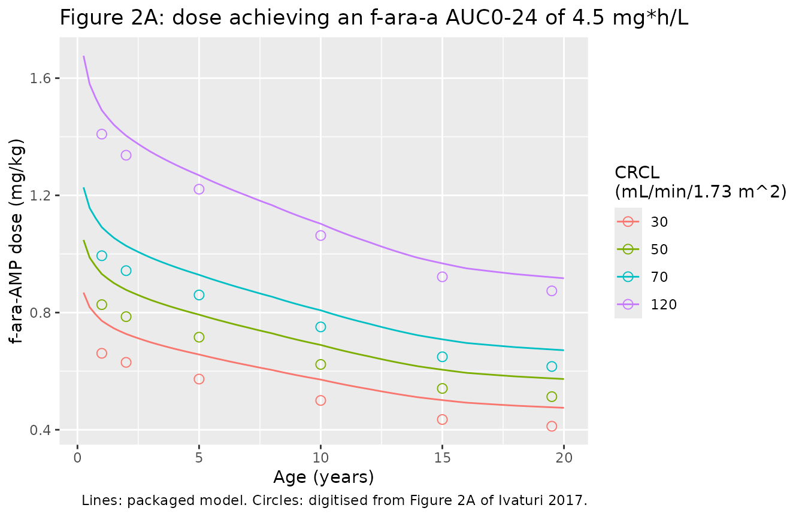
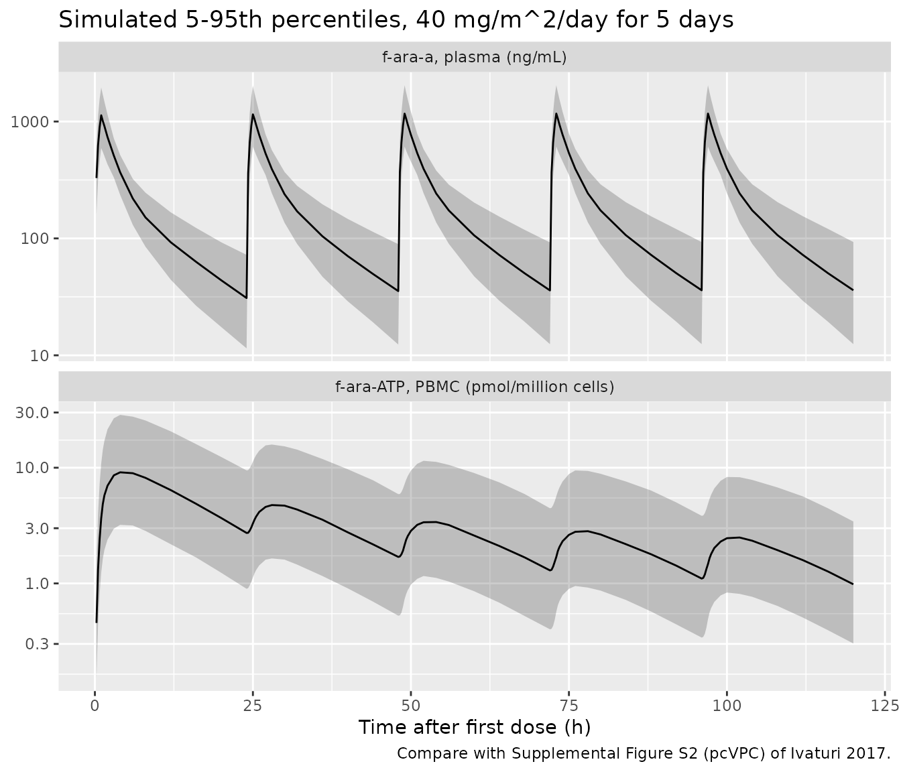

# Fludarabine (Ivaturi 2017)

## Model and source

- Citation: Ivaturi V, Dvorak CC, Chan D, Liu T, Cowan MJ, Wahlstrom J,
  Stricherz M, Jennissen C, Orchard PJ, Tolar J, Pai SY, Huang L, Aweeka
  F, Long-Boyle J. Pharmacokinetics and Model-Based Dosing to Optimize
  Fludarabine Therapy in Pediatric Hematopoietic Cell Transplant
  Recipients. Biol Blood Marrow Transplant. 2017;23(10):1701-1713.
  <doi:10.1016/j.bbmt.2017.06.021>
- Description: Two-compartment population PK model for plasma f-ara-a
  (the circulating nucleoside of intravenous fludarabine phosphate) in
  children and young adults undergoing hematopoietic cell
  transplantation, with allometric weight scaling (reference 15 kg) and
  a linear creatinine-clearance effect on clearance, linked to an
  intracellular f-ara-ATP compartment in peripheral blood mononuclear
  cells whose uptake rate constant declines as a power of time after the
  first dose.
- Article: <https://doi.org/10.1016/j.bbmt.2017.06.021> (NIH author
  manuscript PMC6108324)
- Supplement: Supplemental Figures S1 (observed concentrations) and S2
  (prediction-corrected VPC), available from PMC6108324.

Fludarabine phosphate (f-ara-AMP) is given intravenously and is
dephosphorylated in plasma to the nucleoside f-ara-a, which is what
circulates and what this model describes in plasma. f-ara-a enters cells
and is phosphorylated to the cytotoxic triphosphate f-ara-ATP. Ivaturi
2017 is the first published model of f-ara-ATP in clinical samples from
children undergoing hematopoietic cell transplantation (HCT). It links a
two-compartment plasma f-ara-a model to a
peripheral-blood-mononuclear-cell (PBMC) f-ara-ATP compartment. Weight
and creatinine clearance (CRCL) are the only covariates.

The model was later refined by Brooks 2022 (Pharmaceutics 14:2462),
which replaced weight with fat-free mass, added a maturation function on
clearance and kept the PBMC parameters of this model fixed.

## Population

The study was a prospective multicenter PK study (NCT01316549,
2010-2015) at three US centers. It enrolled children who were to undergo
allogeneic HCT, or autologous HCT with gene therapy, with fludarabine in
the conditioning regimen. 140 subjects contributed 840 f-ara-a and 239
f-ara-ATP concentrations to the PK model. f-ara-ATP was collected only
at the UCSF site (n = 66).

Table 1 describes the 133 subjects who also entered the PK-PD analysis:

- Age: median 5.0 years (range 0.2-17.9).
- Weight: median 15.7 kg (range 3-111).
- Sex: 46% female.
- BSA: median 0.68 m^2.
- CRCL: median 150 mL/min/1.73 m^2 (range 35-150), estimated by Schwartz
  in children and by Cockcroft-Gault with ideal body weight in young
  adults.
- Diagnosis: 44% hematologic malignancy, 14% primary immune deficiency,
  16% inherited metabolic disorder, 16% bone marrow failure, 6%
  hemoglobinopathy and 4% epidermolysis bullosa.
- Fludarabine phosphate: 40 mg/m^2 in 41%, 12.5-35 mg/m^2 in 30%, and
  0.9-1.33 mg/kg in 29%. It was infused over 30-60 min once daily for
  3-5 days.

The same information is available from the model’s `population`
metadata:

``` r

pop <- rxode2::rxode(readModelDb("Ivaturi_2017_fludarabine"))$population
#> ℹ parameter labels from comments will be replaced by 'label()'
str(pop, max.level = 1)
#> List of 13
#>  $ species       : chr "human"
#>  $ n_subjects    : num 140
#>  $ n_studies     : num 1
#>  $ age_range     : chr "0.2-17.9 years"
#>  $ age_median    : chr "5.0 years"
#>  $ weight_range  : chr "3-111 kg"
#>  $ weight_median : chr "15.7 kg"
#>  $ sex_female_pct: num 46
#>  $ disease_state : chr "children undergoing allogeneic hematopoietic cell transplantation (or autologous HCT with gene therapy) with fl"| __truncated__
#>  $ renal_function: chr "creatinine clearance median 150 (range 35-150) mL/min/1.73 m^2; serum creatinine median 0.3 (0.14-1.89) mg/dL"
#>  $ dose_range    : chr "fludarabine phosphate 12.5-40 mg/m^2 or 0.9-1.33 mg/kg IV over 30-60 min once daily for 3-5 days"
#>  $ regions       : chr "United States (UCSF Benioff Children's Hospital, University of Minnesota Masonic Children's Hospital, Boston Ch"| __truncated__
#>  $ notes         : chr "Prospective multicenter study NCT01316549, 2010-2015. 140 subjects completed PK assessments and were used for P"| __truncated__
```

## Source trace

Each `ini()` entry in
`inst/modeldb/specificDrugs/Ivaturi_2017_fludarabine.R` carries a
comment giving its source. The table below collects them. Values come
from the Final Model column of Table 2. The clearance equation is
printed in Results (‘PopPK Analysis’).

| Equation / parameter | Value | Source location |
|----|----|----|
| `lcl` (CL at 15 kg, CRCL 100) | 3.1 L/h | Table 2 ‘Typical value for f-ara-a CL, L/h/15 kg’ (RSE 3.3%) |
| `e_crcl_cl` (CRCLEFF) | 0.006 per mL/min/1.73 m^2 | Table 2 ‘Effect of creatinine clearance on f-ara-a CL’ (RSE 9.5%) |
| `lvc` (Vc at 15 kg) | 13.4 L | Table 2 ‘Vc, L/kg’ (RSE 6.3%); read per 15 kg, see Assumptions |
| `lq` (Q at 15 kg) | 2.2 L/h | Table 2 ‘Intercompartmental CL, L/h/kg’ (RSE 10.4%); read per 15 kg |
| `lvp` (Vp at 15 kg) | 13.4 L | Table 2 ‘Vp, L/15’ (RSE 4.8%) |
| `lkmet_faraatp` (Kin) | 0.005 (pmol/10^6 cells)/h per ng/mL | Table 2 ‘K in’ (RSE 15.4%) |
| `e_time_kmet_faraatp` | -0.41 | Table 2 ‘Time effect on kin’ (RSE 12.7%); functional form inferred, see below |
| `lkel_faraatp` (Kout) | 0.09 1/h | Table 2 ‘K out’ (RSE 7.2%) |
| `etalcl`, `etalvc`, `etalkmet_faraatp` | 31.7, 38.3, 81.9 (omega x 100) | Table 2 IIV rows; omega^2 = (P/100)^2, see Assumptions |
| IIV correlations | CL-Vc 0.86, CL-Kin 0.29, Vc-Kin 0.59 | Table 2 ‘Correlation’ rows |
| `expSd` | 0.248 | Table 2 ‘f-ara-A residual unexplained variability’ 24.8; log-scale SD |
| `expSd_Cpbmc_faraatp` | 0.715 | Table 2 ‘f-ara-ATP residual unexplained variability’ 71.5; log-scale SD |
| CL equation | CL = 3.1 (WT/15)^0.75 \[1 + (CRCL - 100) CRCLEFF\] | Results, ‘PopPK Analysis’ |
| Allometric exponents on Q, Vc, Vp | 0.75, 1, 1 | not printed; standard values (Results: ‘A body weight-based allometric model was added to all clearance and volume parameters’) |
| Dose as f-ara-a equivalents | f-ara-AMP x 285/365 | Methods, ‘PopPK Analysis’ |
| `d/dt(pbmc_faraatp)` | Kin(t) Cc - Kout pbmc_faraatp | Methods ‘Model Inclusion of F-Ara-ATP’; Results ‘PopPK Analysis’ |
| Residual error | log-scale additive per analyte | Results: ‘A separate additive error on the log scale for f-ara-a and f-ara-ATP’ |

### The time effect on Kin

Table 2 gives the ‘Time effect on kin’ as -0.41 but the paper never
prints the equation it enters. The packaged model uses a power of time
after the first dose, in hours:

Kin(t) = 0.005 x TAFD^-0.41

The f-ara-ATP input is Kin(t) multiplied by the plasma f-ara-a
concentration in ng/mL, so the state is in pmol per million cells, the
unit of the f-ara-ATP assay.

This form is the maintainers’ inference from the paper’s own data. With
the printed Kin and exponent, it is the only candidate that reproduces
the observed f-ara-ATP medians of Table 3. It is also the only one that
reproduces the steep fall within the first dosing interval visible in
the individual fits of Figure 1B, because a per-dose or per-day step
cannot change Kin before the second dose. The comparison is shown in the
f-ara-ATP section below.

## Typical-value checks against the text

``` r

mod <- readModelDb("Ivaturi_2017_fludarabine")
ui <- rxode2::rxode(mod)
#> ℹ parameter labels from comments will be replaced by 'label()'
th <- ui$theta

cl_typ <- function(wt, crcl) {
  exp(th[["lcl"]]) * (wt / 15)^0.75 * (1 + (crcl - 100) * th[["e_crcl_cl"]])
}

# CDC 50th-percentile weight and stature for age, averaged across sexes
# (approximate, as used elsewhere in nlmixr2lib's pediatric vignettes).
growth <- tibble::tribble(
  ~age, ~wt, ~ht,
  0.20, 5.6, 58,
  0.25, 6.0, 60,
  0.50, 7.6, 66,
  1.00, 9.6, 75,
  1.50, 11.0, 81,
  2.00, 12.2, 86,
  3.00, 14.3, 95,
  4.00, 16.3, 102,
  5.00, 18.3, 109,
  6.00, 20.6, 115,
  7.00, 23.0, 121,
  8.00, 25.6, 127,
  10.00, 32.0, 138,
  12.00, 40.5, 149,
  14.00, 50.0, 162,
  16.00, 58.0, 168,
  18.00, 63.0, 170,
  20.00, 67.0, 171
)
wt_at <- function(age) stats::approx(growth$age, growth$wt, xout = age, rule = 2)$y
ht_at <- function(age) stats::approx(growth$age, growth$ht, xout = age, rule = 2)$y
```

The Discussion states that ‘the predicted CL of f-ara-a in children \>15
years of age was approximately 11 L/hour’. At 15-18 years with CDC
median weights and CRCL at the 150 mL/min/1.73 m^2 cap:

``` r

adol <- tibble::tibble(age = c(15, 16, 17, 18)) |>
  mutate(WT = wt_at(age), CRCL = 150, CL = cl_typ(WT, CRCL))
knitr::kable(adol, digits = 2, caption = "Typical f-ara-a clearance in adolescents (L/h).")
```

| age |   WT | CRCL |    CL |
|----:|-----:|-----:|------:|
|  15 | 54.0 |  150 | 10.53 |
|  16 | 58.0 |  150 | 11.11 |
|  17 | 60.5 |  150 | 11.47 |
|  18 | 63.0 |  150 | 11.82 |

Typical f-ara-a clearance in adolescents (L/h). {.table}

``` r

# A wrong exponent, reference weight or CRCL slope moves this by tens of percent.
stopifnot(abs(median(adol$CL) / 11 - 1) < 0.15)
```

The text gives one worked dose. ‘The model-predicted dose for a
4.5-month-old child weighing 7 kg with normal renal function for age
would be 8.8 mg per dose’. That dose targets an f-ara-a AUC0-24 of 4.5
mg\*h/L and is converted to f-ara-AMP with the paper’s factor of 1.28.
The paper does not state which Schwartz constant gave ‘normal renal
function for age’. Two readings are shown, both using serum creatinine
0.3 mg/dL (Methods: up to 1 year old) and a CDC median height of 63 cm.

``` r

ht_infant <- ht_at(4.5 / 12)
infant <- tibble::tibble(
  reading = c("bedside Schwartz (k = 0.413)", "original Schwartz infant (k = 0.45)"),
  CRCL = c(0.413, 0.45) * ht_infant / 0.3
) |>
  mutate(
    CL = cl_typ(7, CRCL),
    dose_famp_mg = 4.5 * CL * 1.28,
    pct_vs_paper = 100 * (dose_famp_mg / 8.8 - 1)
  )
knitr::kable(infant, digits = 2, caption = "Model-based f-ara-AMP dose for the 7 kg, 4.5-month-old example (paper: 8.8 mg).")
```

| reading                             |  CRCL |   CL | dose_famp_mg | pct_vs_paper |
|:------------------------------------|------:|-----:|-------------:|-------------:|
| bedside Schwartz (k = 0.413)        | 86.73 | 1.61 |         9.28 |         5.44 |
| original Schwartz infant (k = 0.45) | 94.50 | 1.69 |         9.75 |        10.79 |

Model-based f-ara-AMP dose for the 7 kg, 4.5-month-old example (paper:
8.8 mg). {.table}

``` r

stopifnot(abs(infant$pct_vs_paper[1]) < 15)
```

Both readings give a dose a little above the paper’s 8.8 mg (5-11%). The
paper’s 8.8 mg corresponds to a CRCL of about 79 mL/min/1.73 m^2 at the
printed CRCLEFF. The gap is in the same direction as the Figure 2
discrepancy discussed next.

## Figure 2: model-based dose by age and renal function

Figure 2 plots, for each age, the f-ara-AMP dose in mg/kg that achieves
an f-ara-a AUC0-24 of 4.5 mg\*h/L in a typical child. Weights are the
CDC 50th percentile, and CRCL is fixed at 30, 50, 70 or 120 mL/min/1.73
m^2. Because AUC = dose / CL, the curve is 4.5 x CL x 1.28 / WT. The
table below compares it with values the maintainers digitised from
Figure 2A.

``` r

fig2_digitised <- tibble::tribble(
  ~age, ~CRCL, ~fig_dose,
  1, 120, 1.409, 1, 70, 0.994, 1, 50, 0.827, 1, 30, 0.661,
  2, 120, 1.337, 2, 70, 0.943, 2, 50, 0.786, 2, 30, 0.630,
  5, 120, 1.221, 5, 70, 0.860, 5, 50, 0.716, 5, 30, 0.573,
  10, 120, 1.063, 10, 70, 0.751, 10, 50, 0.623, 10, 30, 0.500,
  15, 120, 0.922, 15, 70, 0.649, 15, 50, 0.541, 15, 30, 0.435,
  19.5, 120, 0.874, 19.5, 70, 0.616, 19.5, 50, 0.513, 19.5, 30, 0.412
)

fig2 <- tidyr::expand_grid(age = seq(0.25, 20, by = 0.25), CRCL = c(30, 50, 70, 120)) |>
  mutate(WT = wt_at(age), dose_mgkg = 4.5 * cl_typ(WT, CRCL) * 1.28 / WT)

ggplot(fig2, aes(age, dose_mgkg, colour = factor(CRCL))) +
  geom_line() +
  geom_point(data = fig2_digitised, aes(age, fig_dose, colour = factor(CRCL)), shape = 1, size = 2.5) +
  labs(
    x = "Age (years)", y = "f-ara-AMP dose (mg/kg)", colour = "CRCL\n(mL/min/1.73 m^2)",
    title = "Figure 2A: dose achieving an f-ara-a AUC0-24 of 4.5 mg*h/L",
    caption = "Lines: packaged model. Circles: digitised from Figure 2A of Ivaturi 2017."
  )
```



``` r


fig2_cmp <- fig2_digitised |>
  mutate(WT = wt_at(age), model_dose = 4.5 * cl_typ(WT, CRCL) * 1.28 / WT,
         pct_diff = 100 * (model_dose / fig_dose - 1))
fig2_cmp |>
  select(age, CRCL, fig_dose, model_dose, pct_diff) |>
  tidyr::pivot_wider(names_from = CRCL, values_from = c(fig_dose, model_dose, pct_diff)) |>
  dplyr::rename(
    "Age (y)" = age,
    "Fig, CRCL 120" = fig_dose_120, "Model, CRCL 120" = model_dose_120, "% diff, 120" = pct_diff_120,
    "Fig, CRCL 30" = fig_dose_30, "Model, CRCL 30" = model_dose_30, "% diff, 30" = pct_diff_30
  ) |>
  select(`Age (y)`, `Fig, CRCL 120`, `Model, CRCL 120`, `% diff, 120`, `Fig, CRCL 30`, `Model, CRCL 30`, `% diff, 30`) |>
  knitr::kable(digits = 2, caption = "Figure 2A digitised vs packaged model (f-ara-AMP mg/kg).")
```

| Age (y) | Fig, CRCL 120 | Model, CRCL 120 | % diff, 120 | Fig, CRCL 30 | Model, CRCL 30 | % diff, 30 |
|---:|---:|---:|---:|---:|---:|---:|
| 1.0 | 1.41 | 1.49 | 5.79 | 0.66 | 0.77 | 16.78 |
| 2.0 | 1.34 | 1.40 | 5.01 | 0.63 | 0.73 | 15.40 |
| 5.0 | 1.22 | 1.27 | 3.90 | 0.57 | 0.66 | 14.65 |
| 10.0 | 1.06 | 1.10 | 3.78 | 0.50 | 0.57 | 14.26 |
| 15.0 | 0.92 | 0.97 | 4.98 | 0.44 | 0.50 | 15.23 |
| 19.5 | 0.87 | 0.92 | 5.33 | 0.41 | 0.48 | 15.71 |

Figure 2A digitised vs packaged model (f-ara-AMP mg/kg). {.table}

``` r


# Structural gate: clearance, its weight exponent and the reference weight set
# the CRCL 120 curve; a transcription error there moves it by tens of percent.
stopifnot(all(abs(fig2_cmp$pct_diff[fig2_cmp$CRCL == 120]) < 12))
stopifnot(all(abs(fig2_cmp$pct_diff) < 20))
```

The CRCL 120 curve agrees within about 6% at every age, which is within
what the CDC weight approximation allows. The low-CRCL curves are 10-17%
higher than the figure. Their ratio to the CRCL 120 curve is the same at
every age in the figure (30/120 = 0.47, 50/120 = 0.59, 70/120 = 0.71),
as the model structure predicts. Solving those three ratios for CRCLEFF
gives 0.0067 each time, against the printed 0.006:

``` r

ratio_fig <- fig2_digitised |>
  group_by(age) |>
  mutate(ratio = fig_dose / fig_dose[CRCL == 120]) |>
  ungroup() |>
  filter(CRCL != 120) |>
  group_by(CRCL) |>
  summarise(ratio = mean(ratio), .groups = "drop") |>
  mutate(implied_crcleff = (1 - ratio) / ((100 - CRCL) + ratio * 20))
knitr::kable(ratio_fig, digits = 4, caption = "CRCLEFF implied by the Figure 2A curve ratios.")
```

| CRCL |  ratio | implied_crcleff |
|-----:|-------:|----------------:|
|   30 | 0.4705 |          0.0067 |
|   50 | 0.5868 |          0.0067 |
|   70 | 0.7051 |          0.0067 |

CRCLEFF implied by the Figure 2A curve ratios. {.table}

The figure was presumably drawn with the unrounded estimate, which the
table’s ‘.006’ does not resolve to a second significant figure (its
bootstrap 95% CI is .004-.008). The packaged model keeps the printed
0.006. At CRCL 30 this gives a clearance about 10% higher than the
figure implies. Above 100 the difference is under 1%.

The ‘Schwartz’ curve of Figure 2 is not reproduced. It depends on which
Schwartz constant, height reference and CRCL cap the authors used, and
the paper does not state these.

## Virtual cohort

Observed data are not public. The cohort approximates Table 1, with
everyone dosed at the most common regimen, 40 mg/m^2/day fludarabine
phosphate. Age is drawn from a piecewise-linear quantile function
anchored at the minimum (0.2 years), the median (5.0 years) and the
maximum (17.9 years). The upper quartile is placed at 10 years. Weight
and height are CDC medians at that age with lognormal scatter. BSA uses
the Mosteller formula. CRCL is drawn lognormal around 165 mL/min/1.73
m^2 and capped at 150, so that, as in Table 1, more than half the cohort
sits at the cap.

``` r

set.seed(2017)
rxode2::rxSetSeed(2017)
n_sub <- 200L

age_p <- c(0, 0.25, 0.50, 0.75, 1)
age_q <- c(0.2, 1.5, 5.0, 10.0, 17.9)

cohort <- tibble::tibble(
  id = seq_len(n_sub),
  AGE = stats::approx(age_p, age_q, xout = stats::runif(n_sub))$y
) |>
  mutate(
    WT = wt_at(AGE) * exp(stats::rnorm(n_sub, 0, 0.15)),
    HT = ht_at(AGE) * exp(stats::rnorm(n_sub, 0, 0.04)),
    BSA = sqrt(HT * WT / 3600),
    CRCL = pmin(150, 165 * exp(stats::rnorm(n_sub, 0, 0.35))),
    dose_famp = 40 * BSA,
    amt = dose_famp * 285 / 365,
    treatment = "40 mg/m^2"
  )

tibble::tibble(
  Characteristic = c("Age (years)", "Weight (kg)", "BSA (m^2)", "CRCL (mL/min/1.73 m^2)", "Fraction at CRCL cap"),
  Simulated = c(
    sprintf("%.1f (%.1f-%.1f)", median(cohort$AGE), min(cohort$AGE), max(cohort$AGE)),
    sprintf("%.1f (%.1f-%.0f)", median(cohort$WT), min(cohort$WT), max(cohort$WT)),
    sprintf("%.2f (%.2f-%.2f)", median(cohort$BSA), min(cohort$BSA), max(cohort$BSA)),
    sprintf("%.0f (%.0f-%.0f)", median(cohort$CRCL), min(cohort$CRCL), max(cohort$CRCL)),
    sprintf("%.0f%%", 100 * mean(cohort$CRCL >= 150))
  ),
  `Table 1` = c("5.0 (0.2-17.9)", "15.7 (3-111)", "0.68 (0.2-2.3)", "150 (35-150)", "median at cap")
) |>
  knitr::kable(caption = "Virtual cohort vs Table 1 (median and range).")
```

| Characteristic         | Simulated        | Table 1        |
|:-----------------------|:-----------------|:---------------|
| Age (years)            | 4.5 (0.2-17.9)   | 5.0 (0.2-17.9) |
| Weight (kg)            | 17.4 (5.4-69)    | 15.7 (3-111)   |
| BSA (m^2)              | 0.70 (0.30-1.83) | 0.68 (0.2-2.3) |
| CRCL (mL/min/1.73 m^2) | 150 (64-150)     | 150 (35-150)   |
| Fraction at CRCL cap   | 66%              | median at cap  |

Virtual cohort vs Table 1 (median and range). {.table}

Five daily doses are given, each a 1-hour infusion of the f-ara-a
equivalent of the fludarabine phosphate dose. Observations are on the
plasma state (`cmt = "central"`) with `dvid = 1`; the model returns both
`Cc` and `Cpbmc_faraatp` at every observation row.

``` r

n_dose <- 5L
dur_inf <- 1
obs_day <- c(0, 0.25, 0.5, 0.75, 1, 1.25, 1.5, 2, 3, 4, 6, 8, 12, 16, 20, 24)
obs_times <- sort(unique(as.vector(outer(obs_day, 24 * (seq_len(n_dose) - 1), "+"))))

doses <- cohort |>
  select(id, amt, WT, CRCL, treatment) |>
  tidyr::crossing(dose_num = seq_len(n_dose)) |>
  mutate(time = 24 * (dose_num - 1), rate = amt / dur_inf, evid = 1L, cmt = "central", dvid = NA_integer_) |>
  select(-dose_num)

obs <- cohort |>
  select(id, WT, CRCL, treatment) |>
  tidyr::crossing(time = obs_times) |>
  mutate(amt = 0, rate = 0, evid = 0L, cmt = "central", dvid = 1L)

events <- bind_rows(doses, obs) |>
  arrange(id, time, desc(evid)) |>
  as.data.frame()
stopifnot(!anyDuplicated(events[, c("id", "time", "evid")]))
```

## Simulation

``` r

sim <- rxode2::rxSolve(mod, events = events, keep = c("treatment", "WT", "CRCL")) |>
  as.data.frame()
#> ℹ parameter labels from comments will be replaced by 'label()'
```

``` r

vpc <- sim |>
  select(time, Cc, Cpbmc_faraatp) |>
  tidyr::pivot_longer(-time, names_to = "analyte", values_to = "value") |>
  filter(time > 0) |>
  group_by(analyte, time) |>
  summarise(
    Q05 = quantile(value, 0.05), Q50 = median(value), Q95 = quantile(value, 0.95),
    .groups = "drop"
  ) |>
  mutate(analyte = recode(analyte,
    Cc = "f-ara-a, plasma (ng/mL)",
    Cpbmc_faraatp = "f-ara-ATP, PBMC (pmol/million cells)"
  ))

ggplot(vpc, aes(time, Q50)) +
  geom_ribbon(aes(ymin = Q05, ymax = Q95), alpha = 0.25) +
  geom_line() +
  facet_wrap(~analyte, ncol = 1, scales = "free_y") +
  scale_y_log10() +
  labs(
    x = "Time after first dose (h)", y = NULL,
    title = "Simulated 5-95th percentiles, 40 mg/m^2/day for 5 days",
    caption = "Compare with Supplemental Figure S2 (pcVPC) of Ivaturi 2017."
  )
```



## PKNCA: f-ara-a daily exposure (Table 4)

Table 4 reports the observed f-ara-a AUC0-24 for patients on 40
mg/m^2/dose as a median of 4.5 mg*h/L (4500 ng*h/mL). The Methods also
use 4.5 mg\*h/L as the target derived from that group. The NCA below
uses the first dosing interval.

``` r

nca_conc <- sim |>
  filter(!is.na(Cc), time <= 24) |>
  select(id, time, Cc, treatment)
nca_conc <- bind_rows(
  nca_conc,
  nca_conc |> distinct(id, treatment) |> mutate(time = 0, Cc = 0)
) |>
  distinct(id, treatment, time, .keep_all = TRUE) |>
  arrange(id, treatment, time)

nca_dose <- doses |>
  filter(time == 0) |>
  select(id, time, amt, treatment)

conc_obj <- PKNCA::PKNCAconc(nca_conc, Cc ~ time | treatment + id)
dose_obj <- PKNCA::PKNCAdose(nca_dose, amt ~ time | treatment + id)
intervals <- data.frame(start = 0, end = 24, cmax = TRUE, tmax = TRUE, auclast = TRUE)
nca_res <- PKNCA::pk.nca(PKNCA::PKNCAdata(conc_obj, dose_obj, intervals = intervals))

published <- tibble::tribble(
  ~treatment, ~auclast,
  "40 mg/m^2", 4500
)
cmp <- nlmixr2lib::ncaComparisonTable(
  simulated = nca_res,
  reference = published,
  by = "treatment",
  units = c(auclast = "ng*h/mL", cmax = "ng/mL", tmax = "h"),
  tolerance_pct = 20
)
knitr::kable(cmp, caption = "Simulated vs published f-ara-a AUC0-24 at 40 mg/m^2 (Table 4). * differs by >20%.")
```

| NCA parameter      | treatment | Reference | Simulated | % diff |
|:-------------------|:----------|:----------|:----------|:-------|
| AUClast (ng\*h/mL) | 40 mg/m^2 | 4500      | 4670      | +3.7%  |

Simulated vs published f-ara-a AUC0-24 at 40 mg/m^2 (Table 4). \*
differs by \>20%. {.table}

``` r


auc_med <- median(as.data.frame(nca_res)$PPORRES[as.data.frame(nca_res)$PPTESTCD == "auclast"])
stopifnot(abs(auc_med / 4500 - 1) < 0.2)
```

The simulated median is close to the observed 4.5 mg\*h/L. The paper
does not give the age or weight distribution of the 55 patients dosed at
40 mg/m^2. The cohort here applies that regimen to the whole Table 1
population, including the youngest children, who were mostly dosed by
mg/kg.

A closed-form check confirms that the ODE solution conserves dose: the
AUC from time zero to infinity after one dose equals dose / CL.

``` r

one <- data.frame(
  id = 1, time = c(0, seq(0, 400, by = 0.25)), amt = c(20, rep(0, 1601)),
  rate = c(20, rep(0, 1601)), evid = c(1L, rep(0L, 1601)), cmt = "central",
  dvid = c(NA_integer_, rep(1L, 1601)), WT = 15, CRCL = 100
)
one_typ <- rxode2::rxSolve(rxode2::zeroRe(mod), events = one) |> as.data.frame()
#> ℹ parameter labels from comments will be replaced by 'label()'
#> ℹ omega/sigma items treated as zero: 'etalcl', 'etalvc', 'etalkmet_faraatp'
auc_ode <- sum(diff(one_typ$time) * (head(one_typ$Cc, -1) + tail(one_typ$Cc, -1)) / 2) / 1000
auc_cf <- 20 / cl_typ(15, 100)
c(ode_mg_h_L = auc_ode, dose_over_cl = auc_cf)
#>   ode_mg_h_L dose_over_cl 
#>     6.451613     6.451613
stopifnot(abs(auc_ode / auc_cf - 1) < 0.01)
```

## f-ara-ATP: Table 3 and the time effect

Table 3 lists observed median f-ara-ATP at 2 h and 24 h after the start
of each dose. The cells with at least 22 samples are doses 1, 3 and 4.
The cohort’s simulated medians at the same times:

``` r

table3 <- tibble::tribble(
  ~dose_num, ~tad_h, ~observed, ~n_obs,
  1, 2, 7.9, 27, 2, 2, 1.5, 4, 3, 2, 3.4, 22, 4, 2, 1.7, 28, 5, 2, 0.6, 5,
  1, 24, 2.0, 33, 2, 24, 0.5, 12, 3, 24, 1.0, 25, 4, 24, 0.9, 31, 5, 24, 0.5, 6
)

# The 24 h value of dose d is the pre-dose value of dose d + 1.
sim_atp <- tidyr::crossing(dose_num = seq_len(n_dose), tad_h = c(2, 24)) |>
  mutate(time = 24 * (dose_num - 1) + tad_h) |>
  left_join(
    sim |> group_by(time) |> summarise(simulated = median(Cpbmc_faraatp), .groups = "drop"),
    by = "time"
  ) |>
  select(-time)

t3 <- table3 |>
  left_join(sim_atp, by = c("dose_num", "tad_h")) |>
  mutate(ratio = simulated / observed)
t3 |>
  dplyr::rename(
    "Dose" = dose_num, "Hours after start of infusion" = tad_h,
    "Observed median" = observed, "Samples" = n_obs,
    "Simulated median" = simulated, "Simulated / observed" = ratio
  ) |>
  knitr::kable(digits = 2, caption = "f-ara-ATP (pmol/million cells): Table 3 vs simulation at 40 mg/m^2.")
```

| Dose | Hours after start of infusion | Observed median | Samples | Simulated median | Simulated / observed |
|---:|---:|---:|---:|---:|---:|
| 1 | 2 | 7.9 | 27 | 6.99 | 0.88 |
| 2 | 2 | 1.5 | 4 | 4.15 | 2.77 |
| 3 | 2 | 3.4 | 22 | 2.85 | 0.84 |
| 4 | 2 | 1.7 | 28 | 2.32 | 1.36 |
| 5 | 2 | 0.6 | 5 | 2.02 | 3.37 |
| 1 | 24 | 2.0 | 33 | 2.73 | 1.37 |
| 2 | 24 | 0.5 | 12 | 1.69 | 3.39 |
| 3 | 24 | 1.0 | 25 | 1.30 | 1.30 |
| 4 | 24 | 0.9 | 31 | 1.10 | 1.22 |
| 5 | 24 | 0.5 | 6 | 0.98 | 1.97 |

f-ara-ATP (pmol/million cells): Table 3 vs simulation at 40 mg/m^2.
{.table}

``` r


well <- t3 |> filter(n_obs >= 20)
# Centre and envelope only: the Kin variability is 82% CV and the observed
# medians come from 22-33 samples on mixed regimens.
stopifnot(
  median(abs(log(well$ratio))) < log(1.5),
  all(abs(log(well$ratio)) < log(2))
)
```

The well-sampled cells agree within a factor of about 1.4. The dose-2
and dose-5 cells hold only 4-12 samples. They are over-predicted about
threefold and are left out of the check.

The time effect’s functional form is not printed. For each candidate
form, the typical subject (15.7 kg, CRCL 150 mL/min/1.73 m^2, 40 mg/m^2
over 1 h) is solved with the printed Kin = 0.005 and exponent -0.41. The
solve uses a small stand-alone ODE so that the forms differ only in how
Kin changes with time.

``` r

alt <- rxode2::rxode2({
  cl <- 3.1 * (WT / 15)^0.75 * (1 + (CRCL - 100) * 0.006)
  vc <- 13.4 * WT / 15
  vp <- 13.4 * WT / 15
  q <- 2.2 * (WT / 15)^0.75
  n <- floor(t / 24) + 1
  tpos <- max(t, 1e-4)
  kt <- 1
  if (form == 1) kt <- tpos^(-0.41)
  if (form == 2) kt <- exp(-0.41 * (n - 1))
  if (form == 3) kt <- n^(-0.41)
  if (form == 4) kt <- exp(-0.41 * t / 24)
  cp <- central / vc * 1000
  d/dt(central) <- -cl / vc * central - q / vc * central + q / vp * peripheral1
  d/dt(peripheral1) <- q / vc * central - q / vp * peripheral1
  d/dt(atp) <- 0.005 * kt * cp - 0.09 * atp
})

typ_wt <- 15.7
# Table 1 medians: 15.7 kg, BSA 0.68 m^2.
typ_amt <- 40 * 0.68 * 285 / 365
typ_ev <- rxode2::et(amt = typ_amt, dur = 1, cmt = "central", ii = 24, addl = 4) |>
  rxode2::et(c(2, 24, 50, 72, 74, 96))
forms <- c(
  "Kin * TAFD^-0.41 (packaged)" = 1, "Kin * exp(-0.41 (dose - 1))" = 2,
  "Kin * dose^-0.41" = 3, "Kin * exp(-0.41 TAFD/24)" = 4, "constant Kin" = 0
)
form_tab <- lapply(names(forms), function(nm) {
  s <- as.data.frame(rxode2::rxSolve(alt, typ_ev, params = c(WT = typ_wt, CRCL = 150, form = forms[[nm]])))
  tibble::tibble(form = nm, time = s$time, atp = s$atp)
}) |> bind_rows()

obs_cells <- tibble::tibble(
  time = c(2, 24, 50, 72, 74, 96),
  cell = c("dose 1, 2 h", "dose 1, 24 h", "dose 3, 2 h", "dose 3, 24 h", "dose 4, 2 h", "dose 4, 24 h"),
  observed = c(7.9, 2.0, 3.4, 1.0, 1.7, 0.9)
)
form_cmp <- form_tab |>
  inner_join(obs_cells, by = "time") |>
  group_by(form) |>
  mutate(med_abs_log = median(abs(log(atp / observed)))) |>
  ungroup()
form_cmp |>
  select(form, cell, atp) |>
  tidyr::pivot_wider(names_from = cell, values_from = atp) |>
  left_join(form_cmp |> distinct(form, med_abs_log), by = "form") |>
  mutate(`Median fold error` = exp(med_abs_log)) |>
  select(-med_abs_log) |>
  bind_rows(tibble::tibble(form = "Observed (Table 3)", !!!setNames(as.list(obs_cells$observed), obs_cells$cell))) |>
  knitr::kable(digits = 2, caption = "Typical f-ara-ATP (pmol/million cells) under candidate time-effect forms vs Table 3.")
```

| form | dose 1, 2 h | dose 1, 24 h | dose 3, 2 h | dose 3, 24 h | dose 4, 2 h | dose 4, 24 h | Median fold error |
|:---|---:|---:|---:|---:|---:|---:|---:|
| Kin \* TAFD^-0.41 (packaged) | 7.74 | 2.85 | 2.99 | 1.27 | 2.42 | 1.08 | 1.23 |
| Kin \* exp(-0.41 (dose - 1)) | 7.61 | 5.18 | 7.06 | 2.97 | 4.79 | 1.99 | 2.39 |
| Kin \* dose^-0.41 | 7.61 | 5.18 | 9.03 | 4.14 | 7.92 | 3.67 | 3.29 |
| Kin \* exp(-0.41 TAFD/24) | 7.46 | 4.47 | 6.49 | 2.56 | 4.40 | 1.71 | 2.07 |
| constant Kin | 7.61 | 5.18 | 13.04 | 6.34 | 13.18 | 6.36 | 4.93 |
| Observed (Table 3) | 7.90 | 2.00 | 3.40 | 1.00 | 1.70 | 0.90 | NA |

Typical f-ara-ATP (pmol/million cells) under candidate time-effect forms
vs Table 3. {.table}

``` r


fold <- form_cmp |> distinct(form, med_abs_log)
stopifnot(
  fold$med_abs_log[fold$form == "Kin * TAFD^-0.41 (packaged)"] ==
    min(fold$med_abs_log)
)
```

Only the power-of-time form fits all three doses. The per-dose and
per-day exponential forms put the dose-1 24-hour trough 2.2-2.6 times
above the observed median, because they hold Kin constant through the
whole first day. The same feature appears in the individual fits of
Figure 1B, where f-ara-ATP falls to about 0.3 of its dose-1 peak by 24
hours.

The packaged model computes time after the first dose with
`tafd(central)`. Its typical-value solution matches the stand-alone
power-of-time ODE:

``` r

pk_ev <- data.frame(
  id = 1, time = c(24 * 0:4, 2, 24, 50, 72, 74, 96), amt = c(rep(typ_amt, 5), rep(0, 6)),
  rate = c(rep(typ_amt, 5), rep(0, 6)), evid = c(rep(1L, 5), rep(0L, 6)), cmt = "central",
  dvid = c(rep(NA_integer_, 5), rep(1L, 6)), WT = typ_wt, CRCL = 150
) |> arrange(time, desc(evid))
pk_typ <- rxode2::rxSolve(rxode2::zeroRe(mod), events = pk_ev) |> as.data.frame()
#> ℹ parameter labels from comments will be replaced by 'label()'
#> ℹ omega/sigma items treated as zero: 'etalcl', 'etalvc', 'etalkmet_faraatp'
ref <- form_tab |> filter(form == "Kin * TAFD^-0.41 (packaged)")
cross <- tibble::tibble(time = pk_typ$time, packaged = pk_typ$Cpbmc_faraatp) |>
  inner_join(ref |> select(time, standalone = atp), by = "time")
knitr::kable(cross, digits = 4)
```

| time | packaged | standalone |
|-----:|---------:|-----------:|
|    2 |   7.7387 |     7.7387 |
|   24 |   2.8481 |     2.8481 |
|   50 |   2.9929 |     2.9929 |
|   72 |   1.2677 |     1.2677 |
|   74 |   2.4152 |     2.4152 |
|   96 |   1.0761 |     1.0761 |

``` r

stopifnot(all(abs(cross$packaged / cross$standalone - 1) < 1e-3))
```

### f-ara-ATP NCA after the first dose

``` r

atp_conc <- sim |>
  filter(!is.na(Cpbmc_faraatp), time <= 24) |>
  select(id, time, Cpbmc_faraatp, treatment)
atp_obj <- PKNCA::PKNCAconc(atp_conc, Cpbmc_faraatp ~ time | treatment + id)
atp_res <- PKNCA::pk.nca(PKNCA::PKNCAdata(atp_obj, dose_obj,
  intervals = data.frame(start = 0, end = 24, cmax = TRUE, tmax = TRUE, auclast = TRUE)
))
summary(atp_res)
#>  start end treatment   N    auclast        cmax              tmax
#>      0  24 40 mg/m^2 200 145 [77.6] 9.34 [75.5] 4.00 [4.00, 6.00]
#> 
#> Caption: auclast, cmax: geometric mean and geometric coefficient of variation; tmax: median and range; N: number of subjects
```

The paper reports no NCA for f-ara-ATP. The simulated dose-1 peak occurs
a few hours after the start of infusion, consistent with the individual
fits in Figure 1B.

## Variability scale

Table 2 prints each IIV row as a percentage labelled %CV, with an RSE
and a bootstrap 95% CI. Two readings compete:

- The percentage is omega x 100, so omega^2 = (P/100)^2.
- The percentage is a true CV, so omega^2 = log(1 + CV^2).

Each reading implies a different RSE of omega from the CI. Only the
first reproduces the printed RSEs on the wide rows, where the two
readings differ.

``` r

iiv <- tibble::tribble(
  ~row, ~P, ~rse_printed, ~lower, ~upper,
  "CL", 31.7, 7.8, 26.4, 36.0,
  "Vc", 38.3, 21.9, 24.4, 56.1,
  "Kin", 81.9, 10.8, 60.0, 97.6
)
implied_rse <- function(P, L, U, tr) {
  ((tr(U / 100) - tr(L / 100)) / 2) / tr(P / 100) / 1.96 * 100 / 2
}
iiv |>
  mutate(
    sd_reading = implied_rse(P, lower, upper, function(x) x^2),
    cv_reading = implied_rse(P, lower, upper, function(x) log(1 + x^2))
  ) |>
  dplyr::rename(
    "IIV row" = row, "Printed value" = P, "Printed RSE (%)" = rse_printed,
    "CI lower" = lower, "CI upper" = upper,
    "Implied RSE, omega x 100" = sd_reading, "Implied RSE, log(1 + CV^2)" = cv_reading
  ) |>
  knitr::kable(digits = 1, caption = "RSE of omega implied by the Table 2 bootstrap CI under each reading.")
```

| IIV row | Printed value | Printed RSE (%) | CI lower | CI upper | Implied RSE, omega x 100 | Implied RSE, log(1 + CV^2) |
|:---|---:|---:|---:|---:|---:|---:|
| CL | 31.7 | 7.8 | 26.4 | 36.0 | 7.6 | 7.3 |
| Vc | 38.3 | 21.9 | 24.4 | 56.1 | 22.2 | 20.1 |
| Kin | 81.9 | 10.8 | 60.0 | 97.6 | 11.3 | 9.0 |

RSE of omega implied by the Table 2 bootstrap CI under each reading.
{.table}

The packaged model uses omega^2 = (P/100)^2. The Kin variance is 0.671.
The log(1 + CV^2) conversion would give 0.513.

## Assumptions and deviations

- **Kin time effect.** The functional form is not printed. It is encoded
  as a power of time after the first dose in hours,
  `Kin(t) = 0.005 x TAFD^-0.41`, as justified above. The value at TAFD =
  1 h is the printed 0.005. TAFD is floored at 1e-4 h so the power stays
  finite at the moment of the first dose, where the plasma
  concentration, and so the uptake flux, is zero.
- **f-ara-ATP input.** Kin multiplies the plasma f-ara-a concentration
  in ng/mL. This is the only reading that gives f-ara-ATP in the assay’s
  pmol per million cells at the observed magnitude. The uptake removes
  no f-ara-a from plasma; the paper models the PBMC pool as a separate
  per-cell quantity.
- **Units in Table 2.** Vc is printed as ‘L/kg’ and Q as ‘L/h/kg’, while
  CL is ‘L/h/15 kg’ and Vp ‘L/15’. Read literally, 13.4 L/kg would give
  a 15 kg child a 201 L central volume and f-ara-a peaks about 15-fold
  below the ~1000 ng/mL of Figure 1A. All four are taken per 15 kg.
- **Allometric exponents.** Only the CL exponent (0.75) is printed. Q
  uses 0.75 and Vc and Vp use 1, the standard allometric values.
- **CRCLEFF.** The printed 0.006 is kept, although Figure 2’s curve
  ratios imply about 0.0067 (see Figure 2 above). Doses for children
  with CRCL well below 100 mL/min/1.73 m^2 therefore come out up to
  about 17% above Figure 2.
- **CRCL cap.** The estimation data were capped at 150 mL/min/1.73 m^2
  (Table 1 range; stated explicitly by Brooks 2022). The cap is
  documented in the model’s covariate notes and should be applied to
  CRCL before simulation. It is not applied inside `model()`.
- **Variability scale.** Table 2 labels the IIV percentages %CV. They
  are taken as omega x 100, so omega^2 = (P/100)^2. The printed RSEs
  decide this. For each row, the RSE of omega implied by the bootstrap
  95% CI matches the printed RSE under this reading (Kin 11.3 vs 10.8
  printed, Vc 22.2 vs 21.9, CL 7.6 vs 7.8). Under omega^2 = log(1 +
  CV^2) it does not (Kin 9.0, Vc 20.1, CL 7.3); see ‘Variability scale’
  above. The residual percentages are read on the same scale, as
  log-scale SDs (0.248 and 0.715), and the log-scale additive error is
  encoded as `lnorm()`.
- **Infusion duration.** The paper gives 30-60 minutes; the simulations
  use 1 hour. A 30-minute infusion raises the 2-hour f-ara-ATP value by
  about 20%.
- **Virtual cohort.** Everyone receives 40 mg/m^2/day for five days. The
  age quartiles other than the median and the CRCL distribution below
  the cap are not reported and are assumed.
- No erratum or correction notice for this article was found on PubMed
  or PMC as of 2026-10-17.
