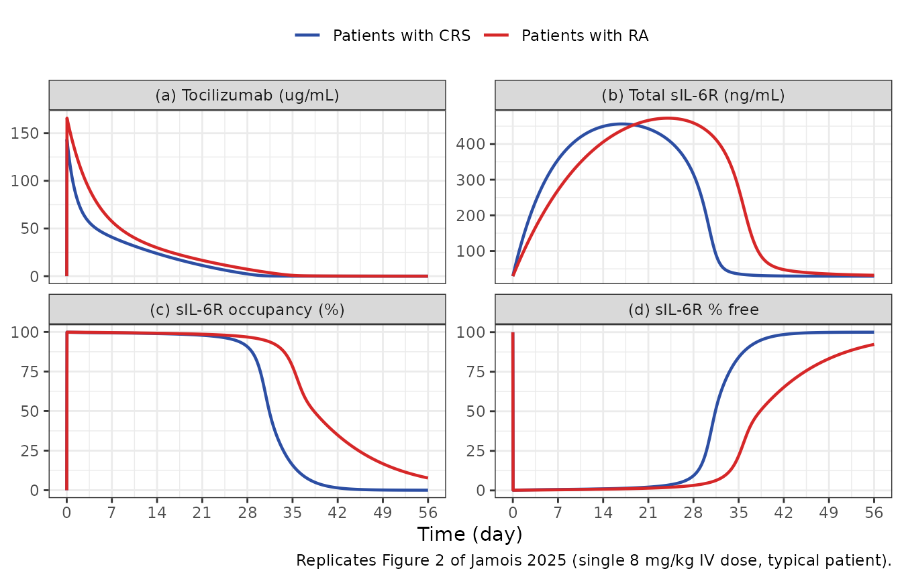
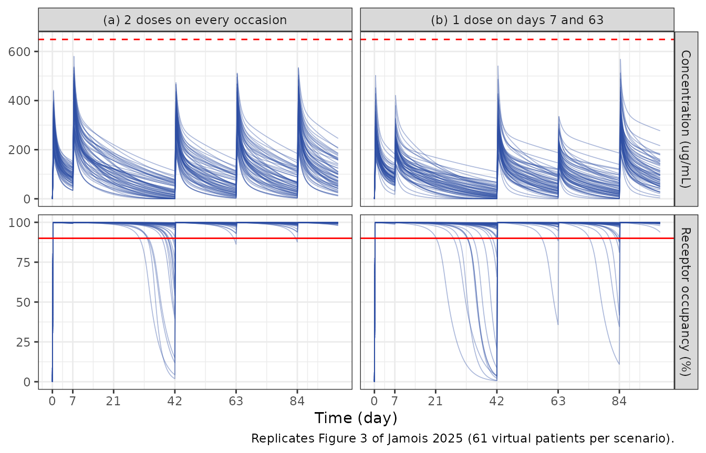

# Tocilizumab for bispecific-antibody CRS (Jamois 2025)

## Model and source

- Citation: Jamois C, Turner DC, Gibiansky L, Li F, Menuet JF, Pereira
  LR, Lundberg L, Guerini E, Carlile DJ, Relf J, Wei MC, Kwan A, Frey N,
  Grange S. Tocilizumab Dosing for Management of T Cell-Engaging
  Bispecific Antibody-Related CRS in Patients With R/R B-Cell NHL. Clin
  Pharmacol Ther. 2025;118(4):917. <doi:10.1002/cpt.3751>
- Article: <https://doi.org/10.1002/cpt.3751> (open access; PMC12439009)
- Supplement: Tables S1-S6 (parameter estimates and the NONMEM control
  stream of the final model) at the same DOI.

Jamois 2025 adapted an internally updated tocilizumab population PK /
soluble IL-6 receptor (sIL-6R) model, fit to adults with rheumatoid
arthritis (RA) and children with juvenile idiopathic arthritis (JIA), to
tocilizumab given for cytokine release syndrome (CRS) induced by the
anti-CD20 x CD3 bispecific antibodies mosunetuzumab and glofitamab. The
paper contributes two models:

| Model | Source | Description |
|----|----|----|
| `Jamois_2025_tocilizumab_ra` | Table S1 | RA / JIA reference model (all parameters estimated, full random-effect structure). |
| `Jamois_2025_tocilizumab_crs` | Tables S5 and S6 | Final CRS model: the RA / JIA parameters held fixed, CRS factors estimated on CL (first CRS event grade \>= 2), VC = VP, Q, kint and kdeg, the albumin and total-protein effects set to 0, and the typical baseline sIL-6R re-estimated. |

Both share one structure: a two-compartment tocilizumab model with
first-order SC absorption, parallel linear and Michaelis-Menten
elimination, and total sIL-6R described by the quasi-steady-state (QSS)
approximation of target-mediated drug disposition:

``` math
\frac{dR_{tot}}{dt} = k_{deg}\,(BASE - R_{tot}) - (k_{int} - k_{deg})\,
R_{tot}\,\frac{C}{K_{SS} + C}, \qquad R_{tot}(0) = BASE,
```

where `BASE` is the observed pre-dose total sIL-6R (covariate
`TSIL6R_BASE`) or, when unobserved, the estimated typical baseline.
Receptor occupancy is `ro = 100 * C / (KSS + C)`.

## Population

The CRS model was developed on 61 adults with relapsed/refractory B-cell
non-Hodgkin lymphoma who received tocilizumab for CRS in the
mosunetuzumab study NCT02500407 (n = 16) or the glofitamab study
NCT03075696 (n = 45): 276 tocilizumab and 230 sIL-6R samples (Table 2).
They were 72.1% male, with a median age of 64 (range 30-87) years,
median weight 73.8 (53-128) kg, median BSA-normalised creatinine
clearance 78.6 mL/min/1.73 m^2, and median baseline total sIL-6R 33.4
(20.3-103) ng/mL (Table S4). Tocilizumab was given IV at 8 mg/kg (12
mg/kg below 30 kg; at most 800 mg per infusion); most patients received
a single dose. Six further mosunetuzumab-treated patients were held out
for external validation.

The RA / JIA reference model is unpublished apart from its parameter
estimates (Table S1); the paper does not report its data set size or
demographics.

``` r

str(readModelDb("Jamois_2025_tocilizumab_crs")()$population)
#> List of 12
#>  $ species       : chr "human"
#>  $ n_subjects    : int 61
#>  $ n_observations: int 506
#>  $ n_studies     : int 2
#>  $ age_range     : chr "30-87 years (mean 63.0, median 64)"
#>  $ weight_range  : chr "53-128 kg (mean 75.7, median 73.8)"
#>  $ sex_female_pct: num 27.9
#>  $ disease_state : chr "Relapsed/refractory B-cell non-Hodgkin lymphoma with cytokine release syndrome (ASTCT grade >= 1) after mosunet"| __truncated__
#>  $ dose_range    : chr "Tocilizumab IV 8 mg/kg (12 mg/kg if < 30 kg; no more than 800 mg per infusion); repeat doses permitted, up to f"| __truncated__
#>  $ regions       : chr "Global (Roche-sponsored phase 1/2 studies)"
#>  $ baseline_sil6r: chr "Total sIL-6R median 33.4 ng/mL (range 20.3-103) (Table S4)"
#>  $ notes         : chr "Model-development data set (Table 2 and Table S4): 61 patients, 276 tocilizumab and 230 sIL-6R samples. Externa"| __truncated__
```

## Source trace

Every `ini()` value carries an in-file comment naming its source. The
fixed-effect values come from the `$THETA` / `$OMEGA` / `$SIGMA` records
of the NONMEM control stream (Table S6), which carry more digits than
Tables S1 and S5 and agree with them to the printed precision.

| Parameter | CRS model | RA / JIA model | Source |
|----|----|----|----|
| `lcl`, `lvc`, `lvp`, `lq` | 0.211 L/day, 3.36 L, 3.29 L, 0.392 L/day (fixed) | same (estimated) | Table S1 theta1-4; Table S6 |
| `lvmax`, `lkm` | 2.31 mg/L/day, 0.414 ug/mL | same | Table S1 theta5-6 |
| `lka`, `lfdepot` | 0.209 1/day, F = 0.710 | same | Table S1 theta7-8 |
| `e_wt_cl`, `e_wt_vc` | 0.502, 0.750 | same | Table S1 theta9-10 |
| `e_hdlc_cl` | -0.252 | same | Table S1 theta11 |
| `e_alb_vc`, `e_tpro_vc` | 0 (removed) | -0.526, 0.562 | Table S1 theta12-13; Table S5 / S6 fix them to 0 |
| `e_crcl_vmax`, `e_age_ka` | 0.357, -0.354 | same | Table S1 theta14-15 |
| `e_study_25220_28117_ka` | log(0.807) | same | Table S1 theta16 |
| `e_sc_inj_group3_lfdepot` | 0.692 | same | Table S1 theta17 |
| `sdL`, `sdH`, `sd50` | 0.999, 0.117, 2.19 ug/mL | same | Table S1 theta18-20 |
| `e_age_cl`, `thalf_age_cl`, `age50_fdepot` | 0.262, 2.44 y, 12.0 y | same | Table S1 theta21-23 |
| `lrbase` | 29.4 ng/mL | 47.6 ng/mL | Table S5 / Table S1 theta24 |
| `lkint`, `lkdeg`, `lkss` | 0.0731, 1.34 1/day, 0.241 ug/mL | same | Table S1 theta25-27 |
| `e_base_kint`, `e_base_kdeg`, `e_wt_kdeg` | 0.193, -0.528, -0.0781 | same | Table S1 theta28-30 |
| `e_crs_grade_ge2_cl` | log(1.60) | – | Table S5 theta31 |
| `e_crs_vc` (VC and VP) | log(1.15) | – | Table S5 theta32 |
| `e_crs_q`, `e_crs_kint`, `e_crs_kdeg` | log(3.59), log(2.09), log(1.76) | – | Table S5 theta33-35 |
| IIV | CL 0.291, VC = VP 0.0681 (shared eta); ka, F, sBASE, kdeg and the two residual-magnitude etas fixed from Table S1 | full Table S1 block, incl. VC-VP covariance 0.0345 | Tables S1, S5, S6 `$OMEGA` |
| Residual error | log-scale; tocilizumab SD `(SDL - (SDL - SDH) C / (SD50 + C)) exp(eta13)`; sIL-6R SD `sqrt(0.015) exp(eta14)` | same | Table S6 `$ERROR`, `$SIGMA` |
| ODEs, QSS bound target, `BASE` logic, CRCL truncation \[15, 150\] |  |  | Table S6 `$PK`, `$DES` |

## Typical patient: CRS vs RA (Figure 2)

Figure 2 compares a typical patient with CRS and with RA after a single
8 mg/kg IV dose. The figure does not state the typical covariates. The
simulation uses 70 kg, 50 years, HDL 1.5 mmol/L, creatinine clearance
100 mL/min/1.73 m^2, albumin 35 g/L and total protein 75 g/L (the model
reference values), a first CRS event of grade \>= 2, and a common
baseline total sIL-6R of 29.4 ng/mL for both curves (the figure shows
both returning to the same baseline near 30 ng/mL).

``` r

mod_crs <- readModelDb("Jamois_2025_tocilizumab_crs")
mod_ra <- readModelDb("Jamois_2025_tocilizumab_ra")

typical_cov <- data.frame(
  WT = 70, AGE = 50, HDLC = 1.5, CRCL = 100, ALB = 35, TPRO = 75,
  STUDY_25220_28117 = 0, SC_INJ_GROUP3 = 0, CRS_GRADE_GE2 = 1,
  TSIL6R_BASE = 29.4
)
obs_grid <- sort(unique(c(seq(0, 1, by = 1 / 24), seq(1, 56, by = 0.25))))
typical_ev <- bind_rows(
  data.frame(time = 0, amt = 8 * 70, dur = 1 / 24, evid = 1, cmt = "central"),
  data.frame(time = obs_grid, amt = 0, dur = 0, evid = 0, cmt = "total_target")
) |>
  mutate(id = 1L) |>
  cbind(typical_cov)

sim_typ <- bind_rows(
  as.data.frame(rxSolve(zeroRe(mod_crs, "omega"), typical_ev)) |> mutate(population = "Patients with CRS"),
  as.data.frame(rxSolve(zeroRe(mod_ra, "omega"), typical_ev)) |> mutate(population = "Patients with RA")
) |>
  mutate(pct_free = 100 * free_target / total_target)
#> ℹ parameter labels from comments will be replaced by 'label()'
#> ℹ omega/sigma items treated as zero: 'etalcl', 'etalvc', 'etalka', 'etalfdepot', 'etalrbase', 'etalkdeg', 'etaruv', 'etaruv_total_target'
#> ℹ parameter labels from comments will be replaced by 'label()'
#> ℹ omega/sigma items treated as zero: 'etalcl', 'etalvc', 'etalvp', 'etalq', 'etalvmax', 'etalkm', 'etalka', 'etalfdepot', 'etalrbase', 'etalkint', 'etalkdeg', 'etalkss', 'etaruv', 'etaruv_total_target'

typ_long <- sim_typ |>
  select(time, population, Cc, total_target, ro, pct_free) |>
  pivot_longer(c(Cc, total_target, ro, pct_free), names_to = "quantity") |>
  mutate(quantity = factor(
    quantity,
    levels = c("Cc", "total_target", "ro", "pct_free"),
    labels = c(
      "(a) Tocilizumab (ug/mL)", "(b) Total sIL-6R (ng/mL)",
      "(c) sIL-6R occupancy (%)", "(d) sIL-6R % free"
    )
  ))

ggplot(typ_long, aes(time, value, colour = population)) +
  geom_line(linewidth = 0.8) +
  facet_wrap(~quantity, scales = "free_y") +
  scale_colour_manual(values = c("Patients with CRS" = "#2c4ea3", "Patients with RA" = "#d62728")) +
  scale_x_continuous(breaks = seq(0, 56, by = 7)) +
  labs(
    x = "Time (day)", y = NULL, colour = NULL,
    caption = "Replicates Figure 2 of Jamois 2025 (single 8 mg/kg IV dose, typical patient)."
  ) +
  theme_bw() +
  theme(legend.position = "top")
```



Figure 2(b) shows the total sIL-6R peak at about 455 ng/mL near day 17
for CRS and about 470 ng/mL near day 24 for RA (its axis label reads
ug/mL, but the baseline near 30 identifies the unit as ng/mL, as in
Table S4). The table below reads the same features from the simulation.

``` r

typ_feat <- sim_typ |>
  group_by(population) |>
  summarise(
    cmax = max(Cc),
    peak_total = max(total_target),
    t_peak_total = time[which.max(total_target)],
    ro_day28 = ro[time == 28],
    ro_day42 = ro[time == 42],
    .groups = "drop"
  )
typ_feat |>
  rename(
    "Population" = population,
    "Cmax (ug/mL)" = cmax,
    "Peak total sIL-6R (ng/mL)" = peak_total,
    "Time of peak (day)" = t_peak_total,
    "Occupancy day 28 (%)" = ro_day28,
    "Occupancy day 42 (%)" = ro_day42
  ) |>
  knitr::kable(digits = 1, caption = "Typical-patient features (compare Figure 2).")
```

| Population | Cmax (ug/mL) | Peak total sIL-6R (ng/mL) | Time of peak (day) | Occupancy day 28 (%) | Occupancy day 42 (%) |
|:---|---:|---:|---:|---:|---:|
| Patients with CRS | 143.3 | 456.2 | 17 | 90.7 | 1.5 |
| Patients with RA | 165.7 | 472.4 | 24 | 96.8 | 34.8 |

Typical-patient features (compare Figure 2). {.table}

``` r


crs_feat <- typ_feat[typ_feat$population == "Patients with CRS", ]
ra_feat <- typ_feat[typ_feat$population == "Patients with RA", ]
stopifnot(
  # Figure 2(b): peaks about 455 (CRS) and 470 ng/mL (RA), CRS earlier.
  abs(crs_feat$peak_total / 455 - 1) < 0.1,
  abs(ra_feat$peak_total / 470 - 1) < 0.1,
  crs_feat$t_peak_total < ra_feat$t_peak_total - 3,
  # Figure 2(c): occupancy is lost earlier with CRS (higher CL).
  crs_feat$ro_day42 < 10,
  ra_feat$ro_day42 > 20
)
```

## Virtual cohort (model-development studies)

Original data are not available. Covariates are drawn per study from the
Table S4 means and SDs (log-normal for weight, creatinine clearance, HDL
and baseline sIL-6R; normal for age), truncated to the observed ranges.
HDL was 1.5 mmol/L for every NCT02500407 patient (Table S4: mean 1.5, SD
0, i.e. imputed at the reference). Every patient is given a first CRS
event of grade \>= 2 (see Assumptions).

``` r

rxode2::rxSetSeed(20250925)
set.seed(20250925)

rtrunc_lnorm <- function(n, mean, sd, lo, hi) {
  sdlog <- sqrt(log(1 + (sd / mean)^2))
  meanlog <- log(mean) - sdlog^2 / 2
  x <- rlnorm(n, meanlog, sdlog)
  pmin(pmax(x, lo), hi)
}
rtrunc_norm <- function(n, mean, sd, lo, hi) {
  pmin(pmax(rnorm(n, mean, sd), lo), hi)
}

# Table S4 summary statistics by study.
study_cov <- list(
  "NCT02500407 (mosunetuzumab)" = list(
    wt = c(84.4, 15.6, 66.2, 128), age = c(63.8, 10.1, 54, 87),
    crcl = c(90.1, 30.5, 44.5, 147), hdl = c(1.5, 0, 1.5, 1.5),
    sil6r = c(43.2, 26.5, 24.4, 82)
  ),
  "NCT03075696 (glofitamab)" = list(
    wt = c(72.6, 12.9, 53, 114), age = c(62.7, 13.8, 30, 85),
    crcl = c(79.6, 24.4, 33.4, 155), hdl = c(1.24, 0.42, 0.465, 2.5),
    sil6r = c(35.7, 20.1, 20.3, 103)
  )
)

make_subjects <- function(n, study, id_offset) {
  s <- study_cov[[study]]
  hdl <- if (s$hdl[2] == 0) rep(s$hdl[1], n) else do.call(rtrunc_lnorm, c(list(n), as.list(s$hdl)))
  data.frame(
    id = id_offset + seq_len(n),
    study = study,
    WT = do.call(rtrunc_lnorm, c(list(n), as.list(s$wt))),
    AGE = do.call(rtrunc_norm, c(list(n), as.list(s$age))),
    CRCL = do.call(rtrunc_lnorm, c(list(n), as.list(s$crcl))),
    HDLC = hdl,
    TSIL6R_BASE = do.call(rtrunc_lnorm, c(list(n), as.list(s$sil6r))),
    CRS_GRADE_GE2 = 1,
    STUDY_25220_28117 = 0,
    SC_INJ_GROUP3 = 0
  )
}

# 8 mg/kg (12 mg/kg below 30 kg), capped at 800 mg, 1-h IV infusion.
tcz_dose <- function(wt) pmin(ifelse(wt < 30, 12, 8) * wt, 800)

make_events <- function(subj, dose_times, obs_times) {
  doses <- subj |>
    tidyr::crossing(time = dose_times) |>
    mutate(amt = tcz_dose(WT), dur = 1 / 24, evid = 1L, cmt = "central")
  obs <- subj |>
    tidyr::crossing(time = obs_times) |>
    mutate(amt = 0, dur = 0, evid = 0L, cmt = "total_target")
  bind_rows(doses, obs) |> arrange(id, time, desc(evid))
}
```

## Exposure and occupancy after 1-4 doses (Table S2 and Table 3)

Table S2 summarises individual (post hoc) exposures after one to four 8
mg/kg doses given 8 hours apart, by study. Each regimen arm below draws
100 virtual patients per study.

``` r

n_per_arm <- 100L
obs_s2 <- sort(unique(c(seq(0, 2, by = 1 / 24), seq(2, 28, by = 0.25))))
regimens <- 1:4
arms <- expand.grid(study = names(study_cov), n_doses = regimens, stringsAsFactors = FALSE)

events_s2 <- bind_rows(lapply(seq_len(nrow(arms)), function(i) {
  subj <- make_subjects(n_per_arm, arms$study[i], id_offset = (i - 1L) * n_per_arm)
  make_events(subj, dose_times = (seq_len(arms$n_doses[i]) - 1) * 8 / 24, obs_times = obs_s2) |>
    mutate(regimen = paste0(arms$n_doses[i], " x 8 mg/kg"))
}))
stopifnot(!anyDuplicated(unique(events_s2[, c("id", "time", "evid")])))

sim_s2 <- rxSolve(
  mod_crs,
  events = events_s2,
  keep = c("study", "regimen"),
  returnType = "data.frame"
)
#> ℹ parameter labels from comments will be replaced by 'label()'
```

``` r

conc_s2 <- sim_s2 |>
  filter(!is.na(Cc)) |>
  select(id, time, Cc, study, regimen) |>
  distinct(id, time, .keep_all = TRUE)
dose_s2 <- events_s2 |>
  filter(evid == 1) |>
  select(id, time, amt, study, regimen)

conc_obj <- PKNCAconc(conc_s2, Cc ~ time | study + regimen + id)
dose_obj <- PKNCAdose(dose_s2, amt ~ time | study + regimen + id)
intervals_s2 <- data.frame(
  start = c(0, 0, 0),
  end = c(28, 7, 28),
  cmax = c(TRUE, FALSE, FALSE),
  auclast = c(FALSE, TRUE, TRUE)
)
nca_s2 <- pk.nca(PKNCAdata(conc_obj, dose_obj, intervals = intervals_s2))

nca_s2_long <- as.data.frame(nca_s2$result) |>
  filter(PPTESTCD %in% c("cmax", "auclast")) |>
  mutate(interval = ifelse(PPTESTCD == "cmax", "Day 0-28", paste0("Day 0-", end))) |>
  select(study, regimen, interval, PPTESTCD, PPORRES)

# Table S2 medians.
published_s2 <- tibble::tribble(
  ~study, ~regimen, ~interval, ~PPTESTCD, ~PPORRES,
  "NCT02500407 (mosunetuzumab)", "1 x 8 mg/kg", "Day 0-28", "cmax", 131,
  "NCT02500407 (mosunetuzumab)", "2 x 8 mg/kg", "Day 0-28", "cmax", 246,
  "NCT02500407 (mosunetuzumab)", "3 x 8 mg/kg", "Day 0-28", "cmax", 349,
  "NCT02500407 (mosunetuzumab)", "4 x 8 mg/kg", "Day 0-28", "cmax", 441,
  "NCT03075696 (glofitamab)", "1 x 8 mg/kg", "Day 0-28", "cmax", 149,
  "NCT03075696 (glofitamab)", "2 x 8 mg/kg", "Day 0-28", "cmax", 281,
  "NCT03075696 (glofitamab)", "3 x 8 mg/kg", "Day 0-28", "cmax", 398,
  "NCT03075696 (glofitamab)", "4 x 8 mg/kg", "Day 0-28", "cmax", 502,
  "NCT02500407 (mosunetuzumab)", "1 x 8 mg/kg", "Day 0-7", "auclast", 447,
  "NCT02500407 (mosunetuzumab)", "2 x 8 mg/kg", "Day 0-7", "auclast", 909,
  "NCT02500407 (mosunetuzumab)", "3 x 8 mg/kg", "Day 0-7", "auclast", 1360,
  "NCT02500407 (mosunetuzumab)", "4 x 8 mg/kg", "Day 0-7", "auclast", 1790,
  "NCT03075696 (glofitamab)", "1 x 8 mg/kg", "Day 0-7", "auclast", 464,
  "NCT03075696 (glofitamab)", "2 x 8 mg/kg", "Day 0-7", "auclast", 940,
  "NCT03075696 (glofitamab)", "3 x 8 mg/kg", "Day 0-7", "auclast", 1400,
  "NCT03075696 (glofitamab)", "4 x 8 mg/kg", "Day 0-7", "auclast", 1850,
  "NCT02500407 (mosunetuzumab)", "1 x 8 mg/kg", "Day 0-28", "auclast", 676,
  "NCT02500407 (mosunetuzumab)", "2 x 8 mg/kg", "Day 0-28", "auclast", 1580,
  "NCT02500407 (mosunetuzumab)", "3 x 8 mg/kg", "Day 0-28", "auclast", 2490,
  "NCT02500407 (mosunetuzumab)", "4 x 8 mg/kg", "Day 0-28", "auclast", 3400,
  "NCT03075696 (glofitamab)", "1 x 8 mg/kg", "Day 0-28", "auclast", 915,
  "NCT03075696 (glofitamab)", "2 x 8 mg/kg", "Day 0-28", "auclast", 2100,
  "NCT03075696 (glofitamab)", "3 x 8 mg/kg", "Day 0-28", "auclast", 3290,
  "NCT03075696 (glofitamab)", "4 x 8 mg/kg", "Day 0-28", "auclast", 4460
)

cmp_s2 <- ncaComparisonTable(
  simulated = nca_s2_long,
  reference = published_s2,
  by = c("study", "regimen", "interval"),
  units = c(cmax = "ug/mL", auclast = "ug*day/mL"),
  tolerance_pct = 20
)
knitr::kable(
  cmp_s2,
  caption = paste(
    "Simulated (median of 100 virtual patients per arm) vs Table S2 medians.",
    attr(cmp_s2, "footnote")
  )
)
```

| NCA parameter | study | regimen | interval | Reference | Simulated | % diff |
|:---|:---|:---|:---|:---|:---|:---|
| Cmax (ug/mL) | NCT02500407 (mosunetuzumab) | 1 x 8 mg/kg | Day 0-28 | 131 | 151 | +15.0% |
| Cmax (ug/mL) | NCT02500407 (mosunetuzumab) | 2 x 8 mg/kg | Day 0-28 | 246 | 297 | +20.6%\* |
| Cmax (ug/mL) | NCT02500407 (mosunetuzumab) | 3 x 8 mg/kg | Day 0-28 | 349 | 371 | +6.4% |
| Cmax (ug/mL) | NCT02500407 (mosunetuzumab) | 4 x 8 mg/kg | Day 0-28 | 441 | 487 | +10.5% |
| Cmax (ug/mL) | NCT03075696 (glofitamab) | 1 x 8 mg/kg | Day 0-28 | 149 | 150 | +0.7% |
| Cmax (ug/mL) | NCT03075696 (glofitamab) | 2 x 8 mg/kg | Day 0-28 | 281 | 270 | -3.9% |
| Cmax (ug/mL) | NCT03075696 (glofitamab) | 3 x 8 mg/kg | Day 0-28 | 398 | 366 | -8.0% |
| Cmax (ug/mL) | NCT03075696 (glofitamab) | 4 x 8 mg/kg | Day 0-28 | 502 | 478 | -4.8% |
| AUClast (ug\*day/mL) | NCT02500407 (mosunetuzumab) | 1 x 8 mg/kg | Day 0-28 | 676 | 937 | +38.6%\* |
| AUClast (ug\*day/mL) | NCT02500407 (mosunetuzumab) | 1 x 8 mg/kg | Day 0-7 | 447 | 481 | +7.6% |
| AUClast (ug\*day/mL) | NCT02500407 (mosunetuzumab) | 2 x 8 mg/kg | Day 0-28 | 1580 | 2090 | +32.0%\* |
| AUClast (ug\*day/mL) | NCT02500407 (mosunetuzumab) | 2 x 8 mg/kg | Day 0-7 | 909 | 979 | +7.7% |
| AUClast (ug\*day/mL) | NCT02500407 (mosunetuzumab) | 3 x 8 mg/kg | Day 0-28 | 2490 | 3130 | +25.9%\* |
| AUClast (ug\*day/mL) | NCT02500407 (mosunetuzumab) | 3 x 8 mg/kg | Day 0-7 | 1360 | 1370 | +0.9% |
| AUClast (ug\*day/mL) | NCT02500407 (mosunetuzumab) | 4 x 8 mg/kg | Day 0-28 | 3400 | 3980 | +17.1% |
| AUClast (ug\*day/mL) | NCT02500407 (mosunetuzumab) | 4 x 8 mg/kg | Day 0-7 | 1790 | 1770 | -0.9% |
| AUClast (ug\*day/mL) | NCT03075696 (glofitamab) | 1 x 8 mg/kg | Day 0-28 | 915 | 809 | -11.6% |
| AUClast (ug\*day/mL) | NCT03075696 (glofitamab) | 1 x 8 mg/kg | Day 0-7 | 464 | 454 | -2.2% |
| AUClast (ug\*day/mL) | NCT03075696 (glofitamab) | 2 x 8 mg/kg | Day 0-28 | 2100 | 1830 | -12.9% |
| AUClast (ug\*day/mL) | NCT03075696 (glofitamab) | 2 x 8 mg/kg | Day 0-7 | 940 | 909 | -3.4% |
| AUClast (ug\*day/mL) | NCT03075696 (glofitamab) | 3 x 8 mg/kg | Day 0-28 | 3290 | 2880 | -12.4% |
| AUClast (ug\*day/mL) | NCT03075696 (glofitamab) | 3 x 8 mg/kg | Day 0-7 | 1400 | 1280 | -8.5% |
| AUClast (ug\*day/mL) | NCT03075696 (glofitamab) | 4 x 8 mg/kg | Day 0-28 | 4460 | 3900 | -12.6% |
| AUClast (ug\*day/mL) | NCT03075696 (glofitamab) | 4 x 8 mg/kg | Day 0-7 | 1850 | 1800 | -2.9% |

Simulated (median of 100 virtual patients per arm) vs Table S2 medians.
\* differs from reference by more than ±20%. {.table}

Table S2 also reports the concentration and the sIL-6R occupancy on days
7, 14, 21 and 28, and Table 3 pools the occupancy across both studies.

``` r

tp_sim <- sim_s2 |>
  filter(time %in% c(7, 14, 21, 28)) |>
  group_by(study, regimen, time) |>
  summarise(Cc = median(Cc), ro = median(ro), .groups = "drop")

tp_pub <- tibble::tribble(
  ~study, ~regimen, ~time, ~Cc_pub, ~ro_pub,
  "NCT02500407 (mosunetuzumab)", "1 x 8 mg/kg", 7, 32.3, 99.3,
  "NCT02500407 (mosunetuzumab)", "1 x 8 mg/kg", 14, 17.3, 98.6,
  "NCT02500407 (mosunetuzumab)", "1 x 8 mg/kg", 21, 8.23, 97.1,
  "NCT02500407 (mosunetuzumab)", "1 x 8 mg/kg", 28, 1.76, 86.2,
  "NCT02500407 (mosunetuzumab)", "2 x 8 mg/kg", 7, 72, 99.7,
  "NCT02500407 (mosunetuzumab)", "2 x 8 mg/kg", 14, 45.5, 99.5,
  "NCT02500407 (mosunetuzumab)", "2 x 8 mg/kg", 21, 30.1, 99.2,
  "NCT02500407 (mosunetuzumab)", "2 x 8 mg/kg", 28, 18.4, 98.7,
  "NCT03075696 (glofitamab)", "1 x 8 mg/kg", 7, 41.6, 99.4,
  "NCT03075696 (glofitamab)", "1 x 8 mg/kg", 14, 26.3, 99.1,
  "NCT03075696 (glofitamab)", "1 x 8 mg/kg", 21, 14.3, 98.3,
  "NCT03075696 (glofitamab)", "1 x 8 mg/kg", 28, 4.68, 95.1,
  "NCT03075696 (glofitamab)", "2 x 8 mg/kg", 7, 91.2, 99.7,
  "NCT03075696 (glofitamab)", "2 x 8 mg/kg", 14, 64, 99.6,
  "NCT03075696 (glofitamab)", "2 x 8 mg/kg", 21, 43.3, 99.4,
  "NCT03075696 (glofitamab)", "2 x 8 mg/kg", 28, 25.5, 99.1
)

tp_cmp <- inner_join(tp_pub, tp_sim, by = c("study", "regimen", "time"))
tp_cmp |>
  rename(
    "Study" = study, "Regimen" = regimen, "Day" = time,
    "Cc Table S2 (ug/mL)" = Cc_pub, "Cc simulated (ug/mL)" = Cc,
    "Occupancy Table S2 (%)" = ro_pub, "Occupancy simulated (%)" = ro
  ) |>
  knitr::kable(digits = c(0, 0, 0, 2, 2, 1, 1), caption = "Median concentration and sIL-6R occupancy by day (Table S2).")
```

| Study | Regimen | Day | Cc Table S2 (ug/mL) | Occupancy Table S2 (%) | Cc simulated (ug/mL) | Occupancy simulated (%) |
|:---|:---|---:|---:|---:|---:|---:|
| NCT02500407 (mosunetuzumab) | 1 x 8 mg/kg | 7 | 32.30 | 99.3 | 43.4 | 99.4 |
| NCT02500407 (mosunetuzumab) | 1 x 8 mg/kg | 14 | 17.30 | 98.6 | 25.9 | 99.1 |
| NCT02500407 (mosunetuzumab) | 1 x 8 mg/kg | 21 | 8.23 | 97.1 | 13.7 | 98.3 |
| NCT02500407 (mosunetuzumab) | 1 x 8 mg/kg | 28 | 1.76 | 86.2 | 4.8 | 95.2 |
| NCT02500407 (mosunetuzumab) | 2 x 8 mg/kg | 7 | 72.00 | 99.7 | 90.4 | 99.7 |
| NCT02500407 (mosunetuzumab) | 2 x 8 mg/kg | 14 | 45.50 | 99.5 | 61.4 | 99.6 |
| NCT02500407 (mosunetuzumab) | 2 x 8 mg/kg | 21 | 30.10 | 99.2 | 37.2 | 99.4 |
| NCT02500407 (mosunetuzumab) | 2 x 8 mg/kg | 28 | 18.40 | 98.7 | 22.6 | 98.9 |
| NCT03075696 (glofitamab) | 1 x 8 mg/kg | 7 | 41.60 | 99.4 | 38.6 | 99.4 |
| NCT03075696 (glofitamab) | 1 x 8 mg/kg | 14 | 26.30 | 99.1 | 21.6 | 98.9 |
| NCT03075696 (glofitamab) | 1 x 8 mg/kg | 21 | 14.30 | 98.3 | 9.1 | 97.4 |
| NCT03075696 (glofitamab) | 1 x 8 mg/kg | 28 | 4.68 | 95.1 | 1.4 | 85.4 |
| NCT03075696 (glofitamab) | 2 x 8 mg/kg | 7 | 91.20 | 99.7 | 82.8 | 99.7 |
| NCT03075696 (glofitamab) | 2 x 8 mg/kg | 14 | 64.00 | 99.6 | 52.5 | 99.5 |
| NCT03075696 (glofitamab) | 2 x 8 mg/kg | 21 | 43.30 | 99.4 | 33.4 | 99.3 |
| NCT03075696 (glofitamab) | 2 x 8 mg/kg | 28 | 25.50 | 99.1 | 18.2 | 98.7 |

Median concentration and sIL-6R occupancy by day (Table S2). {.table}

``` r


ro_pooled <- sim_s2 |>
  filter(time %in% c(14, 21), regimen %in% c("1 x 8 mg/kg", "2 x 8 mg/kg")) |>
  group_by(regimen, time) |>
  summarise(ro_median = median(ro), .groups = "drop")
knitr::kable(
  ro_pooled |> rename("Regimen" = regimen, "Day" = time, "Median occupancy (%)" = ro_median),
  digits = 1,
  caption = "Pooled median occupancy; Table 3 reports 99 / 98.2 % (1 dose, day 14 / 21) and 99.6 / 99.4 % (2 doses)."
)
```

| Regimen     | Day | Median occupancy (%) |
|:------------|----:|---------------------:|
| 1 x 8 mg/kg |  14 |                 99.0 |
| 1 x 8 mg/kg |  21 |                 97.9 |
| 2 x 8 mg/kg |  14 |                 99.6 |
| 2 x 8 mg/kg |  21 |                 99.3 |

Pooled median occupancy; Table 3 reports 99 / 98.2 % (1 dose, day 14 /
21) and 99.6 / 99.4 % (2 doses). {.table}

``` r

cmp_num <- nca_s2_long |>
  group_by(study, regimen, interval, PPTESTCD) |>
  summarise(sim = median(PPORRES), .groups = "drop") |>
  inner_join(published_s2, by = c("study", "regimen", "interval", "PPTESTCD")) |>
  mutate(pct_diff = 100 * (sim / PPORRES - 1))
early_pct <- cmp_num |>
  filter(PPTESTCD == "cmax" | interval == "Day 0-7") |>
  pull(pct_diff)
ro_pub_t3 <- c(99, 98.2, 99.6, 99.4) # Table 3: 1 dose day 14, 21; 2 doses day 14, 21
stopifnot(
  # Cmax and AUC0-7 are set by dose, VC and the first week of CL: a
  # mis-transcribed volume, dose or CRS factor moves the whole set by tens of
  # percent. Centre and a robust quantile, not the extremes (independent
  # 100-patient arms put single cells about 5-20% off).
  abs(median(early_pct)) < 10,
  quantile(abs(early_pct), 0.9) < 25,
  # Table 3 pooled median occupancy, to within 2 percentage points.
  all(abs(ro_pooled$ro_median - ro_pub_t3) < 2)
)
```

The simulated medians reproduce Cmax and AUC0-7 for both studies and all
four regimens, and the pooled median occupancy of Table 3 to within half
a percentage point. The 0-28-day AUC and the day-14 to day-28
concentrations are higher than Table S2 for the mosunetuzumab study and
lower for the glofitamab study. The paper reports that the individual
random effects on CL and VC were biased by study (higher CL and VC in
NCT02500407 males) but kept no study effect in the model; the Table S2
values are post hoc individual estimates that carry that bias, while a
simulation from the typical parameters cannot. The late tail also
depends on the share of patients whose first CRS event was grade 1
(lower CL), which the paper does not report. These columns are shown for
comparison and are not gated.

## Repeat dosing over two cycles (Figure 3)

Figure 3 simulates the model-development patients receiving tocilizumab
on days 0, 7, 42, 63 and 84, with (a) two doses 8 h apart on every
occasion or (b) one dose on days 7 and 63, against the 649 ug/mL FDA
safety threshold. The replication uses 61 virtual patients drawn in the
study proportions.

``` r

obs_f3 <- sort(unique(c(seq(0, 98, by = 0.25), c(0, 7, 42, 63, 84) + 9 / 24)))
subj_f3 <- bind_rows(
  make_subjects(16, "NCT02500407 (mosunetuzumab)", id_offset = 0L),
  make_subjects(45, "NCT03075696 (glofitamab)", id_offset = 16L)
)
q8 <- 8 / 24
scen_a <- c(0, q8, 7, 7 + q8, 42, 42 + q8, 63, 63 + q8, 84, 84 + q8)
scen_b <- c(0, q8, 7, 42, 42 + q8, 63, 84, 84 + q8)
events_f3 <- bind_rows(
  make_events(subj_f3, scen_a, obs_f3) |> mutate(scenario = "(a) 2 doses on every occasion"),
  make_events(subj_f3 |> mutate(id = id + 100L), scen_b, obs_f3) |>
    mutate(scenario = "(b) 1 dose on days 7 and 63")
)
stopifnot(!anyDuplicated(unique(events_f3[, c("id", "time", "evid")])))

sim_f3 <- rxSolve(mod_crs, events = events_f3, keep = "scenario", returnType = "data.frame")

f3_long <- sim_f3 |>
  select(id, time, scenario, Cc, ro) |>
  pivot_longer(c(Cc, ro), names_to = "quantity") |>
  mutate(quantity = ifelse(quantity == "Cc", "Concentration (ug/mL)", "Receptor occupancy (%)"))

ggplot(f3_long, aes(time, value, group = id)) +
  geom_line(colour = "#2c4ea3", alpha = 0.4, linewidth = 0.3) +
  geom_hline(
    data = data.frame(
      quantity = c("Concentration (ug/mL)", "Receptor occupancy (%)"),
      y = c(649, 90),
      lt = c("dashed", "solid")
    ),
    aes(yintercept = y, linetype = lt), colour = "red"
  ) +
  scale_linetype_identity() +
  facet_grid(quantity ~ scenario, scales = "free_y") +
  scale_x_continuous(breaks = c(0, 7, 21, 42, 63, 84)) +
  labs(
    x = "Time (day)", y = NULL,
    caption = "Replicates Figure 3 of Jamois 2025 (61 virtual patients per scenario)."
  ) +
  theme_bw()
```



``` r


f3_summary <- sim_f3 |>
  group_by(scenario, id) |>
  summarise(cmax = max(Cc), .groups = "drop") |>
  group_by(scenario) |>
  summarise(
    median_cmax = median(cmax),
    p90_cmax = unname(quantile(cmax, 0.9)),
    .groups = "drop"
  )
knitr::kable(
  f3_summary |> rename("Scenario" = scenario, "Median Cmax (ug/mL)" = median_cmax, "90th percentile Cmax (ug/mL)" = p90_cmax),
  digits = 0
)
```

| Scenario | Median Cmax (ug/mL) | 90th percentile Cmax (ug/mL) |
|:---|---:|---:|
| \(a\) 2 doses on every occasion | 398 | 505 |
| \(b\) 1 dose on days 7 and 63 | 321 | 435 |

``` r

stopifnot(
  # Figure 3: individual peaks approach but mostly stay below 649 ug/mL;
  # the median patient peaks well below it.
  all(f3_summary$median_cmax < 649),
  f3_summary$median_cmax[1] > f3_summary$median_cmax[2]
)
```

## Assumptions and deviations

- **CRS grade.** The paper does not report how many model-development
  patients had a first CRS event of grade \>= 2. Tocilizumab was
  recommended for CRS of grade \>= 2 and a missing grade was imputed as
  2 (Table S6), so every virtual patient is assigned
  `CRS_GRADE_GE2 = 1`. Patients whose first event was grade 1 have
  1.6-fold lower CL; including them would raise the late (day 21-28)
  concentrations.
- **Infusion duration.** Not stated in the paper; a 1-hour IV infusion
  (the labelled duration) is assumed.
- **Covariate distributions.** Drawn from the Table S4 per-study means
  and SDs and truncated to the observed ranges; correlations between
  covariates are not reproduced. Albumin and total protein are not
  needed by the CRS model (their effects are fixed to 0).
- **Typical patient in Figure 2.** The figure does not give its
  covariates; the model reference values and a common baseline sIL-6R of
  29.4 ng/mL are used for both populations.
- **RA / JIA model structure.** The paper publishes the NONMEM control
  stream only for the CRS model (Table S6). The RA / JIA model file
  reuses that structure with the CRS terms removed, the Table S1 albumin
  and total-protein effects restored, and the Table S1 random-effect
  structure (including a separate VP eta correlated with the VC eta);
  the population metadata are sparse because the paper does not describe
  the RA / JIA data set.
- **`SC_INJ_GROUP3`.** Table S6 multiplies the log SC bioavailability by
  theta17 = 0.692 when `SINJ = 3` (Table S1 ‘F SC,SJIT3’), but neither
  the paper nor the supplement defines `SINJ`. The maintainers kept the
  effect as an opaquely named indicator so it remains selectable; it has
  no effect on IV doses and is 0 throughout this article.
- **Residual-error variability.** The tocilizumab and sIL-6R residual
  SDs carry between-subject random effects (`etaruv`,
  `etaruv_total_target`; Table S6 `EXP(ETA(13))`, `EXP(ETA(14))`),
  encoded as the SD multiplier on the log-normal error.
- **Errata.** The only post-publication change (23 August 2025) is to
  the copyright line; no parameter is affected.
