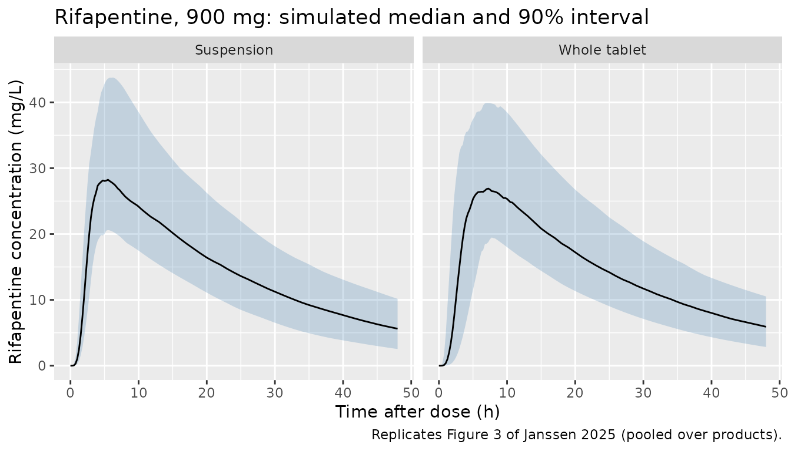
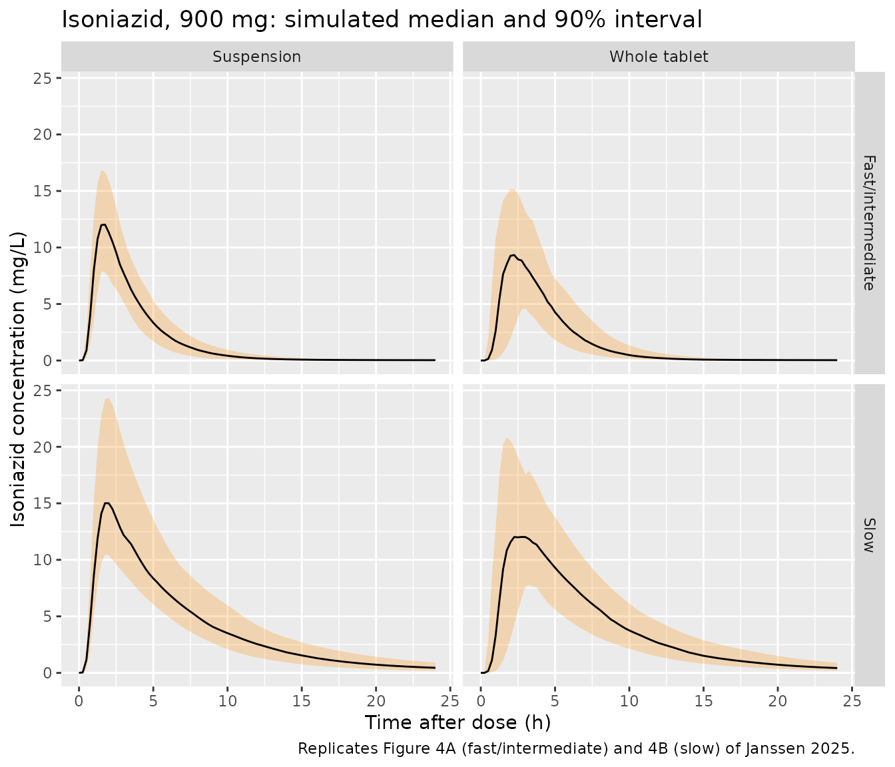

# Rifapentine and isoniazid, whole vs suspended tablets (Janssen 2025)

## Model and source

Janssen et al. (2025) gave 24 adults on once-weekly
rifapentine/isoniazid (3HP) tuberculosis preventive therapy 900 mg of
each drug, either as whole tablets or as tablets crushed and suspended
in water, and fitted one population PK model per drug. Both are
packaged:

- `Janssen_2025_rifapentine`: One-compartment population PK model for
  oral rifapentine in South African adults on once-weekly
  rifapentine/isoniazid (3HP) tuberculosis preventive therapy (Janssen
  2025). Absorption is a Savic transit chain (4 transit compartments,
  absorption rate equal to the transit rate) whose mean transit time is
  shortened when the tablets are suspended in water; IOV on
  bioavailability and MTT is correlated and the MTT IOV is smaller after
  suspended tablets. Parameters are for a 900 mg dose.
- `Janssen_2025_isoniazid`: Two-compartment population PK model for oral
  isoniazid in South African adults on once-weekly rifapentine/isoniazid
  (3HP) tuberculosis preventive therapy (Janssen 2025). A two-class
  mixture separates fast/intermediate from slow acetylators on CL/F
  (supplied here as NAT2_SLOW); CL, Q, V and Vp scale allometrically
  with fat-free mass (reference 45 kg). Absorption is a Savic transit
  chain (5 transit compartments, absorption rate equal to the transit
  rate) whose mean transit time is shortened when the tablets are
  suspended in water; IOV on bioavailability and MTT, with smaller MTT
  IOV after suspended tablets.
- Citation: Janssen S, Vongjarudech T, Karlsson MO, Upton CM,
  Garcia-Prats AJ, Diacon AH, Wiesner L, Sachs T, van der Laan LE,
  Salazar-Austin N, Hesseling AC, Svensson EM. Bridging to Paediatric
  Dosing: Relative Bioavailability of Suspended Rifapentine and
  Isoniazid in an Open-Label Randomized Trial in Adults on Tuberculosis
  Preventive Therapy. Clin Pharmacokinet. 2025;64(12):1885.
  <doi:10.1007/s40262-025-01576-3>
- Article: <https://doi.org/10.1007/s40262-025-01576-3>

The NONMEM control streams of both final models are in the paper’s
Electronic Supplementary Material (ESM 2 for rifapentine, ESM 3 for
isoniazid) and were used to confirm every structural element.

## Population

The study was an open-label randomised crossover at one site in Cape
Town, South Africa. Adults aged 18-55 years weighing 40-90 kg, with a
positive tuberculosis infection test after recent household contact with
drug-susceptible pulmonary TB, were randomised 1:1:1 to receive two of
three products (two generic rifapentine/isoniazid 300/300 mg fixed-dose
combinations, or standalone 300 mg tablets of each drug), each once
whole and once suspended, over the first four weekly doses. Doses were
taken 30 min after a standard 670 kcal breakfast. Of the 24 analysed
participants, 83.3% were female and 91.7% of mixed race; median age 37.5
years, weight 61.1 kg and fat-free mass 38.6 kg (Table 1). The analysis
used 838 rifapentine and 707 isoniazid concentrations; BLQ samples were
omitted.

The same information is available programmatically via
`readModelDb("Janssen_2025_rifapentine")()$population`.

## Source trace

| Equation / parameter | Rifapentine | Isoniazid | Source location |
|----|----|----|----|
| Structure | 1-compartment | 2-compartment | Results, PopPK paragraph; ESM 2 / ESM 3 `$DES` |
| Transit chain `NN`, `ka = ktr = (NN+1)/MTT` | 4 | 5 | ESM 2 / ESM 3 `$PK` (`NN`, `KTR`, `KA`) |
| `lcl` / `lcl_nonslow` (L/h) | 1.03 | 23.3 (fast/intermediate) | Table 2, CL/F |
| `lcl_slow` (L/h) | – | 9.5 | Table 2, CL slow/F |
| Fraction fast/intermediate acetylators | – | 65.9% | Table 2; ESM 3 `$MIX` |
| `lvc` (L) | 26.56 | 59.6 | Table 2, V/F |
| `lq` (L/h) | – | 1.26 | Table 2, Q/F |
| `lvp` (L) | – | 56.7 | Table 2, Vp/F |
| `lmtt` (h) | 2.75 | 1.4 | ESM 2 `$THETA` TVMTT (see Assumptions); Table 2, MTT |
| `lfdepot` | 1 (fixed) | 1 (fixed) | Table 2, F |
| FFM allometry, `(FFM/45)^x` | – | 0.75 on CL, Q; 1 on V, Vp (fixed) | Table 2 footnote b; ESM 3 `FCL`, `FV` |
| `e_susp_mtt` | -0.222 | -0.35 | Table 2, effect of suspension on MTT |
| `e_susp_iovmtt` | -0.458 | -0.629 | Table 2, effect of suspension on MTT variation; ESM 2 / ESM 3 `MTT` for `OFORM = 2` |
| IIV CL (%CV) | 19.9 | 17.4 | Table 2 |
| IIV F (%CV) | 17.3 | 18.1 | Table 2 |
| IOV F (%CV) | 12.2 | 7.1 | Table 2 |
| IOV MTT (%CV) | 39.2 | 40.8 | Table 2 |
| IOV F-MTT correlation | 0.37 | none | Table 2; ESM 2 `$OMEGA BLOCK(2)`, ESM 3 `BLOCK(1)` |
| `propSd` | 0.08 | 0.208 | Table 2, proportional error |
| `addSd` (mg/L) | 1.7 | 0.11 | Table 2, additive error |

Variances are `omega^2 = log(1 + CV^2)`, the inverse of Table 2 footnote
c.

## Virtual cohort

Each simulated subject receives one 900 mg dose of each drug at occasion
1, either whole or suspended (150 subjects per formulation). Fat-free
mass is log-normal around the Table 1 median of 38.6 kg with its
interquartile range (34.5-42.8 kg); the isoniazid acetylator class is
drawn with the fitted fast/intermediate probability of 0.659.

``` r

set.seed(20251)
n_per_arm <- 150
grid_fine <- sort(unique(c(seq(0, 12, by = 0.25), 13:48)))
grid_protocol <- c(0, 1, 2, 3, 4, 5, 6, 8, 24, 48)
grid <- sort(unique(c(grid_fine, grid_protocol)))

make_cohort <- function(n, susp, id_offset) {
  subj <- tibble(
    id = id_offset + seq_len(n),
    FORM_SUSPENSION = susp,
    FFM = exp(rnorm(n, log(38.6), (log(42.8) - log(34.5)) / 1.349)),
    NAT2_SLOW = rbinom(n, 1, 1 - 0.659)
  )
  dose <- subj |> mutate(time = 0, evid = 1L, amt = 900, cmt = "depot")
  obs <- subj |>
    tidyr::crossing(time = grid) |>
    mutate(evid = 0L, amt = 0, cmt = "central")
  bind_rows(dose, obs) |>
    mutate(OCC = 1L, form = ifelse(susp == 1, "Suspension", "Whole tablet")) |>
    arrange(id, time, desc(evid))
}

events <- bind_rows(
  make_cohort(n_per_arm, 0, id_offset = 0L),
  make_cohort(n_per_arm, 1, id_offset = n_per_arm)
)
stopifnot(!anyDuplicated(unique(events[, c("id", "time", "evid")])))
```

## Simulation

``` r

mod_rpt <- readModelDb("Janssen_2025_rifapentine")
mod_inh <- readModelDb("Janssen_2025_isoniazid")

rxode2::rxSetSeed(20251)
sim_rpt <- rxode2::rxSolve(mod_rpt, events = events, keep = c("form")) |>
  as.data.frame() |>
  mutate(drug = "Rifapentine")
#> ℹ parameter labels from comments will be replaced by 'label()'
#> Warning: some etas defaulted to non-mu referenced, possible parsing error: etaiov_lfdepot_1, etaiov_lmtt_1, etaiov_lfdepot_2, etaiov_lmtt_2, etaiov_lfdepot_3, etaiov_lmtt_3, etaiov_lfdepot_4, etaiov_lmtt_4
#> as a work-around try putting the mu-referenced expression on a simple line
sim_inh <- rxode2::rxSolve(
  mod_inh,
  events = events,
  keep = c("form", "NAT2_SLOW")
) |>
  as.data.frame() |>
  mutate(
    drug = "Isoniazid",
    acetylator = ifelse(NAT2_SLOW == 1, "Slow", "Fast/intermediate")
  )
#> ℹ parameter labels from comments will be replaced by 'label()'
#> Warning: some etas defaulted to non-mu referenced, possible parsing error: etaiov_lfdepot_1, etaiov_lfdepot_2, etaiov_lfdepot_3, etaiov_lfdepot_4, etaiov_lmtt_1, etaiov_lmtt_2, etaiov_lmtt_3, etaiov_lmtt_4
#> as a work-around try putting the mu-referenced expression on a simple line
```

### Mass balance of the transit chain

The packaged models write the published Savic analytical transit input
as an explicit chain of first-order compartments. With the random
effects removed, the area under the curve of a single dose must equal
`F * dose / CL`, which checks that no dose is lost or duplicated along
the chain.

``` r

t_mb <- seq(0, 600, by = 0.05)
ev_mb <- tibble(
  id = 1L, time = c(0, t_mb),
  evid = c(1L, rep(0L, length(t_mb))), amt = c(900, rep(0, length(t_mb))),
  cmt = c("depot", rep("central", length(t_mb))),
  FORM_SUSPENSION = 0, FFM = 45, NAT2_SLOW = 0, OCC = 1L
)
auc_typ <- function(mod) {
  s <- rxode2::rxSolve(rxode2::zeroRe(mod), events = ev_mb, atol = 1e-10, rtol = 1e-10)
  PKNCA::pk.calc.auc.last(conc = s$Cc, time = s$time, method = "linear")
}
mb <- tibble(
  drug = c("Rifapentine", "Isoniazid"),
  auc_solved = c(auc_typ(mod_rpt), auc_typ(mod_inh)),
  auc_expected = c(900 / 1.03, 900 / 23.3)
) |>
  mutate(pct_diff = 100 * (auc_solved / auc_expected - 1))
#> ℹ parameter labels from comments will be replaced by 'label()'
#> Warning: some etas defaulted to non-mu referenced, possible parsing error: etaiov_lfdepot_1, etaiov_lmtt_1, etaiov_lfdepot_2, etaiov_lmtt_2, etaiov_lfdepot_3, etaiov_lmtt_3, etaiov_lfdepot_4, etaiov_lmtt_4
#> as a work-around try putting the mu-referenced expression on a simple line
#> Warning: some etas defaulted to non-mu referenced, possible parsing error: etaiov_lfdepot_1, etaiov_lmtt_1, etaiov_lfdepot_2, etaiov_lmtt_2, etaiov_lfdepot_3, etaiov_lmtt_3, etaiov_lfdepot_4, etaiov_lmtt_4
#> as a work-around try putting the mu-referenced expression on a simple line
#> ℹ omega/sigma items treated as zero: 'etalcl', 'etalfdepot', 'etaiov_lfdepot_1', 'etaiov_lmtt_1', 'etaiov_lfdepot_2', 'etaiov_lmtt_2', 'etaiov_lfdepot_3', 'etaiov_lmtt_3', 'etaiov_lfdepot_4', 'etaiov_lmtt_4'
#> ℹ parameter labels from comments will be replaced by 'label()'
#> Warning: some etas defaulted to non-mu referenced, possible parsing error: etaiov_lfdepot_1, etaiov_lfdepot_2, etaiov_lfdepot_3, etaiov_lfdepot_4, etaiov_lmtt_1, etaiov_lmtt_2, etaiov_lmtt_3, etaiov_lmtt_4
#> as a work-around try putting the mu-referenced expression on a simple line
#> Warning: some etas defaulted to non-mu referenced, possible parsing error: etaiov_lfdepot_1, etaiov_lfdepot_2, etaiov_lfdepot_3, etaiov_lfdepot_4, etaiov_lmtt_1, etaiov_lmtt_2, etaiov_lmtt_3, etaiov_lmtt_4
#> as a work-around try putting the mu-referenced expression on a simple line
#> ℹ omega/sigma items treated as zero: 'etalcl', 'etalfdepot', 'etaiov_lfdepot_1', 'etaiov_lfdepot_2', 'etaiov_lfdepot_3', 'etaiov_lfdepot_4', 'etaiov_lmtt_1', 'etaiov_lmtt_2', 'etaiov_lmtt_3', 'etaiov_lmtt_4'
knitr::kable(mb, digits = c(0, 2, 2, 3), caption = "Typical-value AUC0-600 vs F * dose / CL.")
```

| drug        | auc_solved | auc_expected | pct_diff |
|:------------|-----------:|-------------:|---------:|
| Rifapentine |     873.79 |       873.79 |        0 |
| Isoniazid   |      38.63 |        38.63 |        0 |

Typical-value AUC0-600 vs F \* dose / CL. {.table}

``` r

# Same parameters on both sides, so the gap is integration error only.
stopifnot(all(abs(mb$pct_diff) < 0.5))
```

## Replicate published figures

``` r

vpc <- function(sim, ...) {
  sim |>
    group_by(time, form, ...) |>
    summarise(
      Q05 = quantile(Cc, 0.05), Q50 = quantile(Cc, 0.50), Q95 = quantile(Cc, 0.95),
      .groups = "drop"
    )
}
vpc(sim_rpt) |>
  ggplot(aes(time, Q50)) +
  geom_ribbon(aes(ymin = Q05, ymax = Q95), alpha = 0.25, fill = "steelblue") +
  geom_line() +
  facet_wrap(~form) +
  labs(
    x = "Time after dose (h)", y = "Rifapentine concentration (mg/L)",
    title = "Rifapentine, 900 mg: simulated median and 90% interval",
    caption = "Replicates Figure 3 of Janssen 2025 (pooled over products)."
  )
```



``` r

vpc(filter(sim_inh, time <= 24), acetylator) |>
  ggplot(aes(time, Q50)) +
  geom_ribbon(aes(ymin = Q05, ymax = Q95), alpha = 0.25, fill = "darkorange") +
  geom_line() +
  facet_grid(acetylator ~ form) +
  labs(
    x = "Time after dose (h)", y = "Isoniazid concentration (mg/L)",
    title = "Isoniazid, 900 mg: simulated median and 90% interval",
    caption = "Replicates Figure 4A (fast/intermediate) and 4B (slow) of Janssen 2025."
  )
```



The suspension peaks earlier and less variably for both drugs, as in the
paper, while the peak height changes little.

## PKNCA validation

NCA uses the protocol sampling times (pre-dose and 1, 2, 3, 4, 5, 6, 8,
24 and 48 h), so that Tmax is read off the same grid as in the study.

``` r

run_nca <- function(sim, end) {
  conc <- sim |>
    filter(!is.na(Cc), time %in% grid_protocol, time <= end) |>
    select(id, time, Cc, form)
  conc <- bind_rows(conc, distinct(conc, id, form) |> mutate(time = 0, Cc = 0)) |>
    distinct(id, form, time, .keep_all = TRUE) |>
    arrange(id, form, time)
  dose <- events |>
    filter(evid == 1) |>
    select(id, time, amt, form)
  intervals <- data.frame(start = 0, end = end, cmax = TRUE, tmax = TRUE, auclast = TRUE)
  PKNCA::pk.nca(PKNCA::PKNCAdata(
    PKNCA::PKNCAconc(conc, Cc ~ time | form + id),
    PKNCA::PKNCAdose(dose, amt ~ time | form + id),
    intervals = intervals
  ))
}
nca_rpt <- run_nca(sim_rpt, end = 48)
nca_inh <- run_nca(sim_inh, end = 24)
```

### Comparison against published NCA

Table 3 reports median AUC, Cmax and Tmax for each product and form. The
reference below holds all three product rows per form; the comparison
table pools them by their median. All rifapentine samples at 168 h were
BLQ, so the published AUC0-168 is in effect the area to the last
quantifiable sample at 48 h, and is compared with the simulated AUC0-48.

``` r

ref_rpt <- tibble::tribble(
  ~form,          ~auclast, ~cmax, ~tmax,
  "Suspension",   705.9,    31.8,  5.49,
  "Suspension",   770.9,    34.1,  5.01,
  "Suspension",   674,      32.85, 5,
  "Whole tablet", 675.9,    30.35, 6,
  "Whole tablet", 708.5,    34.35, 5.05,
  "Whole tablet", 626.9,    30.15, 5.5
)
ref_inh <- tibble::tribble(
  ~form,          ~auclast, ~cmax, ~tmax,
  "Suspension",   43.18,    10.8,  2,
  "Suspension",   50.95,    13.05, 2.49,
  "Suspension",   46.59,    10.75, 2,
  "Whole tablet", 56.61,    13.4,  2.5,
  "Whole tablet", 36.41,    9.78,  2,
  "Whole tablet", 40.83,    12.05, 3
)
units_nca <- c(auclast = "mg*h/L", cmax = "mg/L", tmax = "h")
cmp_rpt <- nlmixr2lib::ncaComparisonTable(
  simulated = nca_rpt, reference = ref_rpt, by = "form",
  units = units_nca, tolerance_pct = 20
)
cmp_inh <- nlmixr2lib::ncaComparisonTable(
  simulated = nca_inh, reference = ref_inh, by = "form",
  units = units_nca, tolerance_pct = 20
)
knitr::kable(cmp_rpt, caption = "Rifapentine: simulated vs Table 3 medians (AUC0-48 vs published AUC0-168). * differs by >20%.")
```

| NCA parameter     | form         | Reference | Simulated | % diff |
|:------------------|:-------------|:----------|:----------|:-------|
| Cmax (mg/L)       | Suspension   | 32.8      | 29        | -11.8% |
| Cmax (mg/L)       | Whole tablet | 30.4      | 27.9      | -8.2%  |
| Tmax (h)          | Suspension   | 5.01      | 5         | -0.2%  |
| Tmax (h)          | Whole tablet | 5.5       | 6         | +9.1%  |
| AUClast (mg\*h/L) | Suspension   | 706       | 699       | -1.0%  |
| AUClast (mg\*h/L) | Whole tablet | 676       | 704       | +4.1%  |

Rifapentine: simulated vs Table 3 medians (AUC0-48 vs published
AUC0-168). \* differs by \>20%. {.table}

``` r

knitr::kable(cmp_inh, caption = "Isoniazid: simulated vs Table 3 medians (AUC0-24). * differs by >20%.")
```

| NCA parameter     | form         | Reference | Simulated | % diff   |
|:------------------|:-------------|:----------|:----------|:---------|
| Cmax (mg/L)       | Suspension   | 10.8      | 12.1      | +11.9%   |
| Cmax (mg/L)       | Whole tablet | 12        | 11.2      | -7.3%    |
| Tmax (h)          | Suspension   | 2         | 2         | +0.0%    |
| Tmax (h)          | Whole tablet | 2.5       | 2         | -20.0%   |
| AUClast (mg\*h/L) | Suspension   | 46.6      | 52.9      | +13.6%   |
| AUClast (mg\*h/L) | Whole tablet | 40.8      | 56.5      | +38.5%\* |

Isoniazid: simulated vs Table 3 medians (AUC0-24). \* differs by \>20%.
{.table}

The isoniazid whole-tablet AUC0-24 row is starred. Each Table 3 median
comes from 16 participants whose acetylator classes split roughly two to
one, so the product-level medians scatter widely: the three whole-tablet
medians are 36.4, 40.8 and 56.6 mg h/L, and the simulated median lies at
the top of that range. The structural check below therefore pools the
six published product-by-form medians for each drug and parameter, and
compares them with the median over all simulated subjects
(bioavailability does not depend on the form in either model).

``` r

# Structural check: a mis-transcribed clearance, volume, dose or unit moves
# these medians by tens of percent. Observed while authoring: rifapentine
# Cmax -13%, AUC +2%; isoniazid Cmax +2%, AUC +20% (the pooled published
# medians are themselves medians of n = 16 groups).
sim_med <- function(res, code) {
  x <- as.data.frame(res)
  median(x$PPORRES[x$PPTESTCD == code], na.rm = TRUE)
}
chk <- tibble(
  drug = rep(c("Rifapentine", "Isoniazid"), each = 2),
  parameter = rep(c("cmax", "auclast"), 2),
  simulated = c(
    sim_med(nca_rpt, "cmax"), sim_med(nca_rpt, "auclast"),
    sim_med(nca_inh, "cmax"), sim_med(nca_inh, "auclast")
  ),
  published = c(
    median(ref_rpt$cmax), median(ref_rpt$auclast),
    median(ref_inh$cmax), median(ref_inh$auclast)
  )
) |>
  mutate(pct_diff = 100 * (simulated / published - 1))
knitr::kable(chk, digits = 1, caption = "Median over all simulated subjects vs median of the six Table 3 product-by-form medians.")
```

| drug        | parameter | simulated | published | pct_diff |
|:------------|:----------|----------:|----------:|---------:|
| Rifapentine | cmax      |      28.1 |      32.3 |    -13.1 |
| Rifapentine | auclast   |     701.9 |     690.9 |      1.6 |
| Isoniazid   | cmax      |      11.6 |      11.4 |      2.0 |
| Isoniazid   | auclast   |      53.8 |      44.9 |     19.9 |

Median over all simulated subjects vs median of the six Table 3
product-by-form medians. {.table}

``` r

stopifnot(all(abs(chk$pct_diff) < 35))
```

## Assumptions and deviations

- **Rifapentine MTT.** Table 2 prints the rifapentine MTT as 2.34 h with
  a 90% CI of 2.54-2.97 h; the point estimate lies outside its own
  interval. The final-model control stream (ESM 2) carries
  `TVMTT = 2.75047`, at the centre of that interval, so the model uses
  2.75 h. With 2.75 h the typical-value Tmax is 6.3 h (whole) and 5.1 h
  (suspension), against observed medians of 5.0-6.0 h in Table 3; 2.34 h
  would give 5.5 h and 4.4 h.
- **Table 2 vs control-stream values.** The `$THETA`/`$OMEGA` initial
  values in ESM 2 and ESM 3 are close to, but not identical with, the
  Table 2 final estimates (e.g. rifapentine CL/F 1.0192 vs 1.03 L/h).
  Table 2 is used for every value except the rifapentine MTT above.
- **Transit absorption.** The streams use the Savic analytical transit
  input (`NN` = 4 for rifapentine, 5 for isoniazid) into a depot
  absorbed at `KA = KTR`. The packaged models write the same system as
  an explicit chain of `NN + 1` transit stages plus an absorption
  compartment, all at `ktr`, which superposes repeated doses exactly;
  the mass-balance check above confirms the dose is delivered intact.
- **Acetylator mixture.** The isoniazid model was fitted with a NONMEM
  mixture (no NAT2 genotype was available), which rxode2 cannot express
  as a latent class. The class is supplied as the covariate `NAT2_SLOW`
  (1 = slow); for a population simulation draw it with probability 1 -
  0.659 = 0.341, as done here. The model did not separate fast from
  intermediate acetylators.
- **Isoniazid residual error.** ESM 3 fits log-transformed
  concentrations with `SD = sqrt(0.208^2 + (0.11 / C)^2)` on the log
  scale. To first order this is a combined proportional (20.8%) and
  additive (0.11 mg/L) error on the linear scale, which is how it is
  encoded.
- **Formulation and brand on bioavailability.** The final models share
  one bioavailability across products and forms. The relative
  bioavailabilities in the Results and Figure 5 (e.g. rifapentine
  suspension 110.1% for brand 1) come from log-likelihood profiling of
  separate models and are not part of the packaged models.
- **IOV.** Inter-occasion variability is encoded as four per-occasion
  etas selected by `OCC` (the four sampled weekly doses), with occasions
  2-4 fixed to the occasion-1 variance (`$OMEGA ... SAME`). rxode2
  cannot mu-reference these indicator-weighted etas and warns about it;
  the warning affects only estimation speed, not simulation. `OCC`
  values outside 1-4 apply no IOV. In the suspension form the IOV
  deviation on MTT is multiplied by `1 + e_susp_iovmtt`, as in the
  streams.
- **Rifapentine dose.** No dose effect on bioavailability was estimated
  (only 900 mg was given), so the rifapentine parameters apply to 900
  mg.
- **Virtual cohort.** Fat-free mass is drawn log-normal from the Table 1
  median and interquartile range; the paper does not give its
  distribution. NCA medians pool all simulated subjects per form,
  whereas Table 3 reports each product separately (n = 16 each); the
  published values are pooled by their median.
