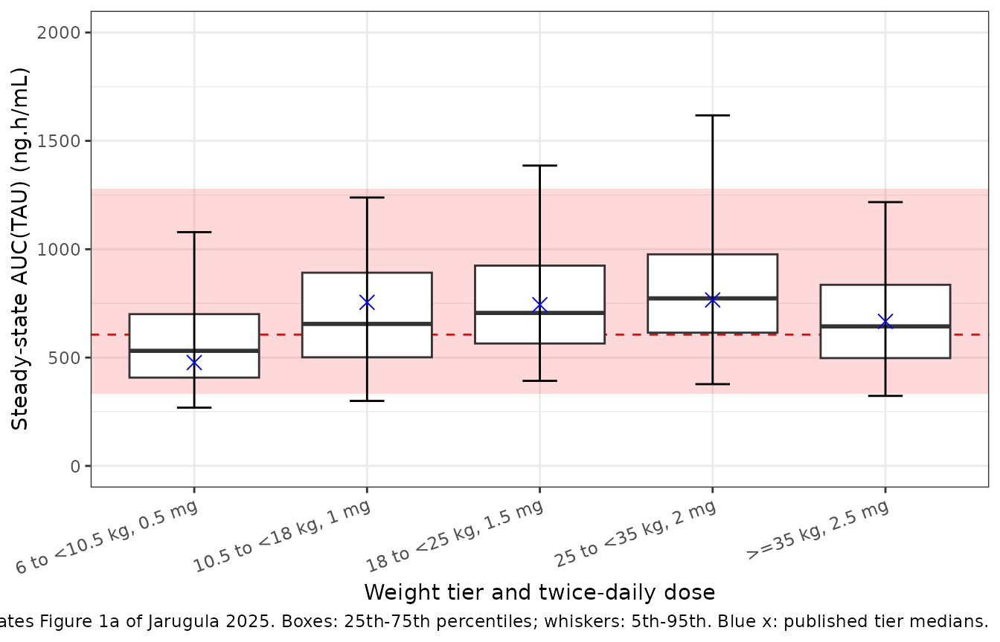
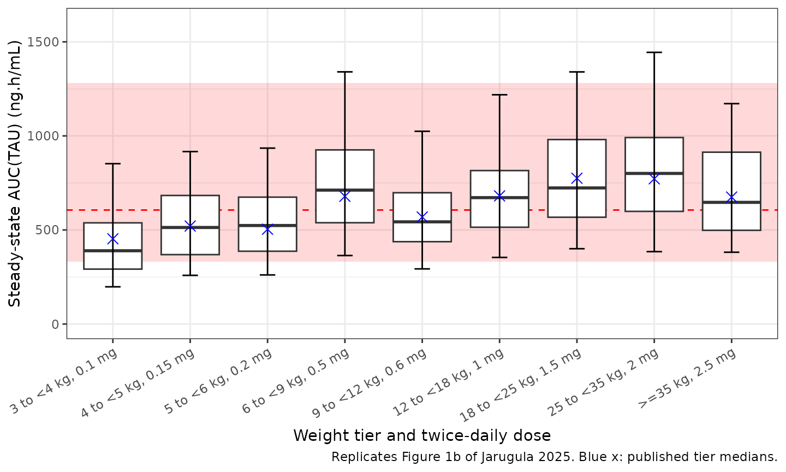
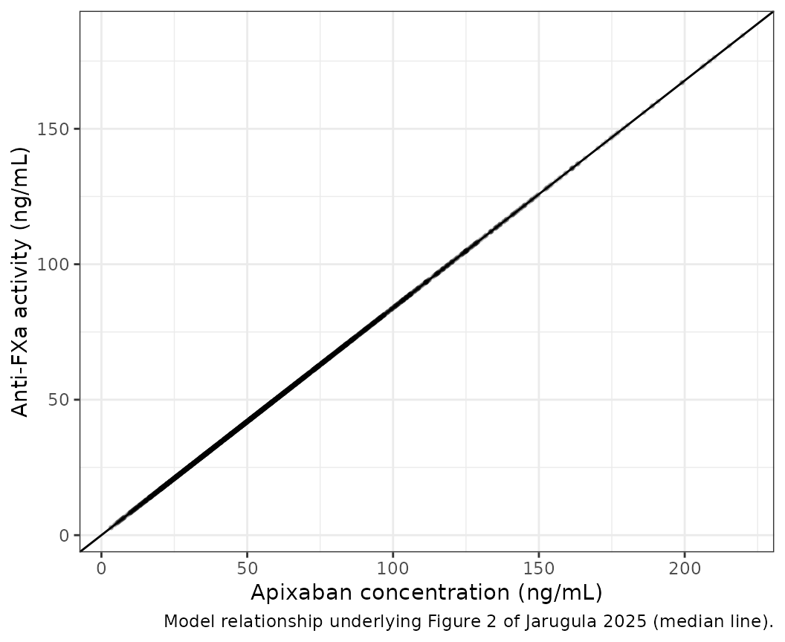

# Apixaban (Jarugula 2025)

## Model and source

- Citation: Jarugula P, Ajavon-Hartmann T, Obianom O, Ludwig E, Crevar
  C, Marchisin D, Wang Z, Chen W, He B, Mitchell LG, Rodriguez V, Lew G,
  Perera V, Murthy B, Merali S. Modeling and Simulation to Inform
  Apixaban Dosing in Pediatrics With Acute Lymphoblastic Leukemia or
  Lymphoblastic Lymphoma Treated With Asparaginase. Clin Pharmacol Ther.
  2025;118(2):355-364. <doi:10.1002/cpt.3616>
- Description: Population PK model for oral apixaban in adults and
  pediatric patients, including children with acute lymphoblastic
  leukemia or lymphoblastic lymphoma treated with asparaginase
  (PREVAPIX) (Jarugula 2025): two-compartment with first-order
  absorption and elimination, dose-dependent relative bioavailability,
  body-weight power effects on CL/F and Vc/F, a fixed literature CYP
  maturation function on CL/F, age on Q/F, a 9-month-to-18-year
  age-group effect on ka and patient-type (ALL/LL) effects on ka and
  Vc/F, with a zero-intercept linear PK/PD relationship to anti-factor
  Xa activity.
- Article: <https://doi.org/10.1002/cpt.3616> (open access, PMC12272317)
- Supplement: Data S1 of the article (methods, AXA summary tables,
  goodness-of-fit and pcVPC figures, and the final NONMEM control
  stream)

Jarugula 2025 updated an earlier pediatric apixaban population PK model
with the sparse PK data of the phase III PREVAPIX trial (children with
newly diagnosed acute lymphoblastic leukemia or lymphoblastic lymphoma
receiving asparaginase during induction), then used it to check the
trial’s fixed-dose weight-tiered regimen against adult exposure and to
propose a regimen down to 28 days of age. A zero-intercept linear
regression relates anti-factor Xa activity (AXA) to apixaban
concentration.

## Population

The final dataset held 5651 apixaban concentrations from 478 patients:
198 adults from eight adult studies, 56 pediatric patients at risk of
venous or arterial thromboembolism from two phase I studies (CV185079,
CV185118) and 224 PREVAPIX patients (431 concentrations). Table 1 of the
paper describes the 280 pediatric patients: age 0.044 to 18 years
(median 6.29), baseline weight 3 to 121 kg (median 22.6), 45.4% female,
75.7% White, 8.57% Asian and 6.79% Black. The PREVAPIX patients were
1.94 to 18 years and 11.5 to 121 kg, all in the 10.5 kg and heavier
weight tiers. Adult demographics are not reported in this paper. The
PK/PD analysis used 151 AXA values from 130 PREVAPIX patients
(Diagnostica Stago anti-Xa apixaban assay, apixaban-calibrated, ng/mL).

The same information is available programmatically via
`readModelDb("Jarugula_2025_apixaban")()$population`.

## Source trace

Each `ini()` entry carries an in-file comment naming its source. The
table collects them. The functional forms come from the
parameter-covariate equations under Table 2 and from the final NONMEM
control stream in Data S1.

| Equation / parameter | Value | Source location |
|----|----|----|
| `lka` (adult ka) | log(0.527) 1/h | Table 2, theta1 |
| `lcl` (CL/F, 67.4 kg, mature) | log(4.70) L/h | Table 2, theta2 |
| `lvc` (Vc/F, 67.4 kg) | log(32.7) L | Table 2, theta3 |
| `lq` (Q/F, 25 years) | log(1.45) L/h | Table 2, theta4 |
| `lvp` (Vp/F) | log(21.0) L | Table 2, theta5 |
| `lgamma` (F1 dose shape) | log(0.889) | Table 2, theta6 |
| `logitifdepot50` (logit max F1 reduction) | -0.461 | Table 2, theta7 |
| `e_wt_vc` | 0.840 | Table 2, theta8 |
| `e_wt_cl` | 0.669 | Table 2, theta9 |
| `e_age_q` | 0.719 | Table 2, theta10 |
| `e_ped9m_ka` | 1.53 | Table 2, theta11 |
| `lhill` (ontogeny shape) | log(0.83), fixed | Table 2, theta12 |
| `lpna50` (ontogeny AGE50) | log(0.244) years, fixed | Table 2, theta13 |
| `e_form_capsule_fdepot` | 1.1, fixed | Table 2, theta14 |
| `fbirth_cl` | 0.05, fixed | Table 2, theta15 |
| `e_dis_all_ka` | -1.67 | Table 2, theta16 |
| `e_dis_all_vc` | -0.564 | Table 2, theta17 |
| `etalka` | 0.364 | Table 2, ZKA |
| `etalcl`, `etalvc`, covariance | 0.158, 0.0766, 0.101 | Table 2, ZCL, ZVC, ZVC:ZCL |
| `etalvp`, `etalq`, covariance | 1.21, 0.880, 0.915 | Table 2, ZVP, ZQ, omega 5,4 (printed ‘ZVC:ZVP’; footnote r = 0.887 for ZQ:ZVP) |
| `expSd` | 0.316 | Table 2, sigma 1,1 = 0.0997 (SD 0.316), additive on log concentration |
| `lslope_antiFXa` | log(0.839) | Table 4, slope |
| `addSd_antiFXa` | 0, fixed | not reported (see Assumptions) |
| ka equation | `theta1 * (1 + PED9M * theta11) * exp(theta16 * PTYPE)` | Table 2 equations; Data S1 `TVKA` |
| CL/F equation incl. ontogeny | `theta2 * (WT/67.4)^theta9 * (FBirth + (1 - FBirth) * AGE^theta12 / (AGE^theta12 + theta13^theta12))` | Table 2 equations; Data S1 `CLHMAT`, `TVCL` |
| Vc/F, Q/F, Vp/F equations | see model file | Table 2 equations; Data S1 `TVV2`, `TVQ`, `TVV3` |
| F1 equation | 1 for dose \<= 2.5 mg, else `1 - expit(theta7) * ((DOSE - 2.5)/47.5)^theta6`; times 1.1 for sprinkle capsule | Table 2 equations; Data S1 `F1`, `FFORM` |
| `Cc = 1000 * central / vc` | ng/mL | Data S1 `S2=V2/1000` |
| `antiFXa = slope * Cc` | ng/mL | Methods (PK/PD analysis); Table 4 |
| Residual `Cc ~ lnorm(expSd)` | n/a | Results; Data S1 `$ERROR` (`IPRED=LOG(F)`, `Y=IPRED+EPS(1)`) |

The control-stream `$THETA` block in Data S1 carries the initial values
of the final run (for example theta16 = -1.56 and theta17 = -0.466); the
model uses the final estimates of Table 2.

## Typical-value checks

The Results quote derived typical values that pin the covariate
structure: ka of 0.527, 1.33 and 0.251 1/h for adults, other children
aged 9 months to \<18 years and children with ALL/LL respectively (52.4%
and 81.1% lower for ALL/LL), and Vc/F of 18.6 L for a 67.4-kg ALL/LL
patient versus 32.7 L for an adult (43.1% lower). Table 2’s footnote
gives the IIV correlations 0.916 and 0.887. These follow from the
parameters without any randomness, so they are checked tightly.

``` r

mod <- readModelDb("Jarugula_2025_apixaban")
mod_typ <- rxode2::zeroRe(mod)
#> ℹ parameter labels from comments will be replaced by 'label()'

typ_cov <- tibble::tibble(
  id = 1:3,
  group = c("Adult", "Pediatric other, 9 mo to <18 y", "Pediatric ALL/LL"),
  WT = 67.4,
  AGE = c(25, 10, 10),
  DIS_ALL = c(0, 0, 1),
  DOSE_APIXABAN_MG = 2.5,
  FORM_CAPSULE = 0
)
typ_ev <- dplyr::bind_rows(
  typ_cov |> dplyr::mutate(time = 0, amt = 2.5, evid = 1L, cmt = "depot", dvid = NA_integer_),
  typ_cov |> dplyr::mutate(time = 1, amt = 0, evid = 0L, cmt = "central", dvid = 1L)
) |>
  dplyr::arrange(id, time, dplyr::desc(evid))

typ <- rxode2::rxSolve(mod_typ, typ_ev, keep = "group", returnType = "data.frame") |>
  dplyr::distinct(id, .keep_all = TRUE) |>
  dplyr::select(group, ka, vc, cl)
#> ℹ omega/sigma items treated as zero: 'etalka', 'etalcl', 'etalvc', 'etalvp', 'etalq'
#> Warning: multi-subject simulation without without 'omega'

typ |>
  dplyr::rename("Group" = group, "ka (1/h)" = ka, "Vc/F (L)" = vc, "CL/F (L/h)" = cl) |>
  knitr::kable(digits = 3, caption = "Typical values for a 67.4-kg patient.")
```

| Group                           | ka (1/h) | Vc/F (L) | CL/F (L/h) |
|:--------------------------------|---------:|---------:|-----------:|
| Adult                           |    0.527 |   32.700 |      4.606 |
| Pediatric other, 9 mo to \<18 y |    1.333 |   32.700 |      4.504 |
| Pediatric ALL/LL                |    0.251 |   18.604 |      4.504 |

Typical values for a 67.4-kg patient. {.table}

``` r


ka_adult <- typ$ka[1]
ka_other <- typ$ka[2]
ka_all <- typ$ka[3]
vc_all <- typ$vc[3]

omega <- rxode2::rxode2(mod)$omega
#> ℹ parameter labels from comments will be replaced by 'label()'
r_cl_vc <- omega["etalcl", "etalvc"] / sqrt(omega["etalcl", "etalcl"] * omega["etalvc", "etalvc"])
r_vp_q <- omega["etalvp", "etalq"] / sqrt(omega["etalvp", "etalvp"] * omega["etalq", "etalq"])

stopifnot(
  abs(ka_adult - 0.527) < 5e-4,
  abs(ka_other - 1.33) < 5e-3,
  abs(ka_all - 0.251) < 5e-4,
  abs(vc_all - 18.6) < 0.05,
  abs(100 * (1 - ka_all / ka_adult) - 52.4) < 0.1,
  abs(100 * (1 - ka_all / ka_other) - 81.1) < 0.1,
  abs(100 * (1 - vc_all / 32.7) - 43.1) < 0.1,
  # The footnote correlations come from unrounded estimates; recomputed from
  # the three-significant-figure Table 2 entries they are 0.918 and 0.887.
  abs(r_cl_vc - 0.916) < 0.005,
  abs(r_vp_q - 0.887) < 0.005
)
```

## Virtual cohort

The paper simulated about 5000 virtual patients, drawing age within an
age group, sex with equal probability, and weight from the CDC growth
chart, then grouping patients by weight tier. The cohorts below keep 200
patients per tier: for each tier, age is drawn uniformly over the ages
at which the CDC 2000 sex-averaged median weight falls inside the tier,
and weight is the CDC median for that age with 12% lognormal scatter; a
weight that falls outside the tier is redrawn uniformly within it. All
virtual patients have ALL/LL (`DIS_ALL = 1`), as in the paper.

``` r

# CDC 2000 50th-percentile weight-for-age, sexes averaged. Reference data for
# building the virtual cohort only, not a model parameter.
cdc_age_yr <- c(0, 1, 2, 3, 4, 6, 9, 12, 18, 24) / 12
cdc_wt_kg <- c(3.4, 4.4, 5.5, 6.3, 7.0, 7.9, 9.0, 9.9, 11.3, 12.5)
cdc_age_yr <- c(cdc_age_yr, 3:18)
cdc_wt_kg <- c(
  cdc_wt_kg, 14.3, 16.3, 18.3, 20.7, 23.2, 26.0, 29.2, 32.7,
  36.7, 41.3, 46.0, 50.6, 54.6, 58.0, 60.6, 62.6
)
cdc_weight_for_age <- function(age_yr) {
  stats::approx(cdc_age_yr, cdc_wt_kg, xout = age_yr, rule = 2)$y
}
cdc_age_for_weight <- function(wt_kg) {
  stats::approx(cdc_wt_kg, cdc_age_yr, xout = wt_kg, rule = 2)$y
}

n_per_tier <- 200L

# One cohort per weight tier; ages restricted to [age_min, age_max).
make_tier <- function(tier, wt_lo, wt_hi, dose, age_min, age_max, id_offset) {
  a_lo <- max(age_min, cdc_age_for_weight(wt_lo))
  a_hi <- min(age_max, cdc_age_for_weight(min(wt_hi, 70)))
  if (a_hi <= a_lo + 1 / 12) a_hi <- a_lo + 1 / 12
  age <- stats::runif(n_per_tier, a_lo, a_hi)
  wt <- cdc_weight_for_age(age) * exp(stats::rnorm(n_per_tier, 0, 0.12))
  # Where the CDC median lies outside the tier (the lightest tiers), clamping
  # would pile patients on one edge; redraw those uniformly inside the tier.
  out <- wt < wt_lo | wt >= wt_hi
  wt[out] <- stats::runif(sum(out), wt_lo, wt_hi)
  tibble::tibble(
    id = id_offset + seq_len(n_per_tier),
    tier = tier,
    WT = wt,
    AGE = age,
    DIS_ALL = 1,
    FORM_CAPSULE = 0,
    DOSE_APIXABAN_MG = dose
  )
}

# PREVAPIX regimen (Results, PPK model simulations): ages 1 to <18 years.
prevapix_tiers <- tibble::tribble(
  ~tier,                  ~wt_lo, ~wt_hi, ~dose,
  "6 to <10.5 kg, 0.5 mg",   6.0,   10.5,  0.5,
  "10.5 to <18 kg, 1 mg",   10.5,   18.0,  1.0,
  "18 to <25 kg, 1.5 mg",   18.0,   25.0,  1.5,
  "25 to <35 kg, 2 mg",     25.0,   35.0,  2.0,
  ">=35 kg, 2.5 mg",        35.0,  121.0,  2.5
)

set.seed(20250430)
cohort_a <- dplyr::bind_rows(lapply(seq_len(nrow(prevapix_tiers)), function(i) {
  r <- prevapix_tiers[i, ]
  make_tier(r$tier, r$wt_lo, r$wt_hi, r$dose,
    age_min = 1, age_max = 18, id_offset = (i - 1L) * n_per_tier
  )
}))
cohort_a$tier <- factor(cohort_a$tier, levels = prevapix_tiers$tier)
stopifnot(!anyDuplicated(cohort_a$id))

cohort_a |>
  dplyr::group_by(tier) |>
  dplyr::summarise(
    n = dplyr::n(),
    `median age (y)` = median(AGE),
    `median WT (kg)` = median(WT),
    .groups = "drop"
  ) |>
  knitr::kable(digits = 1, caption = "Virtual PREVAPIX-regimen cohort (ages 1 to <18 years).")
```

| tier                   |   n | median age (y) | median WT (kg) |
|:-----------------------|----:|---------------:|---------------:|
| 6 to \<10.5 kg, 0.5 mg | 200 |            1.1 |            9.1 |
| 10.5 to \<18 kg, 1 mg  | 200 |            2.9 |           14.2 |
| 18 to \<25 kg, 1.5 mg  | 200 |            6.2 |           21.4 |
| 25 to \<35 kg, 2 mg    | 200 |            9.1 |           29.8 |
| \>=35 kg, 2.5 mg       | 200 |           14.3 |           52.7 |

Virtual PREVAPIX-regimen cohort (ages 1 to \<18 years). {.table}

## Simulation

Twice-daily dosing is simulated directly at steady state (`ss = 1`,
`ii = 12`) with observations every 0.25 h over one dosing interval.

``` r

tau <- 12
obs_grid <- seq(0, tau, by = 0.25)

events_a <- dplyr::bind_rows(
  cohort_a |>
    dplyr::mutate(
      time = 0, amt = DOSE_APIXABAN_MG, evid = 1L, cmt = "depot",
      dvid = NA_integer_, ss = 1L, ii = tau
    ),
  cohort_a |>
    tidyr::crossing(time = obs_grid) |>
    dplyr::mutate(amt = 0, evid = 0L, cmt = "central", dvid = 1L, ss = 0L, ii = 0)
) |>
  dplyr::arrange(id, time, dplyr::desc(evid))

rxode2::rxSetSeed(20250430)
sim_a <- rxode2::rxSolve(
  mod, events_a,
  keep = c("tier", "DOSE_APIXABAN_MG"),
  maxsteps = 500000L,
  returnType = "data.frame"
)
#> ℹ parameter labels from comments will be replaced by 'label()'
# A solver failure would drop subjects silently through the PKNCA filter below.
stopifnot(!anyNA(sim_a$Cc), dplyr::n_distinct(sim_a$id) == nrow(cohort_a))
```

## Replicate published figures

### Figure 1a: steady-state AUC by weight tier, PREVAPIX regimen

``` r

sim_nca <- sim_a |>
  dplyr::filter(!is.na(Cc)) |>
  dplyr::select(id, time, Cc, antiFXa, tier)

dose_df <- events_a |>
  dplyr::filter(evid == 1L) |>
  dplyr::select(id, time, amt, tier)

intervals <- data.frame(
  start = 0, end = tau,
  auclast = TRUE, cmax = TRUE, cmin = TRUE, tmax = TRUE
)

conc_obj <- PKNCA::PKNCAconc(sim_nca, Cc ~ time | tier + id)
dose_obj <- PKNCA::PKNCAdose(dose_df, amt ~ time | tier + id)
nca_res <- PKNCA::pk.nca(PKNCA::PKNCAdata(conc_obj, dose_obj, intervals = intervals))

nca_wide <- as.data.frame(nca_res) |>
  dplyr::select(id, tier, PPTESTCD, PPORRES) |>
  tidyr::pivot_wider(names_from = PPTESTCD, values_from = PPORRES)

# Steady-state AUCtau equals F * dose / CL for the same drawn parameters; the
# only difference is trapezoidal error on the 0.25-h grid.
cl_by_id <- sim_a |>
  dplyr::distinct(id, .keep_all = TRUE) |>
  dplyr::transmute(id, auc_closed = 1000 * DOSE_APIXABAN_MG / cl)
auc_chk <- dplyr::inner_join(nca_wide, cl_by_id, by = "id") |>
  dplyr::mutate(pct_diff = 100 * (auclast / auc_closed - 1))
stopifnot(
  abs(median(auc_chk$pct_diff)) < 1,
  quantile(abs(auc_chk$pct_diff), 0.9) < 3
)
```

``` r

# Replicates Figure 1a of Jarugula 2025: steady-state AUC(TAU) by weight tier
# against the adult VTEp reference (median 606, 95% CI 332-1280 ng.h/mL).
fig1a_published <- tibble::tibble(
  tier = factor(prevapix_tiers$tier, levels = prevapix_tiers$tier),
  published = c(477, 755, 744, 766, 667)
)

ggplot(nca_wide, aes(tier, auclast)) +
  annotate("rect", xmin = -Inf, xmax = Inf, ymin = 332, ymax = 1280, alpha = 0.15, fill = "red") +
  geom_hline(yintercept = 606, linetype = "dashed", colour = "red") +
  geom_boxplot(outlier.shape = NA, coef = 0) +
  stat_summary(
    fun.data = function(y) {
      data.frame(ymin = quantile(y, 0.05), ymax = quantile(y, 0.95))
    },
    geom = "errorbar", width = 0.2
  ) +
  geom_point(data = fig1a_published, aes(tier, published), shape = 4, size = 3, colour = "blue") +
  coord_cartesian(ylim = c(0, 2000)) +
  labs(
    x = "Weight tier and twice-daily dose",
    y = "Steady-state AUC(TAU) (ng.h/mL)",
    caption = paste(
      "Replicates Figure 1a of Jarugula 2025. Boxes: 25th-75th percentiles;",
      "whiskers: 5th-95th. Blue x: published tier medians."
    )
  ) +
  theme_bw() +
  theme(axis.text.x = element_text(angle = 20, hjust = 1))
```



### Comparison against published values

Figure 1a reports the median simulated steady-state AUC(TAU) per weight
tier. Table 3 reports geometric means of the individual (Bayesian)
estimates for the PREVAPIX patients themselves.
[`ncaComparisonTable()`](https://nlmixr2.github.io/nlmixr2lib/reference/ncaComparisonTable.md)
compares the simulated medians with both.

``` r

published <- tibble::tribble(
  ~tier,                   ~auclast, ~cmax, ~cmin, ~tmax,
  "6 to <10.5 kg, 0.5 mg",     477,     NA,    NA,    NA,
  "10.5 to <18 kg, 1 mg",      755,   64.0,  14.2,  2.82,
  "18 to <25 kg, 1.5 mg",      744,   72.0,  13.2,  2.71,
  "25 to <35 kg, 2 mg",        766,   76.4,  20.0,  3.01,
  ">=35 kg, 2.5 mg",           667,   68.7,  20.9,  3.17
)

cmp <- nlmixr2lib::ncaComparisonTable(
  simulated = nca_res,
  reference = published,
  by = "tier",
  units = c(auclast = "ng.h/mL", cmax = "ng/mL", cmin = "ng/mL", tmax = "h"),
  tolerance_pct = 20
)
knitr::kable(
  cmp,
  caption = paste(
    "Simulated (median) vs published. AUC reference: Figure 1a simulated medians;",
    "Cmax, Cmin, Tmax reference: Table 3 geometric means of PREVAPIX individual",
    "estimates. * differs from reference by >20%."
  )
)
```

| NCA parameter     | tier                   | Reference | Simulated | % diff    |
|:------------------|:-----------------------|:----------|:----------|:----------|
| Cmax (ng/mL)      | 6 to \<10.5 kg, 0.5 mg | —         | 66.3      | —         |
| Cmax (ng/mL)      | 10.5 to \<18 kg, 1 mg  | 64        | 79.7      | +24.5%\*  |
| Cmax (ng/mL)      | 18 to \<25 kg, 1.5 mg  | 72        | 84.9      | +18.0%    |
| Cmax (ng/mL)      | 25 to \<35 kg, 2 mg    | 76.4      | 85.6      | +12.0%    |
| Cmax (ng/mL)      | \>=35 kg, 2.5 mg       | 68.7      | 77.1      | +12.2%    |
| Cmin (ng/mL)      | 6 to \<10.5 kg, 0.5 mg | —         | 22.4      | —         |
| Cmin (ng/mL)      | 10.5 to \<18 kg, 1 mg  | 14.2      | 26.1      | +83.6%\*  |
| Cmin (ng/mL)      | 18 to \<25 kg, 1.5 mg  | 13.2      | 32.3      | +144.8%\* |
| Cmin (ng/mL)      | 25 to \<35 kg, 2 mg    | 20        | 37.3      | +86.3%\*  |
| Cmin (ng/mL)      | \>=35 kg, 2.5 mg       | 20.9      | 27.7      | +32.7%\*  |
| Tmax (h)          | 6 to \<10.5 kg, 0.5 mg | —         | 3         | —         |
| Tmax (h)          | 10.5 to \<18 kg, 1 mg  | 2.82      | 3         | +6.4%     |
| Tmax (h)          | 18 to \<25 kg, 1.5 mg  | 2.71      | 3         | +10.7%    |
| Tmax (h)          | 25 to \<35 kg, 2 mg    | 3.01      | 3         | -0.3%     |
| Tmax (h)          | \>=35 kg, 2.5 mg       | 3.17      | 3         | -5.4%     |
| AUClast (ng.h/mL) | 6 to \<10.5 kg, 0.5 mg | 477       | 531       | +11.3%    |
| AUClast (ng.h/mL) | 10.5 to \<18 kg, 1 mg  | 755       | 655       | -13.2%    |
| AUClast (ng.h/mL) | 18 to \<25 kg, 1.5 mg  | 744       | 706       | -5.1%     |
| AUClast (ng.h/mL) | 25 to \<35 kg, 2 mg    | 766       | 773       | +0.9%     |
| AUClast (ng.h/mL) | \>=35 kg, 2.5 mg       | 667       | 644       | -3.5%     |

Simulated (median) vs published. AUC reference: Figure 1a simulated
medians; Cmax, Cmin, Tmax reference: Table 3 geometric means of PREVAPIX
individual estimates. \* differs from reference by \>20%. {.table
style="width:100%;"}

The simulated AUC(TAU) reproduces Figure 1a. Simulated Cmax is roughly
10-25% and Cmin roughly 30-150% above the Table 3 geometric means. Table
3 is not internally consistent on this point: solving the same
two-compartment model at steady state with Table 3’s own geometric-mean
ka, CL/F, Vc/F, Q/F and Vp/F gives the peaks and troughs below, which
agree with the simulation rather than with Table 3’s Cmax and Cmin
columns. The Table 3 Cmin values carry CVs of 61-151%, so their
geometric means are dominated by a long lower tail of individual
estimates and are not the trough of the typical patient. The Cmax and
Cmin rows are therefore not gated; AUC is.

``` r

# Table 3 geometric means of the PREVAPIX individual estimates, by weight tier.
t3 <- tibble::tibble(
  id = 1:4,
  tier = prevapix_tiers$tier[2:5],
  ka = c(0.248, 0.27, 0.242, 0.261),
  cl = c(1.61, 2.16, 2.7, 3.85),
  vc = c(5.43, 7.28, 9.58, 15.6),
  q = c(0.386, 0.568, 0.621, 1),
  vp = c(23.4, 25, 20.5, 23.5),
  dose = c(1, 1.5, 2, 2.5),
  cmax_t3 = c(64, 72, 76.4, 68.7),
  cmin_t3 = c(14.2, 13.2, 20, 20.9)
)
two_cmt <- rxode2::rxode2({
  d/dt(depot) <- -ka * depot
  d/dt(central) <- ka * depot - cl / vc * central - q / vc * central + q / vp * peripheral1
  d/dt(peripheral1) <- q / vc * central - q / vp * peripheral1
  Cc <- 1000 * central / vc
})
t3_ev <- dplyr::bind_rows(
  t3 |> dplyr::transmute(id, time = 0, amt = dose, evid = 1L, ss = 1L, ii = tau),
  t3 |> dplyr::select(id) |> tidyr::crossing(time = obs_grid) |>
    dplyr::mutate(amt = 0, evid = 0L, ss = 0L, ii = 0)
) |>
  dplyr::arrange(id, time, dplyr::desc(evid))
t3_sim <- rxode2::rxSolve(two_cmt, t3_ev,
  params = t3 |> dplyr::select(id, ka, cl, vc, q, vp),
  returnType = "data.frame"
)
t3_sim |>
  dplyr::group_by(id) |>
  dplyr::summarise(cmax_calc = max(Cc), cmin_calc = min(Cc), .groups = "drop") |>
  dplyr::inner_join(t3, by = "id") |>
  dplyr::select(tier, cmax_calc, cmax_t3, cmin_calc, cmin_t3) |>
  dplyr::rename(
    "Weight tier" = tier,
    "Cmax,ss from Table 3 parameters" = cmax_calc, "Cmax,ss Table 3" = cmax_t3,
    "Cmin,ss from Table 3 parameters" = cmin_calc, "Cmin,ss Table 3" = cmin_t3
  ) |>
  knitr::kable(digits = 1, caption = "Steady-state peak and trough (ng/mL) implied by the Table 3 geometric-mean parameters.")
```

| Weight tier | Cmax,ss from Table 3 parameters | Cmax,ss Table 3 | Cmin,ss from Table 3 parameters | Cmin,ss Table 3 |
|:---|---:|---:|---:|---:|
| 10.5 to \<18 kg, 1 mg | 72.8 | 64.0 | 25.8 | 14.2 |
| 18 to \<25 kg, 1.5 mg | 83.3 | 72.0 | 27.7 | 13.2 |
| 25 to \<35 kg, 2 mg | 85.2 | 76.4 | 31.9 | 20.0 |
| \>=35 kg, 2.5 mg | 73.6 | 68.7 | 28.8 | 20.9 |

Steady-state peak and trough (ng/mL) implied by the Table 3
geometric-mean parameters. {.table style="width:100%;"}

``` r

auc_med <- nca_wide |>
  dplyr::group_by(tier) |>
  dplyr::summarise(sim = median(auclast), .groups = "drop") |>
  dplyr::inner_join(fig1a_published, by = "tier") |>
  dplyr::mutate(pct_diff = 100 * (sim / published - 1))
auc_med |>
  dplyr::rename("Weight tier" = tier, "Simulated median" = sim, "Figure 1a median" = published, "% difference" = pct_diff) |>
  knitr::kable(digits = 1, caption = "Steady-state AUC(TAU) medians (ng.h/mL).")
```

| Weight tier            | Simulated median | Figure 1a median | % difference |
|:-----------------------|-----------------:|-----------------:|-------------:|
| 6 to \<10.5 kg, 0.5 mg |            531.1 |              477 |         11.3 |
| 10.5 to \<18 kg, 1 mg  |            655.3 |              755 |        -13.2 |
| 18 to \<25 kg, 1.5 mg  |            705.9 |              744 |         -5.1 |
| 25 to \<35 kg, 2 mg    |            773.1 |              766 |          0.9 |
| \>=35 kg, 2.5 mg       |            643.9 |              667 |         -3.5 |

Steady-state AUC(TAU) medians (ng.h/mL). {.table}

``` r


# A wrong clearance, weight exponent, maturation function or unit shifts every
# tier by tens of percent; the tier-to-tier spread reflects only how closely
# the CDC-based cohort reproduces the paper's age and weight sampling.
stopifnot(
  abs(median(auc_med$pct_diff)) < 15,
  all(abs(auc_med$pct_diff) < 30)
)
```

### Figure 1b: proposed regimen from 28 days of age

The proposed regimen is evaluated the same way the paper describes: the
steady-state AUC(TAU) of each virtual patient is F x dose / CL. Every
dose in this regimen is at or below 2.5 mg, so F is 1, and one
observation row per patient is enough to read the individual clearance.

``` r

proposed_tiers <- tibble::tribble(
  ~tier,                   ~wt_lo, ~wt_hi, ~dose,
  "3 to <4 kg, 0.1 mg",       3.0,    4.0,  0.10,
  "4 to <5 kg, 0.15 mg",      4.0,    5.0,  0.15,
  "5 to <6 kg, 0.2 mg",       5.0,    6.0,  0.20,
  "6 to <9 kg, 0.5 mg",       6.0,    9.0,  0.50,
  "9 to <12 kg, 0.6 mg",      9.0,   12.0,  0.60,
  "12 to <18 kg, 1 mg",      12.0,   18.0,  1.00,
  "18 to <25 kg, 1.5 mg",    18.0,   25.0,  1.50,
  "25 to <35 kg, 2 mg",      25.0,   35.0,  2.00,
  ">=35 kg, 2.5 mg",         35.0,  121.0,  2.50
)

set.seed(20250501)
cohort_b <- dplyr::bind_rows(lapply(seq_len(nrow(proposed_tiers)), function(i) {
  r <- proposed_tiers[i, ]
  make_tier(r$tier, r$wt_lo, r$wt_hi, r$dose,
    age_min = 28 / 365.25, age_max = 18, id_offset = (i - 1L) * n_per_tier
  )
}))
cohort_b$tier <- factor(cohort_b$tier, levels = proposed_tiers$tier)
stopifnot(!anyDuplicated(cohort_b$id))

events_b <- dplyr::bind_rows(
  cohort_b |> dplyr::mutate(time = 0, amt = DOSE_APIXABAN_MG, evid = 1L, cmt = "depot", dvid = NA_integer_),
  cohort_b |> dplyr::mutate(time = 1, amt = 0, evid = 0L, cmt = "central", dvid = 1L)
) |>
  dplyr::arrange(id, time, dplyr::desc(evid))

rxode2::rxSetSeed(20250501)
sim_b <- rxode2::rxSolve(mod, events_b, keep = c("tier", "DOSE_APIXABAN_MG"), returnType = "data.frame") |>
  dplyr::mutate(auc_ss = 1000 * DOSE_APIXABAN_MG / cl)

fig1b_published <- tibble::tibble(
  tier = factor(proposed_tiers$tier, levels = proposed_tiers$tier),
  published = c(453, 521, 504, 679, 569, 681, 775, 772, 675)
)

ggplot(sim_b, aes(tier, auc_ss)) +
  annotate("rect", xmin = -Inf, xmax = Inf, ymin = 332, ymax = 1280, alpha = 0.15, fill = "red") +
  geom_hline(yintercept = 606, linetype = "dashed", colour = "red") +
  geom_boxplot(outlier.shape = NA, coef = 0) +
  stat_summary(
    fun.data = function(y) {
      data.frame(ymin = quantile(y, 0.05), ymax = quantile(y, 0.95))
    },
    geom = "errorbar", width = 0.2
  ) +
  geom_point(data = fig1b_published, aes(tier, published), shape = 4, size = 3, colour = "blue") +
  coord_cartesian(ylim = c(0, 1600)) +
  labs(
    x = "Weight tier and twice-daily dose",
    y = "Steady-state AUC(TAU) (ng.h/mL)",
    caption = "Replicates Figure 1b of Jarugula 2025. Blue x: published tier medians."
  ) +
  theme_bw() +
  theme(axis.text.x = element_text(angle = 30, hjust = 1))
```



``` r


auc_med_b <- sim_b |>
  dplyr::group_by(tier) |>
  dplyr::summarise(sim = median(auc_ss), .groups = "drop") |>
  dplyr::inner_join(fig1b_published, by = "tier") |>
  dplyr::mutate(pct_diff = 100 * (sim / published - 1))
auc_med_b |>
  dplyr::rename("Weight tier" = tier, "Simulated median" = sim, "Figure 1b median" = published, "% difference" = pct_diff) |>
  knitr::kable(digits = 1, caption = "Steady-state AUC(TAU) medians for the proposed regimen (ng.h/mL).")
```

| Weight tier           | Simulated median | Figure 1b median | % difference |
|:----------------------|-----------------:|-----------------:|-------------:|
| 3 to \<4 kg, 0.1 mg   |            389.5 |              453 |        -14.0 |
| 4 to \<5 kg, 0.15 mg  |            513.2 |              521 |         -1.5 |
| 5 to \<6 kg, 0.2 mg   |            523.7 |              504 |          3.9 |
| 6 to \<9 kg, 0.5 mg   |            711.8 |              679 |          4.8 |
| 9 to \<12 kg, 0.6 mg  |            543.2 |              569 |         -4.5 |
| 12 to \<18 kg, 1 mg   |            671.9 |              681 |         -1.3 |
| 18 to \<25 kg, 1.5 mg |            723.5 |              775 |         -6.7 |
| 25 to \<35 kg, 2 mg   |            800.5 |              772 |          3.7 |
| \>=35 kg, 2.5 mg      |            646.8 |              675 |         -4.2 |

Steady-state AUC(TAU) medians for the proposed regimen (ng.h/mL).
{.table}

``` r


stopifnot(
  abs(median(auc_med_b$pct_diff)) < 15,
  all(abs(auc_med_b$pct_diff) < 30)
)
```

### Figure 2 and Table 5: anti-factor Xa activity

The PK/PD model is a zero-intercept line, so the median predicted AXA at
the largest observed concentration of Figure 2 (about 233 ng/mL) is
0.839 x 233 = 196 ng/mL, the end point of the published median line.
Table 5 summarises the steady-state maximum AXA (slope x individual
Cmax,ss) of the 130 PREVAPIX patients in the PK/PD dataset.

``` r

ini_df <- rxode2::rxode2(mod)$iniDf
#> ℹ parameter labels from comments will be replaced by 'label()'
stopifnot(abs(exp(ini_df$est[ini_df$name == "lslope_antiFXa"]) * 233 - 196) < 1)

ggplot(sim_nca |> dplyr::slice_sample(n = 3000), aes(Cc, antiFXa)) +
  geom_point(alpha = 0.15, size = 0.6) +
  geom_abline(slope = 0.839, intercept = 0) +
  labs(
    x = "Apixaban concentration (ng/mL)", y = "Anti-FXa activity (ng/mL)",
    caption = "Model relationship underlying Figure 2 of Jarugula 2025 (median line)."
  ) +
  theme_bw()
```



``` r


conc_axa <- PKNCA::PKNCAconc(sim_nca, antiFXa ~ time | tier + id)
nca_axa <- PKNCA::pk.nca(PKNCA::PKNCAdata(conc_axa, dose_obj,
  intervals = data.frame(start = 0, end = tau, cmax = TRUE)
))
axa_tab <- as.data.frame(nca_axa) |>
  dplyr::filter(PPTESTCD == "cmax") |>
  dplyr::group_by(tier) |>
  dplyr::summarise(sim_gm = exp(mean(log(PPORRES))), .groups = "drop") |>
  dplyr::inner_join(
    tibble::tibble(
      tier = prevapix_tiers$tier[2:5],
      table5_gm = c(62.4, 63.7, 65.2, 66.7)
    ),
    by = "tier"
  )
axa_tab |>
  dplyr::rename("Weight tier" = tier, "Simulated geometric mean" = sim_gm, "Table 5 geometric mean" = table5_gm) |>
  knitr::kable(digits = 1, caption = "Steady-state maximum AXA (ng/mL).")
```

| Weight tier           | Simulated geometric mean | Table 5 geometric mean |
|:----------------------|-------------------------:|-----------------------:|
| 10.5 to \<18 kg, 1 mg |                     67.2 |                   62.4 |
| 18 to \<25 kg, 1.5 mg |                     70.8 |                   63.7 |
| 25 to \<35 kg, 2 mg   |                     75.3 |                   65.2 |
| \>=35 kg, 2.5 mg      |                     62.5 |                   66.7 |

Steady-state maximum AXA (ng/mL). {.table}

The simulated AXAmax is within about 20% of Table 5. The two are not
strictly comparable: Table 5 covers only the 130 patients with AXA above
the 35 ng/mL quantification limit and uses their individual Cmax,ss
estimates, while the simulation covers a virtual cohort of each whole
tier. The comparison is therefore descriptive and not gated.

## Assumptions and deviations

- **Patient-type covariate.** The paper’s indicator (`PTYPE_CAN` in the
  control stream, `PTYPE_ALL` in Table 2) is 1 for every PREVAPIX
  patient, so it covers acute lymphoblastic leukemia and lymphoblastic
  lymphoma together and is confounded with study. It is carried as
  `DIS_ALL`; the authors themselves note the ka and Vc/F effects may
  partly reflect between-study and sampling-design differences.
- **PED9M** is derived inside the model from `AGE` (1 for 9 months \<=
  age \<18 years). The source dataset carried it as a precomputed column
  (`PED4`).
- **Formulation.** The sprinkle-capsule relative bioavailability (1.1,
  fixed) is carried by the general capsule indicator `FORM_CAPSULE` (1 =
  sprinkle capsule); the reference is tablet or oral solution.
- **Dose-dependent bioavailability** reads the dose from the
  `DOSE_APIXABAN_MG` column, which must equal the event-table `amt` on
  the dose records.
- **Table 2 label.** The covariance printed as ‘ZVC:ZVP’ (omega 5,4) is
  the Vp/F-Q/F covariance: the omega indices, the footnote correlation
  for ‘ZQ:ZVP’ (0.887, reproduced above) and the `$OMEGA BLOCK(2)` on
  eta4 (V3) and eta5 (Q) in Data S1 all agree.
- **Table 2 units.** CL/F is printed in ‘L’; it is L/h.
- **AXA residual error.** The paper reports the slope and its standard
  error but not the residual variability of the regression, so
  `addSd_antiFXa` is fixed to 0. The 90% prediction band of Figure 2 is
  about +/-19 ng/mL wide, which suggests an additive SD near 11 to 12
  ng/mL; this is not encoded because it is not a reported estimate.
- **Virtual cohort.** Weight-for-age uses the CDC 2000 sex-averaged
  median with 12% lognormal scatter instead of sampling the full
  sex-specific CDC distribution, and ages are drawn within each weight
  tier rather than within the paper’s age groups. This mainly affects
  the age and weight mix inside a tier, and so the tier medians, by a
  few percent.
- **Cohort size.** 200 virtual patients per tier, against the paper’s at
  least 1000 per tier.
- **Adult reference.** The 606 ng.h/mL median (95% CI 332-1280) adult
  VTEp exposure is taken from the paper’s text (AMPLIFY-EXT); adults are
  not simulated here.
- No erratum or correction notice for this article was found as of
  2026-11-05.
