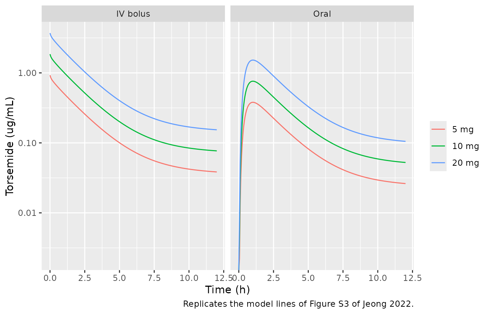
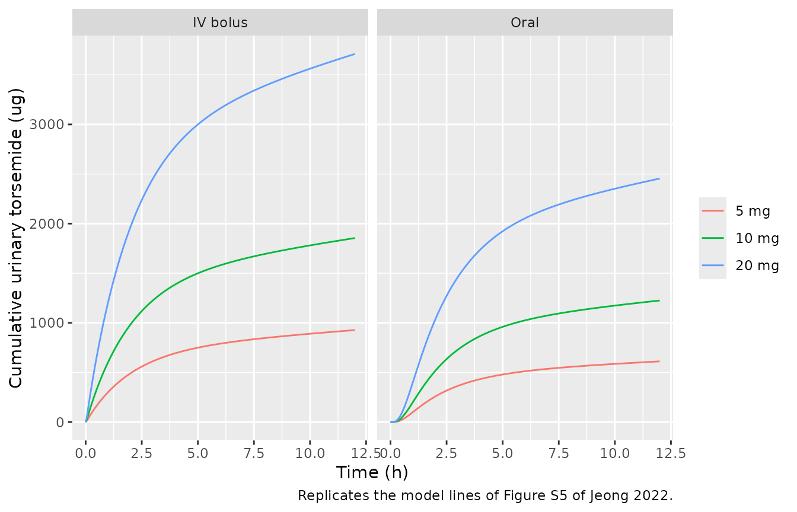
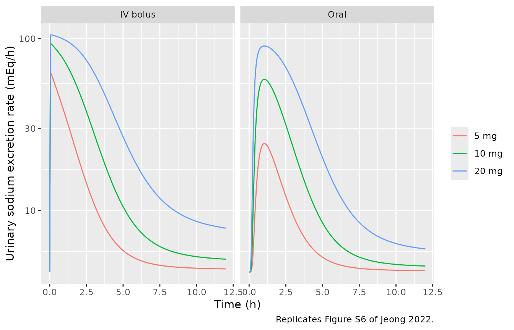
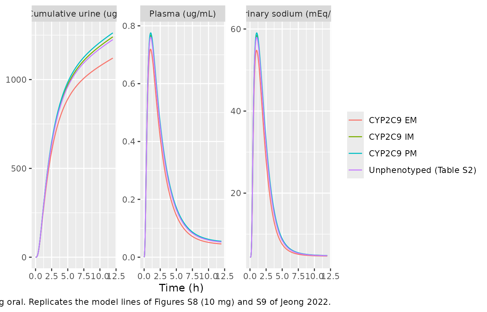
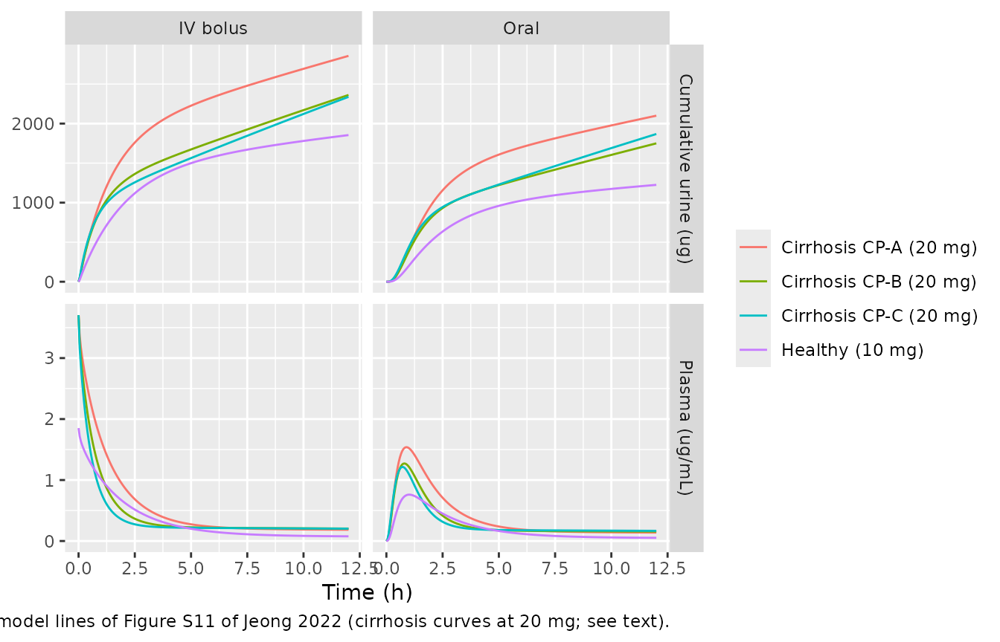
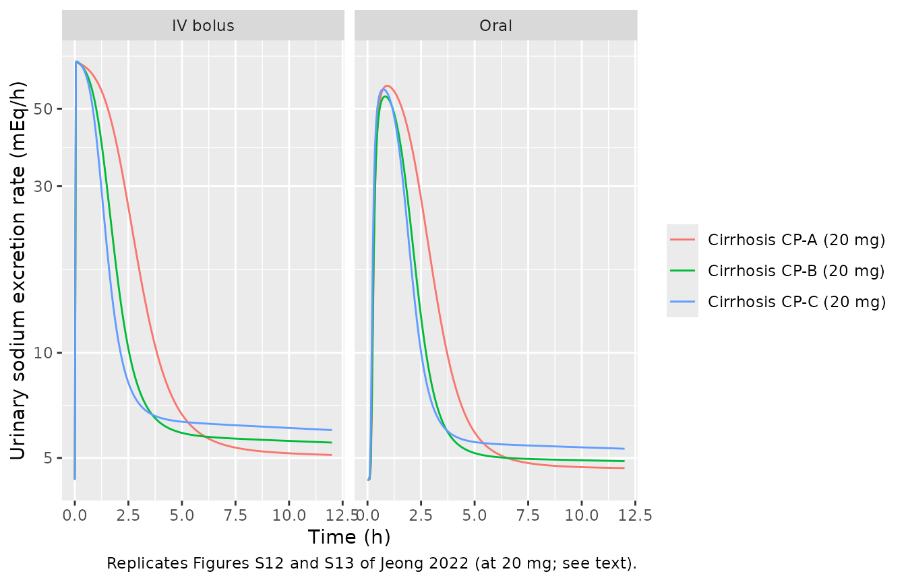
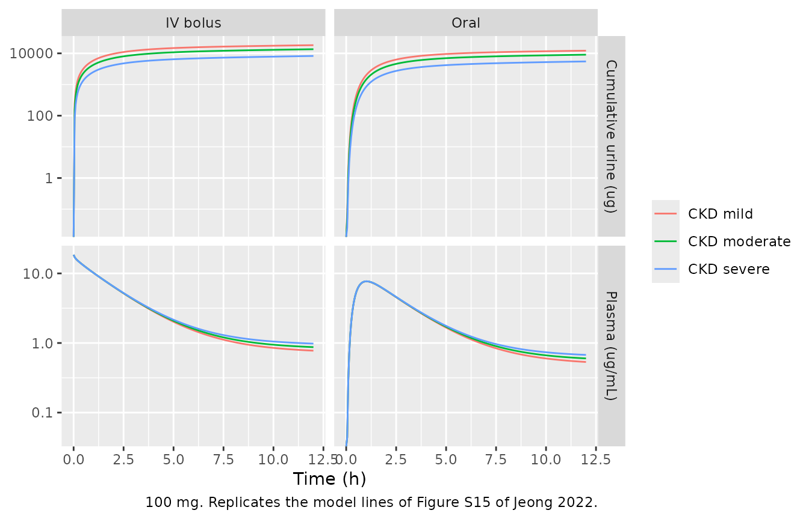
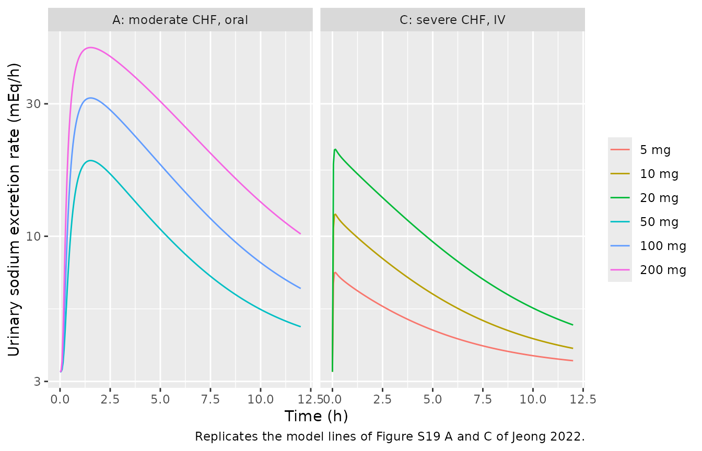
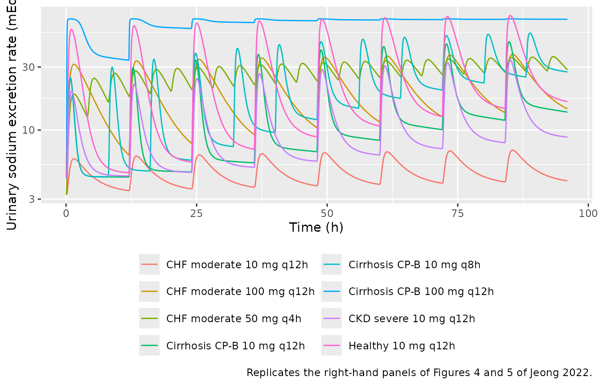

# Torsemide PBPK-PD in healthy adults, CYP2C9 phenotypes and patient groups (Jeong 2022)

## Model and source

- Citation: Jeong S-H, Jang J-H, Lee Y-B. Torsemide Pharmacometrics in
  Healthy Adult Populations Including CYP2C9 Genetic Polymorphisms and
  Various Patient Groups through Physiologically Based
  Pharmacokinetic-Pharmacodynamic Modeling. Pharmaceutics.
  2022;14(12):2720. <doi:10.3390/pharmaceutics14122720>

- Article: [Pharmaceutics
  2022;14(12):2720](https://doi.org/10.3390/pharmaceutics14122720) (open
  access; the supplement holds Tables S1-S3 and Figures S1-S21)

Jeong, Jang and Lee built a minimal physiologically based
pharmacokinetic-pharmacodynamic (PBPK-PD) model of the loop diuretic
torsemide in Berkeley Madonna. A single blood pool exchanges with the
lung, kidney, liver, GI-tract and the rest of the body. All of these
tissues sit in parallel, and the hepatic-vein outflow collects the
hepatic-artery and GI-tract flows. Each blood-tissue flow is multiplied
by the unbound fraction `Fr` and the plasma-to-blood-cell partition
ratio `Pr` (Appendix A).

An oral dose is absorbed first-order into the GI-tract tissue, which
also loses drug through a first-order GI elimination `Ke`. The liver
metabolises torsemide by Michaelis-Menten kinetics (CYP2C9), and the
kidney excretes it first-order into urine. The pharmacodynamic endpoint
is the urinary sodium excretion rate, a direct baseline sigmoid-Emax
function of the urinary torsemide excretion rate (Table 5).

The model was built from mean healthy-adult data. It was then extended
without refitting to CYP2C9 extensive / intermediate / poor metabolizers
(Table 1) and to liver cirrhosis, chronic kidney disease (CKD) and
congestive heart failure (CHF) by substituting physiological parameters
(Tables 2-4). A sibling population-PK model of the same group’s healthy
Korean cohort is shipped as `Jeong_2022_torsemide`.

``` r

mod <- rxode2::rxode(readModelDb("Jeong_2022_torsemide_pbpk"))
```

The model is deterministic: the paper reports no inter-individual or
residual variability, so every simulation below is a typical-value
solve.

## Population

The model was not fitted to individual data. Mean (or median) plasma or
serum concentration, cumulative urinary excretion and urinary sodium
excretion profiles were digitised from published clinical studies (Table
S1). These were 11 healthy-adult studies (5-20 mg oral or IV; most
subjects male; ages 19-83 years) including the authors’ own 112-subject
Korean pop-PK cohort, one CKD study (Gehr 1994, 100 mg), one cirrhosis
study (Schwartz 1993) and six CHF studies (5-200 mg). Organ volumes and
blood flows describe a reference adult (Table S2).

``` r

str(readModelDb("Jeong_2022_torsemide_pbpk")()$population, give.attr = FALSE)
#> List of 11
#>  $ species       : chr "human"
#>  $ n_subjects    : int NA
#>  $ n_studies     : int 17
#>  $ age_range     : chr "19-83 years across the pooled healthy-adult studies (Table S1)"
#>  $ weight_range  : NULL
#>  $ sex_female_pct: num NA
#>  $ race_ethnicity: chr "Mixed: Korean bioequivalence and pop-PK cohorts plus European and US clinical-pharmacology studies (Table S1)."
#>  $ disease_state : chr "Healthy adults (including CYP2C9 EM / IM / PM) for model building; liver cirrhosis, chronic kidney disease and "| __truncated__
#>  $ dose_range    : chr "Healthy: 5, 10 and 20 mg single oral or IV, 10 mg once daily oral; CKD: 100 mg oral or IV; cirrhosis: 10 mg ora"| __truncated__
#>  $ regions       : chr "Republic of Korea, Europe and USA (literature studies of Table S1)."
#>  $ notes         : chr "No individual-level data set. Mean (or median) plasma / serum concentration, cumulative urinary excretion and u"| __truncated__
```

## Source trace

Every `ini()` value carries an in-file comment pointing at its source;
the table collects them.

| Parameter | Value | Source |
|----|----|----|
| `v_blood`, `v_lung`, `v_kidney`, `v_liver`, `v_gut` | 5.4, 1.2, 0.3, 1.5, 2.4 L | Table S2 (5400, 1200, 300, 1500, 2400 mL; literature) |
| `lv_remainder` | log(62.43 L) | Table S2 `Vrb` 6.243e4 mL (estimated) |
| `q_lung` | 379.8 L/h | Table S2 `Qlu` = `Qbl` = 3.798e5 mL/h |
| `q_kidney`, `q_gut`, `q_hepatic_artery` | 74.4, 66, 87 L/h | Table S2 `Qki`, `Qgi`, `Qliar` |
| `lq_remainder` | log(152.4 L/h) | Table S2 `Qrb` 1.524e5 mL/h (estimated) |
| `lkp_lung`, `lkp_kidney`, `lkp_liver`, `lkp_gut`, `lkp_remainder` | log(0.23, 0.15, 0.11, 0.18, 1.03) | Table S2 `Klu`, `Kki`, `Kli`, `Kgi`, `Krb` (Simcyp prediction) |
| `fu` | 0.05 | Table S2 `Fr` |
| `krbc` | 0.28 | Table S2 `Pr` |
| `lvmax`, `lkm` | log(1.11 ug/mL/h), log(3.90 ug/mL) | Table S2 `Vmax`, `Km` |
| `e_cyp2c9em_lvmax`, `e_cyp2c9em_lkm` | log(2.216/1.11), log(1.951/3.90) | Table 1 `Vmax,EM`, `Km,EM` |
| `e_cyp2c9im_lvmax`, `e_cyp2c9im_lkm` | log(0.886/1.11), log(5.073/3.90) | Table 1 `Vmax,IM`, `Km,IM` |
| `e_cyp2c9pm_lvmax`, `e_cyp2c9pm_lkm` | log(0.222/1.11), log(8.242/3.90) | Table 1 `Vmax,PM`, `Km,PM` |
| `lka`, `lkurine`, `lkgutex` | log(5.50, 18.50, 1.00 1/h) | Table S2 `Ka`, `Ku`, `Ke` (estimated) |
| `le0`, `lemax`, `lec50`, `hill` | log(4.39 mEq/h), log(105.1 mEq/h), log(345.5 ug/h), 2.13 | Table 5 Healthy (`P` = -2.13) |
| `e_hepimp_*` | E0 4.33, Emax 65.24, EC50 388.8, P -2.82 | Table 5 Cirrhosis, as shifts from Healthy |
| `e_chf_*` | E0 3.25, Emax 83.45, EC50 3985, P -1.16 | Table 5 CHF, as shifts from Healthy |
| Cirrhosis fractions and levels | CP-A / B / C | Table 2 |
| Cirrhosis partition coefficients | 0.233/0.237/0.243 (lung) … 1.041/1.078/1.139 (rest) | Figure S10, digitised by the maintainers |
| CKD fractions | mild / moderate / severe | Table 3 |
| CHF fractions | mild / moderate / severe | Table 4 |
| Mass balances | – | Appendix A, Equations (A1)-(A10) |
| PD equation | – | Table 5 (see Assumptions and deviations) |

The disease rules (Sections 2.6.2-2.6.4) are coded in `model()`. Their
outputs can be read from a solve and compared with the bar charts of
Figures S10 (cirrhosis), S14 (CKD) and S16 (CHF):

``` r

covs_ref <- c(
  CYP2C9_EM = 0, CYP2C9_IM = 0, CYP2C9_PM = 0,
  HEPIMP_MILD = 0, HEPIMP_MOD = 0, HEPIMP_SEV = 0,
  RENALIMP_MILD = 0, RENALIMP_MOD = 0, RENALIMP_SEV = 0,
  DIS_CHF_NYHA2 = 0, DIS_CHF_NYHA3 = 0, DIS_CHF_NYHA4 = 0
)
scenarios <- c(
  "Healthy" = "none",
  "Cirrhosis CP-A" = "HEPIMP_MILD", "Cirrhosis CP-B" = "HEPIMP_MOD",
  "Cirrhosis CP-C" = "HEPIMP_SEV",
  "CKD mild" = "RENALIMP_MILD", "CKD moderate" = "RENALIMP_MOD",
  "CKD severe" = "RENALIMP_SEV",
  "CHF mild" = "DIS_CHF_NYHA2", "CHF moderate" = "DIS_CHF_NYHA3",
  "CHF severe" = "DIS_CHF_NYHA4",
  "CYP2C9 EM" = "CYP2C9_EM", "CYP2C9 IM" = "CYP2C9_IM", "CYP2C9 PM" = "CYP2C9_PM"
)

# One typical subject: dose events plus an observation grid, with every
# covariate column set (0 except the active scenario indicator).
make_events <- function(dose, cmt, scenario = "none", times = seq(0, 12, by = 0.05),
                        ii = 0, n_doses = 1) {
  ev <- rxode2::et(amt = dose, cmt = cmt, ii = ii, addl = n_doses - 1) |>
    rxode2::et(times)
  d <- as.data.frame(ev)
  covs <- covs_ref
  if (scenario != "none") covs[[scenario]] <- 1
  for (nm in names(covs)) d[[nm]] <- covs[[nm]]
  d
}
solve_typ <- function(...) {
  as.data.frame(rxode2::rxSolve(mod, events = make_events(...), returnType = "data.frame"))
}

physio <- lapply(names(scenarios), function(lab) {
  s <- solve_typ(10, "depot", scenarios[[lab]], times = c(0, 1))
  data.frame(
    Scenario = lab,
    `Vli (L)` = s$vli[1], `Vki (L)` = s$vki[1],
    `Qlu (L/h)` = s$qlu[1], `Qki (L/h)` = s$qki[1], `Qgi (L/h)` = s$qgi[1],
    `Qliar (L/h)` = s$qliar[1], `Qlive (L/h)` = s$qlive[1], `Qrb (L/h)` = s$qrb[1],
    Fr = s$fr[1], Pr = s$pr[1], `Vmax (ug/mL/h)` = s$vmax[1], `Km (ug/mL)` = s$km[1],
    `Ke (1/h)` = s$kgutex[1], `Ku (1/h)` = s$kurine[1],
    check.names = FALSE
  )
}) |> bind_rows()
knitr::kable(physio, digits = 3, caption = "Physiology and drug parameters per scenario, as computed in model().")
```

| Scenario | Vli (L) | Vki (L) | Qlu (L/h) | Qki (L/h) | Qgi (L/h) | Qliar (L/h) | Qlive (L/h) | Qrb (L/h) | Fr | Pr | Vmax (ug/mL/h) | Km (ug/mL) | Ke (1/h) | Ku (1/h) |
|:---|---:|---:|---:|---:|---:|---:|---:|---:|---:|---:|---:|---:|---:|---:|
| Healthy | 1.500 | 0.300 | 379.800 | 74.400 | 66.00 | 87.00 | 153.00 | 152.400 | 0.050 | 0.280 | 1.110 | 3.900 | 1.000 | 18.500 |
| Cirrhosis CP-A | 1.215 | 0.300 | 440.568 | 52.080 | 60.06 | 122.67 | 182.73 | 205.758 | 0.054 | 0.313 | 0.766 | 3.900 | 0.775 | 18.500 |
| Cirrhosis CP-B | 0.975 | 0.300 | 501.336 | 43.152 | 41.58 | 140.94 | 182.52 | 275.664 | 0.065 | 0.349 | 0.578 | 3.900 | 0.658 | 18.500 |
| Cirrhosis CP-C | 0.795 | 0.300 | 535.518 | 40.920 | 36.30 | 166.17 | 202.47 | 292.128 | 0.082 | 0.359 | 0.366 | 3.900 | 0.503 | 18.500 |
| CKD mild | 1.500 | 0.297 | 379.800 | 73.656 | 66.00 | 87.00 | 153.00 | 153.144 | 0.050 | 0.280 | 1.110 | 3.900 | 1.000 | 18.315 |
| CKD moderate | 1.500 | 0.279 | 379.800 | 63.984 | 66.00 | 87.00 | 153.00 | 162.816 | 0.050 | 0.280 | 0.766 | 3.900 | 1.000 | 12.580 |
| CKD severe | 1.500 | 0.261 | 379.800 | 53.568 | 66.00 | 87.00 | 153.00 | 173.232 | 0.050 | 0.280 | 0.577 | 3.900 | 1.000 | 6.845 |
| CHF mild | 1.500 | 0.300 | 262.062 | 58.032 | 50.16 | 66.12 | 116.28 | 86.868 | 0.050 | 0.280 | 0.844 | 3.900 | 1.000 | 18.500 |
| CHF moderate | 1.500 | 0.300 | 189.900 | 40.920 | 35.64 | 46.98 | 82.62 | 67.056 | 0.050 | 0.280 | 0.599 | 3.900 | 1.000 | 18.500 |
| CHF severe | 1.500 | 0.300 | 159.516 | 46.872 | 30.36 | 40.02 | 70.38 | 42.672 | 0.050 | 0.280 | 0.511 | 3.900 | 1.000 | 18.500 |
| CYP2C9 EM | 1.500 | 0.300 | 379.800 | 74.400 | 66.00 | 87.00 | 153.00 | 152.400 | 0.050 | 0.280 | 2.216 | 1.951 | 1.000 | 18.500 |
| CYP2C9 IM | 1.500 | 0.300 | 379.800 | 74.400 | 66.00 | 87.00 | 153.00 | 152.400 | 0.050 | 0.280 | 0.886 | 5.073 | 1.000 | 18.500 |
| CYP2C9 PM | 1.500 | 0.300 | 379.800 | 74.400 | 66.00 | 87.00 | 153.00 | 152.400 | 0.050 | 0.280 | 0.222 | 8.242 | 1.000 | 18.500 |

Physiology and drug parameters per scenario, as computed in model().
{.table style="width:100%;"}

``` r


# Spot checks against values that follow arithmetically from the printed
# tables (Figure S10/S14/S16 show the same numbers as bars).
stopifnot(
  abs(physio$`Qrb (L/h)`[physio$Scenario == "Cirrhosis CP-B"] - (379.8 * 1.32 - 74.4 * 0.58 - (87 * 1.62 + 66 * 0.63))) < 1e-6,
  abs(physio$Fr[physio$Scenario == "Cirrhosis CP-C"] - 1 / (1 + 0.95 * (29.69 / 50.34) / 0.05)) < 1e-9,
  abs(physio$`Vmax (ug/mL/h)`[physio$Scenario == "CHF severe"] - 1.11 * 0.46) < 1e-9,
  abs(physio$`Qrb (L/h)`[physio$Scenario == "CKD severe"] - (152.4 + 74.4 * (1 - 0.72))) < 1e-9,
  abs(physio$`Vmax (ug/mL/h)`[physio$Scenario == "CYP2C9 PM"] - 0.222) < 1e-9
)
```

## Healthy adults (Figures S3, S5, S6)

``` r

healthy <- bind_rows(lapply(c(5, 10, 20), function(dd) {
  bind_rows(
    solve_typ(dd, "depot") |> mutate(route = "Oral"),
    solve_typ(dd, "a_blood") |> mutate(route = "IV bolus")
  ) |> mutate(dose = paste(dd, "mg"))
})) |>
  mutate(dose = factor(dose, levels = c("5 mg", "10 mg", "20 mg")))

ggplot(healthy, aes(time, Cc, colour = dose)) +
  geom_line() +
  facet_wrap(~route) +
  scale_y_log10() +
  labs(
    x = "Time (h)", y = "Torsemide (ug/mL)", colour = NULL,
    caption = "Replicates the model lines of Figure S3 of Jeong 2022."
  )
#> Warning in scale_y_log10(): log-10 transformation introduced infinite values.
```



``` r


ggplot(healthy, aes(time, 1000 * a_urine, colour = dose)) +
  geom_line() +
  facet_wrap(~route) +
  labs(
    x = "Time (h)", y = "Cumulative urinary torsemide (ug)", colour = NULL,
    caption = "Replicates the model lines of Figure S5 of Jeong 2022."
  )
```



``` r


ggplot(healthy, aes(time, sodium_excr_rate, colour = dose)) +
  geom_line() +
  facet_wrap(~route) +
  scale_y_log10() +
  labs(
    x = "Time (h)", y = "Urinary sodium excretion rate (mEq/h)", colour = NULL,
    caption = "Replicates Figure S6 of Jeong 2022."
  )
```



The model lines of Figures S5 and S6 were read off the figures by the
maintainers (roughly +/-2% of the axis span). The table compares them
with the simulation:

``` r

healthy_summary <- healthy |>
  group_by(route, dose) |>
  summarise(
    urine_12h_ug = 1000 * a_urine[time == 12],
    na_peak = max(sodium_excr_rate),
    .groups = "drop"
  )
healthy_ref <- tibble::tribble(
  ~route, ~dose, ~quantity, ~read_from_figure,
  "Oral", "10 mg", "urine_12h_ug", 1240,
  "Oral", "20 mg", "urine_12h_ug", 2480,
  "IV bolus", "10 mg", "urine_12h_ug", 1880,
  "Oral", "5 mg", "na_peak", 25,
  "Oral", "10 mg", "na_peak", 58,
  "Oral", "20 mg", "na_peak", 90
)
healthy_cmp <- healthy_summary |>
  mutate(dose = as.character(dose)) |>
  pivot_longer(c(urine_12h_ug, na_peak), names_to = "quantity", values_to = "simulated") |>
  inner_join(healthy_ref, by = c("route", "dose", "quantity")) |>
  mutate(pct_diff = 100 * (simulated / read_from_figure - 1))
healthy_cmp |>
  dplyr::rename(
    Route = route, Dose = dose, Quantity = quantity,
    Simulated = simulated, `Figure S5 / S6` = read_from_figure, `% diff` = pct_diff
  ) |>
  knitr::kable(digits = 1)
```

| Route    | Dose  | Quantity     | Simulated | Figure S5 / S6 | % diff |
|:---------|:------|:-------------|----------:|---------------:|-------:|
| IV bolus | 10 mg | urine_12h_ug |    1854.5 |           1880 |   -1.4 |
| Oral     | 5 mg  | na_peak      |      24.5 |             25 |   -1.9 |
| Oral     | 10 mg | urine_12h_ug |    1225.0 |           1240 |   -1.2 |
| Oral     | 10 mg | na_peak      |      58.0 |             58 |   -0.1 |
| Oral     | 20 mg | urine_12h_ug |    2454.3 |           2480 |   -1.0 |
| Oral     | 20 mg | na_peak      |      90.6 |             90 |    0.7 |

``` r

# A wrong unit, volume or rate constant moves these by far more than 10%.
stopifnot(all(abs(healthy_cmp$pct_diff) < 10))
```

## CYP2C9 phenotypes (Figures S8, S9)

``` r

cyp <- bind_rows(lapply(c("CYP2C9 EM", "CYP2C9 IM", "CYP2C9 PM", "Healthy"), function(lab) {
  solve_typ(10, "depot", scenarios[[lab]]) |> mutate(phenotype = lab)
})) |>
  mutate(phenotype = recode(phenotype, Healthy = "Unphenotyped (Table S2)"))

cyp |>
  select(phenotype, time, `Plasma (ug/mL)` = Cc, `Cumulative urine (ug)` = a_urine,
         `Urinary sodium (mEq/h)` = sodium_excr_rate) |>
  mutate(`Cumulative urine (ug)` = 1000 * `Cumulative urine (ug)`) |>
  pivot_longer(-c(phenotype, time)) |>
  ggplot(aes(time, value, colour = phenotype)) +
  geom_line() +
  facet_wrap(~name, scales = "free_y") +
  labs(
    x = "Time (h)", y = NULL, colour = NULL,
    caption = "10 mg oral. Replicates the model lines of Figures S8 (10 mg) and S9 of Jeong 2022."
  )
```



``` r


cyp_end <- cyp |> filter(time == 12)
# Section 3.3: urinary excretion and sodium excretion increase from EM to IM to PM.
stopifnot(
  cyp_end$a_urine[cyp_end$phenotype == "CYP2C9 PM"] > cyp_end$a_urine[cyp_end$phenotype == "CYP2C9 EM"]
)
```

The EM-to-PM differences are small because the hepatic intrinsic
clearance `Vmax/Km` is a minor share of total elimination at these
concentrations. This is the paper’s own conclusion (Section 3.9:
steady-state plasma differences of 1.17-1.20-fold between phenotypes).

## Cirrhosis (Figures S11-S13)

``` r

cirr_lab <- c("Cirrhosis CP-A", "Cirrhosis CP-B", "Cirrhosis CP-C", "Healthy")
cirr <- bind_rows(lapply(cirr_lab, function(lab) {
  dd <- if (lab == "Healthy") 10 else 20
  bind_rows(
    solve_typ(dd, "depot", scenarios[[lab]]) |> mutate(route = "Oral"),
    solve_typ(dd, "a_blood", scenarios[[lab]]) |> mutate(route = "IV bolus")
  ) |> mutate(group = paste0(lab, " (", dd, " mg)"))
}))

cirr |>
  select(group, route, time, `Plasma (ug/mL)` = Cc, `Cumulative urine (ug)` = a_urine) |>
  mutate(`Cumulative urine (ug)` = 1000 * `Cumulative urine (ug)`) |>
  pivot_longer(-c(group, route, time)) |>
  ggplot(aes(time, value, colour = group)) +
  geom_line() +
  facet_grid(name ~ route, scales = "free_y") +
  labs(
    x = "Time (h)", y = NULL, colour = NULL,
    caption = "Replicates the model lines of Figure S11 of Jeong 2022 (cirrhosis curves at 20 mg; see text)."
  )
```



``` r


cirr |>
  filter(group != "Healthy (10 mg)") |>
  ggplot(aes(time, sodium_excr_rate, colour = group)) +
  geom_line() +
  facet_wrap(~route) +
  scale_y_log10() +
  labs(
    x = "Time (h)", y = "Urinary sodium excretion rate (mEq/h)", colour = NULL,
    caption = "Replicates Figures S12 and S13 of Jeong 2022 (at 20 mg; see text)."
  )
```



Figures S11-S13 are captioned “10 mg” for the cirrhosis groups, but
their model lines are reproduced by a **20 mg** dose. The healthy
reference line in Figure S11 does correspond to 10 mg. At 20 mg the
simulation matches every cirrhosis curve that can be read off the
figures:

``` r

cirr_cmp <- cirr |>
  filter(group != "Healthy (10 mg)", time == 12) |>
  transmute(group, route, simulated = 1000 * a_urine) |>
  left_join(
    tibble::tribble(
      ~group, ~route, ~read_from_figure,
      "Cirrhosis CP-A (20 mg)", "Oral", 2080,
      "Cirrhosis CP-B (20 mg)", "Oral", 1760,
      "Cirrhosis CP-C (20 mg)", "Oral", 1880,
      "Cirrhosis CP-A (20 mg)", "IV bolus", 2850,
      "Cirrhosis CP-B (20 mg)", "IV bolus", 2390,
      "Cirrhosis CP-C (20 mg)", "IV bolus", 2350
    ),
    by = c("group", "route")
  ) |>
  mutate(pct_diff = 100 * (simulated / read_from_figure - 1))
cirr_cmp |>
  dplyr::rename(
    Group = group, Route = route, `Simulated 12-h urine (ug)` = simulated,
    `Figure S11 (ug)` = read_from_figure, `% diff` = pct_diff
  ) |>
  knitr::kable(digits = 1)
```

| Group | Route | Simulated 12-h urine (ug) | Figure S11 (ug) | % diff |
|:---|:---|---:|---:|---:|
| Cirrhosis CP-A (20 mg) | Oral | 2099.7 | 2080 | 0.9 |
| Cirrhosis CP-A (20 mg) | IV bolus | 2856.2 | 2850 | 0.2 |
| Cirrhosis CP-B (20 mg) | Oral | 1749.9 | 1760 | -0.6 |
| Cirrhosis CP-B (20 mg) | IV bolus | 2361.6 | 2390 | -1.2 |
| Cirrhosis CP-C (20 mg) | Oral | 1868.1 | 1880 | -0.6 |
| Cirrhosis CP-C (20 mg) | IV bolus | 2338.0 | 2350 | -0.5 |

``` r

stopifnot(all(abs(cirr_cmp$pct_diff) < 10))
```

At the captioned 10 mg every one of these values would be half as large;
the PK is linear at these concentrations. Figure 4 (below) simulates
cirrhosis at 10 mg every 12 h, and there the model reproduces the
printed steady-state values at 10 mg.

## Chronic kidney disease (Figure S15)

``` r

ckd <- bind_rows(lapply(c("CKD mild", "CKD moderate", "CKD severe"), function(lab) {
  bind_rows(
    solve_typ(100, "depot", scenarios[[lab]]) |> mutate(route = "Oral"),
    solve_typ(100, "a_blood", scenarios[[lab]]) |> mutate(route = "IV bolus")
  ) |> mutate(group = lab)
}))
ckd |>
  select(group, route, time, `Plasma (ug/mL)` = Cc, `Cumulative urine (ug)` = a_urine) |>
  mutate(`Cumulative urine (ug)` = 1000 * `Cumulative urine (ug)`) |>
  pivot_longer(-c(group, route, time)) |>
  ggplot(aes(time, value, colour = group)) +
  geom_line() +
  facet_grid(name ~ route, scales = "free_y") +
  scale_y_log10() +
  labs(
    x = "Time (h)", y = NULL, colour = NULL,
    caption = "100 mg. Replicates the model lines of Figure S15 of Jeong 2022."
  )
#> Warning in scale_y_log10(): log-10 transformation introduced infinite values.
```



Plasma profiles barely differ between CKD stages, while urinary recovery
falls with severity (about 12, 9 and 5.5 mg at 12 h after 100 mg oral).
This is the pattern of Figure S15 and Section 3.5.

## Congestive heart failure (Figures S17-S19)

``` r

chf_oral <- bind_rows(lapply(c(50, 100, 200), function(dd) {
  solve_typ(dd, "depot", "DIS_CHF_NYHA3") |> mutate(dose = paste(dd, "mg"))
})) |> mutate(panel = "A: moderate CHF, oral")
chf_iv <- bind_rows(lapply(c(5, 10, 20), function(dd) {
  solve_typ(dd, "a_blood", "DIS_CHF_NYHA4") |> mutate(dose = paste(dd, "mg"))
})) |> mutate(panel = "C: severe CHF, IV")
bind_rows(chf_oral, chf_iv) |>
  mutate(dose = factor(dose, levels = paste(c(5, 10, 20, 50, 100, 200), "mg"))) |>
  ggplot(aes(time, sodium_excr_rate, colour = dose)) +
  geom_line() +
  facet_wrap(~panel) +
  scale_y_log10() +
  labs(
    x = "Time (h)", y = "Urinary sodium excretion rate (mEq/h)", colour = NULL,
    caption = "Replicates the model lines of Figure S19 A and C of Jeong 2022."
  )
```



``` r


chf_cmp <- bind_rows(chf_oral, chf_iv) |>
  group_by(panel, dose) |>
  summarise(simulated = max(sodium_excr_rate), .groups = "drop") |>
  left_join(
    tibble::tribble(
      ~panel, ~dose, ~read_from_figure,
      "A: moderate CHF, oral", "50 mg", 18,
      "A: moderate CHF, oral", "100 mg", 31,
      "A: moderate CHF, oral", "200 mg", 47,
      "C: severe CHF, IV", "5 mg", 7.3,
      "C: severe CHF, IV", "10 mg", 12,
      "C: severe CHF, IV", "20 mg", 21
    ),
    by = c("panel", "dose")
  ) |>
  mutate(pct_diff = 100 * (simulated / read_from_figure - 1))
chf_cmp |>
  dplyr::rename(
    Panel = panel, Dose = dose, `Simulated peak (mEq/h)` = simulated,
    `Figure S19 peak (mEq/h)` = read_from_figure, `% diff` = pct_diff
  ) |>
  knitr::kable(digits = 1)
```

| Panel | Dose | Simulated peak (mEq/h) | Figure S19 peak (mEq/h) | % diff |
|:---|:---|---:|---:|---:|
| A: moderate CHF, oral | 100 mg | 31.5 | 31.0 | 1.6 |
| A: moderate CHF, oral | 200 mg | 47.8 | 47.0 | 1.8 |
| A: moderate CHF, oral | 50 mg | 18.7 | 18.0 | 4.1 |
| C: severe CHF, IV | 10 mg | 12.0 | 12.0 | 0.1 |
| C: severe CHF, IV | 20 mg | 20.6 | 21.0 | -2.0 |
| C: severe CHF, IV | 5 mg | 7.4 | 7.3 | 1.5 |

``` r

stopifnot(all(abs(chf_cmp$pct_diff) < 10))
```

## Steady-state scenarios (Figures 3-5) and PKNCA validation

Figures 4 and 5 print the steady-state average plasma concentration and
the average urinary sodium excretion rate of each regimen after 96 h of
oral dosing. Here the plasma average is computed with PKNCA as `cav`
over the last dosing interval, and the sodium average as the
time-average of the simulated rate over the same interval.

``` r

regimens <- tibble::tribble(
  ~treatment, ~scenario, ~dose, ~ii, ~figure, ~cav_ref, ~na_ref,
  "Healthy 10 mg q12h", "none", 10, 12, "Figure 4", 0.46, 31.97,
  "CKD severe 10 mg q12h", "RENALIMP_SEV", 10, 12, "Figure 4", 0.52, 14.57,
  "Cirrhosis CP-B 10 mg q12h", "HEPIMP_MOD", 10, 12, "Figure 4", 0.54, 19.33,
  "CHF moderate 10 mg q12h", "DIS_CHF_NYHA3", 10, 12, "Figure 4", 0.45, 5.18,
  "Cirrhosis CP-B 100 mg q12h", "HEPIMP_MOD", 100, 12, "Figure 5A", 5.42, 33.67,
  "CHF moderate 100 mg q12h", "DIS_CHF_NYHA3", 100, 12, "Figure 5A", 4.60, 23.77,
  "Cirrhosis CP-B 10 mg q8h", "HEPIMP_MOD", 10, 8, "Figure 5B", 0.76, 31.90,
  "CHF moderate 50 mg q4h", "DIS_CHF_NYHA3", 50, 4, "Figure 5B", 6.81, 32.34
)

ss <- bind_rows(lapply(seq_len(nrow(regimens)), function(i) {
  r <- regimens[i, ]
  solve_typ(r$dose, "depot", r$scenario,
    times = seq(0, 96, by = 0.05), ii = r$ii, n_doses = 96 / r$ii
  ) |>
    mutate(id = i, treatment = r$treatment, amt_dose = r$dose)
}))

ggplot(ss, aes(time, sodium_excr_rate, colour = treatment)) +
  geom_line() +
  scale_y_log10() +
  labs(
    x = "Time (h)", y = "Urinary sodium excretion rate (mEq/h)", colour = NULL,
    caption = "Replicates the right-hand panels of Figures 4 and 5 of Jeong 2022."
  ) +
  theme(legend.position = "bottom") +
  guides(colour = guide_legend(ncol = 2))
```



``` r


# PKNCA: concentrations and doses per regimen; cav over the last interval.
conc_df <- ss |>
  filter(!is.na(Cc)) |>
  select(id, treatment, time, Cc)
dose_df <- regimens |>
  mutate(id = row_number()) |>
  rowwise() |>
  reframe(id = id, treatment = treatment, time = seq(0, 96 - ii, by = ii), amt = dose)
conc_obj <- PKNCA::PKNCAconc(conc_df, Cc ~ time | treatment + id)
dose_obj <- PKNCA::PKNCAdose(dose_df, amt ~ time | treatment + id)
intervals <- regimens |>
  transmute(treatment, start = 96 - ii, end = 96, cav = TRUE)
nca_res <- PKNCA::pk.nca(PKNCA::PKNCAdata(conc_obj, dose_obj, intervals = intervals))

cmp <- nlmixr2lib::ncaComparisonTable(
  simulated = nca_res,
  reference = regimens |> select(treatment, cav = cav_ref),
  by = "treatment",
  units = c(cav = "ug/mL"),
  tolerance_pct = 20
)
knitr::kable(
  cmp,
  caption = "Steady-state average plasma torsemide over the last dosing interval: PKNCA vs the values printed in Figures 4 and 5. * differs by >20%."
)
```

| NCA parameter | treatment                  | Reference | Simulated | % diff |
|:--------------|:---------------------------|:----------|:----------|:-------|
| Cavg (ug/mL)  | Healthy 10 mg q12h         | 0.46      | 0.467     | +1.5%  |
| Cavg (ug/mL)  | CKD severe 10 mg q12h      | 0.52      | 0.582     | +12.0% |
| Cavg (ug/mL)  | Cirrhosis CP-B 10 mg q12h  | 0.54      | 0.542     | +0.4%  |
| Cavg (ug/mL)  | CHF moderate 10 mg q12h    | 0.45      | 0.459     | +2.0%  |
| Cavg (ug/mL)  | Cirrhosis CP-B 100 mg q12h | 5.42      | 5.44      | +0.3%  |
| Cavg (ug/mL)  | CHF moderate 100 mg q12h   | 4.6       | 4.64      | +0.9%  |
| Cavg (ug/mL)  | Cirrhosis CP-B 10 mg q8h   | 0.76      | 0.813     | +7.0%  |
| Cavg (ug/mL)  | CHF moderate 50 mg q4h     | 6.81      | 6.95      | +2.0%  |

Steady-state average plasma torsemide over the last dosing interval:
PKNCA vs the values printed in Figures 4 and 5. \* differs by \>20%.
{.table}

``` r

na_avg <- ss |>
  inner_join(regimens |> select(treatment, ii), by = "treatment") |>
  filter(time >= 96 - ii) |>
  group_by(treatment, ii) |>
  arrange(time, .by_group = TRUE) |>
  summarise(
    simulated = sum(diff(time) * (head(sodium_excr_rate, -1) + tail(sodium_excr_rate, -1)) / 2) / first(ii),
    .groups = "drop"
  ) |>
  inner_join(regimens |> select(treatment, figure, na_ref), by = "treatment") |>
  mutate(
    pct_diff = 100 * (simulated / na_ref - 1),
    deviation = treatment == "Cirrhosis CP-B 100 mg q12h"
  )
na_avg |>
  select(treatment, figure, na_ref, simulated, pct_diff, deviation) |>
  dplyr::rename(
    Regimen = treatment, Figure = figure, `Printed (mEq/h)` = na_ref,
    `Simulated (mEq/h)` = simulated, `% diff` = pct_diff, `Known deviation` = deviation
  ) |>
  knitr::kable(digits = 2, caption = "Steady-state average urinary sodium excretion rate over the last dosing interval.")
```

| Regimen | Figure | Printed (mEq/h) | Simulated (mEq/h) | % diff | Known deviation |
|:---|:---|---:|---:|---:|:---|
| CHF moderate 10 mg q12h | Figure 4 | 5.18 | 5.17 | -0.25 | FALSE |
| CHF moderate 100 mg q12h | Figure 5A | 23.77 | 23.75 | -0.08 | FALSE |
| CHF moderate 50 mg q4h | Figure 5B | 32.34 | 32.56 | 0.68 | FALSE |
| CKD severe 10 mg q12h | Figure 4 | 14.57 | 14.34 | -1.57 | FALSE |
| Cirrhosis CP-B 10 mg q12h | Figure 4 | 19.33 | 19.30 | -0.18 | FALSE |
| Cirrhosis CP-B 10 mg q8h | Figure 5B | 31.90 | 34.63 | 8.56 | FALSE |
| Cirrhosis CP-B 100 mg q12h | Figure 5A | 33.67 | 69.15 | 105.37 | TRUE |
| Healthy 10 mg q12h | Figure 4 | 31.97 | 31.81 | -0.51 | FALSE |

Steady-state average urinary sodium excretion rate over the last dosing
interval. {.table}

``` r


# `% diff` is formatted text such as "+12.0%" (with "*" past tolerance).
cav_pct <- as.numeric(gsub("[%*+]", "", cmp$`% diff`))
stopifnot(
  !anyNA(cav_pct), length(cav_pct) == nrow(regimens),
  # Plasma: a mis-transcribed volume, flow, Kp or Vmax shifts these by tens
  # of percent; the largest gap (CKD severe, +12%) is within 20%.
  abs(median(cav_pct)) < 5,
  all(abs(cav_pct) < 20),
  # Natriuresis: every regimen except the documented Figure 5A cirrhosis
  # case is within 10% of the printed value.
  all(abs(na_avg$pct_diff[!na_avg$deviation]) < 10)
)
```

The 100 mg cirrhosis regimen of Figure 5A is the one value not
reproduced: the model gives about 69 mEq/h, against 33.67 mEq/h printed.
The plasma average of the same regimen matches (5.44 vs 5.42 ug/mL).
With 100 mg the urinary torsemide excretion rate lies far above the
cirrhosis `EC50` (388.8 ug/h), so the Table 5 cirrhosis curve sits at
its ceiling `E0 + Emax` = 69.6 mEq/h. The printed 33.67 mEq/h cannot be
reached with those parameters. Applying the Table 5 **CHF** PD
parameters to the same cirrhosis PK gives 33.6 mEq/h:

``` r

chf_pd_on_cirrhosis <- c(
  e_hepimp_le0 = log(3.25 / 4.39), e_hepimp_lemax = log(83.45 / 105.1),
  e_hepimp_lec50 = log(3985 / 345.5), e_hepimp_hill = 1.16 - 2.13
)
s5a <- as.data.frame(rxode2::rxSolve(
  mod,
  events = make_events(100, "depot", "HEPIMP_MOD", times = seq(0, 96, by = 0.05), ii = 12, n_doses = 8),
  params = chf_pd_on_cirrhosis, returnType = "data.frame"
)) |>
  filter(time >= 84)
round(sum(diff(s5a$time) * (head(s5a$sodium_excr_rate, -1) + tail(s5a$sodium_excr_rate, -1)) / 2) / 12, 2)
#> [1] 33.64
```

That panel was therefore most likely drawn with the wrong PD parameter
set. The packaged model keeps the Table 5 cirrhosis parameters as
printed.

## Single-dose NCA in healthy adults

The paper reports no NCA table (its two-fold check is shown only
graphically), so the single-dose NCA is shown for reference.

``` r

sd_conc <- healthy |>
  filter(!is.na(Cc)) |>
  mutate(treatment = paste(route, dose), id = as.integer(factor(treatment))) |>
  select(id, treatment, time, Cc)
sd_dose <- sd_conc |>
  distinct(id, treatment) |>
  mutate(time = 0, amt = as.numeric(sub(".* ([0-9]+) mg", "\\1", treatment)))
sd_res <- PKNCA::pk.nca(PKNCA::PKNCAdata(
  PKNCA::PKNCAconc(sd_conc, Cc ~ time | treatment + id),
  PKNCA::PKNCAdose(sd_dose, amt ~ time | treatment + id),
  intervals = data.frame(start = 0, end = 12, cmax = TRUE, tmax = TRUE, auclast = TRUE)
))
as.data.frame(sd_res) |>
  select(treatment, PPTESTCD, PPORRES) |>
  pivot_wider(names_from = PPTESTCD, values_from = PPORRES) |>
  dplyr::rename(
    Treatment = treatment, `Cmax (ug/mL)` = cmax, `Tmax (h)` = tmax,
    `AUC0-12 (ug*h/mL)` = auclast
  ) |>
  knitr::kable(digits = 3)
```

| Treatment      | AUC0-12 (ug\*h/mL) | Cmax (ug/mL) | Tmax (h) |
|:---------------|-------------------:|-------------:|---------:|
| IV bolus 10 mg |              4.010 |        1.852 |        0 |
| IV bolus 20 mg |              8.023 |        3.704 |        0 |
| IV bolus 5 mg  |              2.005 |        0.926 |        0 |
| Oral 10 mg     |              2.649 |        0.761 |        1 |
| Oral 20 mg     |              5.307 |        1.524 |        1 |
| Oral 5 mg      |              1.323 |        0.380 |        1 |

## Assumptions and deviations

- **PD equation.** Table 5 prints `E = E0 + Emax / (1 + x/EC50)^P` with
  a negative `P`. Read literally, that gives `E = E0 + Emax` before any
  drug and grows without bound. It contradicts both the paper’s
  definition of `E0` as the basal rate and its fitted curves (Figure
  S1), whose sodium excretion returns to `E0` (Figures S6, S12). The
  model uses the standard form `E0 + Emax / (1 + (x/EC50)^P)`, written
  as `E0 + Emax * x^hill / (EC50^hill + x^hill)` with `hill = -P`. This
  form reproduces Figures S6, S12, S19 and the printed steady-state
  averages.
- **Cirrhosis figures S11-S13 are drawn at 20 mg.** Their captions say
  10 mg, but every cirrhosis model line matches a 20 mg dose and not 10
  mg. The 10 mg Figure 4 cirrhosis regimen matches at 10 mg. The model
  itself is unaffected. Table S1 lists the source cirrhosis study
  (Schwartz 1993) at 10 mg, and that dose could not be checked against
  the primary report.
- **Figure 5A cirrhosis natriuresis** is not reproduced with the Table 5
  cirrhosis PD parameters; see the steady-state section. The printed
  value corresponds to the CHF PD set.
- **Cirrhosis partition coefficients** are shown only in Figure S10 and
  were digitised by the maintainers to about +/-0.004. The Fr, Pr, Vmax
  and flow bars of the same figure, recomputed from Table 2, agree with
  the digitisation to that precision.
- **Ke in cirrhosis.** Section 2.6.2 describes Ke as the product of the
  healthy Ke and the villous-flow ratio, but Figure S10 shows Ke falling
  to 0.78 / 0.66 / 0.50 1/h, which equals 1.00 divided by the Table 2
  villous fractions 1.29 / 1.52 / 1.99. The model follows the figure
  (division).
- **Hematocrit ratio.** Pr in cirrhosis is `Pr * 43 / Hct`, which
  reproduces the Figure S10 Pr bars (0.31 / 0.35 / 0.36).
- **Qlive and Qrb** are computed rather than read from Table S2. `Qlive`
  is `Qliar + Qgi` (153 L/h, as printed), which keeps the blood pool in
  mass balance. In the healthy state the estimated `Qrb` 152.4 L/h
  equals `Qbl - Qki - Qlive`, and the same closure gives the cirrhosis
  `Qrb` bars of Figure S10.
- **Plasma output.** Appendix A has no separate plasma compartment; the
  blood-pool concentration `Cbl` is the simulated “plasma (or serum)”
  concentration of the paper’s figures and is returned as `Cc`.
- **Scenario combinations.** The paper simulates one disease group at a
  time. The disease indicators are mutually exclusive within a disease.
  Setting indicators of two different diseases at once is outside the
  paper’s scope. CYP2C9 phenotype acts on the Table S2 base Vmax and Km,
  which the disease rules then scale; the paper does not simulate
  disease and phenotype together.
- **CKD natriuresis.** The paper has no CKD PD model; like its Figure 4,
  the model applies the healthy PD parameters to CKD.
- **Variability.** No inter-individual or residual variability is
  reported; the proportional residual error is fixed to zero.
- **Simulation outputs.** `Cc` (ug/mL), `a_urine` (cumulative urinary
  torsemide, mg), `urine_excr_rate` (ug/h) and `sodium_excr_rate`
  (mEq/h) are all available in the `rxSolve()` output.
- No correction notice is linked to the article in Europe PMC (PMID
  36559213. as of 2026-10-16.
