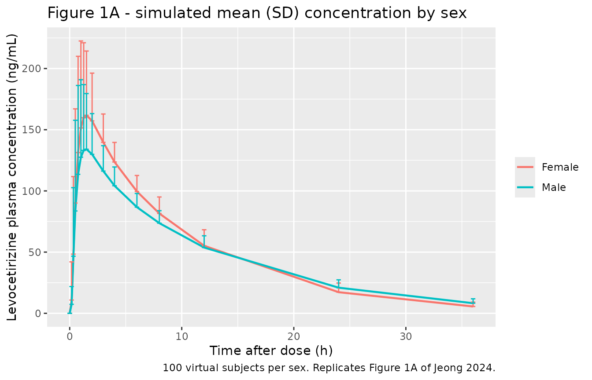
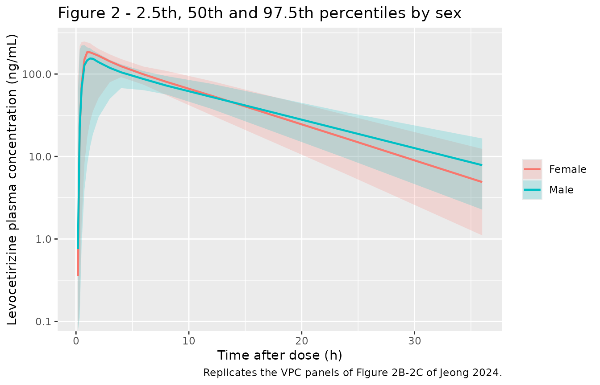
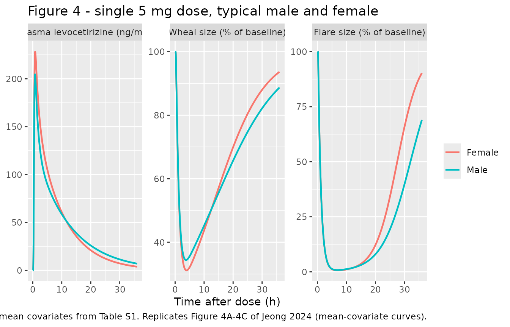
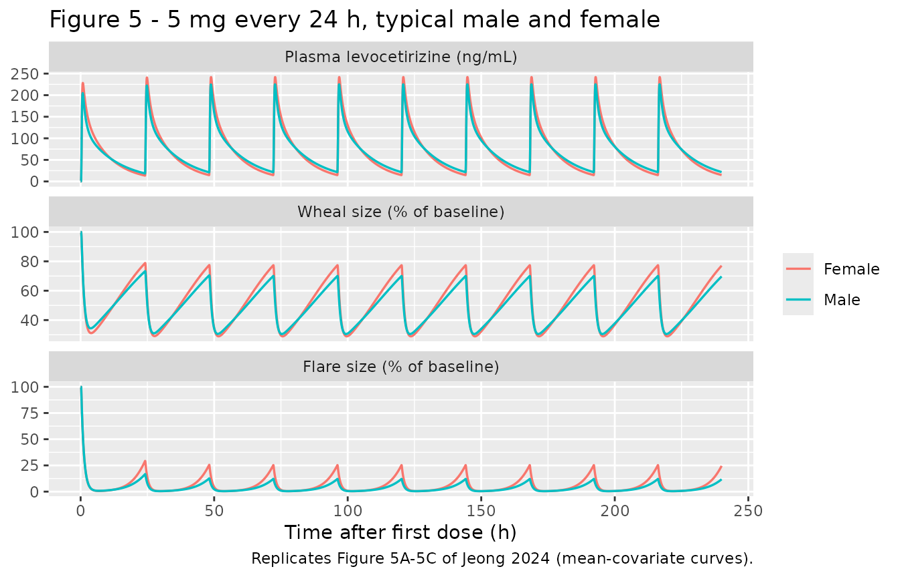

# Levocetirizine (Jeong 2024)

## Model and source

- Citation: Jeong SH, Jang JH, Lee YB. Is Gender an Important Factor in
  the Precision Medicine Approach to Levocetirizine? Pharmaceutics.
  2024;16(1):146. <doi:10.3390/pharmaceutics16010146>. The wheal and
  flare observations used to fit the pharmacodynamic sub-model were
  taken from Simons FER, Simons KJ. Levocetirizine: pharmacokinetics and
  pharmacodynamics in children age 6 to 11 years. J Allergy Clin
  Immunol. 2005;116(2):355-361. <doi:10.1016/j.jaci.2005.04.010>.
- Description: Co-linked population PK-PD model for a single oral 5 mg
  levocetirizine immediate-release tablet in 40 healthy Korean adults
  (24 men, 16 women) from a two-way crossover bioequivalence study
  (Jeong 2024). PK is a two-compartment disposition model (central +
  peripheral1) fed by a chain of five sequential first-order absorption
  compartments (depot -\> transit1 -\> transit2 -\> transit3 -\>
  transit4 -\> central, with distinct rate constants Ka1 to Ka5)
  preceded by an absorption lag time Tlag; volumes and clearances are
  apparent (Vc/F, CLc/F, Vp/F, CLp/F). Retained covariates: body surface
  area (power), serum albumin (power) and female sex (linear fractional
  decrease) on Vp/F, body surface area (power) on CLp/F, and body weight
  (power) on the fifth absorption rate constant Ka5, each continuous
  covariate centred on the cohort value. Residual error is log-additive,
  i.e. log-normal on the linear concentration scale. PD is two parallel
  indirect-response (input-inhibition) models for the histamine-induced
  skin wheal and flare sizes, expressed as a percentage of the pre-dose
  response (baseline kin / kout = 100), in which plasma levocetirizine
  inhibits the zero-order production rate through a sigmoid Imax
  function. The PD parameters were estimated from published mean data in
  children aged 6 to 11 years (Simons 2005) and carry no
  inter-individual variability.
- Article: <https://doi.org/10.3390/pharmaceutics16010146>
- Supplement (Supplementary Information 1-8, Tables S1-S8, Figures
  S1-S6):
  <https://www.mdpi.com/article/10.3390/pharmaceutics16010146/s1>

Jeong 2024 asked whether men and women handle a 5 mg levocetirizine
tablet differently, and whether any difference matters for the drug’s
antihistamine effect. Women reached a higher peak and cleared the drug
from plasma faster than men, which the final model attributes to a
smaller peripheral volume (Vp/F) in women, even after body surface area
and serum albumin are accounted for. Total exposure (AUC) was the same
in both sexes, and the simulated wheal and flare suppression differed by
only a few percentage points.

The pharmacokinetic model and its covariates come from the authors’ own
bioequivalence cohort. The pharmacodynamic model, two parallel
indirect-response models for the histamine-induced skin wheal and flare,
was fitted to published mean data from children aged 6 to 11 years
(Simons 2005) and then linked to the adult PK model. Both layers are in
a single model file because the paper’s simulations (Figures 4 and 5,
Table 1) drive both PD endpoints from the one PK model.

## Population

Forty healthy Korean adults (24 men, 16 women) received a single oral 5
mg levocetirizine tablet (UCB Pharma reference formulation) with 150 mL
of water after a fast of more than 10 h. This was the reference period
of a randomised, open-label, two-way crossover bioequivalence study with
a 7-day washout (Supplementary Information 3). Plasma was sampled at 0,
0.17, 0.33, 0.5, 0.75, 1, 1.25, 1.5, 2, 3, 4, 6, 8, 12, 24 and 36 h
post-dose (LLOQ 0.5 ng/mL).

Baseline demographics (Table S1, mean (SD)): age 28.38 (8.30) years;
body weight 66.97 (12.59) kg (men 71.58 (12.81), women 60.05 (8.68));
height 168.33 (9.10) cm; body surface area 1.76 (0.20) m^2 (men 1.85
(0.19), women 1.63 (0.13)); serum albumin 4.70 (0.24) g/dL (men 4.79
(0.23), women 4.57 (0.17)). Renal and hepatic function were normal; none
of the renal indices survived covariate selection.

The same information is available programmatically via
`readModelDb("Jeong_2024_levocetirizine")()$population`.

## Source trace

Every `ini()` entry in
`inst/modeldb/specificDrugs/Jeong_2024_levocetirizine.R` carries an
in-file comment naming its source. They are collected here for review.

| Equation / parameter | Value | Source location |
|----|----|----|
| Two-compartment disposition + five sequential first-order absorption compartments + Tlag on the dosing depot | n/a | Results 3.2; Table S5 model 02-05 (selected); Figure S2 (topology) |
| `d/dt(depot)` … `d/dt(transit4)`, `d/dt(central)`, `d/dt(peripheral1)` | n/a | Supplementary Information 7 (Ka1 = dosing depot to depot 1 … Ka5 = depot 4 to central); Figure S2 |
| `lka1` | 9.87 1/h | Table S7, tv Ka1 (SE 1.53; bootstrap 9.86 \[7.07-12.74\]) |
| `lka2` | 28.41 1/h | Table S7, tv Ka2 (SE 5.39; bootstrap 28.60 \[20.87-40.82\]) |
| `lka3` | 11.53 1/h | Table S7, tv Ka3 (SE 1.87; bootstrap 11.45 \[7.91-15.35\]) |
| `lka4` | 11.29 1/h | Table S7, tv Ka4 (SE 1.95; bootstrap 10.71 \[8.29-15.67\]) |
| `lka5` | 0.90 1/h | Table S7, tv Ka5 (SE 0.15; bootstrap 0.90 \[0.62-1.18\]) |
| `ltlag` | 0.08 h | Table S7, tv Tlag (SE 0.01; bootstrap 0.08 \[0.07-0.10\]) |
| `lvc` | 1.07 L | Table S7, tv Vc/F (SE 0.28; bootstrap 1.03 \[0.63-1.44\]) |
| `lcl` | 2.94 L/h | Table S7, tv CLc/F (SE 0.07; bootstrap 2.95 \[2.79-3.07\]) |
| `lvp` | 28.12 L | Table S7, tv Vp/F (SE 1.07; bootstrap 28.02 \[26.44-30.70\]) |
| `lq` | 13.80 L/h | Table S7, tv CLp/F (SE 2.24; bootstrap 13.88 \[9.57-18.16\]) |
| `e_wt_ka5`, applied as `Ka5 = tvKa5 * (WT / 66.97)^0.69` | 0.69 | Table S7, dKa5dWeight; form from Supplementary Information 7 Eq. 5 |
| `e_bsa_vp`, applied as `(BSA / 1.76)^1.20` on Vp/F | 1.20 | Table S7, dVp/FdBSA; form from Eq. 9 |
| `e_alb_vp`, applied as `(ALB / 47.0 g/L)^(-0.79)` on Vp/F | -0.79 | Table S7, dVp/FdAlbumin; form from Eq. 9 |
| `e_sexf_vp`, applied as `(1 - 0.18 * SEXF)` on Vp/F | -0.18 | Table S7, dVp/FdGender; linear form from Eq. 9 |
| `e_bsa_q`, applied as `(BSA / 1.76)^1.94` on CLp/F | 1.94 | Table S7, dCLp/FdBSA; form from Eq. 10 |
| `etalvc`, `etalcl`, `etaltlag` | 0.89, 0.03, 0.37 | Table S7, omega^2 Vc/F, CLc/F, Tlag |
| `etalka1` … `etalka5` | 2.09, 4.14, 2.36, 2.11, 0.02 | Table S7, omega^2 Ka1 … Ka5 |
| `etalvp`, `etalq` | fixed(0) | Table S7, omega^2 Vp/F and CLp/F printed as 0.00 (bootstrap 0.00-0.00); retained per Table S5 models 02-05-02-03 and -04 |
| `expSd` (log-additive residual) | 0.11 | Table S7, epsilon; model form from Table S5 model 02-05-02 |
| `dR/dt = Kin * (1 - Imax * C^gamma / (IC50^gamma + C^gamma)) - Kout * R` | n/a | Supplementary Information 8 Eq. 11; Figure S2 |
| `lkin_wheal`, `lkout_wheal`, `imax_wheal`, `lic50_wheal`, `lhill_wheal` | 87.9 %/h, 0.879 1/h, 0.92, 45.5 ng/mL, 1.11 | Table S8, wheal column |
| `lkin_flare`, `lkout_flare`, `imax_flare`, `lic50_flare`, `lhill_flare` | 99.9 %/h, 0.999 1/h, 0.999, 10.5 ng/mL, 2.51 | Table S8, flare column |
| `addSd_wheal`, `addSd_flare` | fixed(0) | Table S8 reports no residual error for the PD model |
| centring values 66.97 kg, 1.76 m^2, 4.70 g/dL | n/a | Table S1 cohort means (the medians named in Supplementary Information 7 are not reported) |

## Virtual cohort

The individual data are not published, so the checks below use a virtual
cohort of 100 men and 100 women, sampled on the paper’s 16-point
schedule. Height, weight and albumin are drawn per sex from the Table S1
means and SDs; BSA is then computed with the Mosteller formula the paper
used (Supplementary Information 1).

``` r

# set.seed() fixes the covariate draws. rxSetSeed() fixes rxode2's random
# effects for a given solver thread count but not across thread counts, so
# every assertion on this stochastic cohort below uses a robust centre with a
# generous envelope; the tight assertions run on typical-value solves.
set.seed(20240121)
rxode2::rxSetSeed(20240121)

sampling_times <- c(0, 0.17, 0.33, 0.5, 0.75, 1, 1.25, 1.5, 2, 3, 4, 6, 8, 12, 24, 36)

make_cohort <- function(n, sexf, ht, ht_sd, wt, wt_sd, wt_min, alb, alb_sd,
                        label, id_offset = 0L) {
  subjects <- tibble(
    id = id_offset + seq_len(n),
    SEXF = sexf,
    HT = stats::rnorm(n, ht, ht_sd),
    WT = pmax(stats::rnorm(n, wt, wt_sd), wt_min),
    # Table S1 albumin is in g/dL; the model's ALB column is g/L.
    ALB = 10 * stats::rnorm(n, alb, alb_sd),
    treatment = label
  ) |>
    mutate(BSA = sqrt(HT * WT / 3600))
  doses <- subjects |>
    mutate(time = 0, amt = 5, evid = 1L, cmt = "depot", dvid = NA_integer_)
  obs <- subjects |>
    tidyr::expand_grid(time = sampling_times) |>
    mutate(amt = NA_real_, evid = 0L, cmt = "central", dvid = 1L)
  bind_rows(doses, obs) |>
    arrange(id, time, desc(evid))
}

events <- bind_rows(
  make_cohort(100, 0, 173.41, 7.50, 71.58, 12.81, 50, 4.79, 0.23, "Male", 0L),
  make_cohort(100, 1, 160.70, 5.08, 60.05, 8.68, 45, 4.57, 0.17, "Female", 100L)
)
stopifnot(!anyDuplicated(events[, c("id", "time", "evid")]))

events |>
  distinct(id, treatment, WT, BSA, ALB) |>
  group_by(treatment) |>
  summarise(across(c(WT, BSA, ALB), \(x) round(mean(x), 2)), .groups = "drop") |>
  dplyr::rename(
    Sex = treatment, "Mean WT (kg)" = WT, "Mean BSA (m^2)" = BSA,
    "Mean ALB (g/L)" = ALB
  ) |>
  knitr::kable(caption = "Virtual-cohort covariate means (Table S1: men 71.58 kg, 1.85 m^2, 47.9 g/L; women 60.05 kg, 1.63 m^2, 45.7 g/L).")
```

| Sex    | Mean WT (kg) | Mean BSA (m^2) | Mean ALB (g/L) |
|:-------|-------------:|---------------:|---------------:|
| Female |        59.99 |           1.63 |          45.83 |
| Male   |        70.51 |           1.84 |          48.12 |

Virtual-cohort covariate means (Table S1: men 71.58 kg, 1.85 m^2, 47.9
g/L; women 60.05 kg, 1.63 m^2, 45.7 g/L). {.table}

## Simulation

The model has three endpoints (plasma `Cc`, `wheal` and `flare`), so
observation rows carry `dvid = 1L` to tie them to the first endpoint;
the wheal and flare states are returned as columns at the same rows.

``` r

mod <- readModelDb("Jeong_2024_levocetirizine")

sim <- rxode2::rxSolve(
  mod,
  events = events,
  keep = c("treatment"),
  useLinCmt = FALSE
) |>
  as.data.frame()
#> ℹ parameter labels from comments will be replaced by 'label()'
#> ℹ omega/sigma items treated as zero: 'etalvp', 'etalq'
```

Typical-value solves use the per-sex mean covariates from Table S1, as
the paper did for Table 1 and Figures 4D-4F and 5D-5F (“applying the
mean biochemical parameter values in each gender”).

``` r

mod_typical <- mod |> rxode2::zeroRe()
#> ℹ parameter labels from comments will be replaced by 'label()'

sex_covariates <- tibble(
  treatment = c("Male", "Female"),
  SEXF = c(0, 1),
  WT = c(71.58, 60.05),
  BSA = c(1.85, 1.63),
  ALB = c(47.9, 45.7)
)

typical_solve <- function(times, n_doses = 1L, tau = 24) {
  rows <- bind_rows(
    tibble(time = 0, amt = 5, evid = 1L, cmt = "depot",
           ii = if (n_doses > 1L) tau else 0, addl = n_doses - 1L,
           dvid = NA_integer_),
    tibble(time = times, amt = NA_real_, evid = 0L, cmt = "central",
           ii = 0, addl = 0L, dvid = 1L)
  )
  ev <- dplyr::cross_join(sex_covariates |> mutate(id = row_number()), rows) |>
    arrange(id, time, desc(evid))
  rxode2::rxSolve(mod_typical, ev, keep = "treatment", useLinCmt = FALSE) |>
    as.data.frame()
}

typical_sd <- typical_solve(seq(0, 36, by = 0.01))
#> ℹ omega/sigma items treated as zero: 'etalvc', 'etalcl', 'etaltlag', 'etalvp', 'etalq', 'etalka1', 'etalka2', 'etalka3', 'etalka4', 'etalka5'
#> Warning: multi-subject simulation without without 'omega'
typical_md <- typical_solve(seq(0, 240, by = 0.01), n_doses = 10L)
#> ℹ omega/sigma items treated as zero: 'etalvc', 'etalcl', 'etaltlag', 'etalvp', 'etalq', 'etalka1', 'etalka2', 'etalka3', 'etalka4', 'etalka5'
#> Warning: multi-subject simulation without without 'omega'
```

## Replicate published figures

``` r

# Replicates Figure 1A of Jeong 2024: mean (SD) plasma concentration by sex.
sim |>
  group_by(treatment, time) |>
  summarise(mean = mean(Cc), sd = sd(Cc), .groups = "drop") |>
  ggplot(aes(time, mean, colour = treatment)) +
  geom_line(linewidth = 0.8) +
  geom_errorbar(aes(ymin = mean, ymax = mean + sd), width = 0.4) +
  labs(
    x = "Time after dose (h)", y = "Levocetirizine plasma concentration (ng/mL)",
    colour = NULL,
    title = "Figure 1A - simulated mean (SD) concentration by sex",
    caption = "100 virtual subjects per sex. Replicates Figure 1A of Jeong 2024."
  )
```



``` r

# Replicates Figure 2B-2C of Jeong 2024: prediction percentiles by sex on a
# log scale (individual predictions; residual error not added).
sim |>
  filter(time > 0) |>
  group_by(treatment, time) |>
  summarise(
    Q025 = quantile(Cc, 0.025), Q50 = quantile(Cc, 0.5),
    Q975 = quantile(Cc, 0.975), .groups = "drop"
  ) |>
  ggplot(aes(time, Q50, colour = treatment, fill = treatment)) +
  geom_ribbon(aes(ymin = Q025, ymax = Q975), alpha = 0.2, colour = NA) +
  geom_line(linewidth = 0.8) +
  scale_y_log10() +
  labs(
    x = "Time after dose (h)", y = "Levocetirizine plasma concentration (ng/mL)",
    colour = NULL, fill = NULL,
    title = "Figure 2 - 2.5th, 50th and 97.5th percentiles by sex",
    caption = "Replicates the VPC panels of Figure 2B-2C of Jeong 2024."
  )
#> Warning in scale_y_log10(): log-10 transformation introduced infinite values.
```



``` r

# Replicates Figure 4D-4F of Jeong 2024 as time courses: typical-value plasma
# concentration, wheal and flare after a single 5 mg dose.
typical_sd |>
  select(time, treatment, Cc, wheal, flare) |>
  pivot_longer(c(Cc, wheal, flare), names_to = "output", values_to = "value") |>
  mutate(output = factor(
    output, c("Cc", "wheal", "flare"),
    c("Plasma levocetirizine (ng/mL)", "Wheal size (% of baseline)",
      "Flare size (% of baseline)")
  )) |>
  ggplot(aes(time, value, colour = treatment)) +
  geom_line(linewidth = 0.8) +
  facet_wrap(~output, scales = "free_y") +
  labs(
    x = "Time after dose (h)", y = NULL, colour = NULL,
    title = "Figure 4 - single 5 mg dose, typical male and female",
    caption = "Per-sex mean covariates from Table S1. Replicates Figure 4A-4C of Jeong 2024 (mean-covariate curves)."
  )
```



``` r

# Replicates Figure 5A-5C of Jeong 2024: 5 mg once daily for 10 days.
typical_md |>
  select(time, treatment, Cc, wheal, flare) |>
  pivot_longer(c(Cc, wheal, flare), names_to = "output", values_to = "value") |>
  mutate(output = factor(
    output, c("Cc", "wheal", "flare"),
    c("Plasma levocetirizine (ng/mL)", "Wheal size (% of baseline)",
      "Flare size (% of baseline)")
  )) |>
  ggplot(aes(time, value, colour = treatment)) +
  geom_line(linewidth = 0.6) +
  facet_wrap(~output, scales = "free_y", ncol = 1) +
  labs(
    x = "Time after first dose (h)", y = NULL, colour = NULL,
    title = "Figure 5 - 5 mg every 24 h, typical male and female",
    caption = "Replicates Figure 5A-5C of Jeong 2024 (mean-covariate curves)."
  )
```



Figure 3 of the paper (the PD fit to the paediatric data of Simons 2005)
is not replicated: it was produced with the children’s concentrations,
which are not part of this model.

## Table 1 of the paper

Table 1 reports typical-value simulations at the per-sex mean
covariates, for a single dose (0-36 h) and at steady state (216-240 h,
once daily). The rows are recomputed below with the paper’s definitions:
the minimum is taken after the peak (footnote a), the wheal and flare
maxima after the maximum effect (footnote b), the fluctuation is maximum
/ minimum (footnote d), and the single-dose AUEC is the area between the
100% baseline and the response curve.

``` r

window_metrics <- function(d) {
  d <- arrange(d, time)
  trap <- function(y) sum(diff(d$time) * (head(y, -1) + tail(y, -1)) / 2)
  dur <- diff(range(d$time))
  after <- function(y, i) y[i:length(y)]
  i_c <- which.max(d$Cc)
  i_w <- which.min(d$wheal)
  i_f <- which.min(d$flare)
  tibble(
    metric = c(
      "Cc maximum", "Cc minimum", "Cc mean", "Cc AUCall",
      "Wheal maximum", "Wheal minimum", "Wheal mean", "Wheal AUEC",
      "Flare maximum", "Flare minimum", "Flare mean", "Flare AUEC"
    ),
    value = c(
      max(d$Cc), min(after(d$Cc, i_c)), trap(d$Cc) / dur, trap(d$Cc),
      max(after(d$wheal, i_w)), min(d$wheal), trap(d$wheal) / dur,
      trap(100 - d$wheal),
      max(after(d$flare, i_f)), min(d$flare), trap(d$flare) / dur,
      trap(100 - d$flare)
    )
  )
}

simulated_t1 <- bind_rows(
  typical_sd |> group_by(treatment) |>
    reframe(window_metrics(pick(everything()))) |> mutate(period = "Single dose"),
  typical_md |> filter(time >= 216) |> group_by(treatment) |>
    reframe(window_metrics(pick(everything()))) |> mutate(period = "Steady state")
)

# Jeong 2024 Table 1. The steady-state AUEC rows are omitted: their values
# (2431.14 and 3517.14 h*% in men) are inconsistent with a 24 h window around
# the reported steady-state means, so the integration window is unclear.
published_t1 <- tibble::tribble(
  ~period, ~metric, ~Male, ~Female,
  "Single dose", "Cc maximum", 212.00, 220.52,
  "Single dose", "Cc minimum", 6.53, 4.39,
  "Single dose", "Cc mean", 45.15, 46.09,
  "Single dose", "Cc AUCall", 1624.90, 1659.09,
  "Single dose", "Wheal maximum", 89.45, 92.77,
  "Single dose", "Wheal minimum", 33.81, 31.87,
  "Single dose", "Wheal mean", 63.02, 64.30,
  "Single dose", "Wheal AUEC", 1330.75, 1284.66,
  "Single dose", "Flare maximum", 72.56, 87.14,
  "Single dose", "Flare minimum", 0.77, 0.65,
  "Single dose", "Flare mean", 20.31, 25.93,
  "Single dose", "Flare AUEC", 2867.43, 2665.73,
  "Steady state", "Cc maximum", 231.37, 235.37,
  "Steady state", "Cc minimum", 20.69, 16.19,
  "Steady state", "Cc mean", 70.73, 70.71,
  "Steady state", "Cc AUCall", 1702.49, 1702.49,
  "Steady state", "Wheal maximum", 70.81, 75.54,
  "Steady state", "Wheal minimum", 30.17, 29.39,
  "Steady state", "Wheal mean", 48.79, 50.22,
  "Steady state", "Flare maximum", 13.11, 21.10,
  "Steady state", "Flare minimum", 0.44, 0.43,
  "Steady state", "Flare mean", 3.49, 5.05
) |>
  pivot_longer(c(Male, Female), names_to = "treatment", values_to = "published")

t1 <- inner_join(published_t1, simulated_t1, by = c("period", "metric", "treatment")) |>
  mutate(pct_diff = 100 * (value - published) / published)
stopifnot(nrow(t1) == nrow(published_t1))

t1 |>
  mutate(across(c(published, value, pct_diff), \(x) round(x, 2))) |>
  select(period, metric, treatment, published, value, pct_diff) |>
  dplyr::rename(
    Period = period, Quantity = metric, Sex = treatment,
    "Jeong 2024 Table 1" = published, Simulated = value, "% difference" = pct_diff
  ) |>
  knitr::kable(caption = "Typical-value reproduction of Jeong 2024 Table 1 (concentrations in ng/mL, AUC in h*ng/mL, PD in % of baseline, AUEC in h*%).")
```

| Period       | Quantity      | Sex    | Jeong 2024 Table 1 | Simulated | % difference |
|:-------------|:--------------|:-------|-------------------:|----------:|-------------:|
| Single dose  | Cc maximum    | Male   |             212.00 |    204.61 |        -3.49 |
| Single dose  | Cc maximum    | Female |             220.52 |    228.25 |         3.51 |
| Single dose  | Cc minimum    | Male   |               6.53 |      7.02 |         7.54 |
| Single dose  | Cc minimum    | Female |               4.39 |      3.84 |       -12.57 |
| Single dose  | Cc mean       | Male   |              45.15 |     44.85 |        -0.66 |
| Single dose  | Cc mean       | Female |              46.09 |     46.24 |         0.32 |
| Single dose  | Cc AUCall     | Male   |            1624.90 |   1614.69 |        -0.63 |
| Single dose  | Cc AUCall     | Female |            1659.09 |   1664.54 |         0.33 |
| Single dose  | Wheal maximum | Male   |              89.45 |     88.71 |        -0.83 |
| Single dose  | Wheal maximum | Female |              92.77 |     93.65 |         0.95 |
| Single dose  | Wheal minimum | Male   |              33.81 |     34.41 |         1.78 |
| Single dose  | Wheal minimum | Female |              31.87 |     31.14 |        -2.28 |
| Single dose  | Wheal mean    | Male   |              63.02 |     62.77 |        -0.40 |
| Single dose  | Wheal mean    | Female |              64.30 |     64.96 |         1.03 |
| Single dose  | Wheal AUEC    | Male   |            1330.75 |   1340.30 |         0.72 |
| Single dose  | Wheal AUEC    | Female |            1284.66 |   1261.40 |        -1.81 |
| Single dose  | Flare maximum | Male   |              72.56 |     68.98 |        -4.94 |
| Single dose  | Flare maximum | Female |              87.14 |     90.28 |         3.61 |
| Single dose  | Flare minimum | Male   |               0.77 |      0.79 |         2.65 |
| Single dose  | Flare minimum | Female |               0.65 |      0.63 |        -2.71 |
| Single dose  | Flare mean    | Male   |              20.31 |     19.40 |        -4.46 |
| Single dose  | Flare mean    | Female |              25.93 |     28.06 |         8.21 |
| Single dose  | Flare AUEC    | Male   |            2867.43 |   2901.48 |         1.19 |
| Single dose  | Flare AUEC    | Female |            2665.73 |   2589.91 |        -2.84 |
| Steady state | Cc maximum    | Male   |             231.37 |    225.04 |        -2.74 |
| Steady state | Cc maximum    | Female |             235.37 |    241.89 |         2.77 |
| Steady state | Cc minimum    | Male   |              20.69 |     21.78 |         5.26 |
| Steady state | Cc minimum    | Female |              16.19 |     14.89 |        -8.01 |
| Steady state | Cc mean       | Male   |              70.73 |     70.86 |         0.19 |
| Steady state | Cc mean       | Female |              70.71 |     70.86 |         0.21 |
| Steady state | Cc AUCall     | Male   |            1702.49 |   1700.68 |        -0.11 |
| Steady state | Cc AUCall     | Female |            1702.49 |   1700.68 |        -0.11 |
| Steady state | Wheal maximum | Male   |              70.81 |     69.74 |        -1.51 |
| Steady state | Wheal maximum | Female |              75.54 |     77.04 |         1.99 |
| Steady state | Wheal minimum | Male   |              30.17 |     30.51 |         1.14 |
| Steady state | Wheal minimum | Female |              29.39 |     28.96 |        -1.47 |
| Steady state | Wheal mean    | Male   |              48.79 |     48.36 |        -0.89 |
| Steady state | Wheal mean    | Female |              50.22 |     50.80 |         1.15 |
| Steady state | Flare maximum | Male   |              13.11 |     11.79 |       -10.10 |
| Steady state | Flare maximum | Female |              21.10 |     24.56 |        16.42 |
| Steady state | Flare minimum | Male   |               0.44 |      0.44 |        -0.42 |
| Steady state | Flare minimum | Female |               0.43 |      0.43 |         0.67 |
| Steady state | Flare mean    | Male   |               3.49 |      3.20 |        -8.19 |
| Steady state | Flare mean    | Female |               5.05 |      5.76 |        14.14 |

Typical-value reproduction of Jeong 2024 Table 1 (concentrations in
ng/mL, AUC in h*ng/mL, PD in % of baseline, AUEC in h*%). {.table}

These are deterministic solves, so the gates below are tight. The
structural quantities (peak, mean, AUC, the whole wheal response) agree
within 5%. The remaining gap, largest for the post-peak minimum and the
low flare values, comes from the unreported covariate medians (see
Assumptions): the medians move the male and female Vp/F, and so the
terminal phase, in opposite directions. A mis-transcribed volume,
clearance or IC50 would move these rows by tens of percent.

``` r

gate <- t1 |>
  mutate(bound = case_when(
    metric == "Cc minimum" ~ 15,
    startsWith(metric, "Flare") ~ 20,
    TRUE ~ 5
  ))
stopifnot(all(abs(gate$pct_diff) < gate$bound))

# Steady-state AUC over a dosing interval equals Dose / (CL/F) exactly for a
# linear model: 5 mg / 2.94 L/h = 1700.68 h*ng/mL. Both sides use the same
# parameters, so the bound is numerical error only.
auc_ss <- t1 |> filter(period == "Steady state", metric == "Cc AUCall") |> pull(value)
stopifnot(all(abs(auc_ss / (5000 / 2.94) - 1) < 1e-3))

# Drug-free PD baseline is kin / kout = 100 for both endpoints.
stopifnot(
  isTRUE(all.equal(typical_sd$wheal[typical_sd$time == 0], c(100, 100))),
  isTRUE(all.equal(typical_sd$flare[typical_sd$time == 0], c(100, 100)))
)
```

## PKNCA validation

``` r

sim_nca <- sim |>
  dplyr::filter(!is.na(Cc)) |>
  dplyr::select(id, time, Cc, treatment)

conc_obj <- PKNCA::PKNCAconc(sim_nca, Cc ~ time | treatment + id)

dose_df <- events |>
  dplyr::filter(evid == 1) |>
  dplyr::select(id, time, amt, treatment)
dose_obj <- PKNCA::PKNCAdose(dose_df, amt ~ time | treatment + id)

intervals <- data.frame(
  start = 0,
  end = Inf,
  cmax = TRUE,
  tmax = TRUE,
  auclast = TRUE,
  aucinf.obs = TRUE,
  half.life = TRUE
)

nca_res <- PKNCA::pk.nca(
  PKNCA::PKNCAdata(conc_obj, dose_obj, intervals = intervals)
)
```

### Comparison against published NCA

``` r

# Jeong 2024 Table S2, observed mean by sex (AUCall over 0-36 h is auclast).
published <- tibble::tribble(
  ~treatment, ~cmax, ~tmax, ~auclast, ~aucinf.obs, ~half.life,
  "Male", 203.89, 1.11, 1647.94, 1751.08, 8.73,
  "Female", 230.84, 1.09, 1783.22, 1835.06, 7.05
)

cmp <- nlmixr2lib::ncaComparisonTable(
  simulated = nca_res,
  reference = published,
  by = "treatment",
  units = c(
    cmax = "ng/mL", auclast = "ng*h/mL", aucinf.obs = "ng*h/mL",
    tmax = "h", half.life = "h"
  ),
  tolerance_pct = 20
)

knitr::kable(
  cmp,
  caption = "Simulated (median of 100 subjects per sex) vs. Jeong 2024 Table S2 (observed mean). * differs from reference by >20%.",
  align = c("l", "l", "r", "r", "r")
)
```

| NCA parameter           | treatment | Reference | Simulated |   % diff |
|:------------------------|:----------|----------:|----------:|---------:|
| Cmax (ng/mL)            | Male      |       204 |       161 | -20.9%\* |
| Cmax (ng/mL)            | Female    |       231 |       193 |   -16.4% |
| Tmax (h)                | Male      |      1.11 |       1.5 | +35.1%\* |
| Tmax (h)                | Female    |      1.09 |      1.25 |   +14.7% |
| AUC0-∞ (obs) (ng\*h/mL) | Male      |      1750 |      1720 |    -1.9% |
| AUC0-∞ (obs) (ng\*h/mL) | Female    |      1840 |      1730 |    -5.5% |
| AUClast (ng\*h/mL)      | Male      |      1650 |      1620 |    -1.4% |
| AUClast (ng\*h/mL)      | Female    |      1780 |      1680 |    -5.6% |
| t½ (h)                  | Male      |      8.73 |      8.53 |    -2.3% |
| t½ (h)                  | Female    |      7.05 |      6.87 |    -2.6% |

Simulated (median of 100 subjects per sex) vs. Jeong 2024 Table S2
(observed mean). \* differs from reference by \>20%. {.table}

AUC and half-life agree with the observed means, and the model
reproduces the sex ordering the paper reports: women have the higher
Cmax and the shorter half-life.

**Cmax and Tmax in the stochastic cohort.** The simulated Cmax is about
15-20% below the observed mean and Tmax is later, although the
typical-value Cmax reproduces Table 1 within 4%. The cause is the
published inter-individual variability on the four fast absorption rate
constants (omega^2 2.09 to 4.14, i.e. SDs of 1.4 to 2.0 on the log
scale) and on Vc/F (0.89). A sizeable minority of simulated subjects
therefore absorb slowly or have a large central volume, which pulls the
cohort peak down and spreads it out in time. The paper’s own visual
predictive check shows the same thing: in Figure 2A the predicted 2.5th
percentile over the first hours lies well below every observation. The
simulated percentiles of the virtual cohort agree with the prediction
lines read from Figure 2A (on the natural-log scale, a median of about
4.0 at 12 h and 1.8 at 36 h, and a 2.5th percentile of about 0.3 at 36
h). This is a property of the published model and is reproduced as
published; no parameter was changed.

``` r

# Stochastic cohort: assert the centre of the exposure and elimination
# quantities against the published means, with an envelope wide enough for any
# cohort the model can draw. A wrong clearance, volume or unit moves these by
# far more than 25%. Cmax and Tmax are not gated, for the reason given above.
nca_summary <- as.data.frame(nca_res$result) |>
  filter(PPTESTCD %in% c("aucinf.obs", "half.life")) |>
  group_by(treatment, PPTESTCD) |>
  summarise(median = median(PPORRES, na.rm = TRUE), .groups = "drop") |>
  left_join(
    published |>
      select(treatment, aucinf.obs, half.life) |>
      pivot_longer(-treatment, names_to = "PPTESTCD", values_to = "ref"),
    by = c("treatment", "PPTESTCD")
  )
stopifnot(nrow(nca_summary) == 4, all(abs(nca_summary$median / nca_summary$ref - 1) < 0.25))
```

## Assumptions and deviations

- **Covariate centring values are the cohort means, not the medians.**
  Supplementary Information 7 centres weight, BSA and albumin on “the
  median … values in the observed population”, but Table S1 reports only
  means and SDs. The model uses the Table S1 means (66.97 kg, 1.76 m^2,
  4.70 g/dL). With these centres the typical-value reproduction of Table
  1 is within 5% for Cmax, AUC, mean concentration and all wheal
  quantities. The post-peak minimum (up to 13% off) and the low-valued
  flare rows (up to 16% off) are the most sensitive to the true medians.
  No centre was tuned to match the table.
- **Albumin is supplied in g/L.** The paper reports albumin in g/dL; the
  canonical `ALB` column is g/L, so the centre is 47.0 g/L. The ratio
  form makes the effect unit-invariant once the centre is converted as
  well.
- **The weight covariate acts on Ka5, not Ka4.** Table S7 footnote c
  says “the quantitative correlation value between Ka4 and body weight”,
  but the printed equation (Supplementary Information 7 Eq. 5), the
  covariate table (Table S6 model 5), the Results and the Conclusions
  all place it on Ka5. The model follows the equation.
- **`omega^2` for Vp/F and CLp/F is encoded as `fixed(0)`.** Table S7
  prints both as 0.00 (bootstrap 0.00-0.00), while Table S5 shows that
  removing either worsened the fit by more than 400 units of -2LL. The
  variances are therefore non-zero but below the two-decimal reporting
  precision; they are carried as explicit zeros rather than invented.
- **The residual-error model is “log additive” in Phoenix NLME**,
  i.e. additive on the natural-log scale, which is log-normal on the
  linear concentration scale and maps to `~ lnorm(expSd)`. Table S7
  reports epsilon = 0.11; Phoenix reports this parameter as a standard
  deviation.
- **The PD sub-model has no IIV and no residual error.** Table S8 gives
  point estimates only; `addSd_wheal` and `addSd_flare` are `fixed(0)`.
- **The PD data are not from this cohort.** The wheal and flare
  responses were taken from Simons 2005 (children aged 6 to 11 years
  given 5 mg levocetirizine) and fitted with the adult PK structure
  (Methods 2.4). The authors note that adult PD studies are needed to
  confirm the parameters (Discussion).
- **Response scale.** Supplementary Information 8 calls R the “percent
  inhibition” of the wheal or flare, but Table 1 and Figures 3-5 plot it
  as the response size relative to a 100% baseline that falls towards 0
  as the antihistamine effect grows, which is what `kin / kout = 100`
  gives. The model follows the plotted scale.
- **The stochastic cohort’s Cmax is lower and its Tmax later than
  observed.** This follows from the large published IIV on Ka1-Ka4 and
  Vc/F and matches the width of the paper’s own VPC (Figure 2); see the
  PKNCA section.
- **Steady-state AUEC is not compared.** Table 1 reports 2431.14 and
  3517.14 h\*% (men, wheal and flare) at steady state, which cannot come
  from a 24 h window around steady-state mean responses of 48.79% and
  3.49%; the integration window used is not stated.
- **Virtual-cohort covariates are assumed normal and independent within
  sex** (height, weight, albumin), with BSA computed from height and
  weight. The paper publishes summary statistics only.
