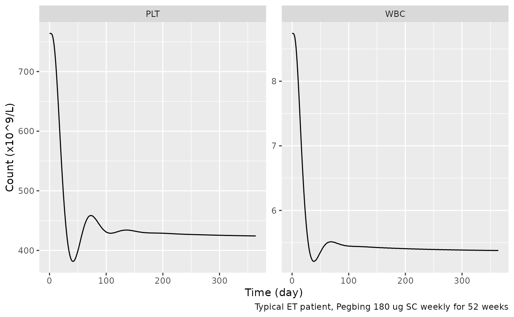

# Peginterferon alfa-2b platelet and white-cell myelosuppression, CHB to ET (Jian 2026)

## Model and source

- Citation: Jian W, Yin Y, Chen R, Xue J, Gu J, Du Z, He R, Zhou T. Drug
  Repositioning of Pegbing for Essential Thrombocythemia: Insights from
  PK/PD Modeling and Extrapolation. Clin Pharmacol Ther.
  2026;119(1):219-227. <doi:10.1002/cpt.70079> (PK layer: Jian W, et
  al. Population Pharmacokinetic Model of Pegbing in Healthy Subjects
  and Chronic Hepatitis B Patients. CPT Pharmacometrics Syst Pharmacol.
  2025;14:2014-2025. <doi:10.1002/psp4.70104>)
- Article: <https://doi.org/10.1002/cpt.70079> (open access, Clin
  Pharmacol Ther 2026;119(1):219-227); Supplementary Method 1 (Data S1)
  prints the ODEs.
- PK layer: the Jian 2025 population PK model, shipped as
  `Jian_2025_peginterferon_alfa_2b` (<doi:10.1002/psp4.70104>).
- Errata: Europe PMC listed no correction or erratum for the article on
  2026-11-11.

Pegbing is a 40 kDa Y-shaped branched-PEG peginterferon alfa-2b approved
in China for chronic hepatitis B (CHB) and C. Jian 2026 used the
platelet (PLT) and white-blood-cell (WBC) counts collected in the CHB
registration trials to build two Friberg semi-mechanistic
myelosuppression models, then extrapolated them to essential
thrombocythemia (ET), where lowering the platelet count is the
therapeutic goal. The paper contributes four model files:

| Model | Endpoint | Population | Baseline typical value / IIV variance |
|----|----|----|----|
| `Jian_2026_peginterferon_alfa_2b_plt_chb` | PLT | CHB (fitted) | 180 x 10^9/L / 0.057 |
| `Jian_2026_peginterferon_alfa_2b_wbc_chb` | WBC | CHB (fitted) | 5.25 x 10^9/L / 0.025 |
| `Jian_2026_peginterferon_alfa_2b_plt_et` | PLT | ET (extrapolated) | 764 x 10^9/L / 0.211 |
| `Jian_2026_peginterferon_alfa_2b_wbc_et` | WBC | ET (extrapolated) | 8.74 x 10^9/L / 0.235 |

The PLT and WBC models were fitted separately and the paper reports no
correlation between them, so they are separate files. Each carries the
full Jian 2025 PK layer with every PK parameter fixed (the fit was
sequential: the PD was driven by individual PK predictions). In the ET
files every drug-effect and system parameter is the CHB estimate; only
the typical baseline and its variance are replaced, and the PK layer is
run for healthy subjects (`DIS_HEALTHY = 1`), as the paper assumes.

## Population

The PD models were fitted to the Phase II multiple-ascending-dose trial
(NCT01143662): 154 CHB patients given 90, 135 or 180 ug SC once weekly
for 48 weeks, 72.7% female, median age 26 years (18-48), median weight
60.0 kg (42.5-90.0), baseline platelets median 181 x 10^9/L (98-346) and
WBC median 5.30 x 10^9/L (3.25-12.16) (Jian 2026 Table 1). The Phase III
trial (NCT01760122, n = 537, 180 ug weekly) served as external
validation. The ET extrapolation used real-world data (RWD) from 100 ET
patients treated off-label, mostly at 180 ug weekly; baseline data were
available for 71 of them (56.3% female; platelets median 764 x 10^9/L,
range 193-2295; WBC median 8.71 x 10^9/L, range 2.95-30.45).

``` r

str(readModelDb("Jian_2026_peginterferon_alfa_2b_plt_chb")()$population)
#> List of 12
#>  $ species            : chr "human"
#>  $ n_subjects         : int 154
#>  $ n_studies          : int 1
#>  $ age_range          : chr "18-48 years (median 26)"
#>  $ weight_range       : chr "42.5-90.0 kg (median 60.0)"
#>  $ sex_female_pct     : num 72.7
#>  $ race_ethnicity     : chr "Not reported; Chinese trial sites (sponsor Xiamen Amoytop Biotech)"
#>  $ disease_state      : chr "Chronic hepatitis B. Baseline platelet count median 181 x 10^9/L (range 98-346); WBC median 5.30 x 10^9/L (rang"| __truncated__
#>  $ dose_range         : chr "Pegbing 90, 135 or 180 ug SC once weekly for 48 weeks (Phase II multiple-ascending-dose trial NCT01143662)"
#>  $ regions            : chr "China"
#>  $ external_validation: chr "Phase III randomized controlled trial NCT01760122 (n = 537 CHB patients, 180 ug SC weekly for 48 weeks) used fo"| __truncated__
#>  $ notes              : chr "Complete blood counts at baseline and weeks 1, 2, 4, 8, 12, 16, 20, 24, 28, 36 and 48 (Jian 2026 Methods). Esti"| __truncated__
str(readModelDb("Jian_2026_peginterferon_alfa_2b_plt_et")()$population)
#> List of 10
#>  $ species         : chr "human"
#>  $ n_subjects      : int 100
#>  $ n_studies       : int 1
#>  $ sex_female_pct  : num 56.3
#>  $ race_ethnicity  : chr "Not reported; Chinese real-world cohort"
#>  $ disease_state   : chr "Essential thrombocythemia (Philadelphia-negative myeloproliferative neoplasm) treated off-label with Pegbing. B"| __truncated__
#>  $ dose_range      : chr "Real-world: mostly Pegbing 180 ug SC once weekly, some 90 or 135 ug depending on disease severity. In silico tr"| __truncated__
#>  $ regions         : chr "China"
#>  $ parameter_source: chr "Drug-effect, transit and feedback parameters are the CHB estimates (Phase II NCT01143662, n = 154 CHB patients)"| __truncated__
#>  $ notes           : chr "Sex percentage from the 71 ET patients with baseline data (Jian 2026 Table 1 footnote a). The Discussion states"| __truncated__
```

## Source trace

The PK parameters are traced line by line in
`Jian_2025_peginterferon_alfa_2b.R` and its vignette; they are copied
unchanged and fixed here.

| Equation / parameter | PLT value | WBC value | Source location |
|----|----|----|----|
| `d/dt(prol) = ktr * prol * (circ0 / circ)^gamma * E - ktr * prol` | – | – | Supplementary Method 1, Eq. 1 |
| `d/dt(transit1..3) = ktr * (upstream - transit)` | – | – | Supplementary Method 1, Eqs. 2-4 |
| `d/dt(circ) = ktr * transit3 - ktr * circ` | – | – | Supplementary Method 1, Eq. 5 |
| `kprol = ktr = ke = 4 / MTT` | – | – | Supplementary Method 1, text after Eq. 5 |
| `E = 1 - Emax * C / (EC50 + C)` | – | – | Supplementary Method 1, Eq. 6 |
| All states start at `circ0` | – | – | Supplementary Method 1, Eqs. 1-5 initial conditions |
| `circ0` (CHB), 10^9/L | 180 | 5.25 | Table 2 |
| `circ0` (ET), 10^9/L | 764 | 8.74 | Results, “Extrapolation of the PK/PD relationship” |
| MTT, h | 279 | 212 | Table 2 |
| gamma (fixed) | 0.23 | 0.16 | Table 2, footnote a |
| Emax | 0.197 | 0.0952 | Table 2 |
| EC50, pg/mL | 4010 | 1940 | Table 2 |
| IIV `circ0` (CHB), omega^2 | 0.239^2 = 0.0571 | 0.159^2 = 0.0253 | Table 2 (WBC row misprinted “IIV PLT0”); Results text 0.057 / 0.025 |
| IIV `circ0` (ET), omega^2 | 0.211 | 0.235 | Results, “Extrapolation of the PK/PD relationship” |
| IIV EC50, omega^2 | 0.792^2 = 0.627 | 1.292^2 = 1.669 | Table 2 |
| Proportional residual SD | 0.170 | 0.193 | Table 2 |
| Additive residual SD, 10^9/L | – | 0.004 | Table 2 |
| PK layer (CL/F, V/F, ka, TMDD, CrCL and CHB effects, PK IIV) | fixed | fixed | Jian 2025 Table 2 and Data S2 |

## Typical PK exposure (PKNCA)

The paper reports no NCA. The block below summarises the inherited PK
layer over the first and the 48th weekly dosing interval for a typical
CHB patient, to place the exposure against the EC50 values (4.01 ug/L
for PLT, 1.94 ug/L for WBC).

``` r

mod_plt_chb <- readModelDb("Jian_2026_peginterferon_alfa_2b_plt_chb")
tau <- 168
grid <- sort(unique(c(seq(0, tau, by = 2), seq(47 * tau, 48 * tau, by = 2))))
pk_one <- function(dose, healthy) {
  ev <- rxode2::et(amt = dose, cmt = "depot", ii = tau, addl = 47) |>
    rxode2::et(grid, cmt = "central")
  s <- rxode2::rxSolve(rxode2::zeroRe(mod_plt_chb), ev,
    params = data.frame(CRCL = 110.38, DIS_HEALTHY = healthy),
    returnType = "data.frame"
  )
  data.frame(
    time = s$time, Cc = s$Cc,
    treatment = paste0(dose, " ug, ", ifelse(healthy == 1, "healthy PK", "CHB PK")),
    id = 1L
  )
}
pk <- bind_rows(
  pk_one(90, 0), pk_one(135, 0), pk_one(180, 0), pk_one(180, 1)
) |>
  dplyr::filter(!is.na(Cc))
#> ℹ parameter labels from comments will be replaced by 'label()'
#> ℹ omega/sigma items treated as zero: 'etalcl', 'etalvc', 'etalka', 'etalkint', 'etalrbase', 'etalec50'
#> ℹ parameter labels from comments will be replaced by 'label()'
#> ℹ omega/sigma items treated as zero: 'etalcl', 'etalvc', 'etalka', 'etalkint', 'etalrbase', 'etalec50'
#> ℹ parameter labels from comments will be replaced by 'label()'
#> ℹ omega/sigma items treated as zero: 'etalcl', 'etalvc', 'etalka', 'etalkint', 'etalrbase', 'etalec50'
#> ℹ parameter labels from comments will be replaced by 'label()'
#> ℹ omega/sigma items treated as zero: 'etalcl', 'etalvc', 'etalka', 'etalkint', 'etalrbase', 'etalec50'
pk_dose <- pk |>
  distinct(treatment, id) |>
  mutate(time = 0, amt = as.numeric(sub(" ug.*", "", treatment)))
conc_obj <- PKNCA::PKNCAconc(pk, Cc ~ time | treatment + id)
dose_obj <- PKNCA::PKNCAdose(pk_dose, amt ~ time | treatment + id)
intervals <- data.frame(
  start = c(0, 47 * tau), end = c(tau, 48 * tau),
  cmax = TRUE, cav = TRUE, auclast = TRUE
)
nca <- PKNCA::pk.nca(PKNCA::PKNCAdata(conc_obj, dose_obj, intervals = intervals))
nca_tab <- as.data.frame(nca$result) |>
  dplyr::filter(PPTESTCD %in% c("cmax", "cav")) |>
  mutate(week = ifelse(start == 0, "Week 1", "Week 48")) |>
  select(treatment, week, PPTESTCD, PPORRES) |>
  pivot_wider(names_from = PPTESTCD, values_from = PPORRES)
nca_tab |>
  dplyr::rename(
    "Regimen" = treatment, "Interval" = week,
    "Cmax (ug/L)" = cmax, "Cavg (ug/L)" = cav
  ) |>
  knitr::kable(digits = 2)
```

| Regimen            | Interval | Cmax (ug/L) | Cavg (ug/L) |
|:-------------------|:---------|------------:|------------:|
| 135 ug, CHB PK     | Week 1   |        3.32 |        2.41 |
| 135 ug, CHB PK     | Week 48  |        7.23 |        5.74 |
| 180 ug, CHB PK     | Week 1   |        4.68 |        3.42 |
| 180 ug, CHB PK     | Week 48  |        9.69 |        7.70 |
| 180 ug, healthy PK | Week 1   |        7.60 |        4.81 |
| 180 ug, healthy PK | Week 48  |       11.14 |        7.70 |
| 90 ug, CHB PK      | Week 1   |        2.06 |        1.51 |
| 90 ug, CHB PK      | Week 48  |        4.77 |        3.77 |

Average concentrations of a few ug/L sit around the EC50, so the
response rises with dose but is far from saturated over 90-270 ug.
Exposure is higher in week 48 than in week 1 because the Jian 2025 model
down-regulates the interferon receptor (the target-mediated sink) over
months of treatment.

``` r

cav_w48 <- nca_tab$cav[nca_tab$week == "Week 48"]
names(cav_w48) <- nca_tab$treatment[nca_tab$week == "Week 48"]
cav_w1 <- nca_tab$cav[nca_tab$week == "Week 1"]
stopifnot(
  length(cav_w48) == 4L,
  # Linear PK at these doses once the receptor sink is depleted: Cavg scales
  # with dose to within a few percent.
  abs(cav_w48[["180 ug, CHB PK"]] / cav_w48[["90 ug, CHB PK"]] - 2) < 0.2,
  all(cav_w48 > cav_w1)
)
```

## CHB: replicating Figure 2

Figure 2a and 2c show the Phase II VPCs by dose. Below, 200 virtual CHB
patients per dose are simulated over 48 weeks of treatment and 24 weeks
of follow-up. Random effects are drawn once per patient with base-R
[`rnorm()`](https://rdrr.io/r/stats/Normal.html) and passed as
parameters, so the cohort is identical on every machine and the same PK
random effects drive the PLT and the WBC models of a patient.

``` r

pk_omega <- c(etalcl = 0.118, etalvc = 0.232, etalka = 0.197, etalkint = 0.272)

draw_pk <- function(n) {
  as.data.frame(lapply(pk_omega, function(v) rnorm(n, 0, sqrt(v))))
}

draw_pd <- function(n, omega_rbase, omega_ec50, shift_rbase = 0) {
  data.frame(
    etalrbase = rnorm(n, shift_rbase, sqrt(omega_rbase)),
    etalec50 = rnorm(n, 0, sqrt(omega_ec50))
  )
}

solve_cohort <- function(name, ev, params) {
  mod <- rxode2::zeroRe(readModelDb(name))
  s <- suppressWarnings(rxode2::rxSolve(mod, ev, params = params, returnType = "data.frame"))
  if (is.null(s$id)) s$id <- 1L
  s
}

weekly_events <- function(n, dose, n_doses, obs_days) {
  rxode2::et(amt = dose, cmt = "depot", ii = 168, addl = n_doses - 1) |>
    rxode2::et(obs_days * 24, cmt = "circ") |>
    rxode2::et(id = seq_len(n))
}
```

``` r

n_arm <- 200
obs_days <- c(0, 7, 14, 28, seq(56, 504, by = 28))
set.seed(20260101)
chb <- list()
for (dose in c(90, 135, 180)) {
  pk_eta <- draw_pk(n_arm)
  cov <- data.frame(id = seq_len(n_arm), CRCL = 127.84, DIS_HEALTHY = 0)
  ev <- weekly_events(n_arm, dose, 48, obs_days)
  p_plt <- cbind(cov, pk_eta, draw_pd(n_arm, 0.057121, 0.627264))
  p_wbc <- cbind(cov, pk_eta, draw_pd(n_arm, 0.025281, 1.669264))
  s_plt <- solve_cohort("Jian_2026_peginterferon_alfa_2b_plt_chb", ev, p_plt)
  s_wbc <- solve_cohort("Jian_2026_peginterferon_alfa_2b_wbc_chb", ev, p_wbc)
  chb[[length(chb) + 1]] <- bind_rows(
    data.frame(dose = dose, endpoint = "PLT", id = s_plt$id, time = s_plt$time, value = s_plt$circ),
    data.frame(dose = dose, endpoint = "WBC", id = s_wbc$id, time = s_wbc$time, value = s_wbc$circ)
  )
}
#> ℹ parameter labels from comments will be replaced by 'label()'
#> ℹ parameter labels from comments will be replaced by 'label()'
#> ℹ parameter labels from comments will be replaced by 'label()'
#> ℹ parameter labels from comments will be replaced by 'label()'
#> ℹ parameter labels from comments will be replaced by 'label()'
#> ℹ parameter labels from comments will be replaced by 'label()'
chb <- bind_rows(chb)
chb_q <- chb |>
  group_by(dose, endpoint, day = time / 24) |>
  summarise(
    p05 = quantile(value, 0.05), p50 = median(value), p95 = quantile(value, 0.95),
    .groups = "drop"
  )
```

``` r

ggplot(chb_q, aes(day, p50)) +
  geom_ribbon(aes(ymin = p05, ymax = p95), fill = "steelblue", alpha = 0.3) +
  geom_line(colour = "firebrick") +
  facet_grid(endpoint ~ paste(dose, "ug"), scales = "free_y") +
  labs(x = "Time (day)", y = "Count (x10^9/L)")
```


Replicates Figure 2a and 2c of Jian 2026: simulated median (line) and
5th-95th percentiles (ribbon) of individual-predicted counts in CHB
patients (no residual error).

The Figure 2 observed medians settle at roughly 125, 110 and 105 x
10^9/L platelets and 3.6, 3.3 and 3.2 x 10^9/L white cells for 90, 135
and 180 ug (values read off the figure by the maintainers), and return
to near baseline by day 500. The simulated medians at week 24 are:

``` r

plateau <- chb_q |>
  dplyr::filter(day == 168) |>
  select(dose, endpoint, p50)
fig2 <- data.frame(
  dose = rep(c(90, 135, 180), 2),
  endpoint = rep(c("PLT", "WBC"), each = 3),
  figure2 = c(125, 110, 105, 3.6, 3.3, 3.2)
)
cmp <- inner_join(plateau, fig2, by = c("dose", "endpoint")) |>
  mutate(pct_diff = 100 * (p50 - figure2) / figure2)
cmp |>
  dplyr::rename(
    "Dose (ug)" = dose, "Endpoint" = endpoint,
    "Simulated median, week 24" = p50, "Figure 2 median (read off)" = figure2,
    "Difference (%)" = pct_diff
  ) |>
  knitr::kable(digits = 1)
```

| Dose (ug) | Endpoint | Simulated median, week 24 | Figure 2 median (read off) | Difference (%) |
|---:|:---|---:|---:|---:|
| 90 | PLT | 125.3 | 125.0 | 0.2 |
| 90 | WBC | 3.7 | 3.6 | 3.1 |
| 135 | PLT | 110.5 | 110.0 | 0.5 |
| 135 | WBC | 3.7 | 3.3 | 11.4 |
| 180 | PLT | 104.7 | 105.0 | -0.3 |
| 180 | WBC | 3.4 | 3.2 | 5.8 |

``` r

stopifnot(
  nrow(cmp) == 6L,
  # A mis-transcribed Emax, EC50 or gamma moves the plateau by tens of
  # percent; reading a median off a figure is good to about 10%.
  all(abs(cmp$pct_diff) < 20)
)
```

## ET extrapolation: replicating Figure 3

Figure 3b-c validates the extrapolated models against the ET real-world
data. The typical ET patient on 180 ug weekly, with healthy-subject PK:

``` r

ev1 <- rxode2::et(amt = 180, cmt = "depot", ii = 168, addl = 51) |>
  rxode2::et(seq(0, 52 * 168, by = 24), cmt = "circ")
et_typ <- bind_rows(
  solve_cohort("Jian_2026_peginterferon_alfa_2b_plt_et", ev1,
    data.frame(CRCL = 110.38, DIS_HEALTHY = 1)) |>
    mutate(endpoint = "PLT"),
  solve_cohort("Jian_2026_peginterferon_alfa_2b_wbc_et", ev1,
    data.frame(CRCL = 110.38, DIS_HEALTHY = 1)) |>
    mutate(endpoint = "WBC")
)
#> ℹ parameter labels from comments will be replaced by 'label()'
#> ℹ omega/sigma items treated as zero: 'etalcl', 'etalvc', 'etalka', 'etalkint', 'etalrbase', 'etalec50'
#> ℹ parameter labels from comments will be replaced by 'label()'
#> ℹ omega/sigma items treated as zero: 'etalcl', 'etalvc', 'etalka', 'etalkint', 'etalrbase', 'etalec50'
ggplot(et_typ, aes(time / 24, circ)) +
  geom_line() +
  facet_wrap(~endpoint, scales = "free_y") +
  labs(x = "Time (day)", y = "Count (x10^9/L)",
       caption = "Typical ET patient, Pegbing 180 ug SC weekly for 52 weeks")
```



The Friberg structure has a closed-form steady state: once proliferation
balances maturation, `circ_ss = circ0 * E^(1 / gamma)`. With the
concentration averaged over the dosing interval the simulated plateau
should sit close to it, and it does:

``` r

cav_healthy <- nca_tab$cav[nca_tab$treatment == "180 ug, healthy PK" & nca_tab$week == "Week 48"]
closed <- function(circ0, emax, ec50_ugL, gamma, conc) {
  circ0 * (1 - emax * conc / (ec50_ugL + conc))^(1 / gamma)
}
ss_plt <- closed(764, 0.197, 4.010, 0.23, cav_healthy)
ss_wbc <- closed(8.74, 0.0952, 1.940, 0.16, cav_healthy)
sim_plt <- mean(et_typ$circ[et_typ$endpoint == "PLT" & et_typ$time > 47 * 168])
sim_wbc <- mean(et_typ$circ[et_typ$endpoint == "WBC" & et_typ$time > 47 * 168])
data.frame(
  endpoint = c("PLT", "WBC"),
  closed_form = c(ss_plt, ss_wbc), simulated_week52 = c(sim_plt, sim_wbc)
) |>
  dplyr::rename(
    "Endpoint" = endpoint, "Closed form at Cavg (x10^9/L)" = closed_form,
    "Simulated, week 48-52 mean (x10^9/L)" = simulated_week52
  ) |>
  knitr::kable(digits = 1)
```

| Endpoint | Closed form at Cavg (x10^9/L) | Simulated, week 48-52 mean (x10^9/L) |
|:---|---:|---:|
| PLT | 417.9 | 424.6 |
| WBC | 5.3 | 5.4 |

``` r

stopifnot(
  # Same parameters on both sides; the gap is only the intra-interval
  # concentration swing (Emax is concave in C), a few percent.
  abs(sim_plt / ss_plt - 1) < 0.05,
  abs(sim_wbc / ss_wbc - 1) < 0.05
)
```

A typical ET patient therefore plateaus at about 420 x 10^9/L platelets
on 180 ug, just above the complete-response threshold of 400, which is
why the response rate depends so strongly on the baseline count.

## In silico trial: replicating Figure 4

The paper simulated 1,000 virtual ET patients for 52 weeks at 90, 180
and 270 ug weekly. Complete hematologic response (CHR) is PLT \<= 400
and WBC \<= 10 x 10^9/L at week 52; partial response (PHR) is PLT \<=
600 x 10^9/L or a platelet fall of more than 50%. Here 200 patients per
dose are simulated twice:

- **As shipped**: baseline PLT median 764, as stated in the Results.
- **Sensitivity**: baseline PLT median 764 \* exp(-0.211) = 619,
  explained in the section “Assumptions and deviations”. Nothing else
  changes.

``` r

run_trial <- function(shift_plt, seed) {
  set.seed(seed)
  out <- list()
  for (dose in c(90, 180, 270)) {
    pk_eta <- draw_pk(n_arm)
    cov <- data.frame(id = seq_len(n_arm), CRCL = 110.38, DIS_HEALTHY = 1)
    ev <- weekly_events(n_arm, dose, 52, c(0, 364))
    p_plt <- cbind(cov, pk_eta, draw_pd(n_arm, 0.211, 0.627264, shift_plt))
    p_wbc <- cbind(cov, pk_eta, draw_pd(n_arm, 0.235, 1.669264))
    s_plt <- solve_cohort("Jian_2026_peginterferon_alfa_2b_plt_et", ev, p_plt)
    s_wbc <- solve_cohort("Jian_2026_peginterferon_alfa_2b_wbc_et", ev, p_wbc)
    out[[length(out) + 1]] <- data.frame(
      dose = dose, id = seq_len(n_arm),
      plt0 = s_plt$circ[s_plt$time == 0], plt52 = s_plt$circ[s_plt$time == 364 * 24],
      wbc0 = s_wbc$circ[s_wbc$time == 0], wbc52 = s_wbc$circ[s_wbc$time == 364 * 24]
    )
  }
  bind_rows(out) |>
    mutate(
      chr = plt52 <= 400 & wbc52 <= 10,
      phr = plt52 <= 600 | plt52 < 0.5 * plt0
    )
}
trial_ship <- run_trial(0, 52)
#> ℹ parameter labels from comments will be replaced by 'label()'
#> ℹ parameter labels from comments will be replaced by 'label()'
#> ℹ parameter labels from comments will be replaced by 'label()'
#> ℹ parameter labels from comments will be replaced by 'label()'
#> ℹ parameter labels from comments will be replaced by 'label()'
#> ℹ parameter labels from comments will be replaced by 'label()'
trial_sens <- run_trial(-0.211, 52)
#> ℹ parameter labels from comments will be replaced by 'label()'
#> ℹ parameter labels from comments will be replaced by 'label()'
#> ℹ parameter labels from comments will be replaced by 'label()'
#> ℹ parameter labels from comments will be replaced by 'label()'
#> ℹ parameter labels from comments will be replaced by 'label()'
#> ℹ parameter labels from comments will be replaced by 'label()'
stopifnot(nrow(trial_ship) == 3L * n_arm, !anyNA(trial_ship$plt52), !anyNA(trial_sens$wbc52))

summ <- function(d, label) {
  d |>
    group_by(dose) |>
    summarise(CHR = 100 * mean(chr), PHR = 100 * mean(phr), .groups = "drop") |>
    mutate(source = label)
}
paper <- data.frame(
  dose = rep(c(90, 180, 270), 2),
  source = rep(c("Paper text", "Paper Figure 4 (read off)"), each = 3),
  CHR = c(50.4, 62.3, 67.9, 46, 55, 61),
  PHR = c(80.8, 89.7, 93.5, 77, 85, 89)
)
rates <- bind_rows(paper, summ(trial_ship, "Simulated, as shipped"), summ(trial_sens, "Simulated, sensitivity"))
rates |>
  pivot_wider(names_from = dose, values_from = c(CHR, PHR)) |>
  dplyr::rename(
    "Source" = source,
    "CHR 90 ug (%)" = CHR_90, "CHR 180 ug (%)" = CHR_180, "CHR 270 ug (%)" = CHR_270,
    "PHR 90 ug (%)" = PHR_90, "PHR 180 ug (%)" = PHR_180, "PHR 270 ug (%)" = PHR_270
  ) |>
  knitr::kable(digits = 1)
```

| Source | CHR 90 ug (%) | CHR 180 ug (%) | CHR 270 ug (%) | PHR 90 ug (%) | PHR 180 ug (%) | PHR 270 ug (%) |
|:---|---:|---:|---:|---:|---:|---:|
| Paper text | 50.4 | 62.3 | 67.9 | 80.8 | 89.7 | 93.5 |
| Paper Figure 4 (read off) | 46.0 | 55.0 | 61.0 | 77.0 | 85.0 | 89.0 |
| Simulated, as shipped | 29.0 | 39.0 | 43.5 | 68.0 | 74.0 | 82.5 |
| Simulated, sensitivity | 46.5 | 55.5 | 56.0 | 81.5 | 88.5 | 89.5 |

``` r

tertile_medians <- function(d) {
  b <- d$plt0[d$dose == 180]
  q <- quantile(b, c(1 / 3, 2 / 3))
  unname(tapply(b, cut(b, c(-Inf, q, Inf)), median))
}
tert <- data.frame(
  tertile = c("Low", "Medium", "High"),
  paper = c(398.3, 612.4, 985.4),
  shipped = tertile_medians(trial_ship),
  sensitivity = tertile_medians(trial_sens)
)
tert |>
  dplyr::rename(
    "Baseline PLT tertile" = tertile, "Paper Results (x10^9/L)" = paper,
    "Simulated, as shipped" = shipped, "Simulated, sensitivity" = sensitivity
  ) |>
  knitr::kable(digits = 1)
```

| Baseline PLT tertile | Paper Results (x10^9/L) | Simulated, as shipped | Simulated, sensitivity |
|:---|---:|---:|---:|
| Low | 398.3 | 493.0 | 399.2 |
| Medium | 612.4 | 725.5 | 587.5 |
| High | 985.4 | 1154.0 | 934.5 |

``` r

trial_sens |>
  group_by(dose) |>
  mutate(tertile = cut(plt0, c(-Inf, quantile(plt0, c(1 / 3, 2 / 3)), Inf),
                       labels = c("Low", "Medium", "High"))) |>
  group_by(dose, tertile) |>
  summarise(chr = 100 * mean(chr), .groups = "drop") |>
  ggplot(aes(factor(dose), chr, fill = tertile)) +
  geom_col(position = "dodge") +
  labs(x = "Dose (ug)", y = "CHR rate (%)", fill = "PLT baseline")
```


Replicates Figure 4c of Jian 2026: CHR rate by baseline-PLT tertile and
dose (sensitivity cohort).

``` r

sens <- summ(trial_sens, "s")
ship <- summ(trial_ship, "s")
fig4 <- paper[paper$source == "Paper Figure 4 (read off)", ]
txt <- paper[paper$source == "Paper text", ]
stopifnot(
  # The sensitivity cohort reproduces the paper's virtual population: its
  # baseline tertile medians match the Results to within sampling noise.
  all(abs(tert$sensitivity / tert$paper - 1) < 0.12),
  # ... and the Figure 4 CHR bars and the Results PHR rates. Base-R draws
  # make the cohort deterministic; the bounds admit the n = 200 sampling
  # error (about 3.5 points) around the paper's own n = 1000 run.
  all(abs(sens$CHR - fig4$CHR) < 12),
  all(abs(sens$PHR - txt$PHR) < 8),
  # As shipped, the baseline sits about 23% higher and CHR at 180 ug is
  # well below the paper's 62.3%; this documents the discrepancy below.
  ship$CHR[ship$dose == 180] < sens$CHR[sens$dose == 180],
  # Dose trend the paper reports, 90 to 270 ug.
  sens$CHR[sens$dose == 270] > sens$CHR[sens$dose == 90]
)
```

## Assumptions and deviations

- **Baseline platelets in the in silico trial.** The Results state that
  the extrapolated ET model uses a baseline PLT median of 764 x 10^9/L
  with geometric variance 0.211, and the Figure 3b prediction band is
  centred near that value. The paper’s in silico trial, however,
  describes a virtual population whose baseline-PLT tertile medians are
  398.3, 612.4 and 985.4 x 10^9/L, and Figure 4 prints tertile bounds of
  501.7 and 783.0 x 10^9/L. Both imply a median near 615, not 764. A
  log-normal baseline with median 764 \* exp(-0.211) = 619 and variance
  0.211 reproduces the tertiles, the Figure 4 CHR bars and the Results
  PHR rates (sensitivity rows above), but the paper gives no reason for
  the shift. The shipped ET platelet model uses the stated 764, and
  therefore predicts lower response rates than the paper’s in silico
  trial (CHR about 39% rather than 62% at 180 ug). The WBC tertiles
  (5.43, 9.01, 13.76 x 10^9/L) match the stated 8.74 / 0.235 without any
  shift.
- **CHR rates in the text and in Figure 4 differ.** The Results give
  overall CHR of 50.4%, 62.3% and 67.9% and PHR of 80.8%, 89.7% and
  93.5%, while the grey “Overall” bars of Figure 4c-f read about
  46/55/61% and 77/85/89%. The text tertile ranges (high baseline
  749.9-2811.4) also differ from the figure legend (783.2-2570.9), so
  the text and figure probably come from different simulation runs.
- **IIV and residual scale.** Table 2 footnotes give the IIV as
  “SQRT(omega^2 - 1)” and the residual error as “SQRT(sigma^2 - 1)”,
  which cannot be evaluated as printed. The percentages are taken as 100
  \* sqrt(omega^2) (an approximate CV): the Results give the CHB
  baseline “geometric variance” as 0.057 and 0.025, which are 0.239^2
  and 0.159^2 exactly, and the same authors’ Jian 2025 control stream
  uses this scale for an identically worded footnote. The ET “geometric
  variances” 0.211 and 0.235 are used directly as omega^2.
- **WBC IIV row label.** Table 2 labels the WBC block’s baseline IIV row
  “IIV PLT0”; it is the WBC0 variability.
- **ET WBC median.** The Results give 8.74 x 10^9/L as the median used
  in the extrapolation; Table 1 prints the RWD median as 8.71. The
  Results value is used.
- **Drug concentration driving the effect.** Supplementary Method 1
  calls C “the concentration of Pegbing”. The total plasma concentration
  predicted by the Jian 2025 model (the quantity its ELISA measured) is
  used. EC50 is kept in pg/mL as reported and Cc (ug/L) is multiplied by
  1000.
- **PK layer.** The fit used individual empirical Bayes PK estimates.
  The library models carry the Jian 2025 population PK with its
  random-effect variances fixed, so simulations draw PK variability. PK
  residual error is omitted because the PK is a driver, not an endpoint,
  of these models.
- **Covariates in the ET models.** Creatinine clearance was not reported
  for the ET cohort; the vignette uses the 110.38 mL/min reference so
  the CrCL term is neutral. `DIS_HEALTHY = 1` follows the paper’s
  assumption that ET PK resembles healthy-subject PK.
- **Correlations.** The Methods mention “parameter correlation” for the
  virtual population, but Table 2 reports only variances; all random
  effects are independent here. PK random effects are shared between a
  patient’s PLT and WBC models in the vignette simulations.
- **Supplementary Eq. 5** prints `dPLT/dt` on the left-hand side for the
  generic circulating compartment; it applies to both PLT and WBC.
