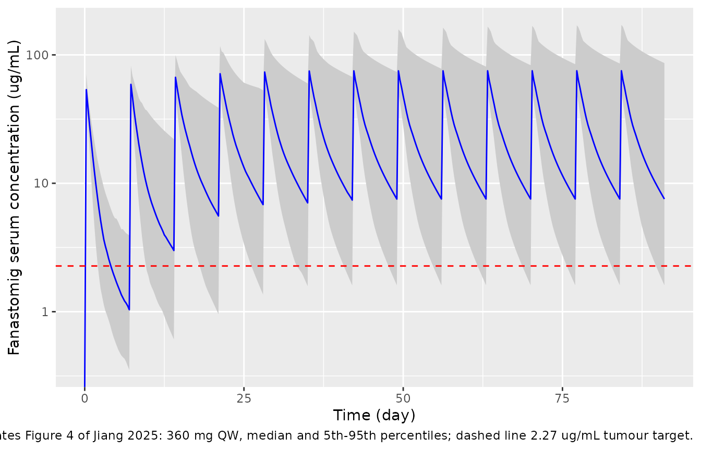
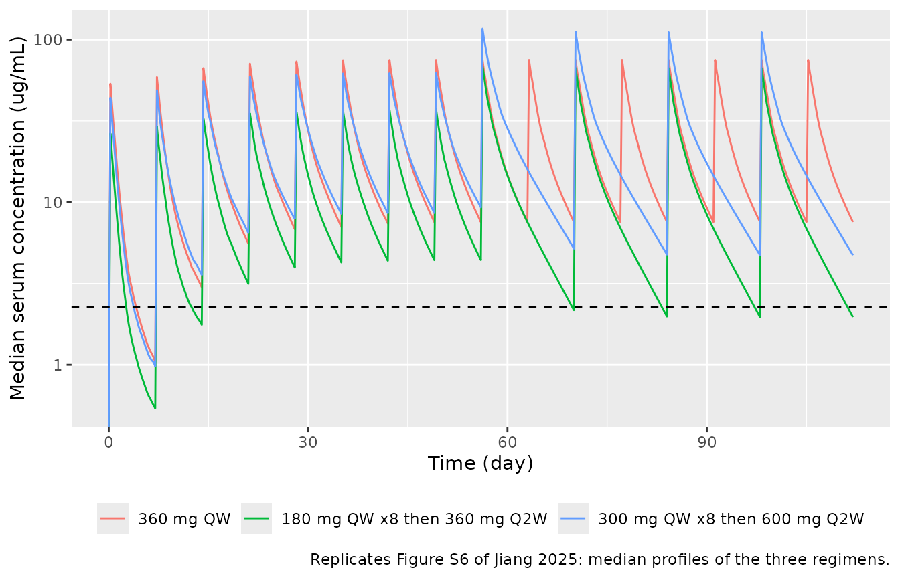
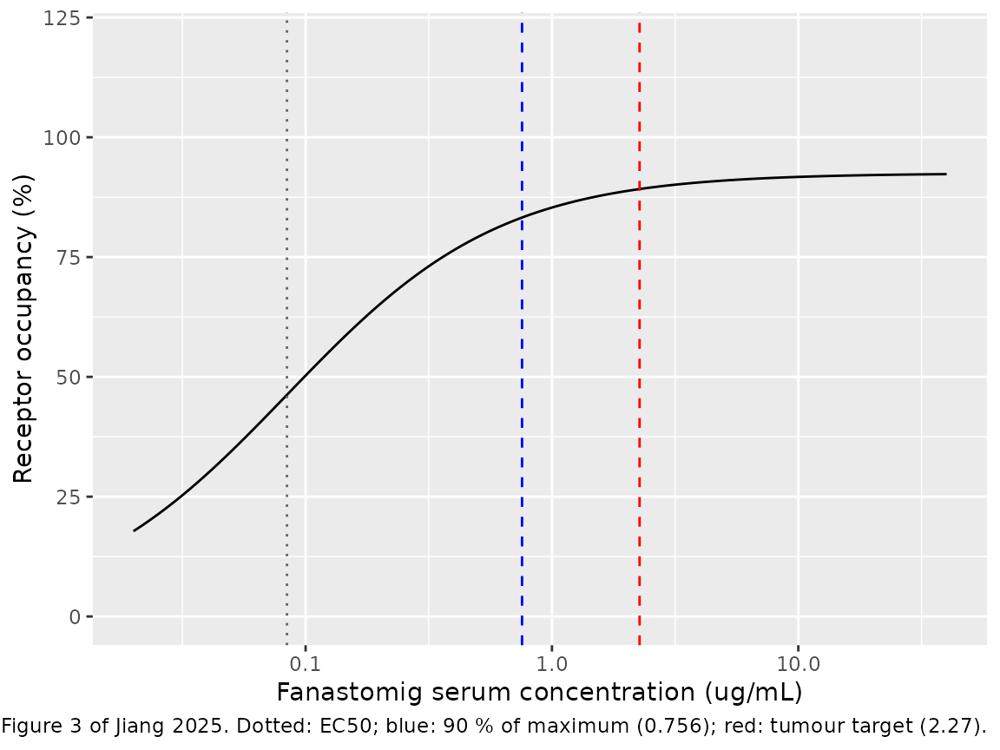

# Fanastomig (Jiang 2025)

## Model and source

- Citation: Jiang C, Ren F, Zhang M, Lu Q, Zeng S, Yang G, Zhu Y. Using
  pharmacokinetic and pharmacodynamic analysis to optimize the dosing
  regimens of fanastomig (EMB-02) in patients with advanced solid
  tumors. CPT Pharmacometrics Syst Pharmacol. 2025;14(5):975-986.
  <doi:10.1002/psp4.70011>.
- Description: Two-compartment population PK model for fanastomig
  (EMB-02; anti-PD-1 x LAG-3 bispecific antibody) with sigmoid I_max
  time-dependent clearance and an albumin effect on central volume, plus
  a direct Emax model of peripheral-blood PD-1 receptor occupancy, in
  adults with advanced solid tumours (Jiang 2025)
- Article: <https://doi.org/10.1002/psp4.70011> (open access;
  PMC12072225)

Fanastomig (EMB-02) is a bispecific antibody against PD-1 and LAG-3.
Jiang 2025 describes its serum pharmacokinetics in the first-in-human
phase 1 study (NCT04618393) with a two-compartment model whose clearance
falls over time following a sigmoid I_max function of time since the
first dose, with serum albumin as the only retained covariate. A direct,
hyperbolic Emax model links serum concentration to PD-1 receptor
occupancy (RO) on peripheral-blood CD3+ T cells. The final Phoenix NLME
model code is printed in the paper’s Data S1.

## Population

Forty-seven adults with advanced solid tumours enrolled in China, the
United States and Australia contributed PK samples. Twelve patients who
had received a PD-1 inhibitor within the previous 4 months had elevated
predose anti-PD-(L)1 concentrations and were excluded, so the final
model was fitted to 625 concentrations from 35 patients. Table S1
summarises the 47 screened patients: median age 61 years (37-83), median
weight 72.0 kg (42.1-107), 59.6% female, 72.3% White, 21.3% Asian, 4.3%
Black; median albumin 38.0 g/L (23.0-49.6). Fanastomig was given
intravenously every week at 6, 20, 60, 180, 360, 600 or 900 mg (dose
escalation) and at 60, 180 or 600 mg (dose enrichment). ADA incidence
was 95.7% (44/46); ADA titre did not change clearance materially.

The same information is available programmatically:

``` r

str(readModelDb("Jiang_2025_fanastomig")()$population)
#> List of 15
#>  $ species         : chr "human"
#>  $ n_subjects      : int 35
#>  $ n_studies       : int 1
#>  $ age_range       : chr "37-83 years"
#>  $ age_median      : chr "61 years"
#>  $ weight_range    : chr "42.1-107 kg"
#>  $ weight_median   : chr "72.0 kg"
#>  $ sex_female_pct  : num 59.6
#>  $ race_ethnicity  : Named num [1:4] 72.3 21.3 4.3 2.1
#>   ..- attr(*, "names")= chr [1:4] "White" "Asian" "Black" "Other"
#>  $ disease_state   : chr "Advanced solid tumours (first-in-human phase 1, NCT04618393)"
#>  $ dose_range      : chr "6, 20, 60, 180, 360, 600 and 900 mg IV QW (Part 1 dose escalation); 60, 180 and 600 mg IV QW (Part 2 dose enrichment)"
#>  $ regions         : chr "China, United States, Australia"
#>  $ albumin_median  : chr "38.0 g/L (range 23.0-49.6)"
#>  $ ada_positive_pct: num 95.7
#>  $ notes           : chr "Demographics are Jiang 2025 Table S1 (all 47 patients with PK data). Twelve patients pretreated with a PD-1 inh"| __truncated__
```

## Source trace

| Equation / parameter | Value | Source location |
|----|----|----|
| `lcl` (CL at t = 0) | log(0.215 L/h) | Table 1 |
| `lvc` (Vc at ALB = 36 g/L) | log(5.20 L) | Table 1 |
| `lq` (Q) | log(0.0463 L/h) | Table 1 |
| `lvp` (Vp) | log(3.15 L) | Table 1 |
| `lcl_time_max` (log abs(Imax)) | log(0.954); Imax = -0.954 | Table 1 |
| `lcl_t50` (T50) | log(180 h) | Table 1 |
| `lcl_time_hill` (Hill) | log(8.49) | Table 1 |
| `e_alb_vc` | -0.924 | Table 1 (‘Effect of ALB’); applied to the central volume per Data S1 |
| `etalvc`, `etalcl`, `etalcl_time_max`, `etalcl_t50` | 0.035, 0.068, 0.416, 0.394 | Table 1 (variances); diagonal per Data S1 `ranef(diag(...))` |
| `propSd` | 0.378 | Table 1 (Prop sigma); Data S1 `CEps = 0.378` |
| `lec50` | log(0.084 mg/L) | Abstract; Results, ‘Receptor Occupancy’ |
| `lemax` | log(92.5 %) | Not printed; digitised from the Figure 3 median curve (see Assumptions) |
| CL(t) = CL0 exp(Imax t^Hill / (t^Hill + T50^Hill)) | n/a | Equation 1; Data S1 `Cl = Cl0*exp(Imax*t^Hill/(t^Hill+T50^Hill))` |
| Vc = tvV (ALB/36)^e_alb_vc exp(eta) | n/a | Data S1 `stparm(V = tvV *(ALB/36)^dVdALB * exp(nV))` |
| Two-compartment ODEs | n/a | Data S1 `deriv(A1 = ...)`, `deriv(A2 = ...)` |
| Cobs = C (1 + eps) | n/a | Equation 4; Data S1 `observe(CObs = C * (1 + CEps))` |
| RO = Emax C / (EC50 + C) | n/a | Methods ‘Receptor Occupancy Assessment’; Results (0.756 ug/mL = 9 x EC50 gives 90 % of maximum) |

## Typical-value identities

These follow from the parameters alone and pin the published statements
exactly.

``` r

mod <- readModelDb("Jiang_2025_fanastomig")
ui <- rxode2::rxode2(mod)
#> ℹ parameter labels from comments will be replaced by 'label()'
th <- ui$theta

imax <- -exp(th[["lcl_time_max"]])
ec50 <- exp(th[["lec50"]])
emax <- exp(th[["lemax"]])

# Results: 'a maximum reduction of 61.5%' in CL over time.
max_reduction <- 1 - exp(imax)
# Results: 0.756 ug/mL maintains 90 % of maximal peripheral RO; 3-fold for tumour.
c90 <- 9 * ec50
ro_c90_frac <- (emax * c90 / (ec50 + c90)) / emax

data.frame(
  quantity = c("Maximum CL reduction (%)", "C for 90 % of max RO (ug/mL)",
               "Tumour target, 3 x C90 (ug/mL)", "RO at C90 / Emax"),
  model = signif(c(100 * max_reduction, c90, 3 * c90, ro_c90_frac), 4),
  published = c(61.5, 0.756, 2.27, 0.90)
) |>
  knitr::kable()
```

| quantity                       |  model | published |
|:-------------------------------|-------:|----------:|
| Maximum CL reduction (%)       | 61.480 |    61.500 |
| C for 90 % of max RO (ug/mL)   |  0.756 |     0.756 |
| Tumour target, 3 x C90 (ug/mL) |  2.268 |     2.270 |
| RO at C90 / Emax               |  0.900 |     0.900 |

``` r


stopifnot(
  abs(100 * max_reduction - 61.5) < 0.05,
  abs(c90 - 0.756) < 1e-9,
  abs(3 * c90 - 2.27) < 0.005,
  abs(ro_c90_frac - 0.9) < 1e-12
)
```

## Virtual cohort

The paper simulated 1000 patients per regimen from posthoc estimates;
the observed data are not public. The cohort below draws the random
effects from the model and albumin from a normal distribution centred on
the Table S1 median (38 g/L, SD 5 g/L, truncated to the observed 23-49.6
g/L range).

Three regimens are simulated, 200 patients each: 360 mg QW (Figure 4),
180 mg QW for 8 doses followed by 360 mg Q2W, and 300 mg QW for 8 doses
followed by 600 mg Q2W (Table S3, Figure S6). Infusions last 1 hour.

``` r

set.seed(20250311)
rxode2::rxSetSeed(20250311)

n_per_arm <- 200L
tau_end <- 2688 # h; end of the 12th dosing interval of the Q2W regimens

regimens <- list(
  "360 mg QW" = data.frame(time = (0:15) * 168, amt = 360),
  "180 mg QW x8 then 360 mg Q2W" = data.frame(
    time = c((0:7) * 168, 1344 + (0:3) * 336), amt = c(rep(180, 8), rep(360, 4))
  ),
  "300 mg QW x8 then 600 mg Q2W" = data.frame(
    time = c((0:7) * 168, 1344 + (0:3) * 336), amt = c(rep(300, 8), rep(600, 4))
  )
)

obs_times <- sort(unique(c(seq(0, tau_end, by = 6), 840, 2688)))

make_cohort <- function(n, doses, regimen, id_offset) {
  ids <- id_offset + seq_len(n)
  alb <- pmin(pmax(rnorm(n, 38, 5), 23), 49.6)
  dose_rows <- tidyr::expand_grid(id = ids, doses) |>
    dplyr::mutate(evid = 1L, cmt = "central", dur = 1)
  obs_rows <- tidyr::expand_grid(id = ids, time = obs_times) |>
    dplyr::mutate(amt = 0, evid = 0L, cmt = "central", dur = 0)
  dplyr::bind_rows(dose_rows, obs_rows) |>
    dplyr::left_join(data.frame(id = ids, ALB = alb), by = "id") |>
    dplyr::mutate(regimen = regimen) |>
    dplyr::arrange(id, time, dplyr::desc(evid))
}

events <- dplyr::bind_rows(lapply(seq_along(regimens), function(i) {
  make_cohort(n_per_arm, regimens[[i]], names(regimens)[i],
              id_offset = (i - 1L) * n_per_arm)
}))
stopifnot(!anyDuplicated(unique(events[, c("id", "time", "evid")])))
```

## Simulation

``` r

sim <- rxode2::rxSolve(mod, events = events, keep = "regimen") |>
  as.data.frame() |>
  dplyr::mutate(regimen = factor(regimen, levels = names(regimens)))
#> ℹ parameter labels from comments will be replaced by 'label()'
```

## Trough concentrations (Table S3)

Table S3 reports the mean and the 10th-50th percentiles of the simulated
trough after the 5th and the 12th dose. “Trough after the k-th dose” is
taken as the concentration at the end of the k-th dosing interval: 840 h
for the 5th weekly dose, and 2688 h for the 12th dose of the Q2W
regimens (by then the Q2W regimens are at steady state, so the troughs
before and after the 12th dose agree).

Two Table S3 cells are misprinted: the 5th-dose P50 of the two loading
regimens repeats their P10 (1.05 and 1.75 ug/mL), which cannot be a
median that sits below the P30 printed beside it. They are excluded from
the comparison.

``` r

published_s3 <- tibble::tribble(
  ~regimen,                         ~dose_no, ~mean, ~P10, ~P20, ~P30, ~P50,
  "360 mg QW",                      5,        19.46, 2.19, 3.53, 5.10, 9.03,
  "180 mg QW x8 then 360 mg Q2W",   5,         9.51, 1.05, 1.72, 2.37, NA,
  "180 mg QW x8 then 360 mg Q2W",   12,       11.46, 0.34, 0.60, 0.91, 2.06,
  "300 mg QW x8 then 600 mg Q2W",   5,        16.29, 1.75, 2.75, 4.02, NA,
  "300 mg QW x8 then 600 mg Q2W",   12,       19.99, 0.55, 0.98, 1.55, 3.67
)

trough_time <- c(`5` = 840, `12` = 2688)

sim_s3 <- published_s3 |>
  dplyr::select(regimen, dose_no) |>
  dplyr::rowwise() |>
  dplyr::mutate(
    ctr = list(sim$Cc[sim$regimen == regimen & sim$time == trough_time[[as.character(dose_no)]]])
  ) |>
  dplyr::ungroup()
stopifnot(all(lengths(sim_s3$ctr) == n_per_arm))

sim_s3 <- sim_s3 |>
  dplyr::mutate(
    mean = vapply(ctr, mean, numeric(1)),
    P10 = vapply(ctr, quantile, numeric(1), probs = 0.1),
    P20 = vapply(ctr, quantile, numeric(1), probs = 0.2),
    P30 = vapply(ctr, quantile, numeric(1), probs = 0.3),
    P50 = vapply(ctr, quantile, numeric(1), probs = 0.5)
  ) |>
  dplyr::select(-ctr)

cmp_s3 <- dplyr::inner_join(
  tidyr::pivot_longer(published_s3, mean:P50, names_to = "statistic", values_to = "published"),
  tidyr::pivot_longer(sim_s3, mean:P50, names_to = "statistic", values_to = "simulated"),
  by = c("regimen", "dose_no", "statistic")
) |>
  dplyr::filter(!is.na(published)) |>
  dplyr::mutate(pct_diff = 100 * (simulated / published - 1))

cmp_s3 |>
  dplyr::mutate(simulated = signif(simulated, 3), pct_diff = round(pct_diff)) |>
  dplyr::rename(
    "Regimen" = regimen, "Dose no." = dose_no, "Statistic" = statistic,
    "Published (ug/mL)" = published, "Simulated (ug/mL)" = simulated,
    "Difference (%)" = pct_diff
  ) |>
  knitr::kable(caption = "Simulated vs. Table S3 trough concentrations (200 patients per regimen vs. 1000 in the paper).")
```

| Regimen | Dose no. | Statistic | Published (ug/mL) | Simulated (ug/mL) | Difference (%) |
|:---|---:|:---|---:|---:|---:|
| 360 mg QW | 5 | mean | 19.46 | 17.100 | -12 |
| 360 mg QW | 5 | P10 | 2.19 | 1.950 | -11 |
| 360 mg QW | 5 | P20 | 3.53 | 3.060 | -13 |
| 360 mg QW | 5 | P30 | 5.10 | 3.980 | -22 |
| 360 mg QW | 5 | P50 | 9.03 | 7.040 | -22 |
| 180 mg QW x8 then 360 mg Q2W | 5 | mean | 9.51 | 8.790 | -8 |
| 180 mg QW x8 then 360 mg Q2W | 5 | P10 | 1.05 | 0.962 | -8 |
| 180 mg QW x8 then 360 mg Q2W | 5 | P20 | 1.72 | 1.450 | -16 |
| 180 mg QW x8 then 360 mg Q2W | 5 | P30 | 2.37 | 2.070 | -13 |
| 180 mg QW x8 then 360 mg Q2W | 12 | mean | 11.46 | 9.560 | -17 |
| 180 mg QW x8 then 360 mg Q2W | 12 | P10 | 0.34 | 0.292 | -14 |
| 180 mg QW x8 then 360 mg Q2W | 12 | P20 | 0.60 | 0.484 | -19 |
| 180 mg QW x8 then 360 mg Q2W | 12 | P30 | 0.91 | 0.775 | -15 |
| 180 mg QW x8 then 360 mg Q2W | 12 | P50 | 2.06 | 1.960 | -5 |
| 300 mg QW x8 then 600 mg Q2W | 5 | mean | 16.29 | 14.800 | -9 |
| 300 mg QW x8 then 600 mg Q2W | 5 | P10 | 1.75 | 1.730 | -1 |
| 300 mg QW x8 then 600 mg Q2W | 5 | P20 | 2.75 | 3.290 | 19 |
| 300 mg QW x8 then 600 mg Q2W | 5 | P30 | 4.02 | 4.200 | 5 |
| 300 mg QW x8 then 600 mg Q2W | 12 | mean | 19.99 | 13.200 | -34 |
| 300 mg QW x8 then 600 mg Q2W | 12 | P10 | 0.55 | 0.540 | -2 |
| 300 mg QW x8 then 600 mg Q2W | 12 | P20 | 0.98 | 1.180 | 20 |
| 300 mg QW x8 then 600 mg Q2W | 12 | P30 | 1.55 | 1.670 | 8 |
| 300 mg QW x8 then 600 mg Q2W | 12 | P50 | 3.67 | 4.720 | 29 |

Simulated vs. Table S3 trough concentrations (200 patients per regimen
vs. 1000 in the paper). {.table style="width:100%;"}

The percentiles track Table S3 closely. The mean is dominated by the few
patients with a small time-dependent CL reduction or a late T50, so it
moves more from one cohort draw to the next than the percentiles do.

``` r

pct <- cmp_s3$pct_diff[cmp_s3$statistic != "mean"]
stopifnot(
  length(pct) == 18L,
  # Structural: a wrong T50 unit, Imax sign or volume moves every percentile
  # by a factor of several; this holds for any 200-patient draw.
  abs(median(pct)) < 20,
  # Envelope over the 18 percentile cells; 200-patient draws put the 90th
  # percentile at about 20-35 %.
  quantile(abs(pct), 0.9) < 45
)
```

## Simulated concentration-time profiles (Figure 4 and Figure S6)

``` r

sim |>
  dplyr::filter(regimen == "360 mg QW", time <= 13 * 168) |>
  dplyr::group_by(time) |>
  dplyr::summarise(
    Q05 = quantile(Cc, 0.05), Q50 = quantile(Cc, 0.5), Q95 = quantile(Cc, 0.95),
    .groups = "drop"
  ) |>
  ggplot(aes(time / 24, Q50)) +
  geom_ribbon(aes(ymin = Q05, ymax = Q95), fill = "grey80") +
  geom_line(colour = "blue") +
  geom_hline(yintercept = 2.27, linetype = "dashed", colour = "red") +
  scale_y_log10() +
  labs(x = "Time (day)", y = "Fanastomig serum concentration (ug/mL)",
       caption = "Replicates Figure 4 of Jiang 2025: 360 mg QW, median and 5th-95th percentiles; dashed line 2.27 ug/mL tumour target.")
#> Warning in scale_y_log10(): log-10 transformation introduced infinite values.
#> log-10 transformation introduced infinite values.
#> log-10 transformation introduced infinite values.
#> log-10 transformation introduced infinite values.
```



``` r

sim |>
  dplyr::group_by(regimen, time) |>
  dplyr::summarise(Q50 = median(Cc), .groups = "drop") |>
  ggplot(aes(time / 24, Q50, colour = regimen)) +
  geom_line() +
  geom_hline(yintercept = 2.27, linetype = "dashed") +
  scale_y_log10() +
  labs(x = "Time (day)", y = "Median serum concentration (ug/mL)", colour = NULL,
       caption = "Replicates Figure S6 of Jiang 2025: median profiles of the three regimens.") +
  theme(legend.position = "bottom")
#> Warning in scale_y_log10(): log-10 transformation introduced infinite values.
```



The paper describes the share of patients whose trough exceeds the 2.27
ug/mL tumour target:

``` r

attain <- function(reg, t) mean(sim$Cc[sim$regimen == reg & sim$time == t] > 2.27)
data.frame(
  statement = c(
    "360 mg QW, after 5th dose: about 90 % (Table S3 P10 = 2.19)",
    "180 mg loading, after 5th dose: approximately 70 %",
    "180 mg loading, after 12th dose: approximately 50 %",
    "300 mg loading, after 12th dose: nearly 70 %"
  ),
  simulated_pct = round(100 * c(
    attain("360 mg QW", 840),
    attain("180 mg QW x8 then 360 mg Q2W", 840),
    attain("180 mg QW x8 then 360 mg Q2W", 2688),
    attain("300 mg QW x8 then 600 mg Q2W", 2688)
  ))
) |>
  knitr::kable()
```

| statement                                                   | simulated_pct |
|:------------------------------------------------------------|--------------:|
| 360 mg QW, after 5th dose: about 90 % (Table S3 P10 = 2.19) |            86 |
| 180 mg loading, after 5th dose: approximately 70 %          |            68 |
| 180 mg loading, after 12th dose: approximately 50 %         |            46 |
| 300 mg loading, after 12th dose: nearly 70 %                |            66 |

## Albumin effect (Figure 2)

Figure 2 shows Cmax and AUC at steady state for albumin 23 and 50 g/L
relative to 38 g/L. The typical-value simulation below uses 360 mg QW
and the 13th dosing interval.

``` r

alb_ev <- function(alb, id) {
  dplyr::bind_rows(
    data.frame(id = id, time = (0:12) * 168, amt = 360, evid = 1L, dur = 1),
    data.frame(id = id, time = seq(12 * 168, 13 * 168, by = 0.25), amt = 0, evid = 0L, dur = 0)
  ) |>
    dplyr::mutate(cmt = "central", ALB = alb) |>
    dplyr::arrange(time, dplyr::desc(evid))
}
ev_alb <- dplyr::bind_rows(alb_ev(23, 1L), alb_ev(38, 2L), alb_ev(50, 3L))
sim_alb <- rxode2::rxSolve(rxode2::zeroRe(mod), events = ev_alb) |>
  as.data.frame() |>
  dplyr::mutate(ALB = c(23, 38, 50)[id])
#> ℹ parameter labels from comments will be replaced by 'label()'
#> ℹ omega/sigma items treated as zero: 'etalvc', 'etalcl', 'etalcl_time_max', 'etalcl_t50'
#> Warning: multi-subject simulation without without 'omega'

expo <- sim_alb |>
  dplyr::group_by(ALB) |>
  dplyr::summarise(
    cmax = max(Cc),
    auc = sum(diff(time) * (head(Cc, -1) + tail(Cc, -1)) / 2),
    .groups = "drop"
  )
ref <- expo[expo$ALB == 38, ]
alb_tab <- expo |>
  dplyr::filter(ALB != 38) |>
  dplyr::transmute(
    ALB,
    cmax_ratio = cmax / ref$cmax,
    auc_ratio = auc / ref$auc,
    cmax_published = c(0.75, 1.12),
    auc_published = c(0.83, 1.14)
  )
alb_tab |>
  dplyr::mutate(dplyr::across(c(cmax_ratio, auc_ratio), \(x) round(x, 2))) |>
  dplyr::rename(
    "ALB (g/L)" = ALB, "Cmax ratio (model)" = cmax_ratio, "AUC ratio (model)" = auc_ratio,
    "Cmax ratio (Fig. 2)" = cmax_published, "AUC ratio (Fig. 2)" = auc_published
  ) |>
  knitr::kable(caption = "Exposure at albumin 23 and 50 g/L relative to 38 g/L (typical patient, 360 mg QW, 13th interval).")
```

| ALB (g/L) | Cmax ratio (model) | AUC ratio (model) | Cmax ratio (Fig. 2) | AUC ratio (Fig. 2) |
|---:|---:|---:|---:|---:|
| 23 | 0.71 | 1 | 0.75 | 0.83 |
| 50 | 1.24 | 1 | 1.12 | 1.14 |

Exposure at albumin 23 and 50 g/L relative to 38 g/L (typical patient,
360 mg QW, 13th interval). {.table}

``` r


# Deterministic: lower albumin -> larger Vc -> lower Cmax, within the Figure 2
# 90 % CI at 23 g/L (0.65-0.85).
cmax23 <- alb_tab$cmax_ratio[alb_tab$ALB == 23]
stopifnot(cmax23 > 0.65, cmax23 < 0.85)
```

The Cmax ratio at 23 g/L (0.71) falls inside the Figure 2 interval
(0.65-0.85); at 50 g/L the model gives 1.24 against a published 1.12
(0.99-1.32). A volume effect leaves the steady-state AUC over a dosing
interval equal to dose / CL, so the model’s AUC ratio is 1, while Figure
2 shows 0.83 and 1.14. The paper does not define the AUC window used in
the forest plot; an AUC over a window that ends before steady state, or
one that includes the time-dependent CL change, would depend on Vc and
could explain the difference.

## PD-1 receptor occupancy (Figure 3)

``` r

ro_curve <- data.frame(Cc = 10^seq(log10(0.02), log10(40), length.out = 200)) |>
  dplyr::mutate(RO = emax * Cc / (ec50 + Cc))

ggplot(ro_curve, aes(Cc, RO)) +
  geom_line() +
  geom_vline(xintercept = c(ec50, c90, 3 * c90), linetype = c("dotted", "dashed", "dashed"),
             colour = c("grey40", "blue", "red")) +
  scale_x_log10() +
  coord_cartesian(ylim = c(0, 120)) +
  labs(x = "Fanastomig serum concentration (ug/mL)", y = "Receptor occupancy (%)",
       caption = paste("Replicates the median curve of Figure 3 of Jiang 2025.",
                       "Dotted: EC50; blue: 90 % of maximum (0.756); red: tumour target (2.27)."))
```



The `RO` column of a simulation applies the same curve at every time
point. Its median at the trough times of the first, fifth and twelfth
weekly dosing intervals:

``` r

sim |>
  dplyr::filter(time %in% c(168, 840, 2016)) |>
  dplyr::group_by(regimen, time) |>
  dplyr::summarise(median_RO = round(median(RO), 1), .groups = "drop") |>
  tidyr::pivot_wider(names_from = time, values_from = median_RO, names_prefix = "t = ") |>
  knitr::kable(caption = "Median peripheral PD-1 RO (%) at the trough times 168, 840 and 2016 h.")
```

| regimen                      | t = 168 | t = 840 | t = 2016 |
|:-----------------------------|--------:|--------:|---------:|
| 360 mg QW                    |    85.6 |    91.4 |     91.5 |
| 180 mg QW x8 then 360 mg Q2W |    80.0 |    90.7 |     88.7 |
| 300 mg QW x8 then 600 mg Q2W |    85.2 |    91.6 |     90.9 |

Median peripheral PD-1 RO (%) at the trough times 168, 840 and 2016 h.
{.table}

## PKNCA validation

The paper reports no NCA table. PKNCA is run on the first dosing
interval and on a late interval of each regimen to document exposure;
the half-life row uses the derived two-compartment half-lives, which the
paper summarises as a model-estimated median of 3.7 days.

``` r

sim_nca <- sim |>
  dplyr::filter(!is.na(Cc)) |>
  dplyr::select(id, time, Cc, regimen)
sim_nca <- dplyr::bind_rows(
  sim_nca,
  sim_nca |> dplyr::distinct(id, regimen) |> dplyr::mutate(time = 0, Cc = 0)
) |>
  dplyr::distinct(id, regimen, time, .keep_all = TRUE) |>
  dplyr::arrange(id, regimen, time)

dose_df <- events |>
  dplyr::filter(evid == 1) |>
  dplyr::select(id, time, amt, regimen)

conc_obj <- PKNCA::PKNCAconc(sim_nca, Cc ~ time | regimen + id)
dose_obj <- PKNCA::PKNCAdose(dose_df, amt ~ time | regimen + id)

# Trough: `ctrough` (end of interval) for the first interval, whose minimum is
# the predose zero; `cmin` for the late intervals, where the minimum is the
# end-of-interval trough (PKNCA returns `ctrough` as NA for an interval that
# does not start at time 0).
intervals <- data.frame(
  start = c(0, 2016, 2352),
  end = c(168, 2184, 2688),
  cmax = TRUE,
  tmax = TRUE,
  auclast = TRUE,
  ctrough = c(TRUE, FALSE, FALSE),
  cmin = c(FALSE, TRUE, TRUE)
)
nca_res <- PKNCA::pk.nca(PKNCA::PKNCAdata(conc_obj, dose_obj, intervals = intervals))

nca_tab <- as.data.frame(nca_res) |>
  dplyr::filter(PPTESTCD %in% c("cmax", "ctrough", "cmin", "auclast")) |>
  dplyr::mutate(PPTESTCD = dplyr::if_else(PPTESTCD %in% c("ctrough", "cmin"), "trough", PPTESTCD)) |>
  dplyr::group_by(regimen, start, end, PPTESTCD) |>
  dplyr::summarise(median = signif(median(PPORRES, na.rm = TRUE), 3), .groups = "drop") |>
  tidyr::pivot_wider(names_from = PPTESTCD, values_from = median)

# Late intervals: the 13th weekly interval for 360 mg QW, the 12th (Q2W)
# interval for the loading regimens.
nca_tab |>
  dplyr::filter(
    start == 0 |
      (regimen == "360 mg QW" & start == 2016) |
      (regimen != "360 mg QW" & start == 2352)
  ) |>
  dplyr::rename(
    "Regimen" = regimen, "Start (h)" = start, "End (h)" = end,
    "Cmax (ug/mL)" = cmax, "Trough (ug/mL)" = trough, "AUClast (ug*h/mL)" = auclast
  ) |>
  knitr::kable(caption = "Median simulated NCA parameters by regimen and interval.")
```

| Regimen | Start (h) | End (h) | AUClast (ug\*h/mL) | Cmax (ug/mL) | Trough (ug/mL) |
|:---|---:|---:|---:|---:|---:|
| 180 mg QW x8 then 360 mg Q2W | 0 | 168 | 703 | 26.5 | 0.539 |
| 180 mg QW x8 then 360 mg Q2W | 2352 | 2688 | 4070 | 66.9 | 1.960 |
| 300 mg QW x8 then 600 mg Q2W | 0 | 168 | 1200 | 44.0 | 0.977 |
| 300 mg QW x8 then 600 mg Q2W | 2352 | 2688 | 7860 | 111.0 | 4.720 |
| 360 mg QW | 0 | 168 | 1450 | 53.7 | 1.040 |
| 360 mg QW | 2016 | 2184 | 3920 | 75.2 | 7.540 |

Median simulated NCA parameters by regimen and interval. {.table}

``` r

# Individual two-compartment terminal half-lives at the first dose (CL0) and
# after the time-dependent decrease has completed (CL0 * exp(Imax)).
indiv <- sim |>
  dplyr::filter(time == 0) |>
  dplyr::select(id, cl0, cl_time_max_i, vc, vp, q)
beta_hl <- function(cl, vc, vp, q) {
  k10 <- cl / vc; k12 <- q / vc; k21 <- q / vp
  s <- k10 + k12 + k21
  beta <- (s - sqrt(s^2 - 4 * k10 * k21)) / 2
  log(2) / beta / 24
}
hl <- data.frame(
  phase = c("t = 0", "t >> T50"),
  median_half_life_day = round(c(
    median(beta_hl(indiv$cl0, indiv$vc, indiv$vp, indiv$q)),
    median(beta_hl(indiv$cl0 * exp(indiv$cl_time_max_i), indiv$vc, indiv$vp, indiv$q))
  ), 2)
)
knitr::kable(hl, caption = "Median terminal half-life (day); the paper reports a model-estimated median of 3.7 days.")
```

| phase      | median_half_life_day |
|:-----------|---------------------:|
| t = 0      |                 2.53 |
| t \>\> T50 |                 4.03 |

Median terminal half-life (day); the paper reports a model-estimated
median of 3.7 days. {.table}

The published 3.7 days falls between the median half-life at the first
dose and after the clearance decrease has completed. The paper does not
say at which time it evaluated the half-life.

## Assumptions and deviations

- **Albumin acts on the central volume.** Table 1 labels the covariate
  row “Effect of ALB on V p”, but the final model code in Data S1
  applies it to the central volume
  (`stparm(V = tvV *(ALB/36)^dVdALB * exp(nV))`; `V2` is the peripheral
  volume and carries no covariate). Figure 2 confirms this. Lower
  albumin cuts Cmax by 25%, which a central-volume effect reproduces
  (0.71 here) and a peripheral-volume effect cannot (Cmax ratio 1.00 in
  a simulation with the effect moved to Vp).
- **Albumin reference 36 g/L.** The model code divides by 36 g/L. Table
  S1 reports a median of 38 g/L for all 47 screened patients, but the 35
  patients in the final model are a subset of them.
- **Parameter values from Table 1.** The Data S1 code carries slightly
  different digits from a re-run of the final model (for example T50
  180.57 h, Imax -0.958, Hill 8.507, omega2 Imax 0.411). The published
  Table 1 estimates are used.
- **Emax digitised.** The paper reports only EC50 (0.084 ug/mL) for the
  RO model. Its statement that 0.756 ug/mL (9 x EC50) maintains 90% of
  the maximal RO fixes a hyperbolic shape with no Hill coefficient. The
  maximal occupancy is not printed; the maintainers digitised the Figure
  3 median curve (91-92.5% between 3 and 28.5 ug/mL) and set Emax to
  92.5%. The paper reports no inter-individual or residual variability
  for RO, so `RO` is a deterministic output.
- **Time since first dose.** CL(t) uses the model time `t`, the time
  since the patient’s first dose, matching Phoenix’s `t` in Data S1.
- **Infusion duration.** The paper does not state the infusion length.
  The simulations use 1-hour infusions; Data S1 doses into A1 at a rate
  set in the data.
- **Albumin distribution.** Normal, mean 38 g/L, SD 5 g/L, truncated to
  the Table S1 range; the paper gives only the median and range.
- **Exposure-response and ADA analyses not encoded.** The logistic
  regressions of anaphylaxis on Cmax and AUC and the correlations of
  tumour-size change with Ctrough and AUC were not significant, and the
  paper prints no coefficients. The ADA-titre analyses are exploratory
  comparisons (Wilcoxon tests). None of these define a model to encode.
- No erratum or correction notice was found for this article (EuropePMC,
  checked 2026-11-04).
