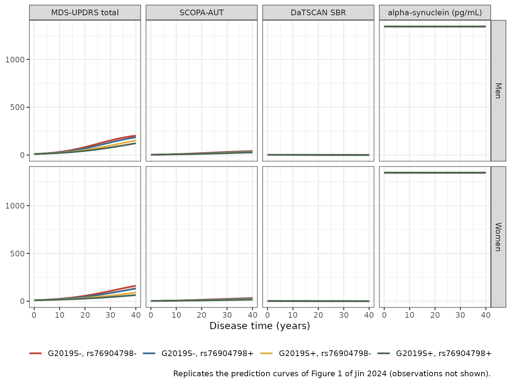
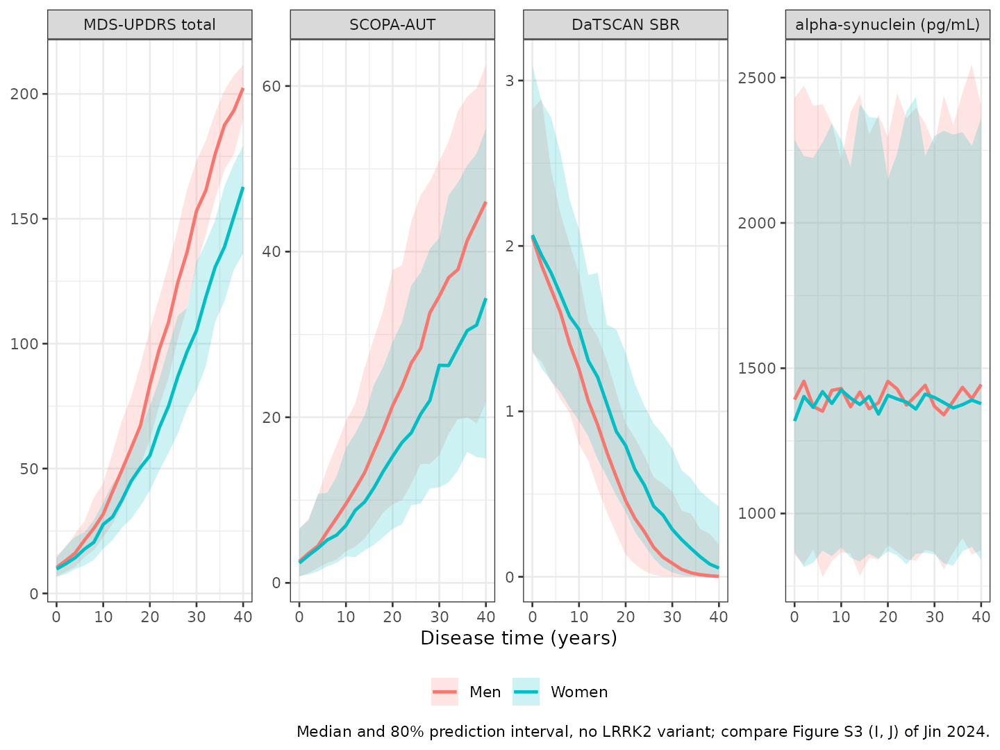

# Parkinson's disease progression with sex and LRRK2 effects (Jin 2024)

## Model and source

- Citation: Jin R, Yoshioka H, Sato H, Hisaka A. Data-driven disease
  progression model of Parkinson’s disease and effect of sex and genetic
  variants. *CPT Pharmacometrics Syst Pharmacol.* 2024;13(4):649.
- Article: <https://doi.org/10.1002/psp4.13112> (open access,
  PMC11015075)

This is a **disease-progression model** with no drug input. Jin et
al. fitted four Parkinson’s disease (PD) biomarkers from the Parkinson’s
Progression Markers Initiative (PPMI) jointly with SReFT (Statistical
Restoration of Fragmented Time course), a NONMEM-based method that
places each subject’s few years of observations on a common
**disease-time** axis and so rebuilds a 30-40 year trajectory from a
median of 6 years of follow-up per patient.

Each biomarker $`j`$ follows a log-Gompertz curve on its
log-standardized scale $`Y`$ (Methods, Equation 1):

``` math
Y_{ij}(t) = \alpha_{ij} + \frac{\beta_{ij}}{\gamma_{ij}} \left( e^{\gamma_{ij}\, d_{T,i}\, t} - 1 \right),
\qquad
d_{T,i} = 1 + d_{T,\text{Sex}}\,\text{Sex}_i + d_{T,\text{G2019S}}\,\text{G2019S}_i + d_{T,\text{rs76904798}}\,\text{rs76904798}_i
```

where $`t`$ is disease time in years (onset, $`t = 0`$, is defined as
MDS-UPDRS Part I-III total = 10) and the single progression factor
$`d_T`$ stretches or compresses disease time for **every** biomarker at
once. A factor below 1 is slower progression.

| Biomarker | Fitted output | Raw-scale output | Transformation to $`Y`$ (Equations 3-4 and Data S1) |
|----|----|----|----|
| MDS-UPDRS Part I-III total (0-236 points) | `updrs_z` | `updrs` | $`X = (x + 0.5)/237`$, $`y = X/(1 - X)`$, $`Y = (\log y + 1.6702)/0.57152`$ |
| SCOPA-AUT (0-69 points) | `scopaaut_z` | `scopaaut` | $`X = (x + 0.5)/70`$, $`y = X/(1 - X)`$, $`Y = (\log y + 1.6641)/0.83675`$ |
| DaTSCAN mean-striatum specific binding ratio | `datscan_z` | `datscan` | $`Y = (\log x - 0.13179)/0.36341`$ |
| CSF alpha-synuclein (pg/mL) | `asyn_z` | `asyn` | $`Y = (\log x - 7.1978)/0.41332`$ |

In nlmixr2lib names, $`\alpha, \beta, \gamma`$ are `gomp_alpha_<bm>`,
`gomp_beta_<bm>`, `gomp_gamma_<bm>`, $`d_T`$ is `ftdis`, and the
covariate effects are `e_sexf_ftdis`, `e_snp_lrrk2_rs34637584_ftdis`
(G2019S) and `e_snp_lrrk2_rs76904798_ftdis`.

**Model time is disease time.** SReFT does not estimate each subject’s
offset (years from onset to study entry) as a random effect; it solves
it at every iteration by an inverse-Gompertz average (Equation 2). The
packaged model therefore takes disease time directly as `time`, exactly
as the authors’ own final-model simulation program does. A user who has
study-time data and an offset for a subject adds the offset to `time`.

## Population

481 PPMI participants with PD (de novo PD cohort plus the genetic cohort
and genetic registry participants with PD), Table 1:

- 298 men and 183 women (38.0% female); mean (SD) age 61.52 (9.67) years
  at inclusion.
- 94.6% White, 1.46% Black, 1.66% Asian, 2.29% other.
- Mean disease duration since diagnosis 0.90 years; Hoehn and Yahr stage
  I in 40.1% and II in 57.8% at baseline.
- LRRK2 G2019S carriers 63 (13.1%), rs76904798 carriers 129 (26.8%),
  carriers of both 11 (2.3%) (Results). Genotypes were dichotomized as
  “at least one mutant allele”.
- Observations: 5916 MDS-UPDRS, 3521 SCOPA-AUT, 1529 DaTSCAN and 1685
  alpha-synuclein, over up to 8, 9, 4 and 3 years respectively.

The same information is available programmatically:

``` r

mod_fn <- readModelDb("Jin_2024_parkinson_progression")
mod <- rxode2::rxode2(mod_fn)
#> ℹ parameter labels from comments will be replaced by 'label()'
str(mod$meta$population, give.attr = FALSE)
#> List of 15
#>  $ species       : chr "human"
#>  $ n_subjects    : int 481
#>  $ n_studies     : int 1
#>  $ age_range     : chr "mean (SD) 61.52 (9.67) years at study inclusion (Table 1); PPMI required age >= 30 years at diagnosis"
#>  $ age_median    : chr NA
#>  $ weight_range  : chr NA
#>  $ weight_median : chr NA
#>  $ sex_female_pct: num 38
#>  $ race_ethnicity: Named num [1:4] 94.6 1.46 1.66 2.29
#>  $ disease_state : chr "Parkinson's disease: PPMI de novo PD cohort plus the genetic cohort and genetic registry participants with PD ("| __truncated__
#>  $ dose_range    : chr "n/a (no drug input; PD medication could start at any time after enrollment and was not modelled)"
#>  $ regions       : chr "PPMI international multicentre study (sites not itemized in the paper)"
#>  $ genotype      : chr "LRRK2 G2019S carriers 63 (13.1%), rs76904798 carriers 129 (26.8%), both 11 (2.3%) (Results; Table 1)"
#>  $ n_observations: Named int [1:4] 5916 3521 1529 1685
#>  $ notes         : chr "Observation periods up to 8 (MDS-UPDRS), 9 (SCOPA-AUT), 4 (DaTSCAN) and 3 (alpha-synuclein) years; SReFT aligns"| __truncated__
```

## Source trace

Typical values come from the authors’ final-model simulation program in
Data S1 (`Simultation_Finalmodel.R`, whose `$THETA` / `$OMEGA` /
`$SIGMA` it states are the final model’s). They agree with Table 2 to
its printed precision except where noted in the Assumptions and
deviations section.

| Quantity | nlmixr2lib name | Value | Source |
|----|----|----|----|
| Model equation | `updrs_z` … `asyn_z` | log-Gompertz | Methods Equation 1; Data S1 `pred_sreft_sim_final.f90` |
| Progression factor | `ftdis` | $`1 + \sum d_{T,k} \cdot \text{cov}_k`$ | Methods Equation 1; Data S1 `covt` |
| Score scaling | (in `model()`) | Xmax 236, 69 | Methods Equations 3-4; Data S1 `.XMAX` |
| Standardization means | (in `model()`) | -1.6702, -1.6641, 0.13179, 7.1978 | Data S1 `AVEBM` |
| Standardization SDs | (in `model()`) | 0.57152, 0.83675, 0.36341, 0.41332 | Data S1 `SDBM` |
| alpha, MDS-UPDRS | `gomp_alpha_updrs` | -2.4517 (fixed) | Data S1 THETA(1); Table 2 -2.45 (fixed) |
| alpha, SCOPA-AUT / DaTSCAN / aSyn | `gomp_alpha_scopaaut`, `_datscan`, `_asyn` | -1.6802, 1.5773, 0.015194 | Data S1 THETA(2-4); Table 2 |
| beta, all four | `gomp_beta_<bm>` | 0.21741, 0.16796, -0.091738, -4.0855e-5 | Data S1 THETA(5-8); Table 2 |
| gamma, all four | `gomp_gamma_<bm>` | -0.0010217, -0.026625, 0.069864, -0.079492 | Data S1 THETA(9-12); Table 2 |
| dT, women | `e_sexf_ftdis` | -0.216 | Data S1 THETA(13); Results; Table 2 |
| dT, G2019S | `e_snp_lrrk2_rs34637584_ftdis` | -0.254 | Data S1 THETA(14); Results and Abstract |
| dT, rs76904798 | `e_snp_lrrk2_rs76904798_ftdis` | -0.104 | Data S1 THETA(15); Results; Table 2 |
| IIV variance, beta MDS-UPDRS | `etagomp_beta_updrs` | 1.87e-9 | Data S1 \$OMEGA |
| IIV variances, alpha | `etagomp_alpha_scopaaut`, `_datscan`, `_asyn` | 0.49882, 0.63096, 0.76947 | Data S1 \$OMEGA; Table 2 |
| IIV variances, gamma | `etagomp_gamma_scopaaut`, `_datscan`, `_asyn` | 2.1902e-4, 0.0012104, 5.6341e-4 | Data S1 \$OMEGA; Table 2 |
| Residual variances | `addSd_<bm>_z` (as SD) | 0.29943, 0.2489, 0.13736, 0.21598 | Data S1 \$SIGMA; Table 2 ‘Residuals’ |

## Reproduction of the authors’ published predictions

The Data S1 archive includes the output table of the authors’
final-model simulation (`table_40subjects.csv`), whose `PRED` column is
the typical-value prediction on the log-standardized scale for every
disease year from -5 to 40, biomarker and covariate combination. The
packaged model reproduces all 1312 rows with non-negative disease time
to within 5e-6 (the table is printed to five decimals). The 24 values
below, men without either variant and women carrying both, at disease
years 10, 20 and 30, are a known-answer check. Both sides use the same
parameters, so the only difference is the rounding of the published
table and the tolerance is tight.

``` r

ref <- data.frame(
  time = rep(c(10, 20, 30), 8),
  bm = rep(rep(c("updrs_z", "scopaaut_z", "datscan_z", "asyn_z"), each = 3), 2),
  SEXF = rep(c(0, 1), each = 12),
  SNP_LRRK2_RS34637584 = rep(c(0, 1), each = 12),
  SNP_LRRK2_RS76904798 = rep(c(0, 1), each = 12),
  PRED = c(
    -0.28867, 1.85238, 3.97166, -0.20561, 0.9243, 1.79008,
    0.24974, -2.42, -7.78889, 0.01491, 0.01478, 0.01473,
    -1.52755, -0.60741, 0.30874, -1.00378, -0.39988, 0.13926,
    1.12211, 0.50914, -0.31632, 0.01505, 0.01494, 0.01487
  )
)

mod_typ <- rxode2::zeroRe(mod)
# rxode2 warns that a multi-subject solve has no omega; with zeroRe() that is
# the intent (one typical-value curve per covariate group), so only that
# warning is muffled.
solve_typical <- function(events) {
  withCallingHandlers(
    rxode2::rxSolve(mod_typ, events, returnType = "data.frame",
                    keep = c("SEXF", "SNP_LRRK2_RS34637584", "SNP_LRRK2_RS76904798")),
    warning = function(w) {
      if (grepl("without 'omega'", conditionMessage(w))) invokeRestart("muffleWarning")
    }
  )
}
ev_ka <- ref |>
  distinct(SEXF, SNP_LRRK2_RS34637584, SNP_LRRK2_RS76904798) |>
  mutate(id = row_number()) |>
  tidyr::crossing(time = c(10, 20, 30))
sim_ka <- solve_typical(ev_ka)
#> ℹ omega/sigma items treated as zero: 'etagomp_beta_updrs', 'etagomp_alpha_scopaaut', 'etagomp_alpha_datscan', 'etagomp_alpha_asyn', 'etagomp_gamma_scopaaut', 'etagomp_gamma_datscan', 'etagomp_gamma_asyn'

chk <- sim_ka |>
  select(time, SEXF, SNP_LRRK2_RS34637584, SNP_LRRK2_RS76904798,
         updrs_z, scopaaut_z, datscan_z, asyn_z) |>
  pivot_longer(c(updrs_z, scopaaut_z, datscan_z, asyn_z),
               names_to = "bm", values_to = "sim") |>
  inner_join(ref, by = c("time", "bm", "SEXF", "SNP_LRRK2_RS34637584", "SNP_LRRK2_RS76904798")) |>
  mutate(abs_diff = abs(sim - PRED))

stopifnot(nrow(chk) == 24, max(chk$abs_diff) < 1e-4)

chk |>
  mutate(group = ifelse(SEXF == 0, "Men, no variant", "Women, both variants")) |>
  select(group, bm, time, PRED, sim, abs_diff) |>
  dplyr::rename(
    "Group" = group, "Output" = bm, "Disease time (y)" = time,
    "Published PRED" = PRED, "nlmixr2lib" = sim, "|Difference|" = abs_diff
  ) |>
  knitr::kable(digits = 6, caption = "Typical log-standardized predictions against the authors' Data S1 output table.")
```

| Group | Output | Disease time (y) | Published PRED | nlmixr2lib | \|Difference\| |
|:---|:---|---:|---:|---:|---:|
| Men, no variant | updrs_z | 10 | -0.28867 | -0.288669 | 1e-06 |
| Men, no variant | scopaaut_z | 10 | -0.20561 | -0.205606 | 4e-06 |
| Men, no variant | datscan_z | 10 | 0.24974 | 0.249741 | 1e-06 |
| Men, no variant | asyn_z | 10 | 0.01491 | 0.014912 | 2e-06 |
| Men, no variant | updrs_z | 20 | 1.85238 | 1.852375 | 5e-06 |
| Men, no variant | scopaaut_z | 20 | 0.92430 | 0.924298 | 2e-06 |
| Men, no variant | datscan_z | 20 | -2.42000 | -2.420001 | 1e-06 |
| Men, no variant | asyn_z | 20 | 0.01478 | 0.014785 | 5e-06 |
| Men, no variant | updrs_z | 30 | 3.97166 | 3.971656 | 4e-06 |
| Men, no variant | scopaaut_z | 30 | 1.79008 | 1.790084 | 4e-06 |
| Men, no variant | datscan_z | 30 | -7.78889 | -7.788894 | 4e-06 |
| Men, no variant | asyn_z | 30 | 0.01473 | 0.014727 | 3e-06 |
| Women, both variants | updrs_z | 10 | -1.52755 | -1.527546 | 4e-06 |
| Women, both variants | scopaaut_z | 10 | -1.00378 | -1.003776 | 4e-06 |
| Women, both variants | datscan_z | 10 | 1.12211 | 1.122115 | 5e-06 |
| Women, both variants | asyn_z | 10 | 0.01505 | 0.015046 | 4e-06 |
| Women, both variants | updrs_z | 20 | -0.60741 | -0.607406 | 4e-06 |
| Women, both variants | scopaaut_z | 20 | -0.39988 | -0.399883 | 3e-06 |
| Women, both variants | datscan_z | 20 | 0.50914 | 0.509139 | 1e-06 |
| Women, both variants | asyn_z | 20 | 0.01494 | 0.014941 | 1e-06 |
| Women, both variants | updrs_z | 30 | 0.30874 | 0.308739 | 1e-06 |
| Women, both variants | scopaaut_z | 30 | 0.13926 | 0.139257 | 3e-06 |
| Women, both variants | datscan_z | 30 | -0.31632 | -0.316324 | 4e-06 |
| Women, both variants | asyn_z | 30 | 0.01487 | 0.014866 | 4e-06 |

Typical log-standardized predictions against the authors’ Data S1 output
table. {.table}

## Replicate Figure 1: typical biomarker trajectories by sex and LRRK2 genotype

``` r

grp <- tidyr::crossing(
  SEXF = 0:1, SNP_LRRK2_RS34637584 = 0:1, SNP_LRRK2_RS76904798 = 0:1
) |>
  mutate(id = row_number())
ev_typ <- tidyr::crossing(grp, time = seq(0, 40, by = 0.5))

sim_typ <- solve_typical(ev_typ) |>
  mutate(
    sex = factor(ifelse(SEXF == 1, "Women", "Men"), levels = c("Men", "Women")),
    genotype = paste0(
      "G2019S", ifelse(SNP_LRRK2_RS34637584 == 1, "+", "-"),
      ", rs76904798", ifelse(SNP_LRRK2_RS76904798 == 1, "+", "-")
    )
  )
#> ℹ omega/sigma items treated as zero: 'etagomp_beta_updrs', 'etagomp_alpha_scopaaut', 'etagomp_alpha_datscan', 'etagomp_alpha_asyn', 'etagomp_gamma_scopaaut', 'etagomp_gamma_datscan', 'etagomp_gamma_asyn'

sim_typ |>
  select(time, sex, genotype, updrs, scopaaut, datscan, asyn) |>
  pivot_longer(c(updrs, scopaaut, datscan, asyn), names_to = "biomarker") |>
  mutate(biomarker = factor(
    biomarker,
    levels = c("updrs", "scopaaut", "datscan", "asyn"),
    labels = c("MDS-UPDRS total", "SCOPA-AUT", "DaTSCAN SBR", "alpha-synuclein (pg/mL)")
  )) |>
  ggplot(aes(time, value, colour = genotype)) +
  geom_line(linewidth = 0.9) +
  facet_grid(sex ~ biomarker, scales = "free_y") +
  scale_colour_manual(values = c("#C14132", "#3C6989", "#E0AE48", "#4A6655")) +
  labs(x = "Disease time (years)", y = NULL, colour = NULL,
       caption = "Replicates the prediction curves of Figure 1 of Jin 2024 (observations not shown).") +
  theme_bw() +
  theme(legend.position = "bottom")
```



The curves match Figure 1: MDS-UPDRS rises from 10 at onset to about 150
at 30 years in men without either variant, SCOPA-AUT rises roughly
tenfold, the DaTSCAN ratio falls from about 2, and alpha-synuclein stays
flat near 1345 pg/mL. Within each sex the variant carriers progress more
slowly, and women more slowly than men.

The paper’s text anchors are checked directly:

``` r

men_ref <- sim_typ |> filter(SEXF == 0, SNP_LRRK2_RS34637584 == 0, SNP_LRRK2_RS76904798 == 0)

# Onset definition: MDS-UPDRS total = 10 at disease time 0 (Methods).
updrs_t0 <- men_ref$updrs[men_ref$time == 0]
# Discussion: "the MDS-UPDRS total elevated to 100 at 20-30 years".
t_updrs100 <- approx(men_ref$updrs, men_ref$time, xout = 100)$y
# Discussion: "DaTSCAN decreased from two to one".
dat_t0 <- men_ref$datscan[men_ref$time == 0]
t_dat1 <- approx(rev(men_ref$datscan), rev(men_ref$time), xout = 1)$y
# Results: alpha-synuclein "did not show any systematic change".
asyn_range <- diff(range(men_ref$asyn))

stopifnot(
  abs(updrs_t0 - 10) < 0.01,
  t_updrs100 > 20, t_updrs100 < 30,
  abs(dat_t0 - 2) < 0.1,
  asyn_range < 5
)

data.frame(
  Check = c("MDS-UPDRS at disease time 0", "Years to MDS-UPDRS = 100",
            "DaTSCAN SBR at disease time 0", "Years to DaTSCAN SBR = 1",
            "Range of alpha-synuclein over 0-40 y (pg/mL)"),
  Paper = c("10 (onset definition)", "20-30", "about 2", "(Figure 1)", "no systematic change"),
  Model = signif(c(updrs_t0, t_updrs100, dat_t0, t_dat1, asyn_range), 4)
) |>
  knitr::kable(caption = "Men without either LRRK2 variant, typical values.")
```

| Check                                        | Paper                 |   Model |
|:---------------------------------------------|:----------------------|--------:|
| MDS-UPDRS at disease time 0                  | 10 (onset definition) | 10.0000 |
| Years to MDS-UPDRS = 100                     | 20-30                 | 22.5100 |
| DaTSCAN SBR at disease time 0                | about 2               |  2.0240 |
| Years to DaTSCAN SBR = 1                     | (Figure 1)            | 12.9900 |
| Range of alpha-synuclein over 0-40 y (pg/mL) | no systematic change  |  0.2738 |

Men without either LRRK2 variant, typical values. {.table}

## Covariate effects as a rescaling of disease time

Because the covariates act only through $`d_T`$, a group with
progression factor $`d_T`$ reaches any biomarker threshold at exactly
$`1/d_T`$ times the reference group’s disease time. This is a
closed-form property of the model, so it is checked to numerical
precision.

``` r

ftdis_tab <- grp |>
  mutate(
    ftdis = 1 - 0.216 * SEXF - 0.254 * SNP_LRRK2_RS34637584 - 0.104 * SNP_LRRK2_RS76904798,
    pct_slower = 100 * (1 - ftdis)
  )
t50 <- sim_typ |>
  group_by(id) |>
  summarise(t_updrs50 = approx(updrs, time, xout = 50)$y, .groups = "drop")
ftdis_tab <- ftdis_tab |>
  left_join(t50, by = "id") |>
  mutate(t_expected = t50$t_updrs50[1] / ftdis)

# Linear interpolation on a 0.5-year grid is the only error source.
stopifnot(max(abs(ftdis_tab$t_updrs50 / ftdis_tab$t_expected - 1)) < 0.01)

ftdis_tab |>
  mutate(Sex = ifelse(SEXF == 1, "Women", "Men")) |>
  select(Sex, SNP_LRRK2_RS34637584, SNP_LRRK2_RS76904798, ftdis, pct_slower, t_updrs50) |>
  dplyr::rename(
    "G2019S" = SNP_LRRK2_RS34637584, "rs76904798" = SNP_LRRK2_RS76904798,
    "dT" = ftdis, "% slower than men, no variant" = pct_slower,
    "Years to MDS-UPDRS = 50" = t_updrs50
  ) |>
  knitr::kable(digits = c(0, 0, 0, 3, 1, 1))
```

| Sex | G2019S | rs76904798 | dT | % slower than men, no variant | Years to MDS-UPDRS = 50 |
|:---|---:|---:|---:|---:|---:|
| Men | 0 | 0 | 1.000 | 0.0 | 14.3 |
| Men | 0 | 1 | 0.896 | 10.4 | 16.0 |
| Men | 1 | 0 | 0.746 | 25.4 | 19.2 |
| Men | 1 | 1 | 0.642 | 35.8 | 22.3 |
| Women | 0 | 0 | 0.784 | 21.6 | 18.2 |
| Women | 0 | 1 | 0.680 | 32.0 | 21.0 |
| Women | 1 | 0 | 0.530 | 47.0 | 27.0 |
| Women | 1 | 1 | 0.426 | 57.4 | 33.6 |

## Stochastic simulation (VPC-style)

Figure S3 (I, J) shows the authors’ VPC as the median and 80% prediction
interval of the log-standardized DV. The block below simulates 200
virtual subjects per sex (no LRRK2 variant), with between-subject
variability drawn by `rxSolve()` and the additive residual error added
on the log-standardized scale, and back-transforms the quantiles to the
raw scale as the authors’ Data S1 program does.

``` r

rxode2::rxSetSeed(20240215)
set.seed(20240215)
n_per_sex <- 200
ev_vpc <- tidyr::crossing(
  data.frame(id = seq_len(2 * n_per_sex), SEXF = rep(0:1, each = n_per_sex)),
  time = seq(0, 40, by = 2)
) |>
  mutate(SNP_LRRK2_RS34637584 = 0, SNP_LRRK2_RS76904798 = 0)

sim_vpc <- rxode2::rxSolve(mod, ev_vpc, returnType = "data.frame", keep = "SEXF")

res_sd <- c(
  updrs_z = sqrt(0.29943), scopaaut_z = sqrt(0.2489),
  datscan_z = sqrt(0.13736), asyn_z = sqrt(0.21598)
)
back <- list(
  updrs_z = function(z) { y <- exp(z * 0.57152 - 1.6702); y / (1 + y) * 237 - 0.5 },
  scopaaut_z = function(z) { y <- exp(z * 0.83675 - 1.6641); y / (1 + y) * 70 - 0.5 },
  datscan_z = function(z) exp(z * 0.36341 + 0.13179),
  asyn_z = function(z) exp(z * 0.41332 + 7.1978)
)

vpc_long <- sim_vpc |>
  select(id, time, SEXF, updrs_z, scopaaut_z, datscan_z, asyn_z) |>
  pivot_longer(c(updrs_z, scopaaut_z, datscan_z, asyn_z), names_to = "bm", values_to = "ipred") |>
  mutate(dv = ipred + rnorm(n(), 0, res_sd[bm]))

vpc_sum <- vpc_long |>
  group_by(SEXF, bm, time) |>
  summarise(
    q10 = quantile(dv, 0.1), q50 = median(dv), q90 = quantile(dv, 0.9),
    .groups = "drop"
  ) |>
  rowwise() |>
  mutate(across(c(q10, q50, q90), \(z) back[[bm]](z))) |>
  ungroup() |>
  mutate(
    sex = ifelse(SEXF == 1, "Women", "Men"),
    bm = factor(bm, levels = names(back),
                labels = c("MDS-UPDRS total", "SCOPA-AUT", "DaTSCAN SBR", "alpha-synuclein (pg/mL)"))
  )

ggplot(vpc_sum, aes(time, q50, colour = sex, fill = sex)) +
  geom_ribbon(aes(ymin = q10, ymax = q90), alpha = 0.2, colour = NA) +
  geom_line(linewidth = 0.9) +
  facet_wrap(~bm, scales = "free_y", nrow = 1) +
  labs(x = "Disease time (years)", y = NULL, colour = NULL, fill = NULL,
       caption = "Median and 80% prediction interval, no LRRK2 variant; compare Figure S3 (I, J) of Jin 2024.") +
  theme_bw() +
  theme(legend.position = "bottom")
```



The MDS-UPDRS curve has essentially no between-subject variability (its
only random effect, on beta, has variance 1.87e-9), so its simulated
median should sit on the typical-value curve and its spread should be
the residual alone. Both are checked on robust statistics:

``` r

updrs_chk <- vpc_long |>
  filter(bm == "updrs_z") |>
  left_join(
    sim_typ |> filter(SNP_LRRK2_RS34637584 == 0, SNP_LRRK2_RS76904798 == 0) |>
      select(time, SEXF, typ = updrs_z),
    by = c("time", "SEXF")
  ) |>
  group_by(SEXF, time) |>
  summarise(med_err = median(dv - typ), sd_dv = sd(dv), .groups = "drop")

stopifnot(
  abs(median(updrs_chk$med_err)) < 0.05,
  abs(median(updrs_chk$sd_dv) / sqrt(0.29943) - 1) < 0.05
)
```

## NCA

The model has no drug input and no concentration-time profile, so a
non-compartmental analysis does not apply; the known-answer reproduction
of the authors’ own predictions above is the quantitative validation.

## Assumptions and deviations

- **Parameter source: Data S1 simulation program rather than Table 2.**
  The Results state that the supplied simulation program uses the final
  model, and its constants reproduce the authors’ output table to within
  5e-6. Table 2 agrees to its printed precision except: beta for
  alpha-synuclein (Table 2 -7.72e-5, Data S1 -4.0855e-5); gamma for
  SCOPA-AUT (-0.0265 vs -0.026625) and alpha-synuclein (-0.0797 vs
  -0.079492); the IIV variance of beta for MDS-UPDRS (2.15e-9 vs
  1.87e-9); and dT for G2019S (Table 2 -0.255, Data S1 and Results text
  -0.254, Abstract 25.4%). The Discussion quotes the G2019S effect as
  both 25.5% and 25.9% and the sex effect as both 21.6% and 21.5%; the
  packaged values follow Data S1. The beta value for alpha-synuclein
  changes the alpha-synuclein trajectory by less than 0.01
  log-standardized units over 40 years, so either choice reproduces the
  flat curve of Figure 1.
- **Bootstrap intervals.** The Results text gives 95% CIs for G2019S
  (-0.408 to -0.100), sex (-0.327 to -0.104) and rs76904798 (-0.223 to
  0.015) that differ from Table 2’s intervals. Neither enters the model.
- **Disease time, not study time.** The per-subject SReFT offset
  (Equation 2) is computed by an inverse-function average inside the
  estimation, not as a random effect, and cannot be expressed as an
  `ini()` parameter. The model’s `time` is disease time; the authors’
  own simulation program likewise simulates on disease time (-5 to 40
  years). Simulations here start at disease time 0.
- **Figures 2 and 3 are not reproduced.** Both depend on the individual
  estimated onset ages (age at inclusion minus the SReFT offset) of the
  PPMI participants, which are not published.
- **Standardization constants.** The means and SDs used to standardize
  the log-transformed biomarkers are given only in the Data S1 R code,
  not in the article text. They are hard-coded in `model()` because they
  are properties of the analysis data set, not estimated parameters.
- **Raw-scale outputs.** `updrs`, `scopaaut`, `datscan` and `asyn` are
  algebraic back-transforms of the individual log-standardized
  prediction (the authors’ `DVToDVraw()`); the residual error lives on
  the log-standardized outputs `updrs_z` etc., which are the model’s
  fitted DVs.
- **gamma = 0.** The authors’ PRED code switches to the linear limit
  $`\alpha + \beta\, d_T\, t`$ when gamma is exactly 0; the packaged
  model carries the same branch so a user can set any gamma to 0 without
  a division by zero.
- **Genotype naming.** The paper names the G2019S variant by its protein
  change; it is stored as `SNP_LRRK2_RS34637584` (the dbSNP identifier
  of LRRK2 p.G2019S). Both SNP indicators are 1 for carriers of at least
  one mutant allele, as in the paper.
- **Residual error added outside `rxSolve()` in the VPC.** The four
  endpoints share one time grid without an endpoint identifier, so the
  additive residual error is drawn in R from the published variances
  rather than by `rxSolve()`.
