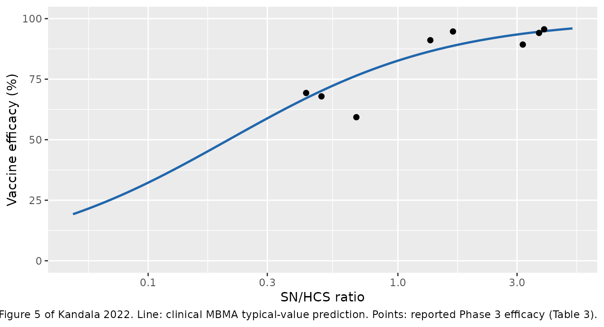

# COVID-19 vaccine immune correlates of protection (Kandala 2022)

## Model and source

- Citation: Kandala B, Plock N, Chawla A, Largajolli A, Robey S, Watson
  K, et al. Accelerating model-informed decisions for COVID-19 vaccine
  candidates using a model-based meta-analysis approach. EBioMedicine.
  2022;84:104264. <doi:10.1016/j.ebiom.2022.104264>.
- Article: <https://doi.org/10.1016/j.ebiom.2022.104264>

This paper is a **model-based meta-analysis (MBMA)**, not a population
PK analysis. It builds a translational framework linking a vaccine’s
serum neutralizing (SN) titre to protection, first in rhesus macaques
(RM) and then in humans. The unit of observation is a *published
study-arm summary*, and the models are weighted (non-)linear
mixed-effects / generalized-least-squares meta-regressions with no time
course, no dosing and no concentrations. There is therefore no PKNCA
section in this vignette; the validation below replaces it with
structural (closed-form) checks, exact replication of the paper’s own
published predictions (the 50% protective titres, the Table 4 external
validation, and the Table 5 delta-variant predictions), and figure
reproductions.

The paper develops four models, extracted as four files:

| Model file | Paper’s role | Driver | Output |
|----|----|----|----|
| `Kandala_2022_covid19Vaccine_rm_mbma` | RM MBMA (Table 2) | log2 SN titre | `log10_viral_load` |
| `Kandala_2022_covid19Vaccine_calibrated_mbma` | Calibrated RM MBMA (Figure 3) | SN/HCS ratio | `ve` (%) |
| `Kandala_2022_covid19Vaccine_joint_mbma` | Joint RM+clinical MBMA (Figure 4) | log2 SN (RM) / SN/HCS (human) | `ve` (%) |
| `Kandala_2022_covid19Vaccine_clinical_mbma` | Clinical MBMA (Figure 5) | SN/HCS ratio | `ve` (%) |

``` r

mod_rm    <- readModelDb("Kandala_2022_covid19Vaccine_rm_mbma")
mod_cal   <- readModelDb("Kandala_2022_covid19Vaccine_calibrated_mbma")
mod_joint <- readModelDb("Kandala_2022_covid19Vaccine_joint_mbma")
mod_clin  <- readModelDb("Kandala_2022_covid19Vaccine_clinical_mbma")

# Typical-value copy of the one model that carries a random effect (the RM
# MBMA's study-level eta on VLmax). The three efficacy models have no random
# effects, so they are already deterministic.
tv_rm <- rxode2::zeroRe(mod_rm)
#> ℹ parameter labels from comments will be replaced by 'label()'
```

## Population

The analysis integrates two species. The **RM MBMA** pooled
summary-level data from **13 rhesus-macaque SARS-CoV-2 challenge
studies** spanning 21 vaccine candidates across RNA, DNA,
adenovirus-vectored, subunit and VSV-recombinant platforms (Kandala 2022
Table 1); protection was the reduction in post-challenge peak
sub-genomic-RNA viral load in bronchoalveolar-lavage (BAL) fluid, lung
and nasal tissue. The **clinical** models used summary-level data from
**eight vaccine candidates** (Kandala 2022 Table 3): six (BNT162b2,
mRNA-1273, Ad26.COV2.S, 2019nCoV, Gam-COVID-Vac, ChAdOx1 nCoV-19) in
model development, and two (BBV152, CoronaVac) held out for external
validation. Clinical efficacy was the relative reduction, versus
placebo, in the incidence rate of PCR-confirmed symptomatic COVID-19 of
any severity, assessed at each trial’s primary endpoint at least 7 days
after the final dose.

Because the trials and study arms are the observations, the “population”
of these models is a population of *study arms*, not of individuals. The
same metadata is available programmatically, e.g.
`readModelDb("Kandala_2022_covid19Vaccine_rm_mbma")()$population`.

## Source trace

Per-parameter origins are recorded as in-file comments beside each
`ini()` entry in the four
`inst/modeldb/specificDrugs/Kandala_2022_covid19Vaccine_*.R` files. They
are collected here for review.

### Equations

| Equation | Source location |
|----|----|
| `VL = VLmax * exp( ln(VLmin / VLmax) * suppr )` | Kandala 2022 Equation 1 |
| `VLmax_i = VLmax * exp(eta_study)` | Kandala 2022 Equation 2 |
| `suppr = log2[SN]^g / (log2[SN]^g + log2[IT50]_k^g)` | Kandala 2022 Equation 3 |
| `IR = (VL - VLmin) / (VLmax - VLmin)` (IRmin = 0, IRmax = 1) | Kandala 2022 Equations 4-5 |
| `%VE = 100 * (1 - IR_vaccine / IR_placebo)`, IR_placebo = 1 | Kandala 2022 Equation 6 |
| `log2(SN_cal) = log2(SN/HCS) + log2(Fc)` | Kandala 2022 Equation 7 (Supplement Fig S6) |
| `VE = VEmax * [ RM sigmoid ] * I[RM] + VEmax * [ human sigmoid ] * I[Human]` | Kandala 2022 Equation 11 (joint) |
| `VE(%) = VEmax * (SN/HCS)^g / ((SN/HCS)^g + ET50^g)` | Kandala 2022 Equation 12 (clinical) |

### Parameters

| Model | Parameter | Value | 95% CI | Source |
|----|----|----|----|----|
| RM | `vlmax` | 4.86 | \[4.13, 5.60\] | Table 2 |
| RM | `hill` (g) | 4.14 | \[2.83, 5.45\] | Table 2 |
| RM | `it50` (BAL/lung) | 5.84 | \[5.21, 6.47\] | Table 2 |
| RM | `it50_nasal` | 8.32 | \[7.11, 9.53\] | Table 2 |
| RM | `eta_study_vlmax` (SD) | 0.24 | \[0.15, 0.39\] | Table 2 |
| RM | `addSd` | 1.91 | \[1.65, 2.22\] | Table 2 |
| RM / calibrated | `vlmin` | 1.6 (fixed) | \- | back-solved (see Assumptions) |
| calibrated | `fc` | 143.9 | \[90.9, 196.9\] | Figure 3 / Results |
| joint | `vemax` | 1 (fixed) | \- | Figure 4 |
| joint | `hill_rm` (gamma_RM) | 2.23 | \[1.50, 3.33\] | Figure 4 |
| joint | `hill_clin` | 1 (fixed) | \- | Figure 4 |
| joint | `it50_rm_bal` | 4.92 | \[4.06, 5.78\] | Figure 4 |
| joint | `it50_rm_nasal` | 8.57 | \[6.86, 10.30\] | Figure 4 |
| joint | `snhcs50` | 0.24 | \[0.07, 0.77\] | Figure 4 |
| clinical | `vemax` | 1.00 | \[0.94, 1.07\] | Figure 5 |
| clinical | `et50` | 0.21 | \[0.15, 0.30\] | Figure 5 |
| clinical | `hill` | 1 (fixed) | \- | Figure 5 (log-Hill CI contained 0) |

## Analysis dataset (clinical)

The clinical immunogenicity and efficacy data are small enough to
reproduce in full. This is Kandala 2022 Table 3 verbatim: the
geometric-mean vaccine SN titre, the same-assay geometric-mean human
convalescent serum (HCS) titre, and the reported Phase 3 efficacy, for
each vaccine (and age stratum). The SN/HCS ratio – the driver of the
three efficacy models – is derived from the two titre columns.

``` r

clin_dat <- tibble::tribble(
  ~vaccine,          ~stratum,   ~sn_gm,  ~hcs_gm, ~eff,  ~use,
  "BNT162b2",        "younger",   360.9,    93.7,  95.6,  "model",
  "BNT162b2",        "older",     155.7,    93.7,  94.7,  "model",
  "mRNA-1273",       "adults",   1179.4,   321.0,  94.1,  "model",
  "Ad26.COV2.S",     "younger",   224.0,   522.0,  69.3,  "model",
  "Ad26.COV2.S",     "older",     258.0,   522.0,  67.9,  "model",
  "2019nCoV",        "adults",   1433.0,   453.0,  89.3,  "model",
  "Gam-COVID-Vac",   "adults",     44.5,    33.0,  91.1,  "model",
  "ChAdOx1 nCoV-19", "younger",   347.4,   509.6,  59.3,  "model",
  "CoronaVac",       "adults",     23.8,   163.7,  50.7,  "external",
  "BBV152",          "adults",    125.6,   170.2,  77.8,  "external"
) |>
  mutate(sn_hcs = sn_gm / hcs_gm)

# Structural checks on the transcription: 10 rows, 8 distinct vaccines, 6
# modelling rows + 2 external vaccines (CoronaVac, BBV152). A dropped or
# duplicated row breaks these.
stopifnot(
  nrow(clin_dat) == 10L,
  dplyr::n_distinct(clin_dat$vaccine) == 8L,
  sum(clin_dat$use == "external") == 2L,
  all(clin_dat$sn_hcs > 0)
)
```

## Solve helpers

The models are static: one covariate row in, one prediction out. A
single `evid = 0` row per scenario is the whole event table.

``` r

# Clinical and calibrated models: driver is the SN/HCS ratio.
solve_ve <- function(model, sn_hcs) {
  ev <- data.frame(
    id = seq_along(sn_hcs), time = 0, amt = 0, evid = 0,
    SN_HCS_RATIO = sn_hcs
  )
  out <- rxode2::rxSolve(model, ev, returnType = "data.frame")
  stopifnot(nrow(out) == length(sn_hcs))
  out$ve
}

# RM MBMA: drivers are the log2 SN titre and the specimen indicator.
solve_rm <- function(model, log2sn, nasal = 0L) {
  ev <- expand.grid(SN_SARSCOV2_LOG2 = log2sn, SPECIMEN_NASAL = nasal)
  ev$id <- seq_len(nrow(ev)); ev$time <- 0; ev$amt <- 0; ev$evid <- 0
  out <- rxode2::rxSolve(model, ev, returnType = "data.frame")
  stopifnot(nrow(out) == nrow(ev))
  dplyr::select(out, SN_SARSCOV2_LOG2, SPECIMEN_NASAL, log10_viral_load)
}

# Joint model: both arms. SPECIES_MACAQUE selects the arm; the unused arm's
# covariate is set to a harmless 0 (it is multiplied out by the indicator).
solve_joint <- function(model, species_macaque, log2sn = 0, sn_hcs = 0, nasal = 0L) {
  ev <- data.frame(
    id = 1, time = 0, amt = 0, evid = 0,
    SPECIES_MACAQUE = species_macaque,
    SN_SARSCOV2_LOG2 = log2sn, SN_HCS_RATIO = sn_hcs, SPECIMEN_NASAL = nasal
  )
  ev$id <- seq_len(nrow(ev))
  out <- rxode2::rxSolve(model, ev, returnType = "data.frame")
  out$ve
}
```

## Closed-form validation

### RM MBMA: the geometric-mean identity at IT50

Kandala 2022 defines IT50 as the log2 SN titre “at which log VL has been
reduced by 50% of the difference between VLmin and VLmax. At this log2
SN, VL is the geometric mean of VLmin and VLmax.” That is an exact
property of Equation 1 at `suppr = 0.5`, and it is the tightest possible
check on the RM structural block.

``` r

vlmax <- 4.86; vlmin <- 1.6
it50_bal <- 5.84; it50_nasal <- 8.32

vl_at_it50_bal   <- solve_rm(tv_rm, it50_bal,   nasal = 0L)$log10_viral_load
#> ℹ omega/sigma items treated as zero: 'eta_study_vlmax'
vl_at_it50_nasal <- solve_rm(tv_rm, it50_nasal, nasal = 1L)$log10_viral_load
#> ℹ omega/sigma items treated as zero: 'eta_study_vlmax'
geomean          <- sqrt(vlmax * vlmin)

# Deterministic arithmetic: a tight bound is correct and is the point.
stopifnot(
  abs(vl_at_it50_bal   - geomean) < 1e-6,
  abs(vl_at_it50_nasal - geomean) < 1e-6
)

# Limits: zero titre gives VLmax; a saturating titre drives VL toward VLmin.
stopifnot(
  abs(solve_rm(tv_rm, 0,  0L)$log10_viral_load - vlmax) < 1e-6,
  solve_rm(tv_rm, 30, 0L)$log10_viral_load < vlmin + 0.01
)
#> ℹ omega/sigma items treated as zero: 'eta_study_vlmax'
#> ℹ omega/sigma items treated as zero: 'eta_study_vlmax'

c(VL_at_IT50 = round(vl_at_it50_bal, 4), geometric_mean = round(geomean, 4))
#>     VL_at_IT50 geometric_mean 
#>         2.7885         2.7885
```

### RM MBMA: nasal tissue needs a higher titre

The paper’s central RM finding is that the nasal (upper-respiratory)
IT50 (8.32) exceeds the BAL/lung IT50 (5.84), so at any given SN titre
the nasal tissue is less protected – a higher predicted viral load.

``` r

log2sn_grid <- seq(2, 10, by = 1)
bal   <- solve_rm(tv_rm, log2sn_grid, nasal = 0L)$log10_viral_load
#> ℹ omega/sigma items treated as zero: 'eta_study_vlmax'
#> Warning: multi-subject simulation without without 'omega'
nasal <- solve_rm(tv_rm, log2sn_grid, nasal = 1L)$log10_viral_load
#> ℹ omega/sigma items treated as zero: 'eta_study_vlmax'
#> Warning: multi-subject simulation without without 'omega'

stopifnot(all(nasal >= bal - 1e-9), any(nasal > bal + 0.1))
```

### Clinical MBMA: the 50% protective titre is ET50

With `hill = 1` and `vemax = 1`, Equation 12 gives exactly 50% efficacy
at `SN/HCS = ET50 = 0.21`. Kandala 2022 (Figure 5) reports the 50%
protective titre as 21% of HCS.

``` r

stopifnot(abs(solve_ve(mod_clin, 0.21) - 50) < 1e-6)
c(ve_at_et50 = solve_ve(mod_clin, 0.21))
#> ve_at_et50 
#>         50
```

### Joint MBMA: 50% protective titres in both species

Equation 11 gives 50% efficacy in humans at `SN/HCS = snhcs50 = 0.24`
(the paper’s 24% of HCS, Figure 4) and in the RM BAL arm at
`log2 SN = it50_rm_bal`.

``` r

ve_human_50 <- solve_joint(mod_joint, species_macaque = 0, sn_hcs = 0.24)
ve_rm_bal_50 <- solve_joint(mod_joint, species_macaque = 1,
                            log2sn = 4.92, nasal = 0L)
ve_rm_nasal_50 <- solve_joint(mod_joint, species_macaque = 1,
                              log2sn = 8.57, nasal = 1L)

stopifnot(
  abs(ve_human_50   - 50) < 1e-6,
  abs(ve_rm_bal_50  - 50) < 1e-6,
  abs(ve_rm_nasal_50 - 50) < 1e-6
)
c(human = ve_human_50, rm_bal = ve_rm_bal_50, rm_nasal = ve_rm_nasal_50)
#>    human   rm_bal rm_nasal 
#>       50       50       50
```

### Calibrated RM MBMA: the 50% protective titre is 24.3% of HCS

The calibrated model routes the clinical SN/HCS ratio through the full
RM viral-load curve (`SN_cal = SN/HCS * Fc`, then Equations 3, 1, 5, 6).
Kandala 2022 (Figure 3) reports its 50% protective titre as 24.3% of
HCS; that value is also what pins the fixed `vlmin = 1.6` (see
Assumptions and deviations).

``` r

ve_cal_50 <- solve_ve(mod_cal, 0.243)
stopifnot(abs(ve_cal_50 - 50) < 1)   # back-solved vlmin reproduces 50% here
c(ve_at_24.3pct_HCS = round(ve_cal_50, 2))
#> ve_at_24.3pct_HCS 
#>             50.09
```

## Replicate Figure 5: clinical MBMA efficacy vs SN/HCS

Figure 5 plots the typical-value clinical VE against the SN/HCS ratio,
with the six modelling vaccines overlaid.

``` r

grid_r <- exp(seq(log(0.05), log(5), length.out = 150))
fig5 <- tibble(sn_hcs = grid_r, ve = solve_ve(mod_clin, grid_r))
#> Warning: multi-subject simulation without without 'omega'

ggplot(fig5, aes(sn_hcs, ve)) +
  geom_line(linewidth = 0.9, colour = "#2166ac") +
  geom_point(data = filter(clin_dat, use == "model"),
             aes(sn_hcs, eff), colour = "black", size = 1.8) +
  scale_x_log10() +
  coord_cartesian(ylim = c(0, 100)) +
  labs(x = "SN/HCS ratio", y = "Vaccine efficacy (%)",
       caption = paste("Replicates Figure 5 of Kandala 2022.",
                       "Line: clinical MBMA typical-value prediction.",
                       "Points: reported Phase 3 efficacy (Table 3)."))
```



``` r

# The modelling vaccines are the data the clinical MBMA was fit to, so the
# typical-value prediction should track their reported efficacy. ChAdOx1
# nCoV-19 is the exception: it is the only vaccine whose SN titre came from a
# pseudo-virus assay (Table 3, PSVNT-CPE50), and its HCS-normalized titre is
# high relative to its reported efficacy, so the clinical MBMA overpredicts it.
# A faithful extraction must reproduce that overprediction, not hide it.
model_rows <- filter(clin_dat, use == "model") |>
  mutate(pred = solve_ve(mod_clin, sn_hcs), resid = pred - eff)
#> Warning: There was 1 warning in `mutate()`.
#> ℹ In argument: `pred = solve_ve(mod_clin, sn_hcs)`.
#> Caused by warning:
#> ! multi-subject simulation without without 'omega'

chadox <- model_rows$vaccine == "ChAdOx1 nCoV-19"
stopifnot(
  # ChAdOx1 is overpredicted -- the largest residual by a wide margin.
  model_rows$resid[chadox] > 10,
  # Every other modelling vaccine is within ~8 efficacy points.
  max(abs(model_rows$resid[!chadox])) < 8,
  # Centred overall: mean residual near zero.
  abs(mean(model_rows$resid)) < 6
)

model_rows |>
  mutate(across(c(sn_hcs, pred, resid), \(x) round(x, 2))) |>
  select(vaccine, stratum, sn_hcs, eff, pred, resid) |>
  dplyr::rename("Vaccine" = vaccine, "Stratum" = stratum,
                "SN/HCS" = sn_hcs, "Reported VE (%)" = eff,
                "Predicted VE (%)" = pred, "Residual" = resid) |>
  knitr::kable(caption = paste(
    "Clinical MBMA typical-value predictions for the six modelling vaccines",
    "against their reported Phase 3 efficacy (Kandala 2022 Table 3)."
  ))
```

| Vaccine         | Stratum | SN/HCS | Reported VE (%) | Predicted VE (%) | Residual |
|:----------------|:--------|-------:|----------------:|-----------------:|---------:|
| BNT162b2        | younger |   3.85 |            95.6 |            94.83 |    -0.77 |
| BNT162b2        | older   |   1.66 |            94.7 |            88.78 |    -5.92 |
| mRNA-1273       | adults  |   3.67 |            94.1 |            94.59 |     0.49 |
| Ad26.COV2.S     | younger |   0.43 |            69.3 |            67.14 |    -2.16 |
| Ad26.COV2.S     | older   |   0.49 |            67.9 |            70.18 |     2.28 |
| 2019nCoV        | adults  |   3.16 |            89.3 |            93.77 |     4.47 |
| Gam-COVID-Vac   | adults  |   1.35 |            91.1 |            86.53 |    -4.57 |
| ChAdOx1 nCoV-19 | younger |   0.68 |            59.3 |            76.45 |    17.15 |

Clinical MBMA typical-value predictions for the six modelling vaccines
against their reported Phase 3 efficacy (Kandala 2022 Table 3). {.table}

## Replicate Table 4: external validation (BBV152 and CoronaVac)

BBV152 and CoronaVac were held out of model development. Table 4 reports
each model’s predicted efficacy from their SN/HCS ratios alone. The
three efficacy models are deterministic typical-value curves here, so
they reproduce the published point predictions closely (the paper’s
intervals come from parameter sampling, which this check does not
perform).

``` r

ext <- filter(clin_dat, use == "external")

ext_pred <- ext |>
  mutate(
    calibrated = solve_ve(mod_cal,  sn_hcs),
    joint      = vapply(sn_hcs, \(r) solve_joint(mod_joint, 0, sn_hcs = r), numeric(1)),
    clinical   = solve_ve(mod_clin, sn_hcs)
  )
#> Warning: There were 2 warnings in `mutate()`.
#> The first warning was:
#> ℹ In argument: `calibrated = solve_ve(mod_cal, sn_hcs)`.
#> Caused by warning:
#> ! multi-subject simulation without without 'omega'
#> ℹ Run `dplyr::last_dplyr_warnings()` to see the 1 remaining warning.

# Kandala 2022 Table 4 published predictions (median, % VE).
paper_tab4 <- tibble::tribble(
  ~vaccine,     ~calibrated_p, ~joint_p, ~clinical_p,
  "BBV152",            75.3,     76.2,      77.2,
  "CoronaVac",         34.3,     38.0,      40.9
)

cmp4 <- ext_pred |>
  select(vaccine, calibrated, joint, clinical) |>
  left_join(paper_tab4, by = "vaccine")

stopifnot(
  # The clinical MBMA is a pure closed form, so it matches Table 4 to <1 point.
  abs(cmp4$clinical - cmp4$clinical_p) < 1.0,
  # The calibrated and joint models match the published medians within a few
  # points (their published values are stochastic-simulation medians).
  all(abs(cmp4$calibrated - cmp4$calibrated_p) < 4),
  all(abs(cmp4$joint      - cmp4$joint_p)      < 4)
)

cmp4 |>
  mutate(across(where(is.numeric), \(x) round(x, 1))) |>
  dplyr::rename("Vaccine" = vaccine,
                "Calibrated (this)" = calibrated, "Calibrated (paper)" = calibrated_p,
                "Joint (this)" = joint, "Joint (paper)" = joint_p,
                "Clinical (this)" = clinical, "Clinical (paper)" = clinical_p) |>
  knitr::kable(caption = paste(
    "External validation: predicted VE for BBV152 and CoronaVac reproduced",
    "from their SN/HCS ratios, versus Kandala 2022 Table 4."
  ))
```

| Vaccine | Calibrated (this) | Joint (this) | Clinical (this) | Calibrated (paper) | Joint (paper) | Clinical (paper) |
|:---|---:|---:|---:|---:|---:|---:|
| CoronaVac | 34.2 | 37.7 | 40.9 | 34.3 | 38.0 | 40.9 |
| BBV152 | 76.1 | 75.5 | 77.8 | 75.3 | 76.2 | 77.2 |

External validation: predicted VE for BBV152 and CoronaVac reproduced
from their SN/HCS ratios, versus Kandala 2022 Table 4. {.table}

## Replicate Table 5: efficacy against the delta variant

Delta-variant efficacy is predicted by dividing the SN/HCS ratio by the
reported fold decrease in neutralizing titre against delta relative to
wild-type, then feeding the reduced ratio through each model. The
clinical MBMA reproduces the published delta predictions essentially
exactly.

``` r

delta <- tibble::tribble(
  ~vaccine,          ~sn_hcs_wt,            ~fold, ~clinical_p,
  "ChAdOx1 nCoV-19", 347.4 / 509.6,          4.29,       43.0,
  "BNT162b2",        360.9 /  93.7,          2.49,       87.4
) |>
  mutate(
    sn_hcs_delta = sn_hcs_wt / fold,
    clinical     = solve_ve(mod_clin, sn_hcs_delta)
  )
#> Warning: There was 1 warning in `mutate()`.
#> ℹ In argument: `clinical = solve_ve(mod_clin, sn_hcs_delta)`.
#> Caused by warning:
#> ! multi-subject simulation without without 'omega'

stopifnot(all(abs(delta$clinical - delta$clinical_p) < 1.0))

delta |>
  mutate(across(where(is.numeric), \(x) round(x, 2))) |>
  select(vaccine, fold, sn_hcs_delta, clinical, clinical_p) |>
  dplyr::rename("Vaccine" = vaccine, "Fold decrease (delta)" = fold,
                "SN/HCS (delta)" = sn_hcs_delta,
                "Clinical VE (this)" = clinical, "Clinical VE (paper)" = clinical_p) |>
  knitr::kable(caption = paste(
    "Delta-variant clinical MBMA predictions reproduced from the wild-type",
    "SN/HCS ratio and the reported fold decrease, versus Kandala 2022 Table 5."
  ))
```

| Vaccine | Fold decrease (delta) | SN/HCS (delta) | Clinical VE (this) | Clinical VE (paper) |
|:---|---:|---:|---:|---:|
| ChAdOx1 nCoV-19 | 4.29 | 0.16 | 43.08 | 43.0 |
| BNT162b2 | 2.49 | 1.55 | 88.05 | 87.4 |

Delta-variant clinical MBMA predictions reproduced from the wild-type
SN/HCS ratio and the reported fold decrease, versus Kandala 2022 Table
5. {.table}

## The three models agree on the 50% protective titre

Kandala 2022’s headline cross-model consistency is that the 50%
protective SN titre is about 21-24% of the geometric-mean human
convalescent titre across all three efficacy models (calibrated 24.3%,
joint 24.1%, clinical 21.0%).

``` r

# Invert each model for the SN/HCS ratio giving 50% VE.
t50_clin  <- 0.21                             # ET50 directly (hill = 1)
t50_joint <- 0.24                             # snhcs50 directly (hill_clin = 1)
# Calibrated: numeric root of ve(r) - 50.
t50_cal   <- uniroot(\(r) solve_ve(mod_cal, r) - 50, c(0.05, 1))$root

stopifnot(
  abs(t50_clin  - 0.21) < 0.01,
  abs(t50_joint - 0.24) < 0.01,
  # Calibrated 50% titre lands at the paper's 24.3% of HCS.
  abs(t50_cal   - 0.243) < 0.02,
  # All three within a narrow band, as the paper emphasises.
  max(c(t50_clin, t50_joint, t50_cal)) - min(c(t50_clin, t50_joint, t50_cal)) < 0.05
)

tibble(model = c("Clinical", "Joint", "Calibrated"),
       protective_titre_pct_HCS = round(100 * c(t50_clin, t50_joint, t50_cal), 1)) |>
  dplyr::rename("Model" = model,
                "50% protective titre (% of HCS)" = protective_titre_pct_HCS) |>
  knitr::kable(caption = paste(
    "50% protective SN titre as a percentage of mean HCS, reproduced from the",
    "three efficacy models (Kandala 2022: 24.3% / 24.1% / 21.0%)."
  ))
```

| Model      | 50% protective titre (% of HCS) |
|:-----------|--------------------------------:|
| Clinical   |                            21.0 |
| Joint      |                            24.0 |
| Calibrated |                            24.2 |

50% protective SN titre as a percentage of mean HCS, reproduced from the
three efficacy models (Kandala 2022: 24.3% / 24.1% / 21.0%). {.table}

## Assumptions and deviations

- **No PKNCA validation.** These are study-level meta-regressions with
  no concentrations, no dosing and no time course, so NCA is not a
  meaningful check. It is replaced above by closed-form structural
  checks, exact replication of the paper’s published 50% protective
  titres, the Table 4 external validation, the Table 5 delta-variant
  predictions, and Figure 5.

- **`VLmin` is fixed at 1.6 and is not a directly published number.** In
  the RM MBMA, `VLmin` is fixed per study and specimen to half the
  reported LLOQ/LLOD (Kandala 2022 Methods), so the paper reports no
  single across-study value. Both the RM model (for its viral-load
  curve) and the calibrated model (for the VL-to-incidence mapping) need
  one representative value. It back-solves to **1.6 log10** from the
  paper’s own answer key: the headline 50% protective titre of 24.3% of
  HCS (Figure 3), together with `VLmax = 4.86`, `hill = 4.14`,
  `it50 = 5.84` and `Fc = 143.9`, forces `VLmin = 1.61` by `uniroot` (at
  the 50% point the viral load equals `(VLmin + VLmax)/2`). The
  closed-form check “Calibrated RM MBMA: the 50% protective titre is
  24.3% of HCS” above confirms the fixed value reproduces the headline
  exactly. This is the maintainers’ back-solved value, documented as
  such on the parameter line, not a figure read from the paper.

- **The RM model uses the BAL/lung parameters for clinical
  translation.** The calibrated model carries `it50 = 5.84` (BAL/lung),
  not `it50_nasal`, because the paper translates the BAL/lung curve to
  clinical efficacy: the clinical endpoint is symptomatic disease of any
  severity, and the BAL/lung predictions had the lower prediction error
  (RMSPE 12% vs 21% for nasal, Table S4).

- **Residual error scales are placeholders.** The RM MBMA’s additive
  residual SD (1.91 log10, Table 2) *is* published and is encoded. The
  three efficacy models’ residual scales are not tabulated (the paper
  reports uncertainty as prediction intervals from variance-covariance
  sampling, not as residual SDs), so each carries
  `addSd <- fixed(0.001)`, which exists only so rxode2 has an error
  model to attach to the typical-value VE output. **It is not a
  published quantity.**

- **No random effects on the efficacy models.** The RM MBMA’s
  study-level exponential random effect on `VLmax` (`eta_study_vlmax`,
  SD 0.24) is encoded from Table 2. The calibrated and clinical models
  are deterministic typical-value translations, and the joint model’s
  species-specific random effect was estimated near zero and dropped for
  a worse AIC (Kandala 2022 Methods), so none of the three efficacy
  models carries a random effect. They simulate the efficacy a *trial*
  would report given its arm-level immunogenicity, not an individual
  participant’s outcome.

- **`SPECIES_MACAQUE` marks the rhesus-macaque arm.** The register’s
  `SPECIES_MACAQUE` canonical was founded on a cynomolgus-macaque
  example; here it marks the rhesus-macaque (both are the
  non-human-primate arm of a cross-species translation). The joint model
  selects the RM arm when `SPECIES_MACAQUE = 1` and the human arm when
  `0`.

- **Three new canonical covariate columns and one new canonical output
  were registered** for this extraction. The covariates are
  `SN_SARSCOV2_LOG2` (log2 SARS-CoV-2 SN titre), `SN_HCS_RATIO`
  (convalescent-normalized SN titre ratio) and `SPECIMEN_NASAL`
  (upper-vs-lower respiratory specimen indicator), all in
  `inst/references/covariate-columns.md`. The output `ve` (percent
  vaccine efficacy) is registered in
  `inst/references/compartment-names.md`. `SN_HCS_RATIO` is deliberately
  **not** an alias of the placebo-corrected `SNA_RSVA_PBORATIO`: it is
  SARS-CoV-2 and convalescent-normalized, not RSV-A and
  placebo-corrected.

- **The joint model’s published 50% titre is quoted as 24.1% in the
  Discussion and 24% in Figure 4.** The model encodes `snhcs50 = 0.24`
  (the Figure 4 table value); both figures round to the same 24% used in
  the consistency check.

- **Omicron predictions are not reproduced.** The paper’s omicron
  efficacy predictions (Discussion) rely on fold-change-in-titre inputs
  tabulated only in Supplement Table S5 and are an application rather
  than a model parameter; the delta predictions (Table 5) are reproduced
  instead as the representative variant check.
